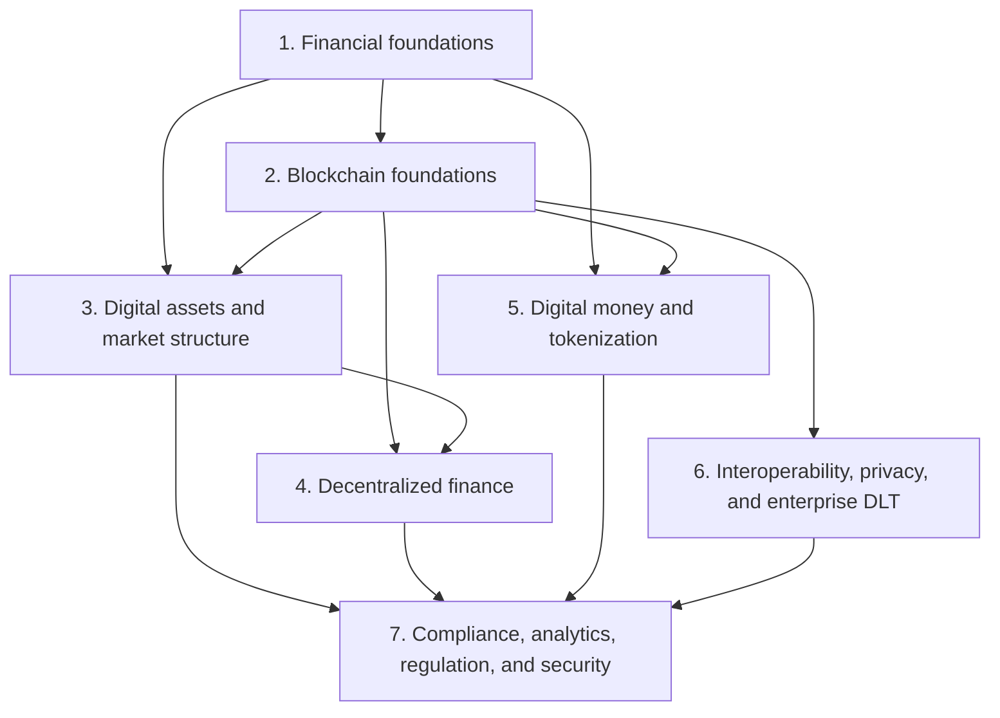

# Blockchain, Digital Assets, Fintech, and Finance

This repository is a depth-first learning knowledge graph and course. It begins
with the financial and technical foundations needed to reason clearly, then
progresses into digital-asset markets, DeFi, digital money, institutional
infrastructure, interoperability, privacy, compliance, and security.

The curriculum is designed for two audiences at once:

- engineers and other technical readers who need finance built from first
  principles; and
- finance professionals who need distributed systems, cryptography, and smart
  contracts built from first principles.

## How the Repository Is Organized

Every learning note lives at two directory levels below `notes/`:

```text
notes/<macro-topic>/<micro-topic>/<canonical-note>.md
```

A macro topic is a major branch of the curriculum. A micro topic is a coherent
subject area within that branch. Markdown files are the canonical teaching units.
They should be long, self-contained, internally structured, and comprehensive
within a clearly stated scope.

Companies and protocols are placed beside the concepts they implement rather
than collected in a generic company directory. This makes the knowledge graph
causal: learn the problem and mechanism first, then study implementations.

## Recommended Learning Path



The numbering suggests a route, not a hard prerequisite chain. Readers can enter
through either finance or technology and follow cross-links when a missing
foundation appears.

## Curriculum and Note Plan

Status labels:

- **Existing — move:** relocate the current note and make only minor corrections
  if it already meets the learning standard.
- **Existing — refactor:** retain accurate material but selectively rewrite,
  merge, split, or remove project-specific content.
- **Migrated:** the current source has been moved to its canonical home and
  refactored where necessary.
- **Authored:** a new canonical note has been researched, written, and added.
- **New:** author the note from scratch.

### 0. Course Guide and Orientation

#### `00-course-guide/01-orientation/`

- **Migrated and expanded — `glossary.md`:** repository-wide reference for
  specialized finance, regulatory, blockchain, infrastructure, protocol, and
  company terminology. Definitions remain concise relative to the canonical
  topic notes and link back to them for full mechanisms and trade-offs.
- The former `introduction-concepts.md` duplicated the glossary and several
  foundation notes, mixed in fast-changing claims, and contained
  project-orchestration material. It is preserved as
  `archive/introduction-concepts.md` and is not part of the course.

### 1. Financial Foundations

#### `01-financial-foundations/01-money-banking-and-payments/`

- **Authored — `money-banking-and-balance-sheets.md`:** forms and functions of money;
  central-bank and commercial-bank money; deposits; credit creation; bank
  balance sheets; reserves; liquidity; solvency; interest rates; and monetary
  transmission.
- **Authored — `payments-clearing-and-settlement.md`:** payment instruments and
  messages; authorization; clearing; gross and net settlement; RTGS; card and
  account-to-account rails; correspondent banking; reconciliation; finality;
  and operational risk.
- **Authored — `cross-border-payments-and-fx.md`:** correspondent chains, nostro and
  vostro accounts, foreign exchange, liquidity, messaging, time zones, fees,
  settlement risk, CLS, and emerging payment models.

#### `01-financial-foundations/02-financial-markets/`

- **Migrated — `financial-market-infrastructure.md`:** retained its teaching
  content, added canonical links and sources, and remains the foundation for
  issuance, trading, clearing, CCPs, CSDs, custody, settlement, DvP, and
  reconciliation.
- **Authored — `securities-and-financial-instruments.md`:** equity, debt, funds,
  derivatives, collateral, repos, securities lending, corporate actions,
  valuation, yield, and the legal/economic rights represented by instruments.
- **Authored — `market-microstructure-and-trading.md`:** order books, quotes, spreads,
  liquidity, brokers, dealers, market makers, exchanges, OTC markets, order
  types, execution quality, price discovery, leverage, margin, and prime
  brokerage.

#### `01-financial-foundations/03-risk-and-regulatory-foundations/`

- **Authored — `financial-risk-management.md`:** credit, market, liquidity,
  counterparty, settlement, model, operational, cyber, legal, and systemic risk;
  controls; stress testing; and risk measurement.
- **Authored — `financial-regulation-compliance-and-accounting.md`:** why financial
  regulation exists; prudential versus conduct rules; KYC/AML; sanctions;
  securities and payments regulation; accounting, capital, and audit concepts.
  Jurisdiction-specific digital-asset rules remain in macro topic 7.

### 2. Blockchain Foundations

#### `02-blockchain-foundations/01-core-architecture/`

- **Migrated — `blockchain-fundamentals.md`:** preserved its strong explanations
  and added canonical links and sources.
- **Migrated — `blockchain-architecture.md`:** retained as the canonical system
  architecture note and linked to the consolidated scaling note.
- **Authored — `cryptography-and-blockchain-data-structures.md`:** hashing, Merkle
  structures, public-key cryptography, signatures, commitments, key derivation,
  authenticated state, tries, and the limits of what cryptography guarantees.

#### `02-blockchain-foundations/02-consensus-and-networks/`

- **Migrated — `consensus-mechanisms.md`:** moved and updated only where accuracy
  or structure required it.
- **Authored — `peer-to-peer-networks-finality-and-forks.md`:** propagation, mempools,
  block production, fork choice, probabilistic and economic finality, reorgs,
  safety, liveness, network assumptions, clients, nodes, and governance.

#### `02-blockchain-foundations/03-execution-and-applications/`

- **Authored — `smart-contracts-virtual-machines-and-token-standards.md`:** execution
  environments, gas, state transitions, contract calls, events, upgradeability,
  account abstraction, token standards, composability, and common failure modes.
- **Authored — `oracles-indexers-and-offchain-data.md`:** the oracle problem, data
  feeds, proof of reserve, automation, indexers, explorers, RPC providers, The
  Graph, Dune, and trust introduced at data boundaries. Chainlink is a principal
  implementation case.

#### `02-blockchain-foundations/04-scaling-and-modularity/`

- **Migrated — `blockchain-scaling-and-modular-architecture.md`:** consolidated
  the former scaling and layers notes into one canonical treatment of layer
  terminology, L1 scaling, channels, sidechains, rollups, sequencers, proofs,
  data availability, shared sequencing, appchains, and modular systems.

#### `02-blockchain-foundations/05-major-blockchains/`

- **Migrated — `bitcoin.md`:** moved, retitled, and date-verified without
  unnecessary rewriting.
- **Migrated — `ethereum.md`:** moved, retitled, and updated against the current
  official Ethereum roadmap.
- **Authored — `alternative-layer-1s-and-appchains.md`:** compare Solana, Avalanche,
  Cosmos, Polkadot, Cardano, Algorand, Sui, Aptos, and representative appchain
  designs by execution, consensus, state, networking, economics, governance,
  interoperability, and decentralization assumptions.

### 3. Digital Assets and Market Structure

#### `03-digital-assets-and-market-structure/01-assets-and-economics/`

- **Authored — `digital-assets-token-taxonomy-and-economics.md`:** native assets,
  utility and governance tokens, security-like claims, wrapped and bridged
  assets, NFTs, token supply, issuance, distribution, vesting, incentives,
  valuation, and legal/economic rights. Stablecoins, deposits, and CBDCs link to
  macro topic 5.

#### `03-digital-assets-and-market-structure/02-centralized-markets/`

- **Authored — `crypto-market-structure-and-centralized-exchanges.md`:** spot and
  derivatives venues, order books, market makers, brokers, prime services,
  on/off-ramps, internal ledgers, proof of reserves, counterparty risk,
  segregation, surveillance, settlement, and failures. Compare Coinbase,
  Kraken, Binance, Gemini, and representative regional venues neutrally.
- **Authored — `coinbase.md`:** company history and structure; retail exchange;
  institutional exchange and Coinbase Prime; custody; Base; stablecoin
  relationship and economics; staking; payments; regulation; financial model;
  architecture that is publicly documented; risks; and major case studies.

#### `03-digital-assets-and-market-structure/03-decentralized-markets/`

- **Authored — `decentralized-exchanges-and-automated-market-makers.md`:** constant
  function market makers, concentrated liquidity, stable-swap curves, routing,
  slippage, impermanent loss, LP economics, governance, MEV, oracle risk, and
  smart-contract risk. Use Uniswap, Curve, Balancer, and CoW Protocol as primary
  implementation cases.
- **Authored — `onchain-order-books-and-derivatives-venues.md`:** central-limit order
  books, perpetual futures, funding, margin, liquidation, insurance funds,
  sequencers, appchains, and hybrid designs through dYdX, Hyperliquid, GMX, and
  comparable systems.

#### `03-digital-assets-and-market-structure/04-wallets-and-custody/`

- **Authored — `wallets-key-management-and-digital-asset-custody.md`:** keys,
  addresses, seed phrases, HD wallets, hot/warm/cold storage, HSMs, MPC/TSS,
  multisig, smart-contract wallets, custody models, segregation, omnibus
  accounts, governance, transaction policies, recovery, and bankruptcy/legal
  ownership.
- **Authored — `institutional-custody-and-wallet-infrastructure.md`:** neutral
  architectural and business-model studies of Fireblocks, BitGo, Copper,
  Anchorage Digital, Taurus, Coinbase Custody, Fidelity Digital Assets, and
  representative bank custodians. Distinguish technology providers from legal
  custodians.

### 4. Decentralized Finance

#### `04-decentralized-finance/01-defi-foundations/`

- **Authored — `defi-architecture-composability-and-governance.md`:** DeFi primitives,
  atomicity, composability, liquidity, governance, token incentives, front ends,
  keepers, oracles, admin keys, upgradeability, decentralization, and the
  relationship between protocols and companies.

#### `04-decentralized-finance/02-onchain-lending/`

- **Authored — `onchain-lending-and-credit.md`:** pooled and isolated markets,
  overcollateralization, utilization and interest-rate models, collateral
  factors, health factors, liquidations, bad debt, flash loans, vault curators,
  uncollateralized and real-world credit, and systemic risk.
- **Authored — `aave.md`:** protocol evolution and architecture, pool model, reserves,
  rates, risk parameters, eMode, isolation, liquidations, flash loans,
  governance, safety mechanisms, GHO, deployments, and failure/risk cases.
- **Authored — `morpho.md`:** Optimizers and current protocol architecture, isolated
  permissionless markets, immutable parameters, LLTV, oracles, interest-rate
  models, vaults and curators, governance, integrations, and risk allocation.
- **Authored — `sky-maker-spark.md`:** MakerDAO-to-Sky history; DAI and USDS creation;
  collateral, vaults, liquidations, savings products, real-world assets,
  governance, Spark lending, token changes, and system risks. Cross-link its
  stablecoin treatment to macro topic 5.
- **Authored — `other-onchain-credit-protocols.md`:** compare Compound, Euler,
  Liquity, Maple, Centrifuge credit markets, and representative lending systems
  on other chains. Promote a protocol to its own file only when the depth
  justifies it.

#### `04-decentralized-finance/03-derivatives-staking-and-yield/`

- **Authored — `onchain-derivatives-structured-products-and-yield.md`:** perpetuals,
  options, synthetics, basis and funding trades, vault strategies, yield sources,
  leverage, recursive positions, and risk.
- **Authored — `staking-liquid-staking-and-restaking.md`:** native staking, liquid
  staking tokens, validator economics, slashing, Lido and Rocket Pool,
  restaking, EigenLayer, liquid restaking, and correlated/systemic risk.

#### `04-decentralized-finance/04-defi-risk-and-failures/`

- **Authored — `defi-risk-security-and-economic-attacks.md`:** smart-contract,
  governance, oracle, liquidity, liquidation, bridge, MEV, stablecoin,
  composability, and operational risks; threat modeling; audits; formal
  verification; monitoring; and carefully sourced incident case studies.

### 5. Digital Money and Tokenization

#### `05-digital-money-and-tokenization/01-stablecoins/`

- **Authored — `stablecoins.md`:** the canonical stablecoin note: definitions,
  issuers and legal claims, issuance and redemption, reserves, collateral and
  stabilization mechanisms, fiat-backed, crypto-backed, synthetic, commodity
  and algorithmic designs, chains and bridging, payments and trading use cases,
  depegs, runs, revenue, regulation, accounting, risks, and comparisons with
  deposits, e-money, tokenized deposits, and CBDCs. Include major examples and
  issuer profiles.
- **Authored — `stablecoin-issuers-and-protocols.md`:** deeper neutral studies of
  Circle/USDC, Tether/USDT, Paxos, Sky/DAI/USDS, Aave/GHO, Ethena/USDe, Liquity,
  PayPal/PYUSD, and other material designs. Split a case into its own file only
  if this note becomes incoherent.

#### `05-digital-money-and-tokenization/02-cbdcs-and-bank-money/`

- **Authored — `central-bank-digital-currencies.md`:** who can issue central-bank
  money; retail and wholesale CBDCs; direct, intermediated, and synthetic
  models; architecture; privacy; monetary policy; financial stability;
  cross-border work; pilots; and comparisons with cash, reserves, deposits, and
  stablecoins.
- **Authored — `tokenized-deposits-and-commercial-bank-money.md`:** the legal claim,
  issuance and redemption, singleness of money, deposit insurance, bank balance
  sheets, interbank settlement, programmability, interoperability, and examples.

#### `05-digital-money-and-tokenization/03-tokenized-assets/`

- **Authored — `tokenization-of-securities-funds-and-real-world-assets.md`:** asset
  representation versus native issuance, legal wrappers, registries, transfer
  restrictions, identity, lifecycle events, custody, cash legs, DvP, atomic
  settlement, liquidity, composability, and risks.
- **Authored — `tokenization-platforms-and-market-case-studies.md`:** Securitize,
  Ondo, Centrifuge, Franklin Templeton, BlackRock BUIDL, JPMorgan platforms,
  Société Générale-FORGE, and other well-documented cases, separated into
  technology, legal structure, distribution, custody, and settlement layers.

### 6. Interoperability, Privacy, and Enterprise DLT

#### `06-interoperability-privacy-and-enterprise-dlt/01-interoperability/`

- **Authored — `blockchain-interoperability-and-bridges.md`:** cross-chain messaging,
  asset transfer, state proofs, lock-and-mint and burn-and-mint, canonical and
  third-party bridges, light clients, multisigs, validator networks, intents,
  atomic swaps, finality, replay protection, liquidity fragmentation, and bridge
  failures.
- **Authored — `layerzero.md`:** endpoints, messaging channels, message libraries,
  decentralized verifier networks, executors, application-selected security,
  omnichain token patterns, trust assumptions, and incidents or limitations.
- **Authored — `interoperability-protocols.md`:** compare Chainlink CCIP, Axelar,
  Wormhole, Cosmos IBC, Polkadot XCM, and other material designs by verification,
  execution, governance, supported systems, and failure model.
- **Covered in the migrated enterprise note:** Hyperledger Cacti's architecture,
  modes, trust model, and relationship to Besu and FireFly remain a substantial
  case study in
  `notes/06-interoperability-privacy-and-enterprise-dlt/03-enterprise-dlt/enterprise-ethereum-and-hyperledger.md`.
  Extract it only if the future generic interoperability note becomes too large;
  do not duplicate the explanation now.

#### `06-interoperability-privacy-and-enterprise-dlt/02-privacy/`

- **Authored — `privacy-and-confidential-computing-for-blockchains.md`:** privacy
  requirements; pseudonymity; zero-knowledge proofs; commitments; MPC; trusted
  execution environments; fully homomorphic encryption; selective disclosure;
  confidential tokens; privacy pools; metadata leakage; and compliance tension.
- **Authored — `zama.md`:** FHE and TFHE foundations, fhEVM architecture, encrypted
  inputs and state, coprocessors, gateways, key management and threshold
  decryption, access control, performance, trust assumptions, use cases, and
  limitations.
- **Authored — `paladin.md`:** Paladin programmable privacy for EVM, privacy groups,
  Pente, Zeto, Noto, notaries, zero-knowledge designs, private state and global
  state, atomic interoperability, governance, deployment, and limitations.

#### `06-interoperability-privacy-and-enterprise-dlt/03-enterprise-dlt/`

- **Migrated — `enterprise-ethereum-and-hyperledger.md`:** retained neutral Besu,
  permissioning, privacy, FireFly, Cacti, identity, operations, and workflow
  explanations; removed project-derived naming and updated the note's framing.
- **Authored — `canton-corda-and-institutional-ledgers.md`:** Digital Asset and Canton,
  Daml, R3 Corda, privacy and synchronization models, asset workflows,
  permissioning, governance, interoperability, and comparison with public-chain
  and enterprise-Ethereum architectures.

### 7. Compliance, Analytics, Regulation, and Security

#### `07-compliance-analytics-regulation-and-security/01-aml-and-blockchain-analytics/`

- **Migrated — `blockchain-analytics.md`:** preserved the technical pipeline,
  transaction graphs, clustering, attribution, exposure, scoring, cross-chain
  tracing, DeFi decoding, monitoring, and model limitations while neutralizing
  purchasing language.
- **Migrated — `chainalysis-and-elliptic.md`:** retained documented architecture,
  products, workflows, APIs, evidence, strengths, and limitations; converted
  the former large-FI assessment and procurement framing into a neutral,
  reproducible technical comparison.
- **Authored — `trm-labs-merkle-science-and-analytics-landscape.md`:** deep studies of
  TRM Labs and Merkle Science plus shorter coverage of Scorechain, Crystal,
  Coinfirm, Arkham, Nansen, and open analytics. Separate compliance intelligence
  from market analytics and onchain data platforms.
- **Authored — `crypto-aml-sanctions-and-travel-rule.md`:** KYC/KYB, wallet and
  transaction screening, sanctions, source of funds, typologies, Travel Rule,
  unhosted wallets, mixers, privacy systems, investigations, SAR/STR workflows,
  evidence, false positives, and the boundary between analytics and legal
  judgment.

#### `07-compliance-analytics-regulation-and-security/02-regulation/`

- **Authored — `digital-asset-regulation.md`:** the regulatory perimeter, asset
  classification, issuance, trading, custody, stablecoins, DeFi, market abuse,
  consumer protection, licensing, prudential treatment, tax, and dated
  jurisdictional comparisons. Use primary legal and regulatory sources.

#### `07-compliance-analytics-regulation-and-security/03-security-and-case-studies/`

- **Authored — `blockchain-smart-contract-and-operational-security.md`:** protocol,
  consensus, bridge, contract, wallet, custody, API, key-management, governance,
  insider, supply-chain, and operational threats; secure development; audits;
  monitoring; incident response; and recovery.
- **Authored — `digital-asset-failures-and-lessons.md`:** sourced post-mortems of
  representative exchange, lender, stablecoin, bridge, protocol, custody, and
  governance failures. Separate observed facts, causal analysis, and lessons.

## Existing Material Migration Map

| Original file | Completed treatment |
|---|---|
| `notes/financial-market-infrastructure.md` | Moved to financial foundations; sources and links added |
| `notes/blockchain-fundamentals.md` | Moved to core architecture; sources and links added |
| `notes/blockchain-architecture.md` | Moved to core architecture and linked to scaling |
| `notes/blockchain-layers.md` | Unique layer concepts absorbed into scaling; duplicate file removed |
| `notes/blockchain-scaling.md` | Renamed and expanded as the canonical scaling/modularity note |
| `notes/consensus-mechanisms.md` | Moved and selectively updated |
| `notes/bitcoin-complete-technical-summary.md` | Moved and retitled as `bitcoin.md` |
| `notes/ethereum-complete-technical-summary.md` | Moved, retitled, and current roadmap facts updated |
| `notes/enterprise-ethereum-stack.md` | Moved, retitled, neutralized, and project-specific naming removed |
| `notes/blockchain-compliance-analytics.md` | Moved and neutralized as the analytics-mechanics note |
| `notes/elliptic-chainalysis.md` | Moved; project/buyer assessment converted to neutral comparison |
| `glossary.md` | Moved to the course guide and expanded into the repository-wide terminology reference |
| `introduction-concepts.md` | Preserved under `archive/`; excluded from the course |

No existing note should be rewritten merely because it is old or is being moved.
Rewrite only when necessary for accuracy, coherence, the learning style, removal
of duplication, or removal of the original research context.

## Rules for Canonical Notes

Each note should:

1. declare its scope and prerequisites;
2. begin with intuition and the real problem being solved;
3. define finance and technical vocabulary before relying on it;
4. explain the internal mechanism, component relationships, lifecycle, and data
   or value flows;
5. cover design alternatives, trade-offs, risks, failure modes, and
   misconceptions;
6. use real systems and companies as neutral implementation cases;
7. distinguish a protocol, its governance, its interfaces, and the companies or
   foundations contributing to it;
8. link to canonical prerequisites and adjacent notes instead of repeating them;
9. date facts that can change; and
10. end with `## References`, prioritizing primary sources, official technical
    documentation, standards, regulators, research papers, audited disclosures,
    and credible independent analysis.

“Comprehensive” does not mean literally final or exhaustive. It means that a
reader can understand and reason about the topic without needing several
fragmentary notes, while sources and cross-links provide routes to further depth.
