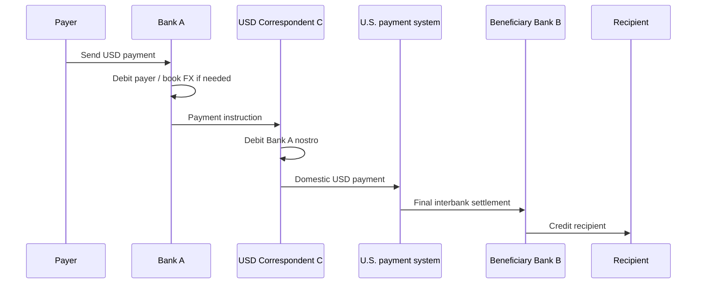
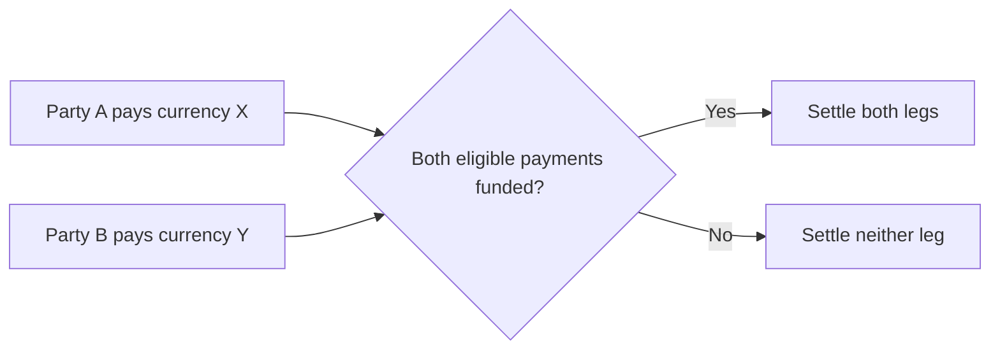

# Cross-Border Payments And Foreign Exchange

A payment becomes cross-border when payer and payee, their payment providers,
or the relevant monetary and legal systems are located in different
jurisdictions. The payment may also require foreign exchange if the payer's
funding currency differs from the currency delivered to the payee.

Cross-border payments are difficult because there is no single global central
bank, commercial-bank ledger, legal framework, identity system, payment rail,
or operating day. A successful transfer coordinates multiple institutions'
balance sheets while satisfying each currency's settlement rules and each
jurisdiction's legal, compliance, data, and consumer-protection requirements.

## Cross-Border Does Not Always Mean Cross-Currency

Four basic cases should be distinguished:

| Payer and payee | Currency | Example | Principal complication |
|---|---|---|---|
| Different jurisdictions | Same | Euro payment between two euro-area countries | Cross-border rules and providers, but no FX |
| Same jurisdiction | Different | Domestic company pays a USD invoice from a EUR base | FX and foreign-currency account access |
| Different jurisdictions | Different | CHF payer sends USD to a U.S. supplier | Cross-border payment plus FX |
| Different jurisdictions | Token reference currency | USDC transfer between wallets | Onchain transfer plus issuer, redemption, and local off-ramp layers |

The location of an IP address or blockchain validator does not by itself
determine the legal payment corridor. Relevant factors include the parties,
providers, accounts, issuers, governing law, currency, and location of regulated
activities.

## The Correspondent-Banking Model

A bank can settle its own currency through its domestic central bank if it has
the necessary access. It usually cannot hold a reserve account at every foreign
central bank. Instead, it may use a **correspondent bank** that has access to the
foreign payment system.

### Nostro And Vostro

The same account has different names depending on perspective:

- **nostro:** "our account with you"—Bank A's asset representing funds held at
  Bank B;
- **vostro:** "your account with us"—Bank B's liability to Bank A.

If a Swiss bank holds a USD account at a U.S. correspondent, the Swiss bank
records a USD nostro asset and the U.S. bank records the matching deposit
liability as a vostro.

### A Simple Correspondent Payment

A customer of Bank A wants to send USD to a beneficiary at Bank B. Bank A lacks
direct U.S. payment-system access but holds USD with Correspondent C.

1. Bank A debits the payer's account or obtains the necessary currency.
2. Bank A sends an authenticated payment instruction.
3. Correspondent C debits Bank A's USD nostro.
4. Correspondent C sends a domestic USD payment to Bank B.
5. Bank B credits the beneficiary after its controls and posting rules.



The message path, compliance path, and money path may not be identical. An
institution can receive a SWIFT message while settlement occurs through reserve
accounts, correspondents, or a private clearing system.

### Serial And Cover Payments

In a **serial payment**, the customer transfer instruction passes through each
bank in the chain, with intermediaries forwarding the instruction and adjusting
settlement balances.

In a **cover payment**, the customer instruction can be sent directly to the
beneficiary bank while a separate interbank "cover" transfer moves the funds
through correspondents. Correctly linking the two message flows is essential
for sanctions screening, transparency, and reconciliation.

### Nested Correspondent Banking

A respondent may offer its own customers or downstream banks indirect access
through a correspondent. The upstream correspondent can therefore face
activity involving entities with which it has no direct relationship. Nested
arrangements increase reach but complicate due diligence, transaction
transparency, sanctions controls, and risk attribution.

## Why Payments Pass Through Multiple Banks

Intermediaries appear because:

- the sending bank lacks access to the destination currency's payment system;
- no direct account relationship exists between the sending and receiving bank;
- liquidity is concentrated with global clearing banks;
- local rules restrict access by foreign or non-bank providers;
- a currency is not directly convertible in the relevant market;
- different institutions perform FX, messaging, clearing, and distribution;
- correspondent networks provide broad reach without every pair of banks
  maintaining bilateral accounts.

The network is economically useful, but each intermediary adds:

- fees and FX margin;
- cutoff and processing time;
- operational dependencies;
- compliance review and possible information requests;
- reconciliation points;
- credit and liquidity exposure; and
- uncertainty about deductions and delivery time.

## Foreign-Exchange Foundations

Foreign exchange is the exchange of one currency for another.

### Currency Pairs And Quotes

An FX rate is quoted as one currency per unit of another. In:

```text
EUR/USD=1.1500
```

one euro, the base currency, costs 1.15 U.S. dollars, the quote currency.

If a company converts €1,000,000 at this rate before fees:

```text
$1{,}150{,}000 = €1{,}000{,}000 × 1.1500
```

The inverse quote is:

```text
USD/EUR = (1) / (1.1500) ≈ 0.869565
```

Quotation conventions differ across currency pairs, so systems must not infer
direction from alphabetical order.

### Bid, Ask, And Spread

A dealer quotes:

- **bid:** price at which it buys the base currency;
- **ask or offer:** price at which it sells the base currency.

If EUR/USD is 1.1498 / 1.1502, the quoted spread is 0.0004 USD per EUR, or four
standard "pips" for this pair.

Customer pricing can include:

- wholesale market spread;
- dealer margin;
- credit and capital cost;
- liquidity and inventory cost;
- payment fees;
- correspondent deductions;
- hedging cost; and
- taxes or regulatory charges.

An advertised zero payment fee does not imply zero total cost if the provider
widens the FX rate.

### Spot, Forward, Swap, And Option

| Instrument | Economic function |
|---|---|
| Spot | Exchange currencies for settlement under the market's spot convention |
| Forward | Fix today the rate for exchange on a future date |
| FX swap | Exchange currencies now and reverse the exchange later at agreed rates |
| Currency swap | Exchange principal and often interest flows over a longer term |
| Option | Right, but not obligation, to exchange under specified terms |

Payment execution and FX execution are distinct. A provider may quote the
customer immediately, hedge later, net flows internally, or execute externally.
This creates market, basis, and timing risk.

## The FX Trade Lifecycle

1. **Request and quote:** counterparties agree currencies, amount, rate, value
   date, and settlement instructions.
2. **Execution:** the trade becomes binding under the applicable venue and legal
   framework.
3. **Capture and confirmation:** both sides record and verify economic terms.
4. **Matching:** settlement instructions are compared.
5. **Funding:** each side positions currency at its correspondent or settlement
   account.
6. **Settlement:** the two currency legs are paid.
7. **Reconciliation:** confirmations, accounts, and internal books are matched.


Operational errors in standing settlement instructions can send funds to the
wrong account even when trade economics are correct. Confirmation and matching
therefore matter independently of pricing.

## FX Settlement Risk

### Principal Risk

FX trades involve two payments. If one currency is paid irrevocably before the
other arrives, the payer risks losing the full principal. This is often called
**Herstatt risk**, after the 1974 failure of Bankhaus Herstatt during the gap
between receipt of Deutsche marks and delivery of U.S. dollars.

Principal risk is much larger than replacement-cost exposure because the entire
currency amount, not merely the trade's change in market value, can be lost.

### Replacement-Cost Risk

If a counterparty defaults before settlement, the surviving party may need to
replace the trade at a worse market rate. Exposure depends on current market
value, not the full principal.

### Liquidity Risk

A counterparty may pay eventually but too late. The recipient may need expensive
emergency funding, miss its own payments, or breach limits.

### Operational And Legal Risk

Incorrect instructions, outages, cyber incidents, time-zone mistakes,
insufficient legal finality, and insolvency rules can delay or invalidate
settlement.

## Payment Versus Payment

**Payment versus payment** (PvP) links the two currency legs so that one settles
if and only if the other settles. This eliminates principal risk within the
scope of the mechanism, although liquidity, operational, participant, and
out-of-scope risks remain.



### CLSSettlement

CLS operates a major multicurrency PvP settlement service. According to CLS,
CLSSettlement covers 18 currencies and, as reported for the first half of 2025,
settled more than USD 7 trillion equivalent per day for direct and indirect
participants. These are provider-reported and time-sensitive figures.

CLS:

- receives matched payment instructions;
- calculates multilateral net funding needs;
- coordinates timed pay-ins through central-bank RTGS systems;
- settles both legs on its own books under PvP rules; and
- makes pay-outs to settlement members.

Multilateral netting dramatically reduces funding compared with paying every
trade gross. This illustrates an important trade-off: more frequent settlement
can reduce exposure duration but also reduce opportunities to net offsetting
flows, increasing liquidity needs.

CLS does not cover every currency, trade type, participant, or settlement time.
Ineligible activity may settle through bilateral correspondents, other PvP
arrangements, prefunding, netting services, or on-us book transfers.

## Time Zones, Operating Hours, And Value Dates

Cross-border payments encounter:

- non-overlapping RTGS hours;
- local holidays;
- weekend differences;
- currency cutoffs;
- daylight-saving changes;
- spot and same-day conventions;
- time needed for compliance review;
- correspondent funding deadlines.

A payment submitted "today" can receive a different value date at each stage.
Continuous customer channels do not imply continuous wholesale settlement.

Extending operating hours can increase overlap, but also requires:

- staff and operational support;
- liquidity outside traditional business hours;
- maintenance-window redesign;
- coordinated incident management;
- access to FX and collateral markets; and
- clear rules for dates and interest.

## Prefunding And Liquidity

Correspondent banking often requires balances to be held in advance across
currencies. These nostro balances provide payment capacity but carry
opportunity cost, credit exposure to the correspondent, forecasting risk, and
operational complexity.

### Liquidity Management Tools

Cross-border payment liquidity is fragmented by currency, correspondent, legal
entity, and time zone. A bank can be solvent in aggregate while lacking the
right currency in the right account before a settlement cutoff. Forecasting,
netting, credit, and payment sequencing reduce idle balances while protecting
timely completion.

- payment-flow forecasting;
- intraday balance monitoring;
- bilateral and multilateral netting;
- payment prioritization;
- automated sweeping;
- intraday credit;
- committed credit lines;
- FX swaps;
- collateral mobilization;
- just-in-time funding; and
- shared or reciprocal liquidity bridges where available.

### Trapped And Fragmented Liquidity

Money can be abundant in aggregate but unavailable:

- in the required currency;
- at the required correspondent;
- within operating hours;
- without breaching limits;
- because collateral cannot move quickly; or
- because compliance review has blocked the payment.

New technology changes messaging and coordination more easily than it changes
the legal and balance-sheet need for liquidity.

## Compliance And Data

Every correspondent sees only part of a payment chain but may carry legal
responsibility for screening and monitoring its own leg. Structured originator,
beneficiary, bank, and purpose data allows controls to distinguish the parties
from intermediaries. Truncation or free-text repair creates delay and can hide
sanctions or fraud risk.

Cross-border payments can require:

- customer and beneficial-owner identification;
- payer and payee information;
- sanctions and embargo screening;
- transaction monitoring;
- purpose-of-payment codes;
- foreign-exchange controls;
- tax or reporting information;
- Travel Rule data where virtual assets are involved;
- data localization and privacy compliance; and
- responses to intermediary information requests.

### False Positives And Repair

Names, addresses, and remittance text may resemble sanctions-list entries.
Poor-quality or truncated data increases false positives and manual review.
Messages may be stopped for missing town, country, account, purpose, or
intermediary information.

ISO 20022 provides richer structured fields, but improvements depend on accurate
source data, consistent implementation, and preservation across the chain.

### Data-Framework Conflict

One jurisdiction may require information transmission while another restricts
cross-border personal-data transfer. Providers need a lawful architecture for
data minimization, retention, access, encryption, and regulatory disclosure.

## Pricing And Transparency

The total cost to the payer and payee can include:

- sender fee;
- correspondent and lifting fees;
- beneficiary-bank fee;
- FX spread or markup;
- card or wallet fees;
- tax;
- cost of delayed availability; and
- deductions from principal.

Transparent pricing identifies:

- exact amount debited;
- exact amount intended and expected to arrive;
- exchange rate and reference rate;
- all known fees;
- who bears shared or intermediary charges;
- expected delivery time; and
- payment status and reason for delay or failure.

The realized cost can remain uncertain in long correspondent chains when
intermediary fees are deducted en route.

## Principal Cross-Border Models

### Traditional Correspondent Chain

Broad reach and mature legal arrangements, but potentially many intermediaries,
prefunding, opaque fees, and variable speed.

### Closed-Loop Network

A provider holds or controls accounts on both sides and updates an internal
ledger before local payout. Speed can improve because the international step is
an internal book transfer, while local bank rails handle funding and
distribution.

### Multilateral Payment Platform

Participants connect to a shared platform with common rules, messaging,
compliance, FX, or settlement arrangements. It can reduce bilateral
integration, but requires governance, legal recognition, access policy, and
liquidity.

### Interlinked Fast-Payment Systems

Domestic instant-payment systems connect through gateways or common schemes.
Interlinking can preserve local rails while enabling cross-border reach.
Challenges include alias resolution, FX, time zones, sanctions controls,
dispute rules, data, and coordinated operations.

### Card Network

Global card schemes provide acceptance, messaging, FX rules, and settlement
arrangements. They offer reach and consumer protections, while pricing and
chargeback economics differ from account-to-account rails.

### Stablecoin Or Tokenized-Money Rail

Value transfers on a shared ledger and can be available continuously. The full
payment still includes:

- acquisition of the token;
- issuer or protocol risk;
- wallet and key management;
- blockchain fees and finality;
- compliance and address screening;
- possible bridging;
- redemption or conversion;
- delivery into a local bank or payment account; and
- local legal and tax treatment.

Moving a stablecoin globally in seconds does not guarantee that recipients can
redeem at par, access banking, or satisfy local requirements.

### CBDC And Unified-Ledger Experiments

Wholesale CBDC, synchronized settlement, and multilateral-ledger experiments
seek to coordinate central-bank money and FX across jurisdictions. They face
policy questions about access, sovereignty, governance, privacy, capital
controls, liquidity, and interoperability with existing systems.

## Atomicity, PvP, And DvP

Atomic execution means linked operations either all occur or none occurs.

- **PvP:** currency X transfers if and only if currency Y transfers.
- **DvP:** securities transfer if and only if payment transfers.
- **atomic swap:** two digital assets exchange through a protocol mechanism.

Atomicity reduces principal risk but can increase liquidity needs because all
assets must be available at the same moment. It also does not remove market
risk before settlement, operational failure, legal uncertainty, or the risk
that one asset is itself unsound.

## Reconciliation Across A Chain

A cross-border provider may need to reconcile:

- customer instruction and quoted FX rate;
- FX execution and hedge;
- payment message and unique transaction identifier;
- nostro debit and correspondent confirmation;
- intermediary deductions;
- beneficiary-bank receipt;
- recipient credit;
- fees and revenue;
- returns or recalls; and
- regulatory reporting.

Every transformation can lose information. Stable end-to-end identifiers,
structured data, status messages, timestamps, and explicit fee records are
critical.

## Common Failure Scenarios

| Failure | Mechanism | Control direction |
|---|---|---|
| Wrong beneficiary | Bad source data or social engineering | Payee verification, confirmation, limits |
| Sanctions hold | Name or entity match | Structured data, review, evidence, escalation |
| Insufficient nostro | Forecast or funding failure | Real-time balances, buffers, credit lines |
| Missed cutoff | Time-zone or processing delay | Routing logic, earlier funding, extended hours |
| FX mismatch | Wrong pair, side, rate, or amount | Trade capture and independent reconciliation |
| Duplicate payment | Retry without idempotency | Unique identifiers and state-aware retry |
| Cover/serial mismatch | Payment and funding messages not linked | Reference integrity and repair workflows |
| Correspondent outage | Critical provider unavailable | Alternate routing and contingency accounts |
| Beneficiary cannot use funds | Local restriction or account issue | Corridor validation and status transparency |
| Stablecoin depeg | Redemption or reserve stress | Asset limits, issuer analysis, redemption paths |

## The G20 Cross-Border Payments Roadmap

The G20 roadmap targets faster, cheaper, more transparent, and more inclusive
cross-border payments. As of July 2026, its quantitative targets retain an
end-2027 horizon. Priority work includes:

- payment-system interoperability and extension;
- more consistent legal, regulatory, and supervisory frameworks;
- cross-border data exchange and harmonized ISO 20022 usage;
- payment-system access;
- longer and better-aligned operating hours;
- increased PvP use;
- API harmonization;
- system interlinking;
- multilateral platforms; and
- consideration of stablecoins and CBDCs.

Progress should be judged by end-user outcomes, not only technology deployment.
A faster message does not help if fees remain opaque, compliance repairs are
manual, recipients lack access, or settlement risk persists.

## Comparing Models

| Dimension | Correspondent banking | Closed-loop provider | Interlinked instant rails | Stablecoin rail |
|---|---|---|---|---|
| Reach | Broad but relationship-dependent | Limited to provider network | Corridor- and scheme-dependent | Chain and wallet reach |
| Settlement | Correspondent and domestic systems | Internal ledger plus local payout | Linked domestic settlement | Onchain token transfer |
| Liquidity | Nostro balances across banks | Provider treasury pools | Scheme and bridge design | Token inventory and redemption |
| FX | Bank/dealer chain | Provider-managed | Embedded provider or auction | Exchange, AMM, or issuer conversion |
| Compliance | Repeated intermediary controls | Centralized provider plus local partners | Coordinated scheme controls | Interfaces, issuers, VASPs, analytics |
| Reversibility | Recall and return processes | Provider rules | Scheme rules | Usually offsetting transfer |
| Main risks | Opacity, cost, delay, correspondents | Provider concentration | Governance and interlink dependency | Issuer, wallet, chain, and off-ramp risk |

## Analytical Checklist

For a cross-border payment, identify:

1. payer and payee jurisdictions;
2. source, settlement, and destination currencies;
3. all regulated providers and intermediaries;
4. message route and money route;
5. nostro/vostro or token balances used;
6. FX provider, quote, hedge, and value date;
7. domestic payment systems at both ends;
8. settlement asset and legal finality at each stage;
9. prefunding and intraday liquidity;
10. sanctions, AML, data, and reporting obligations;
11. total fees and exchange-rate margin;
12. operating hours and cutoffs;
13. status, reconciliation, return, and dispute processes;
14. principal, replacement-cost, liquidity, and operational risks; and
15. behavior during intermediary, currency, or technology failure.

## Connections

- [Money, Banking, And Balance Sheets](money-banking-and-balance-sheets.md)
  explains deposits, reserves, and correspondent claims.
- [Payments, Clearing, And Settlement](payments-clearing-and-settlement.md)
  develops clearing, netting, liquidity, and finality.
- [Market Microstructure And Trading](../02-financial-markets/market-microstructure-and-trading.md)
  explains quotes, dealers, liquidity, and execution.
- [Stablecoins](../../05-digital-money-and-tokenization/01-stablecoins/stablecoins.md)
  evaluates issuer, reserve, redemption, and depeg mechanics.
- [Blockchain Interoperability And Bridges](../../06-interoperability-privacy-and-enterprise-dlt/01-interoperability/blockchain-interoperability-and-bridges.md)
  addresses cross-chain rather than cross-bank movement.

## References

- BIS Committee on Payments and Market Infrastructures,
  [Correspondent banking](https://www.bis.org/cpmi/publ/d147.htm)
- BIS Committee on Payments and Market Infrastructures,
  [Enhancing cross-border payments: building blocks of a global roadmap](https://www.bis.org/cpmi/publ/d194.htm)
- BIS Committee on Payments and Market Infrastructures,
  [Cross-border payments programme](https://www.bis.org/cpmi/cross_border/programme.htm)
- Financial Stability Board,
  [Cross-border payments](https://www.fsb.org/work-of-the-fsb/financial-innovation-and-structural-change/cross-border-payments/)
- Basel Committee on Banking Supervision,
  [Foreign exchange risks](https://www.bis.org/basel_consolidated_guidelines/chapter/RMA/20.htm)
- Global Foreign Exchange Committee,
  [FX Global Code](https://www.globalfxc.org/fx-global-code/)
- CLS, [CLSSettlement](https://www.cls-group.com/publications/clssettlement/)
- CLS and FNA,
  [Reimagining same-day FX](https://www.cls-group.com/insights/innovation/report-reimagining-same-day-fx-exploring-the-case-for-additional-settlement-cycles-shapingfx-series/)
- BIS Committee on Payments and Market Infrastructures,
  [Interlinking fast payment systems to enhance cross-border payments](https://www.bis.org/cpmi/publ/brief7.htm)
- SWIFT, [About ISO 20022](https://www.swift.com/standards/iso-20022)
