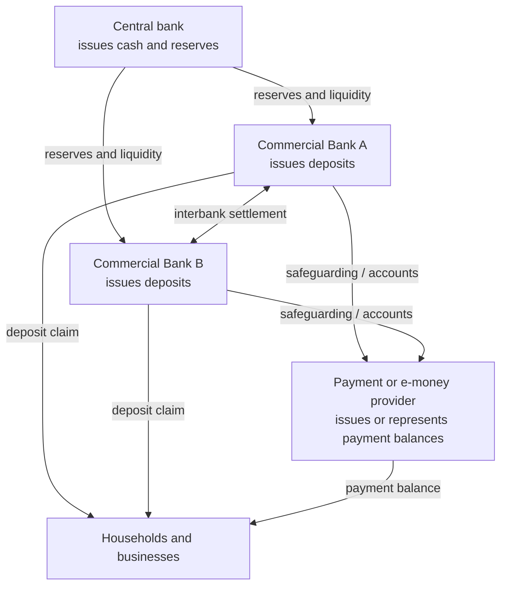
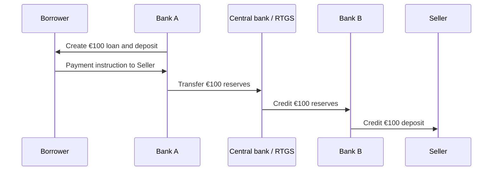
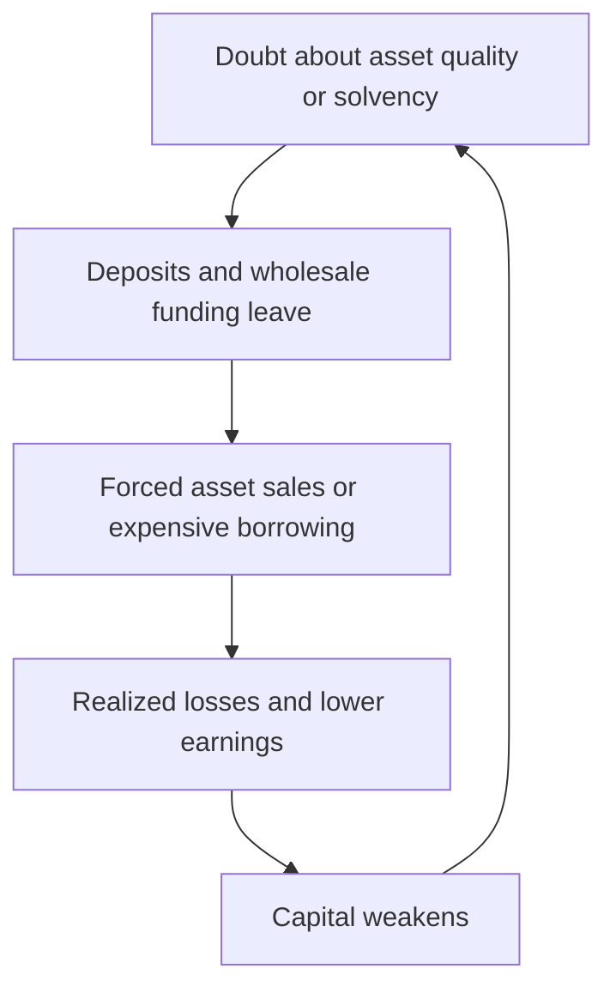

# Money, Banking, And Balance Sheets

Money is not one object. It is a system of transferable claims, settlement
assets, institutions, legal rules, and shared expectations. A banknote, a
commercial-bank deposit, and a central-bank reserve balance can all be
denominated in the same currency while representing liabilities of different
issuers and being available to different users.

Understanding those distinctions is essential before studying stablecoins,
tokenized deposits, central bank digital currencies, custody, lending, or
settlement. A digital representation does not determine what an asset
economically is. The issuer, liability structure, redemption promise, legal
rights, and settlement mechanism do.

## What Money Does

An asset functions as money to the extent that people accept it for three
related purposes:

- **medium of exchange:** it can be transferred for goods, services, assets, or
  discharge of obligations;
- **unit of account:** prices, contracts, taxes, and financial statements can be
  expressed in it; and
- **store of value:** purchasing power can be carried from one time to another.

These functions are matters of degree. A volatile asset may be transferable
but poor as a short-term unit of account. A bank reserve is an excellent
settlement asset for eligible banks but is not normally accessible to
households. A long-dated government bond can store value but is inconvenient
for everyday payment and may fluctuate in price.

Money also coordinates credit. Most modern transactions do not require the
buyer to deliver a physical commodity. They require a trusted system to change
claims on ledgers and to make those changes final.

## Money Is A Liability Relationship

Most financial money is both:

- an **asset** of its holder; and
- a **liability** of its issuer.

If a customer has a €1,000 bank deposit, the customer records a €1,000 asset and
the bank records a €1,000 liability. The bank promises to transfer or redeem
that claim subject to the account contract and applicable law.

Physical commodity money is different because it need not be another entity's
liability. A gold coin can be owned directly. A fiat banknote, by contrast, is
generally treated as a central-bank liability, although it usually does not
promise redemption into a fixed quantity of gold or another commodity.


This balance-sheet symmetry is the starting point for comparing:

- bank deposits with stablecoins;
- tokenized deposits with tokenized money-market fund shares;
- central-bank reserves with wholesale CBDCs;
- custodial exchange balances with assets held directly in a wallet.

## Forms Of Money

### Commodity And Representative Money

**Commodity money** derives substantial value from the material itself, such as
gold or silver. It can carry non-monetary value, but verification, transport,
divisibility, and settlement are costly.

**Representative money** is a claim redeemable for an underlying asset. A
warehouse receipt for a specified quantity of metal is an example. The receipt
is easier to transfer than the metal, but introduces issuer, custody, and
redemption risk.

### Fiat Money

**Fiat money** is denominated and recognized under a sovereign monetary system
without a promise to redeem it for a fixed amount of a commodity. Its
acceptance rests on a combination of:

- the state's designation of the unit of account;
- tax obligations denominated in that unit;
- legal and contractual recognition;
- central-bank monetary policy;
- safe payment and settlement infrastructure;
- regulated institutions that issue private money at par; and
- collective confidence that others will continue to accept it.

Legal-tender rules matter, but they do not alone explain monetary acceptance.
Payment habits, network effects, price stability, convertibility, banking
infrastructure, and state capacity are also central.

### Central-Bank Money

Central-bank money normally has two principal forms:

| Form | Typical holders | Transfer mechanism | Principal role |
|---|---|---|---|
| Notes and coins | Public | Physical delivery | Retail payment and store of value |
| Reserve balances | Eligible financial institutions | Central-bank ledger | Interbank and wholesale settlement |

Cash is a direct public claim within the sovereign monetary system. Reserves
are electronic central-bank liabilities available primarily to eligible
institutions. When two commercial banks settle a payment between them, reserves
often move across the central bank's books.

A central bank can also issue other liabilities, including government deposits
and, depending on its operating framework, term deposits or central-bank
securities. Not every central-bank liability is used as general-purpose money.

### Commercial-Bank Money

Commercial-bank deposits are private liabilities denominated in the sovereign
unit of account. They are widely accepted because they can normally be:

- transferred through payment systems;
- converted into cash at par;
- settled against deposits at other banks;
- supported by bank regulation and supervision;
- protected within defined limits by deposit-guarantee arrangements; and
- ultimately settled between banks in central-bank money.

A deposit is not a segregated pile of the customer's banknotes. It is a claim
against the bank. The bank uses its aggregate funding to hold loans, securities,
reserves, and other assets.

### Non-Bank Payment Money

Electronic-money institutions and payment firms may issue stored-value claims
or provide wallets backed by safeguarded customer funds. Their legal structure
varies. Some issue a direct claim on the payment institution; some hold client
money in safeguarded bank accounts; some merely provide an interface to a bank
deposit.

The distinction matters because safeguarding is not necessarily the same as
deposit insurance, and a payment balance is not necessarily commercial-bank
money even when it is denominated in the same currency.

### Cryptoassets And Stablecoins

A native cryptoasset such as bitcoin has no balance-sheet issuer in the
ordinary sense. Its transfer and issuance rules are enforced by a distributed
protocol. Its market value is not a contractual promise to pay a sovereign
currency amount.

A stablecoin usually does have an issuer or protocol mechanism intended to
maintain a reference value. Its economic nature depends on reserve assets,
redemption rights, legal structure, collateral, governance, and stabilization
mechanism—not merely on the fact that it is a token. These designs are covered
in [Stablecoins](../../05-digital-money-and-tokenization/01-stablecoins/stablecoins.md).

## The Hierarchy And Singleness Of Money

Different issuers' liabilities can circulate as one currency when users expect
them to exchange at par. A €1 deposit at Bank A and a €1 deposit at Bank B are
distinct claims, but payment and settlement arrangements make them appear
economically interchangeable in normal conditions.

This is the **singleness of money**:

> Equal nominal amounts of safe money denominated in the same currency should
> have equal transactional value.

Singleness is supported by:

1. conversion of deposits into cash at par;
2. interbank settlement in central-bank money;
3. access to central-bank liquidity for eligible solvent institutions;
4. prudential regulation, supervision, and resolution;
5. deposit insurance or guarantee schemes; and
6. common payment rules and legal finality.

If claims on one issuer begin trading at a discount, singleness is breaking
down. Stablecoin depegs and distressed-bank deposit runs are different legal
events but share this economic symptom: doubt about par redemption.



## Balance-Sheet Foundations

The basic accounting identity is:

```text
Assets = Liabilities + Equity
```

Assets are resources or claims expected to provide value. Liabilities are
obligations to other parties. Equity, or accounting capital, is the residual
claim:

```text
Equity = Assets - Liabilities
```

Every transaction must preserve the identity. This does not mean every asset is
safe or every liability is immediately payable. Accounting values can also
differ from economic values because of measurement rules, illiquidity, credit
deterioration, and unrecognized gains or losses.

### A Simplified Commercial-Bank Balance Sheet

| Assets | Liabilities and equity |
|---|---|
| Central-bank reserves and cash | Customer deposits |
| Loans to households and firms | Wholesale borrowing |
| Government and private securities | Debt securities issued |
| Reverse repos and interbank claims | Repo and interbank funding |
| Derivatives with positive value | Derivatives with negative value |
| Property and operational assets | Other liabilities |
| | Equity capital |

The bank earns income principally from the spread between returns on assets and
costs of liabilities, plus fees and trading or service income. It incurs credit
losses, operating costs, hedging costs, taxes, and funding costs.

### A Simplified Central-Bank Balance Sheet

| Assets | Liabilities and equity |
|---|---|
| Government securities | Banknotes in circulation |
| Loans to banks | Commercial-bank reserves |
| Foreign reserves | Government deposits |
| Gold or other reserve assets | Central-bank securities or other liabilities |
| | Capital and retained earnings |

Central banks are not ordinary profit-maximizing firms. Their balance sheets are
policy instruments. Asset purchases, lending facilities, collateral rules,
reserve remuneration, and foreign-exchange operations affect financial
conditions and settlement liquidity.

## How Bank Lending Creates Deposits

Commercial banks do not normally wait for an identifiable saver’s deposit and
then pass those exact funds to a borrower. When a bank grants a loan, it records
both:

- a loan asset; and
- a matching deposit liability.

Suppose Bank A approves a €100 loan.

| Bank A | Debit / decrease | Credit / increase |
|---|---:|---:|
| Loan asset |  | €100 |
| Customer deposit liability |  | €100 |

In balance-sheet presentation, both assets and liabilities increase by €100.
New commercial-bank money has been created. The borrower also records a €100
deposit asset and a €100 loan liability, so lending creates money but does not
by itself create net wealth for the borrower.

When principal is repaid from a deposit at the same bank, the bank reduces both
the loan asset and deposit liability. Deposit money is destroyed. Interest
payments are income to the bank and affect equity after expenses and taxes;
they are not simply the reverse of principal creation.

### What Happens When The Deposit Leaves The Bank

If the borrower pays a recipient at Bank B:

1. Bank A reduces the borrower's deposit.
2. Bank B increases the recipient's deposit.
3. Bank A transfers reserves to Bank B through the relevant settlement system.

Bank A created the deposit when it lent, but it must fund the resulting reserve
outflow. It can use existing reserves, incoming payments, wholesale funding,
asset sales, repo, interbank borrowing, or central-bank facilities if eligible.



This is why deposit creation is constrained even though an individual loan does
not mechanically require prior reserves in a one-for-one amount.

## What Constrains Bank Money Creation

Banks cannot create unlimited deposits without consequence. Binding constraints
vary by institution and market conditions.

### Credit Demand And Underwriting

A viable borrower must want credit at the offered price, and the bank must
expect the risk-adjusted return to compensate for default risk, capital use,
funding, operations, and regulation. Weak underwriting creates losses that
consume capital.

### Capital

Equity absorbs losses. Prudential capital requirements relate eligible capital
to risk-weighted exposures and, through leverage requirements, to broader
exposure measures. Higher-risk or concentrated assets generally require more
loss-absorbing capacity.

Capital is not a pool of cash set aside for each loan. It is a financing and
loss-absorption concept. A well-capitalized bank can still face a liquidity
crisis; a liquid bank can still be insolvent.

### Liquidity And Funding

Payments can cause deposits and reserves to leave. Banks manage:

- **funding liquidity:** ability to meet obligations when due;
- **market liquidity:** ability to sell or finance assets without an
  unacceptable price concession; and
- **intraday liquidity:** funds and collateral needed within the operating day.

Stable deposits, wholesale borrowing, secured funding, liquid securities,
central-bank reserves, and contingent facilities all affect lending capacity
and cost.

### Reserve And Settlement Requirements

Reserve frameworks differ. Some jurisdictions impose positive minimum reserve
requirements; others operate with no binding reserve ratio or with abundant
reserves. In all cases, a bank participating in payments must be able to settle
its obligations under the applicable system's rules.

The textbook money-multiplier story—reserves mechanically multiplied into a
fixed quantity of deposits—does not accurately describe modern lending in many
systems. Central banks usually implement policy by setting rates and supplying
reserves consistently with their operating framework, while banks lend subject
to profitability, capital, liquidity, risk, and demand.

### Regulation, Supervision, And Internal Limits

Constraints include large-exposure limits, concentration limits, liquidity
requirements, stress tests, underwriting standards, risk appetite, recovery
planning, consumer-protection rules, and supervisory judgment.

### Profitability And Market Discipline

A loan priced below its funding, capital, expected-loss, and operating costs
destroys value. Depositors, bondholders, shareholders, rating agencies, and
counterparties also respond to perceived weakness by raising funding costs or
withdrawing exposure.

## Capital, Liquidity, And Solvency

These concepts must not be conflated.

| Concept | Core question | Simplified measure | Failure mode |
|---|---|---|---|
| Capital | Can losses be absorbed? | Assets minus liabilities; regulatory ratios | Insolvency after asset losses |
| Liquidity | Can obligations be paid on time? | Liquid resources versus cash outflows | Default despite positive net worth |
| Profitability | Does the business replenish capital over time? | Income minus expenses and losses | Gradual erosion of equity |

### Solvency

A bank is economically insolvent if the realizable value of its assets is below
its liabilities. Accounting statements may reveal this slowly when assets are
held at amortized cost, hard to value, or impaired only after evidence emerges.

### Liquidity

A solvent bank can fail if deposit withdrawals or collateral calls arrive
faster than it can obtain cash. Selling long-duration or illiquid assets under
stress can realize losses, turning a liquidity problem into a solvency problem.

### The Feedback Loop



Deposit insurance, lender-of-last-resort facilities, credible resolution
regimes, and transparent supervision aim to interrupt this loop, but each
creates design trade-offs involving moral hazard, collateral, pricing, and
public risk.

## Reserves Are Not Customer Deposits

Reserves are assets of commercial banks and liabilities of the central bank.
Customer deposits are liabilities of commercial banks. A bank does not assign
particular reserve units to particular customers.

When a customer pays another customer at the same bank, the bank can update its
internal deposit ledger without an interbank reserve transfer. When the payment
crosses banks, settlement changes the banks' reserve or correspondent balances.
The details are developed in
[Payments, Clearing, And Settlement](payments-clearing-and-settlement.md).

## Interest Rates And Bank Economics

### Nominal And Real Rates

The nominal rate is the contracted rate in currency units. A simplified ex post
real rate is:

```text
r_real ≈ r_nominal - π
```

where `π` is inflation over the relevant period. The exact Fisher relation is:

```text
1+r_nominal=(1+r_real)(1+π)
```

Expected inflation, not realized inflation, is relevant when contracts are
priced.

### Yield Curves

A yield curve maps interest rates to maturities for instruments of comparable
credit quality. Rates at longer maturities reflect expected future short rates,
term premia, liquidity, supply and demand, and credit risk where applicable.

Banks often borrow or accept deposits at shorter maturities and hold longer-term
assets. This maturity transformation can earn a spread but creates interest-rate
and liquidity risk.

### Net Interest Income

A simplified expression is:

```text
Net interest income
= interest earned on assets
- interest paid on liabilities
```

The **net interest margin** relates net interest income to average
interest-earning assets. It is affected by asset and liability repricing,
deposit behavior, hedging, yield-curve shape, credit losses, and competition.

### Policy Rates And Transmission

Central banks influence monetary and financial conditions through policy rates,
balance-sheet operations, collateralized lending, reserve remuneration, and
communication. A stylized transmission chain is:


Transmission is neither instantaneous nor uniform. Fixed-rate contracts,
capital-market financing, bank competition, risk perception, expectations,
exchange rates, fiscal policy, and the health of borrower and bank balance
sheets all affect the result.

## Monetary Policy Operations

### Open-Market Operations

The central bank buys, sells, or lends against securities to affect reserves and
short-term rates. A central-bank asset purchase increases the banking system's
reserve balances unless another liability offsets it.

### Standing Facilities

Eligible institutions may borrow from or deposit with the central bank under
specified terms. Facility rates can help bound overnight market rates, although
the exact corridor or floor framework differs by jurisdiction.

### Quantitative Easing And Tightening

Under quantitative easing, a central bank purchases assets at scale, typically
increasing reserves and changing the duration and risk composition held by the
private sector. Intended channels can include lower term premia, portfolio
rebalancing, market-function support, and signaling.

Quantitative tightening reduces or slows the growth of central-bank asset
holdings and associated liabilities. Its effects depend on the operating
framework, reserve demand, government cash balances, money-market facilities,
and market expectations.

### Lender Of Last Resort

A central bank may lend against collateral to eligible institutions facing
temporary liquidity stress. Classic distinctions include:

- liquidity support versus solvency support;
- system-wide facilities versus firm-specific assistance;
- market-value collateral and haircuts;
- ordinary pricing versus penalty-like pricing; and
- public disclosure versus stigma risk.

Central-bank liquidity cannot make economically worthless assets valuable. It
can provide time and prevent forced sales when a fundamentally viable
institution faces a liquidity shock.

## Deposits, Insurance, And Resolution

Deposit insurance protects eligible depositors up to legally defined limits and
conditions. It reduces incentives for destabilizing runs but can weaken depositor
monitoring, which is why it coexists with supervision, capital rules, risk-based
premiums, resolution powers, and limits.

Coverage is jurisdiction-specific. For example, the U.S. FDIC states a standard
maximum of $250,000 per depositor, per insured bank, per ownership category as
of July 2026. Investment products and cryptoassets are not FDIC-insured merely
because a bank distributes or custodies them.

When a bank fails, resolution authorities may:

- transfer insured deposits and sound assets to another bank;
- create a bridge bank;
- sell business lines;
- write down or convert eligible creditor claims;
- use a deposit-insurance fund subject to law; or
- liquidate the residual estate.

The legal ranking of deposits, secured claims, senior and subordinated debt,
capital instruments, and other liabilities affects loss allocation.

## Money, Credit, And Wealth

Money and credit are connected but not identical.

- **Money** is a generally accepted settlement claim or instrument.
- **Credit** is a claim for future payment.
- **Wealth** is the value of assets minus liabilities.
- **Income** is a flow earned over a period.

When a bank creates a loan and deposit, gross financial assets and liabilities
increase together. The borrower can use the deposit to acquire a real asset,
finance production, or consume. Whether wealth is created depends on subsequent
economic outcomes, not on the bookkeeping act alone.

Government deficits, central-bank purchases, loan repayment, defaults, asset
price changes, and cross-border flows affect sectoral balance sheets in
different ways. Consolidating entities can hide important claims: a reserve is
a commercial bank's asset but the central bank's liability; a government bond
held by the central bank may disappear from a consolidated public-sector view
while remaining economically relevant to institutional arrangements.

## Common Misconceptions

| Misconception | More accurate explanation |
|---|---|
| Banks lend out the exact deposits savers placed with them | Lending generally creates a new deposit; banks then manage funding, settlement, capital, and liquidity |
| Banks can create unlimited money | Credit demand, underwriting, capital, liquidity, regulation, profitability, and settlement constrain them |
| Reserves are customer money stored at the central bank | Reserves are commercial-bank assets used chiefly for interbank settlement and liquidity |
| Capital is cash in a vault | Capital is loss-absorbing financing; liquidity is the capacity to pay on time |
| A solvent institution cannot fail | A solvent institution can default if it cannot obtain liquidity when obligations mature |
| All digital currency is the same | The issuer, claim, redemption, legal framework, ledger, and settlement asset determine its nature |
| Stable value means risk-free | Par value can depend on issuer solvency, reserve quality, liquidity, operational controls, and redemption access |
| Money creation automatically creates wealth | A loan creates offsetting assets and liabilities; real wealth depends on productive value and future cash flows |

## Analytical Framework For Any Form Of Money

When evaluating a monetary instrument, ask:

1. **Unit:** What currency or reference asset defines the claim?
2. **Issuer:** Whose liability is it, if anyone's?
3. **Holder:** Who is legally and technically allowed to hold it?
4. **Backing:** What assets, capital, taxing power, or protocol mechanism
   supports it?
5. **Redemption:** Who can redeem, for what, at what price, and on what timing?
6. **Transfer:** Which ledger and payment rules move it?
7. **Settlement:** What event makes a transfer final, and in which asset?
8. **Par:** Why should one unit remain equal to another unit of the currency?
9. **Risk:** Who bears credit, liquidity, market, operational, legal, and cyber
   risk?
10. **Failure:** What happens during a run, insolvency, technical outage, or
    legal dispute?

This framework applies equally to deposits, e-money, stablecoins, tokenized
deposits, CBDCs, exchange balances, and tokenized fund shares.

## Connections

- [Payments, Clearing, And Settlement](payments-clearing-and-settlement.md)
  explains how monetary claims move and become final.
- [Cross-Border Payments And Foreign Exchange](cross-border-payments-and-fx.md)
  explains correspondent balances, currencies, and settlement risk.
- [Financial Market Infrastructure](../02-financial-markets/financial-market-infrastructure.md)
  extends settlement concepts to securities and derivatives.
- [Stablecoins](../../05-digital-money-and-tokenization/01-stablecoins/stablecoins.md)
  compares token issuers and stabilization mechanisms.
- [Central Bank Digital Currencies](../../05-digital-money-and-tokenization/02-cbdcs-and-bank-money/central-bank-digital-currencies.md)
  examines digital access to central-bank liabilities.
- [Tokenized Deposits And Commercial-Bank Money](../../05-digital-money-and-tokenization/02-cbdcs-and-bank-money/tokenized-deposits-and-commercial-bank-money.md)
  applies bank-money principles to distributed ledgers.

## References

- Bank of England, [What is money?](https://www.bankofengland.co.uk/explainers/what-is-money)
- Bank of England, [How is money created?](https://www.bankofengland.co.uk/explainers/how-is-money-created)
- Michael McLeay, Amar Radia, and Ryland Thomas, Bank of England,
  [Money creation in the modern economy](https://www.bankofengland.co.uk/quarterly-bulletin/2014/q1/money-creation-in-the-modern-economy)
- Bank of England,
  [New forms of digital money](https://www.bankofengland.co.uk/paper/2021/new-forms-of-digital-money)
- European Central Bank,
  [Scope of monetary policy](https://www.ecb.europa.eu/mopo/intro/role/html/index.en.html)
- European Central Bank,
  [Transmission mechanism of monetary policy](https://www.ecb.europa.eu/mopo/intro/transmission/html/index.en.html)
- Board of Governors of the Federal Reserve System,
  [What is the difference between a bank's liquidity and its capital?](https://www.federalreserve.gov/faqs/cat_21427.htm)
- Basel Committee on Banking Supervision,
  [Liquidity risk management and supervision](https://www.bis.org/basel_consolidated_guidelines/chapter/LQY/10.htm)
- Federal Deposit Insurance Corporation,
  [Deposit Insurance FAQs](https://www.fdic.gov/resources/deposit-insurance/faq)
- BIS, [Principles for financial market infrastructures](https://www.bis.org/cpmi/publ/d101.htm)

