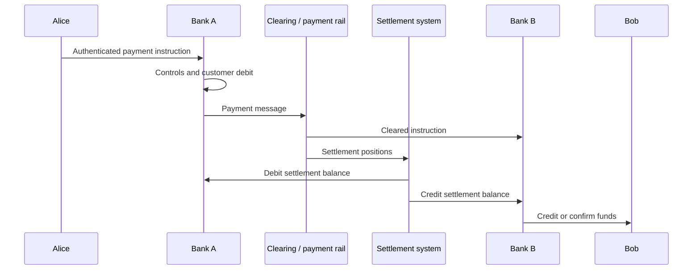
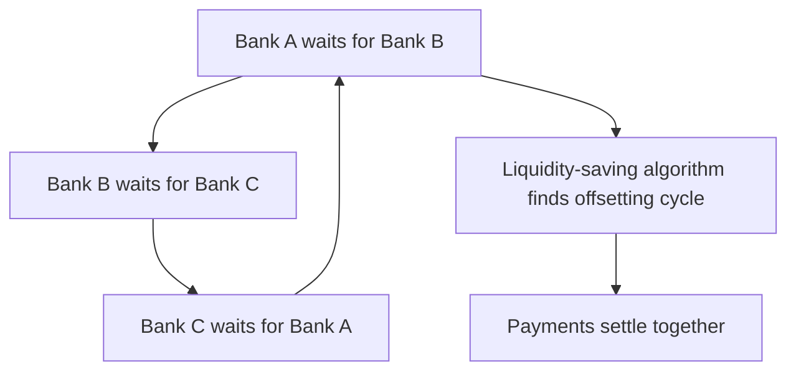
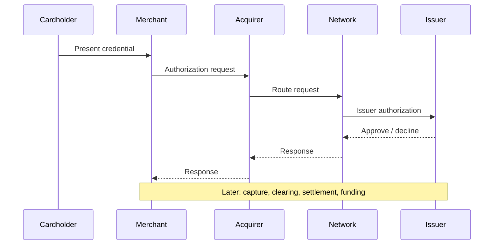
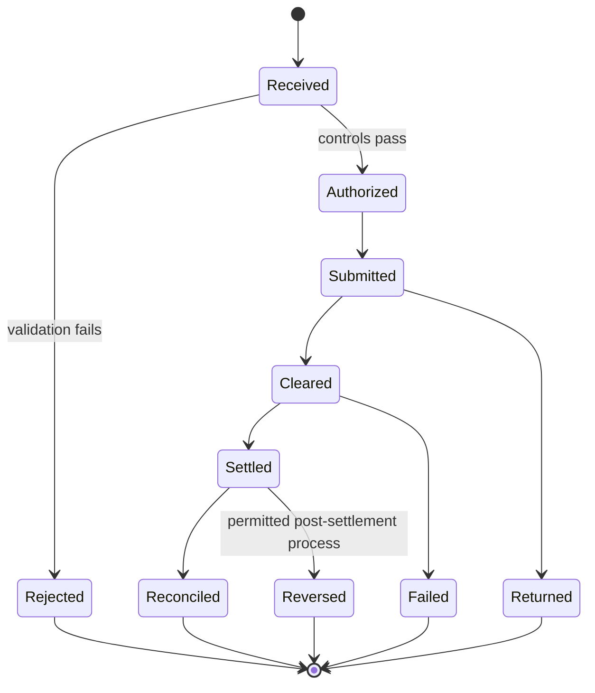

# Payments, Clearing, And Settlement

A payment is not merely a message saying that value moved. It is a coordinated
change in legal obligations and ledger balances. The customer experience may
take seconds, while authorization, fraud controls, clearing, interbank funding,
settlement, reconciliation, returns, and dispute rights continue across several
systems and time periods.

This distinction becomes especially important when comparing bank payments with
blockchain transfers. A ledger can make a token transfer final without making
the token economically equivalent to bank money. Conversely, a customer can see
an immediate bank-account credit before the banks have completed final
interbank settlement.

## The Core Vocabulary

### Payment

A **payment** transfers monetary value or discharges an obligation. It involves
a payer, payee, amount, unit of account, payment instrument, account or wallet,
and a set of legal and operational rules.

### Payment Instrument

A payment instrument is the means by which a payer initiates a transfer. Common
examples include:

- cash;
- card credentials;
- credit transfers;
- direct debits;
- checks;
- e-money wallets;
- instant-payment applications; and
- digital-asset wallet instructions.

The instrument is not necessarily the settlement asset. A card credential
initiates a payment, but interbank obligations may ultimately settle in
central-bank money.

### Payment Message

A payment message carries an instruction or information. It may identify the
payer and payee, accounts, amount, currency, purpose, remittance data,
intermediaries, charges, and compliance information.

Messages coordinate ledger changes but are not themselves money. SWIFT, for
example, provides secure financial messaging; it does not generally hold the
commercial balances being transferred.

### Authorization

Authorization establishes that a payment instruction is permitted. It can
involve:

- customer authentication;
- account and balance checks;
- spending or velocity limits;
- fraud scoring;
- sanctions and compliance controls;
- merchant or payee validation;
- cryptographic signature verification; and
- approval under a corporate mandate.

Authorization does not necessarily mean settlement has occurred or become
final.

### Clearing

**Clearing** is the process of transmitting, reconciling, confirming, and in
some systems netting obligations before settlement. It determines what each
participant must pay or receive.

### Settlement

**Settlement** discharges the obligations created by the payment. Interbank
settlement often occurs by debiting one bank's reserve account and crediting
another's at a central bank.

### Finality

**Finality** is the point at which a transfer becomes irrevocable and
unconditional under the applicable rules and law. Operational completion,
customer availability, accounting finality, and legal settlement finality can
occur at different times.

## A Layered Payment Model

Every payment can be analyzed in layers:

| Layer | Core question |
|---|---|
| User and instrument | How does the payer express intent? |
| Authentication and authorization | Is the instruction genuine and permitted? |
| Messaging | How is the instruction communicated and enriched? |
| Clearing | What obligations result, and are they netted? |
| Settlement | Which asset discharges the obligations? |
| Posting | When do customer and general ledgers update? |
| Reconciliation | Do messages, balances, and confirmations agree? |
| Exception and dispute | How are errors, returns, fraud, and reversals handled? |


The exact sequence varies. In an RTGS transfer, clearing may be minimal and each
instruction settles individually. In a card payment, merchant authorization
usually precedes batch clearing and settlement. In an on-us bank transfer, the
same institution can update both customer accounts internally.

## A Basic Interbank Credit Transfer

Alice at Bank A pays Bob at Bank B.

1. Alice authenticates and submits a payment instruction.
2. Bank A validates the mandate, balance, limits, fraud indicators, and required
   compliance information.
3. Bank A sends a payment message directly or through a clearing system.
4. The system calculates Bank A's obligation to Bank B.
5. Settlement debits Bank A's settlement account and credits Bank B's.
6. Bank B credits Bob according to the scheme's availability rules.
7. Both banks reconcile customer, settlement, and general-ledger entries.

### Simplified Balance-Sheet Effects

Before settlement:

- Bank A owes Alice less after debiting her deposit.
- Bank A owes Bank B, or the clearing system records the obligation.
- Bank B may owe Bob if it has credited him before final settlement.

At final settlement:

- Bank A's reserve or correspondent asset decreases.
- Bank B's reserve or correspondent asset increases.
- the interbank obligation is discharged.



## Gross And Net Settlement

### Real-Time Gross Settlement

In **real-time gross settlement** (RTGS), each accepted payment settles
individually, usually in central-bank money, without waiting for multilateral
netting. Settlement is typically final when the relevant account entries occur.

Advantages include:

- rapid finality;
- lower accumulation of interbank credit exposure;
- clear transaction-level settlement status; and
- suitability for high-value and time-critical payments.

Costs and constraints include:

- substantial intraday liquidity needs;
- dependency on operating hours and participant connectivity;
- potential payment queues when balances are insufficient; and
- concentration of operational importance.

RTGS systems use liquidity-saving mechanisms such as queues, offsetting,
priorities, bilateral or multilateral matching, intraday credit, and collateral.
These techniques reduce liquidity demand without turning the system into a
traditional deferred-net-settlement arrangement.

### Deferred Net Settlement

In a **deferred net settlement** system, payments accumulate and participants
settle net positions at specified times.

If Bank A sends 100 to Bank B while Bank B sends 80 to Bank A, their bilateral
net obligation is 20 rather than two gross payments totaling 180.

For participant `i`, a simplified multilateral net position is:

```text
N_i = Σ_j R_ji - Σ_j S_ij
```

where `R_ji` is value received from participant `j` and `S_ij` is value sent
to participant `j`. A positive `N_i` is a net credit; a negative value is a net
debit.

Netting reduces settlement liquidity and the number or value of transfers, but
creates dependencies:

- positions remain unsettled until the settlement cycle;
- failure by one participant can affect others;
- unwind rules can redistribute exposures;
- loss-sharing and liquidity arrangements may be necessary; and
- legal enforceability of netting is critical.

### Hybrid Systems

Many modern systems combine continuous processing with periodic or rapid
settlement, prefunding, liquidity controls, or offsetting algorithms. The labels
"instant," "real-time," and "gross" should therefore be checked against the
actual rulebook.

## Settlement Assets

The settlement asset determines whose credit risk remains after settlement.

| Settlement asset | Issuer | Typical context | Residual concern |
|---|---|---|---|
| Central-bank reserves | Central bank | Domestic systemically important payments | Operational, legal, and sovereign monetary-system risk |
| Commercial-bank money | Settlement bank | Private schemes, correspondent relationships | Settlement-bank credit and liquidity risk |
| Prefunded scheme balance | Scheme or safeguarded arrangement | Some retail systems | Legal claim, safeguarding, and issuer risk |
| Stablecoin or token | Issuer or protocol | Onchain payment and trading | Redemption, reserve, protocol, and market risk |
| Native cryptoasset | Protocol-defined, no ordinary issuer | Public blockchain transfer | Price, consensus, custody, and finality risk |

Central-bank money is generally preferred for systemically important settlement
because it minimizes credit risk between participants. Access restrictions,
operating design, cross-border availability, and technology can nevertheless
lead systems to use commercial settlement banks or other arrangements.

## Liquidity In Payment Systems

Liquidity is needed at the right place, currency, and time. An institution can
be solvent on an end-of-day basis but unable to settle a payment at noon.

### Sources Of Settlement Liquidity

- opening reserve or settlement balances;
- incoming payments;
- intraday credit from a central bank or settlement bank;
- collateralized borrowing or repo;
- uncommitted or committed credit lines;
- sales or maturities of liquid assets;
- prefunding; and
- payment sequencing and queue optimization.

### Intraday Credit

Intraday credit allows a participant to make payments before incoming funds
arrive. It can reduce gridlock, but creates credit exposure for the provider.
Controls can include collateral, limits, fees, automatic repayment, and
conversion to overnight borrowing if not repaid.

### Payment Gridlock

If every participant waits for incoming funds before sending, payments can
stall even when the system has enough aggregate liquidity. Queue algorithms can
identify offsetting sets of payments and settle them simultaneously.



## Card Payments

A card transaction separates the customer experience from later interbank
settlement.

### Participants

- **cardholder:** uses the card or credential;
- **merchant:** accepts the payment;
- **issuer:** provides the cardholder's account or credit;
- **acquirer:** provides acquiring services to the merchant;
- **card network:** routes messages and applies scheme rules;
- **processor or gateway:** provides technical processing;
- **settlement banks:** hold accounts used to discharge obligations.

Some firms perform several roles.

### Lifecycle

1. **Authentication:** credential, device, PIN, biometrics, or risk-based
   methods help establish cardholder legitimacy.
2. **Authorization:** the merchant sends a request through the acquirer and
   network to the issuer; the issuer approves or declines.
3. **Capture:** the merchant submits the completed transaction.
4. **Clearing:** transaction records are exchanged and scheme fees and positions
   calculated.
5. **Settlement:** issuers and acquirers settle their net obligations.
6. **Merchant funding:** the acquirer credits the merchant, less agreed fees.
7. **Billing and repayment:** debit accounts are posted or credit balances later
   billed and repaid.



Authorization reserves or confirms capacity but is not final settlement.
Reversals, refunds, chargebacks, fraud claims, and cardholder protections can
alter the economic result later.

### Card Economics

The merchant service charge can include:

- interchange paid in the issuing side of the system;
- scheme or network fees;
- acquiring and processing margin;
- fraud and chargeback costs;
- gateway or value-added service fees; and
- currency-conversion costs.

Fee structure varies by jurisdiction, card type, merchant, channel, and
regulation.

## Account-To-Account Payments

### Credit Transfers

The payer instructs its provider to push funds to the payee. Examples include
payroll, bank transfers, and many instant payments.

### Direct Debits

The payee or creditor initiates collection under a mandate from the payer.
Direct debits are useful for recurring bills but require mandate management,
presentment rules, return rights, and consumer protections.

### Automated Clearing Houses

ACH systems commonly process batches of credit and debit entries and settle net
positions on value dates. Modern ACH services may offer several windows per day
or faster availability, but return and exception rules remain important.

### Instant Payments

Instant payment systems generally aim to provide:

- near-real-time end-to-end processing;
- immediate or near-immediate recipient availability;
- continuous or extended operating hours;
- rapid confirmation to both sides; and
- final or strongly protected interbank settlement.

Designs vary:

| Design dimension | Possible approaches |
|---|---|
| Settlement | Individual RTGS, frequent net settlement, prefunded positions |
| Access | Direct banks only, tiered PSP access, sponsored access |
| Addressing | Account number, alias, phone, email, QR code |
| Fraud control | Pre-authorization scoring, confirmation of payee, limits |
| Liquidity | Central-bank accounts, prefunding, bridge accounts |
| Availability | 24/7/365 or extended hours |
| Finality | Immediate legal finality or scheme-defined protection |

Speed compresses the time available to detect fraud and recover mistaken
payments. Strong identity, payee confirmation, behavioral analytics, limits,
and rapid information sharing become more important, not less.

## Checks And Cash

### Checks

A check is an instruction to the payer's bank to pay a specified amount.
Modern check processing often uses electronic images and data rather than
physical transport. Presentment, funds availability, returns, endorsement, and
fraud rules determine when provisional credits become reliable.

### Cash

Cash settles by physical delivery and can provide immediate peer-to-peer
finality without a network connection. It offers practical privacy but creates
transport, theft, counterfeit, storage, and denomination costs. Depositing cash
into a bank converts central-bank physical money into a commercial-bank deposit
claim.

## Messaging Standards And ISO 20022

Payment systems require shared syntax and meaning. A message standard defines
fields, data types, identifiers, and business semantics.

ISO 20022 is an open standard and methodology for structured financial
messages. Payments commonly use message families such as:

- `pain`: payment initiation;
- `pacs`: clearing and settlement;
- `camt`: cash management, reporting, and investigation.

Richer structured data can improve:

- straight-through processing;
- reconciliation;
- beneficiary and remittance information;
- sanctions and AML screening;
- exception handling;
- analytics; and
- interoperability between systems.

Adopting the same syntax does not automatically create semantic or operational
interoperability. Communities can use different implementation guidelines,
required fields, identifiers, character sets, business rules, and legal
frameworks. Mapping structured data into legacy free-text formats can lose
information or create truncation.

## Reconciliation

Reconciliation proves that records describing the same economic activity agree.
At minimum, a payment provider may compare:

- channel and customer instructions;
- payment-engine records;
- clearing acknowledgements;
- settlement-account entries;
- customer subledger postings;
- general-ledger balances;
- fee records; and
- confirmations from correspondents or schemes.

### Common Breaks

- duplicate or missing messages;
- inconsistent amount or currency;
- late or rejected settlement;
- incorrect value date;
- unmatched return or reversal;
- fee differences;
- account mapping errors;
- time-zone or cutoff mismatch;
- partial processing after an outage; and
- ledger posting without corresponding settlement.

Good design uses immutable identifiers, idempotent processing, explicit state
machines, timestamps, reason codes, retry policies, and complete audit trails.

### A Payment State Machine



The permissible transitions depend on the rail. A blockchain transaction may
move from pending to confirmed and then be affected by a reorganization. A card
payment can settle and later be charged back. A final RTGS transfer can be
economically returned only through a new payment, not by erasing the original
final transfer.

## Finality Is Multidimensional

### Technical Finality

The processing system no longer expects the state to change under its protocol.
In deterministic BFT systems this may follow a quorum decision; in
proof-of-work systems confidence grows with confirmations.

### Settlement Finality

The transfer of the settlement asset becomes irrevocable and unconditional
under the system rules.

### Legal Finality

Applicable law recognizes the transfer and protects it from reversal, including
where insolvency law might otherwise unwind transactions.

### Customer Finality

The payee can use the funds and has limited practical risk that the credit will
be revoked.

These moments can differ. "Instant" should always be unpacked into:

- instant message?
- instant customer notification?
- instant availability?
- instant interbank settlement?
- instant legal finality?

## Returns, Refunds, Reversals, And Chargebacks

These terms are not interchangeable.

| Mechanism | Typical meaning |
|---|---|
| Rejection | Instruction never enters normal processing |
| Return | Receiving or paying side sends value back under scheme rules |
| Recall | Sender requests recovery; success may require consent |
| Reversal | Corrective entry cancels or offsets an earlier entry under permitted rules |
| Refund | Merchant or payee initiates repayment |
| Chargeback | Card scheme reallocates a disputed transaction under its rules |

Irrevocable settlement can coexist with refunds: the original transfer remains
final, while a separate transfer moves value back.

## Payment Risk

### Credit And Settlement Risk

A participant may fail after obligations arise but before settlement.
Principal risk exists if one side delivers value without receiving the
countervalue.

### Liquidity Risk

A participant may be unable to settle on time even if ultimately solvent.
Liquidity shocks can propagate through queued payments and withheld incoming
funds.

### Operational And Cyber Risk

Hardware, software, network, third-party, data, access-control, or human failure
can disrupt payments. Because payment systems are highly connected and
time-sensitive, resilience requires redundancy, tested recovery, capacity
management, cyber controls, and manual contingencies.

### Fraud Risk

Fraud includes stolen credentials, authorized push-payment scams, account
takeover, synthetic identities, merchant fraud, mule accounts, check fraud, and
social engineering. Whether a payment was technically authorized does not
settle questions of deception, consumer liability, or reimbursement.

### Legal And Compliance Risk

Unclear finality, invalid mandates, privacy violations, sanctions breaches,
consumer-protection failures, and conflicting jurisdictional rules can affect
payment validity or liability.

### Systemic Risk

A participant, settlement bank, critical service provider, or infrastructure
failure can prevent many institutions from meeting obligations, amplify
liquidity hoarding, and affect the real economy.

## Operational Resilience

A critical payment service needs:

- multiple availability zones or sites;
- tested failover and recovery;
- accurate replication and recovery points;
- secure key and credential management;
- denial-of-service protection;
- dependency mapping;
- capacity for peak and stress volumes;
- incident detection and coordinated communication;
- alternative channels or manual procedures;
- reconciliation after recovery; and
- exercises covering participant and third-party failure.

Availability alone is insufficient. A system that stays online while producing
incorrect, duplicate, or unreconciled payments is not resilient.

## Comparing Bank Payments And Blockchain Transfers

| Dimension | Conventional payment rail | Public blockchain |
|---|---|---|
| Ledger operators | Banks, central bank, scheme, processors | Distributed validators or miners |
| Identity | Account and institution identity | Primarily keys and addresses, with overlays |
| Settlement asset | Deposits, reserves, or scheme balance | Native asset or token |
| Finality | Rule- and law-defined | Protocol and economic finality plus applicable law |
| Availability | Rail-specific hours | Often continuous, subject to network conditions |
| Reversibility | Returns and disputes under scheme rules | Usually new offsetting transaction; keys or contracts may add controls |
| Privacy | Data shared among defined intermediaries | Public state by default on many chains |
| Error handling | Mature exception workflows | Application-specific and often limited |
| Compliance | Institution and rail controls | Wallet, interface, issuer, and analytics layers |

Neither model is universally superior. The relevant questions concern the
asset, participants, risk, legal rights, performance, privacy, governance,
interoperability, and failure recovery.

## Analytical Checklist

For any payment system, determine:

1. Who can participate directly and indirectly?
2. What instrument initiates payment?
3. How are payer authority and payee details verified?
4. Which messages and identifiers are used?
5. When are accounts debited and credited?
6. Does clearing occur gross or net?
7. What asset settles the obligation?
8. When does legal finality occur?
9. Is recipient availability provisional?
10. How are liquidity and participant default managed?
11. What returns, recalls, refunds, or disputes are possible?
12. How are records reconciled?
13. Which parties see personal and transaction data?
14. What happens during an outage or cyber incident?
15. Which legal rules allocate loss?

## Connections

- [Money, Banking, And Balance Sheets](money-banking-and-balance-sheets.md)
  explains the claims and settlement assets being transferred.
- [Cross-Border Payments And Foreign Exchange](cross-border-payments-and-fx.md)
  adds correspondent chains, currency conversion, time zones, and PvP.
- [Financial Market Infrastructure](../02-financial-markets/financial-market-infrastructure.md)
  applies related concepts to securities clearing, CCPs, CSDs, and DvP.
- [Peer-To-Peer Networks, Finality, And Forks](../../02-blockchain-foundations/02-consensus-and-networks/peer-to-peer-networks-finality-and-forks.md)
  explains protocol finality and reorganizations.

## References

- BIS Committee on Payments and Market Infrastructures,
  [CPMI glossary](https://www.bis.org/cpmi/publ/d00b.htm)
- CPSS-IOSCO,
  [Principles for financial market infrastructures](https://www.bis.org/cpmi/publ/d101.htm)
- European Central Bank,
  [Payments and markets glossary](https://www.ecb.europa.eu/services/glossary/html/act7c.en.html)
- Board of Governors of the Federal Reserve System,
  [Fedwire Funds Service assessment](https://www.federalreserve.gov/paymentsystems/fedfunds_coreprinciples.htm)
- Board of Governors of the Federal Reserve System,
  [National Settlement Service](https://www.federalreserve.gov/paymentsystems/natl_about.htm)
- Board of Governors of the Federal Reserve System,
  [Fedwire Securities Service](https://www.federalreserve.gov/paymentsystems/fedsecs_about.htm)
- SWIFT, [About ISO 20022](https://www.swift.com/standards/iso-20022)
- BIS Committee on Payments and Market Infrastructures,
  [Fast payments: enhancing the speed and availability of retail payments](https://www.bis.org/cpmi/publ/d154.htm)
- BIS Committee on Payments and Market Infrastructures,
  [Reducing the risk of wholesale payments fraud related to endpoint security](https://www.bis.org/cpmi/publ/d178.htm)
