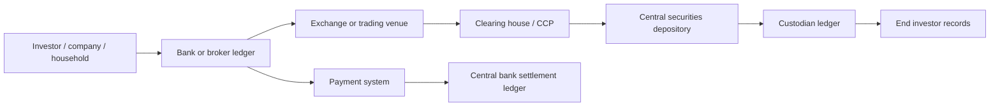
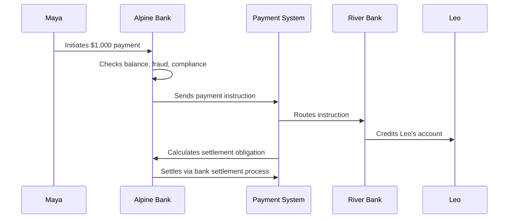
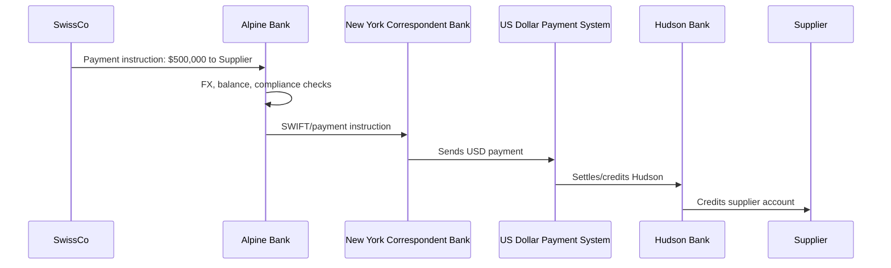
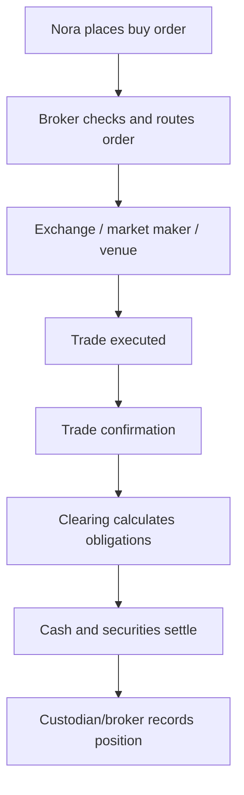
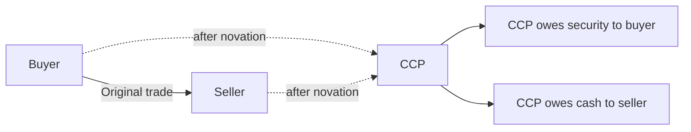
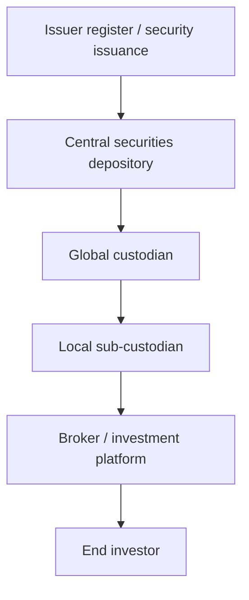
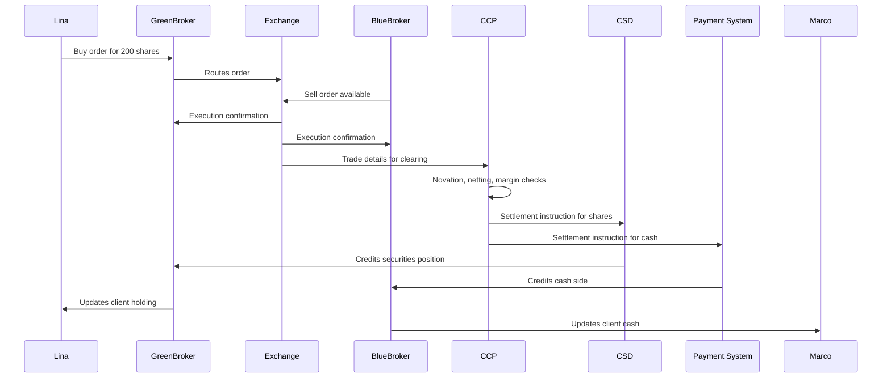
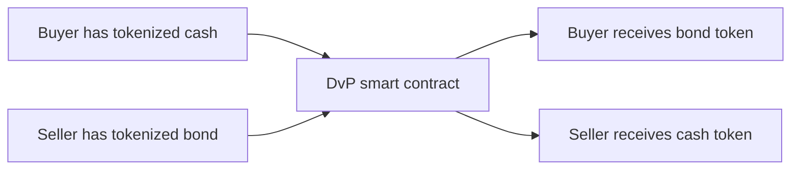

# Financial Market Infrastructure

Financial market infrastructure is the set of institutions, ledgers, networks, legal rules, and operating processes that let money and financial assets move safely between people and institutions.

Most of finance is not just "buyers meet sellers." A trade or payment only becomes economically meaningful when the system can prove who owns what, who owes what, which obligations are final, and what happens if someone fails before the transaction is complete. This hidden machinery is financial market infrastructure.

For digital assets, this topic is foundational. Blockchains, stablecoins, CBDCs, tokenized deposits, and tokenized securities are all attempts to redesign some part of financial market infrastructure: ledgers, settlement assets, asset records, payment rails, reconciliation, or the legal/technical connection between them.

## The Core Idea

At the simplest level, finance is a system of promises and records.

If Alice pays Bob $100, the visible story is simple: Alice had money, Bob received money. Underneath, several ledgers may change. Alice's bank reduces Alice's deposit balance. Bob's bank increases Bob's deposit balance. The banks may later settle the net amount they owe each other using central bank money. Payment messages, fraud checks, compliance systems, and settlement processes all coordinate to make this possible.

The same pattern appears in securities markets. If Alice buys a share of a company from Bob, the visible story is again simple: Alice bought, Bob sold. Underneath, the trading venue matches the order, a broker records the client trade, a clearing process calculates obligations, a central securities depository updates ownership records, and cash moves through payment systems.

Financial market infrastructure exists because high-volume finance needs more than bilateral trust. It needs shared operational procedures for:

- recording ownership;
- moving money;
- moving securities;
- managing counterparty risk;
- netting obligations;
- enforcing legal finality;
- recovering from failures;
- producing audit trails for institutions and regulators.

The main intuition is that financial infrastructure is not one database. It is a network of many specialized ledgers that must agree often enough for the system to function.

The diagram is simplified, but it shows the important shape: financial transactions pass through specialized institutions, each responsible for a different type of record or risk.

> **Important distinction:** A payment message is not the same as settlement. A trade confirmation is not the same as legal ownership transfer. A brokerage app balance is not always the same thing as the final settlement record.

## The Main Actors

Financial infrastructure is easier to understand if each institution is seen as owning a specific problem.

| Actor | Main role | The problem it solves | Simple example |
|---|---|---|---|
| Central bank | Issues central bank money and operates or oversees core payment settlement | Gives banks a final settlement asset | The Federal Reserve, ECB, SNB |
| Commercial bank | Holds customer deposits, makes loans, connects customers to payment systems | Lets households and firms use bank money | A company pays suppliers from its bank account |
| Payment system | Routes and settles payment obligations | Moves money between banks | ACH, Fedwire, TARGET services |
| Broker | Gives clients access to markets | Lets clients buy/sell securities | A retail investor uses a brokerage account |
| Dealer | Trades for its own account, often providing liquidity | Stands ready to buy/sell assets | A bond dealer quotes prices to clients |
| Exchange | Organizes trading and price discovery | Matches buyers and sellers under rules | A stock exchange order book |
| Market maker | Quotes buy and sell prices | Improves liquidity and tighter spreads | A firm continuously quotes ETF prices |
| Clearing house / CCP | Calculates and guarantees trade obligations | Reduces counterparty risk after trading | A CCP stands between buyer and seller |
| CSD | Maintains official securities records and settlement system | Records final ownership of securities | A central securities depository |
| Custodian | Safekeeps client assets and maintains records | Lets investors hold assets through institutions | A pension fund's global custodian |
| Trade repository | Collects transaction data | Gives regulators market visibility | Derivatives reporting database |

These roles can be combined inside one corporate group, but conceptually they are different. A bank can also be a custodian. A broker-dealer can act as both broker and dealer. An exchange group may own a clearing house. The important thing is the function, not just the company name.

## Money: The Settlement Foundation

Before securities or tokenization make sense, the hierarchy of money has to be clear.

Money is not only physical cash. In modern finance, most money is ledger money: balances recorded as liabilities of some institution. A bank deposit is money for the customer, but it is legally the bank's promise to pay. Central bank reserves are money for banks, but ordinary households usually cannot hold them directly.

| Form of money | Issuer / liability of | Who usually holds it | Why it matters |
|---|---|---|---|
| Cash | Central bank / state monetary authority | Public | Direct public money, physical settlement |
| Central bank reserves | Central bank | Commercial banks and some financial institutions | Final interbank settlement asset |
| Commercial bank deposits | Commercial bank | Households, firms, investors | Main everyday money used in bank accounts |
| E-money balances | Regulated payment/e-money institution | Consumers and firms | Payment balances backed by safeguarded funds |
| Stablecoins | Private issuer or protocol | Crypto users, firms, traders | Tokenized money-like claims used on-chain |
| Tokenized deposits | Commercial bank | Bank clients on ledger-based systems | Deposit claims represented as tokens |

The safest settlement asset in a currency system is normally central bank money because it is a direct claim on the monetary authority. Commercial bank deposits are convenient and widely trusted, but they still involve bank credit risk, mitigated by regulation, supervision, liquidity rules, and deposit insurance where applicable.

### Fake Scenario: A Simple Bank Payment

Maya banks with Alpine Bank. Leo banks with River Bank. Maya sends Leo $1,000 for freelance work.

From Maya's point of view, this feels like one action in an app. Underneath, there are at least three layers:

- Alpine Bank reduces Maya's deposit balance by $1,000.
- River Bank increases Leo's deposit balance by $1,000.
- Alpine Bank and River Bank settle what they owe each other, often through a payment system that ultimately uses central bank money or a net settlement arrangement.

If Alpine and River process thousands of payments between their customers during the day, they may not settle every payment one by one. Instead, they can net obligations. If Alpine customers send River customers $10 million, and River customers send Alpine customers $8 million, Alpine may only need to settle a $2 million net obligation.

This example shows a recurring financial infrastructure pattern: customer-facing balances can update before, during, or after interbank settlement depending on the system design and risk rules.

## Payments

A payment system moves monetary value. It may be fast for the user, but the underlying settlement design determines risk, liquidity needs, cost, and finality.

Payments involve several distinct actions:

- **Instruction:** one party tells its bank or payment provider to pay another party.
- **Authentication:** the system verifies the payer is authorized.
- **Screening:** fraud, sanctions, AML, and operational checks may run.
- **Clearing:** obligations are calculated, sometimes netted.
- **Settlement:** final money movement occurs between institutions.
- **Notification:** parties receive confirmation.

These steps can happen nearly instantly or over hours/days depending on the rail. The important learning point is that user experience speed and settlement finality are not always the same thing.

### Gross Settlement vs Net Settlement

Payment systems differ in how they manage liquidity and risk.

| Design | How it works | Strength | Trade-off |
|---|---|---|---|
| Real-time gross settlement | Each payment settles individually, usually in central bank money | Strong finality and low settlement risk | Requires more liquidity because each payment must be funded |
| Deferred net settlement | Payments accumulate, then net obligations settle later | Liquidity efficient | Creates exposure before final settlement |
| Instant payment system | End users receive fast confirmation, with settlement either instant or managed by system rules | Better user experience | Back-end settlement and risk model varies |
| Correspondent banking | Banks use account relationships with other banks to move money across borders | Global reach | Slow, costly, opaque, and multi-intermediary |

### Fake Scenario: Why Netting Matters

Imagine three banks with payment obligations at the end of a trading day:

- Bank A owes Bank B $100 million.
- Bank B owes Bank C $80 million.
- Bank C owes Bank A $70 million.

Without netting, the system needs $250 million of gross payments to move. With multilateral netting, the actual cash needed can be much lower because obligations offset.

| Bank | Gross owed | Gross receivable | Net position |
|---|---:|---:|---:|
| Bank A | $100m | $70m | Pays $30m |
| Bank B | $80m | $100m | Receives $20m |
| Bank C | $70m | $80m | Receives $10m |

Only $30 million of net settlement payments are needed: Bank A pays $20 million to Bank B and $10 million to Bank C, or the settlement system performs equivalent ledger updates.

Netting is powerful because it reduces liquidity needs. It is risky because participants are exposed to each other until settlement is final. If Bank A fails before paying, the whole net settlement process can be disrupted.

## Cross-Border Payments

Cross-border payments are harder than domestic payments because they cross currencies, legal systems, banking relationships, time zones, compliance regimes, and settlement systems.

A domestic payment can often move through a national payment rail. A cross-border payment may require correspondent banks. A correspondent bank holds an account for another bank, enabling that bank to access a foreign payment system or currency.

Two terms appear constantly:

- **Nostro account:** "our account with you." If Alpine Bank holds USD at New York Bank, Alpine calls that its nostro account.
- **Vostro account:** "your account with us." New York Bank calls the same account Alpine's vostro account.

The account is the same ledger relationship viewed from opposite sides.

### Fake Scenario: Paying A Supplier Abroad

SwissCo wants to pay $500,000 to a US supplier. SwissCo banks with Alpine Bank in Switzerland. The supplier banks with Hudson Bank in the US. Alpine Bank does not directly participate in the US dollar payment system, so it uses New York Bank as a correspondent.

Several frictions appear:

- fees may be charged by multiple banks;
- the sender may not know the final arrival time;
- FX conversion may occur at a spread;
- compliance checks may pause the payment;
- each intermediary has operational and credit risk;
- information about the payment can be incomplete or hard to reconcile.

This is one reason stablecoins, tokenized deposits, and CBDC experiments often focus on cross-border payments. They are trying to reduce the number of disconnected ledgers and intermediaries involved. That does not remove legal, compliance, liquidity, or FX problems; it changes where those problems appear.

## Securities Markets

A security is a financial instrument such as a stock, bond, fund share, or other investment claim. Securities markets let issuers raise capital and investors buy, sell, and hold financial claims.

There are two broad market layers:

- **Primary market:** new securities are issued. A company sells new shares in an IPO or a government issues new bonds.
- **Secondary market:** existing securities trade between investors. Alice sells shares to Bob; the issuing company usually does not receive money from that trade.

The secondary market is what most people think of as "the market," but the primary market is where capital formation happens.

### Trading Venues

Securities trade in different venues depending on the asset type, liquidity, regulation, and market convention.

| Venue type | How trading happens | Common assets | Typical feature |
|---|---|---|---|
| Exchange | Standardized rules and often central order book | Listed equities, ETFs, some derivatives | Transparent price discovery |
| OTC market | Bilateral or dealer-mediated trading | Bonds, swaps, large block trades | Flexible but less transparent |
| Broker internalization | Broker routes or executes client orders internally or with selected market makers | Retail equities/orders | Fast execution, payment/order-routing economics may matter |
| RFQ platform | Client requests quotes from dealers | Bonds, institutional products | Dealers compete on price |

### Brokers, Dealers, And Market Makers

A broker acts for a client. A dealer trades for its own account. A market maker continuously provides buy and sell prices to help others trade.

The distinction matters because incentives differ. A broker should seek appropriate execution for the client. A dealer earns spread and manages inventory risk. A market maker is compensated for standing ready to trade when buyers and sellers do not naturally arrive at the same time.

### Fake Scenario: Buying A Stock

Nora wants to buy 100 shares of ExampleCorp. She uses a brokerage app.

The simple visible action is "buy 100 shares." The actual workflow may involve:

1. Nora submits an order to her broker.
2. The broker checks account permissions and available cash/margin.
3. The broker routes the order to an exchange, market maker, or other execution venue.
4. The order executes against a seller or liquidity provider.
5. Nora receives a trade confirmation.
6. Clearing determines the obligations.
7. Settlement transfers cash and securities.
8. Nora's custodian/broker records her position.

The key point is that execution is not settlement. Nora may see the shares in her brokerage account immediately after execution, but final legal settlement happens through post-trade infrastructure.

## Clearing

Clearing is the post-trade process that turns executed trades into precise obligations.

After a trade, the system must know:

- which parties bought and sold;
- what security and quantity traded;
- what price was agreed;
- how much cash must be delivered;
- when settlement should occur;
- what collateral or margin is required;
- what happens if one party fails.

Clearing can include trade matching, confirmation, netting, margin calculation, default management, and guarantee mechanisms.

### Central Counterparties

A central counterparty, or CCP, steps between buyers and sellers after a trade through a process called novation. Instead of Alice facing Bob, Alice faces the CCP and Bob faces the CCP.

This reduces bilateral counterparty risk, but it concentrates risk in the CCP. A well-designed CCP has strict membership rules, margin requirements, default funds, and recovery procedures.

The CCP is not just a database. It is a risk-management institution. Its job is to survive member defaults and keep settlement functioning.

### Fake Scenario: A Member Default

Assume Broker X buys $50 million of shares for clients and owes cash at settlement. Before settlement, Broker X fails.

Without a CCP, each seller that traded with Broker X may face a direct failed trade. With a CCP, the CCP still owes cash to the sellers and must manage Broker X's default. It can use Broker X's posted margin, default fund contributions, and other default procedures.

The CCP reduces the number of exposed relationships. Instead of many market participants individually worrying about Broker X, they rely on the CCP's risk controls.

| Without CCP | With CCP |
|---|---|
| Many bilateral exposures | Market participants face CCP |
| Default losses spread unpredictably | Default waterfall and margin rules apply |
| Harder to net across counterparties | Centralized multilateral netting |
| Less standard default management | Formal default procedures |

This is safer only if the CCP itself is robust. A weak CCP can become a single point of systemic risk.

## Settlement

Settlement is the final transfer that completes a transaction. In securities settlement, two things must happen:

- the buyer receives the security;
- the seller receives the money.

The safest structure is **delivery versus payment**, or DvP. DvP means delivery of the security occurs if and only if payment occurs. It reduces the risk that one party delivers and the other fails.

For foreign exchange, the equivalent idea is **payment versus payment**, or PvP. PvP means one currency is paid if and only if the other currency is paid. This reduces principal risk in FX settlement.

### Settlement Timing

Settlement timing is often written as `T+N`.

- `T` is trade date.
- `T+1` means settlement occurs one business day after trade date.
- `T+2` means two business days after trade date.
- `T+0` means same-day settlement.

Shorter settlement cycles reduce counterparty exposure, but they increase operational demands. Participants need cash, securities, confirmations, FX, securities lending, and error correction to happen faster.

| Timing | Benefit | Challenge |
|---|---|---|
| T+2 | More time to resolve errors and arrange funding | More counterparty exposure |
| T+1 | Lower exposure, faster completion | Tighter operational timelines |
| T+0 | Very low time exposure | Requires near-real-time funding, inventory, and process readiness |
| Atomic / instant | Delivery and payment occur as one indivisible action | Hard to align with existing legal, liquidity, compliance, and batch-processing systems |

### Fake Scenario: Settlement Fail

Nora buys 1,000 shares from Omar. The trade executes today for settlement tomorrow. Omar's broker is supposed to deliver the shares, but Omar's broker cannot locate them because Omar had lent the shares out and they were not recalled in time.

Nora saw the trade confirmed, but settlement fails because the security is not delivered. The system now needs fail-management rules: penalties, buy-ins, delayed settlement, or other remedies depending on market rules.

This example shows why financial infrastructure must track not only trades, but also inventory, obligations, deadlines, and remedies.

## Central Securities Depositories And Custody

A central securities depository, or CSD, maintains the top-level record for securities settlement in a market. A custodian safekeeps assets for clients and records holdings in its own books.

Modern securities ownership is often intermediated. An investor may not appear directly on the issuer's register. Instead, ownership can be recorded through layers:

This chain allows large-scale custody, settlement, corporate actions, tax processing, and cross-border investment access. It also creates reconciliation needs. Each layer must ensure its records match the layer above and below.

### Beneficial Ownership vs Legal Record

In many intermediated markets, the end investor is the beneficial owner, while the legal record may show an intermediary or nominee.

That distinction matters for:

- voting rights;
- dividends and interest payments;
- tax withholding;
- insolvency treatment;
- securities lending;
- corporate actions;
- asset segregation.

Tokenization proposals often claim to simplify this ownership chain. Sometimes they can. But the hard part is not merely putting a token on a ledger. The token must correspond to enforceable legal rights, custody arrangements, investor identity rules, and settlement finality.

## Market Makers And Liquidity

Liquidity means the ability to buy or sell without moving the price too much. A market is liquid when there are many willing buyers and sellers, tight spreads, and enough depth at each price level.

Market makers improve liquidity by quoting both a bid and an ask:

- **Bid:** the price at which the market maker is willing to buy.
- **Ask:** the price at which the market maker is willing to sell.
- **Spread:** the difference between ask and bid.

If a market maker quotes ExampleCorp at `$99.95 / $100.05`, it is willing to buy at $99.95 and sell at $100.05. The $0.10 spread compensates it for inventory risk, adverse selection, operational cost, and capital usage.

### Fake Scenario: Liquidity In A Thin Market

Suppose a small bond rarely trades. A pension fund wants to sell $20 million of it.

There may be no natural buyer at that exact moment. A dealer can quote a price and buy the bond into inventory, hoping to resell it later. The dealer demands a wider spread because it may be stuck holding the bond in a falling market.

This is why liquid assets usually have tight spreads and illiquid assets have wide spreads. Liquidity is not just "volume." It is the market's capacity to absorb trades under stress.

| Liquidity feature | Liquid market | Illiquid market |
|---|---|---|
| Bid-ask spread | Tight | Wide |
| Market depth | Large size near current price | Small size near current price |
| Price impact | Low for typical trades | High even for moderate trades |
| Time to trade | Fast | Slow or dealer-dependent |
| Stress behavior | Liquidity may still weaken | Liquidity can disappear |

## Reconciliation

Reconciliation is the process of comparing records across systems to ensure they agree.

It sounds boring, but it is one of the most important infrastructure problems in finance. Because many institutions maintain their own ledgers, the same economic event appears in multiple databases. If one system says a client owns 10,000 shares and another says 9,900, the mismatch must be investigated.

Reconciliation is needed across:

- brokers and custodians;
- custodians and CSDs;
- banks and payment systems;
- fund administrators and asset managers;
- trading systems and clearing systems;
- internal risk, accounting, and regulatory reporting systems.

### Fake Scenario: A Reconciliation Break

An asset manager's portfolio system says a fund owns 50,000 shares of ExampleCorp. The custodian's report says 49,500 shares. The difference is 500 shares.

Possible explanations include:

- a trade was booked internally but failed to settle;
- a corporate action was processed in one system but not another;
- a securities lending transaction moved shares temporarily;
- a trade correction was applied by the custodian but not by the asset manager;
- a timing difference exists between reports.

The fund cannot simply ignore this. NAV calculation, client reporting, regulatory reporting, and risk management may all depend on the correct position.

This is one reason shared-ledger designs are appealing: if multiple parties can rely on the same authoritative record, some reconciliation work may shrink. But shared ledgers do not remove all reconciliation. Institutions still need to reconcile legal records, off-ledger systems, client books, risk models, and accounting systems.

## Trade Repositories And Regulatory Reporting

Trade repositories collect information about transactions, especially in markets where regulators need visibility into exposures and systemic risk.

A trade repository does not necessarily settle trades or hold assets. Its role is informational. It gives regulators a clearer view of who is exposed to whom, what instruments are being traded, and where risks may be building.

This distinction is useful:

| Institution | Asset movement? | Risk management? | Main record |
|---|---:|---:|---|
| Payment system | Yes | Sometimes | Money movement |
| CSD | Yes | Settlement-focused | Securities ownership |
| CCP | Indirectly | Yes | Cleared obligations and margin |
| Trade repository | No | No direct guarantee | Reported transaction data |

In digital asset markets, regulators often want similar visibility: wallet flows, exchange activity, stablecoin reserves, derivatives positions, and issuer disclosures. The technical form differs, but the public-policy concern is familiar.

## End-To-End Example: A Stock Trade

This scenario connects the pieces.

Lina buys 200 shares of Northstar Robotics from Marco. Lina uses GreenBroker. Marco uses BlueBroker. The stock is listed on an exchange and settles through a CSD. A CCP clears the trade.

Several records change:

- GreenBroker records Lina's purchase.
- BlueBroker records Marco's sale.
- The exchange records the execution.
- The CCP records cleared obligations.
- The CSD records settlement of the security.
- The payment system records money movement.
- Custody and accounting systems update positions and cash.

If any record disagrees, reconciliation starts.

## Why Blockchain Matters To This Topic

Blockchains matter to financial market infrastructure because they propose a different way to coordinate records and settlement.

Traditional finance usually relies on specialized institutions maintaining separate ledgers and reconciling them. A blockchain-based system tries to move more of the shared state onto a common ledger, where participants can verify the same transaction history and current state.

The potential benefits are real but often overstated. Distributed ledgers may improve:

- shared recordkeeping;
- settlement speed;
- auditability;
- programmability;
- atomic delivery-versus-payment;
- 24/7 operation;
- fractionalization and transfer automation;
- reconciliation between parties using the same ledger.

They do not automatically solve:

- legal enforceability;
- identity and compliance;
- privacy;
- liquidity;
- credit risk;
- governance;
- dispute resolution;
- off-chain asset custody;
- bad data entering the system;
- the need for regulated institutions in many markets.

### TradFi Infrastructure vs Blockchain-Style Infrastructure

| Dimension | Traditional infrastructure | Blockchain-style infrastructure |
|---|---|---|
| Ledger model | Multiple institutional ledgers reconciled over time | Shared ledger or synchronized ledgers |
| Settlement | Often batch-based and institution-mediated | Can be near-real-time or atomic |
| Trust model | Legal contracts, regulated intermediaries, rulebooks | Code, cryptography, validators, plus legal wrappers where needed |
| Privacy | Data siloed by institution | Public by default on public chains; privacy must be designed |
| Error handling | Reversals, corrections, legal processes | Harder to reverse on immutable ledgers; governance matters |
| Compliance | Embedded in institutions and workflows | Must be built into wallets, tokens, protocols, or access layers |
| Reconciliation | Large operational burden | Reduced only where parties rely on same authoritative ledger |

The most balanced view is that blockchain is not a magic replacement for financial infrastructure. It is a new infrastructure design pattern. It can simplify some recordkeeping and settlement problems while introducing new questions around governance, privacy, security, and legal finality.

## Tokenization And Settlement

Tokenization means representing an asset, claim, or right as a token on a ledger. In financial market infrastructure, the promise is to make assets easier to issue, transfer, settle, and program.

The most important issue is the link between the token and the real legal asset. If a token represents a Treasury fund share, the investor must know what legal rights the token gives, who the issuer is, who holds the underlying assets, how redemptions work, and what happens if an intermediary fails.

### Atomic DvP Example

Suppose a tokenized bond and tokenized cash exist on the same ledger. A smart contract can exchange them atomically:

The contract can enforce that both legs happen or neither happens. That reduces principal risk. But the system still depends on:

- whether the bond token is legally valid;
- whether the cash token is redeemable;
- whether participants are identified and compliant;
- whether the ledger has legal settlement finality;
- whether operational errors can be handled;
- whether liquidity exists.

The technology can make settlement logic cleaner. It cannot by itself define the legal and institutional meaning of the token.

## Common Misconceptions

> **Misconception: A trade is complete when the order executes.**  
> Execution creates a trade, but settlement completes the transfer of cash and securities. Many post-trade processes happen after execution.

> **Misconception: Faster settlement is always better.**  
> Faster settlement reduces exposure but increases funding and operational pressure. Some markets need time for securities lending, FX, error correction, and allocation.

> **Misconception: Netting is just an accounting convenience.**  
> Netting is a major liquidity and risk-management tool. It can dramatically reduce required settlement payments, but it creates dependency on the net settlement process.

> **Misconception: Blockchain removes intermediaries.**  
> It can change which intermediaries are needed and what they do. In regulated finance, issuers, custodians, identity providers, compliance agents, or governance bodies often remain essential.

> **Misconception: A shared ledger eliminates reconciliation completely.**  
> It can reduce reconciliation between parties using that ledger, but institutions still reconcile client records, accounting systems, legal documents, off-chain assets, and risk systems.

## Connections to Other Notes

- **Stablecoins** build on the distinction between bank deposits, private money-like claims, reserves, redemption, and settlement.
- **CBDCs** build on central bank money and the role of final settlement assets.
- **Tokenized deposits** build on commercial bank money and interbank settlement.
- **Tokenization** builds on securities ownership, custody, transfer restrictions, and settlement.
- **Crypto custody** builds on the difference between legal safekeeping and technical control.
- **Crypto trading** builds on market makers, liquidity, exchanges, order books, clearing, leverage, and settlement risk.
- [Blockchain Architecture](../../02-blockchain-foundations/01-core-architecture/blockchain-architecture.md)
  builds on the idea of ledgers, state transitions, finality, and shared
  recordkeeping.

## Active Recall

1. Explain the difference between execution, clearing, and settlement using a stock trade.
2. Describe why central bank money is important for interbank settlement.
3. Explain why a bank deposit is an asset for the customer but a liability for the bank.
4. Describe the difference between gross settlement and net settlement.
5. Explain why correspondent banking creates friction in cross-border payments.
6. Describe how a CCP changes counterparty risk.
7. Explain delivery-versus-payment and payment-versus-payment.
8. Describe why custody and CSD records matter for securities ownership.
9. Explain why reconciliation is such a large operational burden in finance.
10. Describe what blockchain can improve in financial market infrastructure and what it cannot solve by itself.

## TLDR

Financial market infrastructure is the hidden machinery that records ownership, moves money, clears trades, settles obligations, manages counterparty risk, and gives markets legal and operational finality.

Traditional finance uses many specialized institutions and ledgers: banks, payment systems, brokers, exchanges, clearing houses, CCPs, CSDs, custodians, and trade repositories. This structure is resilient and legally mature, but it creates delays, reconciliation work, counterparty exposure, and operational complexity.

Blockchain and tokenization are attempts to redesign parts of this machinery around shared ledgers, programmable settlement, and more synchronized records. They can improve some workflows, especially settlement and reconciliation, but they do not automatically solve legal rights, compliance, liquidity, privacy, governance, or off-chain asset custody.

## References

- CPMI-IOSCO, [Principles for Financial Market Infrastructures](https://www.bis.org/cpmi/publ/d101.htm), 2012.
- Bank for International Settlements, [Central bank digital currencies: foundational principles and core features](https://www.bis.org/publ/othp33.htm), 2020.
- European Central Bank, [What is TARGET Services?](https://www.ecb.europa.eu/paym/target/html/index.en.html).
- CLS, [Settlement](https://www.cls-group.com/products/settlement/).
- DTCC, [How the U.S. securities industry works](https://www.dtcc.com/understanding-settlement).
- Bank of England, [CHAPS](https://www.bankofengland.co.uk/payment-and-settlement/chaps).
