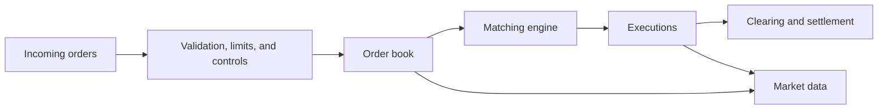
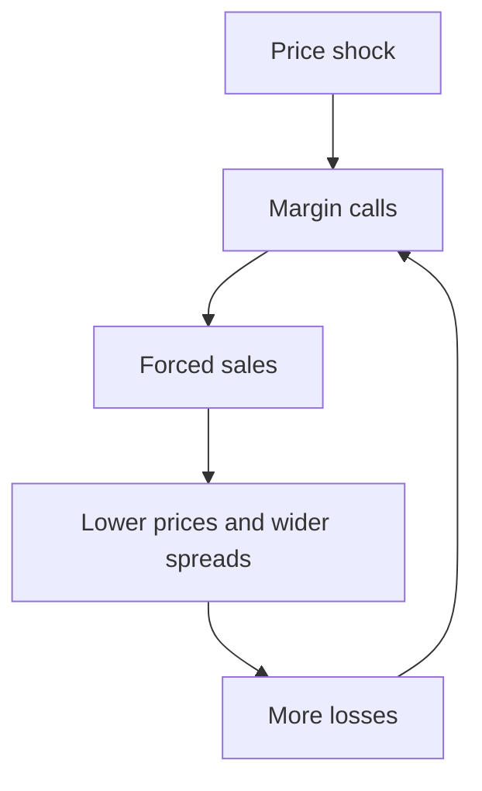

# Market Microstructure And Trading

Market microstructure studies how trading rules, participants, information,
technology, and inventory produce observable prices and liquidity. Two venues
can list economically identical assets yet generate different spreads,
execution quality, and resilience because their matching, disclosure, access,
fee, and market-making arrangements differ.

The "market price" is therefore not a single abstract truth. It is an outcome
formed at a place, time, size, and set of trading conditions.

## What A Market Must Do

A functioning market coordinates:

- buyers and sellers;
- price discovery;
- order submission and matching;
- liquidity provision;
- risk transfer;
- trade confirmation;
- clearing and settlement;
- surveillance and rule enforcement;
- market data distribution; and
- default and disruption management.

Trading is only one stage of the lifecycle. See
[Financial Market Infrastructure](financial-market-infrastructure.md) for
clearing, CCPs, CSDs, custody, and settlement.

These functions are interdependent. A market can match orders quickly yet still
be economically unusable if participants cannot fund positions, trust the
settlement asset, borrow securities for delivery, or enforce trades after a
default. Conversely, reliable post-trade infrastructure does not create
liquidity by itself: somebody must be willing to hold inventory, expose a
quote, or wait for the other side of a trade.

Market quality is multidimensional. A useful market produces prices that
incorporate available information, lets participants trade reasonable size at
reasonable cost, treats comparable orders consistently, remains available
during stress, and completes the resulting obligations. Improving one
dimension can weaken another. More pre-trade transparency can strengthen price
comparison while exposing a large investor's intentions; faster execution can
increase operational and latency risk; very small ticks can make prices more
precise while reducing the reward for displaying liquidity.

| Market function | Economic question | Typical failure |
|---|---|---|
| Price discovery | What price balances current supply and demand? | Stale or manipulable reference prices |
| Liquidity | Can risk be transferred at tolerable cost? | Wide spreads, little depth, or no firm quotes |
| Allocation | Which orders trade, and in what sequence? | Unfair access or unpredictable priority |
| Integrity | Can participants rely on prices and rules? | Manipulation, conflicts, or selective disclosure |
| Completion | Do matched trades become final positions and cash flows? | Settlement failure or counterparty default |

## Participants And Roles

### Investor

An investor takes exposure for return, liability matching, hedging, liquidity,
policy, or strategic objectives. Investors range from households to funds,
insurers, pension plans, corporates, sovereigns, and treasuries.

### Broker

A broker acts as agent, seeking execution for a client. It may route orders,
provide algorithms, aggregate venues, arrange block trades, and charge
commission or embedded spread.

Agency changes the economic problem. The broker is spending the client's money
and must balance price, speed, likelihood of execution, information leakage,
and other costs according to the order and applicable duties. A broker that
also operates a venue, receives routing payments, or trades as principal has
conflicts that require disclosure and controls; the cheapest explicit
commission need not produce the lowest total execution cost.

### Dealer

A dealer trades as principal, buying or selling for its own account. It provides
immediacy but assumes inventory and adverse-selection risk.

The distinction between broker and dealer describes the role in a transaction,
not merely the firm's name. The same firm can act as agent for one order and as
principal for another. Principal trading replaces an agency commission with a
price quoted from the firm's inventory and changes the conflicts, capital use,
and counterparty relationship.

### Market Maker

A market maker repeatedly expresses willingness to buy and sell. It attempts to
earn spread and venue incentives while managing:

- inventory;
- price movements;
- informed counterparties;
- hedging cost;
- funding and capital;
- technology latency;
- operational risk.

Market makers do not guarantee unlimited liquidity. They widen, reduce size, or
withdraw when risk or uncertainty rises.

### Exchange

An exchange operates a market under rules governing listing, access, matching,
data, conduct, and surveillance. It may use an order book, auctions, request for
quote, or hybrid mechanisms.

### Alternative Trading System And Dark Venue

Non-exchange venues can match participants under alternative rules. Dark pools
limit pre-trade transparency to reduce information leakage for large orders,
while creating questions about price formation and access.

### Principal Trading Firm

A principal trading firm uses its own capital, often with automated strategies,
to make markets, arbitrage prices, or trade signals. It is not necessarily a
broker handling customers.

### Prime Broker

A prime broker provides an integrated set of financing, custody, clearing,
securities lending, reporting, and operational services to active clients such
as hedge funds. Prime brokerage creates concentrated counterparty, collateral,
and funding relationships.

## Orders And Quotes

### Bid, Ask, And Midpoint

The best bid is the highest displayed buying price. The best ask is the lowest
displayed selling price.

```text
Quoted spread = P_ask - P_bid
```

```text
Midpoint =
(P_ask + P_bid) / 2
```

The relative quoted spread is often expressed as:

```text
Relative spread =
(P_ask - P_bid) / P_mid
```

The spread compensates liquidity providers for processing, inventory,
adverse-selection, capital, and market risk. It is also affected by tick size,
fees, competition, volatility, and trading activity.

### Market Order

A market order prioritizes execution over price. It consumes available
liquidity and can fill at several price levels. "Market" does not guarantee the
last traded or currently displayed price, especially in a thin or fast market.

### Limit Order

A limit order sets a worst acceptable price. It provides execution price
control but may never fill. A buy limit can execute at or below its limit; a
sell limit at or above.

### Stop Order

A stop order becomes active when a trigger price is reached. Depending on the
implementation it then becomes a market or limit order. Gaps and volatility can
produce execution far from the stop trigger.

### Pegged, Iceberg, And Conditional Orders

- **pegged:** price follows a reference such as the best bid or midpoint;
- **iceberg or reserve:** displays only part of total size;
- **immediate-or-cancel:** executes available size immediately and cancels the
  rest;
- **fill-or-kill:** requires immediate complete execution;
- **post-only:** cancels or reprices if it would immediately take liquidity;
- **all-or-none or minimum quantity:** constrains partial fills.

Order behavior depends on venue rules. Identical labels can hide different
priority and trigger semantics.

### The Order Lifecycle

An order is an instruction, not yet a trade. Before reaching a matching engine,
it may pass through authentication, buying-power or position checks, credit and
fat-finger limits, sanctions or market-access controls, and a routing decision.
The venue then accepts, rejects, reprices, rests, or executes it. Each execution
creates trade records that must be confirmed, cleared where applicable,
allocated to the correct account, and settled.

A limit order also changes roles over its life. A buy limit posted below the
ask supplies liquidity while it waits. If the market falls and an incoming sell
order executes against it, the same instruction becomes a completed purchase.
The price protection was real, but the fill may arrive precisely because other
participants now believe the asset is worth less. This is the execution-risk
versus adverse-selection trade-off of passive trading.

| Instruction | What it controls | What it leaves uncertain |
|---|---|---|
| Market order | Priority on immediate execution | Final price and total slippage |
| Limit order | Worst acceptable execution price | Whether and when it fills |
| Stop-market order | Trigger for urgent execution | Price after activation |
| Stop-limit order | Trigger and price boundary | Execution after a gap |
| Iceberg order | Displayed quantity | Discovery of hidden size and full fill |

## The Central Limit Order Book

A central limit order book ranks bids and asks. A common priority is:

1. best price;
2. earliest time at that price.

Other systems use pro rata allocation, size priority, or special order classes.

### Example

| Ask quantity | Ask price |
|---:|---:|
| 40 | 100.30 |
| 50 | 100.20 |
| 25 | 100.10 |

| Bid price | Bid quantity |
|---:|---:|
| 100.00 | 30 |
| 99.90 | 60 |
| 99.80 | 100 |

The best market is 100.00 bid / 100.10 ask. A market buy for 60 units would
consume 25 at 100.10 and 35 at 100.20 if no other orders arrive.

Volume-weighted average execution price:

```text
VWAP_execution
= (25(100.10)+35(100.20)) / (60)
= 100.1583
```

The difference between expected and realized price is one form of slippage.

This example also distinguishes **quoted liquidity** from **available
liquidity**. The best ask displays only 25 units. A buyer of five units sees and
pays 100.10; a buyer of 60 units walks two price levels and pays an average of
100.1583; a still larger buyer would reach 100.30. There is no single spread
independent of trade size.

Queue position matters even when price does not. A new buy order at 100.00
normally joins behind the 30 units already displayed there under price-time
priority. It can lose its place if cancelled and resubmitted. This creates an
economic value for early placement, motivates fast order management, and
explains why displayed depth can change rapidly without a trade.



## Auctions And Continuous Trading

### Continuous Market

Orders match whenever compatible prices exist. This provides immediacy but can
fragment liquidity over time.

### Call Auction

Orders accumulate and the venue selects a clearing price that maximizes
executable volume subject to tie-break rules. Opening, closing, volatility, and
periodic auctions concentrate liquidity and can improve price discovery when
continuous trading is thin.

An auction trades immediacy for coordination. Instead of rewarding the first
participant to react by a fraction of a second, it pools interest over a time
window and produces one clearing price. Closing auctions are important because
fund valuations and index tracking often use official closing prices; that same
concentration makes auction imbalance information and control of the closing
process economically significant.

### Request For Quote

A client requests prices from one or more dealers, commonly for bonds,
derivatives, large orders, or less standardized instruments. RFQ markets expose
less order-book information and rely more on dealer balance sheets.

## Exchange And Over-The-Counter Markets

**Exchange trading** uses a formal venue with standardized rules and often
pre- and post-trade transparency.

**OTC trading** is negotiated bilaterally or through dealer and electronic
networks outside a centralized exchange. OTC does not mean manual: sophisticated
electronic RFQ, streaming quote, and matching systems are common.

OTC markets support customized size, terms, credit, and confidentiality, while
creating counterparty, valuation, transparency, and documentation complexity.

## Liquidity

Liquidity has several dimensions:

- **tightness:** low cost to trade, often proxied by spread;
- **depth:** substantial quantity available near the current price;
- **breadth:** orders distributed across prices and participants;
- **immediacy:** ability to execute quickly;
- **resilience:** speed with which price and depth recover after a shock.

High daily volume does not guarantee liquidity for a large urgent order during
stress. Reported volume can include repeated interdealer trading, wash activity,
or small trades that say little about executable depth.

These dimensions can move differently. An instrument may have a one-tick
spread but only trivial displayed size, or deep quotes that disappear when a
participant attempts to trade. **Latent liquidity**—interest that is not
displayed but may respond to an RFQ or price move—matters particularly in bond
and block markets. Liquidity measurement must therefore specify instrument,
venue, trade direction, size, time horizon, and market state.

### Market Impact

A large order moves price because it consumes liquidity and reveals possible
information. Total execution cost includes:

- explicit commission and venue fees;
- bid-ask spread;
- delay cost;
- market impact;
- opportunity cost of unfilled quantity;
- tax and clearing cost.

Impact has temporary and persistent components. Temporary impact compensates
liquidity suppliers for taking the other side and may reverse after the order
ends. Persistent impact reflects information inferred from the trade or a
lasting change in supply and demand. In practice the two cannot be observed
perfectly, so execution algorithms divide an order over time and continuously
trade off urgency against footprint. Trading too quickly consumes depth;
trading too slowly increases exposure to unrelated market movement and the
chance that other participants infer the order.

### Implementation Shortfall

For a buy order, a simplified implementation shortfall is:

```text
IS
= Σ_i (q_i × P_i)
+ q_uP_final
- QP_decision
+ fees
```

where `q_i` and `P_i` are executed quantities and prices, `q_u` is unexecuted
quantity valued at a later price, `Q` is intended quantity, and
`P_decision` is the price when the decision was made.

The framework separates execution performance from whether the investment idea
was good.

For example, suppose an investor decides to buy 1,000 shares when the reference
price is 50.00. It buys 700 at an average 50.08, leaves 300 unfilled, and the
evaluation price later reaches 50.20. Ignoring fees:

```text
Executed cost above decision price = 700 × (50.08 - 50.00) = 56
Opportunity cost on unfilled shares = 300 × (50.20 - 50.00) = 60
Total implementation shortfall = 116
```

The price increase may validate the investment decision while still showing
that incomplete and costly execution surrendered 116 of value relative to
instantaneous execution at the decision price. The benchmark is hypothetical,
not a claim that all 1,000 shares were actually available at 50.00.

## Price Discovery

Price discovery aggregates heterogeneous information and willingness to trade.
The most informative venue need not have the greatest reported volume; it may
lead price changes because its participants, transparency, or instruments react
first.

Prices across venues remain aligned through arbitrage, but arbitrage is limited
by:

- transfer and settlement delay;
- short-sale and borrow constraints;
- funding and margin;
- counterparty risk;
- fees;
- position limits;
- asset or contract differences;
- operational capacity.

Crypto markets demonstrate these limits clearly. The same asset can trade at
different prices across exchanges because balances cannot move instantly, fiat
rails close, withdrawal is suspended, or the venue itself is risky.

Price discovery can migrate by time of day and information type. A futures
market may react first to macroeconomic news because it is liquid and
capital-efficient; the cash securities then adjust through arbitrage. A dealer
market may reveal information through executable quotes even when public trade
volume is low. A reference price should therefore be evaluated for
representativeness, robustness, and susceptibility to manipulation rather than
selected solely because it is easy to obtain.

## Information And Adverse Selection

A liquidity provider risks trading against someone with better information.
After selling to an informed buyer, the price may rise; after buying from an
informed seller, it may fall. This **adverse selection** is a central reason
spreads widen around news or uncertainty.

A useful conceptual decomposition of the spread is:

```text
Spread compensation
= order-processing cost
+ inventory and funding cost
+ adverse-selection cost
+ capital and risk compensation
- venue incentives
```

This is not an accounting identity; the components are estimated from behavior.
It explains why a spread can widen even when processing technology is
unchanged. Before an earnings release, for example, the probability that an
incoming order reflects superior information rises, so a market maker demands
more protection or quotes less size.

Market makers respond by:

- widening quotes;
- reducing size;
- increasing hedging;
- shortening quote life;
- skewing prices to reduce inventory;
- withdrawing from selected instruments.

## Inventory Risk

A dealer that buys from clients accumulates a long position. It can:

- sell to another client;
- hedge with the same or a related instrument;
- trade on another venue;
- warehouse the exposure;
- adjust quotes to encourage offsetting flow.

A dealer's quote is therefore a function of fair-value estimate, inventory,
risk limits, expected client information, hedge liquidity, and balance-sheet
cost—not merely a markup around a public price.

## Fragmentation And Routing

An asset may trade on many exchanges, dealer platforms, dark pools, and internal
systems. A broker or smart order router chooses where and how to execute.

Routing factors include:

- displayed and hidden liquidity;
- price and likelihood of fill;
- venue and rebate economics;
- latency;
- order information leakage;
- clearing and settlement;
- counterparty and venue risk;
- regulatory best-execution obligations.

Fragmentation can increase competition but split liquidity and complicate the
definition of a consolidated best price.

The router faces a sequential decision. It can send the whole order to the
venue showing the best price, split across venues, expose hidden liquidity,
internalize, or wait. Displayed quotations may already be cancelled by the time
the message arrives, and accessing several venues can reveal the remaining
order. A nominally inferior price can therefore produce a better outcome if it
has a much higher probability of filling or lower downstream cost.

### Internalization

A broker-dealer can execute customer flow against its own inventory or match it
internally. This can save venue cost and provide price improvement, but creates
conflicts between agency duty and principal profit.

### Maker-Taker Fees

Some venues charge orders that remove liquidity and rebate orders that add it.
Quoted spread can therefore differ from the economically realized spread after
fees. Fee incentives may also affect routing and queue competition.

The core governance question is who receives each benefit and bears each cost.
A rebate paid to the broker can conflict with the client's interest if it
causes routing to a slower or less liquid venue. Transparent routing and
execution-quality data help detect such conflicts, but aggregate reports do not
prove that any particular order received its best feasible outcome.

## Execution Quality

No single metric is sufficient.

| Metric | Question |
|---|---|
| Fill rate | How much of the order executed? |
| Speed | How long did execution take? |
| Price improvement | Was execution better than the reference quote? |
| Effective spread | How far was execution from midpoint? |
| Realized spread | How much spread remained after later price movement? |
| Market impact | How did the order move the market? |
| Implementation shortfall | What was total cost versus decision price? |
| Adverse selection | Did price move systematically after fills? |

For trade price `P_t` and midpoint `M_t`, a signed effective spread is commonly
approximated as:

```text
Effective spread=2D(P_t-M_t)
```

where `D=+1` for buyer-initiated and `D=-1` for seller-initiated trades.

Benchmarks can be gamed or inappropriate. VWAP rewards matching the market's
volume distribution; arrival price emphasizes decision-to-execution cost;
closing-price benchmarks can concentrate activity at the close.

Execution analysis also needs like-for-like comparison. A broker handling
small liquid equity orders cannot be compared directly with one handling block
orders in illiquid securities. Order size, volatility, spread, urgency,
constraints, and market direction affect achievable results. Good transaction
cost analysis explains the benchmark, normalizes for these conditions, and
examines the distribution of outcomes rather than only an average.

## Leverage, Margin, And Liquidation

Leverage magnifies exposure relative to equity:

```text
Leverage =
(gross or net exposure) / (equity)
```

Different definitions produce different ratios. Gross notional, delta-adjusted
exposure, accounting assets, and risk-weighted assets are not interchangeable.

### Margin

Initial margin supports opening a position. Maintenance margin is the minimum
equity level before additional collateral or liquidation is required.

If asset value falls while debt remains fixed, equity falls faster:

| Position | Initial | After 20% asset decline |
|---|---:|---:|
| Asset | 100 | 80 |
| Debt | 60 | 60 |
| Equity | 40 | 20 |

A 20% asset loss caused a 50% equity loss.

If maintenance equity were 25, the decline would create a margin deficit of
five. The client must add collateral or reduce the position. Liquidation is not
costless: the execution itself may push the price lower, fees continue to
accrue, and the broker may still have an unsecured claim if proceeds are
insufficient.

A typical default and liquidation sequence is:

1. mark positions and collateral using the governing valuation rules;
2. calculate the margin deficiency and issue a call if the agreement permits
   time to cure;
3. restrict new risk or cancel open orders;
4. close or hedge positions and realize collateral;
5. net obligations under enforceable agreements; and
6. allocate any residual loss through the broker, clearing member, CCP, or
   platform waterfall.

The sequence and legal rights differ across cash accounts, bilateral
derivatives, prime brokerage, centrally cleared markets, and onchain lending.

Forced liquidation can create feedback:



## Prime Brokerage

Prime services can include:

- custody and asset servicing;
- margin lending;
- derivatives and synthetic financing;
- securities borrowing and lending;
- trade clearing and settlement;
- cash management;
- capital introduction;
- consolidated reporting.

The prime broker sees a broad portfolio and can offer cross-margining, but the
relationship creates wrong-way risk and concentration. A client failure can
leave the broker with illiquid positions; a broker failure can trap the
client's assets and hedges.

Cross-margining illustrates both value and danger. Offsetting positions can
reduce collateral when viewed as a portfolio, freeing funding for the client.
The benefit depends on correlations and liquidation assumptions continuing to
hold during stress. If positions that normally offset diverge, or if they must
be closed at different times and venues, the apparent diversification can
disappear. The legal ability to net claims is as important as the statistical
model.

## Market Abuse And Surveillance

Market integrity threats include:

- insider trading;
- manipulation;
- spoofing and layering;
- wash trading;
- marking the close;
- pump-and-dump schemes;
- front running;
- misuse of customer order information;
- false or misleading disclosures.

Surveillance combines orders, cancellations, trades, accounts, communications,
beneficial ownership, cross-venue data, and event context. A suspicious pattern
is evidence for investigation, not automatically proof of legal violation.

Public blockchains make transaction records visible but do not automatically
identify controllers, reveal offchain arrangements, or distinguish legitimate
arbitrage from collusion.

Different patterns exploit different parts of market design. Spoofing attempts
to create a false impression of supply or demand with orders intended to be
cancelled. Wash trading manufactures activity without genuine change in
economic exposure. Marking the close targets a price used for valuation or
contract settlement. Front running misuses knowledge of another party's order.
Detection therefore requires intent and context as well as a statistical
anomaly; a large cancellation rate alone can arise from legitimate market
making in a fast market.

## Market Stress

During stress:

- correlations can rise;
- market makers protect capital;
- order-book depth falls;
- spreads widen;
- volatility triggers more margin;
- asset sales depress collateral values;
- data and models become less reliable;
- exchanges can apply volatility controls or halt trading.

Historical average volume and spread are poor estimates of stressed
liquidation capacity. Stress tests should include nonlinear price impact,
crowded exits, closed venues, reduced borrow, and delayed settlement.

Market liquidity and funding liquidity reinforce each other. A leveraged
holder facing margin calls sells assets; those sales reduce prices and
collateral values; market makers facing larger inventory and volatility widen
quotes; the wider quotes make liquidation more expensive and produce further
calls. Circuit breakers and auctions can create time for information and orders
to accumulate, but they defer rather than eliminate the need to transfer risk.

### Section Summary

| Design choice | Primary benefit | Main trade-off |
|---|---|---|
| Continuous order book | Immediate, transparent matching | Fragmented queues and speed competition |
| Call auction | Concentrated liquidity and one clearing price | Delayed execution |
| RFQ/dealer market | Customized size, terms, and immediacy | Dealer dependence and less pre-trade transparency |
| Dark or hidden liquidity | Lower information leakage for large orders | Weaker visible price formation |
| Internalization | Potential price improvement and lower venue cost | Agency-principal conflict |
| Leverage and cross-margining | Capital-efficient exposure | Nonlinear loss and liquidation feedback |

## Centralized And Decentralized Market Design

| Feature | Central limit order book | Dealer/RFQ market | Automated market maker |
|---|---|---|---|
| Price source | Orders | Dealer quotes | Pool function and arbitrage |
| Liquidity provider | Limit-order traders | Dealer balance sheet | Deposited assets |
| Execution | Matching engine | Bilateral acceptance | Smart-contract swap |
| Inventory risk | Market makers and traders | Dealer | Liquidity providers |
| Transparency | Venue-specific | Often lower pre-trade | Pool state visible |
| Main constraints | Tick, queue, latency, access | Dealer capacity and credit | Curve, pool depth, gas, MEV |

AMMs replace the order book, not the economic need for liquidity, pricing,
arbitrage, and risk bearing. They are developed in
[Decentralized Exchanges And Automated Market Makers](../../03-digital-assets-and-market-structure/03-decentralized-markets/decentralized-exchanges-and-automated-market-makers.md).

## Analytical Checklist

For any trading venue or market:

1. What instruments and contract specifications trade?
2. Who can access directly and through intermediaries?
3. Is trading order-driven, quote-driven, auction, RFQ, AMM, or hybrid?
4. What information is visible before and after trading?
5. How are orders prioritized and matched?
6. Who supplies liquidity and bears inventory risk?
7. What are explicit and implicit trading costs?
8. How fragmented is liquidity, and how are orders routed?
9. What credit, margin, and collateral arrangements apply?
10. How do clearing and settlement work?
11. Which benchmarks measure execution?
12. How are manipulation, conflicts, and outages controlled?
13. What happens when volatility rises and liquidity providers withdraw?

## Connections

- [Securities And Financial Instruments](securities-and-financial-instruments.md)
  explains what is being traded.
- [Financial Market Infrastructure](financial-market-infrastructure.md)
  explains the full trade lifecycle.
- [Financial Risk Management](../03-risk-and-regulatory-foundations/financial-risk-management.md)
  develops market, counterparty, liquidity, and model risk.
- [Crypto Market Structure And Centralized Exchanges](../../03-digital-assets-and-market-structure/02-centralized-markets/crypto-market-structure-and-centralized-exchanges.md)
  applies these concepts to crypto venues.

## References

- U.S. Securities and Exchange Commission,
  [Market centers: buying and selling stock](https://www.sec.gov/answers/market.htm)
- U.S. Securities and Exchange Commission,
  [Guide to broker-dealer registration](https://www.sec.gov/about/divisions-offices/division-trading-markets/division-trading-markets-compliance-guides/guide-broker-dealer-registration)
- Financial Industry Regulatory Authority,
  [Order types](https://www.finra.org/investors/investing/investment-products/stocks/order-types)
- U.S. Securities and Exchange Commission,
  [Research and analysis: market structure](https://www.sec.gov/featured-topics/market-structure-analytics/research-analysis-market-structure)
- International Organization of Securities Commissions,
  [Objectives and principles of securities regulation](https://www.iosco.org/library/pubdocs/pdf/IOSCOPD561.pdf)
- Bank for International Settlements,
  [Market liquidity: research findings and selected policy implications](https://www.bis.org/publ/cgfs11.htm)
- Bank for International Settlements,
  [Repo market functioning](https://www.bis.org/publ/cgfs59.htm)
- Bank for International Settlements,
  [Market-making and proprietary trading: industry trends, drivers and policy implications](https://www.bis.org/publ/cgfs52.htm)
- U.S. Securities and Exchange Commission,
  [Disclosure of order execution and order routing information](https://www.sec.gov/about/divisions-offices/division-trading-markets/broker-dealers/disclosure-order-execution-order-routing-information)
