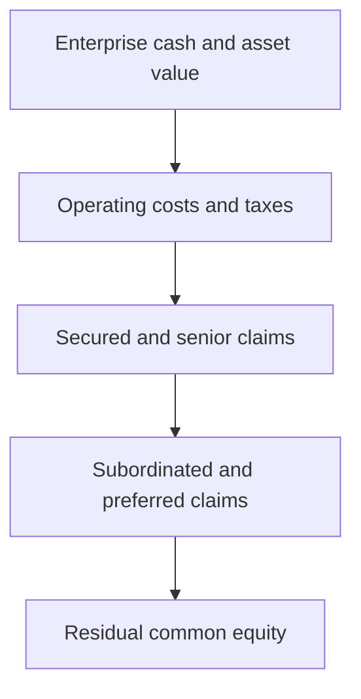

# Securities And Financial Instruments

A financial instrument is a contract or legally recognized position that gives
one party an asset and another party a liability or equity claim. The instrument
defines who owes what, under which conditions, how cash flows are calculated,
which rights attach to ownership, and what happens during default, maturity,
transfer, or a corporate event.

A token, database entry, or paper certificate is a representation and transfer
mechanism. It does not by itself determine the underlying economics. A token can
represent equity, debt, a fund share, a deposit, a commodity claim, a
derivative, a license, or no enforceable claim at all.

## A Framework For Understanding Any Instrument

Analyze every instrument along the same dimensions:

1. **Issuer or obligor:** who creates the claim or owes performance?
2. **Holder:** who owns the rights, and how is ownership evidenced?
3. **Principal:** what amount or property is at risk?
4. **Cash flows:** fixed, floating, contingent, discretionary, or residual?
5. **Maturity:** perpetual, callable, puttable, demand, or fixed term?
6. **Seniority:** where does the claim rank during insolvency?
7. **Security:** is it collateralized, guaranteed, or unsecured?
8. **Control:** does it confer voting, consent, conversion, or enforcement
   rights?
9. **Transfer:** where and how can ownership change?
10. **Valuation:** which rates, prices, models, and assumptions determine value?
11. **Risk:** credit, market, liquidity, legal, operational, and other risks?
12. **Lifecycle:** issuance, income, corporate actions, redemption, and default?

These dimensions turn a product label into an economic map. Calling something
a "bond" does not reveal whether it is secured, subordinated, callable, liquid,
or denominated in a currency the issuer cannot readily obtain. Calling
something a "token" reveals even less. Analysis begins with the enforceable
claim and its cash-flow waterfall, then examines how that claim is represented,
traded, held, valued, and serviced.

### Claims, Cash Flows, And Priority

Most instruments allocate some combination of three things:

- **cash-flow rights**, such as coupons, dividends, redemption proceeds, or a
  derivative settlement amount;
- **control rights**, such as votes, consents, conversion, or the right to
  enforce after default; and
- **risk-bearing**, meaning which holder absorbs losses first and which is paid
  first.

These rights need not travel together. Common equity usually carries votes and
the residual upside but is last in insolvency. Senior secured debt has limited
upside but contractual payments and priority against specified collateral. An
option can create substantial price exposure without ownership or voting
rights. A fund share gives an interest in a vehicle rather than direct title to
each asset it holds.



The diagram is deliberately simplified: insolvency law, guarantees, structural
subordination, netting, and asset-specific security can create several
waterfalls rather than one universal order.

## Security, Instrument, Asset, And Contract

The terms overlap but are not identical.

- A **financial asset** is cash, an ownership interest, a contractual right to
  receive cash or another financial asset, or a qualifying right to exchange
  financial instruments.
- A **financial liability** is a contractual obligation to deliver cash or
  another financial asset, or exchange under potentially unfavorable terms.
- An **equity instrument** is a residual interest after liabilities.
- A **security** is a legally defined transferable financial instrument, often
  subject to issuance, disclosure, trading, and intermediary rules.
- A **derivative** derives value from an underlying price, rate, index, event, or
  variable.

Legal definitions vary by jurisdiction and purpose. The economic analysis
should be separated from the legal classification, then reconciled with it.

## Equity

Equity represents a residual ownership claim in an entity.

### Common Shares

Common shareholders may receive:

- voting rights;
- dividends if declared;
- subscription or pre-emption rights;
- information and meeting rights; and
- residual value after creditors and senior claims in liquidation.

Dividends are not generally contractual debt payments. A profitable company can
retain earnings rather than distribute them, subject to law and governance.

The residual nature of equity explains both its upside and its fragility. If an
enterprise worth 120 owes creditors 80, the residual equity is 40. A 10 decline
in enterprise value reduces equity to 30—a 25% loss—while the debt may remain
money-good. Once asset value approaches the debt claim, equity begins to behave
like an option on recovery and creditors become economically exposed to
decisions that transfer risk.

### Preferred Shares

Preferred shares can combine equity and debt-like features:

- fixed or floating dividends;
- cumulative unpaid dividends;
- priority over common equity;
- conversion into common shares;
- issuer call or investor put rights; and
- limited or contingent voting rights.

Classification depends on substance and contract. A mandatorily redeemable
instrument can be economically closer to debt.

### Market Capitalization And Enterprise Value

For a listed company:

```text
Market capitalization
= share price × diluted shares outstanding
```

A simplified enterprise value is:

```text
EV =
equity value
+ debt
+ preferred equity
+ non-controlling interests
- cash
```

These measures answer different questions. Market capitalization values common
equity; enterprise value approximates the value of operations available to all
capital providers.

For example, a company with 10 million diluted shares at 12 per share, debt of
50, preferred equity of 5, non-controlling interests of 3, and cash of 18 has:

```text
Equity value = 10 million × 12 = 120 million
Enterprise value = 120 + 50 + 5 + 3 - 18 = 160 million
```

An operating multiple such as enterprise value to EBITDA uses 160 because
EBITDA is measured before interest paid to debt holders. A price-to-earnings
multiple uses common equity value because earnings after interest and preferred
claims are attributable to common shareholders. These are analytical
conventions, not substitutes for a full valuation.

### Dilution

New shares, employee options, convertible debt, warrants, and acquisitions can
increase the claims on future earnings. Fully diluted analysis estimates shares
that could become outstanding under specified assumptions.

## Debt Instruments

Debt creates a contractual repayment obligation.

### Core Terms

| Term | Meaning |
|---|---|
| Principal or face value | Amount used to calculate repayment and often coupons |
| Coupon | Contractual interest payment |
| Maturity | Date principal becomes due |
| Yield | Return implied by price and expected cash flows |
| Seniority | Ranking relative to other claims |
| Covenant | Contractual restriction or required action |
| Security | Collateral supporting repayment |
| Call | Issuer right to redeem early |
| Put | Holder right to demand early repayment |
| Conversion | Right or obligation to exchange debt for equity |

### Bond Pricing

For a fixed-rate bond with coupon `C`, face value `F`, yield per period `y`,
and `n` periods:

```text
P = Σ from t = 1 to n of C / (1 + y)^t
+ (F) / ((1+y)^n)
```

Price and yield move inversely. When the required market yield rises, the
present value of fixed cash flows falls.

Consider a two-year bond with face value 100 and an annual 5 coupon. If the
required annual yield is 6%, its simplified price is:

```text
P = 5 / 1.06 + 105 / (1.06)^2 = 98.17
```

The bond trades below par because its 5% coupon is less attractive than the 6%
return now required for comparable risk. If its credit quality deteriorates,
the required credit spread can rise even when the risk-free curve is
unchanged. A bond price therefore combines the time value of money, expected
credit loss, liquidity, optionality, and risk premia.

### Yield Measures

- **coupon rate:** annual coupon divided by face value;
- **current yield:** annual coupon divided by current price;
- **yield to maturity:** discount rate equating price with promised cash flows,
  assuming reinvestment and payment as contracted;
- **yield to call:** analogous calculation to a call date and price;
- **credit spread:** yield above a selected reference curve;
- **total return:** income plus price change, adjusted for cash flows.

Promised yield is not realized return if the issuer defaults, the bond is called,
cash flows are reinvested at different rates, or the investor sells early.

### Duration And Convexity

Duration measures sensitivity to yield changes. For a small parallel change:

```text
(Δ P) / (P) ≈ -D_modΔ y
```

Convexity improves the approximation:

```text
(Δ P) / (P)
≈ -D_modΔ y
+ (1) / (2)K(Δ y)^2
```

Duration is not maturity. A coupon bond's weighted cash-flow timing differs
from its final maturity, and embedded options make sensitivity state-dependent.

If modified duration is 4.5, a 0.25 percentage-point parallel yield increase
gives a first-order estimate:

```text
Estimated price change ≈ -4.5 × 0.0025 = -1.125%
```

This is local sensitivity, not a forecast. Yield curves rarely move in
perfectly parallel fashion, credit spreads can move separately, and callable
or prepayable instruments change expected cash-flow timing as rates change.
Risk managers therefore supplement duration with key-rate sensitivities,
spread duration, convexity, and scenarios.

### Credit Structure

Debt can be:

- sovereign, municipal, supranational, bank, or corporate;
- secured or unsecured;
- senior, subordinated, or structurally subordinated;
- investment grade, high yield, or unrated;
- fixed-rate, floating-rate, inflation-linked, or zero-coupon;
- public or privately placed.

The issuer's probability of default is only one component of credit value.
Recovery, collateral, covenants, ranking, guarantees, jurisdiction, currency,
and liquidity matter.

Structural subordination is easy to miss. Debt issued by a holding company may
depend on dividends from an operating subsidiary. Creditors of the operating
subsidiary are paid from its assets before value can move up to the holding
company, even if both instruments are described as "senior." Covenants,
guarantees, and collateral packages determine how much practical protection
the label provides.

## Money-Market Instruments

Money markets provide short-term funding and liquidity. Instruments include:

- Treasury bills;
- commercial paper;
- certificates of deposit;
- interbank deposits;
- repurchase agreements;
- short-dated government and agency paper; and
- money-market fund shares.

"Cash equivalent" does not mean risk-free or identical to a deposit. A fund
share is an investment claim on a portfolio; a deposit is a liability of a
bank; a Treasury bill is sovereign debt.

The instruments also solve different funding problems. Treasury bills fund the
sovereign; commercial paper provides unsecured corporate funding; certificates
of deposit fund banks; and repo exchanges short-term cash for securities
collateral. Their yields can differ because of credit quality, collateral,
liquidity, maturity, central-bank eligibility, regulatory treatment, and
investor mandates—not merely because their dates differ.

## Funds And Collective Investment Vehicles

A fund pools investor capital under a mandate.

### Open-End Mutual Funds

Investors subscribe and redeem with the fund at a net asset value calculated
under the fund's rules:

```text
NAV per share
= (assets - liabilities) / shares outstanding
```

The fund creates or cancels shares as investors enter and leave. Redemption
liquidity can mismatch the liquidity of portfolio assets.

### Exchange-Traded Funds

ETF shares trade on an exchange. Authorized participants can create or redeem
large blocks, often in kind, helping arbitrage the market price toward NAV.
Tracking error, bid-ask spreads, portfolio liquidity, creation mechanics, tax,
and counterparty arrangements affect results.

The arbitrage mechanism has two linked markets. Retail and institutional
investors trade ETF shares with one another on an exchange. Authorized
participants can separately deliver the prescribed asset basket to the fund in
exchange for a creation unit, or return a creation unit for the basket. If ETF
shares trade materially above the basket value, an authorized participant can
buy the basket, create shares, and sell them; the reverse process can address a
discount. Competition encourages convergence but does not guarantee it during
stress, when the basket is hard to value or finance.

### Closed-End Funds

The share count is relatively fixed and shares trade in the secondary market.
Prices can persistently differ from NAV because holders cannot generally redeem
directly at NAV.

### Money-Market Funds

Money-market funds hold short-duration, high-quality instruments under
jurisdiction-specific rules. Some seek a stable NAV while others float.
Liquidity transformation and investor runs can still arise, especially when
assets are less liquid than redemption promises.

### Private Funds

Hedge funds, private-equity funds, private-credit funds, and venture funds use
different liquidity, leverage, valuation, and governance arrangements. An
investor generally owns an interest in the fund vehicle, not direct title to
each portfolio asset.

## Derivatives

A derivative's value depends on an underlying variable. Derivatives transfer
risk, create synthetic exposure, enable price discovery, and provide leverage.

Derivatives separate an economic exposure from ownership of the underlying.
An airline can hedge fuel prices without storing all future fuel; an investor
can hedge equity downside while keeping voting rights; a borrower can convert
fixed-rate exposure to floating through a swap. This flexibility also creates
leverage: a relatively small premium or margin amount can support a much larger
notional exposure. Notional describes the calculation base, not the amount
already lost or owed.

### Forwards And Futures

A forward obliges parties to transact later at an agreed price. It is commonly
bilateral and customized. A futures contract is standardized and typically
cleared through a central counterparty with daily margining.

Suppose a buyer agrees today to purchase one unit in three months for 100. At
maturity, if the spot price is 112, the buyer's gross value is 12 and the
seller's is -12; if spot is 93, the signs reverse. A bilateral forward can allow
this value to accumulate until settlement, creating replacement-cost exposure.
A futures CCP instead marks the position to market and transfers variation
margin, crystallizing gains and losses over time. Daily settlement reduces
accumulated credit exposure but can produce urgent liquidity needs.

For a non-income-paying asset under simple assumptions, the no-arbitrage forward
price is:

```text
F_0 = S_0e^(rT)
```

With continuous income yield `q`:

```text
F_0 = S_0e^((r-q)T)
```

Actual pricing can reflect funding, storage, convenience yield, collateral,
credit, and market segmentation.

### Swaps

A swap exchanges cash-flow streams. Common forms include:

- fixed versus floating interest-rate swaps;
- cross-currency swaps;
- total-return swaps;
- credit-default swaps; and
- commodity swaps.

The notional amount usually determines cash flows but is not necessarily
exchanged. Counterparty exposure changes as market values move.

In a plain fixed-for-floating interest-rate swap, one party pays a fixed rate
on the notional and receives a periodically reset floating rate; only the net
cash-flow difference is commonly paid in the same currency. At inception the
contract is normally priced near zero value. Later, changes in the yield curve
make the remaining fixed leg more or less valuable, creating an asset for one
party and an equal pre-credit-adjustment liability for the other.

### Options

A call gives the holder a right to buy; a put gives a right to sell, under
specified terms.

At expiry, simple payoffs are:

```text
Call payoff = max(S_T-K,0)
```

```text
Put payoff = max(K-S_T,0)
```

The buyer pays a premium and has asymmetric exposure. The seller receives the
premium and accepts a contingent obligation. Option value depends on price,
strike, time, volatility, rates, income, exercise style, and model assumptions.

The option's sensitivities explain how value changes before expiry:

| Sensitivity | Main question |
|---|---|
| Delta | How does value change for a small underlying-price move? |
| Gamma | How does delta change as the underlying moves? |
| Vega | How does value respond to implied volatility? |
| Theta | How much value is lost or gained as time passes? |
| Rho | How does value respond to interest rates? |

These measures are local and model-dependent. A delta hedge removes only the
estimated first-order exposure at that moment; large moves, volatility changes,
market gaps, and transaction costs leave residual risk.

### Derivative Exposure

Notional value is not the same as market value or credit exposure. Risk depends
on:

- current replacement value;
- potential future exposure;
- netting;
- collateral and margin;
- wrong-way risk;
- liquidation period;
- underlying volatility and liquidity; and
- close-out enforceability.

## Collateral

Collateral is an asset pledged or transferred to reduce credit exposure.

### Haircuts

If collateral worth `V` receives haircut `h`, recognized collateral value is:

```text
V_recognized = V(1-h)
```

Haircuts cover price volatility, liquidation cost, credit risk, concentration,
wrong-way risk, and time to realize the asset.

### Initial And Variation Margin

- **variation margin** covers current mark-to-market exposure;
- **initial margin** covers potential exposure during close-out after default.

Margin can reduce credit risk while increasing liquidity risk. A sharp market
move triggers cash or collateral calls precisely when funding is expensive.

Initial and variation margin solve different timing problems. Variation margin
transfers value already created by market moves. Initial margin is a buffer for
further adverse movement between the last successful margin exchange and
close-out after default. Neither eliminates risk: collateral prices can fall,
the portfolio can take longer to liquidate than assumed, documentation can be
unenforceable, and operational disputes can delay access.

### A Collateral Lifecycle

Collateral management is a continuing process rather than a one-time pledge:

1. calculate exposure and the contractual margin requirement;
2. identify eligible collateral after haircuts and concentration limits;
3. issue, agree, or dispute the call;
4. transfer and settle the collateral;
5. value it again as markets and exposures change;
6. substitute or return excess collateral; and
7. realize or return it when trades terminate or a party defaults.

The receiver must know not only the collateral's market value but also whether
it has legal control, where the asset is held, whether another party has a
claim, and how quickly it can be sold.

### Rehypothecation And Reuse

A collateral receiver may be allowed to reuse collateral. Reuse improves market
liquidity but creates chains of claims, operational complexity, and dependency
on return of equivalent assets.

For example, dealer A receives a government bond from fund B and reuses it in a
repo with dealer C. B retains a contractual right to equivalent securities,
while C may obtain title or a security interest under the repo. The same
security supports several linked obligations without being owned outright by
every participant that reports an economic claim. Close-out netting,
segregation rules, and client-asset law determine how that chain behaves if A
fails.

## Repurchase Agreements

In a repo, one party sells securities for cash and agrees to repurchase
equivalent securities later. Legally it is often a sale and repurchase;
economically it resembles collateralized borrowing.

If cash `C` is repaid after `d` days at repo rate `r` using day-count basis
`B`:

```text
Repurchase price
= C(1+r(d) / (B))
```

Repos serve two motives:

- **cash-driven:** borrow or invest cash against collateral;
- **securities-driven:** obtain a specific security needed for delivery,
  hedging, or short covering.

A cash-driven borrower focuses on the financing rate and acceptable collateral.
A securities-driven borrower may accept a very low or otherwise unusual rate
to obtain a scarce issue. This is why the repo rate contains information about
both general funding conditions and the relative scarcity of specific
securities.

At maturity, the cash lender returns equivalent securities and receives the
repurchase price. During the term, margin maintenance adjusts for collateral
price changes. If the borrower defaults, the lender's protection depends on
prompt access to collateral, the haircut, market liquidity, and enforceable
close-out netting—not only the initial collateral value.

Key terms include collateral eligibility, haircut, margin maintenance, rate,
term, substitution, income payments, close-out netting, and title transfer.

## Securities Lending

The lender transfers securities temporarily and the borrower promises to return
equivalent securities. The borrower provides collateral and pays a fee or
rebate economics.

Borrowers use securities for:

- short selling;
- market making;
- settlement-fail coverage;
- arbitrage;
- hedging; and
- collateral transformation.

The lender generally retains economic exposure and receives manufactured
payments corresponding to dividends or coupons, but legal title and voting
rights may transfer during the loan.

The fee depends heavily on scarcity. Widely available securities can earn a
small general-collateral return; heavily shorted or operationally scarce
securities can command a much larger special fee. A lender weighs this revenue
against recall needs, voting and stewardship policy, collateral risk, borrower
concentration, and the possibility that cash collateral is reinvested in assets
that lose value.

Risks include borrower default, collateral shortfall, cash-collateral
reinvestment loss, operational error, recall failure, legal uncertainty, and
counterparty concentration.

## Short Selling

A short seller sells an asset it does not own outright, commonly after
borrowing it, expecting to repurchase at a lower price.

Simplified profit before fees is:

```text
Short P&L
= sale proceeds - repurchase cost
```

Costs include borrow fees, manufactured distributions, margin, and execution.
Losses are theoretically unbounded because the asset price can rise without a
fixed upper limit. Short selling supports price discovery and hedging but can
interact with squeezes, scarce borrow, and settlement failures.

## Corporate Actions

Ownership must be maintained through lifecycle events.

### Income

- dividends;
- interest and coupons;
- fund distributions;
- capital repayments.

### Mandatory Events

- stock splits and consolidations;
- mergers;
- spin-offs;
- redemptions;
- name or identifier changes.

### Voluntary Or Elective Events

- tender offers;
- rights elections;
- conversion;
- optional dividends;
- proxy voting.

Dates can include announcement, ex-date, record date, election deadline, and
payment date. The record date alone does not always determine market
entitlement; settlement cycles and ex-date rules matter.

A corporate action is an information, entitlement, and settlement workflow.
The issuer or agent announces terms; intermediaries identify eligible
positions; custodians pass information through omnibus account chains; holders
make elections where required; agents calculate cash, securities, and tax;
positions and payments are reconciled; and exceptions are corrected. A missed
election deadline can change the instrument received even when the underlying
ownership record is accurate.

Tokenization does not eliminate corporate actions. Smart contracts can automate
some calculations and controls, but legal announcements, eligibility,
withholding tax, corrections, elections, and offchain cash or asset delivery
still require authoritative data and governance.

## Issuance And Trading

### Primary Market

New instruments are issued to raise capital or create investment units.
Participants can include issuer, arranger, underwriter, placement agent,
investor, registrar, paying agent, CSD, counsel, and auditor.

### Secondary Market

Existing instruments trade between investors. Secondary liquidity can lower an
issuer's future cost of capital, but most secondary trades do not directly fund
the issuer.

### Public And Private Instruments

Public offerings usually involve standardized disclosure and broad
distribution. Private placements restrict eligible investors, transfer, or
marketing and may provide less liquidity. "Onchain" does not remove these
restrictions; token contracts often need identity and transfer controls to
represent them.

## Settlement And Ownership

Holding arrangements can include:

- direct registration on an issuer register;
- immobilized certificates held through a depository;
- dematerialized book-entry securities;
- omnibus accounts through custodians;
- beneficial ownership beneath a registered nominee;
- token records connected to an offchain legal register.

The party controlling a private key may control token transfer but not
necessarily have uncontested legal ownership of the represented asset. Legal
title depends on issuance documents, property law, account rules, custody
arrangements, and the authoritative register.

This distinction also exists without tokens. An investor shown as beneficial
owner in a broker's books may sit beneath the broker, custodian, and depository,
with a nominee recorded on the issuer register. The chain enables scalable
settlement and asset servicing but requires reconciliation and determines
which intermediary exercises rights or bears a shortfall during insolvency.
Tokenization can shorten or alter the chain; it does not make the legal layer
optional.

See [Financial Market Infrastructure](financial-market-infrastructure.md) for
issuance, trading, clearing, CSDs, custody, DvP, and reconciliation.

## Valuation

All valuation reduces expected future economic benefits to a present measure,
but methods differ:

- discounted cash flow;
- comparable-company or transaction multiples;
- observable market quote;
- yield-curve and spread models;
- option-pricing models;
- net asset value;
- replacement cost;
- liquidation value;
- model-based fair value when markets are inactive.

Inputs can be directly observable, indirectly observable, or unobservable.
Model risk grows when valuation depends on assumptions about volatility,
correlation, default, recovery, liquidity, prepayment, or optionality.

For financial reporting under IFRS 13, the fair-value hierarchy classifies the
inputs rather than declaring one valuation technique inherently superior:

| Level | Nature of significant inputs | Illustration |
|---|---|---|
| 1 | Unadjusted quoted price in an active market for an identical item | Listed share with accessible active-market price |
| 2 | Other observable direct or indirect inputs | Swap valued from observable yield curves |
| 3 | Significant unobservable inputs | Illiquid private instrument using internal assumptions |

A model can use discounted cash flow and still be Level 2 when the significant
curve and spread inputs are observable. Conversely, an adjustment to an
observable price can move the whole measurement to Level 3 if the unobservable
adjustment is significant. A reported fair value is a measurement under a
defined framework, not a guarantee that the full position can be liquidated at
that price.

## Risk Map

| Risk | Illustration |
|---|---|
| Credit | Bond issuer or derivative counterparty defaults |
| Market | Rates, spreads, equity, FX, commodity, or volatility moves |
| Liquidity | Position cannot be sold near its marked value |
| Funding | Holder cannot finance the position or meet margin |
| Legal | Claim, netting, collateral, or ownership is unenforceable |
| Operational | Trade, settlement, valuation, or corporate-action error |
| Model | Pricing or risk model omits material behavior |
| Basis | Hedge and exposure do not move together |
| Concentration | One issuer, sector, factor, venue, or counterparty dominates |
| Custody | Asset is lost, frozen, misappropriated, or inaccessible |

## Tokenization Does Not Change The Economic Checklist

A tokenized instrument must still answer:

- What legal claim does the token evidence?
- Is the token or an offchain register authoritative?
- Who can issue, mint, burn, freeze, or correct it?
- Are holders recorded directly or through nominees?
- How are transfer restrictions enforced?
- What cash asset pays coupons, redemptions, or distributions?
- How do DvP and settlement finality work?
- Who handles tax, disclosures, and corporate actions?
- How are lost keys, forks, upgrades, and erroneous transfers treated?
- What happens in issuer, custodian, platform, or blockchain insolvency?

These questions are developed in
[Tokenization Of Securities, Funds, And Real-World Assets](../../05-digital-money-and-tokenization/03-tokenized-assets/tokenization-of-securities-funds-and-real-world-assets.md).

## Connections

- [Financial Market Infrastructure](financial-market-infrastructure.md)
  explains the institutions and post-trade lifecycle.
- [Market Microstructure And Trading](market-microstructure-and-trading.md)
  explains how instruments obtain prices and liquidity.
- [Financial Risk Management](../03-risk-and-regulatory-foundations/financial-risk-management.md)
  develops measurement, limits, stress, and control.
- [Digital Assets, Token Taxonomy, And Economics](../../03-digital-assets-and-market-structure/01-assets-and-economics/digital-assets-token-taxonomy-and-economics.md)
  applies claim analysis to tokens.

## References

- U.S. Securities and Exchange Commission, Investor.gov,
  [Investment products](https://www.investor.gov/introduction-investing/investing-basics/investment-products)
- U.S. Securities and Exchange Commission, Investor.gov,
  [Bonds](https://www.investor.gov/introduction-investing/investing-basics/investment-products/bonds-or-fixed-income-products/bonds)
- U.S. Securities and Exchange Commission, Investor.gov,
  [Securities lending](https://www.investor.gov/introduction-investing/investing-basics/glossary/securities-lending)
- Bank for International Settlements,
  [Securities lending transactions: market development and implications](https://www.bis.org/cpmi/publ/d32.htm)
- Bank for International Settlements,
  [Implications of repo markets for central banks](https://www.bis.org/publ/cgfs10.htm)
- CPSS-IOSCO,
  [Principles for financial market infrastructures](https://www.bis.org/cpmi/publ/d101.htm)
- International Swaps and Derivatives Association,
  [About derivatives](https://www.isda.org/about-isda/)
- IFRS Foundation,
  [IAS 32 Financial Instruments: Presentation](https://www.ifrs.org/issued-standards/list-of-standards/ias-32-financial-instruments-presentation/)
- IFRS Foundation,
  [IFRS 9 Financial Instruments](https://www.ifrs.org/issued-standards/list-of-standards/ifrs-9-financial-instruments/)
- U.S. Securities and Exchange Commission, Investor.gov,
  [Exchange-traded funds](https://www.investor.gov/introduction-investing/general-resources/news-alerts/alerts-bulletins/investor-bulletins-24)
- Basel Committee on Banking Supervision and International Organization of
  Securities Commissions,
  [Margin requirements for non-centrally cleared derivatives](https://www.bis.org/basel_framework/chapter/MGN/20.htm)
- IFRS Foundation,
  [IFRS 13 Fair Value Measurement](https://www.ifrs.org/issued-standards/list-of-standards/ifrs-13-fair-value-measurement/)
