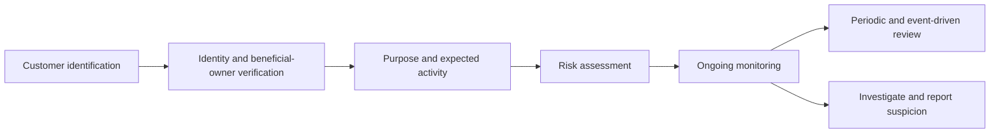
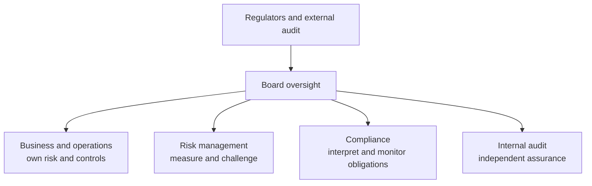

# Financial Regulation, Compliance, And Accounting

Financial regulation defines the legal perimeter in which money, credit,
investment, payments, and risk transfer occur. Compliance translates those
external obligations into policies, controls, evidence, and decisions.
Accounting determines how economic events are recognized, measured, presented,
and disclosed.

These functions overlap but answer different questions:

- **regulation:** what activities and outcomes does the law require, permit, or
  prohibit?
- **supervision:** how does an authority assess an institution and intervene?
- **compliance:** how does the institution conform and demonstrate conformity?
- **risk management:** which uncertainties threaten objectives and viability?
- **accounting:** how are financial position and performance represented?
- **audit:** is evidence sufficient to provide independent assurance?

## Why Finance Is Regulated

Finance has characteristics that make ordinary contract law insufficient on
its own:

- customers cannot easily assess institutional solvency or product complexity;
- banks transform maturity and create money-like deposits;
- leverage makes failure nonlinear;
- payment and settlement systems create network dependencies;
- one failure can spread through common exposures and confidence;
- agents can exploit conflicts and information advantages;
- financial crime uses legitimate infrastructure;
- customers can lose essential savings or payment access;
- public safety nets create moral hazard.

Regulation manages trade-offs. Strong protection can reduce failure and abuse
but increase cost, concentration, and barriers to entry. Innovation can improve
access and efficiency while creating new opacity and operational dependency.

## Regulatory Objectives

The objectives can conflict. Requiring every provider to hold substantial fixed
capital may reduce failure risk but exclude smaller entrants and concentrate the
market. Immediate public disclosure of an emerging liquidity problem may improve
transparency but accelerate a run. Strong transaction privacy protects customers
but can make financial-crime investigation harder. Regulation is therefore an
institutional process for balancing public objectives, not a single optimization
formula.

Common objectives include:

- safety and soundness;
- depositor and customer protection;
- investor protection;
- fair, efficient, and transparent markets;
- financial stability and reduced systemic risk;
- market integrity;
- payment reliability;
- competition and access;
- prevention of money laundering, terrorist financing, and sanctions evasion;
- accurate financial disclosure;
- orderly failure and resolution.

Authorities weigh these objectives differently according to mandate.

## The Regulatory Perimeter

The perimeter answers two questions: which rulebook applies, and which authority
can supervise or enforce it? Modern financial groups make this difficult because
one customer journey may involve a bank account, securities broker, payment
institution, custodian, cloud provider, and an offshore venue. The customer sees
one application, but the law sees several entities and activities.

Rules often attach to:

- an **entity**: bank, insurer, broker-dealer, payment institution, fund,
  exchange, custodian;
- an **activity**: taking deposits, lending, arranging investments, executing
  orders, custody, operating a payment system;
- an **instrument**: security, derivative, deposit, e-money, fund interest;
- a **customer**: retail, professional, eligible counterparty;
- a **location**: incorporation, customer residence, marketing, infrastructure;
- an **outcome**: market manipulation, misleading disclosure, sanctions breach.

A company can fall under several regimes at once. Labeling a product "DeFi,"
"utility token," or "technology service" does not determine its legal status.
Authorities generally examine function, rights, control, and actual conduct.

**Example.** A technology company lets users hold a dollar balance, transfer it
to merchants, earn a return, and invest it automatically. The balance could
implicate deposit-taking, e-money or payment safeguarding; the return feature
could add lending or investment regulation; automated investment can add
brokerage or advisory duties. Calling the application a “wallet” does not resolve
any of those functions.

### Authorization And Licensing

Licensing can require:

- fit and proper owners and managers;
- minimum capital;
- governance and internal controls;
- business and recovery plans;
- safeguarding or custody arrangements;
- operational resilience;
- compliance and reporting;
- local presence;
- ongoing fees and examinations.

Authorization is not a guarantee against failure or loss. It means the entity
has entered a supervised perimeter subject to specified rules.

## Prudential Regulation

Prudential regulation focuses on the safety and resilience of institutions and
the system.

### Capital

Regulatory capital provides loss absorption. A simplified risk-based ratio is:

```text
Capital ratio
= eligible regulatory capital / risk-weighted assets
```

Risk weights and model rules attempt to relate exposures to risk, while a
leverage ratio provides a non-risk-weighted backstop:

```text
Leverage ratio
= Tier 1 capital / exposure measure
```

Accounting equity and regulatory capital differ. Regulatory rules apply
deductions, eligibility criteria, tiers, buffers, and transitional treatment.

Capital quality matters because a loss absorber must remain available under
stress. Common equity can absorb losses while the institution continues
operating; some subordinated instruments absorb loss only after a trigger or in
resolution. Goodwill and certain deferred tax assets may be deducted because they
may not provide realizable resources when the firm fails.

Risk-weighted ratios and leverage ratios solve different model problems.
Risk-weighting distinguishes, for example, a secured high-quality exposure from
an unsecured speculative one, but depends on classifications and models. The
leverage ratio ignores those distinctions and limits total balance-sheet
expansion. Buffers above minimum requirements create room to absorb stress,
although distributions may be constrained as buffers are used.

### Liquidity

Liquidity frameworks address short-term stress and structural funding. Common
concepts include:

- stock of high-quality liquid assets;
- stressed net cash outflows;
- stable funding over longer horizons;
- intraday liquidity;
- asset encumbrance;
- concentration;
- contingency funding.

Capital does not substitute for operationally available liquidity.

The liquidity coverage ratio is designed around survival through a short,
specified stress using high-quality liquid assets against net cash outflows. The
net stable funding ratio addresses a longer structural question: whether the
stability of funding is appropriate for the liquidity and maturity of assets.
Neither ratio guarantees survival in every run, and both depend on assumptions
about outflows, asset monetization, legal transferability, and market access.

### Large Exposures And Concentration

Limits restrict excessive exposure to one counterparty or connected group.
Consolidated supervision looks through legal entities to group-wide risk and
related-party transactions.

### Governance And Risk Management

Regulation assigns accountability because policies do not operate themselves.
The board sets risk appetite and oversees the control environment; senior
management turns it into products, limits, staffing, and escalation; independent
risk and audit functions challenge whether this actually works. Weak governance
allows commercial pressure to override otherwise sound written rules.

Supervisors assess:

- board accountability;
- senior-management competence;
- risk culture;
- independent risk, compliance, and audit;
- internal controls;
- remuneration incentives;
- data aggregation;
- outsourcing;
- new-product approval.

### Supervisory Review

Rules cannot enumerate every risk or business model. Supervisory review tests how
an institution applies the framework in practice and whether minimum rules are
sufficient for its particular risk profile. A rapidly growing lender with weak
data and concentrated funding may require stronger governance, capital, or
liquidity even if its reported ratios currently exceed minima.

Supervision can combine:

- regulatory reports;
- offsite analysis;
- onsite examinations;
- meetings and information requests;
- model review;
- stress testing;
- thematic work;
- remediation and enforcement.

Supervisors can impose higher requirements, restrict activities, require
capital or liquidity, replace management where law permits, or initiate
resolution.

Supervision is continuous and evidence-based. Reporting provides routine data;
onsite work tests source records and controls; stress tests reveal sensitivity;
and remediation tracks whether identified weaknesses are corrected. Enforcement
addresses breaches, while ordinary supervision aims to correct weakness before
failure.

### Microprudential And Macroprudential

**Microprudential** supervision focuses on individual institutions.
**Macroprudential** policy focuses on system-wide vulnerabilities and feedback.

Macroprudential tools can include:

- countercyclical capital buffers;
- systemic-institution surcharges;
- sectoral capital measures;
- loan-to-value or debt-service limits;
- liquidity and margin measures;
- stress tests incorporating common shocks.

An action that is prudent for one institution—selling assets quickly—can be
destabilizing if every institution does it simultaneously.

## Recovery, Resolution, And Deposit Protection

Prudential regulation lowers the probability and impact of failure; it does not
assume failure is impossible. **Recovery** is management action intended to
restore a stressed but viable firm, such as raising capital, selling a business,
reducing risk, or activating contingency funding. **Resolution** is the use of
public-authority powers after a firm is failing or likely to fail, with the aim
of maintaining critical functions and allocating losses without relying on
ordinary insolvency alone.

Resolution tools can include transferring deposits and sound assets to another
institution, creating a bridge institution, selling business lines, writing down
or converting eligible liabilities, and imposing a temporary stay on certain
termination rights. The available tools and creditor hierarchy are
jurisdiction-specific. Resolution does not mean every creditor is protected; it
creates an orderly mechanism for deciding who bears loss while preserving
critical services where possible.

Deposit insurance protects eligible depositors up to defined limits and can
reduce incentives for destabilizing runs. It is not a blanket guarantee of every
balance, investment product, token, or payment wallet. Coverage depends on the
institution, account, depositor, currency, ownership structure, and national
scheme. A payment balance safeguarded outside a bank may be protected through
segregation rather than deposit insurance, producing a different recovery path.

| Failure framework | Primary actor | Objective | Important limitation |
|---|---|---|---|
| Recovery | Firm management and board | Restore viability before failure | Actions may be infeasible in market-wide stress |
| Resolution | Resolution authority | Preserve critical functions and allocate loss | Creditors and investors can still lose |
| Deposit insurance | Deposit insurer and safety-net authorities | Protect covered depositors and confidence | Coverage is capped and legally scoped |
| Ordinary insolvency | Court or insolvency administrator | Realize assets and distribute under priority | May be too slow for critical financial services |

## Conduct And Consumer Protection

Conduct regulation addresses how products are designed, marketed, sold, and
serviced.

The lifecycle begins before a sale. Product governance identifies the target
market, the need being served, foreseeable misuse, cost, and distribution
strategy. Distribution controls determine whether the product is appropriate or
suitable for a particular customer. Servicing, complaints, and redress reveal
whether the original design produces fair outcomes. A disclosure delivered at
purchase cannot cure a product whose incentives or mechanics predictably cause
harm.

Core concerns include:

- fair and non-misleading communication;
- product suitability or appropriateness;
- disclosure of cost and risk;
- conflicts of interest;
- best execution;
- client-asset segregation;
- complaints and redress;
- vulnerable customers;
- market abuse;
- data and privacy.

Disclosure is necessary but not always sufficient. A technically complete
document can remain ineffective if complexity, framing, or incentives prevent
understanding.

## Securities Regulation

Securities regulation follows the life of an investment claim. Issuance rules
address what investors are told and how an offering is conducted; market rules
address trading, manipulation, intermediaries, and execution; custody and
post-trade rules protect ownership and settlement. The same economic claim
normally retains these concerns when represented by a token.

IOSCO groups securities regulation around:

1. investor protection;
2. fair, efficient, and transparent markets;
3. reduction of systemic risk.

The framework can cover:

- public offerings and issuer disclosure;
- auditors and credit-rating agencies;
- collective investment schemes;
- broker-dealers and market intermediaries;
- secondary trading venues;
- clearing and settlement;
- derivatives;
- enforcement and cross-border cooperation.

### Issuance

Primary-market rules reduce the information gap between an issuer and investors.
Investors need to understand both the enterprise and the legal rights of the
instrument: payment priority, voting, dilution, maturity, security, covenants,
and use of proceeds. Ongoing disclosure matters because the issuer's condition
changes after the original offering.

Issuers may need a prospectus or disclosure document describing:

- business and governance;
- financial statements;
- instrument rights;
- use of proceeds;
- material risks;
- conflicts and related parties.

Exempt or private offerings generally retain anti-fraud obligations and
transfer restrictions.

### Market Conduct

Rules prohibit or control insider dealing, manipulation, false disclosure,
misuse of orders, and conflicts. Market surveillance and transaction reporting
support enforcement.

Market integrity protects the price-formation process. A manipulative order can
mislead others without executing; wash trades can fabricate volume; an insider
can trade on material non-public information; and a venue can misuse confidential
client orders. Surveillance therefore combines orders, executions, identities,
communications, positions, and cross-venue data rather than reviewing completed
trades alone.

### Intermediary Duties

Broker, dealer, adviser, exchange, and custodian duties differ. Whether a firm
acts as agent or principal affects disclosure, best execution, conflicts, and
capital.

An agent is expected to pursue the client's mandate and disclose relevant
conflicts. A dealer trades from its own inventory and may profit from the spread,
creating a principal relationship rather than pure agency. An adviser recommends
or manages investments; a custodian safeguards and administers assets. Combining
roles is common, but customers must be able to understand when the firm's
economic interest changes.

## Payments And E-Money Regulation

Payment regulation protects both the user-facing transfer and the infrastructure
that completes it. User rules allocate liability for unauthorized payments,
require information on fees and timing, and establish complaint or refund rights.
Institutional rules govern safeguarding, access, security, outsourcing, and
incident reporting. System-level rules address settlement finality, participant
default, liquidity, and operational continuity.

Payments frameworks can regulate:

- payment-service authorization;
- safeguarding of customer funds;
- operational and security controls;
- customer authentication;
- execution time and information;
- unauthorized transaction liability;
- fees and FX transparency;
- access to payment systems;
- outsourcing and incident reporting.

Deposit-taking is usually reserved for banks. E-money or safeguarded payment
balances may look similar to deposits operationally but have different balance
sheet, insurance, and resolution treatment.

A bank deposit is generally a liability used by the bank in its balance-sheet
activities, subject to banking capital, liquidity, and resolution rules. A
safeguarded e-money balance is commonly expected to be backed and separated
under a payments regime rather than intermediated as an ordinary bank loan book.
The precise distinction varies by jurisdiction, but the economic and insolvency
questions should never be inferred from the interface alone.

Systemically important payment systems are also subject to risk-management and
finality standards such as the PFMI.

## KYC, AML, CFT, And Sanctions

### Distinct Regimes

- **KYC/KYB:** identifies and understands customers and businesses.
- **AML/CFT:** prevents, detects, and reports money laundering and terrorist
  financing.
- **proliferation financing controls:** address financing of weapons
  proliferation.
- **sanctions:** implement legally binding restrictions against designated
  persons, entities, countries, sectors, assets, or activity.

Sanctions compliance is not merely a subset of risk-based AML. Some sanctions
prohibitions apply strictly once relevant jurisdiction and facts are present.

### Risk-Based Approach

A risk-based AML framework applies proportionate controls based on customer,
product, geography, channel, and transaction risk.



### Customer Due Diligence

CDD can include:

- identity and reliable verification;
- beneficial ownership and control;
- purpose and intended nature of relationship;
- source of funds or wealth where appropriate;
- politically exposed person status;
- sanctions screening;
- expected activity;
- ongoing review.

Enhanced due diligence addresses higher-risk situations. Simplified measures
may apply where law and risk permit; they do not mean no diligence.

### Transaction Monitoring

Monitoring uses rules, models, and investigator judgment to identify activity
inconsistent with expected behavior or typologies. Alerts are not conclusions.
Investigators combine transactions, customer context, counterparties, external
intelligence, and explanations.

### Suspicious Activity Reporting

When the legal threshold is met, a regulated entity files a confidential report
with the appropriate financial intelligence unit. Terminology such as SAR or
STR varies. Filing is not a criminal conviction, and anti-tipping-off rules can
restrict disclosure to the customer.

### Sanctions Screening

Screening can apply to:

- customers and beneficial owners;
- counterparties;
- payment parties and banks;
- vessels, addresses, and identifiers;
- digital-asset addresses;
- goods, sectors, and jurisdictions.

Name matching produces false positives and false negatives. Effective controls
need data quality, list updates, transliteration, fuzzy matching, ownership and
control analysis, escalation, blocking or rejection rules, and evidence.

## Compliance Is A Control System

Compliance requires more than a policy document.

| Layer | Evidence |
|---|---|
| Obligation inventory | Laws, rules, licenses, interpretations |
| Applicability | Legal entity, product, customer, jurisdiction mapping |
| Policy | Approved principles and responsibilities |
| Procedure | Operational steps and escalation |
| Control | Preventive or detective mechanism |
| Testing | Evidence that design and operation work |
| Monitoring | Metrics, incidents, breaches, regulatory change |
| Remediation | Owner, deadline, validation, closure |

### Regulatory Change

Regulatory change is not complete when a legal memo is circulated. The
institution must translate a source into affected legal entities, products,
contracts, data fields, system behavior, customer communications, reports, and
training. It must also distinguish an enacted law from a proposal, guidance,
speech, court decision, or enforcement settlement because these sources have
different authority and implementation consequences.

The process should:

1. identify new and amended obligations;
2. assess applicability and effective date;
3. map affected products, entities, systems, and contracts;
4. implement changes;
5. test readiness;
6. retain evidence;
7. monitor interpretations and enforcement.

Company websites and legal summaries are not substitutes for primary law and
official guidance.

## Accounting Foundations

### Double-Entry

Every entry has equal debits and credits. The fundamental statement of
financial position is:

```text
Assets=Liabilities+Equity
```

The income statement explains revenue and expense over a period. Cash-flow
statements classify operating, investing, and financing flows. Changes in
equity reconcile owner transactions and comprehensive performance.

### Recognition

Recognition determines whether an asset, liability, income, or expense appears
in the primary statements. It depends on applicable standards, the nature of
rights and obligations, relevance, faithful representation, and measurement
uncertainty.

Recognition is distinct from disclosure and custody. Holding an asset for a
customer does not automatically make it the custodian's asset; controlling an
asset economically can require recognition even when legal title sits in a
special-purpose vehicle. Derecognition is equally important: transferring a token
or receivable does not remove it from the balance sheet if the transferor retains
substantially relevant rights, obligations, or control under the applicable
standard.

### Measurement

Measurement determines the number attached after recognition. Historical cost
anchors the amount to an original transaction; amortized cost subsequently
reflects repayments, effective interest, and impairment; fair value updates the
amount to a current market-participant measure. The selected basis changes when
gains and losses appear and how volatile the reported balance sheet becomes.

Common bases include:

- historical cost;
- amortized cost;
- fair value;
- value in use;
- fulfillment value;
- current cost.

The same economic instrument can be measured differently depending on business
model, contractual cash flows, designation, and accounting framework.

Under IFRS 9, financial-asset classification considers both the business model
for managing the asset and whether contractual cash flows are solely payments of
principal and interest. This can lead to amortized cost, fair value through other
comprehensive income, or fair value through profit or loss. The classification
is an accounting result, not a statement that one asset is economically safe.

### Fair Value

Fair value estimates an orderly market transaction under the relevant standard.
Inputs are often grouped by observability:

- quoted prices for identical assets;
- other observable market inputs;
- significant unobservable inputs.

Model-based value is not necessarily cash obtainable in a forced sale.
Valuation adjustments can reflect bid-ask spread, credit, funding, model,
concentration, and close-out cost.

The hierarchy concerns inputs, not the inherent quality of the asset. A Level 1
measurement uses an unadjusted quoted price in an active market for an identical
item. Level 2 uses other observable inputs, while Level 3 relies materially on
unobservable inputs. A model using observable yield curves may still be complex;
a Level 3 value may be carefully governed but remains more dependent on
assumptions.

### Accrual And Cash

Accrual accounting recognizes economic events when rights and obligations
arise, not only when cash moves. A loan can accrue interest before payment; a
credit loss can be recognized before default.

### Provisioning And Expected Credit Loss

Financial-instrument standards can require forward-looking expected credit
losses. Provisioning reduces accounting profit and asset carrying value or
creates an allowance. Accounting provisions and regulatory capital serve
related but distinct purposes.

Expected credit loss is probability-weighted and reflects the timing of cash
shortfalls, reasonable forward-looking information, and the instrument's credit
deterioration. Recognition before an actual default responds to the problem that
an incurred-loss approach can report credit deterioration too late. Estimates
remain sensitive to macroeconomic scenarios, staging or credit-deterioration
judgments, recoveries, and model governance.

### Consolidation

Consolidation asks which entities are controlled and included as one reporting
group. Legal ownership percentage is important but not always decisive;
contractual power, variable returns, and ability to affect returns can matter.

Structured entities, funds, protocol foundations, and special-purpose vehicles
require careful analysis.

Consolidation prevents a parent from presenting only its direct legal shell while
economically controlled assets, liabilities, income, and expenses sit elsewhere.
It is different from prudential consolidation, which can include or exclude
entities according to supervisory objectives. Both need a clear group map, but
they may draw the boundary differently.

### Off-Balance-Sheet Does Not Mean No Risk

Commitments, guarantees, derivatives, assets under custody, and special-purpose
vehicles can create material exposure without appearing as ordinary funded
assets. Disclosure and regulatory exposure measures may capture them
differently.

## Capital Versus Accounting

| Concept | Accounting focus | Prudential focus |
|---|---|---|
| Equity/capital | Residual assets minus liabilities | Eligible loss-absorbing resources |
| Asset value | Standard-specific measurement | May receive deductions or risk weights |
| Loss | Recognition under accounting rules | Capital adequacy under stress |
| Provision | Expected credit loss or obligation | Can affect capital subject to treatment |
| Consolidation | Financial-reporting control | Prudential group and risk perimeter |

A product can be profitable under accounting and unattractive after capital,
liquidity, and stress requirements.

## Audit And Assurance

### Internal Audit

Internal audit independently evaluates governance, risk management, and
controls. It reports within the organization, commonly with functional
accountability to the board or audit committee.

### External Audit

External auditors provide an opinion on whether financial statements are
prepared, in all material respects, under the applicable framework. Reasonable
assurance is high but not absolute, and an unmodified opinion is not a guarantee
of future solvency or absence of fraud.

### Assertions And Evidence

An assertion is management's claim embedded in a financial statement. Auditors
design procedures around the risk that a material claim is wrong. Confirmation
with a bank may support existence of cash; inspecting contracts may support
rights; testing subsequent receipts may support valuation of a receivable. No
single procedure proves every assertion.

Audit procedures address assertions such as:

- existence;
- rights and obligations;
- completeness;
- valuation;
- accuracy;
- cutoff;
- presentation.

For a digital asset, proof that an address contains tokens supports existence
or control at a moment, but not necessarily:

- legal ownership;
- absence of undisclosed liabilities;
- exclusive control of keys;
- correct valuation;
- recoverability;
- client segregation.

This is why proof of reserves is not a complete financial-statement audit. It can
support a narrow assertion about selected assets at a point in time, but may omit
liability completeness, ownership, encumbrance, valuation, internal controls, and
events after the snapshot.

### Materiality

Material information could reasonably influence users' decisions. Materiality
is quantitative and qualitative. A small illegal payment, related-party
transaction, or key-control failure may be material because of nature.

## Compliance, Risk, And Audit Boundaries



Risk and compliance advise and challenge; they do not remove business
accountability. Internal audit assesses; it should not own the controls it later
audits. Regulators supervise; they do not manage the institution.

## Applying The Framework To Digital Assets

For a digital-asset activity, separate:

1. **asset classification:** security, commodity-like asset, payment token,
   deposit, e-money, derivative, fund interest, or another category;
2. **activity classification:** issuance, exchange, brokerage, dealing, advice,
   custody, transfer, lending, payments, staking;
3. **entity and location:** legal operator, governance body, interface,
   customer, and infrastructure;
4. **prudential treatment:** capital, liquidity, concentration, and exposure;
5. **conduct duties:** disclosure, suitability, conflicts, execution, custody;
6. **financial-crime controls:** CDD, monitoring, Travel Rule, sanctions;
7. **accounting:** recognition, control, custody, valuation, revenue, liability;
8. **tax:** income, gains, withholding, transaction, and reporting;
9. **failure:** resolution, insolvency, customer asset status, and recovery.

Decentralization is not binary. Legal analysis may attribute obligations to
issuers, developers, governance participants, companies, front ends,
validators, or intermediaries according to facts and jurisdiction.

Jurisdiction-specific digital-asset rules are covered in
[Digital-Asset Regulation](../../07-compliance-analytics-regulation-and-security/02-regulation/digital-asset-regulation.md).

## Common Misconceptions

| Misconception | More accurate explanation |
|---|---|
| Regulated means guaranteed safe | Regulation reduces and manages risk; failures remain possible |
| Compliance owns all regulatory risk | Business owns its activity; compliance interprets, advises, monitors, and challenges |
| Passing KYC makes every transaction legitimate | KYC is one control; ongoing behavior, sanctions, fraud, and product rules still matter |
| A blockchain address proves legal ownership | It proves protocol-level control or state, not necessarily legal title |
| Audit proves no fraud exists | Audit provides bounded assurance under materiality and evidence constraints |
| Accounting capital equals available cash | Equity, regulatory capital, and liquidity are different |
| Code replaces regulation | Code executes rules; law determines rights, obligations, and accountability |

## Analytical Checklist

For any financial activity:

1. Which entities, activities, instruments, customers, and jurisdictions are in
   scope?
2. Which licenses or registrations apply?
3. Which prudential, conduct, payment, AML, sanctions, data, and tax rules apply?
4. Who is accountable for each obligation?
5. How is the obligation translated into a preventive or detective control?
6. What evidence proves the control operated?
7. How are exceptions escalated and remediated?
8. Which financial-statement items arise?
9. How are assets, liabilities, revenue, expense, and custody measured?
10. What disclosures are material?
11. What independent testing and audit apply?
12. How do rules and accounting change during failure or insolvency?

## Connections

- [Financial Risk Management](financial-risk-management.md) explains the risk
  framework underlying prudential controls.
- [Money, Banking, And Balance Sheets](../01-money-banking-and-payments/money-banking-and-balance-sheets.md)
  develops capital, liquidity, deposits, and monetary claims.
- [Securities And Financial Instruments](../02-financial-markets/securities-and-financial-instruments.md)
  explains the legal and economic claims being regulated.
- [Crypto AML, Sanctions, And The Travel Rule](../../07-compliance-analytics-regulation-and-security/01-aml-and-blockchain-analytics/crypto-aml-sanctions-and-travel-rule.md)
  applies financial-crime concepts to digital assets.

## References

- Basel Committee on Banking Supervision,
  [Core Principles for effective banking supervision](https://www.bis.org/bcbs/publ/d573.htm)
- Basel Committee on Banking Supervision,
  [Basel Framework](https://www.bis.org/basel_framework/)
- International Organization of Securities Commissions,
  [Objectives and Principles of Securities Regulation](https://www.iosco.org/library/pubdocs/pdf/IOSCOPD561.pdf)
- Financial Action Task Force,
  [The FATF Recommendations](https://www.fatf-gafi.org/en/publications/Fatfrecommendations/Fatf-recommendations.html)
- CPSS-IOSCO,
  [Principles for financial market infrastructures](https://www.bis.org/cpmi/publ/d101.htm)
- IFRS Foundation,
  [Conceptual Framework for Financial Reporting](https://www.ifrs.org/issued-standards/list-of-standards/conceptual-framework/)
- IFRS Foundation,
  [IFRS 9 Financial Instruments](https://www.ifrs.org/issued-standards/list-of-standards/ifrs-9-financial-instruments/)
- International Auditing and Assurance Standards Board,
  [International Standards on Auditing](https://www.iaasb.org/publications/2025-handbook-international-quality-management-auditing-review-other-assurance-and-related-services)
- Financial Stability Board,
  [Key Attributes of Effective Resolution Regimes for Financial Institutions](https://www.fsb.org/2024/04/key-attributes-of-effective-resolution-regimes-for-financial-institutions-revised-version-2024/)
- International Association of Deposit Insurers,
  [Core Principles for Effective Deposit Insurance Systems](https://www.iadi.org/what-we-do/policy/core-principles/)
- IFRS Foundation,
  [IFRS 13 Fair Value Measurement](https://www.ifrs.org/issued-standards/list-of-standards/ifrs-13-fair-value-measurement/)
- IFRS Foundation,
  [IFRS 10 Consolidated Financial Statements](https://www.ifrs.org/issued-standards/list-of-standards/ifrs-10-consolidated-financial-statements/)
