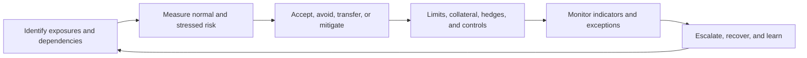
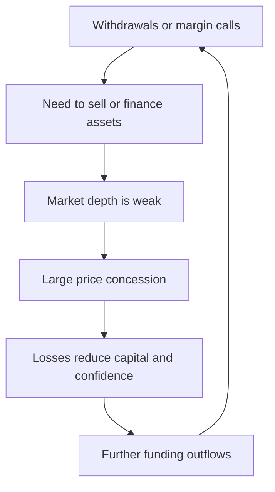

# Financial Risk Management

Risk is the possibility that actual outcomes differ materially from intended
outcomes. Financial risk management does not seek to eliminate all uncertainty:
an institution earns returns by accepting selected risks. It seeks to identify,
measure, price, limit, control, monitor, and survive those risks without
violating obligations or transferring unacceptable harm to customers and the
financial system.

Risk categories are analytical lenses, not isolated boxes. A cyber incident can
become an operational outage, cause missed settlement, create liquidity needs,
trigger customer withdrawals, damage reputation, and ultimately threaten
solvency.

## The Risk Management Cycle

Risk management is a feedback process, not an annual inventory. A firm identifies
how it can fail, measures current exposure against appetite, chooses controls,
observes whether those controls operate, and changes the model as products and
conditions evolve. Incidents and near misses feed back into every earlier stage.



Effective management requires:

- clear ownership;
- complete and timely data;
- independent challenge;
- limits tied to risk capacity;
- escalation with real authority;
- stress and reverse-stress testing;
- contingency and recovery plans;
- incentives consistent with long-term outcomes.

## Risk Capacity, Appetite, Tolerance, And Limits

- **risk capacity:** maximum loss or disruption the organization can absorb
  before breaching capital, liquidity, legal, or viability constraints;
- **risk appetite:** types and aggregate levels of risk it deliberately accepts;
- **risk tolerance:** acceptable variation around objectives;
- **limits:** operational quantitative or qualitative boundaries.

Limits can apply by counterparty, issuer, asset, sector, country, currency,
product, maturity, risk factor, wallet, smart contract, venue, or settlement
route. A limit is ineffective if exposures cannot be aggregated promptly or
breaches are routinely waived.

## Credit Risk

Credit risk is loss caused by an obligor failing to perform.

### Expected Loss

A common simplified formulation is:

```text
Expected loss
= PD × LGD × EAD
```

where:

- `PD` is probability of default;
- `LGD` is loss given default;
- `EAD` is exposure at default.

For a portfolio across time, the calculation is more complex: default,
exposure, recovery, correlation, discounting, guarantees, and economic
conditions can all vary.

Expected loss is a pricing and provisioning concept. Capital protects against
unexpected loss beyond the expected amount, subject to the chosen confidence
and regulatory framework.

### Credit Assessment

Credit analysis asks whether a borrower can and will perform when payment is due,
and what the lender can recover if it does not. A valuable collateral mark is not
enough: cash-flow capacity, seniority, covenants, legal enforceability, correlation,
and stressed liquidation value determine the actual loss distribution.

Assessment considers:

- ability and willingness to pay;
- cash flow and leverage;
- business and industry risk;
- collateral and guarantees;
- legal ranking and covenants;
- currency and refinancing needs;
- country and transfer risk;
- concentration and correlation;
- recovery process.

### Concentration

Many individually acceptable loans can be dangerous together. Concentration can
arise from common:

- borrower or group;
- sector;
- geography;
- currency;
- collateral;
- technology;
- funding source;
- market factor.

Crypto exposures can share hidden concentration through the same stablecoin,
bridge, oracle, custodian, cloud provider, governance key, or liquidity venue.

## Counterparty Credit Risk

Counterparty credit risk arises where exposure changes with market value before
final settlement, especially derivatives, securities financing, and unsettled
trades.

### Current And Potential Exposure

- **current exposure:** positive replacement value today;
- **potential future exposure:** possible increase before close-out;
- **wrong-way risk:** exposure rises as the counterparty's credit quality falls.

An exchange owing assets to clients creates counterparty exposure even if the
client's displayed account balance is stable.

### Mitigation

- legal netting;
- variation and initial margin;
- eligible collateral and haircuts;
- central clearing;
- credit limits;
- diversification;
- frequent settlement;
- independent custody;
- termination and close-out rights.

Mitigation introduces residual risk. Collateral can fall in value, netting can
be unenforceable, margin can arrive late, and closing positions can move the
market.

## Settlement Risk

Settlement risk is loss because a transaction fails to complete as expected.
It includes:

- **principal risk:** delivered one leg, did not receive the other;
- **replacement-cost risk:** must replace a failed trade at a worse price;
- **liquidity risk:** expected incoming funds do not arrive on time;
- **operational risk:** instructions or systems fail.

DvP and PvP reduce principal risk by conditioning one transfer on another. They
do not remove the risk of an unsound settlement asset, participant default
before settlement, or operational disruption.

## Market Risk

Market risk is loss from changes in prices or market variables:

- interest rates and yield curves;
- credit spreads;
- equity prices;
- foreign-exchange rates;
- commodity prices;
- implied volatility;
- correlations and basis relationships.

### Sensitivities

Risk can be approximated through local sensitivities:

- bond duration and convexity;
- option delta, gamma, vega, theta, and rho;
- FX delta;
- credit spread duration;
- key-rate duration;
- basis sensitivities.

Local sensitivities can fail under large, nonlinear, or discontinuous moves.

### Value At Risk

Value at Risk estimates a loss threshold over a horizon at a confidence level.
A one-day 99% VaR of 10 million means the model estimates that losses exceed 10
million on approximately 1% of modeled days—not that maximum loss is 10
million.

Methods include:

- historical simulation;
- parametric variance-covariance;
- Monte Carlo simulation.

VaR limitations include:

- little information about loss severity beyond the threshold;
- unstable correlations and volatility;
- inadequate history;
- model and data error;
- poor treatment of illiquidity and jumps;
- false precision.

### Expected Shortfall

Expected shortfall estimates average loss conditional on being beyond a chosen
quantile:

```text
ES_α = E[L | L ≥ VaR_α]
```

It better reflects tail severity but remains model-dependent.

## Interest-Rate Risk

Interest-rate risk affects both trading positions and the banking book.

- fixed-rate asset values fall as required yields rise;
- assets and liabilities reprice at different times;
- customers prepay loans or withdraw deposits differently from assumptions;
- yield curves change shape, not only level;
- hedges can create basis and optionality risk.

Economic-value measures estimate present-value effects. Earnings measures
estimate changes to net interest income over a horizon. Both are needed.

## Liquidity Risk

### Funding Liquidity

The risk of being unable to meet obligations when due without unacceptable
loss.

### Market Liquidity

The risk of being unable to sell, hedge, or close a position near its observed
price.

### Intraday Liquidity

The risk of lacking funds or collateral at a specific moment during the day.

These interact:



### Liquidity Measurements

- contractual cash-flow ladder;
- expected and stressed outflows;
- survival horizon;
- liquid-asset buffer;
- funding concentration;
- asset encumbrance;
- collateral availability;
- liquidation horizon and price impact;
- intraday peak usage.

Stable historical behavior can reverse during a run. Operationally available
liquidity matters more than nominal asset value.

## Leverage Risk

Leverage uses borrowing, derivatives, or embedded structures to create exposure
larger than equity.

```text
Balance-sheet leverage
= (assets) / (equity)
```

If assets are 1,000 and equity is 50, a 5% asset loss eliminates equity before
considering income, hedging, or liability changes.

Derivatives can create large economic leverage with limited initial cash.
Gross notional alone can overstate risk, while net mark-to-market can understate
future exposure and liquidation cost.

## Operational Risk

Operational risk is loss from inadequate or failed processes, people, systems,
or external events. Examples include:

- incorrect trade or payment;
- software defect;
- access-control failure;
- fraud or insider abuse;
- third-party outage;
- failed model deployment;
- lost cryptographic keys;
- data corruption;
- legal-documentation error;
- natural disaster.

### Controls

- segregation of duties;
- maker-checker approval;
- least privilege;
- reconciliations;
- change management;
- tested backups and recovery;
- dual control over keys and payments;
- incident response;
- vendor and dependency management;
- business continuity exercises.

Automation reduces manual error but can propagate a defect instantly and at
scale.

## Cyber Risk

Cyber risk overlaps operational risk but requires explicit threat analysis:

- credential theft;
- ransomware;
- supply-chain compromise;
- denial of service;
- data exfiltration;
- transaction manipulation;
- private-key compromise;
- smart-contract exploitation;
- insider misuse.

Risk management covers prevention, detection, containment, recovery, evidence,
notification, and learning. "Immutable" systems can preserve malicious
transactions as effectively as legitimate ones.

## Model Risk

Model risk is adverse consequence from incorrect or misused models.

Sources include:

- conceptual error;
- incomplete variables;
- biased or poor-quality data;
- invalid extrapolation;
- implementation defects;
- parameter instability;
- use outside approved scope;
- human overreliance.

Model governance includes inventory, documentation, validation, change control,
performance monitoring, limitations, overrides, and accountable ownership.

Blockchain analytics risk scores, oracle prices, credit ratings, liquidation
models, and fraud systems are all models or model-like decision systems.

## Legal And Regulatory Risk

Legal risk includes:

- unenforceable contract;
- uncertain asset ownership;
- invalid collateral or netting;
- conflicting jurisdictions;
- insolvency recharacterization;
- breach of privacy, sanctions, securities, or consumer law;
- inadequate disclosure;
- lack of settlement finality.

Code execution does not settle legal characterization. A smart contract can
perform exactly as programmed while the resulting transfer breaches law or
fails to transfer the claimed offchain asset.

## Conduct And Reputational Risk

Conduct risk arises from unfair treatment, conflicts, manipulation,
mis-selling, misuse of information, or poor product governance. Reputation is
not merely public-relations sentiment: lost confidence can cause customer
outflows, higher funding costs, regulatory intervention, and employee loss.

## Strategic And Business Risk

A solvent, compliant product can still fail because:

- demand is insufficient;
- pricing does not cover costs;
- competitors change the market;
- technology becomes obsolete;
- regulation changes economics;
- concentration in one revenue source is excessive.

Business risk belongs in the same integrated framework because it affects
capital generation and viability.

## Systemic Risk

Systemic risk is disruption capable of impairing broad financial services or
the real economy.

Transmission channels include:

- common asset holdings;
- interbank and derivative exposures;
- payment and settlement dependencies;
- fire sales;
- runs;
- collateral and margin spirals;
- critical service providers;
- confidence and information contagion.

A protocol can be systemically important within DeFi even if it is small
relative to global banking. Importance depends on the system boundary and
dependencies being analyzed.

## Hedging

A hedge offsets exposure with another position.

### Basis Risk

Hedge and exposure may not move identically because of:

- different instruments or maturities;
- location or grade;
- collateral and funding;
- liquidity;
- index composition;
- timing;
- counterparty credit.

### Dynamic Hedging

Option and nonlinear exposures require rebalancing as markets move. Transaction
costs, gaps, liquidity, and volatility can make theoretical replication
inexact.

### Hedge Accounting Versus Economic Hedging

An economically sound hedge can produce accounting volatility if recognition
and measurement differ. Hedge accounting has specific qualification,
documentation, and effectiveness rules; it does not determine whether economic
risk is genuinely reduced.

## Stress Testing

Stress testing asks how positions and the institution behave under severe
conditions.

### Types

- **sensitivity:** changes one or a few variables;
- **historical scenario:** replays a past event;
- **hypothetical scenario:** constructs a plausible future shock;
- **reverse stress:** asks what would make the business model fail;
- **system-wide stress:** includes feedback between institutions and markets.

### Good Scenario Design

A scenario should be:

- severe enough to challenge the business;
- internally coherent;
- broad enough to capture interacting risks;
- explicit about time horizon and management actions;
- updated for new products and vulnerabilities;
- skeptical about market liquidity and correlations.

For digital assets, a coherent scenario might combine:

- stablecoin depeg;
- exchange and bridge withdrawal suspension;
- collateral-price fall;
- oracle delay;
- higher blockchain fees;
- validator or sequencer outage;
- counterparty failure;
- legal freeze;
- customer run.

### Management Actions

Stress tests often assume asset sales, hedges, capital raising, or liquidity
facilities. Those actions must be feasible under the same stressed conditions.
Every participant cannot sell the same asset at the unstressed price.

## Risk-Adjusted Return

Raw revenue is not sufficient. Economic evaluation considers:

```text
Risk-adjusted return
= (return - expected loss - costs) / capital or risk measure
```

Implementation varies, but the principle is consistent: revenue earned by
taking unpriced tail, liquidity, legal, or operational risk is not necessarily
economic profit.

## The Three-Lines Model

A common governance arrangement distinguishes:

1. **business and operations:** own and manage risks;
2. **independent risk and compliance:** set frameworks, advise, monitor, and
   challenge;
3. **internal audit:** independently assesses governance and controls.

Boards oversee risk appetite and senior management. External audit, regulators,
and supervisors provide additional assurance or oversight but do not replace
internal accountability.

The model fails if the second line designs the business's controls for it, if
the first line treats risk as an approval department, or if audit becomes a
continuous operational control.

## Risk Data And Aggregation

Risk decisions depend on knowing total exposure. Data must map:

- legal entity;
- customer and beneficial owner;
- counterparty group;
- instrument and underlying;
- currency and maturity;
- collateral and guarantor;
- venue, custodian, wallet, and protocol;
- risk factor;
- jurisdiction.

Duplicate identifiers, stale prices, missing derivatives, and inconsistent
netting can make an apparently precise risk report materially wrong.

## Early-Warning Indicators

Indicators can include:

- limit usage and breaches;
- credit downgrades and spread widening;
- collateral disputes;
- deposit and funding outflows;
- market depth and haircut changes;
- settlement failures;
- operational incidents;
- unusual customer behavior;
- vendor service degradation;
- governance or key changes;
- oracle deviation and protocol utilization;
- audit findings and overdue remediation.

An indicator needs thresholds, ownership, escalation, and action. A dashboard
without response rules is observation, not control.

## Failure Analysis

Separate:

1. **trigger:** the event that begins visible failure;
2. **vulnerability:** condition that made the system fragile;
3. **transmission:** how losses or disruption spread;
4. **control failure:** why prevention or containment failed;
5. **impact:** financial, customer, legal, and systemic consequences;
6. **recovery:** liquidity, recapitalization, resolution, or technical response;
7. **lesson:** specific change supported by evidence.

Calling a price fall "the cause" can miss leverage, maturity mismatch,
concentration, governance, and inaccurate records that made the fall fatal.

## Analytical Checklist

For any product, protocol, company, or portfolio:

1. What economic exposure is being accepted?
2. Which legal entities and counterparties bear it?
3. How is it measured under normal and stressed conditions?
4. Which concentrations and common dependencies exist?
5. What capital and liquidity absorb loss?
6. Which limits prevent excessive exposure?
7. What collateral, netting, insurance, or hedge mitigates it?
8. What residual and basis risk remains?
9. Which models and data drive decisions?
10. What operational and cyber failures are plausible?
11. What legal and conduct obligations apply?
12. How quickly can exposure be reduced?
13. What feedback loops arise during stress?
14. Who owns escalation and recovery?
15. What would make the activity non-viable?

## Connections

- [Money, Banking, And Balance Sheets](../01-money-banking-and-payments/money-banking-and-balance-sheets.md)
  distinguishes capital, liquidity, and solvency.
- [Securities And Financial Instruments](../02-financial-markets/securities-and-financial-instruments.md)
  explains the contracts creating financial exposure.
- [Financial Regulation, Compliance, And Accounting](financial-regulation-compliance-and-accounting.md)
  explains prudential and conduct frameworks.
- [DeFi Risk, Security, And Economic Attacks](../../04-decentralized-finance/04-defi-risk-and-failures/defi-risk-security-and-economic-attacks.md)
  applies integrated risk analysis to protocols.

## References

- Basel Committee on Banking Supervision,
  [Core Principles for effective banking supervision](https://www.bis.org/basel_framework/chapter/BCP/40.htm)
- Basel Committee on Banking Supervision,
  [General credit risk management](https://www.bis.org/basel_consolidated_guidelines/chapter/CRI/10.htm)
- Basel Committee on Banking Supervision,
  [Liquidity risk management and supervision](https://www.bis.org/basel_consolidated_guidelines/chapter/LQY/10.htm)
- Basel Committee on Banking Supervision,
  [Stress testing](https://www.bis.org/basel_consolidated_guidelines/chapter/RMA/30.htm)
- Basel Committee on Banking Supervision,
  [Counterparty credit risk](https://www.bis.org/basel_framework/chapter/SRP/32.htm)
- Basel Committee on Banking Supervision,
  [Principles for effective risk data aggregation and risk reporting](https://www.bis.org/publ/bcbs239.htm)
- Committee of Sponsoring Organizations of the Treadway Commission,
  [Enterprise Risk Management](https://www.coso.org/enterprise-risk-management)
- Institute of Internal Auditors,
  [The IIA's Three Lines Model](https://www.theiia.org/en/content/position-papers/2020/the-iias-three-lines-model-an-update-of-the-three-lines-of-defense/)
