# Blockchain Architecture

Blockchain architecture describes how a blockchain is built internally: how nodes communicate, how transactions are executed, how blocks are produced, how state is stored, how consensus is reached, and how the system exposes data to wallets and applications.

A blockchain is a live distributed system made of software clients, databases,
networks, execution engines, consensus rules, storage formats, APIs, and
economic actors—not merely an abstract replicated ledger or state machine.

A useful intuition is that a blockchain is not one component. It is a pipeline:

1. Users submit signed transactions.
2. Nodes receive and validate those transactions.
3. Block producers order transactions into blocks.
4. Execution engines apply the transactions to state.
5. Consensus decides which blocks become canonical.
6. Storage systems preserve history, state, and commitments.
7. APIs expose the chain to wallets, apps, indexers, explorers, and institutions.

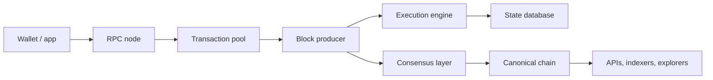

This diagram is intentionally simplified. Real chains differ in whether they
have public mempools, separate consensus and execution clients, sequencers,
specialized virtual machines, local fee markets, parallel execution, rollups, or
data-availability layers.

## Architectural Layers

Blockchain systems can be described through functional layers. These are not always separate pieces of software, but they are separate responsibilities.

| Layer / function | Main responsibility | Typical questions |
|---|---|---|
| Networking | Propagate transactions, blocks, votes, and peer data | How do nodes find peers and relay data? |
| Execution | Apply transactions and compute state changes | What rules run when a transaction executes? |
| State/storage | Store balances, contract data, history, and commitments | What data must nodes keep and prove? |
| Consensus | Agree on canonical blocks and ordering | Which block/history is accepted? |
| Settlement | Provide finality and dispute resolution for assets/state | Where does final economic/legal finality occur? |
| Data availability | Make transaction data available for verification | Can others reconstruct and verify state? |
| API/access | Serve wallets, apps, explorers, and institutions | How do users read and write to the chain? |

In early blockchain systems, these functions were tightly bundled. Bitcoin and Solana are largely monolithic in the sense that the same base chain handles execution, data publication, consensus, and settlement. Modern Ethereum increasingly separates concerns, with Layer 2 rollups doing execution and Ethereum Layer 1 acting as settlement and data availability infrastructure.

> **Important distinction:** "Layer" can mean a functional responsibility, a protocol level, or a piece of software. A consensus layer, a Layer 1, and a data availability layer are related ideas, but they are not interchangeable terms.

## Node Architecture

A node is not just a computer with a copy of the chain. It is a bundle of services that communicate with peers, validate data, execute state transitions, maintain databases, and expose interfaces.

A simplified full node has these internal components:

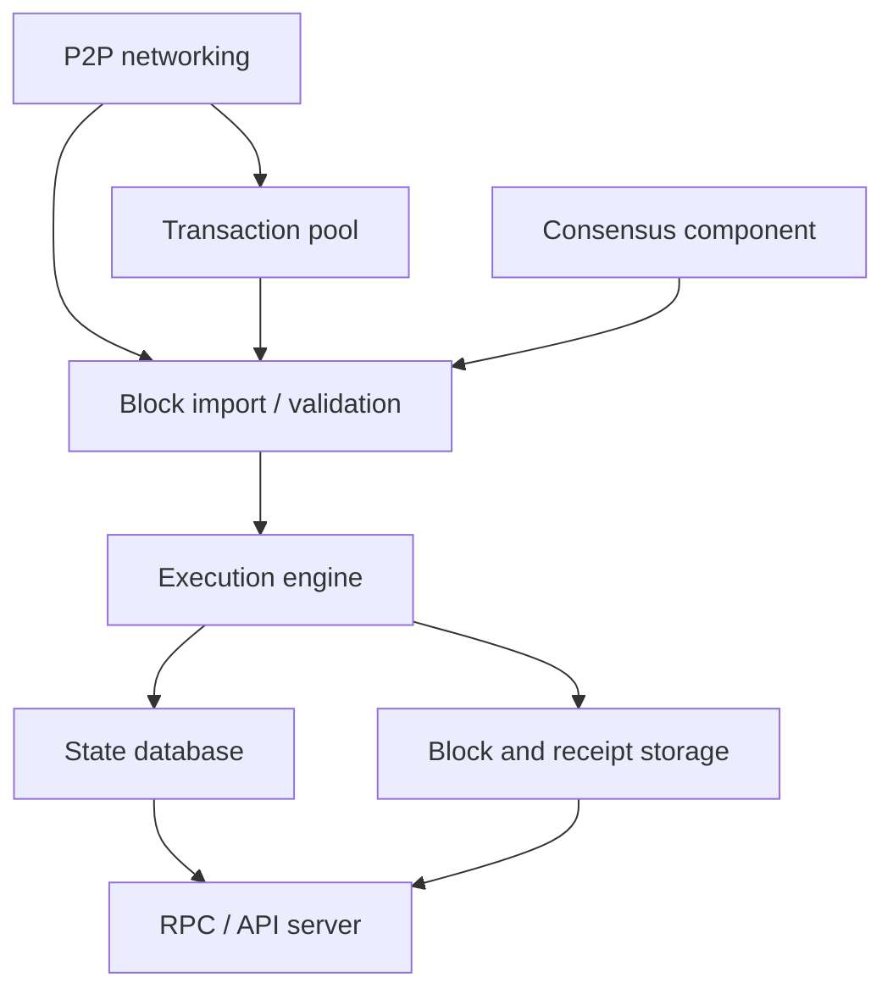

Each component solves a different problem:

- **P2P networking** finds peers and exchanges blocks, transactions, and protocol messages.
- **Transaction pool** stores pending transactions that may be included in future blocks.
- **Block import/validation** checks whether received blocks satisfy protocol rules.
- **Execution engine** runs transactions and calculates the resulting state.
- **State database** stores the current state needed to validate new transactions.
- **History storage** stores blocks, receipts, logs, and other historical data.
- **Consensus component** decides whether a block belongs to the canonical chain.
- **RPC/API server** lets wallets, applications, indexers, and users interact with the node.

This structure matters because different infrastructure providers optimize for different roles. A validator node needs reliable block production and signing. An archive node needs historical state. An RPC node needs high query availability. A light client needs compact verification rather than complete storage.

## Execution

Execution is the process of applying transactions to the current state.

If the current state says Alice has 10 tokens and a valid transaction sends 3 tokens to Bob, execution updates Alice's balance, Bob's balance, fees, and any related metadata. If the transaction calls a smart contract, execution may run code, read and write contract storage, emit logs, call other contracts, and consume gas.

Execution must be deterministic. If two honest nodes start from the same state and process the same ordered transactions under the same protocol rules, they must produce the same new state. If one node produces a different result, the network cannot maintain a shared ledger.

The execution pipeline usually looks like this:

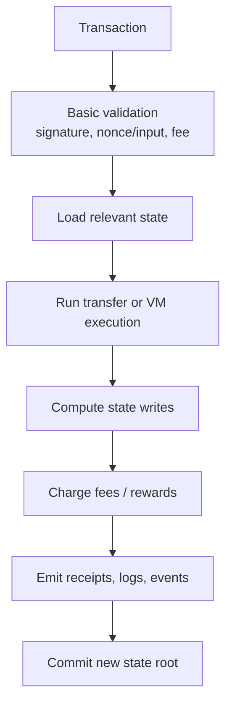

### Execution Rules

Execution rules define what a valid state transition looks like.

They include:

- signature checks;
- balance or UTXO checks;
- nonce or replay-prevention rules;
- fee and gas rules;
- smart contract virtual machine rules;
- token transfer rules;
- validator or staking rules;
- limits on block size, compute, memory, or storage access.

In a simple payment chain, execution may be mostly balance updates. In a smart contract chain, execution can be much more complex because transactions can trigger arbitrary contract logic within protocol limits.

### Fake Scenario: Contract Execution

Suppose Dana swaps 1 ETH for USDC on a decentralized exchange.

The transaction is not just "send ETH." Execution may involve:

1. Checking Dana's signature and nonce.
2. Sending ETH into the exchange contract.
3. Reading the pool's ETH and USDC balances.
4. Calculating the swap price and fee.
5. Updating pool reserves.
6. Sending USDC to Dana.
7. Emitting logs so wallets and indexers can display the swap.
8. Charging gas for computation and storage writes.

If every node executes those steps from the same prior state, every node should compute the same resulting state.

## Virtual Machines

A virtual machine is the execution environment for smart contracts or on-chain programs. It defines what instructions can run, how computation is metered, how memory/storage works, and how contracts interact.

| VM / execution model | Used by | Design intuition | Trade-off |
|---|---|---|---|
| EVM | Ethereum and many EVM-compatible chains | General-purpose smart contract runtime with huge ecosystem | Sequential execution model and historical design constraints |
| WASM-based runtimes | Some chains and frameworks | Use WebAssembly-like execution for portability/performance | Ecosystem fragmentation and implementation complexity |
| Move VM | Aptos, Sui variants | Resource-oriented programming for assets | Newer ecosystem, different developer model |
| Bitcoin Script | Bitcoin | Constrained scripting for spending conditions | Not general-purpose application execution |

The VM is where "programmability" becomes concrete. It determines what developers can build, how expensive operations are, and what kinds of bugs are likely.

### Gas And Metering

Smart contract execution needs a metering system. Without metering, a user could submit a transaction that loops forever or consumes excessive resources.

Gas is a unit of computational and storage cost. A transaction specifies how much gas it is willing to use and what fee it will pay. If execution consumes too much gas, the transaction fails or reverts according to chain rules, but the user may still pay for consumed resources.

Gas exists for three reasons:

- to prevent denial-of-service attacks;
- to compensate validators or block producers;
- to allocate scarce blockspace among competing users.

Gas is not just a fee. It is a resource-accounting system for replicated computation.

## State

State is the current condition of the chain: balances, contract storage, validator sets, token ownership, and any other data needed to validate the next transaction.

Nodes need current state to answer questions like:

- whether an account has enough balance;
- whether a nonce is correct;
- what a smart contract's stored variables are;
- who owns a token;
- which validators are active;
- whether collateral is sufficient.

State is often much smaller than full history, but it can still become very large. State growth is one of the major long-term scaling problems because every full node needs enough current state to validate the chain.

### State Commitments

Many blockchains include a compact commitment to state in each block. Ethereum historically uses trie-based structures that commit to account and storage data. The exact data structure is complex, but the intuition is simple: the block header contains a cryptographic fingerprint of the resulting state.

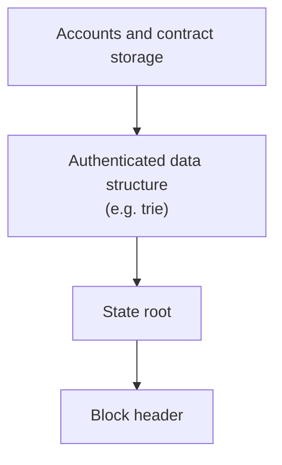

If state changes, the state root changes. This lets nodes verify that execution produced the expected state commitment.

### History vs State

History and state are different.

| Data type | Meaning | Needed for |
|---|---|---|
| Current state | Latest balances/storage/validator info | Validating new transactions |
| Block history | Past blocks and transactions | Auditing and syncing |
| Receipts/logs | Execution results and emitted events | Indexing, explorers, application UI |
| Historical state | State at previous blocks | Archive queries, analytics, debugging |

A full node may not store every historical state. An archive node stores much more historical data so it can answer questions like "what was this contract's storage at block 15,000,000?"

This distinction is crucial for infrastructure. Wallets often need current state. Block explorers need history and logs. Auditors and analytics platforms may need archive data.

## Storage

Storage is one of the least glamorous but most important parts of blockchain architecture. Every node must store enough data to do its job, and the system must keep storage requirements realistic enough for decentralization.

Blockchain storage includes:

- block headers;
- block bodies;
- transactions;
- receipts;
- logs/events;
- current state;
- historical state, depending on node type;
- indexes for fast queries, depending on infrastructure.

The protocol usually defines what data must exist and how it is committed. Infrastructure providers often build additional indexes because raw blockchain data is not convenient for applications.

### Fake Scenario: Wallet Query vs Explorer Query

Nora opens her wallet. The wallet mostly needs current information:

- her ETH balance;
- token balances;
- pending transactions;
- recent activity;
- current gas estimates.

A block explorer needs more:

- all transactions for an address;
- logs emitted by contracts;
- token transfer events;
- contract source verification;
- internal transaction traces;
- historical balances.

Both interact with the same chain, but their storage/query needs are different. This is why specialized RPC providers, indexers, archive nodes, and analytics databases exist.

## Networking

Networking is the layer that lets nodes discover each other and exchange information. It is easy to underestimate because users rarely see it, but poor networking can harm performance, security, and decentralization.

Nodes need to propagate:

- transactions;
- blocks;
- votes or attestations;
- peer information;
- state synchronization data;
- sometimes blobs, chunks, or data availability samples.

Blockchains use peer-to-peer networks because there should not be one central server responsible for distributing blocks. But peer-to-peer networks have trade-offs:

- messages take time to propagate;
- nodes may have different views of pending transactions;
- attackers may try to isolate nodes;
- bandwidth requirements can exclude smaller operators;
- geographic distribution affects latency;
- network topology can advantage well-connected participants.

### Propagation And Temporary Disagreement

If two validators produce blocks around the same time, some nodes may see Block A first while others see Block B first. Consensus and fork-choice rules resolve this disagreement.

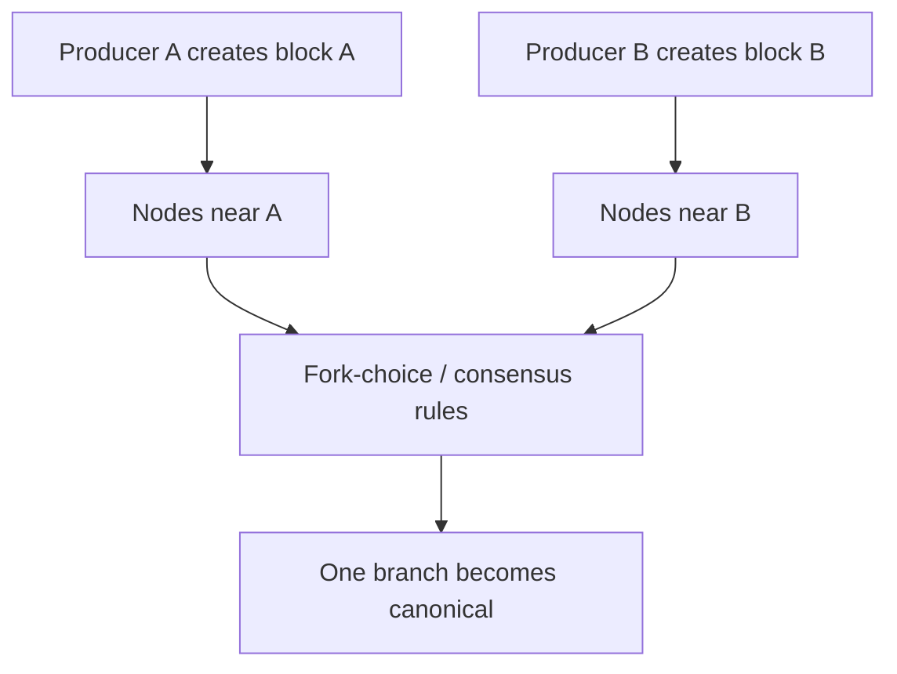

Fast propagation matters because stale or orphaned blocks waste work and can reduce security. In high-performance chains, networking becomes a core engineering bottleneck.

## Consensus And Fork Choice

Consensus is the part of the system that chooses the canonical history. Fork choice is the rule or algorithm nodes use to decide which valid branch to follow when there are competing branches.

Execution answers whether a transaction or block is valid under the rules. Consensus answers which valid block becomes part of the accepted history.

This distinction matters:

- A block can be syntactically valid but not canonical.
- A transaction can be valid but not included.
- A node can execute a block correctly but later switch branches during a reorg.
- Finality rules determine when switching becomes impossible or economically extreme.

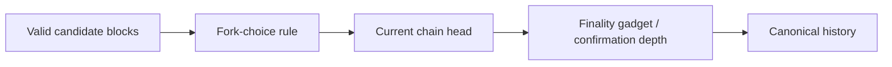

Different systems implement this differently:

- Bitcoin uses Proof of Work and follows the chain with the most accumulated work.
- Ethereum uses Proof of Stake with block proposal, attestations, fork choice, and finality checkpoints.
- BFT-style systems often finalize blocks after enough validators vote.
- Some high-performance chains combine leader schedules, votes, and specialized propagation mechanisms.

Consensus is deep enough to deserve its own note. The architectural point is that consensus sits between execution and settlement finality: it decides which executed state transitions count.

## Execution Clients And Consensus Clients

Ethereum is a useful architecture example because it separates execution and consensus into different client software.

After Ethereum's transition to Proof of Stake, a node typically runs:

- an **execution client**, which handles transactions, EVM execution, state, receipts, and JSON-RPC methods related to execution;
- a **consensus client**, which handles Proof of Stake consensus, beacon chain logic, validator duties, attestations, and finality.

They communicate through an Engine API.

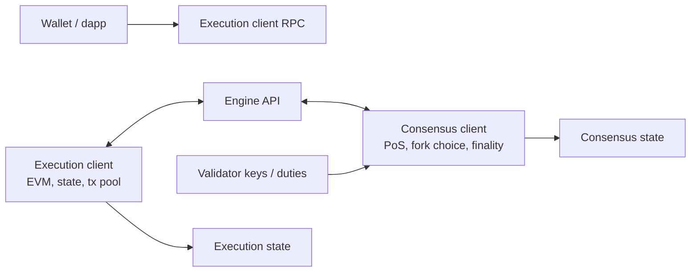

This separation improves modularity and client diversity. Different teams can build execution clients and consensus clients. But it also adds operational complexity because node operators must run compatible software and keep both sides healthy.

## RPC Nodes And Application Access

Most users do not connect directly to the peer-to-peer network. They use wallets and apps that query RPC nodes.

RPC means remote procedure call. In practice, an RPC node exposes API methods such as:

- get account balance;
- estimate gas;
- send raw transaction;
- read contract storage;
- call a contract method without broadcasting;
- fetch logs;
- get block data.

RPC nodes are a major practical dependency. If many wallets rely on the same RPC provider, the user experience becomes centralized even if the underlying blockchain is decentralized.

### Fake Scenario: Hidden Centralization Through RPC

Suppose a decentralized application says it is fully on-chain. Its smart contracts are deployed on Ethereum. Users interact through a website.

But the website uses one RPC provider, one hosted frontend, one indexer, and one wallet connection service. If the RPC provider has an outage or blocks certain requests, many users cannot access the app easily, even though the smart contracts still exist on-chain.

This is an architectural lesson: decentralization must be evaluated across the whole stack, not only the base chain.

| Stack component | Decentralization question |
|---|---|
| Base chain | Who validates and produces blocks? |
| RPC access | Who serves reads/writes to users? |
| Frontend | Can users access the app without one hosted website? |
| Indexing | Who organizes data for the UI? |
| Wallets | Who controls signing and transaction presentation? |
| Governance | Who can upgrade contracts or change parameters? |

## Monolithic Architecture

A monolithic blockchain handles execution, consensus, data availability, and settlement in one base protocol.

Bitcoin is monolithic in a simple sense: the base chain orders transactions, verifies them, stores their data, and provides settlement finality. Solana is also commonly described as monolithic because it aims to scale execution and consensus on one high-performance Layer 1 rather than moving most execution to rollups.

Monolithic design has strengths:

- simpler mental model for users and developers;
- shared liquidity and state on one chain;
- fewer cross-layer assumptions;
- direct composability between applications;
- one canonical settlement environment.

It also has trade-offs:

- every validating node may face higher hardware requirements;
- scaling can pressure decentralization;
- upgrades affect the whole system;
- one chain must optimize many functions at once;
- congestion in one application area can affect others.

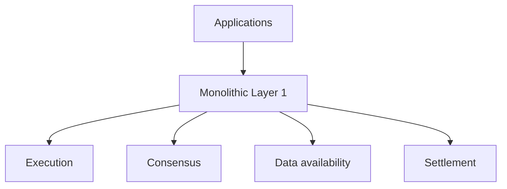

Monolithic does not mean unsophisticated. It means the protocol tries to provide the major blockchain functions in one integrated system.

## Modular Architecture

Modular blockchain architecture separates core functions across different layers or protocols.

Instead of one chain doing everything, one layer might execute transactions, another might provide data availability, and another might provide settlement/finality.

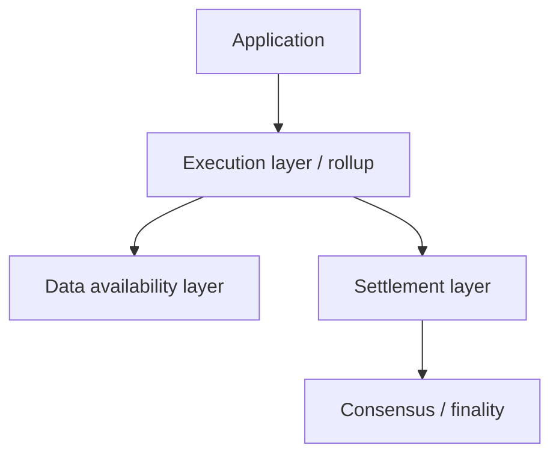

The modular thesis is that specialization can scale better. Execution layers can optimize for application throughput. Data availability layers can optimize for publishing/verifying data. Settlement layers can optimize for security and dispute resolution.

The cost is complexity. Users and developers must understand more moving parts:

- where execution happens;
- where transaction data is published;
- where assets are bridged;
- where finality is inherited;
- who sequences transactions;
- how withdrawals work;
- what happens if one layer fails.

## Data Availability

Data availability means that the data needed to verify or reconstruct the chain's state transitions is actually available to the network.

This sounds subtle, but it is central to rollups and modular architectures. If a block producer or rollup operator claims a new state root is valid but withholds the transaction data, others may be unable to verify the state transition.

Data availability is different from data storage forever. The immediate question is whether the relevant data was published enough for validators or users to check the transition and protect themselves.

### Fake Scenario: The Data Withholding Problem

Imagine a rollup operator posts a new state root saying:

"The rollup state is now `0xABC...`."

But the operator does not publish the transaction batch that produced that state root.

Users cannot independently reconstruct the state. They cannot know whether balances were updated correctly. Even if the state root looks cryptographic and official, the missing data prevents verification.

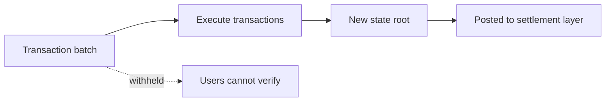

This is why rollups publish transaction data or compressed data to a data availability layer. Without available data, the system risks becoming a black box.

## Rollup Architecture

A rollup is a system that executes transactions outside a base Layer 1 but posts enough information back to the Layer 1 or data availability layer so users can verify or challenge the rollup's state.

At a high level:

1. Users submit transactions to the rollup.
2. A sequencer orders transactions.
3. The rollup executes the batch.
4. The rollup posts data and/or commitments to a base layer.
5. Fraud proofs or validity proofs protect the state transition depending on design.
6. Users can withdraw assets through the settlement layer under the rollup's rules.

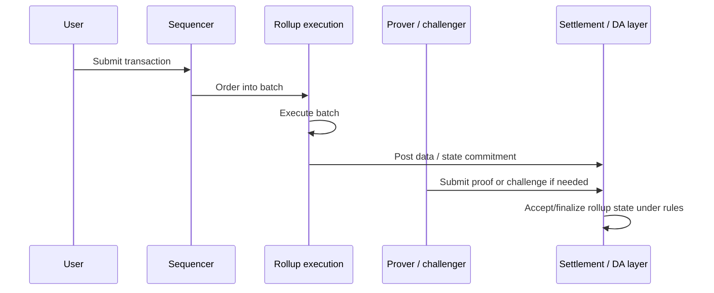

### Sequencers

A sequencer orders transactions for a rollup. It provides fast user experience because users can receive quick pre-confirmations from the sequencer before the batch is finalized on Layer 1.

Sequencers are powerful because ordering affects:

- transaction inclusion;
- MEV opportunities;
- censorship risk;
- latency;
- user experience;
- fairness.

Many rollups have centralized or semi-centralized sequencers today. This does not necessarily mean user funds are fully custodial, but it does create operational and censorship assumptions.

### Provers And Challengers

Rollups use different verification models.

| Rollup type | Verification method | Main intuition | Trade-off |
|---|---|---|---|
| Optimistic rollup | Fraud proofs / challenge windows | Assume batches are valid unless challenged | Withdrawals may be delayed; challengers must monitor |
| ZK rollup | Validity proofs | Prove state transition correctness cryptographically | Proof generation is complex and expensive |

In both designs, the architecture separates execution from settlement. The rollup executes many transactions cheaply, while the base layer provides stronger security or dispute resolution.

## Settlement Layer

A settlement layer is where final disputes or asset exits are resolved. In many Ethereum rollup designs, Ethereum Layer 1 is the settlement layer.

Settlement layer responsibilities may include:

- holding bridge contracts;
- accepting state roots;
- verifying validity proofs;
- resolving fraud challenges;
- managing withdrawals;
- defining finality for rollup assets;
- providing the base asset/security environment.

Settlement is not the same as execution. A rollup may execute thousands of transactions, but the settlement layer decides whether the resulting state is accepted under the rollup's rules.

### Fake Scenario: Rollup Withdrawal

Maya has 1 ETH on a rollup and wants to withdraw to Ethereum Layer 1.

The withdrawal process may involve:

1. Maya initiates withdrawal on the rollup.
2. The rollup includes the withdrawal in a batch.
3. The batch/state commitment is posted to Ethereum.
4. The system waits for proof verification or a challenge period.
5. Maya claims ETH from the Layer 1 bridge contract.

The bridge contract is the settlement anchor. It only releases funds if the rollup's rules say the withdrawal is valid.

## Data Availability Layer

A data availability layer focuses on making transaction data available so others can verify state transitions.

Ethereum provides data availability for many rollups through calldata and blob space. Celestia is an example of a project focused specifically on data availability and consensus for modular chains. Other designs use committees or alternative DA providers with different security assumptions.

| DA approach | Security intuition | Main trade-off |
|---|---|---|
| Publish data to Ethereum | Inherits Ethereum's security/data availability assumptions | More expensive blockspace |
| Dedicated DA layer | Specialized scaling and data availability sampling | Additional trust and integration assumptions |
| Data availability committee | Known group attests data is available | Cheaper but more trust in committee |
| Validium-style off-chain DA | Data stored off-chain while validity proofs verify execution | Low cost but user exit depends on data availability |

Data availability is one of the most important concepts for understanding modular blockchains. It is also easy to confuse with ordinary file storage. A DA layer is not just "where files live"; it is a security component that lets users verify the chain's state transitions.

## Indexers And Explorers

Raw blockchain data is not user-friendly. A node can provide low-level data, but applications often need indexed, transformed, searchable data.

An indexer reads chain data and organizes it into queryable formats:

- all token transfers for a wallet;
- all trades on a decentralized exchange;
- NFT ownership history;
- lending protocol positions;
- governance votes;
- validator performance;
- contract events.

Block explorers are user-facing products built on indexed data. They let people search addresses, transactions, contracts, blocks, tokens, and logs.

Indexers are not usually part of consensus. If an indexer is wrong, the chain state is not wrong; the application view is wrong. This distinction matters because many users experience blockchains through indexers and explorers.

## Oracles As Architecture Boundaries

Blockchains cannot directly know off-chain facts. They can verify signatures and state transitions, but they cannot natively know the price of ETH/USD, the weather, a court ruling, or whether a shipment arrived.

An oracle is infrastructure that brings external data on-chain. Oracles sit at the boundary between deterministic on-chain execution and messy off-chain reality.

Architecturally, oracles introduce trust assumptions:

- who supplies the data;
- how data sources are aggregated;
- how manipulation is resisted;
- how stale data is handled;
- how disputes or outages are managed.

Oracles are architectural boundaries because many financial smart contracts
depend on external facts. A lending protocol can have perfect on-chain execution
and still fail if its price oracle is manipulated.

## Client Diversity

Client software is the implementation of protocol rules. A blockchain can have multiple clients written by different teams.

Client diversity matters because software bugs happen. If almost every node runs the same client and that client has a critical bug, the network may fail or accept bad behavior. If multiple independent clients exist, a bug in one implementation is less likely to take down the whole network.

| Client diversity benefit | Explanation |
|---|---|
| Bug resilience | One client bug does not necessarily break the whole chain |
| Decentralized development | Protocol knowledge is spread across teams |
| Implementation cross-checking | Clients can reveal ambiguities in specs |
| Reduced vendor dependence | Node operators are not locked into one codebase |

Client diversity also creates coordination work. Implementations must match the same protocol specification. If clients interpret rules differently, the chain can split.

## Performance Bottlenecks

Blockchain performance is constrained by several resources at once.

| Bottleneck | Meaning | Why it matters |
|---|---|---|
| Compute | CPU needed to execute transactions | Complex smart contracts consume resources |
| Storage | Disk needed for state/history | High requirements reduce node accessibility |
| Bandwidth | Data nodes must send/receive | Large blocks can centralize validation |
| Latency | Time for messages to propagate | Affects forks, finality, and UX |
| State access | Reading/writing database entries | Often a bottleneck for smart contract execution |
| Consensus overhead | Votes, attestations, leader changes | More coordination can reduce throughput |
| Data availability | Publishing enough data for verification | Critical for rollups and modular systems |

A chain that improves one bottleneck may worsen another. Bigger blocks can increase throughput but make it harder for small operators to run nodes. Faster block times can improve user experience but increase network propagation stress. Parallel execution can increase throughput but requires careful management of state conflicts.

## Parallel Execution

Many chains historically executed transactions sequentially. Sequential execution is simple: process transaction 1, then transaction 2, then transaction 3. The downside is limited throughput.

Parallel execution tries to process independent transactions at the same time. If Alice sends tokens to Bob and Carol swaps unrelated assets in a different pool, those transactions may not touch the same state and can run concurrently.

The challenge is detecting conflicts. If two transactions both try to update the same liquidity pool, their order matters.

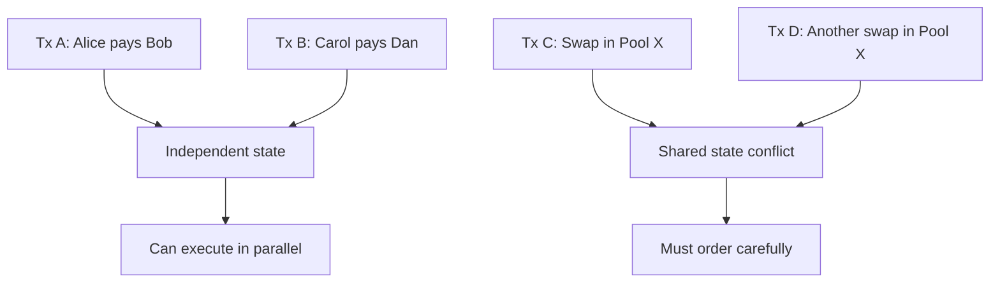

Parallel execution is one reason newer chains like Sui, Aptos, Monad, and others focus heavily on execution architecture. It can improve throughput, but it adds complexity to scheduling, state access, developer tooling, and deterministic execution.

## Architecture Examples

### Bitcoin

Bitcoin has a deliberately narrow architecture. It focuses on robust decentralized money rather than general-purpose computation.

Key architectural features:

- UTXO model;
- Proof of Work consensus;
- limited scripting;
- full nodes that independently validate;
- relatively conservative block production;
- emphasis on verification and monetary policy stability.

Bitcoin's architecture is powerful because it keeps the validation rules understandable and resource requirements comparatively manageable. It is limited because it does not aim to support rich general-purpose applications on the base layer.

### Ethereum

Ethereum is a programmable blockchain architecture.

Key architectural features:

- account model;
- EVM execution;
- smart contracts and composability;
- gas metering;
- execution/consensus client separation;
- Proof of Stake consensus;
- rollup-centric scaling roadmap;
- Ethereum L1 as settlement and data availability for many L2s.

Ethereum's main architectural trade-off is that programmability creates demand and complexity. The base layer cannot execute every possible application cheaply, so the roadmap pushes much execution to rollups while preserving Ethereum as a secure settlement and DA anchor.

### Solana

Solana is a high-performance monolithic Layer 1.

Key architectural themes:

- high throughput on the base chain;
- fast block production;
- parallel transaction processing where possible;
- local fee markets and performance-oriented engineering;
- validator hardware requirements that are higher than conservative chains.

Solana's trade-off is direct: it aims for a fast integrated user experience, but higher performance can increase node operation requirements and make decentralization harder to preserve.

### Celestia

Celestia is associated with modular blockchain architecture, especially data availability.

Its design separates data availability from execution. Developers can build execution environments that publish data to Celestia rather than building their own full consensus and DA layer from scratch.

The architectural idea is specialization: one layer focuses on making data available, while other layers handle execution and application logic.

### Sui And Aptos

Sui and Aptos are newer smart contract platforms influenced by the Move ecosystem.

Their architectural focus includes:

- resource-oriented programming;
- high-throughput execution;
- parallelism;
- object/resource models;
- developer safety around asset representation.

They show how changing the execution model and programming language can change the whole developer and performance profile of a blockchain.

## Common Misconceptions

> **Misconception: A blockchain is one piece of software.**  
> A blockchain is a distributed system made of clients, networks, databases, execution engines, consensus rules, APIs, indexers, wallets, and governance processes.

> **Misconception: Faster execution alone solves scaling.**  
> Execution is only one bottleneck. Storage, bandwidth, state growth, consensus, data availability, and decentralization constraints also matter.

> **Misconception: Rollups are just sidechains.**  
> Rollups publish data and/or proofs to a base layer and rely on it for settlement or security assumptions. Sidechains usually have their own independent validator security.

> **Misconception: RPC providers are neutral plumbing with no decentralization impact.**  
> RPC infrastructure strongly shapes user access. If most users depend on a few RPC providers, the application layer can be centralized even when the base chain is decentralized.

> **Misconception: Data availability means permanent data storage.**  
> Data availability is about ensuring data needed for verification is published and obtainable when needed. Permanent archival storage is a related but different problem.

## Connections to Other Notes

- [Blockchain Fundamentals](blockchain-fundamentals.md) introduces ledgers,
  transactions, blocks, nodes, keys, state, and consensus.
- [Blockchain Scaling and Modular Architecture](../04-scaling-and-modularity/blockchain-scaling-and-modular-architecture.md)
  deepens layers, rollups, channels, validiums, data availability sampling,
  shared sequencing, and parallel execution.
- [Consensus Mechanisms](../02-consensus-and-networks/consensus-mechanisms.md)
  deepens validator/miner selection, safety, liveness, finality, and attacks.
- **Blockchain transactions:** transaction fields, mempools, gas markets,
  receipts, logs, failed transactions, and ordering.
- **Smart contracts:** virtual machines, storage layout, contract calls,
  upgradeability, oracles, and security.
- **Major blockchains** will compare Bitcoin, Ethereum, Solana, Avalanche, Cosmos, Polkadot, Sui, Aptos, Base, Polygon, and others.

## Active Recall

1. Describe the main responsibilities inside a blockchain node.
2. Explain why execution must be deterministic.
3. Distinguish current state, block history, receipts/logs, and historical state.
4. Explain why state growth creates decentralization pressure.
5. Describe the difference between execution and consensus.
6. Explain why Ethereum separates execution clients and consensus clients.
7. Describe how RPC providers can centralize user access.
8. Compare monolithic and modular blockchain architecture.
9. Explain why data availability matters for rollups.
10. Describe the role of sequencers, provers, and settlement layers in rollup architecture.

## TLDR

Blockchain architecture is the internal design of the distributed system: networking, execution, state, storage, consensus, settlement, data availability, and APIs.

Execution applies transactions to state. Consensus chooses the canonical history. Storage preserves the data needed for validation and access. Networking propagates transactions and blocks. RPC and indexing infrastructure make the chain usable. Modular designs split these functions across layers, while monolithic designs keep them integrated in one base chain.

The key architectural lesson is that a blockchain is not just a ledger. It is a full distributed computing stack, and every design choice creates trade-offs between performance, decentralization, security, cost, complexity, and user experience.

## References

- Ethereum.org, [Nodes and clients](https://ethereum.org/developers/docs/nodes-and-clients/).
- Ethereum.org, [Networking layer](https://ethereum.org/developers/docs/networking-layer/).
- Ethereum.org, [Ethereum Virtual Machine](https://ethereum.org/developers/docs/evm/).
- Ethereum.org, [Data availability](https://ethereum.org/developers/docs/data-availability/).
- Bitcoin Developer Documentation, [P2P network](https://developer.bitcoin.org/devguide/p2p_network.html).
- Celestia documentation, [How Celestia works](https://docs.celestia.org/learn/how-celestia-works/).
- Solana documentation, [Core concepts](https://solana.com/docs/core).
