# Blockchain Fundamentals

A blockchain is a shared ledger maintained by a network of computers that do not need to fully trust one another. The ledger records transactions, groups them into blocks, links those blocks with cryptographic hashes, and uses a consensus process so the network can agree which history is valid.

The simplest mental model is a database that many independent computers replicate and verify. The important difference is that the database is not controlled by one normal administrator. The rules of the system decide which transactions count, how records are ordered, and what makes a history valid.

Blockchains became famous through Bitcoin because Bitcoin solved a specific problem that had blocked earlier digital money systems: how to let people transfer scarce digital value without relying on one central operator to prevent double-spending. Since then, the same basic design has been extended from simple money transfers to programmable systems like Ethereum, where the ledger can track balances, smart contract state, token ownership, governance rights, collateral, and many other digital claims.

These primitives support the deeper study of architecture, scaling, consensus,
smart contracts, token economics, interoperability, and individual blockchains.

## The Core Intuition

A normal database is usually controlled by one organization. A bank controls its internal ledger. A payment company controls its balances. A game company controls its item database. Users trust the operator to apply the rules correctly, fix mistakes, reverse fraud, block attackers, and keep the system available.

A blockchain changes the trust model. Instead of one organization maintaining the record, many nodes keep copies of the ledger and independently check whether proposed changes follow the rules. If a transaction breaks the rules, honest nodes reject it even if someone broadcasts it loudly. If a block contains invalid transactions, honest nodes reject that block too.

This means the ledger is not trusted because every participant is honest. It is trusted because the system is designed so participants can verify the rules themselves.

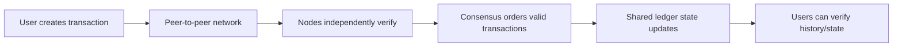

This verification property is why blockchains are often described as **trust-minimized** systems. Trust does not disappear. Users still trust software, cryptography, economic incentives, governance processes, wallets, bridges, exchanges, and their own operational security. But the core ledger can reduce the need to trust one central recordkeeper.

## What A Blockchain Solves

Blockchains are useful when multiple parties need a shared record but do not want one ordinary administrator to control that record completely.

They are especially relevant when the system needs some combination of:

- shared state across many parties;
- public or broad verifiability;
- resistance to unilateral record changes;
- censorship resistance;
- digital scarcity;
- programmable asset movement;
- auditability of transaction history;
- settlement without relying on one private database operator.

Bitcoin's breakthrough was narrow but profound: it made a scarce digital bearer-like asset possible without a central issuer or payment processor. Ethereum generalized the idea by making the ledger programmable, so applications could define their own rules with smart contracts.

Blockchains do not automatically solve every coordination problem. They are usually slower, more expensive, and harder to change than centralized systems. They also do not magically solve legal enforceability, identity, privacy, user mistakes, bad off-chain data, or governance conflict.

| System need | Blockchain can help when... | Blockchain may be a poor fit when... |
|---|---|---|
| Shared record | Many parties need to verify the same state | One trusted organization can simply operate a database |
| Digital scarcity | The asset must not be copied or double-spent | The asset is just internal points or easily reversible records |
| Censorship resistance | Users need access without permission from one operator | Access control and compliance are the main requirements |
| Auditability | History should be independently inspectable | Privacy or confidentiality dominates |
| Settlement | Assets can move according to deterministic rules | Legal review, reversibility, or human discretion is essential |
| Programmability | Rules can be encoded and executed automatically | Rules require subjective judgment or frequent exception handling |

> **Important distinction:** A blockchain is not just "a database with hashes." The hard part is not storing blocks. The hard part is getting many independent nodes to agree on one valid history while some participants may be offline, slow, selfish, or malicious.

## Digital Money Before Bitcoin

Bitcoin did not appear from nowhere. It combined decades of work from cryptography, digital cash, distributed systems, peer-to-peer networking, and proof-of-work.

Earlier digital money projects showed pieces of the puzzle:

| Project / idea | Core contribution | Limitation or unresolved issue |
|---|---|---|
| DigiCash | Early cryptographic digital cash using blind signatures | Relied on a central company/bank model |
| Hashcash | Proof-of-work as an anti-spam mechanism | Not a complete money or ledger system |
| B-money | Proposed decentralized digital money and contracts | Remained a proposal, not a deployed robust system |
| Bit Gold | Proposed scarce digital value using proof-of-work chains | Did not fully solve decentralized consensus |
| Bitcoin | Combined proof-of-work, peer-to-peer networking, chain ordering, incentives, and difficulty adjustment | Limited throughput and intentionally narrow scripting |

The central obstacle was the **double-spending problem**.

Physical cash is hard to double-spend because if Alice hands Bob a physical banknote, Alice no longer has that same banknote. Digital files are different. If Alice has a digital coin represented as data, she can copy the data and try to send the same coin to Bob and Carol.

Centralized digital money solves this with a trusted operator. A bank, card network, or payment company keeps the official ledger and rejects duplicate spending. Bitcoin's goal was to solve the same problem without a central operator.

### Fake Scenario: The Double-Spend Problem

Imagine a simple digital coin system where each coin is a file.

Mina owns `coin-123.txt`. She sends a copy to Omar as payment for a laptop. Before Omar checks anything, Mina also sends a copy of the same file to Priya for concert tickets.

Both Omar and Priya can receive a file that looks valid. The missing ingredient is a shared record that decides which transfer happened first and makes the other invalid.

A blockchain provides that shared record:

1. Mina signs a transaction spending the coin.
2. The transaction is broadcast to the network.
3. Nodes check whether the coin has already been spent.
4. Consensus orders transactions into blocks.
5. Once one spend is accepted into the valid chain, conflicting spends are rejected.

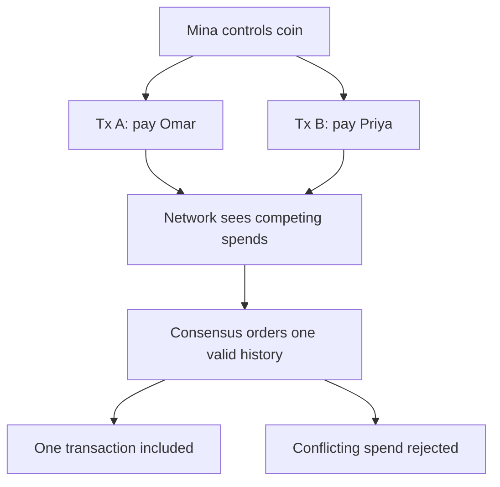

The double-spend problem is not about copying arbitrary data. It is about establishing a single authoritative history for scarce digital assets.

## Ledgers, State, And State Transitions

A ledger is a record of transactions or balances. In blockchain systems, the ledger is not just historical decoration. It is the basis for computing the current state of the system.

**State** means the current condition of the ledger after applying all valid transactions so far.

Examples of state:

- Alice has 2 BTC available to spend.
- An Ethereum address has 5 ETH.
- A smart contract stores a collateral ratio.
- A token contract says Wallet A owns 100 USDC.
- A validator set contains these validators and stake weights.

A blockchain transaction is an instruction that attempts to change state. Nodes execute the transaction according to the protocol rules. If the transaction is valid, the state changes. If it is invalid, nodes reject it or mark execution as failed depending on the system.

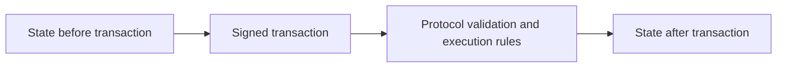

This state-transition model is one of the most important ideas in blockchain design. The chain is not merely a list of messages. It is a replicated state machine: many nodes start from the same earlier state, process the same ordered transactions under the same rules, and arrive at the same later state.

### Fake Scenario: State Transition

Suppose a tiny account-based ledger has this state:

| Account | Balance |
|---|---:|
| Alice | 10 coins |
| Bob | 3 coins |

Alice signs a transaction: "send 4 coins to Bob."

Nodes check:

- Alice's signature is valid.
- Alice has enough balance.
- The transaction has not already been used.
- The fee rules are satisfied.

After the transaction:

| Account | Balance |
|---|---:|
| Alice | 6 coins minus any fee |
| Bob | 7 coins |

That simple example captures the core of all blockchain execution: validate the instruction, apply deterministic rules, update state.

## Distributed Systems Foundations

Blockchains are distributed systems. They involve many computers communicating over an unreliable network. Messages can arrive late, nodes can crash, software can have bugs, and some participants may intentionally lie.

The basic system models are:

| Model | Who controls the system | Strength | Weakness |
|---|---|---|---|
| Centralized | One operator controls the main system | Fast, simple, easy to govern | Single point of control/failure |
| Distributed | Many machines cooperate, often under one organization | More resilient and scalable | Still depends on an administrator/trust domain |
| Decentralized | Many independent parties operate parts of the system | Harder for one actor to control | Slower, harder to coordinate and upgrade |

A normal cloud service can be distributed without being decentralized. A bank may run databases across many data centers, but the bank still controls the system. A public blockchain aims for independent operators who can verify and enforce the rules themselves.

### Replication

Replication means storing copies of data on multiple machines. It improves availability because the system can continue operating even if some machines fail.

In a blockchain, replication has an additional purpose: independent verification. Many nodes store the ledger not just for backup, but so they can check the validity of history themselves.

Replication creates a coordination problem. If different nodes receive transactions in different orders, they may temporarily disagree about the latest state. Consensus is the process that resolves this into one accepted ordering.

### Consistency

Consistency means the system's copies agree according to the rules that matter.

In a banking database, consistency might mean account balances never violate accounting constraints. In a blockchain, consistency means honest nodes eventually agree on the same valid ledger history and state.

Different systems choose different consistency/finality trade-offs. Bitcoin has probabilistic finality: a transaction becomes harder to reverse as more blocks build on top of it. Some proof-of-stake and BFT-style systems aim for deterministic finality: once enough validators sign, the block is final under protocol assumptions.

### Fault Tolerance

Fault tolerance means the system continues working even when parts fail.

Failures can be simple:

- a node goes offline;
- a network connection drops;
- a disk fails;
- a message arrives late.

Failures can also be Byzantine. A Byzantine participant may lie, send conflicting messages, censor transactions, produce invalid blocks, or coordinate with attackers. Public blockchains must assume this kind of adversarial behavior.

> **Important distinction:** "Distributed" does not automatically mean "secure." A badly designed distributed system can be fragile. Blockchain security depends on the details of consensus, incentives, cryptography, networking, software implementation, and governance.

## Cryptographic Foundations

Cryptography gives blockchains several of their basic building blocks. It does not solve consensus by itself, but it makes verification efficient and tampering detectable.

The core primitives are:

- hash functions;
- public/private key pairs;
- digital signatures;
- Merkle trees.

## Hash Functions

A cryptographic hash function takes an input of arbitrary size and produces a fixed-size output. The output is often called a hash, digest, or fingerprint.

For example, a hash function can take a transaction, a block header, or a whole file and produce a short identifier. If the input changes even slightly, the hash changes unpredictably.

Good cryptographic hash functions have several properties:

- **Deterministic:** the same input always produces the same hash.
- **Fast to compute:** nodes can verify data efficiently.
- **Preimage resistant:** given a hash, it is infeasible to find an input that produces it.
- **Collision resistant:** it is infeasible to find two different inputs with the same hash.
- **Avalanche effect:** small input changes create very different outputs.

Bitcoin uses SHA-256 heavily. Ethereum uses Keccak-256 in many places. The exact function matters for implementation, but the conceptual role is the same: hashes create compact fingerprints of data.

### Hashes As Tamper Evidence

If a block contains a hash of the previous block, changing an old block changes its hash. That change breaks the link to the next block, whose stored previous-block hash no longer matches.

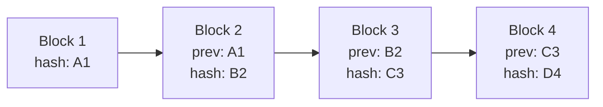

This is why blockchains are called tamper-evident. Tampering with old data is visible because the hashes stop matching. In proof-of-work systems, an attacker would also need to redo the work for the modified block and catch up with the honest chain.

Tamper-evident does not mean physically impossible to alter in all circumstances. It means alteration is detectable and, under the consensus security assumptions, economically or computationally impractical to make accepted by honest nodes.

## Public Keys, Private Keys, And Addresses

Blockchains use public-key cryptography to control assets.

A private key is a secret value. A public key is derived from it. An address is usually derived from the public key or related data. Users can share addresses publicly so others can send assets to them, while keeping private keys secret.

| Item | Safe to share? | Role |
|---|---:|---|
| Private key | No | Authorizes spending or control |
| Public key | Usually yes | Lets others verify signatures |
| Address | Yes | Destination identifier for receiving assets |
| Signature | Yes | Proves authorization for a specific message/transaction |

The private key does not "store coins." The blockchain records assets or spendable outputs. The private key gives the ability to authorize changes involving those assets.

### Fake Scenario: Signing A Transaction

Ravi wants to send 1 coin to Sara.

His wallet constructs a transaction describing the transfer. Ravi's private key signs the transaction. Nodes use Ravi's public key or address-related verification rules to check that the signature is valid.

If the signature is valid, nodes know that the transaction was authorized by whoever controls Ravi's private key. They do not need to know Ravi's real-world identity.

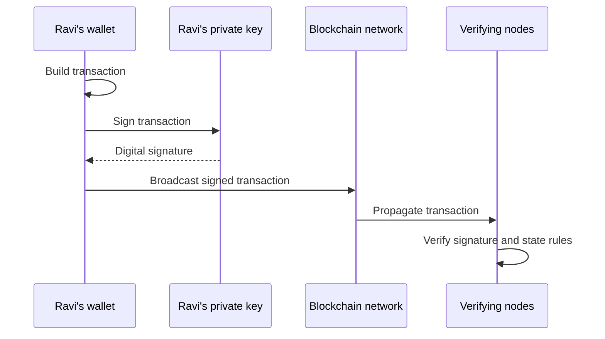

If someone steals Ravi's private key, they can sign transactions as Ravi. If Ravi loses the private key, he may permanently lose control of the assets. This is why custody is so central in crypto.

## Digital Signatures

A digital signature proves that a private key authorized a specific message. In blockchains, the message is usually a transaction or part of a transaction.

Digital signatures provide three crucial properties:

- **Authentication:** the transaction was authorized by the key holder.
- **Integrity:** the signed data was not changed after signing.
- **Non-repudiation in a technical sense:** the holder of the private key cannot plausibly claim that a different key produced the signature, though legal identity is a separate question.

Changing a signed transaction invalidates the signature. If Ravi signs "send 1 coin to Sara," an attacker cannot change it to "send 10 coins to Mallory" without producing a new valid signature.

This is why wallets are security-critical. A wallet is not just a balance viewer; it is software that prepares and signs instructions capable of changing ledger state.

## Merkle Trees

A Merkle tree is a data structure that hashes many pieces of data into one compact root hash. Each transaction is hashed. Pairs of hashes are hashed together. This continues until one root remains.

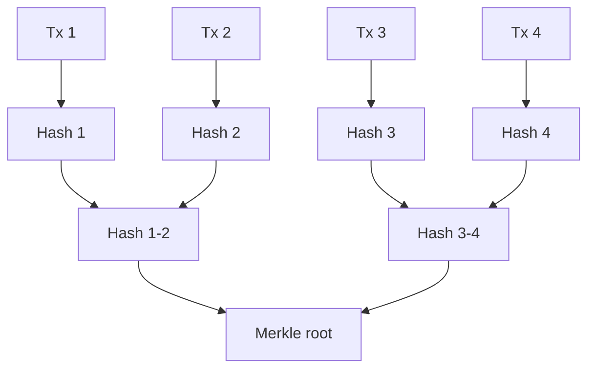

The Merkle root commits to the set of transactions. If any transaction changes, its hash changes, then the parent hash changes, and eventually the root changes.

Merkle trees matter because they allow efficient proofs. A light client can verify that a transaction is included in a block without downloading every transaction in the block. It only needs the transaction, the block header, and a small path of hashes.

## The Blockchain Data Model

A blockchain is made of blocks. Each block contains a batch of transactions plus metadata. Blocks are linked together because each block references the previous block's hash.

The exact structure differs across chains, but the conceptual components are similar.

| Component | Meaning | Why it matters |
|---|---|---|
| Transaction list | The transactions included in the block | Defines proposed state changes |
| Previous block hash | Hash pointer to the parent block | Links history together |
| Merkle root or state commitment | Compact commitment to transactions or state | Lets nodes verify data integrity |
| Timestamp / slot data | Time-related metadata | Helps with ordering and protocol rules |
| Consensus data | Proof-of-work nonce, validator signatures, attestations, etc. | Shows how the block satisfies consensus rules |
| Block producer identity | Miner/validator/proposer information, where applicable | Determines rewards, accountability, or attribution |

### Block Structure

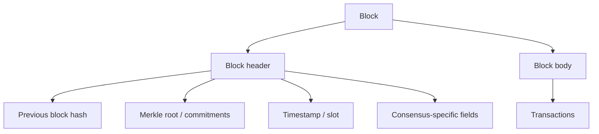

The block header is designed to be compact and easy to verify. The body contains the heavier transaction data. Many protocols use header commitments so nodes and light clients can reason about large amounts of data through small cryptographic fingerprints.

## Genesis Block

The genesis block is the first block in a blockchain. It has no normal previous block. It defines the starting point of the ledger's history.

The genesis block or genesis state may specify:

- initial balances;
- initial validators;
- network parameters;
- chain ID;
- protocol configuration;
- initial smart contracts or system modules.

Every node needs the same genesis information to participate in the same chain. If two networks have different genesis states, they are different chains even if their software is otherwise similar.

## Transactions

A transaction is a signed instruction submitted to the network. It requests a state change.

Examples:

- spend bitcoin from one set of UTXOs to another;
- send ETH from one address to another;
- call a smart contract function;
- mint or burn a token;
- vote in governance;
- register validator activity;
- update a rollup state commitment.

Transactions normally include enough information for nodes to decide whether they are valid. The required fields differ by chain, but common categories include:

| Field category | Purpose |
|---|---|
| Sender / authorization data | Shows who authorized the transaction |
| Recipient or contract target | Identifies where value or execution is directed |
| Amount or call data | Describes the requested operation |
| Fee data | Pays for block inclusion or execution |
| Nonce or input references | Prevents replay and double-spending |
| Signature | Proves authorization |

## UTXO Model

Bitcoin uses a UTXO model. UTXO means **unspent transaction output**.

The best analogy is cash bills, though it is not perfect. If Alice has a $10 bill and wants to pay Bob $6, she cannot tear off exactly $6 in ordinary payment logic. She spends the $10 bill and receives $4 change. Bitcoin works similarly at the ledger level.

A UTXO is a discrete chunk of spendable value. Transactions consume existing UTXOs as inputs and create new UTXOs as outputs.

### Fake Scenario: UTXO Payment

Alice has two UTXOs:

- UTXO A: 0.7 BTC
- UTXO B: 0.4 BTC

Alice wants to pay Bob 0.9 BTC and pay a 0.01 BTC fee. Her wallet constructs a transaction:

| Inputs consumed | Amount |
|---|---:|
| UTXO A | 0.7 BTC |
| UTXO B | 0.4 BTC |
| **Total input** | **1.1 BTC** |

| Outputs created | Amount |
|---|---:|
| Bob | 0.9 BTC |
| Alice change address | 0.19 BTC |
| Miner/validator fee | 0.01 BTC |

The old UTXOs are now spent and cannot be used again. Bob receives a new UTXO. Alice receives a new change UTXO.

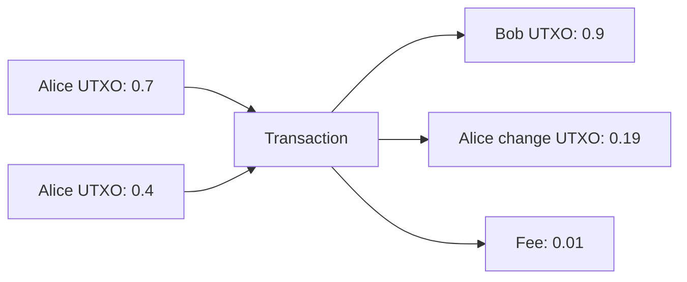

The UTXO model makes double-spend checking conceptually clear: a UTXO can be either unspent or spent. A valid transaction cannot spend an already-spent output.

## Account Model

Ethereum uses an account model. Instead of tracking discrete spendable outputs, the ledger tracks accounts and balances, more like a bank ledger.

If Alice has 10 ETH and sends Bob 3 ETH, the state changes from:

| Account | Balance before |
|---|---:|
| Alice | 10 ETH |
| Bob | 1 ETH |

to:

| Account | Balance after |
|---|---:|
| Alice | 7 ETH minus fee |
| Bob | 4 ETH |

The account model is natural for smart contracts because contracts maintain ongoing storage. A decentralized exchange contract, for example, can store liquidity pool balances and update them when users swap.

Ethereum uses nonces to prevent replay. If Alice's account has nonce 12, her next transaction must use the correct nonce. A copied old transaction cannot be replayed indefinitely because the account nonce has moved on.

### UTXO vs Account Model

| Dimension | UTXO model | Account model |
|---|---|---|
| Basic unit | Discrete unspent outputs | Accounts with balances/storage |
| Analogy | Cash bills and change | Bank account ledger |
| Double-spend prevention | Output can be spent once | Nonces and balance checks |
| Parallelism | Independent UTXOs can be processed separately | Account conflicts can create ordering constraints |
| Smart contracts | Possible but less natural in Bitcoin-style design | Natural for contract storage and calls |
| Privacy | Change outputs and coin selection matter | Account history is easier to trace by address |

Neither model is universally better. The right model depends on the system's goals. Bitcoin's UTXO model fits a conservative money-transfer system. Ethereum's account model fits a programmable state machine.

## Nodes

A node is a computer participating in a blockchain network. The word "node" is broad. Not every node has the same responsibilities.

| Node type | Stores | Verifies | Typical role |
|---|---|---|---|
| Full node | Full current ledger data needed for validation | Validates blocks and transactions independently | Enforces protocol rules |
| Archive node | Historical states and data beyond normal full-node needs | Can answer historical state queries | Used by explorers, analytics, infrastructure providers |
| Light client | Block headers or compact proofs | Verifies limited data using proofs | Lower-resource verification |
| Miner | PoW mining data and mempool | Proposes blocks by doing work | Bitcoin-style block production |
| Validator | Validator keys and node infrastructure | Proposes/attests/votes depending on protocol | PoS/BFT-style block production |
| RPC node | Serves API requests for wallets/apps | May or may not independently validate depending on setup | User/application access point |

The most important concept is that full nodes enforce rules. If a miner or validator produces an invalid block, full nodes can reject it.

This is why decentralization is partly about who can verify, not only who can produce blocks. If ordinary users cannot realistically run verifying nodes, they become more dependent on infrastructure providers.

## Peer-To-Peer Networking

Public blockchains usually use peer-to-peer networking. Transactions and blocks propagate from node to node rather than through one central server.

When a wallet broadcasts a transaction, it may send it to one node. That node checks basic validity and relays it to peers. Those peers relay it further. Eventually, miners or validators see it and may include it in a block.

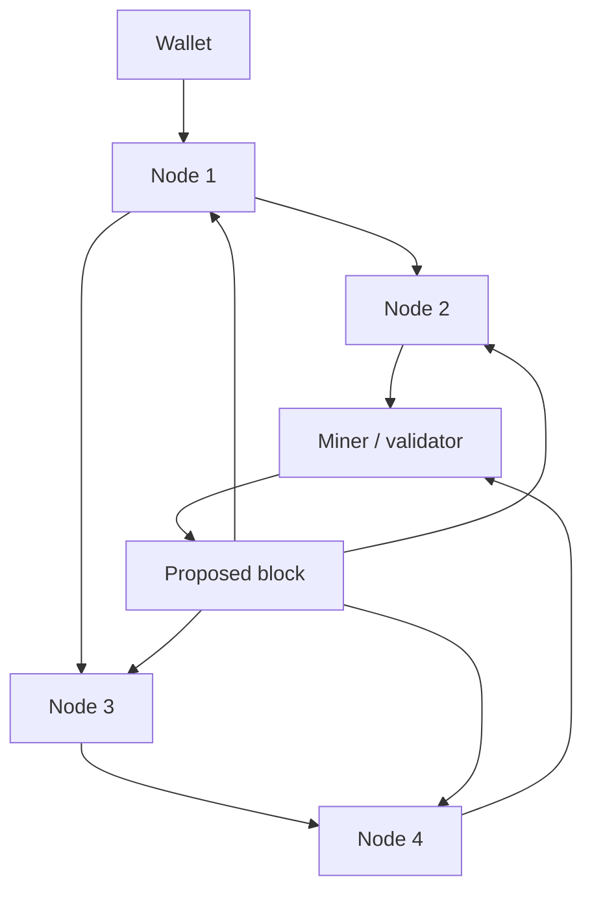

Networking affects security and user experience. If a node is isolated from honest peers, it can have a distorted view of the chain. If blocks propagate slowly, temporary forks become more likely. If mempools are public, sophisticated actors can observe pending transactions and attempt strategies such as front-running or sandwich attacks.

## Transaction Lifecycle

A transaction does not become final the moment a wallet creates it. It passes through a lifecycle.

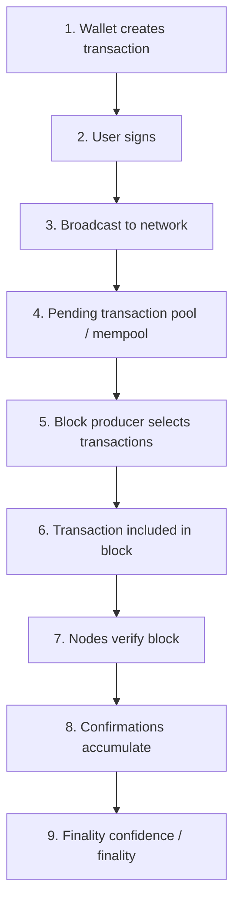

The details differ by chain, but the conceptual path is stable:

1. A wallet constructs the transaction.
2. The user or key system signs it.
3. The transaction is broadcast.
4. Nodes check basic validity and hold it pending.
5. A block producer selects it.
6. The transaction is included in a block.
7. Nodes verify the block and update state.
8. The transaction gains confirmations or finality.

### Mempool

A mempool is a waiting area for valid pending transactions that have not yet been included in a block. Not every blockchain has the same mempool design, and some systems route transactions through more centralized sequencers or validators, but the concept is important.

The mempool creates ordering questions. If block space is limited, which transactions get included first? Usually, transactions offering higher fees have better inclusion priority. In transparent public mempools, pending transactions can also be observed by bots, which creates MEV opportunities.

### Confirmations And Reorgs

A confirmation usually means a transaction is included in a block, and more blocks have been added after it. In Bitcoin-style probabilistic finality, each additional block makes reversal less likely because an attacker would need to create an alternative heavier chain.

A reorg, or chain reorganization, happens when nodes switch from one valid chain branch to another. Short reorgs can happen naturally when two block producers find blocks around the same time. Longer reorgs are more serious and may indicate network problems or attack conditions.

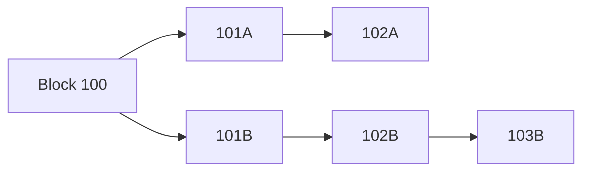

If the `101B -> 102B -> 103B` branch becomes the accepted chain, transactions in the `101A -> 102A` branch may return to pending status or become invalid if conflicting transactions were confirmed in the accepted branch.

## Blocks, Ordering, And Time

Blockchains impose an order on transactions. This ordering is essential because different valid transactions may conflict.

If Alice has 5 coins and signs two transactions spending the same 5 coins to different people, both signatures can be valid, but both transactions cannot be accepted. The network needs one ordered history so all nodes reach the same state.

Block time is the approximate interval between blocks. It is not the same as finality. A chain can have fast block production but slower finality, or slower blocks with strong finality assumptions after a certain confirmation depth.

| Concept | Meaning | Common confusion |
|---|---|---|
| Block time | How often blocks are produced | Not the same as settlement finality |
| Confirmation | Transaction included in a block, often with blocks after it | More confirmations usually increase confidence |
| Finality | Point at which reversal is impossible or economically/protocol-wise very unlikely | Depends on consensus design |
| Reorg | Chain switches to a different branch | Can affect recent transactions |

## Consensus In Brief

Consensus is the process that lets distributed nodes agree on the valid ledger history.

Consensus includes substantially more detail than this foundation requires:
Proof of Work, Proof of Stake, BFT protocols, safety, liveness, attacks, and
validator economics are developed in
[Consensus Mechanisms](../02-consensus-and-networks/consensus-mechanisms.md).

For now, the key idea is that consensus answers three practical questions:

- which transactions are included;
- in what order they are included;
- which block becomes part of the accepted chain.

### Proof Of Work In Brief

In Proof of Work, miners compete to find a block hash that satisfies a difficulty target. This requires repeated hashing and real-world electricity/hardware cost. The accepted chain is generally the one representing the most accumulated work.

The security intuition is economic and physical: rewriting history requires redoing the work and overtaking the honest network's work.

### Proof Of Stake In Brief

In Proof of Stake, validators lock up stake and participate in proposing or voting on blocks. Security comes from capital at risk. If validators behave dishonestly in provable ways, the protocol may penalize or slash them.

The security intuition is economic and internal to the chain: attackers must control enough stake and risk losing value if they violate rules.

| Mechanism | Main scarce resource | Block producer | Security intuition |
|---|---|---|---|
| Proof of Work | Energy and hardware | Miner | Attacking requires costly computation |
| Proof of Stake | Locked capital | Validator | Attacking risks stake and economic penalties |
| BFT-style validator consensus | Known or staked validator voting power | Validator set | Blocks finalize when enough validators vote |

## Finality

Finality describes how irreversible a transaction is.

There are two broad models:

- **Probabilistic finality:** reversal becomes less likely as more blocks are built on top. Bitcoin is the classic example.
- **Deterministic or economic finality:** once enough validators sign or attest, the protocol treats a block as final unless a large amount of stake is slashed or assumptions fail.

Finality is not just a technical detail. It affects exchanges, bridges, payments, tokenization, and institutional settlement. A merchant accepting a small payment may tolerate low confirmation depth. An exchange crediting a large deposit may wait longer. A bridge moving assets across chains must decide how much finality is enough before releasing value on another chain.

### Fake Scenario: Different Finality Needs

Lena buys coffee with a crypto payment worth $4. The merchant may accept the payment after a quick confirmation because the risk is small.

Later, a trading firm deposits $20 million worth of crypto into an exchange. The exchange waits for more confirmations or finality because a reorg or double-spend would be costly.

The same blockchain can support both transactions, but the risk tolerance differs.

## Blockchain Types

Not all blockchains have the same access rules. The important questions are:

- who can read the ledger;
- who can submit transactions;
- who can validate or produce blocks;
- who governs rule changes;
- what legal agreements exist between participants.

| Type | Read access | Validator access | Typical use | Trade-off |
|---|---|---|---|---|
| Public permissionless | Open | Open to anyone meeting protocol requirements | Bitcoin, Ethereum | Maximum openness, harder compliance/privacy |
| Public permissioned | Public or broad | Approved validators | Some public-sector or enterprise designs | Transparency with controlled operation |
| Consortium | Restricted to members/participants | Known institutions | Interbank or industry networks | Legal governance, less openness |
| Private | Controlled by one organization | One organization or controlled set | Internal audit/reconciliation systems | Simpler, but less trust-minimized |

Public permissionless chains are the most radical because anyone can verify, transact, and often participate economically. Permissioned or private ledgers may still use blockchain-like structures, but they rely more heavily on legal governance and known operators.

The term **DLT**, or distributed ledger technology, is broader than blockchain. A blockchain is a DLT where records are grouped into cryptographically linked blocks. Some DLT systems do not use a simple global chain of blocks.

## Bitcoin As The Foundational Example

Bitcoin is the cleanest example of a blockchain designed for one core purpose: maintaining a scarce, censorship-resistant digital monetary asset.

Its design emphasizes:

- UTXO-based transaction accounting;
- Proof of Work mining;
- limited scripting;
- predictable issuance;
- a hard-capped supply schedule;
- conservative protocol changes;
- broad independent verification through full nodes.

Bitcoin's simplicity is part of its design philosophy. It is not trying to be a general-purpose world computer. It is trying to be robust digital money with a highly verifiable monetary policy and settlement network.

### Simplified Bitcoin Flow

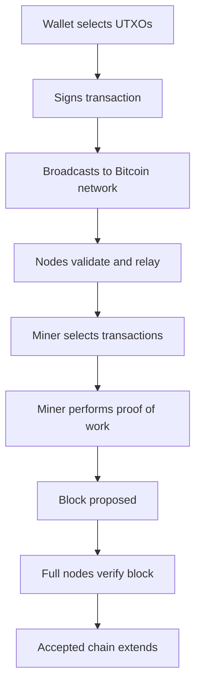

Each step is designed so participants can independently check the rules. Miners propose blocks, but full nodes decide whether those blocks are valid.

## Ethereum As The Programmable Example

Ethereum uses blockchain foundations for a broader goal: a programmable settlement and execution layer.

Instead of only tracking a native asset, Ethereum tracks accounts, contract code, contract storage, token balances, and application state. A transaction can transfer ETH, deploy a contract, call a contract, swap tokens, borrow from a lending protocol, mint an NFT, or trigger many other state changes.

Ethereum's design emphasizes:

- account-based state;
- smart contracts;
- the Ethereum Virtual Machine;
- gas metering;
- composability between applications;
- Proof of Stake consensus after the Merge;
- a rollup-centric scaling roadmap.

Ethereum shows how blockchains can become more than payment ledgers. They can become platforms where applications share a common settlement environment and can call each other.

This power creates new risks:

- smart contract bugs;
- oracle failures;
- MEV;
- governance risk;
- wallet signing mistakes;
- complex dependencies between protocols.

Ethereum demonstrates why the fundamental primitives remain relevant at the
application layer: every application still depends on signatures, state
transitions, blocks, nodes, consensus, and finality.

## Immutability And Its Limits

Blockchain immutability means that once data is deeply embedded in the accepted chain, changing it becomes extremely difficult under the system's security assumptions.

It does not mean:

- software can never be upgraded;
- communities can never coordinate forks;
- invalid social outcomes are impossible;
- stolen assets can never move;
- all on-chain data is legally final in every jurisdiction.

Immutability is a property of the ledger history relative to consensus rules and network assumptions. It is strongest when:

- many independent nodes verify the chain;
- block production is decentralized;
- economic incentives make attacks costly;
- users wait for sufficient finality;
- social governance resists arbitrary rewrites.

### Forks

A fork is a divergence in chain history or protocol rules.

| Fork type | Meaning | Example situation |
|---|---|---|
| Temporary fork | Two valid blocks compete briefly | Two miners find blocks close together |
| Soft fork | Rule change that tightens validity rules | Some older clients may still accept new blocks under certain conditions |
| Hard fork | Rule change incompatible with old rules | Nodes that do not upgrade follow a different chain |
| Social/community fork | Community splits around values or governance | Competing chains continue separately |

Forks show that blockchains are not purely technical systems. They are also social and economic systems. Code defines rules, but humans decide which software to run, which assets to recognize, which chains exchanges list, and which histories communities treat as legitimate.

## Security Properties

Blockchain security is layered. No single mechanism does everything.

| Security property | Mechanism | Limitation |
|---|---|---|
| Authorization | Digital signatures | Key theft or bad signing can still lose assets |
| Data integrity | Hashes and Merkle roots | Bad data can still be validly committed |
| Double-spend resistance | Consensus and state validation | Depends on consensus assumptions |
| Tamper evidence | Hash-linked blocks | Detects tampering; does not automatically stop social forks |
| Censorship resistance | Open participation and decentralized block production | Can weaken if validators/miners centralize |
| Availability | Peer-to-peer replication | Network attacks and infrastructure concentration still matter |
| Auditability | Public/verifiable ledger | Privacy may be reduced |

The most important practical lesson is that blockchain security is not one feature. It is the interaction between cryptography, consensus, incentives, software, network topology, economic value, user behavior, and governance.

## Fake End-To-End Scenario: From Wallet To Settlement

Nia wants to send 2 ETH to Omar.

1. Nia's wallet reads the current state from an RPC provider or node.
2. The wallet constructs a transaction: sender, recipient, value, nonce, gas limit, fee parameters.
3. Nia reviews and signs the transaction with her private key.
4. The wallet broadcasts the signed transaction.
5. Nodes and validators check the signature, nonce, fee, and balance.
6. A validator includes the transaction in a block.
7. The block is propagated across the network.
8. Nodes execute the block and update Ethereum state.
9. Omar's wallet or block explorer sees the transfer.
10. After sufficient confirmations/finality, the transfer is treated as settled for practical purposes.

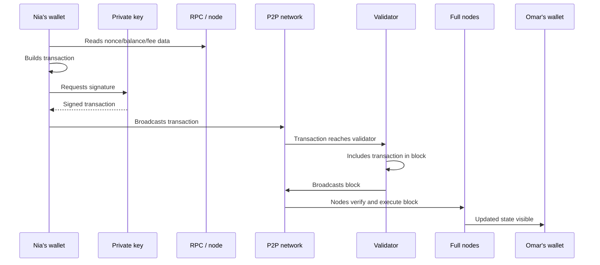

This scenario contains nearly every fundamental concept:

- the wallet is an interface to keys and network data;
- the private key authorizes the transaction;
- the transaction requests a state change;
- the network propagates the transaction;
- a validator orders it into a block;
- nodes verify the block;
- finality determines how confident users should be.

## Common Misconceptions

> **Misconception: A blockchain stores coins inside wallets.**  
> Wallets store keys. The ledger records balances, UTXOs, contract state, or token ownership. Control comes from the ability to sign valid transactions.

> **Misconception: Decentralized means nobody is in charge of anything.**  
> Decentralization reduces unilateral control, but systems still have developers, miners/validators, users, exchanges, infrastructure providers, governance processes, and social norms.

> **Misconception: Blockchains are automatically private.**  
> Public blockchains are usually transparent. Addresses may be pseudonymous, but transaction histories can often be analyzed.

> **Misconception: Immutability means mistakes cannot matter.**  
> Immutability can make mistakes more serious because reversals are difficult. Bad signatures, wrong addresses, and smart contract bugs can have permanent consequences.

> **Misconception: More nodes always mean more security.**  
> Node count matters, but so do validator/miner concentration, client diversity, economic incentives, network topology, governance, and the ability of ordinary users to verify.

> **Misconception: Consensus and cryptography are the same thing.**  
> Cryptography provides signatures, hashes, and commitments. Consensus decides ordering and accepted history in an adversarial distributed network.

## Connections to Other Notes

- [Blockchain Architecture](blockchain-architecture.md) deepens execution,
  settlement, storage, networking, clients, data availability, and modular
  architecture.
- [Consensus Mechanisms](../02-consensus-and-networks/consensus-mechanisms.md)
  deepens Proof of Work, Proof of Stake, BFT protocols, attacks, validator
  economics, safety, and liveness.
- [Blockchain Scaling and Modular Architecture](../04-scaling-and-modularity/blockchain-scaling-and-modular-architecture.md)
  covers Layer 0/1/2/3 terminology, rollups, channels, sidechains, and scaling
  trade-offs.
- **Blockchain transactions:** transaction fields, gas, mempools, receipts,
  logs, ordering, and failed transactions.
- **Smart contracts:** virtual machines, contract storage, calls,
  upgradeability, composability, and security.
- **Token economics:** native assets, token standards, issuance, burning,
  staking rewards, and value capture.
- **Cross-chain interoperability:** bridges, wrapped assets, messaging, IBC,
  CCIP, and bridge security.
- **Crypto custody:** private-key management, wallets, MPC, HSMs, and hot/cold
  storage.

## Active Recall

1. Explain how a blockchain differs from a normal centralized database.
2. Describe the double-spending problem and why digital money needs a shared ordering mechanism.
3. Explain how hashes make block history tamper-evident.
4. Describe the difference between a private key, public key, address, and digital signature.
5. Explain how a Merkle tree allows efficient inclusion proofs.
6. Describe the difference between UTXO and account-based ledger models.
7. Explain what full nodes do and why they matter.
8. Describe the lifecycle of a transaction from wallet creation to finality.
9. Explain why confirmations and finality are not identical.
10. Describe why a blockchain can be trust-minimized without being trustless in every sense.

## TLDR

A blockchain is a replicated ledger where many independent nodes verify transactions, order them into blocks, and agree on a valid history through consensus. It combines distributed systems, cryptographic hashes, digital signatures, peer-to-peer networking, and economic or protocol incentives.

Bitcoin used this design to solve the double-spend problem for decentralized digital money. Ethereum extended the model into a programmable state machine for smart contracts and tokens.

The core primitives are simple but powerful: transactions request state changes, signatures authorize them, nodes verify them, blocks order them, hashes link history, and consensus decides which history the network accepts. These foundations underlie every later topic in the digital asset stack.

## References

- Satoshi Nakamoto, [Bitcoin: A Peer-to-Peer Electronic Cash System](https://bitcoin.org/bitcoin.pdf), 2008.
- Bitcoin Developer Documentation, [Developer Guides](https://developer.bitcoin.org/devguide/).
- Ethereum.org, [Ethereum development documentation](https://ethereum.org/developers/docs/).
- National Institute of Standards and Technology, [Secure Hash Standard (FIPS 180-4)](https://csrc.nist.gov/pubs/fips/180-4/upd1/final).
- National Institute of Standards and Technology, [Digital Signature Standard (FIPS 186-5)](https://csrc.nist.gov/pubs/fips/186-5/final).
- Leslie Lamport, Robert Shostak, and Marshall Pease, [The Byzantine Generals Problem](https://lamport.azurewebsites.net/pubs/byz.pdf), 1982.
