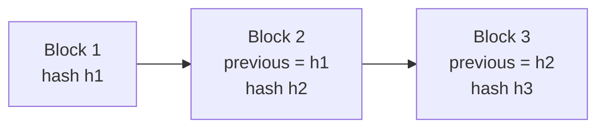
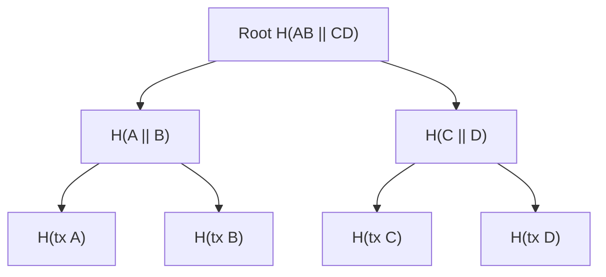
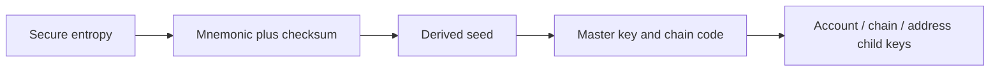

# Cryptography And Blockchain Data Structures

Blockchains combine ordinary distributed-systems engineering with
cryptographic primitives. Cryptography makes data tampering detectable,
authorizes state changes, and permits compact proofs. It does not decide whether
an offchain statement is true, keep a private key safe, make software correct,
or guarantee that a legal owner controls an address.

The security of a blockchain depends on how primitives are composed with
consensus, networking, execution, incentives, and operational controls.

## Security Properties

### Confidentiality

Only authorized parties can learn information. Most public blockchains do not
provide transaction confidentiality by default; encryption is different from
signing or hashing.

### Integrity

Unauthorized changes are detectable. Hashes, signatures, and authenticated data
structures support integrity.

### Authenticity

A verifier can establish that data or an instruction came from the holder of a
particular credential or key. This is not necessarily proof of civil identity.

### Availability

Authorized users can access data and systems when needed. Cryptography alone
does not provide availability; replication, networking, recovery, and
incentives matter.

### Non-Repudiation

Digital signatures can provide strong evidence that a key produced a signature.
Real-world non-repudiation also depends on key control, identity binding,
malware, coercion, delegation, and applicable law.

## Cryptographic Hash Functions

A hash function maps arbitrary-length input to a fixed-length digest:

```text
h = H(m)
```

Important properties include:

- **determinism:** the same input gives the same output;
- **preimage resistance:** given `h`, finding an `m` with `H(m)=h` is
  computationally infeasible;
- **second-preimage resistance:** given `m_1`, finding distinct `m_2` with the
  same hash is infeasible;
- **collision resistance:** finding any distinct pair with equal hashes is
  infeasible;
- **avalanche behavior:** small input changes produce unpredictable digest
  changes.

For an ideal `n`-bit hash, generic preimage work is approximately `2^n`, while
collision search is approximately `2^(n/2)` because of the birthday effect.

### Hashes Are Not Encryption

Encryption is reversible with a key. Hashing is designed as a one-way mapping.
Hashing a low-entropy secret such as a common password does not make it secure:
an attacker can hash guesses. Password systems use salts and deliberately
expensive password-based derivation functions.

### Blockchain Uses

Hash functions turn variable data into compact commitments. Changing a
transaction changes its hash, which changes its Merkle path and ultimately the
block commitment. This makes tampering detectable without making data secret;
the same primitive supports identifiers, authenticated data structures, and
proof-of-work selection for different reasons.

- transaction and block identifiers;
- linking each block to its predecessor;
- Merkle trees and authenticated state;
- proof-of-work puzzles;
- address and script construction;
- commitments;
- content addressing;
- signature preprocessing.

### Algorithm Names Matter

Bitcoin uses SHA-256 in several core constructions and RIPEMD-160 in some
address-related scripts. Ethereum uses Keccak-256 in its execution layer.
Standardized SHA3-256 and Ethereum's Keccak-256 are closely related but not
byte-for-byte interchangeable because standardization changed padding.

## Hash Pointers And Block Linking

A normal pointer identifies where data is stored. A **hash pointer** identifies
data and commits to its contents.

If block `B_n` contains `H(B_n-1)`, changing an old block changes its hash,
which invalidates the next link and every descendant commitment.



This makes history **tamper-evident**, not physically immutable. An attacker
could recompute hashes; consensus and resource costs determine whether the
network accepts the rewritten chain.

## Merkle Trees

A binary Merkle tree hashes leaves, then recursively hashes pairs until one root
remains.



The exact serialization, ordering, odd-leaf rule, domain separation, and hash
function are protocol-specific.

### Inclusion Proof

To prove leaf A is included, a prover supplies:

- the leaf;
- sibling B;
- subtree hash CD;
- position information.

The verifier recomputes the path to the known root. Proof size is `O(log n)`
for `n` leaves, rather than sending every leaf.

### Non-Inclusion

A basic unordered Merkle tree does not efficiently prove absence. Sorted trees,
tries, sparse Merkle trees, and other authenticated dictionaries support
non-inclusion by proving neighboring or empty paths.

### What The Root Proves

A valid proof shows that data was committed under a particular root according
to a particular encoding. It does not prove:

- the data is factually true;
- the root is canonical;
- consensus finalized it;
- the data remained available;
- the submitter was legally authorized.

## Tries And Authenticated State

A **trie** indexes values by key path. A radix trie consumes pieces of a key at
each branch. Patricia compression collapses non-branching paths.

An authenticated trie hashes nodes so a root commits to the key-value state.
It can support:

- efficient lookup;
- update;
- inclusion proof;
- non-inclusion proof;
- comparison of state roots.

### Ethereum's Modified Merkle Patricia Trie

Ethereum's execution state historically uses modified Merkle Patricia tries for:

- global account state;
- each contract's storage;
- transactions and receipts in blocks.

Node forms include branch, extension, leaf, and empty nodes. Keys and values are
encoded according to protocol rules. The state root in a block header commits
to account state after execution.

Ethereum also uses SSZ and Merkleization in the consensus layer. Protocol
evolution toward Verkle-style commitments has been researched to support
smaller proofs and statelessness; current claims must be checked against the
active protocol specification rather than roadmap assumptions.

### Sparse Merkle Trees

A sparse Merkle tree represents a very large fixed keyspace with default empty
hashes. Only populated paths need physical storage. Proof length relates to key
bit length, while compression can omit repeated defaults.

### Verkle Trees

Verkle trees use vector commitments to prove many child values with smaller
proofs than hash-based tries. They introduce different cryptographic and
implementation assumptions.

## Commitments

A commitment lets one party bind to a value without immediately revealing it.
Later it opens the commitment.

A common form is:

```text
C = H(m ∥ r)
```

where `m` is the message and `r` is random.

Desired properties:

- **hiding:** `C` reveals little about `m`;
- **binding:** the committer cannot open `C` to a different message.

Commit-reveal schemes can reduce some forms of front-running:

1. participants commit to hidden choices;
2. after the commitment window, they reveal message and randomness;
3. the contract verifies the opening.

They introduce non-reveal behavior, timing, griefing, and liveness issues.

### Pedersen Commitments

In a suitable group:

```text
C = g^m h^r
```

Pedersen commitments are perfectly hiding under assumptions about the group and
computationally binding if the discrete-log relationship between `g` and `h` is
unknown. They also have homomorphic properties useful in confidential systems.

## Symmetric And Asymmetric Cryptography

### Symmetric Encryption

The same secret key, or closely related keys, encrypts and decrypts. Symmetric
cryptography is fast and suitable for bulk data but requires secure key sharing.

Authenticated encryption modes protect confidentiality and integrity together.
Encryption without authentication can permit undetected modification.

### Public-Key Cryptography

A user has:

- **private key:** secret value used to sign or decrypt;
- **public key:** distributed value used to verify or encrypt.

Public-key systems simplify open verification but do not eliminate the need to
authenticate whose public key it is.

## Elliptic-Curve Foundations

Many blockchains use elliptic-curve groups because they provide strong security
with relatively small keys.

Given generator point `G` and private scalar `d`, the public key is:

```text
Q = dG
```

Computing `Q` from `d` is easy. Recovering `d` from `Q` is assumed infeasible
under the elliptic-curve discrete logarithm problem for the selected curve.

Bitcoin and Ethereum commonly use `secp256k1`; other systems use Ed25519,
BLS12-381-related groups, or different curves for signatures and proofs.
Algorithms, curves, encodings, and hash functions must match exactly.

## Digital Signatures

A signature scheme has:

1. key generation;
2. signing of a message or digest with the private key;
3. verification with the public key.

Signatures support authorization and integrity. They do not encrypt the signed
message.

### ECDSA

At a high level, ECDSA signs using a private key, message digest, and per-signature
nonce. Reusing or biasing the nonce can reveal the private key. Deterministic
nonce generation and secure implementations reduce this risk.

ECDSA signatures can be malleable unless the protocol constrains valid
representations. Protocols use canonicalization and transaction designs to
control this.

### Schnorr Signatures

Schnorr signatures have linear structure supporting clean aggregation and
multisignature constructions. Bitcoin Taproot uses Schnorr signatures under
BIP340, enabling key aggregation patterns and improved script privacy.

### EdDSA

EdDSA uses Edwards curves with deterministic signing and implementation
advantages. Ed25519 is widely used, but its signatures and keys are not
interchangeable with ECDSA or Schnorr.

### BLS Signatures

BLS signatures use pairings and support compact aggregation: many signatures
can be combined. Ethereum consensus uses BLS signatures for validator
attestations. Pairing assumptions, proof-of-possession rules, subgroup checks,
and domain separation are critical.

## Domain Separation

The same key or hash construction should not be ambiguously reused across
different purposes. Domain separation includes context—protocol, chain, message
type, version—so a valid signature or hash in one context cannot be replayed as
another.

Without it, a message signed for login could be interpreted as a transaction,
or a signature from one chain replayed on another.

## Addresses

An address is a protocol identifier derived from or associated with control
logic. It is not always a raw public key.

- Bitcoin addresses encode locking-script templates and checksums.
- Ethereum externally owned account addresses are derived from a public key.
- Smart-contract addresses are derived from creator and nonce or deterministic
  deployment parameters.
- Account-abstraction systems can use contract-defined authorization.

Address checksums detect some typing errors but do not prove the recipient's
identity.

## Key Generation And Entropy

Private keys must be generated with sufficient unpredictable entropy. Failure
modes include:

- weak random generator;
- predictable seed;
- copied virtual-machine state;
- leaked development keys;
- logging;
- browser or supply-chain compromise;
- biased hardware;
- insecure backup.

A mathematically strong signature algorithm is irrelevant if the key was
predictable or stolen.

## Seed Phrases And Hierarchical Deterministic Wallets

A mnemonic commonly encodes entropy plus checksum under a standard such as
BIP39. A key-derivation function produces seed material; hierarchical
deterministic derivation produces a tree of child keys.



### Hardened And Non-Hardened Derivation

In BIP32-style systems:

- non-hardened public derivation enables watch-only public-key trees;
- hardened derivation uses parent private material and limits some compromise
  paths.

Combining an extended public key with a leaked non-hardened child private key
can expose the parent private key in relevant constructions.

### Seed Phrase Is Not The Wallet

The phrase is backup key material. A wallet also includes:

- derivation path;
- script or account type;
- network;
- metadata and labels;
- transaction construction;
- policy.

Restoring with a wrong path can make funds appear missing despite valid seed
material.

## Multisignature And Threshold Cryptography

### Onchain Multisignature

A script or smart contract requires `m` of `n` distinct signatures. The chain
sees and enforces the policy.

Advantages:

- transparent policy;
- independent keys;
- explicit recovery and governance.

Costs:

- larger or more complex transactions;
- policy and signer information may be visible;
- protocol-specific support.

### Threshold Signatures

Threshold schemes distribute a private-key capability among parties so a
threshold jointly produces one ordinary-looking signature. No single party
needs to reconstruct the key.

### Multi-Party Computation

MPC is a broad class of protocols that compute over private inputs. Threshold
signing is one application. Production systems require authenticated channels,
correct participant enrollment, malicious-security assumptions, refresh and
recovery, availability, and auditable policy.

MPC changes key control; it does not by itself provide legal custody,
transaction approval, or protection against every quorum member colluding.

## Encryption And Public Ledgers

Putting encrypted data on a public blockchain creates long-term exposure:

- ciphertext is permanently available for future cryptanalysis;
- metadata, timing, counterparties, and access patterns remain visible;
- keys can leak later;
- smart contracts cannot normally compute on conventional ciphertext;
- deletion rights conflict with immutable replication.

Privacy systems use combinations of commitments, zero-knowledge proofs, MPC,
trusted execution environments, and fully homomorphic encryption. See
[Privacy And Confidential Computing For Blockchains](../../06-interoperability-privacy-and-enterprise-dlt/02-privacy/privacy-and-confidential-computing-for-blockchains.md).

## Serialization And Canonical Encoding

Cryptographic operations apply to bytes, not abstract objects. All participants
must agree how fields become bytes:

- order;
- integer endianness;
- optional fields;
- length encoding;
- string normalization;
- signature encoding;
- omitted defaults.

Non-canonical encodings can cause different hashes for equivalent-looking data,
signature ambiguity, malleability, or consensus failure.

Examples include Bitcoin transaction serialization, Ethereum RLP in the
execution layer, and SSZ in consensus.

## Authenticated Data Availability

A commitment proves what data should be, not that the data can be retrieved.
If a block producer publishes a root but withholds underlying data, users may be
unable to validate state transitions or construct future proofs.

Data availability is therefore distinct from:

- data integrity;
- execution validity;
- consensus finality.

Erasure coding, sampling, full publication, and availability committees address
different versions of this problem.

## Zero-Knowledge Proofs

A zero-knowledge proof can establish a statement without revealing the witness.
Desirable properties are:

- **completeness:** valid statements with valid witnesses verify;
- **soundness:** false statements cannot feasibly convince the verifier;
- **zero knowledge:** the proof reveals no prohibited witness information.

Proof systems differ in:

- trusted setup;
- proof size;
- prover time and memory;
- verifier cost;
- recursion;
- quantum assumptions;
- circuit expressiveness;
- implementation maturity.

Validity rollups prove state transitions; privacy systems prove authorization or
balance relationships; identity systems prove attributes. A proof only proves
the encoded statement under the circuit and input assumptions.

## Cryptographic Accumulators And Vector Commitments

An accumulator commits to a set and supports membership, and sometimes
non-membership, proofs. A vector commitment binds to ordered values and supports
opening positions. These can reduce state proofs, support stateless validation,
or improve privacy, with different setup and update costs.

## Randomness

Blockchains need randomness for committees, leader selection, games, and
applications. Block hashes and timestamps can be influenced by block producers
and are unsafe for high-value unbiased randomness.

Techniques include:

- commit-reveal;
- verifiable random functions;
- threshold beacons;
- external randomness oracles;
- future-block commitments.

Each has bias, delay, liveness, and trust trade-offs.

## Quantum Risk

Large fault-tolerant quantum computers would threaten widely used
discrete-logarithm and factoring-based public-key systems. Hash security is also
reduced under quantum search but can be managed with larger parameters.

Migration challenges include:

- exposed public keys;
- address and script compatibility;
- larger keys and signatures;
- hardware support;
- protocol upgrades;
- inactive holders;
- transition periods vulnerable to downgrade.

NIST standardized initial post-quantum signature algorithms in 2024. Adoption
does not make existing blockchain keys automatically safe; protocols require
explicit migration designs.

## What Cryptography Does Not Guarantee

| Claim | Actual boundary |
|---|---|
| Valid signature | A key authorized bytes under protocol rules |
| Known address | Not necessarily known human or legal entity |
| Merkle proof | Data belongs under a specified root |
| State root | Does not make the state canonical without consensus |
| Hash commitment | Does not prove source data was true |
| Encryption | Does not hide metadata or protect compromised endpoints |
| Threshold key | Does not ensure independent governance or legal segregation |
| Zero-knowledge proof | Proves only the encoded statement and assumptions |
| Immutable history | Consensus and incentives, not hashes alone, resist rewrite |

## Implementation Risks

- weak entropy or nonce generation;
- side-channel leakage;
- incorrect curve or subgroup validation;
- missing domain separation;
- ambiguous serialization;
- signature malleability;
- integer and memory bugs;
- dependency compromise;
- failure to rotate or revoke keys;
- insecure backup and recovery;
- cryptographic agility without tested migration.

Cryptographic code should use mature reviewed libraries and protocol test
vectors. Custom primitives are rarely justified.

## Analytical Checklist

For a blockchain cryptographic construction:

1. Which security property is required?
2. Which exact algorithm, parameters, and encoding are used?
3. What computational assumption supports it?
4. How are keys and randomness generated?
5. How are domains and chains separated?
6. What does the proof or signature establish—and not establish?
7. Which root or public key is trusted, and why?
8. Is underlying data available?
9. How are keys rotated, recovered, revoked, and audited?
10. What threshold and collusion assumptions apply?
11. What implementation and side-channel risks exist?
12. What is the post-quantum migration path?

## Connections

- [Blockchain Fundamentals](blockchain-fundamentals.md) introduces transactions,
  blocks, wallets, and consensus.
- [Blockchain Architecture](blockchain-architecture.md) places cryptographic
  components in the complete system.
- [Peer-To-Peer Networks, Finality, And Forks](../02-consensus-and-networks/peer-to-peer-networks-finality-and-forks.md)
  explains why a valid hash chain is not enough for canonical history.
- [Wallets, Key Management, And Digital-Asset Custody](../../03-digital-assets-and-market-structure/04-wallets-and-custody/wallets-key-management-and-digital-asset-custody.md)
  develops operational control and recovery.

## References

- National Institute of Standards and Technology,
  [Cryptographic Standards and Guidelines](https://csrc.nist.gov/Projects/cryptographic-standards-and-guidelines)
- National Institute of Standards and Technology,
  [Hash Functions](https://csrc.nist.gov/Projects/hash-functions)
- National Institute of Standards and Technology,
  [FIPS 186-5 Digital Signature Standard](https://csrc.nist.gov/pubs/fips/186-5/final)
- National Institute of Standards and Technology,
  [FIPS 203, 204, and 205 post-quantum standards](https://www.nist.gov/news-events/news/2024/08/nist-releases-first-3-finalized-post-quantum-encryption-standards)
- Bitcoin Developer Guide,
  [Block Chain](https://developer.bitcoin.org/devguide/block_chain.html)
- Bitcoin Improvement Proposal 32,
  [Hierarchical Deterministic Wallets](https://github.com/bitcoin/bips/blob/master/bip-0032.mediawiki)
- Bitcoin Improvement Proposal 39,
  [Mnemonic code for generating deterministic keys](https://github.com/bitcoin/bips/blob/master/bip-0039.mediawiki)
- Bitcoin Improvement Proposal 340,
  [Schnorr Signatures for secp256k1](https://github.com/bitcoin/bips/blob/master/bip-0340.mediawiki)
- Ethereum.org,
  [Data structures and encoding](https://ethereum.org/developers/docs/data-structures-and-encoding/)
- Ethereum.org,
  [Merkle Patricia Trie](https://ethereum.org/developers/docs/data-structures-and-encoding/patricia-merkle-trie/)
- Ethereum Consensus Specifications,
  [BLS signatures](https://github.com/ethereum/consensus-specs/blob/dev/specs/phase0/validator.md)
