# Consensus Mechanisms

Last verified: 2026-07-29.

Consensus is the process a distributed blockchain network uses to agree on one valid ledger history. It decides which transactions count, what order they appear in, which blocks become canonical, and when users can treat a transaction as settled.

Consensus mechanisms combine network assumptions, proposer-selection rules,
voting or fork-choice rules, incentives, penalties, node software, and
governance. Understanding them therefore requires both distributed-systems and
economic analysis, not only a label such as Proof of Work or Proof of Stake.

## Core Mental Model

A blockchain is a replicated state machine. Many nodes independently store the ledger and execute the same rules. If all honest nodes process the same transactions in the same order, they arrive at the same state. Consensus is the machinery that gives them that shared order.

Without consensus, valid transactions can still conflict. Alice might sign one transaction paying Bob and another paying Carol with the same funds. One node may see Bob's transaction first; another may see Carol's transaction first. Both signatures may be valid, but both spends cannot be accepted. Consensus gives the network a rule for choosing one canonical history and rejecting incompatible alternatives.

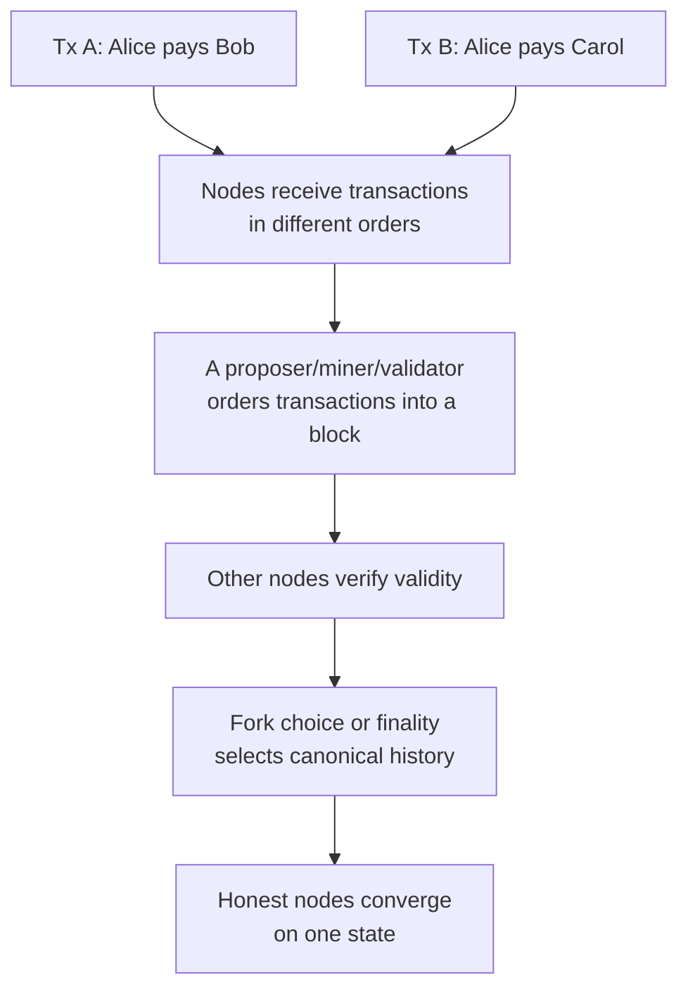

Consensus does not make every participant honest. It gives honest participants a shared procedure for identifying the accepted history under explicit assumptions: how many participants may be faulty, how messages propagate, what resource controls influence, and what penalties or costs discourage attacks.

## Consensus As Layered Jobs

The word "consensus" often hides several different jobs. Separating them makes the mechanism families easier to compare.

| Job | Meaning | Examples |
|---|---|---|
| Membership | Who is allowed to participate? | Permissionless miners, staked validators, known banks, trusted validator lists |
| Sybil resistance | What prevents one attacker from creating many identities? | Hash power, locked stake, approved legal identity, trusted quorum list |
| Proposer selection | Who gets to suggest the next block or ledger update? | Mining race, stake-weighted random choice, round-robin validator, leader election |
| Validity verification | How do nodes know the block follows rules? | Full-node validation, smart-contract execution, signature checks, endorsement policies |
| Voting or fork choice | How is the canonical block selected? | Most accumulated work, attestation weight, BFT quorum, randomized sampling |
| Finality | When is reversal practically or protocol-theoretically impossible? | Confirmations, finality checkpoints, quorum commits, validated ledgers |
| Incentives and penalties | Why do participants behave? | Block rewards, transaction fees, slashing, reputation, legal contracts |

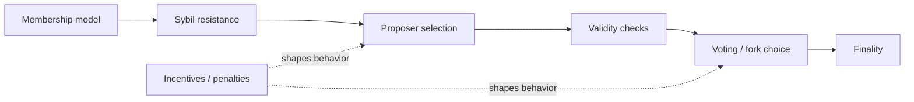

Some systems combine these jobs tightly. Bitcoin's mining race both selects the proposer and supplies Sybil resistance. Ethereum proof of stake separates validator membership, proposer selection, attestation voting, fork choice, finality, rewards, and slashing. A private Besu QBFT network may use legal identity for membership and BFT voting for finality.

## Safety, Liveness, And Finality

Consensus protocols are usually evaluated with two core properties.

**Safety** means honest participants do not finalize conflicting histories. If one honest node finalizes Block A at height 100, another honest node should not finalize a different Block B at height 100.

**Liveness** means the system keeps making progress. Valid transactions can eventually be included, and blocks or ledger versions continue being produced.

| Property | Plain meaning | Failure example |
|---|---|---|
| Safety | The system does not finalize conflicting states | Two incompatible blocks both become final |
| Liveness | The system keeps producing and finalizing updates | The network stalls and no new transactions settle |

The tension is that preserving safety can require sacrificing liveness during severe network problems. If a validator network splits into two isolated halves, a conservative BFT protocol may halt because neither side can gather a safe quorum. That is unpleasant, but it prevents two conflicting histories from both becoming final. A protocol that continues on both sides may preserve availability but create a dangerous fork.

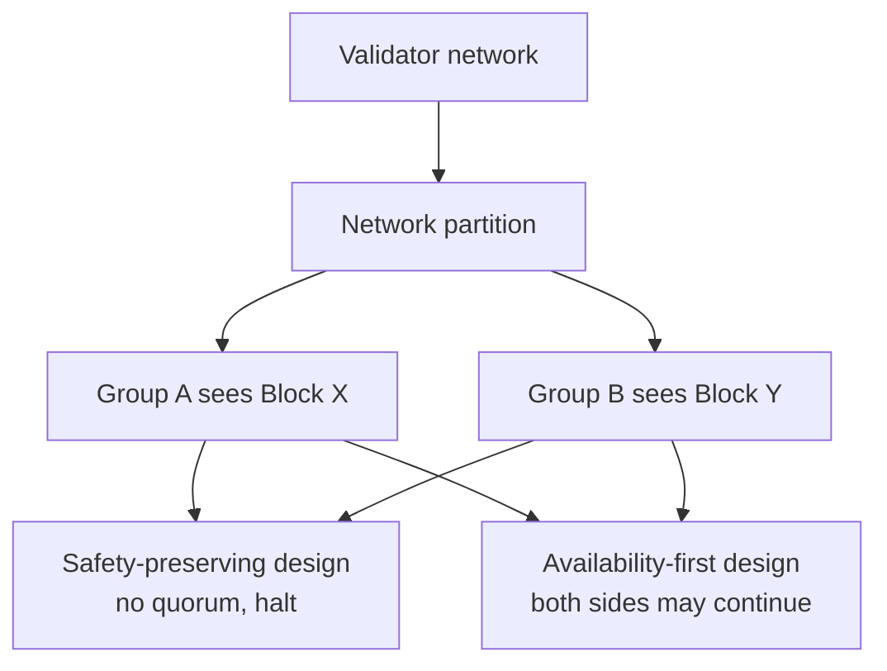

### Finality Vocabulary

Finality is the point at which a transaction or block should be treated as settled. Different systems mean different things by "final."

| Term | Meaning |
|---|---|
| Valid | The transaction or block follows protocol rules |
| Included | The transaction appears in a block or ledger version |
| Canonical | The block is currently on the accepted chain/head |
| Confirmed | Additional blocks or votes have built on top of it |
| Safe | Reversion is unlikely under normal assumptions |
| Finalized | Reversion would require breaking protocol assumptions or extreme social intervention |

| Finality model | Mechanism | Examples | Reversal risk |
|---|---|---|---|
| Probabilistic finality | Reversal becomes less likely as more work/blocks accumulate | Bitcoin, many PoW chains | Never mathematically zero; decreases with confirmations |
| Deterministic finality | Protocol quorum commits a block/ledger | Tendermint/CometBFT, PBFT-style systems, Besu QBFT/IBFT | Reversal requires quorum safety failure or governance reset |
| Economic finality | Reversal would slash or destroy large validator stake | Ethereum PoS finalized checkpoints | Possible only with severe economic/social consequences |
| Trust-list finality | Trusted validators agree on a ledger | XRPL-style consensus | Depends on UNL/trust configuration and overlap |
| Institutional finality | Legal/governance rules treat a state as settled | Some permissioned networks and financial-market infrastructures | Depends on contracts, rulebooks, and dispute processes |

Bitcoin's developer documentation describes how proof of work and block chaining make modification harder as blocks accumulate.[^bitcoin-dev-blockchain] Ethereum proof of stake combines fork choice and finality through validators, attestations, checkpoints, and economic penalties.[^ethereum-pos] Fabric's ordering service documentation emphasizes deterministic finality in Fabric's permissioned ordering model, contrasting it with probabilistic consensus in Bitcoin-like systems.[^fabric-ordering]

### Fake Scenario: Bridge Finality

A bridge locks tokens on Chain A and mints wrapped tokens on Chain B. If Chain A has probabilistic finality and the bridge mints too quickly, a reorganization on Chain A could remove the lock transaction after Chain B has already minted the representation. The bridge then has unbacked wrapped tokens.

For a Bitcoin-like source chain, the bridge may wait for many confirmations. For a BFT source chain, it may wait for deterministic finality. For Ethereum, it may distinguish head, safe, and finalized blocks. The correct waiting rule depends on the source chain's finality model and the value at risk.

## Fault Models And Network Assumptions

Consensus design depends on what failures the protocol expects.

| Fault model | Meaning | Example | Relevant systems |
|---|---|---|---|
| Crash fault | Node stops or restarts but does not lie | Server outage | Raft/Paxos-style systems |
| Omission fault | Node fails to send or receive messages | Packet loss, overloaded node | Most distributed systems |
| Byzantine fault | Node behaves arbitrarily or maliciously | Double-signing, equivocation, censorship | Blockchain consensus |
| Rational fault | Node follows profit incentives, not protocol spirit | MEV extraction, selfish mining | Public economic networks |
| Correlated fault | Many nodes fail the same way | Client bug, cloud outage, validator operator mistake | PoS and permissioned networks |

Byzantine behavior includes:

- proposing invalid blocks;
- signing conflicting blocks;
- withholding blocks or votes;
- lying to different peers;
- censoring transactions;
- creating many identities;
- attempting to rewrite recent history;
- coordinating with other attackers.

Protocols also make network timing assumptions.

| Timing model | Meaning | Practical consequence |
|---|---|---|
| Synchronous | Messages arrive within a known bound | Easier to reason about, unrealistic at global scale |
| Asynchronous | Messages may be delayed indefinitely | Deterministic consensus cannot guarantee termination with faults |
| Partially synchronous | The network eventually behaves within timing bounds | Common assumption for practical BFT systems |

FLP impossibility says deterministic consensus cannot guarantee termination in a fully asynchronous network with even one possible crash fault. Practical systems work around this with partial synchrony, randomness, leader rotation, economic incentives, or weaker finality assumptions.

## Byzantine Agreement And Quorums

Byzantine fault tolerant systems commonly rely on quorums. A quorum is a sufficiently large set of votes that two conflicting quorums must overlap in at least one honest participant. That overlap is what prevents two conflicting decisions from both becoming final.

The classic BFT threshold is often expressed as `n >= 3f + 1`, where:

- `n` is the total number of validators;
- `f` is the maximum number of Byzantine validators tolerated;
- a decision typically needs more than two-thirds of voting power.

With 4 validators, the system can tolerate 1 Byzantine validator. With 7 validators, it can tolerate 2. If more than one-third of voting power is Byzantine or unavailable, safety or liveness assumptions break depending on the protocol.

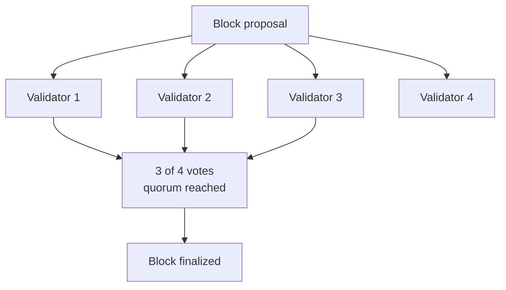

The quorum idea appears in PBFT, Tendermint/CometBFT, HotStuff-style systems, Besu QBFT/IBFT, and many permissioned networks. The membership and incentive layer may differ, but the voting threshold intuition is shared.

## Proof Of Work And Nakamoto Consensus

Proof of Work, or PoW, uses costly computation as Sybil resistance. A miner's influence depends on hash power, not on how many identities the miner creates.

Bitcoin is the canonical PoW system. Bitcoin's developer documentation explains that each block must prove significant work was invested in its creation and that modifying older blocks requires redoing the work for that block and all later blocks.[^bitcoin-dev-blockchain] The accepted chain is not merely the longest by block count; it is the valid chain with the most accumulated work.

### Mining Lifecycle

In Bitcoin-style PoW:

1. transactions enter mempools;
2. miners build candidate blocks;
3. miners include a coinbase transaction paying subsidy and fees;
4. miners vary nonce and extra nonce data;
5. miners repeatedly hash the block header;
6. a valid block header hash must be below the target;
7. the winning miner broadcasts the block;
8. full nodes independently verify the block;
9. miners build on the valid chain with the most accumulated work.

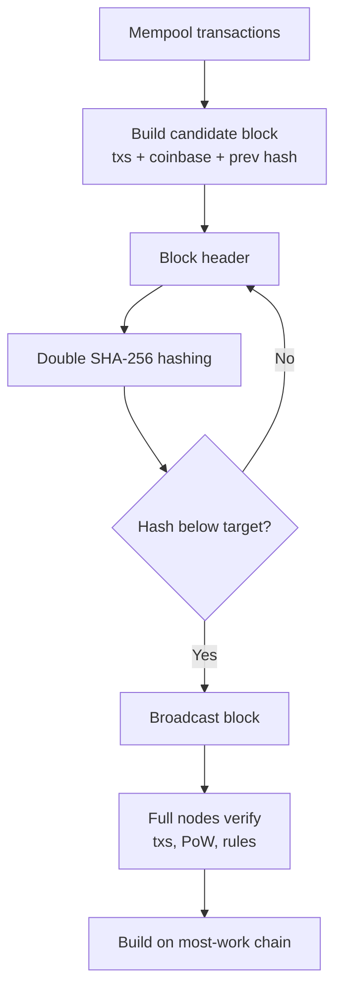

PoW is asymmetric. Producing a valid block is expensive because many hashes must be tried. Verifying the proof is cheap because nodes only check that the block header hash is below the target and that the block follows consensus rules.

### Difficulty And Hash Rate

Difficulty adjusts the target so blocks arrive near the intended average rate. Bitcoin adjusts difficulty every 2,016 blocks based on the time taken to mine the previous period, aiming for roughly two weeks per 2,016-block interval.[^bitcoin-dev-blockchain]

Hash rate measures the number of hash attempts per second. High total hash rate raises the cost of attack, but decentralization depends on who controls that hash rate. If a few pools coordinate most block production, the system may be economically powerful but operationally concentrated.

### Mining Pools

Mining is probabilistic. A small miner may wait a long time before finding a block. Mining pools smooth income by coordinating many miners and distributing rewards according to contributed work.

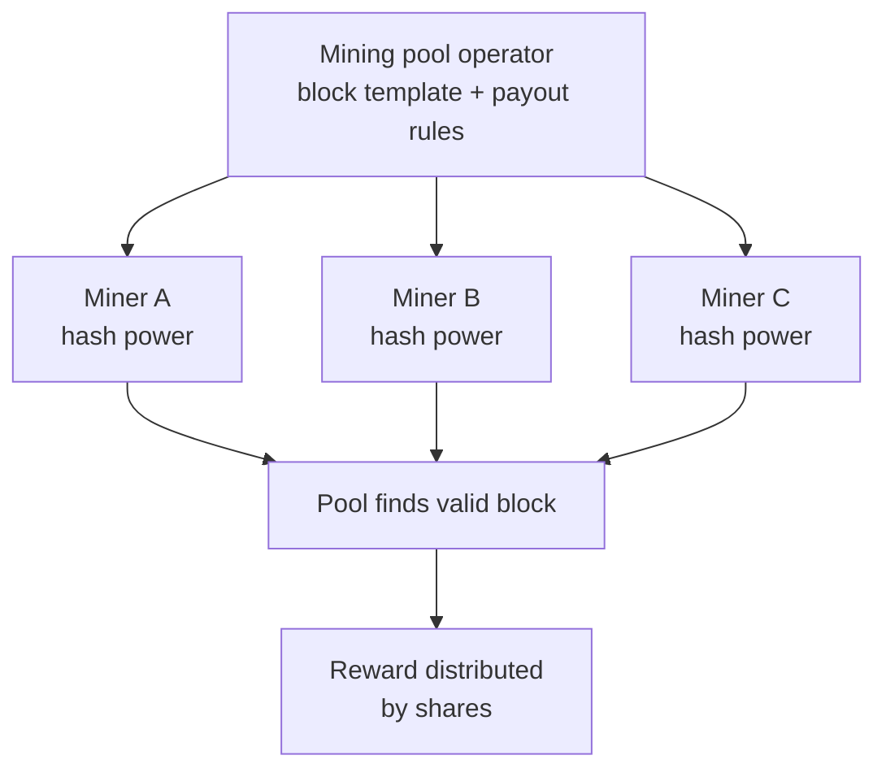

Pools reduce reward variance but create control points. A pool operator may choose block templates, censor transactions, or participate in coordinated behavior even if the underlying hardware is owned by many miners.

### PoW Finality

PoW finality is probabilistic. A transaction with one confirmation can be reversed by a short reorganization. A transaction buried under six confirmations is harder to reverse because an attacker must produce an alternative chain from before that transaction and overtake the honest chain's accumulated work.

The waiting period is a risk decision. A coffee purchase may accept zero or one confirmation. An exchange deposit may wait several confirmations. A bridge or institutional settlement system may wait more, especially on smaller PoW chains with lower hash power.

### PoW Examples

| Network | PoW status | Notes |
|---|---|---|
| Bitcoin | Current | Canonical Nakamoto PoW system |
| Litecoin | Current | Bitcoin-like PoW with different parameters/hash function history |
| Dogecoin | Current | PoW with merged-mining history with Litecoin |
| Monero | Current | PoW using RandomX to favor general-purpose CPUs |
| Ethereum | Historical | Used PoW before the Merge; now PoS |
| Bitcoin Cash | Current | Forked Bitcoin-like PoW network |

### PoW Pros And Cons

| Strength | Explanation |
|---|---|
| Open participation | Anyone with hardware and energy can mine |
| Simple verification | Full nodes cheaply verify work and block validity |
| External attack cost | Security is anchored in physical energy/hardware expenditure |
| Mature track record | Bitcoin has operated under PoW since 2009 |

| Weakness | Explanation |
|---|---|
| Energy consumption | Security budget consumes real-world electricity |
| Hardware specialization | ASIC markets can centralize manufacturing and mining |
| Probabilistic finality | High-value settlement requires waiting |
| Mining-pool concentration | Pools can influence block construction and censorship |
| Security-budget questions | Long-term security depends on fees after subsidy declines |

## Proof Of Stake

Proof of Stake, or PoS, uses locked capital as Sybil resistance. A validator's influence depends on stake, not hash power. Validators perform protocol duties such as proposing blocks, attesting, voting, or participating in finality. Honest participation earns rewards; downtime or misbehavior can lead to penalties; provable serious misbehavior can lead to slashing.

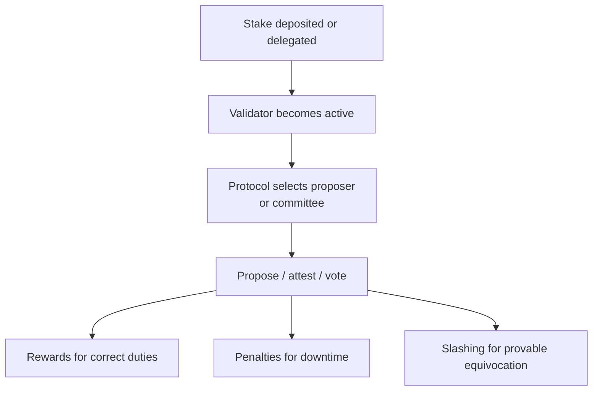

The economic intuition is capital at risk. A miner who attacks a PoW network spends electricity and may still own hardware afterward. A validator who attacks a slashable PoS network can lose part of the staked capital if the misbehavior is provable.

### Core PoS Concepts

| Concept | Meaning |
|---|---|
| Validator | Node/operator participating in consensus duties |
| Stake | Capital bonded or delegated to secure the network |
| Proposer | Validator selected to propose a block |
| Attester/voter | Validator voting on block validity, head, or finality |
| Epoch/slot | Time structure used to schedule duties |
| Slashing | Destruction or seizure of stake for provable misbehavior |
| Delegation | Token holder assigns staking power to a validator |
| Weak subjectivity | New nodes need a recent trusted checkpoint or social context |

### Ethereum Proof Of Stake

Ethereum currently uses proof of stake. Validators propose and attest to blocks. Ethereum's consensus combines LMD-GHOST fork choice with Casper FFG finality, often described together as Gasper.[^ethereum-pos][^gasper-paper]

At a high level:

1. validators stake ETH to become active;
2. time is divided into slots and epochs;
3. one validator is selected to propose a block for a slot;
4. committees of validators attest to blocks;
5. LMD-GHOST uses latest validator messages to choose the head;
6. Casper FFG justifies and finalizes checkpoints when enough stake votes;
7. slashable offenses include conflicting votes or proposals under protocol rules;
8. inactivity leaks help recover finality if many validators go offline.

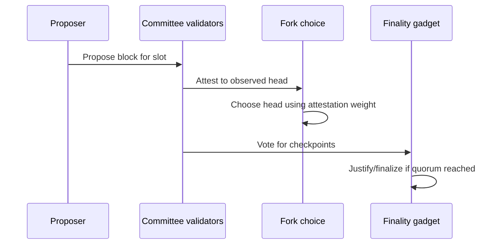

Ethereum finality is economic. Reverting finalized blocks would require a severe failure, such as a large fraction of validator stake violating finality rules and becoming slashable, plus social coordination around recovery.

### PoS Subtypes

| Subtype | Core idea | Examples |
|---|---|---|
| Direct/bonded PoS | Validators bond stake directly | Ethereum, many Cosmos-style networks |
| Delegated PoS | Token holders vote/delegate to block producers | EOS-style systems, many DPoS chains |
| Nominated PoS | Nominators back validators; election spreads stake | Polkadot |
| BFT PoS | Stake selects voting power in BFT finality | Cosmos/CometBFT chains |
| Liquid staking | Staked position represented by transferable token | Ethereum liquid staking protocols |
| Restaking | Staked capital secures additional services | Ethereum-adjacent restaking systems |
| Pure PoS with sortition | Committees selected cryptographically by stake | Algorand-style systems |

### Delegated And Nominated PoS

Delegated PoS improves coordination by narrowing the active block-producer set. Token holders delegate voting power to validators or block producers. Performance can improve, but political concentration can increase because a small validator set controls block production.

Nominated PoS, associated with Polkadot, uses nominators who back validators with stake. Polkadot's current documentation describes Nominated Proof of Stake as the mechanism for choosing validators to secure the Relay Chain, and separates block production and finality into BABE and GRANDPA-style mechanisms.[^polkadot-pos]

### Cardano Ouroboros

Cardano uses the Ouroboros proof-of-stake protocol family. Ouroboros uses epochs and slots, stake pools, delegation, and slot-leader selection. It is a slot-based PoS design rather than Ethereum's exact validator/attestation/finality-gadget structure.

The conceptual comparison:

| Feature | Ethereum PoS | Cardano Ouroboros-style PoS |
|---|---|---|
| Time structure | Slots and epochs | Slots and epochs |
| Participation | Validators with stake deposits | Stake pools and delegators |
| Finality style | Fork choice plus Casper FFG finality | Chain-growth/common-prefix style settlement assumptions |
| Delegation | Mostly through staking pools/liquid staking outside protocol validator deposit model | Protocol-level stake delegation to pools |

### Algorand Pure Proof Of Stake

Algorand-style pure proof of stake uses cryptographic sortition. Participants privately determine whether they are selected for a committee by running a verifiable random function. If selected, they can prove membership to others. This makes committee membership hard to target before messages are sent.

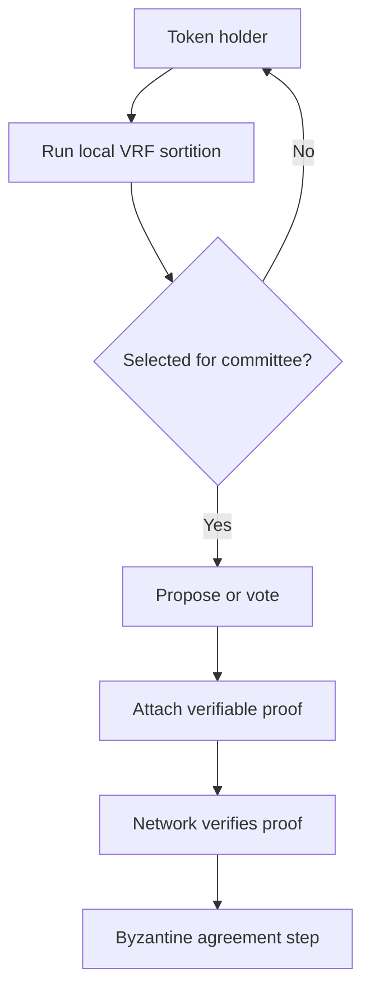

Algorand's public materials describe accessible node participation and consensus based on proof of stake; the academic Algorand literature describes cryptographic sortition and Byzantine agreement as central to the design.[^algorand-docs][^algorand-paper]

### PoS Pros And Cons

| Strength | Explanation |
|---|---|
| Energy efficient | No mining race required |
| Slashable accountability | Some misbehavior produces cryptographic evidence |
| Flexible finality | Can combine fork choice with BFT-style finality |
| Lower hardware waste | Validators do not need ASIC mining equipment |

| Weakness | Explanation |
|---|---|
| Weak subjectivity | New nodes may need recent trusted checkpoints |
| Stake concentration | Wealth and staking infrastructure can centralize |
| Slashing complexity | Operational errors can destroy funds |
| Governance capture | Large stakeholders may influence upgrades and validator sets |
| Long-range attacks | Old validators may sign alternative histories after exiting unless mitigated |

## BFT-Style Consensus

BFT-style consensus uses explicit voting among a known or stake-weighted validator set. These protocols are designed to tolerate Byzantine validators up to a threshold, usually less than one-third of voting power. They can provide deterministic finality: once the required quorum commits a block, the protocol treats it as final.

### PBFT

Practical Byzantine Fault Tolerance, or PBFT, is a classic BFT protocol for replicated state machines. It assumes a fixed set of replicas and tolerates up to `f` Byzantine replicas with at least `3f + 1` total replicas.

PBFT uses phases often described as:

1. **pre-prepare:** leader proposes a value;
2. **prepare:** replicas echo support so everyone can see that enough replicas observed the proposal;
3. **commit:** replicas confirm that the value is ready to be executed/finalized;
4. **view change:** if the leader fails, replicas move to a new leader/view.

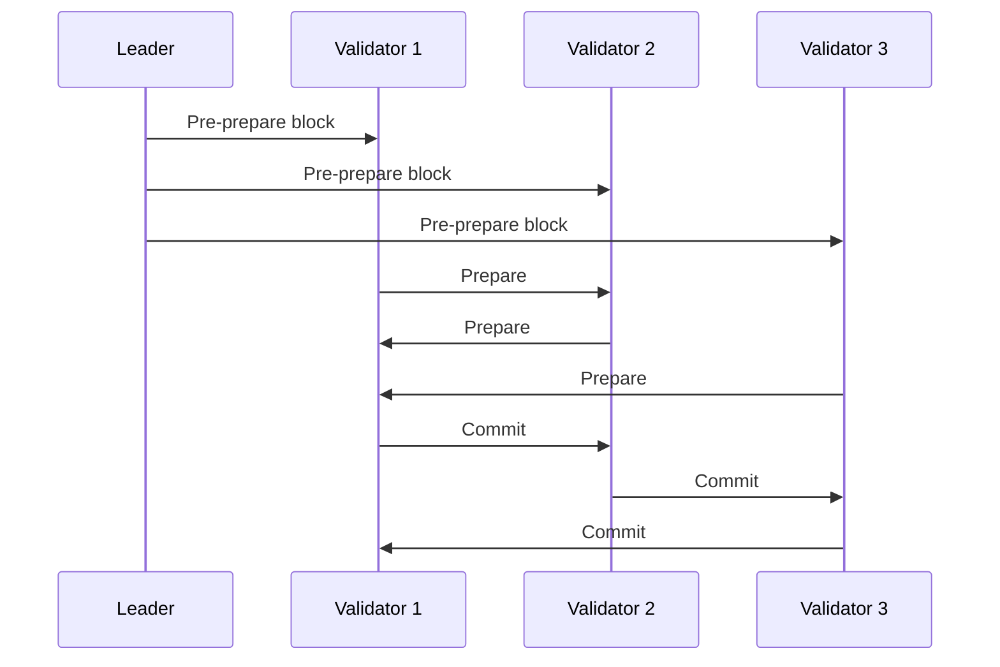

PBFT is influential but communication-heavy because validators exchange many messages. Modern protocols borrow its quorum logic while reducing communication overhead, improving leader changes, or adapting voting power to stake.

### Tendermint And CometBFT

Tendermint, now continued in the CometBFT ecosystem, is a BFT consensus engine widely associated with Cosmos SDK chains. The core round structure is:

1. proposer proposes a block;
2. validators prevote;
3. validators precommit;
4. if enough voting power precommits, the block commits;
5. if not, the protocol moves to another round.

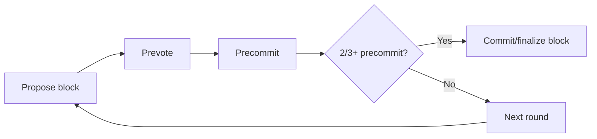

CometBFT documentation describes consensus as rounds with proposal, prevote, and precommit steps.[^cometbft-consensus] Cosmos-style chains often combine bonded PoS validator selection with Tendermint/CometBFT BFT finality.

Strengths:

- fast deterministic finality;
- clear validator accountability;
- good fit for application-specific chains;
- simple mental model for bridge and exchange integrations.

Weaknesses:

- validator set size affects communication overhead;
- the chain can halt if enough voting power is unavailable;
- stake concentration can become governance concentration;
- app-chain security depends on the value and distribution of stake.

### HotStuff And Modern BFT

HotStuff is a modern BFT protocol family that streamlined communication and leader changes using quorum certificates. A quorum certificate is aggregated evidence that enough validators voted for a block or phase. HotStuff-style ideas influenced several high-performance blockchain systems and the Diem/Aptos/Sui design lineage.

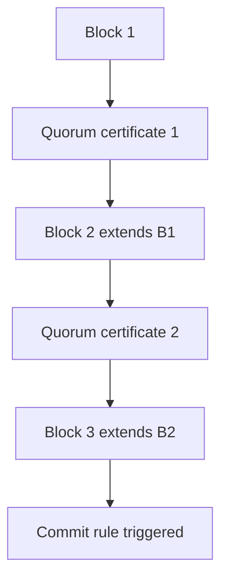

The central design goal is to keep BFT finality while reducing message complexity and making view changes cleaner. The trade-off is conceptual and implementation complexity.

### BFT Pros And Cons

| Strength | Explanation |
|---|---|
| Fast finality | Quorum votes can finalize quickly |
| Clear accountability | Validators sign votes that can be audited |
| Good for permissioned networks | Known institutions can run validators |
| Good for app chains | Application-specific chains can tune validator sets |

| Weakness | Explanation |
|---|---|
| Validator-set assumptions | Usually needs known or stake-weighted validators |
| Communication overhead | More validators can mean more messages |
| Liveness sensitivity | Network partitions or offline validators can halt the chain |
| Governance complexity | Validator addition/removal is a security-critical process |

## Proof Of Authority

Proof of Authority, or PoA, uses a known set of approved validators. Validators are selected by identity, reputation, legal role, or governance permission rather than open mining or broad staking. PoA is common in private networks, enterprise consortia, testnets, and systems where validator accountability is legal or reputational.

PoA is not meaningfully permissionless. Its security comes from controlled validator membership, operational monitoring, governance, and real-world accountability.

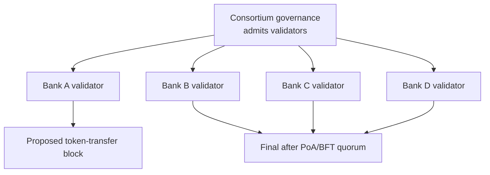

### PoA Subtypes

| Subtype | How it works | Current relevance |
|---|---|---|
| Clique-style PoA | Approved signers take turns or sign blocks with lightweight rules | Historically common in Ethereum private networks; Besu docs state Clique is no longer supported |
| IBFT 2.0 | Istanbul BFT-style validator voting with immediate finality | Supported in Besu private networks |
| QBFT | Quorum BFT-style consensus for Besu private networks | Current Besu private-network option |
| Aura/AuthorityRound | Authorities produce blocks in scheduled rounds | Appears in some Substrate/Parity-style contexts |
| Consortium BFT PoA | Known institutions vote/finalize under legal rulebook | Common pattern for bank or market-infrastructure networks |
| Contract-managed validator set | Smart contract/governance updates validator membership | Useful when validator set changes must be transparent |

Besu documentation describes QBFT and IBFT 2.0 as proof-of-authority consensus protocols for private networks and states that Clique is no longer supported.[^besu-poa]

### Besu QBFT And IBFT 2.0

In a Besu private network, validators are known nodes. QBFT/IBFT provide BFT-style finality among those validators. A block is not accepted because one authority signed it; validators participate in voting rounds so the network can tolerate some faulty validators up to the protocol threshold.

Institutional implication:

- validator membership is a governance object;
- node identity and validator identity must be controlled;
- validator removal procedures must exist;
- outages can threaten liveness;
- collusion or legal disputes can threaten trust;
- finality can be much faster and more deterministic than PoW.

### PoA Institutional Scenario

Four banks operate a tokenized deposit network. Each bank runs one validator and one non-validator RPC node. A token contract records deposit-token balances. FireFly or another middleware layer submits transactions. Governance documents define validator admission, removal, software upgrades, and emergency pauses.

1. Bank A customer requests a transfer to Bank B customer.
2. Bank A application performs KYC/sanctions/risk checks.
3. Middleware submits a token-transfer transaction.
4. Besu validators run QBFT consensus.
5. The transaction finalizes after quorum.
6. Bank A and Bank B update internal books and audit records.

PoA solves validator selection for this controlled environment. It does not solve customer identity, legal settlement, compliance, custody, or accounting by itself.

### PoA Pros And Cons

| Strength | Explanation |
|---|---|
| Efficient | No mining race and small validator sets |
| Fast finality | BFT-style PoA can finalize quickly |
| Clear accountability | Validators are known legal entities |
| Good for consortia | Fits banks, market infrastructures, and pilots |

| Weakness | Explanation |
|---|---|
| Not permissionless | Ordinary users cannot independently join validation |
| Governance-dependent | Security relies on legal and operational controls |
| Censorship/collusion risk | Known validators can coordinate or be pressured |
| Lower public neutrality | Less suitable for open public settlement |

## Avalanche Consensus Family

Avalanche consensus uses repeated randomized subsampling. Instead of every validator communicating with every other validator in every round, a node repeatedly queries small random subsets of peers and updates its preference based on the responses. If enough repeated samples show the same preference, the network converges.

The intuition is social convergence through repeated sampling. If most honest nodes start leaning toward one option, repeated random polling amplifies that preference until it becomes stable.

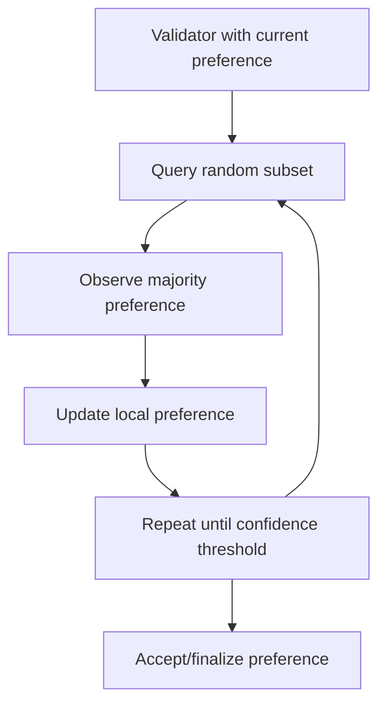

Avalanche-style consensus differs from Nakamoto PoW and from classical all-to-all BFT:

- it does not rely on a mining race;
- it does not require every validator to vote with every other validator in every round;
- finality comes from repeated probabilistic confidence;
- parameters and adversarial assumptions matter.

Avalanche's platform uses Snow-family consensus protocols. Snowman is the linear-chain consensus protocol used for EVM-style chains such as Avalanche's C-Chain. Avalanche's own documentation and related research describe repeated sampling and Snow-family consensus as central to the design.[^avalanche-docs]

| Strength | Weakness |
|---|---|
| Fast convergence under normal assumptions | More complex to reason about than simple longest-chain PoW |
| Lower communication overhead than all-to-all BFT | Parameter choices matter |
| Supports high-throughput designs | Stake/validator distribution still matters |
| Useful for subnet/L1-style custom chains | Operational and security assumptions differ from Ethereum/Bitcoin |

## Proof Of History And Solana-Style Consensus

Proof of History, or PoH, is associated with Solana. It is not a complete consensus mechanism by itself. It is a cryptographic time-ordering component: a sequence of hashes that gives validators a verifiable ordering of events.

The purpose is to reduce coordination overhead around time. If events can be placed in a verifiable sequence before full network agreement, validators can process and vote more efficiently.

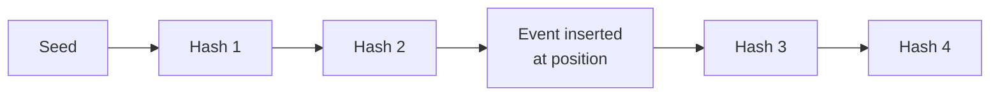

Solana's broader architecture includes:

- stake-weighted validators;
- leader schedules;
- PoH as a time/order component;
- Tower BFT-style voting;
- fork choice;
- high-performance networking and execution assumptions.

The current Anza validator documentation describes Solana/Agave as proof-of-stake validator infrastructure and distinguishes validators from RPC nodes.[^solana-docs] The important conceptual point is that PoH helps order events, while validator voting and fork choice provide consensus.

| Strength | Weakness |
|---|---|
| High throughput and low latency design | Higher hardware/network demands |
| Efficient ordering component | More complex architecture |
| Strong fit for high-performance applications | Operational outages and client diversity matter |
| Different design from Ethereum/Bitcoin | Small validators may face barriers |

## Federated Byzantine Agreement

Federated Byzantine Agreement, or FBA, lets each node choose whom it trusts instead of requiring one globally fixed validator set. Nodes define quorum slices: subsets of trusted nodes sufficient to convince them. If these trust choices overlap correctly, the network can reach agreement.

Stellar Consensus Protocol is the canonical FBA example. XRPL uses a related trust-list model based on Unique Node Lists. XRPL documentation explains that each server chooses trusted validators in a Unique Node List, and that the network prefers halting over confirming invalid transactions when too many trusted validators are unreachable or faulty.[^xrpl-consensus]

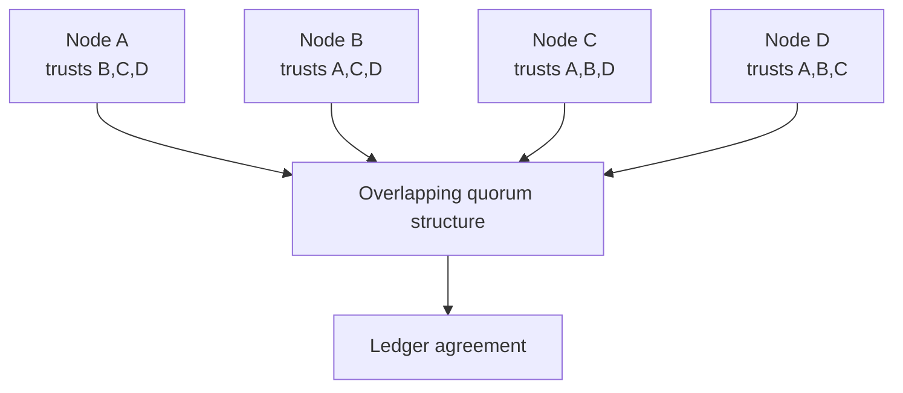

FBA is not PoW and not standard PoS. Its security depends on quorum intersection and trust configuration. It can be fast and energy efficient, but decentralization is subtle because each node's trust choices affect global safety and liveness.

| Strength | Weakness |
|---|---|
| Fast confirmation | Trust configuration is complex |
| Energy efficient | Safety depends on quorum intersection |
| Flexible trust | Bad trust lists can centralize or weaken the network |
| Useful for payment networks | Less permissionless than PoW/PoS participation ideals |

## Crash-Fault Consensus: Raft And Paxos

Raft and Paxos are consensus algorithms for crash-fault-tolerant replicated systems. They assume nodes may crash or lose messages, but not lie maliciously. This is appropriate for many database clusters and internal systems, but insufficient for open adversarial blockchains.

Raft uses a leader. Followers replicate the leader's log. If the leader fails, followers elect a new leader.

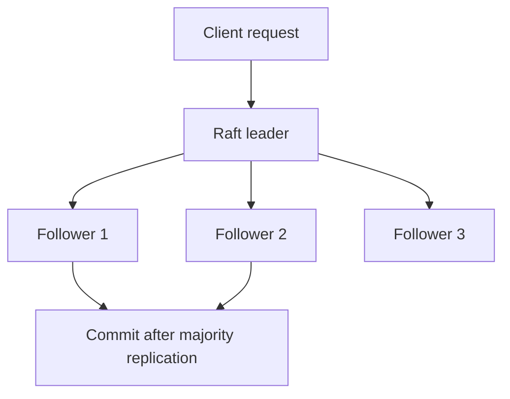

Hyperledger Fabric uses a different architecture from Ethereum-like blockchains. Its ordering service orders transactions into blocks, and Fabric documentation describes deterministic finality and a recommended Raft ordering service implementation.[^fabric-ordering] Fabric also has BFT ordering work, but the key learning point is that permissioned enterprise systems may separate execution, endorsement, ordering, and commitment instead of using one monolithic blockchain consensus mechanism.

| Setting | Failure assumption | Suitable consensus |
|---|---|---|
| Internal database cluster | Nodes crash but do not lie | Raft/Paxos |
| Permissioned consortium | Known participants may fail or misbehave | BFT/PoA |
| Public blockchain | Open adversarial participation | PoW or PoS with economic Sybil resistance |

## Hybrid And Modular Designs

Many real systems combine several consensus ideas.

| Combination | Meaning | Example |
|---|---|---|
| PoW + longest-chain fork choice | Work selects proposer and chain weight | Bitcoin |
| PoS + fork choice + finality gadget | Stake selects/votes; finality checkpoints finalize | Ethereum |
| PoS + BFT | Stake defines voting power in BFT rounds | Cosmos/CometBFT chains |
| PoA + BFT | Known validators vote with BFT quorum | Besu QBFT/IBFT |
| PoH + PoS voting | Cryptographic ordering plus validator votes | Solana |
| FBA trust lists | Nodes choose quorum slices or validator lists | Stellar/XRPL-style systems |
| Rollup + L1 consensus | Sequencer orders locally; L1 provides settlement/DA | Ethereum rollups |

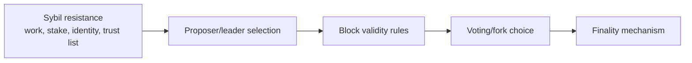

Rollups are especially important. A rollup may have a centralized or decentralized sequencer that orders transactions quickly, but final settlement and data availability often depend on Ethereum's consensus. This means users must reason about both the rollup's local ordering guarantees and the L1's finality.

## Consensus Economics

Consensus security is partly economic. Attackers compare potential profit to expected cost, penalties, detection, and social response.

### Mining Economics

PoW miners face:

- hardware capital expenditure;
- electricity operating expenditure;
- facility and cooling costs;
- mining pool fees;
- block subsidy revenue;
- transaction fee revenue;
- stale-block risk;
- regulatory and energy-market risk.

Bitcoin's long-term security budget is expected to rely more heavily on transaction fees as block subsidy declines. This creates open questions about fee markets, miner incentives, and the cost of majority attacks in the distant future.

### Validator Economics

Proof-of-stake security turns capital and future revenue into incentives. An
honest validator earns issuance and fees but bears operating costs and the risk
of penalties; an attacker compares extractable value with capital loss, foregone
rewards, and the chance that the community rejects the attack. The security
budget is therefore economic and changes with asset price and stake concentration.

PoS validators face:

- capital lockup;
- opportunity cost;
- infrastructure costs;
- slashing risk;
- downtime penalties;
- software/client risk;
- key-management risk;
- MEV and block-building dynamics;
- delegation or liquid-staking concentration.

### Permissioned Validator Economics

In a private PoA/BFT network, validators may not earn block rewards. They run nodes because of a business arrangement: membership in a settlement network, access to tokenized deposits, participation in a market infrastructure, or regulatory mandate. Security comes from:

- legal contracts;
- reputational penalties;
- operational SLAs;
- audits;
- governance rights;
- technical monitoring;
- removal procedures.

This is still an incentive system, just not a public-token incentive system.

## MEV And Consensus

Maximal extractable value, or MEV, is value extracted from transaction ordering, inclusion, or exclusion. It connects directly to consensus because block producers decide which transactions appear and in what order.

Examples:

- a miner or validator front-runs a DEX trade;
- a block builder sandwiches a swap;
- a validator censors a transaction;
- a sequencer delays withdrawals;
- a proposer chooses the most profitable block from a builder market.

Consensus determines who has ordering power. Economics determines what they are tempted to do with it. Mitigations include proposer-builder separation, inclusion lists, encrypted mempools, fair ordering research, MEV smoothing, and application-level protections.

## Attacks And Failure Modes

| Attack/failure | Main target | Mechanism | Typical mitigations |
|---|---|---|---|
| 51% attack | PoW/PoS majority control | Reorg, double spend, censorship | Distributed hash/stake, confirmations, monitoring |
| Double spend | Payment finality | Spend once, reorg, spend elsewhere | Confirmation/finality waiting |
| Selfish mining | PoW incentives | Withhold blocks to gain advantage | Network propagation, pool monitoring, incentives research |
| Block withholding | Mining pools | Miner submits shares but withholds valid blocks | Pool protocols, monitoring |
| Nothing-at-stake | PoS forks | Validators vote on many forks cheaply | Slashing, fork-choice rules |
| Long-range attack | PoS history | Old validators sign alternative old chain | Weak subjectivity, checkpoints |
| Equivocation | BFT/PoS | Sign conflicting messages | Slashing, evidence, quorum rules |
| Censorship | Users/transactions | Block producers refuse inclusion | Diverse validators, inclusion lists, social pressure |
| Eclipse attack | Node view | Isolate a node's peers | Peer diversity, network hardening |
| Sybil attack | Membership | Create many identities | Work, stake, permissioning, trust lists |
| Client bug | Software diversity | Same bug affects many validators | Client diversity, audits, testnets |
| Key compromise | Validator/custody | Attacker signs malicious messages | HSMs, key rotation, slashing protection |
| Network partition | Safety/liveness | Validators cannot communicate | Conservative finality, failover, topology |
| Governance capture | Protocol control | Large actors control upgrades/validators | Decentralized governance, checks and balances |
| Bridge-finality mismatch | Cross-chain systems | Destination acts before source finality | Conservative confirmation policies |

### Majority Attack Limits

Majority control weakens ordering and recent-history guarantees, but it does not
grant arbitrary application authority. Other nodes still verify state-transition
rules, so an attacker generally cannot forge a signature or spend assets it never
controlled. It can nevertheless cause serious harm through censorship, reordering,
double spending around probabilistic finality, and loss of confidence.

A majority attacker can often:

- censor transactions temporarily;
- reorganize recent blocks;
- double-spend against recipients who accept insufficient finality;
- disrupt liveness.

A majority attacker usually cannot:

- create coins beyond consensus rules if honest full nodes reject invalid blocks;
- spend coins without private keys;
- force upgraded honest nodes to accept invalid state transitions;
- permanently control social consensus if the community coordinates a response.

## Real-World Network Map

| Network/system | Consensus family | Mechanism details | Finality model | Notes |
|---|---|---|---|---|
| Bitcoin | PoW / Nakamoto | SHA-256 mining, most accumulated work | Probabilistic | Conservative base-layer settlement |
| Ethereum | PoS + fork choice + finality | LMD-GHOST + Casper FFG | Economic finality | Validators propose/attest/finalize |
| Ethereum before the Merge | PoW historical | Ethash mining | Probabilistic | Replaced by PoS in 2022 |
| Cosmos Hub / many Cosmos chains | PoS + Tendermint/CometBFT | Propose, prevote, precommit | Deterministic BFT finality | App-chain model |
| Hyperledger Besu private networks | PoA/BFT | QBFT or IBFT 2.0 validators | Deterministic | Permissioned institutional networks |
| Solana | PoH component + PoS voting | Leader schedule, PoH, Tower BFT-style voting | Fast but architecture-specific | High-performance validator design |
| Avalanche C-Chain | Snowman/Avalanche family | Repeated sampling, stake validators | Fast probabilistic confidence | EVM-compatible chain on Avalanche |
| Cardano | Ouroboros PoS | Slots, epochs, stake pools | Settlement under PoS chain assumptions | Formal PoS protocol family |
| Polkadot | Nominated PoS + BABE/GRANDPA | Validators/nominators, block production/finality | GRANDPA finality | Shared-security relay architecture |
| Algorand | Pure PoS + BA | Cryptographic sortition committees | Fast finality | Committee selection by VRF |
| Stellar | Federated Byzantine Agreement | Quorum slices | Deterministic under quorum assumptions | Flexible trust model |
| XRP Ledger | Trust-list consensus | Unique Node Lists | Validated ledgers final under assumptions | Prioritizes correctness/agreement over progress |
| Hyperledger Fabric | Permissioned ordering | Raft/CFT and BFT options depending deployment | Deterministic | Separates endorsement, ordering, validation |
| Corda | Notary-based uniqueness/finality | Notary prevents double-spends of states | Transaction finality after notarization/signatures | Not a blockchain in the Ethereum/Bitcoin style |

## Consensus Family Comparison

### By Openness

| Family | Permissionless participation | Block/ledger producer |
|---|---|---|
| PoW | Yes, if miner can obtain hash power | Miner/pool with valid work |
| PoS | Often permissionless subject to stake requirements | Stake-selected validator |
| BFT PoS | Usually permissionless or semi-permissioned validator set | Stake-weighted proposer |
| PoA | No | Approved authority/validator |
| FBA | Semi-open; trust-list dependent | Trusted validators |
| Raft/Paxos | No | Cluster leader/orderer |

### By Resource

| Family | Scarce resource or trust anchor | Attack cost |
|---|---|---|
| PoW | Hash power, energy, hardware | Buy/rent/control majority work |
| PoS | Locked capital | Acquire/control stake and risk slashing |
| PoA | Legal identity/reputation | Corrupt or pressure known validators |
| BFT consortium | Validator membership | Break quorum assumptions |
| FBA | Trust graph/quorum slices | Break quorum intersection/trust assumptions |
| Raft | Trusted cluster membership | Compromise trusted operators |

### By Best Fit

| Use case | Usually suitable families | Reason |
|---|---|---|
| Permissionless sound-money style settlement | PoW, conservative PoS | Strong public neutrality and broad participation |
| General smart-contract L1 | PoS with robust fork choice/finality | Energy efficiency and economic finality |
| Bank consortium | PoA/BFT such as QBFT/IBFT | Known institutions and fast finality |
| App-specific chain | Tendermint/CometBFT, Avalanche/Snowman, custom PoS | Tunable validator set and application governance |
| High-performance consumer apps | Solana-style or other high-throughput PoS/BFT designs | Low latency and throughput focus |
| Cross-border payment network | FBA/trust-list or BFT-style systems | Fast settlement with known/trusted participants |
| Internal replicated database | Raft/Paxos | Crash-fault assumptions are enough |

## Common Misconceptions

> **Misconception: Consensus means every node votes on every transaction.**  
> Many systems do not work that way. Bitcoin miners race to produce blocks while full nodes verify. Ethereum validators propose and attest. BFT systems vote on blocks or rounds. Fabric orderers order transactions before peers validate and commit.

> **Misconception: Proof of Stake means the richest party can always steal funds.**  
> Stake concentration is a risk, but validators still cannot spend users' funds without private keys or make honest full nodes accept invalid state. Their main powers involve ordering, censorship, reorg/finality attacks under severe assumptions, and governance influence.

> **Misconception: BFT finality has no assumptions.**  
> BFT finality depends on validator honesty thresholds, network timing assumptions, correct software, and safe key management.

> **Misconception: Proof of Authority is just centralized blockchain.**  
> It can be centralized, but consortium PoA/BFT systems can distribute validation among known legal entities. The security model is institutional rather than permissionless.

> **Misconception: Proof of History is Solana's full consensus mechanism.**  
> PoH is a time-ordering component. Solana consensus also uses stake-weighted validators, leader schedules, voting, and fork choice.

> **Misconception: More validators always means more decentralization and better performance.**  
> More validators can improve distribution, but they also increase coordination costs. Effective decentralization also depends on stake distribution, client diversity, geography, operators, cloud concentration, and governance.

## Connections To Other Notes

- [Bitcoin](../05-major-blockchains/bitcoin.md) expands Bitcoin PoW, mining
  economics, confirmations, and attacks.
- [Ethereum](../05-major-blockchains/ethereum.md) expands Ethereum PoS,
  LMD-GHOST, Casper FFG, validators, slashing, and weak subjectivity.
- [Enterprise Ethereum and Hyperledger](../../06-interoperability-privacy-and-enterprise-dlt/03-enterprise-dlt/enterprise-ethereum-and-hyperledger.md)
  expands Besu QBFT/IBFT and permissioned-network consensus.
- [Blockchain Scaling and Modular Architecture](../04-scaling-and-modularity/blockchain-scaling-and-modular-architecture.md)
  explains how consensus overhead, finality, validator requirements, rollups,
  sequencers, data availability, and settlement layers affect throughput and
  security.

## Glossary

**Attestation:** A validator vote or signed statement supporting a block, head, or checkpoint.

**BFT:** Byzantine fault tolerance; ability to operate correctly despite some malicious or arbitrary participants.

**Checkpoint:** A block or state selected as a finality reference point.

**Committee:** Subset of validators selected for a duty.

**Confirmation:** Additional block or vote depth after a transaction's inclusion.

**Deterministic finality:** Finality reached by protocol quorum, not merely probability.

**Equivocation:** Signing or proposing conflicting messages for the same consensus role.

**Finality:** Point at which a transaction/block should be treated as settled under the protocol assumptions.

**Fork choice:** Rule for selecting the canonical chain/head among valid alternatives.

**Liveness:** Ability of the protocol to keep making progress.

**PoA:** Proof of Authority; consensus based on approved validators.

**PoS:** Proof of Stake; consensus based on locked or delegated capital.

**PoW:** Proof of Work; consensus based on costly computation.

**Quorum:** Sufficient voting set to make a decision.

**Safety:** Property that conflicting states are not finalized.

**Slashing:** Penalty that destroys or seizes validator stake for provable misbehavior.

**Sybil resistance:** Mechanism that prevents fake identities from cheaply gaining influence.

**Weak subjectivity:** PoS property where new nodes need a recent trusted checkpoint or social context to avoid long-range attacks.

## Active Recall

1. Explain consensus as separate jobs: membership, Sybil resistance, proposer selection, voting/fork choice, finality, and incentives.
2. Compare safety and liveness during a network partition.
3. Explain why Bitcoin finality is probabilistic.
4. Explain why Ethereum PoS is not just "validators vote"; include fork choice and finality.
5. Describe how PBFT-style quorum voting prevents conflicting finality under assumptions.
6. Compare Tendermint/CometBFT and PoW finality.
7. Explain why PoA is useful for bank consortia but not permissionless.
8. Explain what PoH does and does not do in Solana.
9. Compare PoW, PoS, PoA, BFT, Avalanche, and FBA by scarce resource/trust anchor.
10. Describe how a bridge should adapt confirmation policy to source-chain finality.

## TLDR

Consensus mechanisms let distributed nodes agree on one canonical history despite latency, faults, and adversaries. The main families differ by their scarce resource and trust model: Proof of Work uses costly computation, Proof of Stake uses capital at risk, BFT systems use quorum voting, Proof of Authority uses known validators, Avalanche-style protocols use repeated randomized sampling, and FBA systems use overlapping trust choices.

The right mechanism depends on the system's goal. Bitcoin optimizes for open, conservative, permissionless settlement. Ethereum uses PoS with fork choice and economic finality. Cosmos-style chains use BFT finality with stake-weighted validators. Besu private networks often use PoA/BFT for known institutional validators. Solana uses a high-performance PoS architecture with Proof of History as an ordering component. Stellar and XRPL use trust-list/federated approaches. Internal enterprise systems may use Raft or Paxos when Byzantine behavior is outside the threat model.

Consensus security is never only cryptography. It is also incentives, validator distribution, client diversity, network topology, governance, MEV, key management, and social coordination.

## References

[^bitcoin-dev-blockchain]: Bitcoin Developer Guide, [Block Chain](https://developer.bitcoin.org/devguide/block_chain.html).
[^ethereum-pos]: ethereum.org, [Proof-of-stake](https://ethereum.org/developers/docs/consensus-mechanisms/pos/).
[^gasper-paper]: Vitalik Buterin et al., [Combining GHOST and Casper](https://arxiv.org/abs/2003.03052), 2020.
[^besu-poa]: Hyperledger Besu documentation, [Proof of authority consensus](https://docs.besu.hyperledger.org/private-networks/concepts/poa).
[^cometbft-consensus]: CometBFT documentation, [Consensus](https://docs.cometbft.com/main/spec/consensus/consensus).
[^avalanche-docs]: Avalanche documentation, [Avalanche consensus](https://docs.avax.network/learn/avalanche/avalanche-consensus).
[^solana-docs]: Anza/Solana validator documentation, [Agave Validator Documentation](https://docs.anza.xyz/).
[^algorand-docs]: Algorand Developer Portal, [Algorand consensus](https://developer.algorand.org/docs/get-details/algorand_consensus/).
[^algorand-paper]: Yossi Gilad et al., [Algorand: Scaling Byzantine Agreements for Cryptocurrencies](https://dl.acm.org/doi/10.1145/3132747.3132757), SOSP 2017.
[^xrpl-consensus]: XRP Ledger documentation, [Consensus Protocol](https://xrpl.org/docs/concepts/consensus-protocol).
[^polkadot-pos]: Polkadot documentation, [Proof of Stake Consensus](https://docs.polkadot.com/polkadot-protocol/architecture/polkadot-chain/pos-consensus/).
[^fabric-ordering]: Hyperledger Fabric documentation, [The Ordering Service](https://hyperledger-fabric.readthedocs.io/en/latest/orderer/ordering_service.html).
