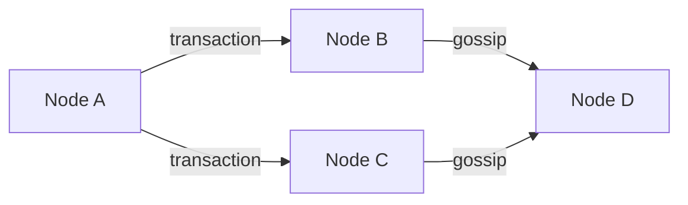
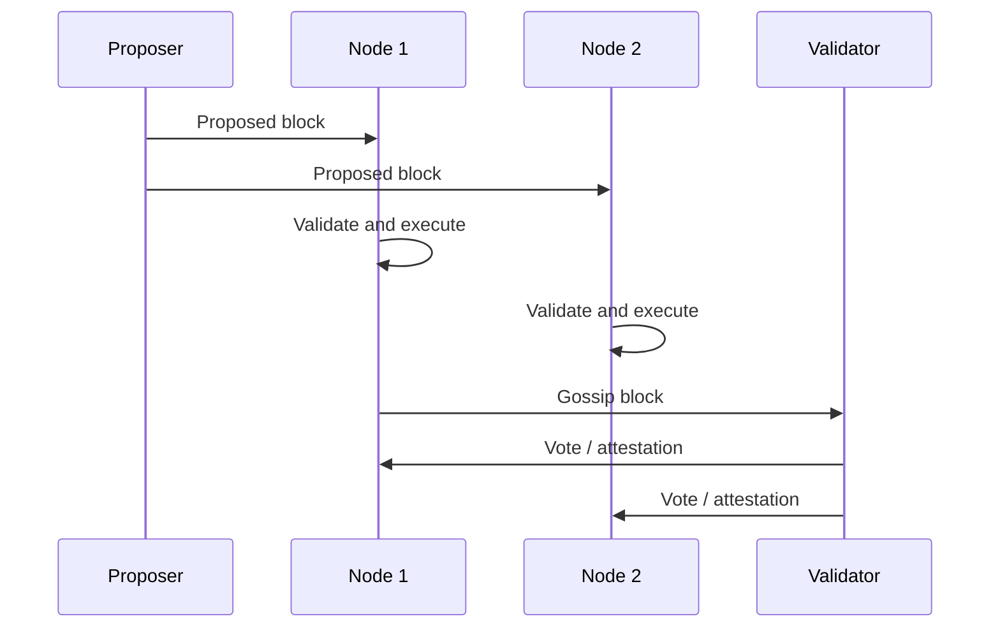

# Peer-To-Peer Networks, Finality, And Forks

A blockchain is a replicated state machine operating over an adversarial
network. Nodes can receive messages at different times, disconnect, lie, run
different software, or observe competing valid-looking blocks. Consensus must
therefore define not only who proposes blocks, but how nodes discover peers,
propagate data, validate messages, choose a chain, and decide when history is
sufficiently final.

## Nodes, Clients, And Validators

- A **node** is a running participant that communicates with peers and performs
  one or more protocol roles.
- A **client** is a software implementation of the protocol.
- A **validator or miner** participates in block production or consensus.
- A **full validating node** checks protocol rules independently.
- An **archive node** retains historical state beyond what ordinary validation
  requires.
- A **light client** verifies selected commitments and consensus evidence
  without downloading and executing everything.

Running a wallet or RPC connection does not necessarily mean independently
validating the chain. Many applications trust remote nodes.

These roles answer different questions. A validator influences consensus but
may rely on separate software and storage to execute transactions. A
non-validating full node has no block-production weight yet can reject invalid
history independently and serve data to its operator. An archive node provides
historical query depth, not extra voting power. "Number of nodes" is therefore
not a sufficient decentralization or security measure without knowing their
roles, operators, implementations, and network positions.

| Role | Independently checks current rules? | Proposes or votes? | Retains arbitrary historical state? |
|---|---|---|---|
| Full node | Yes | Not necessarily | Not necessarily |
| Validator/miner | Normally yes, directly or through paired clients | Yes | Not necessarily |
| Archive node | Yes | Not necessarily | Yes |
| Light client | Checks selected proofs and consensus evidence | No | No |
| Unverified RPC consumer | No | No | Provider-dependent |

## Peer Discovery

A new node must find peers. Mechanisms include:

- hardcoded bootstrap nodes;
- DNS seeds;
- distributed hash tables;
- peer-exchange messages;
- static configuration;
- local discovery.

Bootstrap nodes introduce the network but need not remain trusted for block
validity if the node verifies all data. Discovery still creates availability and
eclipse-attack risks.

Bootstrapping separates **finding a peer** from **trusting chain data**. A DNS
seed can give a new Bitcoin node candidate addresses without deciding which
transactions are valid. The node connects to several peers, requests headers
and blocks, and checks proof of work and transaction rules itself. A malicious
seed can delay or isolate the node by supplying only attacker-controlled
addresses, but it cannot make an invalid block pass local validation. This is
why address diversity and multiple discovery paths matter even in a
cryptographically verified protocol.

### Peer Identity

Peer identity can be based on a public key and signed node record containing
addresses, ports, protocol versions, and capabilities. Peer identity proves
control of a networking key, not legal identity or honest behavior.

## Gossip And Request-Response

Blockchains use:

- **gossip:** spread transactions, blocks, votes, and proofs broadly;
- **request-response:** retrieve specific blocks, headers, state, or history;
- **direct protocols:** specialized communication between builders, relays,
  validators, or local client components.



Nodes validate before relaying to avoid amplifying invalid traffic. Validation
is often staged: cheap format and signature checks first, expensive execution
later.

Gossip is redundant by design. A message travels along many paths so the
network does not depend on a central broadcaster; duplicate suppression and
peer scoring keep that redundancy bounded. Request-response complements it:
gossip announces or rapidly disseminates recent objects, while direct requests
fill gaps, synchronize history, or obtain large data only when needed.

Propagation is not the same as broadcast to every node. Protocols often aim for
rapid reach among well-connected participants, after which the message
continues through the topology. A node's view is always local and time-specific.
This fact explains different mempools, short-lived competing heads, and why
network monitoring from one location cannot observe the complete system.

## Propagation

Propagation delay is the time for data to reach relevant participants. It
depends on:

- message size;
- bandwidth and latency;
- peer topology;
- validation time;
- compression and compact-block protocols;
- geographic distribution;
- adversarial withholding;
- client performance.

Slow propagation affects consensus. A miner whose block reaches peers late is
more likely to lose a race. A validator that receives a block late may attest
to another head or miss its duty.

This creates pressure toward high-bandwidth infrastructure and geographic
proximity, which can undermine decentralization if blocks become too large or
slot times too short.

Block capacity and block interval interact. Increasing capacity may process
more transactions per block, but larger messages take longer to transmit,
validate, and reconstruct. Shortening intervals gives participants less time
to receive and verify each proposal. Operators with strong connectivity then
experience fewer stale blocks or missed votes than home or geographically
distant operators. Throughput cannot be evaluated independently of the
hardware and network conditions required to remain competitive.

## The Mempool

A mempool is a node's local set of valid unconfirmed transactions.

There is no single global mempool. Nodes differ because of:

- arrival timing;
- local fee and relay policy;
- capacity limits;
- replacement rules;
- censorship;
- private order flow;
- chain state;
- network partitions.

### Admission

Nodes can check:

- syntax and size;
- signature or authorization;
- nonce or unspent-output validity;
- fee policy;
- resource limits;
- conflicts;
- standardness or relay rules.

Mempool policy can be stricter than consensus. A transaction not relayed by
ordinary nodes might still be consensus-valid if a block producer includes it.

This distinction gives nodes a local anti-abuse layer without changing global
validity. Bitcoin "standardness" policy, for example, can decline to relay
unusual but consensus-valid scripts. Fee floors and eviction protect finite
memory. Because producers can adopt different policies or receive transactions
privately, absence from one public mempool does not prove that a transaction
cannot be included.

### Ordering

Block producers select and order transactions based on fees, dependencies,
private agreements, MEV, censorship policy, or protocol constraints. Time of
broadcast does not guarantee execution order.

### Replacement And Expiry

Account systems can replace a pending transaction using the same nonce and a
higher fee under node policy. UTXO systems can permit fee-bumping mechanisms.
Nodes evict low-fee or old transactions when capacity is constrained.

## Block Production

Block production turns a changing set of pending transactions into one proposed
ordering. The producer chooses transactions subject to protocol validity and
resource limits, while other nodes independently verify the proposal. This
separation explains why inclusion and ordering can be economically strategic even
when no producer can make an invalid transaction valid.

A block producer:

1. selects a parent under fork choice;
2. selects transactions or receives a payload;
3. orders and executes them;
4. constructs block commitments;
5. signs or proves eligibility;
6. propagates the block.

Other nodes independently:

1. verify structure and producer eligibility;
2. verify parent and consensus rules;
3. verify transactions and state transition;
4. update fork-choice view;
5. relay valid data.



## Fork Choice

A fork-choice rule tells nodes which valid branch is the current head.

### Proof-Of-Work

Bitcoin selects the valid chain with the greatest cumulative proof of work,
often simplified as the "longest chain." Block count alone is not the criterion
if difficulty differs.

### Proof-Of-Stake

PoS systems can use stake-weighted votes, latest messages, checkpoints, or BFT
certificates. Ethereum combines LMD-GHOST fork choice with Casper FFG
checkpoint finality.

Fork choice and finality are distinct:

- fork choice selects the head during ordinary operation;
- finality identifies history that cannot revert without violating explicit
  safety assumptions.

A protocol may have three useful states rather than a binary final/not-final
view:

1. **seen or included:** the transaction appears in a currently known block;
2. **canonical but reversible:** fork choice presently selects its branch;
3. **finalized:** reversal would require violation of the finality assumptions,
   extraordinary recovery, or—in probabilistic systems—an acceptably remote
   competing-work event.

User interfaces often compress these into "pending," "confirmed," and
"finalized," but applications need the chain-specific meaning behind each
label.

## Why Temporary Forks Occur

Two valid blocks can be proposed for the same height or slot because:

- simultaneous discovery;
- network delay;
- partition;
- equivocation;
- proposer or relay strategy;
- client disagreement.

Nodes temporarily build on different branches. Fork choice eventually selects
one. Blocks not in the canonical branch are stale, orphaned in loose usage, or
ommer/uncle-like depending on protocol terminology.

Transactions from discarded blocks may return to mempools if still valid.

## Reorganizations

A **reorganization** replaces one recent canonical suffix with another.

If a node changes:

```text
B_0 → B_1 → B_2
```

to:

```text
B_0 → B'_1 → B'_2 → B'_3
```

it rolls back the old state changes and applies the new branch.

Applications must handle:

- event logs disappearing;
- transaction status changing;
- nonces or UTXOs becoming reusable;
- deposits requiring reconfirmation;
- offchain actions already triggered.

An exchange that credits and permits withdrawal too early can lose funds if the
deposit is reorganized away.

A safe offchain consumer treats block identity, not block height alone, as the
record key. Suppose an indexer processed height 1,000 with hash H and sent a
notification. If the canonical block at height 1,000 later has hash H2, it must
reverse every derived record from H, ingest H2, and ensure the notification or
downstream payment is either delayed, idempotent, or compensatable. Merely
overwriting the row at height 1,000 leaves balances and aggregates corrupted.

## Confirmation And Probabilistic Finality

In proof-of-work, confidence usually increases as more work accumulates after a
transaction. A "six confirmation" convention is a risk policy, not universal
mathematical certainty.

Reorganization probability depends on:

- adversarial hash power;
- confirmation depth;
- network conditions;
- transaction value;
- attacker incentives;
- eclipse or routing attacks.

Different transactions justify different thresholds. A small retail payment and
a bridge minting millions of dollars should not use the same risk assumption
without analysis.

Confirmation depth is an economic risk control. Waiting longer reduces
reorganization risk but delays use of funds and worsens user experience. The
appropriate threshold considers the value an attacker can extract, cost of the
attack, counterparty identity, concentration of mining or stake, and whether
the external action can be reversed. The commonly repeated confirmation count
for one chain should not be copied mechanically to another.

## BFT And Economic Finality

Many BFT-style systems finalize a block when a quorum of weighted validators
votes according to protocol rules. With typical assumptions, conflicting
finality requires at least a threshold of Byzantine weight.

### Ethereum Example

Ethereum validators vote for checkpoints. A checkpoint becomes justified and
then finalized through supermajority links involving at least two-thirds of
active stake under protocol rules. Conflicting finalized checkpoints imply
slashable behavior by substantial stake under the accountable-safety model.

Finality can stop if more than one-third of stake is unavailable or fails to
vote coherently. Ethereum's inactivity leak gradually reduces inactive
validators' effective influence to restore conditions for finalization.

Economic finality means reverting finalized history would require detectable
rule violations and destruction or social treatment of stake. It is strong but
still depends on software, governance, key control, and the social response to
catastrophic failure.

"Economic" emphasizes that the protocol can identify and penalize signed
contradictory behavior. It does not mean every finalized state is factually or
legally correct: a valid transaction can exploit a contract bug, a compromised
key can authorize theft, and an oracle can provide a wrong price. Consensus
finality answers whether the chain will retain the state transition, not whether
the transition represented legitimate intent.

## Safety And Liveness

- **safety:** honest nodes do not finalize conflicting states;
- **liveness:** valid transactions can continue to become final.

During a severe partition, a consensus protocol may preserve safety by halting
finality. A system that continues finalizing on both sides may preserve local
liveness while violating global safety.

The trade-off is governed by synchrony assumptions:

- **synchronous:** known upper bound on message delay;
- **asynchronous:** no reliable delay bound;
- **partially synchronous:** bounds hold eventually or after an unknown time.

Internet blockchains generally rely on partial-synchrony-style assumptions for
strong liveness.

Safety and liveness also explain why halting can be the correct outcome. If
communication is unreliable, continuing with too little quorum could produce
two finalized histories that cannot both be honored. A BFT protocol commonly
refuses to finalize until enough messages arrive. Users experience an outage,
but the system preserves a single recoverable history. Operational monitoring
should distinguish delayed blocks, stalled finality, and conflicting finality
because they imply very different recovery paths.

## Network Partitions

A partition divides nodes into groups unable to communicate.

Outcomes depend on consensus:

- proof-of-work sides may mine separate branches; accumulated work later chooses
  one;
- BFT consensus may halt if neither side has quorum;
- a side with quorum may continue while minority nodes fall behind;
- faulty quorum configuration can finalize conflicting states.

Operational systems need partition detection, cautious external actions, and
recovery procedures.

## Eclipse And Sybil Attacks

### Sybil Attack

An attacker creates many network identities. Consensus weight must not be based
solely on identity count. PoW, stake, permissioned membership, or other scarce
resources constrain consensus influence.

### Eclipse Attack

An attacker controls a victim's peer connections, isolating it from honest
network information. The victim can be shown stale blocks, manipulated fees, or
an attacker-controlled branch.

Mitigations include:

- diverse peer selection;
- outbound connection protection;
- address-bucket diversity;
- anchors and trusted checkpoints where appropriate;
- multiple networks and providers;
- monitoring for inconsistent heads.

## Denial Of Service

Nodes face resource-exhaustion through:

- oversized or malformed messages;
- expensive validation;
- connection floods;
- transaction spam;
- state growth;
- repeated requests;
- pathological smart-contract execution.

Controls include fees, gas, size limits, rate limiting, peer scoring, staged
validation, bounded caches, and disconnection.

## Full, Pruned, Archive, And Light Nodes

### Full Node

Validates history or reaches a validated current state and independently checks
new blocks.

### Pruned Node

Validates but discards older block data after it is no longer needed for current
operation. Pruning reduces storage, not validation rigor.

### Archive Node

Retains historical state for arbitrary past queries. It is useful for analytics
and infrastructure but not required for ordinary consensus validation.

### Light Client

Uses headers, commitments, committee proofs, or sampling to obtain assurance
without full execution and storage. Its trust assumptions depend on protocol.

### RPC Provider

An RPC provider supplies convenient chain access. Unless responses are verified
with proofs, users trust it for availability and correctness. Multiple
providers improve resilience but do not automatically provide independent
verification if all rely on common infrastructure.

## Initial Sync And Checkpoints

A new node needs a trusted starting method.

- **genesis sync:** verify from genesis; strongest historical verification but
  resource-intensive;
- **snapshot or state sync:** obtain recent state and verify commitments;
- **checkpoint sync:** trust a recent finalized checkpoint, then verify forward;
- **weak subjectivity:** PoS nodes require a sufficiently recent checkpoint to
  avoid long-range histories signed by exited validators.

A checkpoint is a trust input. Its distribution and freshness belong in the
security model.

Weak subjectivity arises because an attacker may acquire old validator keys
after their stake is withdrawn and use them to sign an alternative history at
little present economic cost. A node that has been offline too long cannot
always distinguish that history using only current signatures. A recent
checkpoint obtained from a trusted or socially corroborated source anchors the
node after the period in which old validator evidence remains meaningful.
This is different from trusting every subsequent state transition: the node
verifies forward from the anchor.

## Client Diversity

Multiple independent implementations reduce the chance that one bug controls
the whole network. Diversity includes:

- implementation;
- programming language;
- operating system;
- hosting provider;
- geography;
- validator operator.

Diversity also raises specification and testing demands. If the written
specification is ambiguous, clients can disagree and split consensus.

Ethereum separates execution and consensus clients connected through the Engine
API, adding modularity and a matrix of client combinations.

## Protocol Forks And Upgrades

### Soft Fork

A soft fork tightens validity so upgraded nodes reject some behavior older nodes
accept. Compatibility depends on block production and enforcement; "soft" does
not mean politically easy or risk-free.

### Hard Fork

A hard fork changes rules so older clients may reject new valid blocks. Nodes
must upgrade to follow the new rules.

### Chain Split

If communities continue incompatible rules with economic support, both chains
can persist. Assets, contracts, transaction histories, and signatures may be
duplicated at the split point, creating replay and naming problems.

### Replay Protection

Transactions should commit to chain or domain identifiers so a signature valid
on one fork cannot be replayed on another.

## Governance

Protocol governance includes:

- specification and proposal processes;
- client implementation;
- validator or miner adoption;
- node operator upgrades;
- application, exchange, and wallet support;
- foundation or company influence;
- social legitimacy.

Onchain token voting is one mechanism, not the entirety of governance. Even
"immutable" protocols rely on human decisions about software, interfaces,
emergency response, and accepted chain history.

An upgrade becomes operative only through a sociotechnical adoption chain.
Authors specify a change; client teams implement it; operators choose software;
block producers create blocks under rules; exchanges and applications decide
which resulting asset and history they support. A formally scheduled activation
does not force every participant to assign the same name or economic value to
the resulting chain. This is why hard forks can be routine upgrades or lasting
chain splits depending on coordination and disagreement.

## Finality For Applications

Applications should define explicit confirmation policies based on:

- consensus mechanism;
- transaction value;
- reorganization history;
- counterparty and bridge exposure;
- dependence on sequencers or relayers;
- source and destination finality;
- whether offchain action is reversible.

### Cross-Chain Finality

A bridge must not treat source-chain messages as final before the source
assumption is satisfied. Destination execution adds another finality layer.

Total risk includes:

1. source transaction validity;
2. source finality;
3. relayer or verifier correctness;
4. destination execution;
5. destination finality.

The bridge's waiting rule composes these stages rather than replacing them. A
message proven against a source block that is later reorganized can create an
unbacked destination asset even if destination execution is flawless.
Conversely, finalized source state does not protect against a verifier bug or
compromised bridge key. Cross-chain applications should expose which stage is
pending and avoid presenting destination inclusion as proof that the entire
path is final.

### Section Summary

| Concept | What it establishes | What it does not establish |
|---|---|---|
| Peer identity | Control of a networking key | Honesty or legal identity |
| Full validation | Compliance with local protocol rules | Correct external facts or user intent |
| Fork choice | Present canonical head | Irreversibility |
| Confirmations | Accumulating work or descendants | Universal certainty |
| BFT finality | Quorum-backed state under safety assumptions | Oracle truth or bug-free execution |
| Checkpoint | Trusted recent history anchor | Trust in every data provider |
| Destination inclusion | Message executed on destination | Safe source finality and verifier correctness |

## Common Misconceptions

| Misconception | More accurate explanation |
|---|---|
| Every node has the same mempool | Mempools are local and policy-dependent |
| Longest chain means most blocks | PoW commonly uses cumulative work |
| One confirmation is final | Risk depends on consensus and reorganization |
| BFT finality means impossible reversal | Conflicting finality requires assumption failure, slashable weight, bugs, or social intervention |
| More nodes automatically improve consensus security | Resource or membership weighting matters; topology and client diversity matter |
| Full node means archive node | Full validation does not require retaining all historical state |
| A fork is always a governance dispute | Temporary forks arise during ordinary propagation |
| Blockchain is available because data is hashed | Commitments do not guarantee data availability |

## Analytical Checklist

1. How are peers discovered and authenticated?
2. Which messages use gossip and request-response?
3. What is validated before relay?
4. Is there a global or local mempool, and what policy applies?
5. Who constructs and orders blocks?
6. What fork-choice rule selects the head?
7. What event creates finality?
8. Which safety, liveness, and synchrony assumptions apply?
9. How do nodes behave during partition?
10. How are eclipse, Sybil, spam, and DoS attacks mitigated?
11. Which node types independently verify which claims?
12. How does a new node obtain trusted state?
13. Is client, operator, hosting, and geographic diversity sufficient?
14. How are upgrades and replay protection governed?
15. How should applications handle reorgs and cross-chain finality?

## Connections

- [Consensus Mechanisms](consensus-mechanisms.md) compares PoW, PoS, and BFT
  algorithms.
- [Cryptography And Blockchain Data Structures](../01-core-architecture/cryptography-and-blockchain-data-structures.md)
  explains hashes, signatures, and authenticated state.
- [Blockchain Scaling And Modular Architecture](../04-scaling-and-modularity/blockchain-scaling-and-modular-architecture.md)
  develops data availability, sequencers, rollups, and modular networks.
- [Blockchain Interoperability And Bridges](../../06-interoperability-privacy-and-enterprise-dlt/01-interoperability/blockchain-interoperability-and-bridges.md)
  applies multi-chain finality assumptions.

## References

- Bitcoin Developer Guide,
  [P2P Network](https://developer.bitcoin.org/devguide/p2p_network.html)
- Bitcoin Developer Guide,
  [Block Chain](https://developer.bitcoin.org/devguide/block_chain.html)
- Ethereum.org,
  [Networking layer](https://ethereum.org/developers/docs/networking-layer/)
- Ethereum.org,
  [Nodes and clients](https://ethereum.org/developers/docs/nodes-and-clients/)
- Ethereum.org,
  [Gasper](https://ethereum.org/developers/docs/consensus-mechanisms/pos/gasper/)
- Ethereum.org,
  [Proof-of-stake rewards and penalties](https://ethereum.org/developers/docs/consensus-mechanisms/pos/rewards-and-penalties/)
- Ethereum.org,
  [Weak subjectivity](https://ethereum.org/developers/docs/consensus-mechanisms/pos/weak-subjectivity/)
- Ethereum Consensus Specifications,
  [Phase 0 Beacon Chain](https://github.com/ethereum/consensus-specs/tree/dev/specs/phase0)
- libp2p,
  [Concepts and protocols](https://docs.libp2p.io/concepts/)
- Satoshi Nakamoto,
  [Bitcoin: A Peer-to-Peer Electronic Cash System](https://bitcoin.org/bitcoin.pdf)
