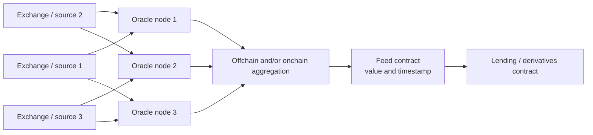
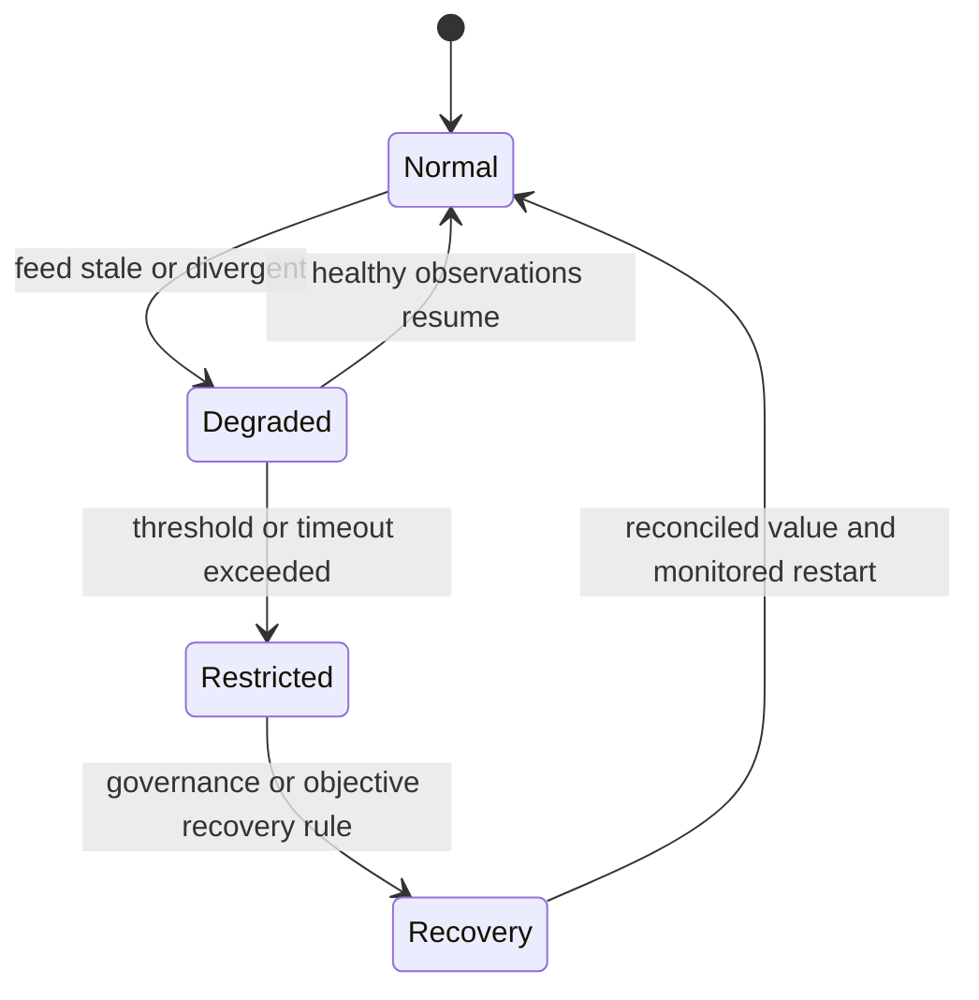
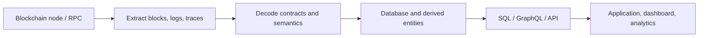

# Oracles, Indexers, And Offchain Data

Blockchains are deterministic systems: validating nodes must derive the same
state from the same accepted inputs. A contract cannot independently fetch an
HTTP API, inspect a bank database, or know a court judgment because nodes could
receive different answers. Oracles bring external facts or computation into the
consensus state. Indexers transform blockchain data into forms applications can
query efficiently.

Both cross a trust boundary. An oracle can make false data authoritative
onchain; an indexer can show users an incorrect view even when the chain itself
is correct.

Their directions are different. An oracle moves a claim **into** a state
transition: once a lending contract accepts a price, that value can authorize
borrowing or liquidation. An indexer moves chain data **out** into a query
model: a wrong dashboard does not normally change contract storage, but it can
mislead users, compliance systems, accounting, or automated offchain actions.
This difference determines how quickly an error becomes irreversible and which
controls belong in the consuming application.

| Component | Input | Output | Primary failure consequence |
|---|---|---|---|
| Input oracle | External observation or attestation | Onchain value | Incorrect state transition |
| Output oracle | Onchain event or state | External instruction | Incorrect offchain action |
| Indexer | Blocks, receipts, logs, traces, metadata | Searchable derived database | Incorrect view or decision |
| RPC provider | Node methods and local chain view | Raw or simulated response | Censorship, stale state, or false response if unverified |

## The Oracle Problem

A blockchain can verify:

- transaction signatures;
- state-transition rules;
- cryptographic proofs;
- prior onchain data.

It cannot natively verify that:

- ETH traded at a particular USD price on external venues;
- a company defaulted;
- a shipment arrived;
- reserves exist in a bank account;
- an election or sporting event ended with a given result.

The oracle problem is how to import such claims with acceptable:

- correctness;
- availability;
- freshness;
- manipulation resistance;
- accountability;
- cost.

Cryptographic authentication proves that a source signed data, not that the
source measured reality correctly.

The problem has two nested layers. First, somebody must define the fact: which
venues, timestamp, currency, legal entity, reserve account, or event condition
counts? Second, the system must transport the resulting observation without
tampering or outage. Threshold signatures can improve the second layer while
leaving the first centralized. Conversely, several independent data vendors can
still fail together if all calculate from the same thin exchange.

This is why "decentralized oracle" is incomplete without specifying
decentralization of measurement, delivery, administration, and consumption.
The consuming contract ultimately determines whether a report is accepted and
what happens when it is missing.

## Oracle Categories

### Input Oracle

Brings information onchain: prices, rates, weather, identity status, event
outcomes, reserves.

### Output Oracle

Triggers or informs an external system from onchain activity: bank payment,
shipment release, notification, or IoT control.

### Computation Oracle

Performs expensive or private computation offchain and returns a result or
proof.

### Cross-Chain Oracle

Reports state from one chain to another. This is commonly called a bridge or
interoperability protocol and adds source-finality and message-verification
assumptions.

### Human Oracle

Designated experts, arbitrators, voters, or governance determine subjective or
disputed outcomes.

## Delivery Models

### Push Feed

Reporters publish updates when deviation, time, or market triggers are met.
Consumers read the latest onchain value.

Advantages:

- simple synchronous read;
- value shared across consumers;
- high availability if updated reliably.

Costs:

- onchain publication expense;
- stale value between updates;
- feeds exist only for supported assets.

### Pull Feed

Signed reports are distributed offchain and submitted with a user transaction
when needed. The contract verifies signature, timestamp, and feed identity.

This reduces continuous publication cost and improves granularity, but consumers
must supply valid data and handle expiry.

Push and pull feeds also allocate liveness responsibility differently. With a
push feed, the oracle network pays to keep a shared onchain value current even
when no consumer transacts. With a pull feed, the user or application obtains a
recent signed report and brings it into the transaction. The pull model avoids
unused updates but must define who retrieves reports, how the transaction
behaves if a report expires, and whether all users have equal access to the
offchain distribution channel.

### Request-Response

A contract emits a request; oracle nodes perform work and later deliver a
response. The process is asynchronous and needs request identifiers, payment,
timeout, retry, and callback security.

## A Decentralized Price Feed



Decentralization has several layers:

- source diversity;
- data-vendor diversity;
- node-operator diversity;
- hosting and geographic diversity;
- aggregation;
- governance and upgrade diversity.

Ten nodes querying one API are not ten independent sources.

Independence should be tested for common failure domains:

- several venue prices may ultimately depend on the same dominant market;
- different APIs may purchase the same underlying vendor dataset;
- separate node operators may run in one cloud region;
- one multisignature may control all feed contracts;
- all consumers may use the same proxy address and fallback;
- correlated software can mis-handle the same edge case.

Aggregation reduces idiosyncratic failures only when inputs can fail
independently. It cannot average away a shared definition error or common
dependency.

## Price Construction

There is no uniquely correct price for every financial purpose. The last trade
can be noisy, a volume-weighted average describes past execution, a mark price
may be designed to prevent unnecessary liquidations, and a redemption price may
come from an issuer. An oracle must choose the measure that matches the contract's
decision and define how it behaves when constituent markets disagree or close.

An oracle must define:

- instrument and venue set;
- quote currency;
- spot, index, mark, or reference price;
- volume and liquidity weighting;
- outlier filtering;
- timestamp and market hours;
- treatment of depegs and venue outages;
- update threshold.

For example, "ETH/USD" could mean the last ETH trade against dollars on one
exchange, a volume-weighted spot index across ETH/USD and ETH/USDT markets, or
the dollar value implied by an ETH/stablecoin pool and a separate stablecoin/USD
feed. These constructions behave differently during a stablecoin depeg or venue
outage. The feed name alone does not specify the exposure.

The correct measure depends on use. A lending protocol needs a manipulation-
resistant collateral value and may accept some latency. A perpetual exchange
needs a mark that tracks the tradable market quickly without allowing a single
thin venue to trigger liquidations. An issuer's redemption contract may need
the legally defined official rate even when it lags live trading.

### Median

The median tolerates extreme outliers if fewer than half the inputs are corrupt,
but it does not correct systematic bias or common-source failure.

### Volume-Weighted Price

```text
P_VWAP = Σ_i (P_i × V_i) / Σ_i V_i
```

Reported volume can be manipulated, and historical volume does not guarantee
current executable liquidity.

### Time-Weighted Average Price

```text
P_TWAP = (1 / T) × integral from (t - T) to t of P(u) du
```

Onchain implementations approximate this over observations. TWAP makes a
short manipulation more expensive but responds slowly to genuine price jumps.

## Freshness And Heartbeats

Feeds commonly update when:

- price changes beyond a deviation threshold;
- a maximum heartbeat interval elapses;
- an explicit request is made.

Consumers should validate:

- round or report completeness;
- timestamp;
- maximum age;
- nonzero and plausible range;
- sequencer or chain status where relevant.

A value can be correctly signed and dangerously stale.

Suppose a collateral price is 100 and the feed updates after a 1% deviation or
one-hour heartbeat. Thirty minutes after the last update, the external market
falls abruptly to 85. The onchain value can remain 100 until reporters observe,
aggregate, transmit, and finalize an update. A consumer checking only that the
value is less than one hour old accepts it according to the stated heartbeat
yet materially overvalues collateral. Maximum age, deviation rules, market
volatility, chain congestion, and liquidation latency must be analyzed
together.

## Oracle Manipulation

### Thin-Market Spot Price

An attacker temporarily moves a pool price, uses it to borrow or liquidate, then
reverses the trade. Flash loans make large temporary capital available but are
not the root cause; the root cause is an oracle manipulable within one atomic
transaction.

### Source Compromise

API, exchange, reporter, credential, or network is compromised.

### Collusion

Enough reporters coordinate to submit a false value.

### Governance Attack

Admin changes reporters, thresholds, feed address, or implementation.

### Liveness Failure

Updates stop while consumers continue using old data, or protocols halt and
liquidations accumulate.

### Front-Running

An observer sees an incoming price update and trades before or around it.

## Oracle Risk Controls

- independent sources and operators;
- liquidity-aware source selection;
- median or robust aggregation;
- minimum quorum;
- deviation and heartbeat rules;
- staleness checks in consuming contracts;
- circuit breakers;
- bounded price movement where economically justified;
- multiple feed comparison;
- fallback modes;
- monitoring and alerting;
- cautious governance and timelocks;
- protocol caps and conservative collateral factors.

Fallbacks are not automatically safer. A secondary feed can share the same
sources, be less liquid, or diverge during stress. A pause protects solvency but
can deny legitimate withdrawals.

Controls also interact. A tight circuit breaker limits sudden manipulation but
can deliberately preserve a stale value during a real crash. Taking the median
of two different oracle networks is ill-defined because there is no middle
observation and their timestamps may differ. Pausing new borrowing while
allowing repayment reduces risk differently from pausing all operations.
Fallback design should specify a state machine rather than simply naming a
backup:



Each state should define which operations remain safe: repay, add collateral,
withdraw, borrow, liquidate, settle, or redeem.

## Chainlink As A Principal Implementation

Chainlink Data Feeds use decentralized oracle networks to aggregate reports and
publish reference data through onchain aggregator contracts.

At a conceptual level:

1. nodes obtain values from configured data providers;
2. nodes agree offchain under an OCR-family protocol;
3. a compact report with signatures is transmitted onchain;
4. the aggregator verifies and stores it;
5. consumers read through a feed interface or proxy.

Offchain reporting reduces gas relative to every node posting separately while
retaining a quorum-signed report.

The onchain contract verifies that the report was authorized under its current
configuration; it does not independently query exchanges. Consumers normally
read through a proxy so the underlying aggregator can change across phases.
That architecture makes feed-address verification, phase-aware round handling,
and monitoring of configuration changes part of integration—not merely
deployment-time checks.

### Consumer Checks

Integrations must know:

- chain-specific feed address;
- decimals;
- description and pair direction;
- update policy;
- returned timestamp;
- phase and aggregator changes;
- limitations published for the feed.

### Chainlink Services

The broader architecture includes:

- Data Feeds and data streams;
- Automation for conditional transaction execution;
- VRF for verifiable randomness;
- Proof of Reserve feeds;
- Functions for offchain computation and APIs;
- CCIP for cross-chain messaging.

Each has a distinct trust and failure model; the Chainlink name does not make
them interchangeable.

## Proof Of Reserves

Proof of reserves is an evidence system, not one universal proof.

It may attest:

- an address balance;
- custodian-reported holdings;
- bank or auditor statement;
- liabilities or token supply;
- collateral ratio.

A complete solvency view needs:

```text
net position =
verified assets
- complete liabilities
- senior or encumbering claims
```

An onchain balance proves neither legal ownership nor absence of borrowing,
pledges, undisclosed liabilities, or temporary balance arrangements.

Asset and liability scope must use the same perimeter. Showing one custodian
account while tokens are issued by several affiliates does not establish
coverage. Assets may be restricted, encumbered, or junior to other claims;
liabilities may exclude pending redemptions or off-balance-sheet obligations.
Point-in-time evidence can also be window-dressed through short-term borrowing.
A useful attestation identifies entity, accounts, asset rights, liability
population, valuation method, timestamp, frequency, and assurance provider.

Proof-of-reserve feeds can support circuit breakers but inherit source,
attestation, timing, legal, and oracle risk.

## Automation And Keepers

Contracts cannot wake themselves. An external transaction must call them.
Keepers or automation networks monitor conditions and submit transactions for:

- liquidations;
- periodic rebalancing;
- reward distribution;
- limit orders;
- maintenance.

Risks include:

- no keeper acts because incentives are poor;
- gas spikes make execution uneconomic;
- competing keepers create races;
- condition simulation differs from execution;
- centralized operators censor;
- key or configuration failure.

Automation should be permissionless where feasible, economically incentivized,
and monitored.

## Randomness Oracles

Block variables can be biased by producers. A verifiable random function
returns random-looking output plus proof tied to a secret key and input.

Oracle-based randomness still depends on:

- key holder or threshold availability;
- request confirmation policy;
- callback gas;
- subscription funding;
- correct consumer logic.

Commit-reveal avoids one external provider but can suffer last-revealer bias and
non-participation.

## Indexers

Blockchain storage is optimized for validation, not analytics. Asking for "all
trades by this account grouped by protocol and day" requires:

1. reading blocks, transactions, receipts, logs, and traces;
2. decoding ABIs and protocol semantics;
3. handling reorganizations;
4. writing structured records;
5. aggregating and serving queries.



An indexer is normally offchain. Its database is not consensus state.

Raw chain data does not contain every concept analysts want. A log may record
token amounts and addresses but not the USD value, beneficial owner, protocol
category, or economic meaning of a multi-step transaction. Those fields require
prices, labels, ABIs, traces, and classification rules. The resulting table can
be useful and reproducible while still being an interpretation rather than a
native chain fact.

### Events, Calls, Traces, And State

An indexer can observe several related but non-equivalent data sources:

| Source | What it records | Important limitation |
|---|---|---|
| Transaction | User-authorized top-level input | Does not list every nested call |
| Receipt and logs | Execution status, gas, emitted events | Contracts choose what events to emit |
| Execution trace | Internal calls and opcode-level behavior | Node-specific APIs and high processing cost |
| State query | Value at a selected block | Historical access may require archive infrastructure |
| Contract bytecode/ABI | Executable code and decoding schema | Proxy logic and ABI versions can change |

An event is not automatically a complete accounting record. A contract can
change storage without emitting an event, emit an event before a later revert
(the reverted receipt will not retain it canonically), or emit fields whose
meaning changes after an upgrade. Robust pipelines reconcile events with state
and protocol-specific invariants where material.

## Explorers

Block explorers combine node data, indexing, ABI decoding, address labels,
token metadata, and user interfaces. They are invaluable but can be wrong about:

- contract name;
- token metadata;
- method decoding;
- address attribution;
- internal traces;
- current canonical chain during reorgs.

Verification should use transaction hashes, receipts, bytecode, proofs, and
multiple sources for critical decisions.

## RPC Providers

RPC exposes node methods for:

- current state;
- transaction submission;
- logs;
- simulation;
- historical queries;
- traces where supported.

Provider differences include:

- node client and version;
- archive retention;
- rate limits;
- geographic infrastructure;
- mempool view;
- tracing methods;
- supported chains;
- data caching.

Using two brands on the same cloud or upstream node may not provide meaningful
diversity.

## The Graph

A subgraph defines:

- blockchain and contracts to index;
- starting blocks;
- event or call handlers;
- GraphQL schema;
- deterministic mappings from chain data to entities.

Graph Node reads an RPC endpoint, processes the mapping, stores entities
commonly in PostgreSQL, and serves GraphQL. In The Graph Network, indexers stake
and provide indexing/query service, with protocol incentives and curation.

Subgraphs are reproducible transformations, but errors in:

- source contract address;
- ABI;
- mapping logic;
- start block;
- reorg handling;
- RPC data;

can produce incorrect views.

Mappings should be deterministic because independent indexers need to derive
the same entities from the same chain data. External web requests and local
time would break reproducibility. Even deterministic code can encode the wrong
business definition, however, so schema and mapping changes should be versioned
and historical metrics recalculated or clearly separated.

## Dune And SQL Analytics

SQL analytics platforms ingest raw and decoded blockchain data into queryable
tables. Analysts build transformations, dashboards, and metrics.

Strengths:

- rapid exploratory analysis;
- reproducible SQL;
- shared dashboards;
- cross-chain data.

Limitations:

- ingestion and decoding delay;
- schema changes;
- query mistakes;
- labels and prices with external assumptions;
- dashboard metrics lacking standardized methodology.

A chart is not primary evidence unless its query, tables, time range, and
methodology are reviewed.

## Onchain Versus Offchain Truth

| Data | Authority |
|---|---|
| Contract storage at finalized block | Chain consensus plus proof |
| Decoded event table | Indexer transformation |
| Token name or website | Metadata source |
| Address owner | Attribution evidence |
| USD value | Price source and timestamp |
| Reserve status | Custodian, auditor, bank, or oracle evidence |
| Legal status | Relevant authority and law |

Applications should preserve provenance rather than flattening every value into
one database column.

Provenance answers: who asserted this value, from which raw record, under which
transformation, at what chain height and wall-clock time, using which software
version? For a USD-denominated transfer metric, lineage might include a token
event, token-decimal metadata, an address classification, and a price feed.
Changing any one can alter history without any blockchain reorganization.

## Reorganizations

Indexers need a reversible pipeline:

1. ingest block as provisional;
2. associate records with block hash and number;
3. detect parent mismatch;
4. remove or mark orphaned derived data;
5. apply canonical branch;
6. finalize after chain-specific policy.

Offchain actions triggered before finality need idempotency and compensation.

## Data Quality

Quality dimensions include:

- completeness;
- accuracy;
- consistency;
- timeliness;
- lineage;
- uniqueness;
- validity;
- reproducibility.

Derived metrics require explicit definitions. "Protocol revenue" might mean
gross fees, fees retained by contracts, distributions to token holders, or
accounting revenue of a company.

## Trust-Minimized Queries

Possible assurance mechanisms include:

- Merkle storage proofs;
- receipt proofs;
- light-client verification;
- multiple independent indexers;
- signed query responses;
- verifiable computation;
- re-execution.

Proofs increase assurance only if the verifier trusts the block root and the
query statement correctly represents the intended question.

A Merkle proof can establish that a storage slot had particular bytes under a
committed state root. It cannot prove that the slot means "fully collateralized
reserves" unless contract semantics, proxy configuration, token rights, and
offchain claims support that interpretation. Verifiability narrows the trusted
computation path; it does not eliminate semantic analysis.

### Section Summary

| Question | Oracle focus | Indexer focus |
|---|---|---|
| Meaning | Exact external fact and measurement rule | Exact derived metric and classification rule |
| Freshness | Timestamp, heartbeat, deviation, delivery latency | Ingestion lag, finality lag, refresh schedule |
| Correctness | Source and operator independence, aggregation | Decode, mapping, state reconciliation |
| Reversibility | Often changes onchain state immediately | Reorg rollback and derived-data recomputation |
| Governance | Feed configuration, proxy, reporters, fallback | Schema, mappings, labels, provider versions |
| Verification | Signatures, proofs, source attestations | Block hashes, receipts, storage proofs, reproducible queries |

## Analytical Checklist

For an oracle:

1. What exact fact is reported?
2. Which sources measure it?
3. How independent are sources and operators?
4. How are values aggregated?
5. What timestamps, heartbeats, and deviation rules apply?
6. What can governance change?
7. How does the consumer detect stale or implausible data?
8. What happens under manipulation or outage?

For an indexer:

1. Which chain data, node methods, and finality policy are used?
2. How are contracts decoded?
3. How are reorgs reversed?
4. Which derived definitions and external datasets apply?
5. Can results be reproduced?
6. Which claims can be verified with proofs?
7. What availability and provider concentration exist?

## Connections

- [Smart Contracts, Virtual Machines, And Token Standards](smart-contracts-virtual-machines-and-token-standards.md)
  explains why deterministic contracts need external inputs.
- [Blockchain Analytics](../../07-compliance-analytics-regulation-and-security/01-aml-and-blockchain-analytics/blockchain-analytics.md)
  develops attribution and transaction-graph pipelines.
- [DeFi Risk, Security, And Economic Attacks](../../04-decentralized-finance/04-defi-risk-and-failures/defi-risk-security-and-economic-attacks.md)
  covers oracle exploitation and dependency risk.
- [Blockchain Interoperability And Bridges](../../06-interoperability-privacy-and-enterprise-dlt/01-interoperability/blockchain-interoperability-and-bridges.md)
  treats cross-chain messages as external state claims.

## References

- Ethereum.org,
  [Oracles](https://ethereum.org/developers/docs/oracles/)
- Chainlink,
  [Data Feeds documentation](https://docs.chain.link/data-feeds)
- Chainlink,
  [Offchain Reporting](https://docs.chain.link/architecture-overview/off-chain-reporting)
- Chainlink,
  [Proof of Reserve](https://docs.chain.link/data-feeds/proof-of-reserve)
- Chainlink,
  [Automation](https://docs.chain.link/chainlink-automation)
- Chainlink,
  [VRF](https://docs.chain.link/vrf)
- The Graph,
  [Subgraphs](https://thegraph.com/docs/en/subgraphs/overview/)
- The Graph,
  [Indexing overview](https://thegraph.com/docs/en/indexing/overview/)
- Dune,
  [Documentation](https://docs.dune.com/)
- Ethereum.org,
  [JSON-RPC API](https://ethereum.org/developers/apis/json-rpc/)
