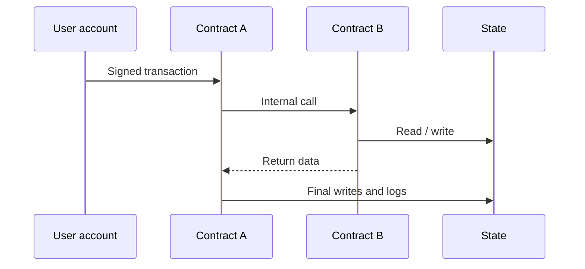
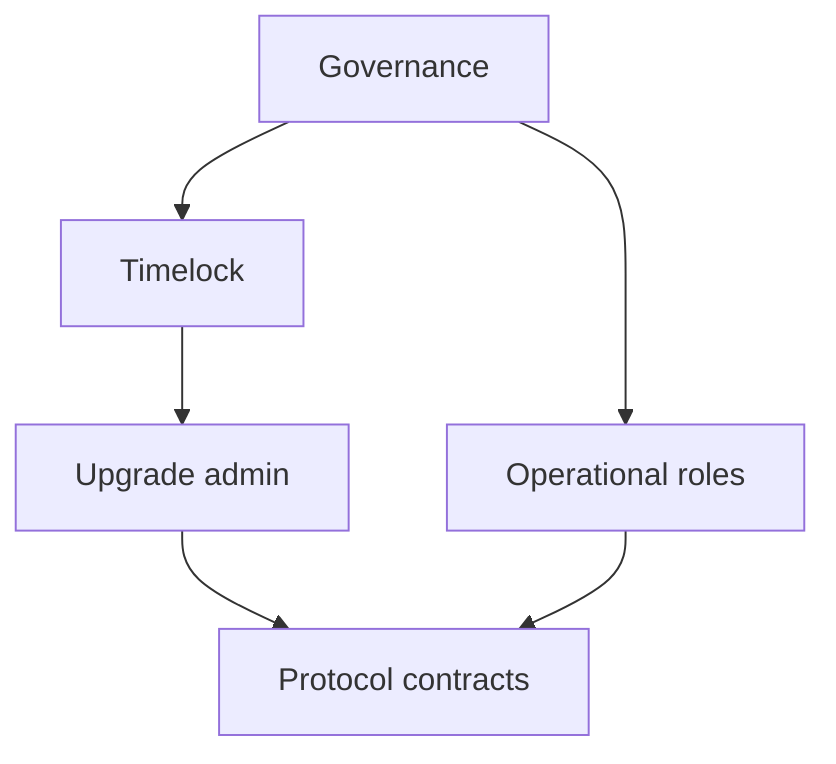
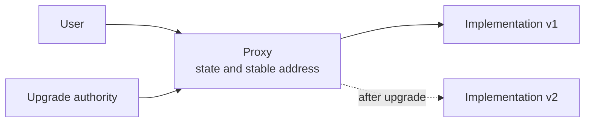
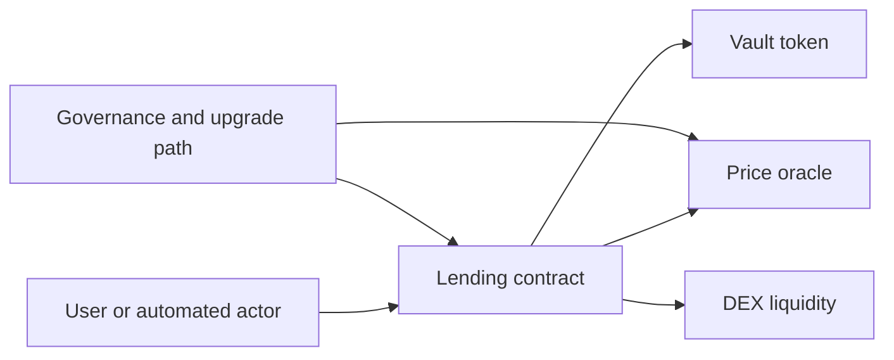

# Smart Contracts, Virtual Machines, And Token Standards

A smart contract is program code and persistent state executed under a
blockchain's consensus rules. It is not inherently a legal contract, autonomous,
trustless, secure, or intelligent. Its guarantees depend on the virtual machine,
source inputs, upgrade controls, external dependencies, and users' ability to
understand and verify the system.

## From Ledger To State Machine

A simple ledger transfers balances. A programmable blockchain defines a
deterministic state transition:

```text
S_t+1=Υ(S_t,T_t,E_t)
```

where:

- `S_t` is prior state;
- `T_t` is an ordered set of transactions;
- `E_t` is permitted execution context such as block number and timestamp;
- `Υ` is the protocol's transition function.

Every validating node must obtain the same result from valid inputs. Contracts
therefore cannot directly call arbitrary websites, read local clocks, or use
unseeded randomness: those nodes could observe different results.

This replication is the source of both assurance and cost. Ordinary server code
runs once under an operator's control. A public-blockchain transaction is
distributed, checked, and re-executed by many independent nodes, and its durable
state must remain available to future validators. The result is a shared
execution environment in which participants can verify the rules without
trusting one server, but computation and storage are much more constrained than
in a conventional cloud application.

The transition is also ordered. If Alice and Bob both try to spend the same
balance, each transaction can be valid against the starting state, yet only the
first in canonical order succeeds if it consumes the balance. Consensus chooses
the order; execution determines the result. A useful mental model separates:

| Layer | Main responsibility |
|---|---|
| Consensus | Choose an agreed ordering and canonical history |
| Execution | Apply each transaction to prior state under deterministic rules |
| Storage commitments | Let nodes commit to and verify the resulting state |
| Application | Define domain-specific authorization and accounting |

## Virtual Machines

A virtual machine defines:

- instruction set;
- value and memory model;
- persistent storage;
- call semantics;
- resource metering;
- host functions;
- error and rollback behavior.

### EVM

The Ethereum Virtual Machine is a 256-bit stack machine. Compiled bytecode uses
opcodes for arithmetic, memory, storage, hashing, calls, logs, and blockchain
context.

Execution data has different lifetimes:

| Area | Lifetime | Relative cost and use |
|---|---|---|
| Stack | Current call frame | Small, direct opcode operands |
| Memory | Current call | Temporary byte-addressed data |
| Transient storage | Current transaction | Shared temporary state across calls |
| Persistent storage | Across transactions | Consensus state; expensive |
| Calldata | Function input | Read-only call data |
| Code | Contract lifetime | Deployed bytecode |

Other platforms use WebAssembly, Move VM, Solana's SVM, Cairo VM, or custom
environments. Compatibility claims should distinguish source language,
bytecode, RPC, account model, and behavioral equivalence.

### Execution Environments Are Design Choices

The EVM's sequential transaction semantics and shared contract calls make
atomic composability straightforward, but the shared state can become a
bottleneck. Other environments expose parallel execution when transactions
declare or can be shown to touch independent state. Resource-oriented
languages such as Move represent assets with types intended to constrain
copying and destruction. Zero-knowledge-oriented VMs prioritize efficient
proof generation. None is simply "faster EVM": each changes developer
tooling, security assumptions, concurrency, state access, and compatibility.

Source-code compatibility means a program may compile after small changes.
Bytecode compatibility means existing compiled contracts can run. RPC
compatibility helps wallets and tools communicate. State and behavioral
compatibility require edge cases—gas, precompiles, call behavior, and
cryptography—to match. Evaluating these separately prevents a familiar
interface from being mistaken for identical execution.

## Transactions And Calls

An externally submitted transaction can:

- transfer native value;
- call a contract;
- create a contract;
- carry data;
- pay execution fees.

Contracts can synchronously call other contracts during the same transaction.
These internal calls are not separate user-signed transactions.

The externally owned account authorizes the top-level transaction. Contracts
down the call tree authorize behavior using `msg.sender`, signatures, stored
roles, or other logic. Each frame has its own caller, input, memory, return
data, value, and remaining gas. A call can succeed while a nested low-level call
fails if the caller deliberately catches the failure; "atomic" does not mean
every subcall is automatically required to succeed.



### Atomicity

If an uncaught failure reverts the transaction, its state writes are rolled
back. This enables atomic composition but does not roll back:

- offchain actions already taken;
- activity on another chain;
- effects of separately committed transactions;
- external system messages.

## Gas And Resource Metering

Untrusted code needs bounded execution. Gas assigns cost to operations.

For Ethereum-style pricing:

```text
fee=
gas used×(base fee+priority fee)
```

subject to transaction fee caps and protocol details.

Gas:

- prevents infinite execution;
- prices scarce computation, storage, and bandwidth;
- prioritizes demand;
- compensates block production and can burn protocol-defined fees.

Gas price is not execution effort. Gas used measures metered resources; price
per gas reflects market conditions. A contract can be functionally correct but
unusable when fees rise.

In Ethereum's EIP-1559 fee market, a transaction specifies a maximum total fee
per gas and a maximum priority fee. The protocol calculates a block base fee
from prior block demand and burns it; the priority component rewards block
inclusion. If the fee cap is 40 gwei, the base fee is 25 gwei, and the priority
cap is 2 gwei, the effective price is 27 gwei rather than the full cap. A
transaction using 80,000 gas costs:

```text
80,000 × 27 gwei = 2,160,000 gwei = 0.00216 ETH
```

Fee-market details differ by chain, and rollups add data-publication or
proof-related costs. Applications should estimate the complete fee path, not
assume the execution-meter component is the user's total cost.

### Out Of Gas

If execution exhausts its limit, the call reverts while consumed gas remains
spent. Nested-call behavior depends on gas forwarding and error handling.

## Contract Creation

Deployment executes initialization code and stores resulting runtime bytecode.
Addresses can derive from creator and nonce or from deterministic deployment
using salt and code hash.

Construction and initialization deserve separate attention. A conventional
deployment executes constructor logic once. A proxy's implementation
constructor does not initialize the proxy's storage, so an initializer function
usually performs that job through delegated execution. If initialization is
publicly callable, callable twice, or omitted, an attacker may acquire roles or
the system may begin with invalid state. Deployment scripts, transaction order,
and address verification are therefore part of the security boundary.

Deterministic deployment enables counterfactual addresses but creates risks
around initialization, code assumptions, and address reuse under platform
semantics.

## ABI, Function Selectors, And Encoding

The application binary interface defines how typed calls become bytes and how
returns and events are decoded.

An EVM function selector is the first four bytes of a Keccak hash of the
canonical function signature. Four bytes can collide, so interfaces and proxy
dispatch require care.

Canonical encoding is security-critical. A displayed call description can
differ from the actual bytes signed if wallet decoding is wrong or unavailable.

For a call such as `transfer(address,uint256)`, the selector identifies the
function and the remaining calldata encodes its arguments in fixed-size words
and referenced dynamic regions. The ABI is not self-describing: bytes do not
carry a trustworthy human-readable name. Wallets and explorers need a matching
interface, verified source, or independent decoding logic. A malicious
interface can label an approval or arbitrary call as something benign while
the signed bytes remain authoritative.

## Events And Logs

Contracts emit logs containing topics and data. Applications and indexers use
them for:

- user interfaces;
- histories;
- monitoring;
- accounting;
- cross-system workflows.

Logs are part of transaction receipts but are not contract-readable historical
storage in the general case. A contract must store state explicitly if future
onchain logic depends on it.

Events can disappear in a chain reorganization. Offchain systems need
confirmation policies and idempotent processing.

## Access Control

Common patterns include:

- single owner;
- role-based access;
- multisignature;
- threshold key;
- timelock;
- governance vote;
- immutable no-admin design.

Roles can control minting, pausing, freezing, upgrades, oracle settings, fees,
collateral, and recovery. The risk depends on the complete authority graph, not
the label "decentralized."

Authority analysis should follow capabilities recursively. A governance token
may vote on a timelock, the timelock may control a proxy admin, the proxy admin
may replace logic, and the new logic may transfer every asset. Separately, a
security council might bypass the timelock to pause or upgrade. Listing only
the visible owner address misses inherited authority, delegate calls, role
administrators, multisig signer replacement, and offchain control of signers.



Secure design separates powers, limits scope, uses delay where possible, and
provides observable events and recovery.

## Upgradeability

Deployed EVM bytecode at an address is immutable, but systems can redirect calls
to new logic.

### Migration

Deploy new contracts and ask users or applications to move. This preserves
simple immutability but fragments state and integrations.

### Proxy

Users call a stable proxy address. The proxy uses `DELEGATECALL` to execute an
implementation in the proxy's storage context.



Patterns include transparent, UUPS, beacon, and diamond designs.

Risks include:

- unauthorized upgrade;
- compromised admin;
- incompatible storage layout;
- uninitialized proxy or implementation;
- selector collision;
- malicious implementation;
- governance capture;
- insufficient notice;
- accidental loss of upgrade path.

Upgradeability converts code risk into governance and key risk. A timelock
improves observability only if users can exit before execution.

Storage layout makes proxy upgrades unusually delicate. Delegated code reads
and writes the proxy's storage slots. Reordering variables or changing types can
cause new logic to interpret an old balance as an address or overwrite an
administrator. Safe upgrades preserve layout, reserve storage where needed,
test migrations against a copy of live state, and verify both implementation
and proxy configuration. Even a technically correct upgrade changes the code
whose behavior users originally assessed.

## Token Standards

A standard defines interfaces and expected behavior. It does not guarantee
economic value, legal rights, compliance, or secure implementation.

### ERC-20

ERC-20 standardizes how applications ask for fungible balances, transfers, and
allowances. It does not standardize the asset's economics or guarantee that every
implementation behaves ideally. A token can satisfy the visible interface while
charging fees, rebasing balances, freezing users, or changing logic through an
upgrade.

Fungible token interface:

- balances;
- transfer;
- allowance;
- delegated `transferFrom`;
- total supply;
- transfer and approval events.

Important limitations:

- metadata such as name and decimals is not the unit of value;
- some tokens return nonstandard values;
- fee-on-transfer and rebasing behavior break assumptions;
- approvals create spend authority and race or phishing risk;
- a transfer to an incompatible contract may trap tokens.

Allowance is a separate ledger from balance. If Alice approves protocol P for
1,000 units, P can ask the token contract to transfer up to that amount from
Alice, subject to the token's current rules and Alice's balance. Sending no
tokens to P does not make the approval harmless. If P or an upgradeable
component it controls is compromised later, the unused authority can still be
exercised.

Tokens that rebase or charge transfer fees illustrate why an interface is not
an accounting model. A protocol that records "100 received" because the caller
requested a transfer of 100 can become insolvent if only 98 arrived. Robust
integrations compare balances before and after, define supported behaviors, and
avoid assuming decimals, return values, or supply are immutable.

### ERC-721

Non-fungible tokens map unique IDs to owners and approvals. The token ID does
not necessarily store media or legal rights. Metadata can be offchain, mutable,
or unavailable.

### ERC-1155

A multi-token standard represents fungible, non-fungible, and semi-fungible
IDs in one contract and supports batch transfers.

### ERC-4626

Tokenized vault standardizes shares representing claims on underlying assets.
Key concepts include:

- `totalAssets`;
- conversion between assets and shares;
- deposit/mint and withdraw/redeem;
- previews and limits.

Vaults remain vulnerable to rounding, donation or inflation attacks, strategy
loss, illiquidity, and incorrect accounting.

A vault has two units: underlying assets and vault shares. If 1,000 shares
represent 1,100 assets, a share is economically worth 1.1 assets before fees
and rounding. Depositing assets mints shares at the current conversion rate;
redeeming burns shares for assets. Edge cases arise when supply is near zero,
assets are donated without minting shares, unrealized strategy values are
wrong, or a withdrawal cannot liquidate assets. The standard aligns interfaces;
it cannot make the reported `totalAssets` correct or liquid.

### Wrapped Assets

A wrapped token represents another asset through custody, locking, or protocol
mechanism. It adds issuer, custodian, bridge, and redemption risk. Equal ticker
symbols do not establish identical claims.

## Allowances And Permits

ERC-20 delegated spending typically requires an approval transaction followed
by protocol use. Signed permit mechanisms can set allowance without a separate
onchain approval, but introduce:

- domain and chain separation;
- nonce handling;
- expiration;
- phishing risk;
- signature replay if implemented incorrectly.

Unlimited approvals reduce friction and increase loss if the spender is
compromised.

## Account Abstraction

Traditional externally owned accounts have protocol-fixed signature and nonce
logic. Account abstraction moves authorization into programmable accounts.

Features can include:

- multisignature;
- social recovery;
- session keys;
- spending limits;
- fee payment in tokens;
- sponsored gas;
- batched calls;
- alternative signature schemes.

ERC-4337 implements account abstraction through a higher-layer flow involving
user operations, bundlers, an EntryPoint contract, account validation, and
optional paymasters.

Programmability improves usability but adds contract, bundler, paymaster,
simulation, censorship, and upgrade risk.

In the ERC-4337 model, a user signs a **UserOperation** rather than a
protocol-native transaction. A bundler packages operations into a transaction
to a common EntryPoint contract. The account validates its own signature and
nonce logic; a paymaster can conditionally fund gas. This enables recovery and
sponsorship without changing Ethereum consensus, but introduces a specialized
mempool and simulation rules. A paymaster outage can block sponsored users even
when the account and chain remain healthy.

## Composability

Contracts can call other protocols atomically. A lending protocol can use an
oracle, swap on a DEX, accept a vault token, and liquidate through another
market.

Composability creates:

- rapid reuse and innovation;
- unified settlement;
- capital efficiency;
- dependency and contagion.

An upstream token pause, oracle error, governance upgrade, or liquidity collapse
can break many downstream protocols.

The same-transaction call graph makes dependency failure synchronous. If a
liquidation requires an oracle read, a vault redemption, and a DEX swap, one
unexpected revert can stop the whole path. Conversely, atomicity prevents the
liquidator from being left with only half the intended operation. System
analysis should map both direct calls and economic dependencies, including
tokens, price feeds, governance, front ends, sequencers, bridges, and keeper
incentives.



## Common Failure Modes

### Reentrancy

Contract A makes an external call before completing internal state updates. The
recipient calls back and observes inconsistent state.

Mitigations include checks-effects-interactions, reentrancy guards, pull
payments, and careful invariant design. A guard on one function may not prevent
cross-function or cross-contract reentrancy.

### Access-Control Error

Sensitive function lacks correct authorization, role administration, or
initialization.

### Oracle Manipulation

Protocol trusts a spot price that can be moved temporarily, often with flash
liquidity.

### Arithmetic And Rounding

Integer division, decimal mismatch, overflow in unsafe environments, and
rounding direction can leak or create value.

### Unchecked External Behavior

Tokens can be nonstandard, callbacks malicious, return data malformed, and
dependencies upgradeable.

### Denial Of Service

Unbounded loops, revert-dependent payouts, storage growth, or malicious
recipients can block functions.

### Front-Running And MEV

Observers copy or reorder transactions to capture value. Slippage limits,
commit-reveal, batch auctions, private order flow, and intent systems mitigate
different forms while adding trade-offs.

### `delegatecall` And Storage Collision

Executing foreign code in the caller's context can overwrite state or seize
control. Proxy storage layouts must remain compatible.

### Signature And Replay Errors

Incorrect domain separation, nonce, expiration, chain ID, or typed-data
encoding can authorize unintended actions.

## Invariants

An invariant is a property that must remain true, such as:

- total liabilities do not exceed accounted assets;
- only authorized roles can mint;
- user cannot withdraw more than claim;
- collateral and debt accounting balance;
- share price changes only through defined economic events.

Security testing should target invariants across arbitrary sequences, not only
individual happy-path functions.

## Testing And Assurance

- unit and integration tests;
- property-based and fuzz testing;
- invariant testing;
- static analysis;
- symbolic execution;
- formal specification and verification;
- independent audits;
- bug bounty;
- monitored deployment and incident response.

An audit is a bounded review of a version and scope. It is not a guarantee, and
upgrades or integrations can invalidate conclusions.

These techniques answer different questions. Unit tests check selected
examples; fuzzing explores many generated inputs; invariant testing searches
sequences that violate system-wide properties; static analysis flags known
code patterns; symbolic execution reasons about paths under mathematical
constraints; and formal verification proves a stated property of a model.
None proves that the specification captures the intended economics. A formally
verified function can faithfully implement a flawed interest formula or trust
an economically manipulable oracle.

### Section Summary

| Assurance target | Core question | Representative control |
|---|---|---|
| Authorization | Who can cause each state change? | Roles, signatures, nonces, timelocks |
| Accounting | Do assets, shares, debt, and fees reconcile? | Invariants and balance-delta checks |
| Execution | Can calls revert, reenter, or exhaust resources unexpectedly? | Call-graph review, fuzzing, gas bounds |
| Change control | Can code or configuration be replaced safely? | Upgrade tests, storage checks, delayed governance |
| Dependencies | What external state must remain correct and available? | Oracle checks, caps, fallback and pause design |
| User intent | Do signed bytes match what the user understands? | Trusted decoding, simulation, bounded approvals |

## Protocol Versus Company

A protocol can include immutable contracts, upgradeable contracts, governance,
front ends, APIs, hosted infrastructure, oracles, and a company. Determine:

- which component users interact with;
- who controls each dependency;
- which parts can change;
- whether alternative interfaces exist;
- where fees and legal obligations accrue.

## Analytical Checklist

1. Which VM and state model execute the code?
2. How are resources metered and fees paid?
3. Which persistent and transient states exist?
4. How are calls encoded and events consumed?
5. Which roles can mint, pause, freeze, configure, or upgrade?
6. Is code immutable, migrated, proxied, or natively upgradeable?
7. Which token standards and nonstandard behaviors apply?
8. What external contracts, oracles, bridges, and keepers are required?
9. Which invariants define solvency and authorization?
10. How are reentrancy, rounding, replay, MEV, and DoS handled?
11. Which source and deployed bytecode were reviewed?
12. How are incidents detected and contained?

## Connections

- [Blockchain Architecture](../01-core-architecture/blockchain-architecture.md)
  places execution in the full stack.
- [Cryptography And Blockchain Data Structures](../01-core-architecture/cryptography-and-blockchain-data-structures.md)
  explains signatures, hashing, and authenticated state.
- [Oracles, Indexers, And Offchain Data](oracles-indexers-and-offchain-data.md)
  covers external information boundaries.
- [DeFi Architecture, Composability, And Governance](../../04-decentralized-finance/01-defi-foundations/defi-architecture-composability-and-governance.md)
  applies contract architecture to financial protocols.

## References

- Ethereum.org,
  [Ethereum Virtual Machine](https://ethereum.org/developers/docs/evm/)
- Ethereum.org,
  [Smart contracts](https://ethereum.org/developers/docs/smart-contracts/)
- Ethereum.org,
  [Upgrading smart contracts](https://ethereum.org/developers/docs/smart-contracts/upgrading/)
- Solidity,
  [Security considerations](https://docs.soliditylang.org/en/latest/security-considerations.html)
- Ethereum Improvement Proposals,
  [ERC-20](https://eips.ethereum.org/EIPS/eip-20),
  [ERC-721](https://eips.ethereum.org/EIPS/eip-721),
  [ERC-1155](https://eips.ethereum.org/EIPS/eip-1155), and
  [ERC-4626](https://eips.ethereum.org/EIPS/eip-4626)
- Ethereum Improvement Proposals,
  [ERC-4337 Account Abstraction](https://eips.ethereum.org/EIPS/eip-4337)
- Ethereum Improvement Proposals,
  [EIP-1559 Fee Market Change](https://eips.ethereum.org/EIPS/eip-1559)
- Solidity,
  [Contract ABI specification](https://docs.soliditylang.org/en/latest/abi-spec.html)
- OpenZeppelin,
  [Proxy Upgrade Pattern](https://docs.openzeppelin.com/upgrades-plugins/proxies)
- OpenZeppelin,
  [Contracts documentation](https://docs.openzeppelin.com/contracts/)
