# Blockchain Scaling and Modular Architecture

Blockchain scaling is the effort to increase how much useful activity a blockchain ecosystem can support without destroying the properties that made the system valuable in the first place: independent verification, censorship resistance, security, and credible settlement.

Scaling is not only about making a number called "transactions per second" go up. A chain can process more transactions by using bigger blocks, more powerful validators, fewer validators, centralized sequencing, weaker data availability, or a trusted operator. Those choices may improve throughput while weakening the system's trust model.

The real scaling question is how to increase capacity while preserving enough decentralization, security, and verifiability for the intended use case.

The relevant foundation concepts—transactions, state, nodes, consensus,
execution, storage, and data availability—are developed in
[Blockchain Fundamentals](../01-core-architecture/blockchain-fundamentals.md)
and
[Blockchain Architecture](../01-core-architecture/blockchain-architecture.md).
Scaling builds on them through the Layer 0/1/2/3 taxonomy, functional layers,
bottlenecks, the blockchain trilemma, rollups, channels, sidechains, validiums,
shared sequencing, parallel execution, and the movement of risk across the
stack.

## The Core Intuition

A public blockchain asks many independent nodes to agree on the same state. That is expensive by design.

In a centralized payment app, one company can update its database quickly. In a blockchain, many nodes must receive the data, verify the rules, execute the transactions, store or commit to the resulting state, and agree that the block belongs to the canonical chain. The redundancy is what creates verifiability and resilience, but redundancy also limits speed.

Scaling therefore has two broad strategies:

- make the base chain itself more efficient;
- move some work away from the base chain while keeping enough connection to its security.

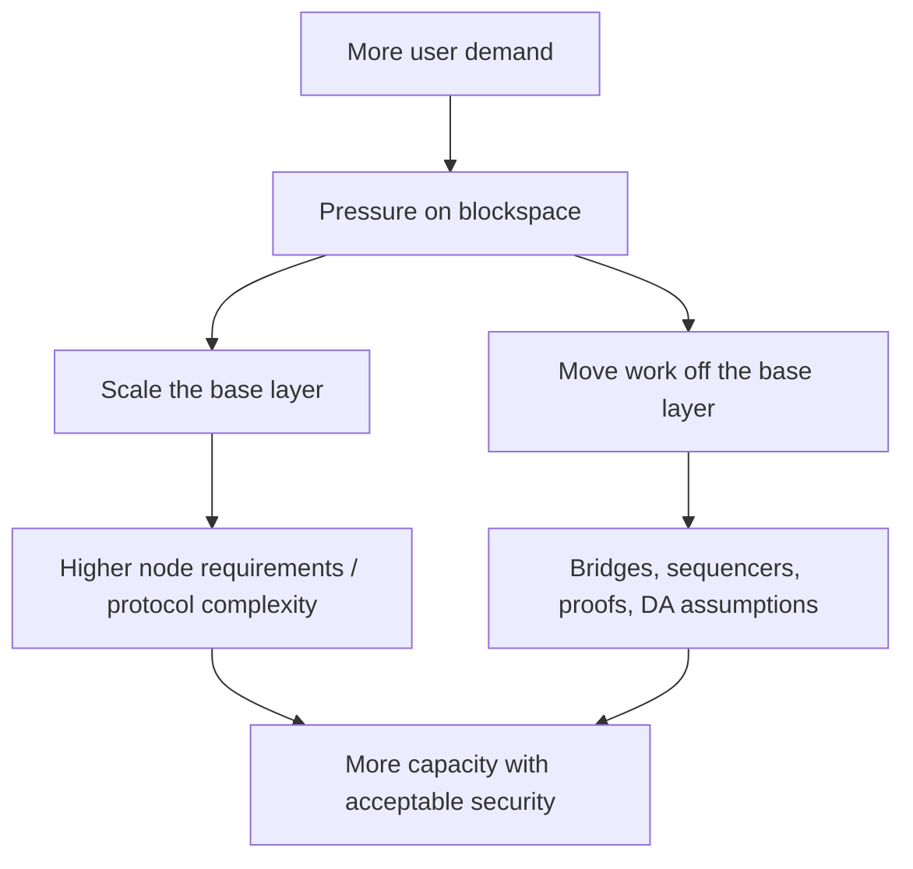

The central pattern is that scaling rarely removes cost. It moves cost. It can move cost from users to validators, from Layer 1 to Layer 2, from execution to data availability, from computation to proof generation, or from decentralization to operational efficiency.

> **Important distinction:** Scaling is not one technology. It is a design space. Rollups, bigger blocks, parallel execution, channels, sidechains, data availability sampling, and better clients all scale different bottlenecks with different trade-offs.

## Two Ways to Describe Blockchain Layers

The word *layer* is used for two different classification systems. Treating them
as interchangeable creates confusion.

The first is a **deployment hierarchy**:

- **Layer 0** is infrastructure used to create or connect sovereign chains. The
  term is informal rather than universal. Cosmos SDK and Inter-Blockchain
  Communication (IBC), and Polkadot's relay-chain/parachain architecture, are
  commonly placed here.
- **Layer 1** is a sovereign base blockchain with its own consensus, state, and
  native security model, such as Bitcoin, Ethereum, or Solana.
- **Layer 2** processes activity outside an L1's normal execution path while
  relying on that L1 for specified security functions. Rollups are the clearest
  example because their state commitments, data, and dispute or validity
  mechanisms connect to settlement contracts on the L1.
- **Layer 3** usually means an additional application-specific execution layer
  above an L2. The label is not standardized: different projects use it for
  app-specific rollups, privacy systems, or specialized execution domains.

The second is a **functional decomposition**:

| Function | Question it answers |
|---|---|
| Execution | Given ordered inputs and prior state, what is the next valid state? |
| Settlement | Where are commitments accepted and disputes resolved? |
| Consensus | How do participants agree on the canonical history? |
| Data availability | Can verifiers obtain the data needed to reconstruct and check state transitions? |
| Application | What user-facing rules and workflows do contracts and interfaces implement? |

A monolithic blockchain performs most functions in one protocol and validator
set. A modular system assigns them to different systems. For example, a rollup
may execute transactions through a sequencer, publish compressed data to
Ethereum, and rely on Ethereum contracts and consensus for settlement. Modular
design can specialize each component, but the combined system is only as strong
as the interfaces and trust assumptions between them.

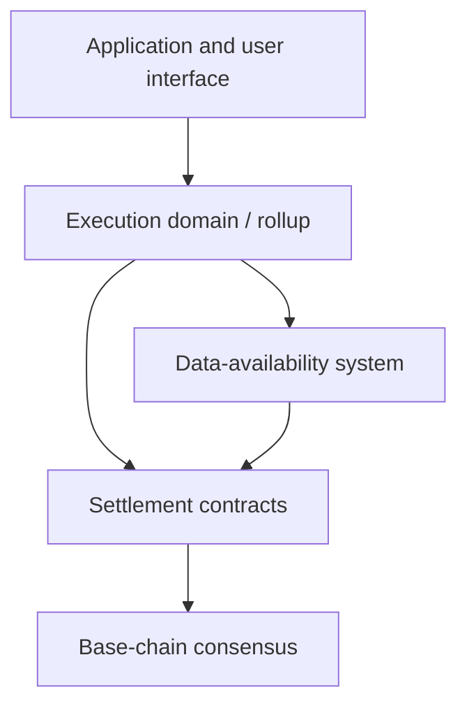

> **Layer numbers do not prove security.** Calling a system “Layer 2” does not
> establish which base-layer properties it inherits. Security depends on data
> publication, proof or challenge mechanisms, upgrade controls, sequencer
> powers, bridge contracts, and whether users can exit without operator
> cooperation.

### Cross-Layer Consequences

Splitting functions across layers creates recurring system-level problems:

- **finality inheritance:** a fast sequencer confirmation is not the same as
  final base-layer settlement;
- **liquidity fragmentation:** the same economic asset may be divided across
  chains, rollups, bridges, and representations;
- **reduced synchronous composability:** contracts in different execution
  domains cannot generally call one another atomically as if they shared one
  state machine;
- **bridge and message risk:** value and instructions cross domains through
  additional verification and execution mechanisms;
- **user-experience complexity:** users must reason about networks, gas assets,
  confirmation stages, withdrawals, and multiple token representations; and
- **shared-security concentration:** many systems can inherit or rent one
  security base, but a common failure can then propagate across them.

These are not secondary inconveniences. They are part of the scaling
architecture and must be included when comparing capacity, cost, and security.

## The Blockchain Trilemma

The blockchain trilemma is a shorthand for the tension between three goals:

- **scalability:** the system can process many transactions cheaply and quickly;
- **security:** the system resists invalid state transitions, double-spends, censorship, and attacks;
- **decentralization:** many independent participants can verify and participate without excessive resources or permission.

The trilemma is not a mathematical law that says only two can ever be achieved. It is a warning that pushing one dimension often pressures the others.

| Design choice | Scaling benefit | Pressure created |
|---|---|---|
| Larger blocks | More transaction data per block | More bandwidth/storage; fewer nodes may keep up |
| Faster block times | Lower latency and more frequent capacity | More network propagation stress and reorg risk |
| More powerful validators | Higher throughput | Validator set may centralize |
| Rollups | More execution capacity off L1 | Sequencer, bridge, proof, and DA assumptions |
| Sidechains | Independent throughput | Different security set from the main chain |
| Channels | Many off-chain updates | Users must manage liquidity and watch for disputes |
| Parallel execution | More compute throughput | More complex state conflict detection |

The trilemma is best understood through node requirements. If scaling requires every validator to run expensive hardware, the system may still work technically, but fewer people can independently verify it. If fewer people can verify it, users become more dependent on professional operators and infrastructure providers.

### Fake Scenario: The Bigger Block Temptation

Suppose a chain processes 1,000 transactions per block. Users complain about high fees. The community proposes increasing block size tenfold so each block can include 10,000 transactions.

At first, this sounds like an easy fix. More room per block means lower congestion. But every full node must now download, validate, and store much more data. Some hobbyist node operators drop out. Smaller validators struggle with bandwidth. Block propagation slows down. Well-connected professional validators gain an advantage.

The chain did scale throughput, but it changed the decentralization profile. That trade-off may or may not be acceptable depending on the chain's goals.

## Throughput, Latency, And Finality

Scaling discussions often mix together throughput, latency, and finality, but they measure different things.

| Concept | Meaning | Example question |
|---|---|---|
| Throughput | How much work the system processes per unit of time | How many transactions can fit into blocks? |
| Latency | How long a user waits for an initial response or inclusion | How quickly does my transaction appear included? |
| Finality | How irreversible the transaction is | When is reversal impossible or extremely unlikely? |
| Cost | Price paid for inclusion/execution | How expensive is this transaction? |
| Capacity | Practical useful workload supported | How many users/apps can the system serve? |

A system can have low latency but weak finality. A rollup sequencer may give users a fast pre-confirmation, but final settlement on Layer 1 may take longer. A system can have high throughput but expensive state growth. A system can have cheap transactions during normal times but expensive transactions during congestion.

### Fake Scenario: Fast UX vs Final Settlement

Mina swaps tokens on a rollup. The rollup sequencer confirms the transaction in less than a second. Her wallet shows the new token balance immediately.

That fast confirmation is useful, but it is not identical to final settlement on the base layer. The batch still needs to be posted, proven or challengeable, and accepted by the settlement layer. For a small swap, Mina may not care. For a $50 million institutional movement, the difference matters.

This mirrors traditional finance: a user may see a brokerage trade instantly, while clearing and settlement happen later.

## The Main Bottlenecks

Blockchain systems bottleneck across several resources at once. Improving one bottleneck often exposes another.

### Compute

Compute is the CPU work needed to validate signatures, execute transactions, run smart contracts, verify proofs, and update state.

Simple transfers use relatively little compute. Complex DeFi transactions may call several contracts, read and write many storage slots, emit logs, and perform arithmetic. If every full node must repeat this computation, expensive execution directly limits throughput.

Compute bottlenecks can be improved by:

- optimizing client software;
- using better virtual machines;
- improving signature aggregation or verification;
- parallelizing independent transactions;
- moving execution to rollups;
- using validity proofs so others verify a proof rather than re-executing everything.

But compute optimization is not enough if bandwidth, storage, or data availability becomes the next bottleneck.

### Bandwidth

Bandwidth is the amount of data nodes must transmit and receive. Blocks, transactions, attestations, votes, and rollup data all consume bandwidth.

Large blocks increase throughput only if nodes can receive them quickly enough. If block propagation is slow, more nodes may build on stale information, increasing forks or missed slots. Well-connected validators gain an advantage because they see data earlier.

Bandwidth bottlenecks are especially important for decentralization because internet connectivity varies globally. A system that works only for validators in data centers with excellent connectivity may be fast, but it is less globally verifiable.

### Storage

Storage includes current state, block history, receipts, logs, and indexes. State growth is especially important because current state is needed to validate new transactions.

If state grows too quickly, running a full node becomes harder. This creates reliance on professional infrastructure providers. It can also make syncing new nodes slower, which weakens decentralization over time.

Storage pressure appears in several places:

- more users create more accounts and token balances;
- smart contracts store more data;
- DeFi protocols emit more logs and events;
- rollups publish data to L1 or DA layers;
- archive nodes store historical state for analytics and infrastructure.

Not all storage has the same security importance. Current state matters for validation. Historical state matters for auditing and application access. Indexed data matters for UX but is usually outside consensus.

### State Access

State access is the cost of reading and writing the state database during execution. It is often a hidden bottleneck.

A smart contract transaction may do many reads and writes:

- read user balances;
- read pool reserves;
- update allowances;
- update token balances;
- update protocol accounting;
- emit events.

Even if computation is fast, database access can be slow. This is one reason parallel execution and state layout matter. If many transactions touch the same hot contract or liquidity pool, they may conflict and need careful ordering.

### Consensus Overhead

Consensus requires communication. Validators may need to propose blocks, vote, attest, aggregate signatures, exchange messages, and handle leader changes.

As validator count grows, coordination can become more expensive. As block times shrink, the system has less time to propagate data and collect votes. As finality gets stronger, the protocol may need more explicit communication.

Consensus overhead is one reason high-performance chains often make design choices around leader schedules, validator hardware, message aggregation, and network topology.

### Data Availability

Data availability is the guarantee that transaction data needed for verification has actually been published and can be retrieved.

For rollups, this can become the central scaling bottleneck. If execution happens off-chain but the data needed to verify execution must be posted somewhere, then scaling depends heavily on how much data can be made available securely.

Data availability is not glamorous, but it is often the limiting factor for secure rollup scaling.

### Fee Markets And Blockspace

Blockspace is the scarce capacity inside blocks. Users compete for it by paying fees.

When demand exceeds supply, fees rise. Fees are not just arbitrary charges; they are the market mechanism for allocating scarce validation, execution, storage, and data availability resources.

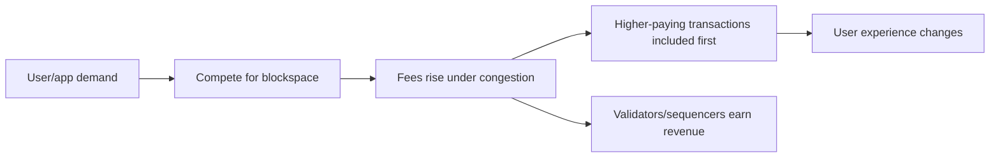

Fee markets create several design questions:

- Which resource is being priced: compute, storage, bandwidth, data availability, or priority?
- Are fees predictable enough for users?
- Can one application congest the whole chain?
- Are fees burned, paid to validators, paid to sequencers, or split?
- Can local fee markets isolate congestion to specific state hotspots?

Scaling often means increasing useful blockspace or making blockspace markets more efficient.

## Scaling Design Map

Scaling designs differ in which bottleneck they target and which trust assumptions they introduce.

| Design | Main scaling idea | Security source | Main trade-off |
|---|---|---|---|
| Bigger/faster L1 | Increase base chain capacity | Same L1 validator/miner set | Higher node requirements |
| Rollups | Move execution off L1, settle/prove on L1 | L1 plus rollup proof/DA design | Sequencer/proof/bridge complexity |
| Sidechains | Separate chain with own validators | Sidechain validator set | Does not inherit L1 security directly |
| Payment channels | Many off-chain updates, settle net result | L1 dispute mechanism | Liquidity and monitoring complexity |
| Validiums | Off-chain execution with validity proofs and off-chain DA | Validity proof plus DA provider/committee | Data availability trust |
| Data availability layers | Specialize in publishing/verifying data | DA layer consensus/sampling | Integration and additional assumptions |
| Parallel execution | Execute independent transactions concurrently | Same chain security | State conflict complexity |

The most important habit is to ask what security is inherited and what security is new. Scaling systems often advertise speed, but the deeper question is what users must now trust.

## Base-Layer Scaling

Base-layer scaling means improving the Layer 1 itself.

Common approaches include:

- larger blocks or more blockspace;
- faster block times;
- optimized clients;
- better networking;
- more efficient signature schemes;
- parallel execution;
- improved state storage;
- local fee markets;
- sharding or data sharding;
- hardware-conscious engineering.

Base-layer scaling is attractive because it preserves a simple user experience. Users transact on one chain, liquidity remains unified, and applications can compose directly.

The risk is that base-layer scaling can increase requirements for validating nodes. If the chain becomes too expensive to verify independently, the system may become fast but less trust-minimized.

### Fake Scenario: Scaling A DeFi App On L1

A chain has one popular on-chain game and one popular decentralized exchange. During a major game launch, millions of game transactions fill blocks. DEX users suddenly pay much higher fees even though their trades are unrelated.

The chain can respond in several ways:

- increase total block capacity;
- create local fee markets so game congestion does not fully spill into DEX activity;
- encourage the game to move to an app-specific chain or rollup;
- optimize execution so more transactions fit;
- add priority fee mechanisms for users who need urgent inclusion.

Each response changes the architecture. Scaling is not just "make blocks bigger"; it is deciding how scarce resources are isolated, priced, and verified.

## Rollups

Rollups are one of the most important blockchain scaling designs. A rollup executes transactions outside a base Layer 1, then posts data and/or proofs back to a settlement layer.

The purpose is to reduce the amount of work the base chain must do per transaction while still anchoring the rollup's security to the base chain.

At a high level, a rollup separates:

- **execution:** handled by the rollup;
- **ordering:** often handled by a sequencer;
- **data publication:** posted to L1 or a DA layer;
- **verification:** fraud proofs or validity proofs;
- **settlement:** handled by L1 contracts or settlement rules.

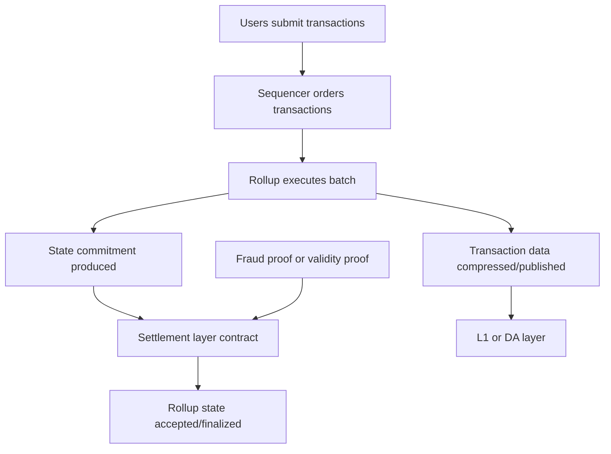

Rollups are powerful because Layer 1 does not execute every user transaction. It verifies a compressed representation of the rollup's activity. The trade-off is that the system now depends on rollup-specific machinery.

## Rollup Components

### Sequencer

The sequencer receives transactions and orders them into batches.

Sequencers improve user experience because they can give quick pre-confirmations. Instead of waiting for L1 inclusion, users can receive a fast response that their transaction has been ordered by the rollup.

But the sequencer is also a powerful actor:

- it can choose transaction ordering;
- it can delay or censor transactions, depending on design;
- it can extract MEV;
- it can go offline;
- it can create a centralized operational dependency;
- it can influence perceived finality before L1 settlement.

Many rollups have centralized sequencers today because this is simpler and gives better latency. Decentralizing sequencing is an active design area, involving shared sequencing, leader rotation, validator sets, auctions, or based sequencing.

### Batch Poster

The batch poster submits rollup transaction data or commitments to the base layer. In some systems, the sequencer and batch poster are the same operator. In others, the roles can be separated.

The batch poster matters because rollup security depends on data being published. If batches are not posted, the rollup may continue giving users soft confirmations, but settlement on L1 does not progress.

### Prover

In ZK rollups, a prover generates a validity proof showing that a batch of transactions was executed correctly.

Proof generation can be computationally expensive. The reward is that verification can be much cheaper than re-executing the whole batch. This creates a useful asymmetry:

- proving may be hard;
- verification should be relatively easy.

This is one of the core scaling ideas behind zero-knowledge validity proofs.

### Challenger

In optimistic rollups, challengers monitor posted batches and submit fraud proofs if a batch is invalid.

The optimistic model assumes transactions are valid unless challenged within a dispute window. This reduces proving cost during normal operation, but it requires:

- data availability so challengers can inspect batches;
- honest challengers who monitor the system;
- enough time for disputes;
- a settlement contract that can resolve fraud proofs.

### Bridge Contract

A rollup bridge contract on L1 often holds assets backing the rollup representation.

If a user deposits ETH into a rollup, the ETH may be locked in an L1 bridge contract while the rollup credits the user with ETH-equivalent balance inside the rollup. Withdrawals reverse the process under rollup rules.

This bridge is security-critical. Bugs in bridge contracts or withdrawal logic can put user funds at risk.

## Optimistic Rollups

Optimistic rollups assume batches are valid by default and allow invalid batches to be challenged.

The core lifecycle is:

1. Users submit transactions to the sequencer.
2. The sequencer orders transactions into a batch.
3. The rollup executes the batch.
4. The batch data and state commitment are posted to L1.
5. A challenge window begins.
6. If no successful fraud proof is submitted, the batch is accepted.
7. Withdrawals can finalize after the challenge period.

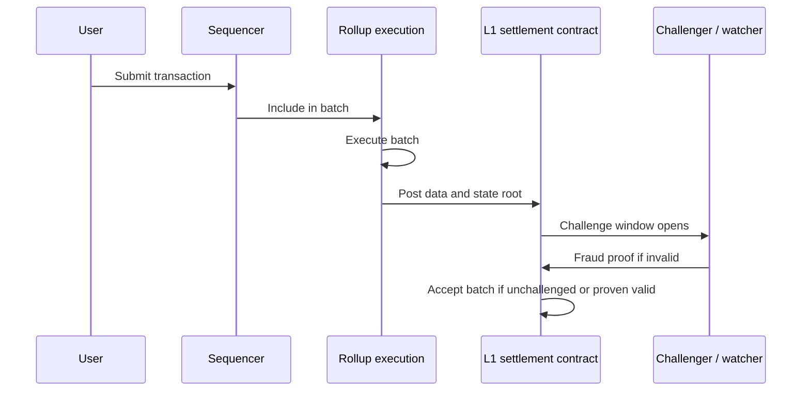

### Fraud Proof Intuition

A fraud proof is evidence that a posted state transition was invalid.

Instead of asking L1 to re-execute every rollup transaction, the system tries to isolate the disputed computation. The exact mechanism differs across implementations, but the idea is to prove that "at this step, the rollup claimed the wrong result."

The challenge system must be precise enough for L1 to decide who is correct. It also needs incentives so dishonest claims are penalized and honest challengers are rewarded or at least not economically discouraged.

### Strengths

Optimistic rollups have several advantages:

- simpler execution compatibility with existing environments such as the EVM;
- lower normal-case proving overhead;
- easier path to supporting complex smart contract execution;
- relatively mature ecosystems in Ethereum scaling.

### Weaknesses

The main trade-offs are:

- withdrawal delays due to challenge windows;
- dependence on watchers/challengers;
- need for robust fraud proof systems;
- sequencer centralization in many current deployments;
- bridge and upgrade risks;
- UX complexity around finality.

### Fake Scenario: Invalid Batch

A malicious sequencer posts a batch claiming that Priya's rollup balance decreased by 100 tokens even though no valid transaction authorized it.

If transaction data is available, a challenger can reconstruct the batch and identify the invalid state transition. The challenger submits a fraud proof to the L1 contract. If the proof succeeds, the invalid batch is rejected and the sequencer may be penalized.

The security model depends on at least one honest party being able to see the data and challenge in time.

## ZK Rollups

ZK rollups use validity proofs. A validity proof cryptographically proves that a batch of transactions was executed correctly according to the rollup's rules.

Despite the name, the main scaling use here is usually validity, not privacy. A ZK rollup proof can show that a computation was correct without requiring L1 to re-execute every transaction.

The lifecycle is:

1. Users submit transactions.
2. The rollup orders and executes a batch.
3. A prover generates a validity proof.
4. The proof and state commitment are submitted to L1.
5. L1 verifies the proof.
6. If the proof verifies, the new state is accepted.

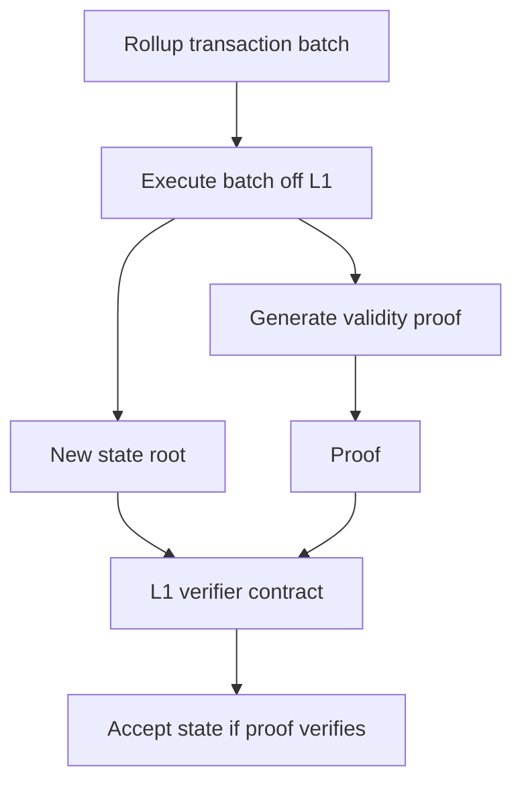

### Validity Proof Intuition

A validity proof is like a compact certificate that a large computation was performed correctly.

The base chain does not need to redo the whole computation. It verifies the proof. If proof verification is much cheaper than re-execution, the system can scale.

This creates a different bottleneck:

- the rollup must generate proofs efficiently;
- circuits or proof systems must correctly encode the VM rules;
- proof verification must be affordable on the settlement layer;
- upgrades to the execution environment may require proof-system changes.

### Strengths

ZK rollups can provide:

- faster finality on the settlement layer after proof verification;
- no need for a long fraud challenge window;
- strong cryptographic validity guarantees;
- potential compression advantages;
- good fit for specialized applications and increasingly for general-purpose execution.

### Weaknesses

The main trade-offs are:

- proof generation complexity;
- difficulty supporting all EVM behavior efficiently;
- more complex engineering and audits;
- prover centralization risk if proving is expensive;
- dependence on proof-system assumptions and implementation correctness.

## Optimistic vs ZK Rollups

| Dimension | Optimistic rollup | ZK rollup |
|---|---|---|
| Validity model | Assumed valid unless challenged | Proven valid before acceptance |
| Normal-case cost | Lower proving cost | Proof generation cost |
| Withdrawal timing | Often delayed by challenge window | Potentially faster after proof verification |
| Watcher requirement | Challengers must monitor | Less reliance on fraud watchers |
| Engineering difficulty | Fraud proofs and dispute games | Validity circuits/provers/verifiers |
| EVM compatibility | Historically easier | Harder but improving |
| Failure mode | Invalid state accepted if no challenge works | Invalid state accepted if proof system/verifier is broken |

Neither design is simply "better." Optimistic rollups optimize for simpler normal-case execution and compatibility. ZK rollups optimize for cryptographic validity and faster settlement, at the cost of complex proving infrastructure.

## Data Availability And Rollups

Rollups need data availability because users and verifiers must be able to reconstruct the rollup state.

If a rollup posts only a state root but not the underlying transaction data, users cannot independently verify the state. They may be trapped if the operator withholds data.

Data availability can be provided by:

- Ethereum calldata or blobs;
- a dedicated DA layer such as Celestia-style architecture;
- a data availability committee;
- off-chain storage plus validity proofs in validium designs.

### Data Availability Sampling

Data availability sampling is a technique where nodes sample small random pieces of data to gain confidence that the full data was published.

The intuition is like checking random pages from a book. If many independent
participants randomly sample pieces and all samples are available, confidence
increases that the full data exists. The exact security depends on the sampling
scheme and network assumptions; conceptually, sampling lets light nodes help
verify availability without downloading everything.

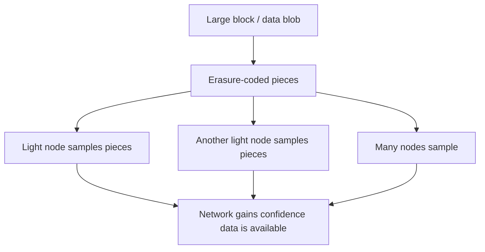

Data availability sampling matters because it tries to preserve verifiability while increasing data throughput. It is a key idea in modular blockchain scaling.

## Validiums And Volitions

A validium uses validity proofs for execution correctness but keeps transaction data off-chain or outside the main settlement layer's DA.

This means the settlement layer can know that the state transition was valid, but users still depend on the off-chain data availability system to know their balances and exit safely.

| Design | Execution correctness | Data availability | Main trade-off |
|---|---|---|---|
| ZK rollup | Validity proof | Data posted to L1/DA layer | More secure DA, higher cost |
| Validium | Validity proof | Off-chain DA or committee | Lower cost, more DA trust |
| Volition | User/app chooses rollup-style or validium-style DA | Mixed | Flexible but more complex |

Validiums can be useful for high-throughput applications where cost matters and users accept the DA assumptions. They are weaker than rollups if users need maximum exit guarantees from public data availability.

### Fake Scenario: Validium Data Failure

An exchange-like application uses a validium. Validity proofs ensure the operator cannot create invalid state transitions. But then the data availability committee stops publishing user balance data.

The latest state may be valid, but users cannot reconstruct their own account data or prove withdrawals. This is not an execution-validity failure. It is a data availability failure.

This is why validity proofs and data availability solve different problems.

## Sidechains

A sidechain is a separate blockchain connected to another chain, often through a bridge. It has its own validators, consensus, block production, and security assumptions.

Sidechains can provide cheaper and faster transactions because they do not require the main chain to validate every state transition. But they generally do not inherit the main chain's security in the same way a rollup tries to.

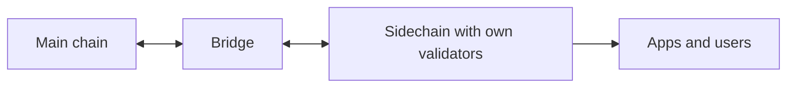

The bridge is critical. If users lock assets on the main chain and receive wrapped assets on the sidechain, the security of those wrapped assets depends on the bridge and sidechain validator set.

### Sidechain Trade-Offs

| Feature | Sidechain |
|---|---|
| Scaling benefit | Independent execution capacity |
| Security | Own validator set or consensus |
| Cost | Often cheaper than L1 |
| Finality | Depends on sidechain design |
| Bridge risk | Usually significant |
| Best fit | Applications that accept separate security assumptions |

Sidechains are not "fake" scaling. They are real scaling, but they scale by creating another chain with another trust model.

## Payment Channels And State Channels

Channels move repeated interactions off-chain while keeping an on-chain dispute mechanism.

A payment channel lets two or more parties transact many times off-chain, then settle the final result on-chain. The Lightning Network is the most famous payment-channel network associated with Bitcoin.

### Simple Payment Channel

Maya and Leo open a channel by locking funds on-chain. They exchange signed off-chain updates representing new balances. Later, one of them closes the channel and settles the latest valid state on-chain.

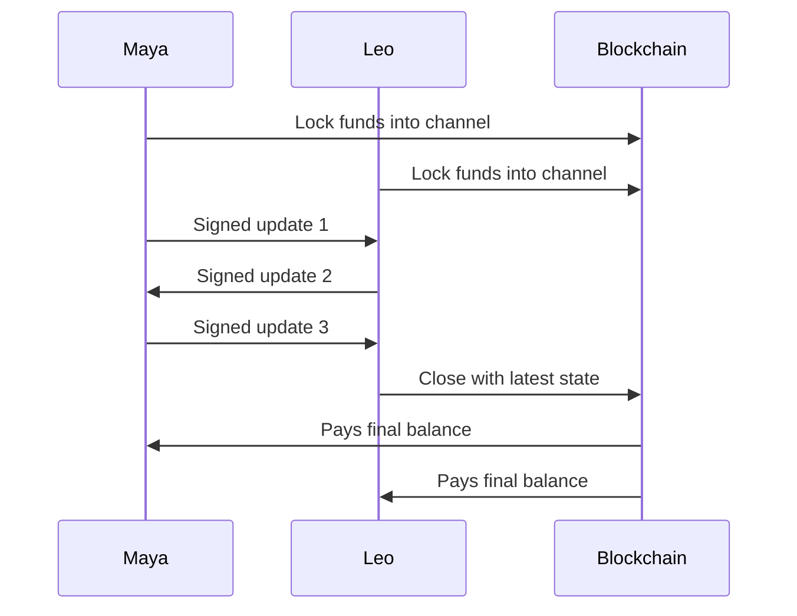

Channels scale because every intermediate update does not go on-chain. Only opening, closing, and disputes need the base layer.

### Channel Requirements

Channels work best when:

- participants interact repeatedly;
- liquidity can be locked in advance;
- users or watchtowers can monitor for old-state fraud;
- routing between channels is available if paying across a network;
- participants tolerate channel-management complexity.

### Channel Trade-Offs

| Strength | Explanation |
|---|---|
| Very low marginal cost | Off-chain updates can be cheap and fast |
| Strong base-layer anchor | Disputes can settle on-chain |
| Good for repeated payments | Many updates can happen before settlement |

| Weakness | Explanation |
|---|---|
| Liquidity fragmentation | Funds must be locked in channels |
| Online/monitoring burden | Users must detect invalid closures or use watchtowers |
| Routing complexity | Multi-hop payments need available path liquidity |
| Less general than rollups | Channels work best for specific interaction patterns |

Channels are elegant, but they are not a universal replacement for on-chain execution. They are strongest for repeated bilateral or routed payments.

## Sharding

Sharding splits work across multiple partitions called shards. Instead of every node processing every transaction, different shards process different subsets of data or execution.

The basic idea comes from databases, but blockchain sharding is harder because adversarial security and cross-shard communication matter.

There are different forms:

- **execution sharding:** different shards execute different transactions;
- **data sharding:** the system increases data availability capacity without each node downloading all data;
- **state sharding:** state is partitioned across shards;
- **committee sharding:** validators are assigned to shards.

Execution sharding sounds intuitive, but it creates difficult questions:

- how are validators assigned securely to shards;
- how do cross-shard transactions work;
- what happens if one shard is attacked;
- how is composability preserved;
- can users verify the whole system without processing all shards?

Ethereum's roadmap moved away from classic execution sharding and toward rollups plus data scaling, because rollups can provide execution scaling while Ethereum focuses on settlement and data availability.

## Parallel Execution

Parallel execution improves throughput by running independent transactions at the same time.

The challenge is that blockchain execution must remain deterministic. If two nodes execute transactions in parallel, they must still arrive at the same final state.

Transactions can be parallelized when they touch independent state. They conflict when they read or write the same state in ways where ordering matters.

### Fake Scenario: Parallel And Conflicting Transactions

Four transactions arrive in a block:

- Tx A: Alice pays Bob.
- Tx B: Carol pays Dan.
- Tx C: Eli swaps in Pool X.
- Tx D: Fatima also swaps in Pool X.

Tx A and Tx B may be independent. Tx C and Tx D both touch Pool X, so their order affects pricing and output amounts.

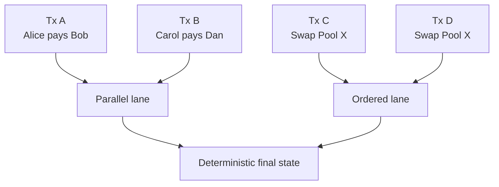

Parallel execution can be implemented in different ways:

- require transactions to declare which state they access;
- detect conflicts optimistically and retry conflicting transactions;
- use object/resource models that make state dependencies clearer;
- schedule transactions based on known accounts or storage keys.

Parallelism can increase throughput substantially, but it does not remove the need for ordering. It makes ordering more sophisticated.

## Local Fee Markets

A local fee market tries to isolate congestion around specific resources or state hotspots.

In a global fee market, one popular application can raise fees for everyone. In a local fee market, users competing for the same resource pay more, while unrelated users may be less affected.

### Fake Scenario: NFT Mint vs Stablecoin Transfer

A popular NFT mint causes thousands of users to interact with one contract. Under a global fee market, a user trying to send a stablecoin payment may also face high fees because all transactions compete for the same blockspace.

Under a local fee market, the NFT contract's state becomes expensive to access, but unrelated stablecoin transfers may remain cheaper if they do not touch the congested state.

Local fee markets are hard to design because resources are not always cleanly separable. Complex transactions may touch many contracts. But the idea is important: scaling is not only increasing total capacity; it is also allocating capacity more intelligently.

## Shared Sequencing

Shared sequencing is a design where multiple rollups or execution environments use a common sequencing system.

The motivation is that independent rollups can fragment ordering, liquidity, and MEV. If each rollup has its own centralized sequencer, cross-rollup transactions become harder and users face inconsistent assumptions.

Shared sequencing may help with:

- cross-rollup atomicity;
- better MEV management;
- reduced sequencer centralization;
- more consistent transaction ordering;
- improved interoperability between rollups.

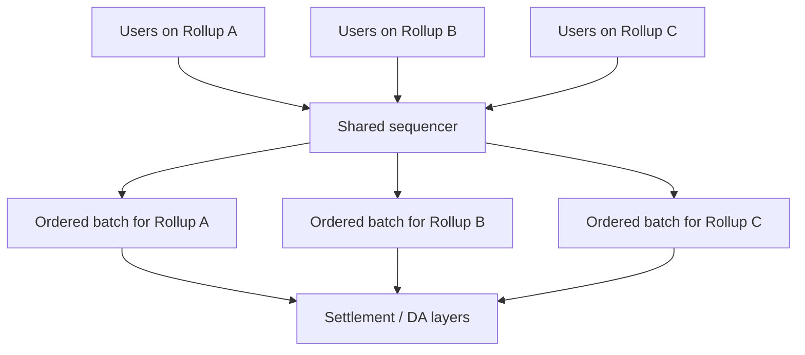

Shared sequencing is not free. It creates its own governance, incentive, latency, and security questions. The shared sequencer itself must be decentralized or trusted enough for the applications using it.

## Appchains And Layer 3s

An appchain is a blockchain dedicated to one application or application ecosystem. A Layer 3 is often described as an app-specific or purpose-specific layer built on top of a Layer 2.

The motivation is specialization. A game, exchange, social network, or institution may want custom execution rules, fee markets, governance, privacy, or performance settings.

App-specific scaling can improve:

- application-level performance;
- custom fee models;
- control over upgrades;
- isolation from unrelated congestion;
- tailored compliance or privacy;
- UX design.

The trade-off is fragmentation:

- users may need bridges;
- liquidity may split;
- security assumptions may differ;
- developers must maintain more infrastructure;
- composability with other applications may weaken.

Appchains and Layer 3s are best seen as scaling through specialization rather than scaling one shared environment for everyone.

## MEV And Scaling

MEV, or maximal extractable value, is value captured through transaction ordering, inclusion, or exclusion.

Scaling changes MEV but does not eliminate it. In fact, new scaling designs can create new MEV markets:

- rollup sequencers can order transactions for profit;
- cross-domain MEV can arise between L1 and L2 or between rollups;
- shared sequencers may centralize or redistribute ordering power;
- faster block times can change searcher strategies;
- private mempools can reduce some attacks while creating new trust assumptions.

MEV matters for scaling because ordering power is part of the architecture. A rollup can have cheap fees but a centralized sequencer extracting value from users. A high-throughput chain can process many trades but still expose users to sandwich attacks if transaction ordering is adversarial.

Scaling throughput without addressing ordering fairness may create systems that are fast but extractive.

## Bridges And Exit Risk

Many scaling systems require bridges. Rollups, sidechains, appchains, and Layer 3s often need a way to move assets between environments.

Bridge risk depends on the scaling design:

- a rollup bridge may rely on L1 contracts, proofs, and DA;
- a sidechain bridge may rely on a multisig or validator set;
- an appchain bridge may rely on its own consensus;
- a validium bridge may depend on off-chain data availability.

Exit risk is the risk that users cannot safely withdraw assets back to the settlement layer.

Important exit questions:

- Is transaction data available?
- Is there a permissionless escape hatch?
- Can users force inclusion if the sequencer censors them?
- How long is the withdrawal delay?
- What happens if the operator disappears?
- Who can upgrade the bridge contract?
- Are emergency controls centralized?

These questions are often more important than headline transaction fees.

## Scaling Examples

### Lightning

Lightning is a payment-channel network associated with Bitcoin.

Its core scaling idea is to move repeated payments off-chain while using Bitcoin as the final dispute/settlement layer. Users lock liquidity into channels and exchange signed updates. Payments can route across multiple channels if a path with sufficient liquidity exists.

Lightning is well suited to payment flows but less suited to arbitrary smart contract execution. Its scaling trade-offs involve liquidity management, routing, online monitoring, and channel operations.

### Arbitrum

Arbitrum is an optimistic rollup ecosystem for Ethereum.

Its core scaling idea is to execute transactions off Ethereum L1 while posting data and state commitments back to Ethereum. It uses the optimistic model: state is accepted unless successfully challenged under the protocol's dispute rules.

Arbitrum is important because it shows how EVM-compatible rollups can support large smart contract ecosystems while relying on Ethereum as a settlement anchor.

### Optimism And Base

Optimism is an optimistic rollup ecosystem and the basis for the OP Stack. Base, built by Coinbase, uses OP Stack technology.

The OP Stack represents a broader scaling idea: rollups can become a standardized family of chains with shared tooling, governance, bridges, and potentially shared sequencing or interoperability.

The trade-off is that a multi-rollup ecosystem needs coordination around upgrades, security, bridging, and cross-chain UX.

### zkSync, Starknet, And Polygon ZK Systems

ZK-oriented scaling systems use validity proofs to prove execution correctness.

They differ in VM design, proof system, EVM compatibility, developer experience, and data availability choices. Some aim for EVM equivalence or compatibility. Others use different execution environments that are more proof-friendly.

The important conceptual point is that ZK scaling shifts work into proof generation and verification. This can reduce settlement-layer work but increases engineering complexity.

### Celestia

Celestia is an example of modular scaling focused on data availability. Instead of executing smart contracts for everyone, a DA layer helps other chains and rollups publish data needed for verification.

The scaling idea is specialization: many execution environments can use a shared or specialized DA layer rather than each building its own validator set and data availability system from scratch.

### EigenLayer And Restaking

EigenLayer is associated with restaking and shared security services. In scaling discussions, it appears because systems may use externally secured services such as data availability, sequencing, bridges, or other middleware.

The deeper concept is **shared security**: one economic security base may support additional services. This can improve bootstrapping but also creates correlated risk. If many systems depend on the same restaked security layer, failures can propagate.

## Comparing Scaling Paths

| Path | Best for | Main benefit | Main risk |
|---|---|---|---|
| High-performance L1 | Unified UX and direct composability | One fast shared environment | Higher validator requirements |
| Optimistic rollup | EVM-compatible smart contracts | Lower fees with Ethereum settlement | Challenge windows and sequencer assumptions |
| ZK rollup | Validity-proven execution | Faster settlement and strong correctness proofs | Prover/circuit complexity |
| Sidechain | Cheap independent environment | Flexible and scalable | Separate security model |
| Payment channel | Repeated payments | Very cheap off-chain updates | Liquidity and monitoring complexity |
| Validium | High-throughput apps | Lower cost than rollup DA | Data availability trust |
| Appchain / L3 | Specialized apps | Customization and congestion isolation | Fragmented liquidity and security assumptions |

The right design depends on the application. A high-value settlement system may prioritize security and finality over low fees. A game may prioritize low latency and cheap actions. A DEX may care about liquidity, MEV, composability, and finality. An institutional tokenization system may care about compliance, privacy, DvP, and legal settlement.

## Fake Case Study: Choosing A Scaling Design

Imagine three teams building different products.

### Team A: Retail Payment App

Team A wants users to send tiny payments frequently. Users care about low fees and speed. The payments are small, and the interaction pattern is repetitive.

A channel-style design or high-throughput payment-focused environment may fit. The team must handle liquidity, routing, and user experience around channel management.

### Team B: Decentralized Exchange

Team B wants deep liquidity, composability with other DeFi protocols, and strong settlement guarantees. It cares about MEV and ordering.

A rollup may fit because it reduces fees while preserving a strong settlement anchor. But the team must evaluate sequencer decentralization, bridge security, data availability, and cross-rollup liquidity.

### Team C: Regulated Tokenized Fund

Team C wants controlled investor access, compliance checks, legal ownership mapping, and reliable settlement. It does not need full public permissionless execution for every action.

A permissioned ledger, appchain, or rollup with compliance controls may fit better than a fully open public L1. The scaling issue is not only throughput; it is operational control, legal finality, identity, and integration with custodians and transfer agents.

This case study shows why scaling cannot be evaluated by TPS alone. Application requirements decide which trade-offs are acceptable.

## Common Misconceptions

> **Misconception: TPS is the main measure of blockchain quality.**  
> TPS ignores finality, security, decentralization, transaction complexity, state growth, data availability, liquidity, and user trust assumptions.

> **Misconception: Rollups are fully equivalent to using the base chain.**  
> Rollups can inherit important security from the base chain, but they add sequencer, bridge, proof, upgrade, and DA assumptions.

> **Misconception: ZK rollups are mainly about privacy.**  
> In scaling, validity proofs are mainly used to prove execution correctness compactly. Privacy is possible but not the default purpose of every ZK rollup.

> **Misconception: Sidechains inherit L1 security just because they bridge to L1.**  
> Most sidechains have their own validator/security model. Bridging connects assets but does not automatically transfer full security.

> **Misconception: Bigger blocks are a free scaling solution.**  
> Bigger blocks increase capacity but also increase bandwidth, storage, and validation requirements.

> **Misconception: Data availability is the same as storing data forever.**  
> DA is about publishing enough data for verification and safe exits. Archival storage is related but different.

> **Misconception: Faster user confirmations always mean final settlement.**  
> A sequencer or app can provide fast feedback before the transaction is fully settled under the strongest security assumptions.

## Connections To Other Notes

- [Blockchain Fundamentals](../01-core-architecture/blockchain-fundamentals.md)
  explains transactions, blocks, nodes, state, consensus, and finality.
- [Blockchain Architecture](../01-core-architecture/blockchain-architecture.md)
  explains execution, storage, RPC, clients, and modular system boundaries.
- [Consensus Mechanisms](../02-consensus-and-networks/consensus-mechanisms.md)
  deepens safety, liveness, validator/miner economics, attacks, and finality.
- **Blockchain transactions:** fees, gas markets, mempools, reorgs, receipts,
  failed transactions, and ordering.
- **Cross-chain interoperability:** bridge security, messaging, wrapped assets,
  and cross-domain risks.
- **Crypto trading:** MEV, liquidity, order flow, AMMs, and market structure.

## Active Recall

1. Explain why blockchain scaling is not just increasing transactions per second.
2. Describe how the blockchain trilemma appears through node hardware, bandwidth, and storage requirements.
3. Distinguish throughput, latency, finality, capacity, and cost.
4. Explain why state growth is a decentralization problem.
5. Describe how rollups separate execution, data publication, proof/verification, and settlement.
6. Compare optimistic rollups and ZK rollups.
7. Explain why data availability is necessary for rollup security.
8. Describe the difference between a rollup and a sidechain.
9. Explain how payment channels scale repeated payments.
10. Describe why parallel execution still needs deterministic ordering.
11. Explain how local fee markets can isolate congestion.
12. Describe the trade-offs introduced by shared sequencing.
13. Explain why bridge and exit risk are central to scaling systems.

## TLDR

Blockchain scaling is about increasing useful capacity while preserving acceptable security, decentralization, and verifiability. The hard part is not making a system faster in isolation; it is deciding which costs and trust assumptions move where.

Base-layer scaling improves the L1 itself but can raise node requirements. Rollups move execution off L1 while using proofs, data availability, and settlement contracts to inherit some base-layer security. Sidechains create separate capacity with separate security. Channels move repeated updates off-chain. Validiums lower data costs but add data availability trust. Parallel execution, local fee markets, shared sequencing, and data availability sampling improve specific bottlenecks.

The best scaling design depends on the application. A payment network, DeFi exchange, game, and regulated tokenized fund may all need different trade-offs. The right question is not only how fast the system is, but what users must trust when it becomes fast.

## References

- Ethereum.org, [Scaling](https://ethereum.org/developers/docs/scaling/).
- Ethereum.org, [Data availability](https://ethereum.org/developers/docs/data-availability/).
- Ethereum.org, [Optimistic rollups](https://ethereum.org/developers/docs/scaling/optimistic-rollups/).
- Ethereum.org, [Zero-knowledge rollups](https://ethereum.org/developers/docs/scaling/zk-rollups/).
- Bitcoin, [Lightning Network paper](https://lightning.network/lightning-network-paper.pdf).
- Cosmos, [IBC documentation](https://ibc.cosmos.network/).
- Polkadot Wiki, [Architecture](https://wiki.polkadot.network/learn/learn-architecture/).
- Celestia, [How Celestia works](https://docs.celestia.org/learn/how-celestia-works/).
