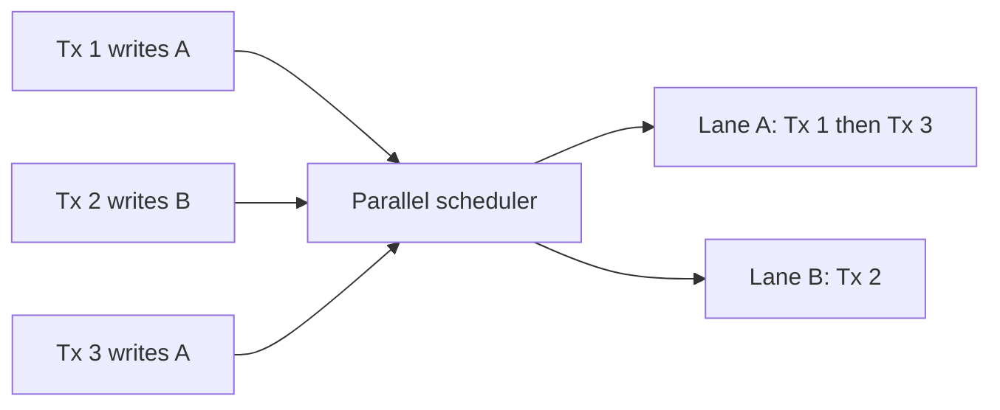
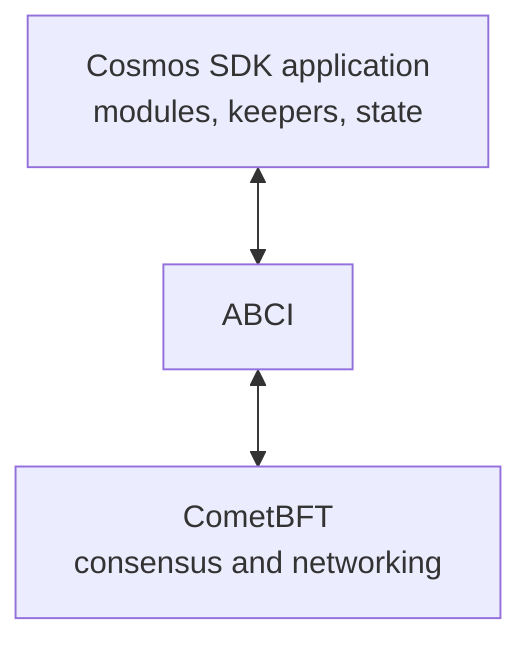
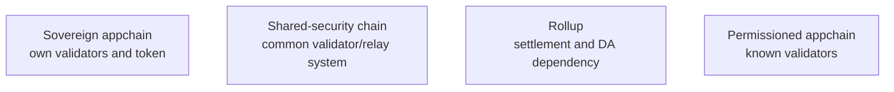

# Alternative Layer 1s And Appchains

Bitcoin and Ethereum are only two points in a large design space. Other layer
1 blockchains optimize for different combinations of execution speed, state
model, finality, hardware, programmability, governance, interoperability, and
application sovereignty.

Comparisons should not rely on advertised transactions per second. Capacity,
latency, and cost are produced by a complete architecture, including
transaction complexity, validator requirements, state growth, data
availability, client diversity, and demand.

## Comparison Framework

Network comparisons should begin with the workload and security objective. A
chain optimized for frequent low-value state updates may make different trade-offs
from one settling high-value financial claims. Comparing one throughput number
without execution complexity, hardware, finality, data availability, and
validator requirements can reward measurement choices rather than architecture.

For each network, identify:

1. state and transaction model;
2. execution environment and parallelism;
3. consensus and fork choice;
4. finality;
5. validator admission and economics;
6. hardware and networking requirements;
7. fee market and native asset;
8. governance and upgrades;
9. interoperability;
10. decentralization and failure assumptions.

## Monolithic, Modular, And Appchain Designs

### Shared General-Purpose L1

All applications share consensus, execution, state, and fees. This creates
composability and unified liquidity but contention.

### Appchain

An application controls its own chain, execution rules, fees, validators,
governance, and blockspace.

Benefits:

- predictable capacity;
- custom state and compliance;
- application-specific economics;
- fault isolation.

Costs:

- bootstrapping security;
- fragmented liquidity;
- bridge dependence;
- validator and operations burden;
- weaker synchronous composability.

### Shared-Security Appchain

An application-specific chain uses a common validator or settlement system,
seeking sovereignty without independently recruiting full economic security.
Polkadot parachains, Cosmos consumer-security models, rollups, and some
Avalanche designs occupy different forms of this category.

## Solana

Solana is a high-throughput account-based L1 designed around rapid leader
rotation, parallel execution, and high-performance validator infrastructure.

### State And Programs

Solana stores state in accounts keyed by 32-byte addresses. An account has:

- lamports;
- data;
- owner program;
- executable flag;
- rent-related metadata.

Programs are compiled to sBPF and are conceptually stateless; mutable data lives
in separate accounts passed to instructions. Transactions declare accounts they
will read and write.

### Parallel Execution

The runtime can execute non-conflicting transactions in parallel. Transactions
writing the same account contend for locks and are serialized. This makes state
layout important: one global writable account can become a bottleneck even when
the network has spare compute.



Multiple instructions execute atomically in one transaction. Cross-program
invocation supports composition.

### Consensus And Time

Proof of History is a verifiable sequential clock or ordering mechanism, not
consensus by itself. Tower BFT uses stake-weighted voting and PoH timing under
the network's consensus architecture. Leaders are scheduled to produce entries
and blocks for slots.

Applications distinguish processed, confirmed, and finalized commitment levels.
Finality policy should match the economic risk.

### Fees And Resources

Transactions pay a base signature fee and optional prioritization fee using
compute-unit parameters. The scheduler also accounts for writable accounts and
block resource limits. Fees are time-sensitive protocol parameters.

### Trade-Offs

Strengths include high throughput, low-latency applications, parallel execution,
and a large shared state. Trade-offs include demanding validator and RPC
infrastructure, execution hotspots around shared writable accounts, complex
runtime semantics, client-concentration history, and operational challenges
under extreme load.

## Avalanche

Avalanche is a heterogeneous network with a Primary Network and customizable
Avalanche L1 blockchains.

### Primary Network

- **C-Chain:** EVM-compatible smart contracts;
- **P-Chain:** validators, staking, and Avalanche L1 management;
- **X-Chain:** asset issuance and transfers.

Current architecture uses linear Snowman-family consensus across the Primary
Network; older descriptions of the X-Chain's DAG consensus are historical after
its linearization.

### Snowman Consensus

Validators repeatedly sample small random subsets of stake-weighted peers and
update preference. Repeated successful samples create confidence and
probabilistic finality with low messaging overhead relative to all-to-all BFT.

### Avalanche L1s

An Avalanche L1 can define:

- validator management;
- native token and fees;
- VM and execution;
- membership or permissioning;
- governance;
- performance parameters.

VMs separate application rules from the AvalancheGo consensus engine.
Subnet-EVM provides EVM compatibility; custom VMs provide greater sovereignty.

Security is not automatically inherited in the same way as a rollup settling
to Ethereum. The validator set and configuration of each Avalanche L1 must be
examined.

## Cosmos

Cosmos is an ecosystem and technology stack for application-specific
blockchains, not one monolithic execution environment.

### Cosmos SDK And CometBFT



CometBFT orders transactions and provides BFT consensus. ABCI connects it to a
deterministic application. Cosmos SDK modules implement staking, governance,
banking, and custom logic.

CometBFT commits blocks after more than two-thirds voting power agrees under its
assumptions and tolerates less than one-third Byzantine voting power for safety.

### Sovereign Security

A typical Cosmos chain has its own:

- validator set;
- staking token;
- governance;
- upgrades;
- fee market.

This provides sovereignty but fragments security and operations. Shared or
replicated security models allow one validator set to secure additional chains,
with governance and slashing dependencies.

### IBC

IBC uses light-client verification, connections, channels, packets, timeouts,
and relayers to communicate between chains. Security depends on each source
chain, correct light clients, and application semantics. Relayers affect
liveness, not ordinarily message validity.

## Polkadot

Polkadot separates a relay chain providing shared security from parachains
providing application-specific execution.

### Roles

- **relay-chain validators:** consensus, availability, and parachain validation;
- **collators:** maintain parachain state and produce candidate blocks;
- **nominators:** back validators under NPoS;
- **fishermen or monitoring roles:** terminology and implementation evolve.

Parachain candidates include proof-of-validity data. Assigned relay validators
check candidates, with availability and approval processes supporting security.
Relay-chain finality finalizes included parachain state.

### Execution

Parachains can use the Polkadot SDK and compile runtime logic to WebAssembly.
Runtime upgrades can occur through governance without a conventional hard-fork
deployment process, creating powerful governance authority.

### XCM

Cross-Consensus Messaging is a format and execution language for expressing
cross-system intent. It is not one transport protocol and does not make every
connected system share identical trust.

## Cardano

Cardano uses Ouroboros-family proof of stake and the extended UTXO model.

### Extended UTXO

An output can contain value, address, and datum. Spending validates a script
with transaction context and redeemer. Transactions consume old outputs and
create new ones.

Benefits:

- explicit state transitions;
- local reasoning about outputs;
- deterministic transaction effects and fees before submission.

Trade-offs:

- shared application state can create UTXO contention;
- application patterns differ from account-based EVM development;
- composability requires careful transaction construction.

### Staking And Governance

Stake pools produce blocks under Ouroboros selection. Delegation separates
stake participation from running a pool. Governance, treasury, and upgrade
mechanisms have evolved across protocol eras and should be verified against
current Cardano constitutional and protocol documentation.

## Algorand

Algorand uses Pure Proof of Stake with cryptographic sortition.

### Sortition And Consensus

Verifiable random functions privately select stake-weighted proposers and voting
committees for each round. Selected users reveal proofs with their messages.
The protocol progresses through proposal and voting steps toward deterministic
block finality under its Byzantine assumptions.

### State And Execution

Algorand supports:

- native assets;
- atomic transaction groups;
- stateless smart signatures;
- stateful applications under the Algorand Virtual Machine.

Atomic groups make several transactions succeed or fail together.

### State Proofs

Algorand state proofs aggregate stake-weighted signatures over interval
commitments so light clients can verify historical transaction commitments.
They use a separate cryptographic construction and do not make the entire
existing signing system post-quantum.

## Sui

Sui uses Move and an object-centric state model.

### Objects

State consists of typed objects with ownership modes:

- address-owned;
- shared;
- immutable;
- object-owned.

Transactions explicitly name input objects. Owned-object transactions that do
not contend can follow a simpler path; shared-object transactions require
consensus ordering.

### Move

Move treats assets as resources that cannot be implicitly copied or discarded.
Modules define types and abilities, supporting stronger local constraints on
asset behavior than untyped key-value storage.

### Parallelism

Explicit object dependencies reveal conflicts. Independent owned objects can be
processed in parallel. Hot shared objects remain contention points.

## Aptos

Aptos also uses Move but has a global-address/resource model and different
execution and consensus architecture from Sui.

### Block-STM

Block-STM optimistically executes an ordered batch in parallel:

1. transactions execute against multiversion state;
2. read sets are validated against ordering;
3. conflicts cause re-execution;
4. final result matches deterministic sequential order.

Parallelism does not alter transaction semantics but improves execution where
conflicts are limited.

### Consensus And Pipeline

Aptos uses stake-weighted BFT consensus and pipelines dissemination, ordering,
execution, storage, and certification. Performance depends on the slowest
bottleneck and validator infrastructure, not execution engine alone.

## Solana, Sui, And Aptos Parallelism

| Network | Conflict discovery | State model | Consequence |
|---|---|---|---|
| Solana | Accounts declared in transaction | Account/data-account | Scheduler locks writable accounts |
| Sui | Input object references and ownership | Object-centric Move | Owned objects can avoid consensus path; shared objects ordered |
| Aptos | Optimistic runtime read/write validation | Global Move resources | Conflicts trigger validation and re-execution |

All three gain most when workloads touch independent state. A popular shared
market or token can still serialize.

## Appchain Security Models



### Sovereign Validator Set

Full control, but must recruit enough honest economic weight and operational
diversity.

### Shared Validator Set

Security provider validates multiple chains. This can provide stronger economic
security but creates correlated failure and provider-governance dependency.

### Rollup

Execution occurs separately while settlement and often data availability rely
on a base chain. Sequencer behavior, proof system, bridge, and escape path
remain material.

### Permissioned Appchain

Known organizations validate under legal governance. It can satisfy privacy and
accountability requirements while depending on consortium availability,
collusion thresholds, and contractual enforcement.

## Performance Comparisons

### TPS Is Not Standardized

“Transactions per second” has no universal denominator. One simple balance
transfer, one vote message, and one transaction containing hundreds of parallel
operations can each be counted as a transaction. Sustainable throughput also
differs from a short laboratory peak and may require hardware that changes who
can validate the chain.

Reported TPS can count:

- user transactions;
- consensus votes;
- simple transfers;
- batched operations;
- failed transactions;
- theoretical benchmark load.

A fair benchmark specifies:

- hardware and validator count;
- transaction workload;
- state contention;
- sustained duration;
- finality threshold;
- state and bandwidth growth;
- mainnet observed versus laboratory result.

### Latency And Finality

Time to first inclusion differs from time to safe finality. A rapid block can
have probabilistic reorganization risk; a slower BFT block may be final when
committed.

### Fees

Low fees can reflect spare capacity, subsidies, inflation, centralized
resources, or efficient architecture. Sustainability depends on who funds
validators and state growth when subsidy changes.

## Economics

Native assets can:

- pay fees;
- secure staking;
- reward validators;
- fund governance or treasury;
- serve as application collateral.

Analyze:

```text
net issuance
= new rewards
- burned fees
- other burns
```

Security budget includes issuance and fees but economic security also depends
on token liquidity, stake distribution, delegation, custody, correlated
operators, and ability to slash or exclude.

## Governance And Upgrade Risk

Networks vary from social offchain coordination to onchain referenda and
runtime upgrades.

Questions:

- Who proposes?
- Who votes and with what weight?
- Is participation delegated?
- Are there quorum and delay?
- Can emergency actors bypass process?
- Must validators install software?
- Can dissenting participants continue an old chain?

Fast governance improves repair but can change property rights or security
assumptions quickly.

## Decentralization

No single count is enough. Examine:

- stake and block-production concentration;
- independent operators;
- client diversity;
- hardware accessibility;
- hosting and geography;
- governance participation;
- foundation and company influence;
- RPC and wallet concentration;
- token distribution;
- bridge and stablecoin dependencies.

One thousand validators hosted by a few operators and clouds do not represent a
thousand independent failure domains.

## Comparison Summary

| Network | State/execution | Consensus/finality | Scaling orientation | Principal trade-off |
|---|---|---|---|---|
| Solana | Accounts, sBPF, declared parallelism | PoH-timed stake consensus | High-capacity shared L1 | Hardware and operational intensity |
| Avalanche | Pluggable VMs, C/P/X and L1s | Snowman sampling | Heterogeneous L1 ecosystem | Per-L1 validator/security analysis |
| Cosmos | Modular SDK applications | CometBFT BFT | Sovereign and shared-security appchains | Fragmented security and liquidity |
| Polkadot | Wasm parachain runtimes | Relay-chain shared security | Parachains | Relay governance and slot/core dependency |
| Cardano | Extended UTXO, Plutus | Ouroboros PoS | Shared L1 | Different composability and state patterns |
| Algorand | Accounts/assets, AVM | Sortition-based PPoS | Shared L1 | Ecosystem and relay/participation structure |
| Sui | Object-centric Move | Consensus for shared objects | Object-level parallelism | Shared-object contention and newer stack |
| Aptos | Move resources, Block-STM | Pipelined BFT PoS | Optimistic parallel execution | Re-execution and validator demands |

## Analytical Checklist

1. What exactly counts as a transaction and finality?
2. Which state conflicts serialize execution?
3. What hardware and bandwidth does a validator need?
4. Who controls stake, validators, clients, RPC, and governance?
5. How is data made available and state stored over time?
6. Which asset pays security and what is its distribution?
7. How are upgrades adopted and emergencies handled?
8. Does an appchain inherit security or operate its own validator set?
9. Which bridge or messaging assumptions connect ecosystems?
10. What happens under network partition, client bug, or validator outage?

## Connections

- [Blockchain Scaling And Modular Architecture](../04-scaling-and-modularity/blockchain-scaling-and-modular-architecture.md)
  explains modularity, rollups, and appchains.
- [Consensus Mechanisms](../02-consensus-and-networks/consensus-mechanisms.md)
  provides the consensus theory.
- [Blockchain Interoperability And Bridges](../../06-interoperability-privacy-and-enterprise-dlt/01-interoperability/blockchain-interoperability-and-bridges.md)
  compares cross-chain trust.

## References

- Solana, [Core concepts](https://solana.com/docs/core)
- Solana, [Programs](https://solana.com/docs/core/programs)
- Solana, [Fees](https://solana.com/docs/core/fees)
- Avalanche Builder Hub,
  [AvalancheGo architecture](https://build.avax.network/docs/nodes/architecture)
- Avalanche Builder Hub,
  [Snowman Consensus](https://build.avax.network/docs/primary-network/avalanche-consensus)
- Cosmos,
  [Cosmos application architecture](https://docs.cosmos.network/sdk/latest/learn/intro/sdk-app-architecture)
- IBC, [Protocol overview](https://docs.cosmos.network/ibc/latest/ibc/overview)
- Polkadot,
  [Parachain consensus](https://docs.polkadot.com/polkadot-protocol/architecture/parachains/consensus/)
- Cardano,
  [Cardano architecture](https://docs.cardano.org/about-cardano/explore-more/cardano-architecture)
- Algorand,
  [Algorand consensus](https://developer.algorand.org/docs/get-details/algorand_consensus/)
- Algorand,
  [State proofs](https://developer.algorand.org/docs/get-details/stateproofs/)
- Sui, [Sui Smart Contracts Platform](https://docs.sui.io/paper/sui.pdf)
- Aptos,
  [Aptos white paper](https://legacy.aptos.dev/assets/files/Aptos-Whitepaper-47099b4b907b432f81fc0effd34f3b6a.pdf)
