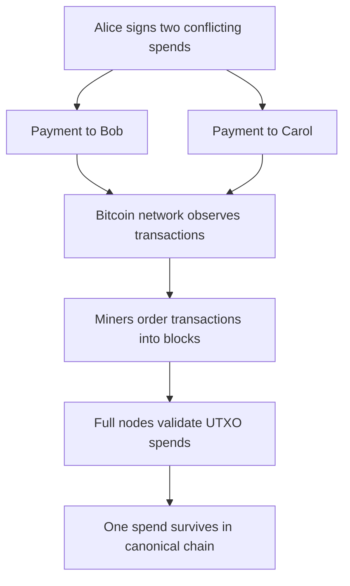
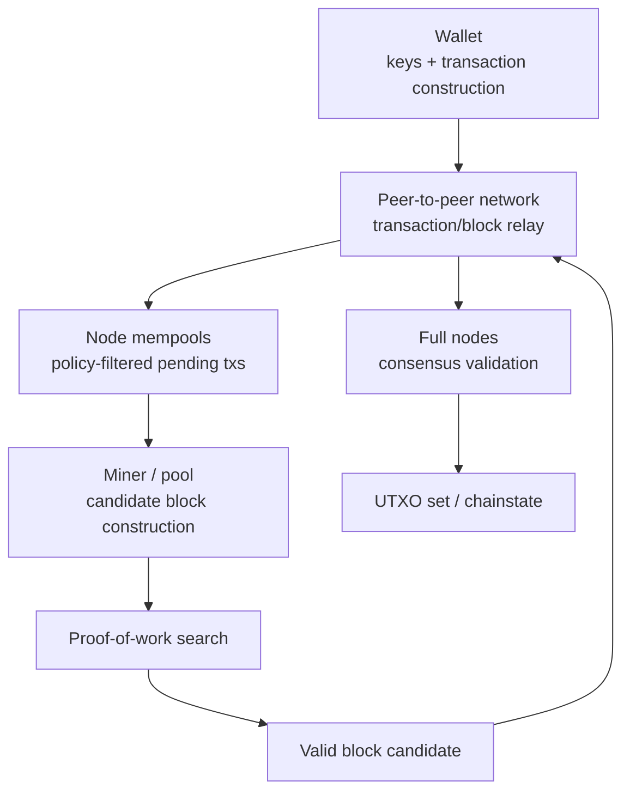
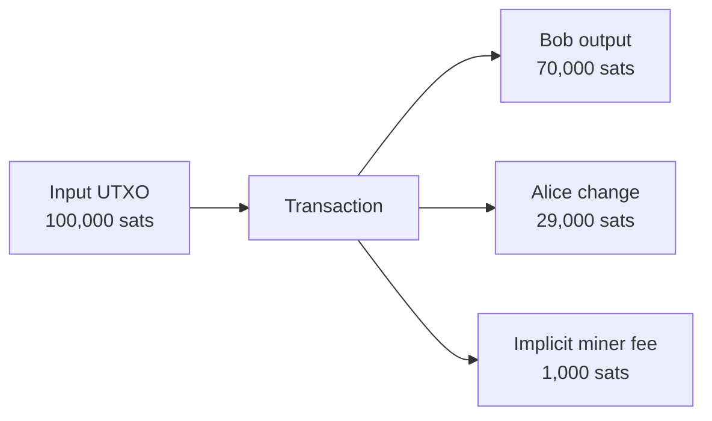
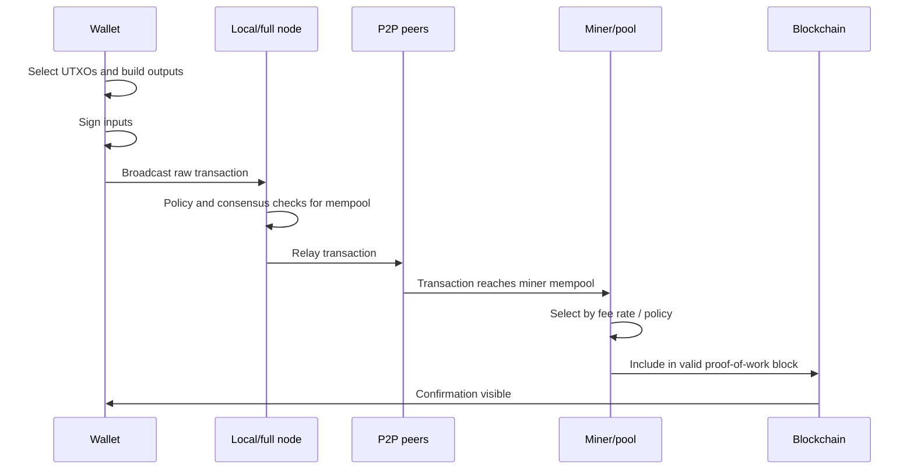
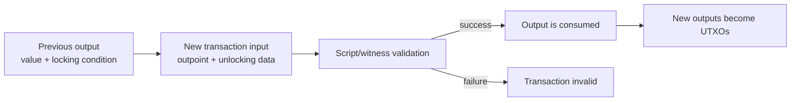
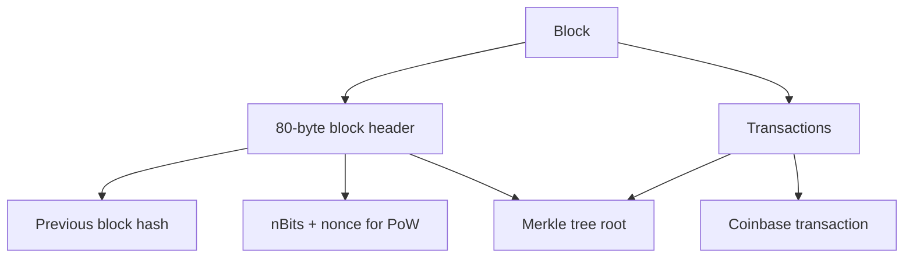
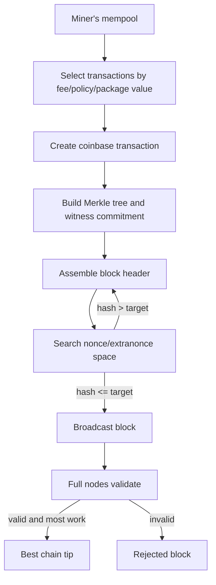

# Bitcoin

Last verified: 2026-07-29.

Bitcoin is a peer-to-peer monetary settlement network whose native asset, BTC, is issued and transferred according to consensus rules enforced by independently validating nodes. Its core technical design combines a UTXO ledger, proof-of-work block production, hash-linked blocks, digital signatures, a constrained scripting language, and a peer-to-peer gossip network. The original white paper framed Bitcoin as electronic cash that avoids a trusted intermediary for double-spend prevention; current Bitcoin is best understood as a conservative, globally replicated settlement system for scarce digital units, with payments, custody, privacy, and scaling often handled by wallets and higher-layer protocols rather than by expressive base-layer smart contracts.[^bitcoin-whitepaper]

A distinction between Bitcoin's original design and its current protocol is essential. The white paper described a chain of digital signatures, proof-of-work timestamps, longest-chain selection, incentives, Merkle proofs, and simplified payment verification. Current Bitcoin includes later consensus changes such as pay-to-script-hash, SegWit, relative locktimes, Taproot, Schnorr signatures, and Tapscript. It also includes implementation and relay policies in Bitcoin Core that are important in practice but are not always consensus rules.

## Executive Summary

Bitcoin solves one narrow problem extremely carefully: it lets a decentralized network agree on the ownership and transfer history of BTC without a central mint, bank, or payment processor. The system does this by making every valid coin spend reference a previous unspent transaction output, requiring the spender to satisfy that output's spending condition, and ordering transactions in proof-of-work blocks so the network can reject double-spends.

The main architectural idea is that miners propose blocks, but full nodes enforce the rules. Miners can choose which valid transactions to include, and a majority of hash power can reorganize recent history or censor transactions. Miners cannot make full nodes accept invalid inflation, invalid signatures, or invalid spends unless those nodes change their rules.

Bitcoin's base layer is intentionally limited. It does not have a general-purpose persistent smart-contract state like Ethereum. It has Bitcoin Script, a deliberately constrained stack language used to define spending conditions for UTXOs. This makes Bitcoin programmable in a narrow but important sense: multisignature custody, timelocks, hashlocks, escrow-like flows, payment channels, Taproot script paths, and atomic swaps are all possible. It is not a general application platform by base-layer design.

Bitcoin's monetary policy is also unusually explicit. New BTC are issued through the block subsidy, which halves every 210,000 blocks. Because the subsidy is a geometric series measured in satoshis, the practical maximum supply is just under 21 million BTC. Over time, security funding shifts from subsidy toward transaction fees. Whether a fee-only security budget will be sufficient in the long run is an open economic question, not a settled protocol guarantee.

## Historical Motivation And Problem Statement

The white paper begins from a payment problem rather than a general blockchain problem. Internet commerce relied on financial institutions as trusted intermediaries. Those intermediaries prevent double-spending, mediate disputes, reverse payments, and maintain records. This works, but it means online payments are not equivalent to handing over physical cash: settlement is mediated, reversible, and dependent on a trusted third party.[^bitcoin-whitepaper]

Digital signatures alone do not solve digital cash. If Alice signs a message saying "pay Bob 1 coin," Bob can verify that Alice authorized the message. But Bob cannot know whether Alice also signed another message spending the same coin to Carol unless there is a shared record of all spends. Earlier digital-cash systems often relied on a central mint or bank to keep that record.

Bitcoin replaces the trusted mint with a public ordering mechanism:

1. Transactions are broadcast.
2. Miners collect transactions into candidate blocks.
3. Miners perform proof of work.
4. The network accepts valid blocks in the greatest-cumulative-work chain.
5. Full nodes reject transactions that spend already-spent outputs.



Bitcoin is therefore a settlement system more than a payment-message system. A payment message says what someone wants to happen. Bitcoin settlement is the inclusion of a valid spend in a proof-of-work history that the network recognizes as canonical.

## Core Design Principles

Bitcoin's design is conservative because base-layer changes affect the validity of money. Its principles are not written as one formal constitution, but they emerge from the protocol and development culture.

| Principle | Technical meaning | Consequence |
|---|---|---|
| Independent verification | Users can run full nodes that verify blocks and transactions | Miners and service providers do not define validity alone |
| Scarce native asset | BTC issuance follows consensus rules | Inflation cannot occur unless validating nodes accept changed rules |
| Simple base layer | Script and state are constrained | Fewer application features, smaller consensus surface |
| Proof-of-work ordering | Work-weighted chain resolves history | Security depends on hash power economics |
| Backward-compatible upgrades where possible | Soft forks tighten rules | Protocol evolves slowly and cautiously |
| Pseudonymous public ledger | Transactions are public, identities are not native | Auditability with limited privacy |

The system's restraint is part of its architecture. Bitcoin does not try to make every financial application easy on-chain. Instead, it provides a minimal settlement base that wallets, custodians, Lightning channels, sidechains, and overlay protocols can build around.

## Monetary Design

BTC is the native asset of Bitcoin. It is not issued by a company or central bank. New BTC are created only when a valid coinbase transaction claims the permitted block subsidy plus transaction fees for a block.

The smallest standard unit is a satoshi:

```text
1 BTC = 100,000,000 satoshis
```

Bitcoin's initial distribution happened through mining rather than through a complete genesis allocation. This matters because miners had to expend work over time to receive newly issued BTC. The white paper analogized this to gold miners expending resources to add gold to circulation.[^bitcoin-whitepaper]

### Subsidy Schedule And 21 Million Limit

The block subsidy began at 50 BTC per block and halves every 210,000 blocks. Let `n` be the halving epoch starting at 0. The subsidy in BTC during epoch `n` is:

```text
subsidy_n = 50 / 2^n
```

Each epoch has 210,000 blocks, so the idealized total supply is the geometric series:

```text
total = 210,000 * 50 * (1 + 1/2 + 1/4 + ...)
      = 10,500,000 * 2
      = 21,000,000 BTC
```

In actual Bitcoin consensus, subsidy is denominated in integer satoshis and eventually rounds down to zero. This makes the maximum slightly less than exactly 21 million BTC.

| Term | Meaning |
|---|---|
| Block subsidy | Newly created BTC allowed in a block's coinbase transaction |
| Transaction fees | Input value minus output value across included transactions |
| Block reward | Subsidy plus transaction fees |
| Halving | Programmed subsidy reduction every 210,000 blocks |
| Issued supply | BTC created by valid coinbase transactions |
| Circulating supply | Issued BTC not provably unissued; may include lost coins |
| Accessible supply | BTC whose keys are still controlled by someone |
| Lost coins | BTC whose private keys are lost or provably unspendable |

### Monetary Inflation vs Price Inflation

Monetary inflation means growth in BTC supply. Price inflation means a decline in purchasing power relative to goods or currencies. Bitcoin's monetary issuance schedule is deterministic under current consensus rules; BTC's purchasing power is market-driven and volatile.

Bitcoin can have low monetary inflation while its fiat price falls, or declining issuance while its purchasing power rises. These are different concepts.

### Security Budget Transition

Bitcoin's security budget has two sources:

- block subsidy;
- transaction fees.

As subsidy declines, fees must become more important if miners are to receive enough revenue to make attacks expensive. This transition is not mechanically guaranteed. It depends on future blockspace demand, BTC price, fee-market behavior, miner costs, and attack incentives.

> **Open question:** Bitcoin's long-term fee-only security model is debated. The protocol guarantees the subsidy schedule; it does not guarantee that future users will pay enough fees to replace declining subsidy revenue.

## System Architecture

Bitcoin has a simple architecture compared with smart-contract platforms.



The important separation is between proposing and validating:

- wallets construct and sign transactions;
- nodes relay and validate transactions/blocks;
- miners construct candidate blocks and perform proof of work;
- full nodes enforce consensus rules;
- wallets and lightweight clients may depend on full nodes for data;
- mining pools coordinate hash power but do not define validity rules by themselves.

## Bitcoin Data Model: UTXOs

Bitcoin uses the unspent transaction output model. A UTXO is a discrete spendable output created by a previous transaction and not yet spent by any later transaction.

Ownership in Bitcoin means the ability to satisfy a UTXO's spending condition. A UTXO does not contain a real-world identity. It contains a value and a script condition. Whoever can provide unlocking data that makes the script evaluate successfully can spend it.

### Outputs, Inputs, And Outpoints

A transaction output contains:

- a value in satoshis;
- a locking script, also called `scriptPubKey`.

A transaction input references a previous output and provides unlocking data. The reference is called an outpoint:

```text
outpoint = (previous_transaction_id, output_index)
```

Simplified transaction structure:

```text
Transaction {
  version
  inputs: [
    {
      previous_txid
      previous_output_index
      scriptSig / unlocking data
      sequence
      witness?        // SegWit transactions
    }
  ]
  outputs: [
    {
      value_satoshis
      scriptPubKey / locking condition
    }
  ]
  locktime
}
```

### Fees And Change

Bitcoin fees are not a separate field. A transaction fee is the difference between total input value and total output value:

```text
fee = sum(inputs spent) - sum(outputs created)
```

If Alice spends a 100,000 satoshi UTXO to pay Bob 70,000 sats and wants to pay a 1,000 sat fee, her wallet creates a change output of 29,000 sats.



Coin selection is the wallet problem of choosing which UTXOs to spend. It affects fees, privacy, and future wallet usability. Combining many small UTXOs increases transaction size and may reveal common ownership.

### UTXO Set

The UTXO set is the current set of all unspent outputs. Full nodes use it to validate new transactions. If a transaction tries to spend an output not in the UTXO set, it is invalid.

The UTXO set is more important for validation than full historical transaction data. A node needs historical blocks to bootstrap and audit, but current transaction validation depends on knowing what outputs are unspent.

### Dust

Dust is an output so small that spending it may cost more in fees than the value it contains. Dust is not only an economic nuisance; it can bloat the UTXO set. Bitcoin Core relay policy discourages dust outputs, but policy rules are not always consensus rules.

## Transaction Identifiers, SegWit, And Malleability

Legacy Bitcoin transaction IDs are double-SHA256 hashes of the traditional serialized transaction. Before SegWit, signatures were part of the data that determined the txid. Because ECDSA signatures and script encodings could be modified in ways that did not change the economic effect, transaction IDs could be malleated.

SegWit introduced a witness structure and two identifiers:

- **txid:** hash of the traditional serialization without witness data;
- **wtxid:** hash of the serialization including witness data.[^bip141]

This matters for protocols that depend on unconfirmed transaction chains, such as payment channels. If a transaction ID can change after signing, later transactions that reference it may break.

SegWit moved signatures and scripts needed for validation into witness data and committed witness data separately through the coinbase transaction. It also introduced block weight, where witness data receives discounted weight. BIP141 defines block weight as:

```text
block_weight = base_size * 3 + total_size
```

and limits block weight to 4,000,000 weight units.[^bip141]

## Bitcoin Transactions In Detail

Bitcoin transaction validity has two layers:

- **consensus validity:** rules all full nodes enforce for blocks;
- **standardness / relay policy:** stricter policy many nodes use for mempool relay and mining selection.

A transaction can be consensus-valid but non-standard, meaning it might be accepted in a block if mined but not relayed by ordinary nodes.

### Transaction Structure And Serialization

A Bitcoin transaction is not a command such as "move 1 BTC from Alice to Bob." It is a serialized object that proves the right to spend specific previous outputs and creates new outputs with new spending conditions.

| Component | Technical role | Important consequences |
|---|---|---|
| `version` | Selects transaction format/rule interpretation | Enables later rule extensions |
| Input count | CompactSize integer | Determines how many previous outputs are consumed |
| Inputs | Reference previous outpoints and provide spending data | Spending is anchored to exact historical outputs |
| Output count | CompactSize integer | Determines how many new outputs are created |
| Outputs | Amount in satoshis plus locking script | Creates new UTXOs if confirmed |
| `locktime` | Earliest time or block height at which transaction is final | Supports delayed settlement patterns |
| Witness marker/flag | SegWit serialization indicator | Present only in witness serialization |
| Witness fields | Per-input witness stack items | Carries signatures/scripts outside the legacy `txid` commitment |

An input contains an outpoint, a script field, a sequence number, and, for SegWit spends, associated witness data. The outpoint is the pair `(previous_txid, output_index)`. This exactness is what lets independent nodes detect double-spends: two transactions that try to spend the same outpoint cannot both be valid in the same best chain.

```text
Transaction {
  version: int32
  inputs: [
    {
      previous_output: { txid: bytes32, vout: uint32 }
      scriptSig: bytes
      sequence: uint32
      witness: [bytes, ...]   // SegWit serialization only
    }
  ]
  outputs: [
    {
      value: int64_satoshis
      scriptPubKey: bytes
    }
  ]
  locktime: uint32
}
```

The sequence number originally supported replacement semantics and later became part of relative timelock mechanisms. `locktime` can express either a block height or a timestamp depending on its value. These fields matter because Bitcoin's programmability often comes from carefully composing signatures, hashlocks, and time constraints rather than from persistent contract state.

### Lifecycle



Mempools are local, not global. Different nodes may have different pending transactions because of timing, policy, memory limits, eviction, fee filters, or network topology.

### Fee Rates, RBF, CPFP, And Packages

Miners care about revenue per scarce block resource. Wallets usually express fee rate in satoshis per virtual byte:

```text
fee_rate = fee_satoshis / virtual_size_vbytes
```

Replace-by-Fee (RBF) lets a wallet replace an unconfirmed transaction with a conflicting version paying a higher fee, subject to node policy. Child Pays for Parent (CPFP) lets a later transaction spend an unconfirmed output and pay a high fee, incentivizing miners to include both parent and child.

Package relay and package mining are practical areas of ongoing policy engineering: miners and nodes may evaluate groups of related transactions together rather than one transaction at a time. These details are implementation/relay policy unless made consensus-critical.

### Reorg Effects

If a confirmed transaction is in a block that becomes stale during a reorganization, the transaction may return to the mempool if still valid, or disappear if it conflicts with the winning chain.

Coinbase transactions have a 100-block maturity rule before their outputs can be spent. This protects against spending rewards from blocks that may later become stale.[^bitcoin-dev-blockchain]

## Script And Programmability

Bitcoin Script is a stack-based language used to define spending conditions. It is deliberately constrained: no unbounded loops, limited operation set, and no general-purpose persistent contract storage.

A Bitcoin "contract" is usually a condition for spending a UTXO, not a program that lives on-chain and wakes up independently.

### Locking And Unlocking

An output locks coins with a script. An input spends that output by providing unlocking data.

In legacy pay-to-public-key-hash (P2PKH):

- the output script says, in effect, "provide a public key whose HASH160 matches this hash, and a valid signature from that key";
- the input provides a signature and public key.

Simplified legacy evaluation can be understood as concatenating unlocking data with the locking script and running a stack machine. Modern SegWit and Taproot forms separate more data into witness structures, but the conceptual pattern remains: spending succeeds only if script evaluation ends successfully under consensus rules.

```text
Initial stack: []
scriptSig pushes: [signature, public_key]
scriptPubKey checks:
  DUP HASH160 <pubkey_hash> EQUALVERIFY CHECKSIG
Result:
  valid only if HASH160(public_key) matches and signature verifies
```



### Common Script Templates

| Template | Meaning |
|---|---|
| P2PK | Pay to a public key |
| P2PKH | Pay to a public-key hash |
| P2SH | Pay to a script hash; redeem script revealed at spend time |
| P2WPKH | Native SegWit pay-to-witness-public-key-hash |
| P2WSH | Native SegWit pay-to-witness-script-hash |
| P2TR | Taproot output, supporting key-path and script-path spending |

### Timelocks And Hashlocks

Timelocks restrict when a UTXO can be spent. Hashlocks require revealing a preimage to a hash.

Together, timelocks and hashlocks support atomic swaps and payment-channel constructions. For example, a hash time-locked contract can let Alice claim funds if she reveals a secret before a deadline, while Bob can refund after the deadline if she does not.

### Taproot, Schnorr, And Tapscript

Taproot is a deployed soft-fork upgrade specified across BIP340, BIP341, and BIP342.[^bip340][^bip341][^bip342]

It introduced:

- Schnorr signatures for Taproot spends;
- key-path spending, where a Taproot output can be spent as if it were a single public key;
- script-path spending, where hidden script branches can be revealed only if needed;
- MAST-style commitments to script alternatives;
- Tapscript changes to script semantics for version 1 witness programs.

The practical effect is that many complex spending policies can look like a simple key spend in the cooperative case. This improves privacy and efficiency, while preserving fallback scripts for non-cooperative cases.

## Blocks And Chain Structure

A Bitcoin block contains a block header and transactions. The header is 80 bytes and includes:

| Field | Purpose |
|---|---|
| Version | Signals block validation features |
| Previous block hash | Links to parent block |
| Merkle root | Commits to transaction list |
| Time | Block timestamp |
| nBits | Compact target representation |
| Nonce | Field miners vary during hashing |

The first transaction must be the coinbase transaction. It creates the block subsidy and collects fees. Miners also use the coinbase script area as an extra nonce space to vary the Merkle root when the 32-bit header nonce is exhausted.



The Merkle root commits to all transaction IDs in the block. Full transactions are still stored/relayed because validating nodes need transaction data to check signatures, scripts, UTXO spends, and fees. The Merkle root is a compact commitment, not a replacement for validation data.

## Proof Of Work And Mining

Mining is brute-force search over block headers. The miner seeks a double-SHA256 hash of the header that is numerically below the current target.

```text
double_sha256(block_header) < target
```

Proof generation is expensive because the only practical method is trial and error. Verification is cheap because a node hashes the header once and checks the target.

### Candidate Block Construction

A miner or mining pool:

1. selects transactions, usually prioritizing fee rate and package economics;
2. constructs a coinbase transaction paying the subsidy and fees;
3. builds the Merkle root;
4. fills the header fields;
5. hashes repeatedly while varying nonce/extraNonce/time/transaction set;
6. broadcasts the block if a valid hash is found.

### Difficulty Adjustment

Bitcoin retargets difficulty every 2,016 blocks. The target interval is:

```text
2016 blocks * 10 minutes = 20,160 minutes = 1,209,600 seconds
```

If blocks were found too quickly, difficulty rises. If too slowly, difficulty falls, subject to retargeting constraints. Bitcoin developer documentation notes an implementation off-by-one detail in how timestamps are used for retargeting.[^bitcoin-dev-blockchain]

### Block Discovery Distribution

Mining attempts are independent Bernoulli trials with very low success probability. Block discovery is therefore stochastic. The expected interval is about 10 minutes, but actual intervals vary widely and are commonly modeled with an exponential distribution.

This variance is why confirmations are probabilistic and why mining pools exist.

### Mining Pools

Mining pools let miners share revenue. The pool creates block templates and miners search for valid shares. A share is proof that a miner performed work at an easier target than the network target. Pool payout methods vary, but the basic purpose is income smoothing.

Pool centralization can affect censorship and block-template construction. Hash power may be owned by many miners but coordinated by fewer pools.

| Payout model | Intuition | Risk distribution |
|---|---|---|
| PPS | Pool pays a fixed amount per valid share | Pool absorbs more block-discovery variance |
| PPLNS | Miners are paid when the pool finds blocks, based on recent shares | Miners absorb more variance |
| FPPS | Similar to PPS but estimates subsidy plus transaction-fee revenue | Pool prices fee variance into payouts |

Mining profitability can be approximated as:

```text
expected_daily_revenue =
  (miner_hashrate / network_hashrate)
  * expected_blocks_per_day
  * (subsidy + expected_fees)
  * BTC_price

profit =
  revenue - electricity_cost - hosting_cost - hardware_depreciation - pool_fees
```

This equation hides important practical complexity. ASIC miners are specialized machines, so hardware efficiency, access to cheap electricity, cooling, uptime, firmware, financing, and regulatory risk all affect real profitability. Pool participation reduces income variance but can concentrate block-template construction and censorship power.

## Consensus And Validation

Consensus rules are the rules that full nodes use to decide whether blocks and transactions are valid.

Validation includes:

- proof-of-work target;
- block header linkage;
- block weight and structure;
- coinbase rules;
- subsidy and fee correctness;
- transaction syntax;
- UTXO existence;
- no double-spends within block/chain;
- script execution;
- signature checks;
- locktime/sequence rules;
- soft-fork rules such as SegWit and Taproot.

Valid chain selection follows the greatest cumulative proof-of-work chain among valid chains, not merely the chain with the most blocks.

Validation is deliberately redundant across the network. When a new block arrives, a full node does not trust the miner, the peer that relayed the block, or a block explorer. It recomputes the checks locally. The node verifies the header, confirms the proof-of-work target, checks that the block builds on a known valid chain, validates every transaction, updates a temporary view of the UTXO set, and only then accepts the block as part of a candidate best chain.

Simplified block-validation flow:

```text
validate_block(block):
  check_header_syntax(block.header)
  check_proof_of_work(block.header)
  check_previous_block_known_and_valid(block.header.prev_hash)
  check_block_weight_and_structure(block)
  check_coinbase_is_first_and_unique(block)

  temporary_utxo_view = parent_chainstate.copy()
  total_fees = 0

  for tx in block.transactions:
    check_transaction_syntax(tx)
    if tx is not coinbase:
      check_inputs_exist_and_are_unspent(tx, temporary_utxo_view)
      check_scripts_and_signatures(tx)
      check_locktime_and_sequence(tx)
      total_fees += input_value(tx) - output_value(tx)
      spend_inputs_and_add_outputs(tx, temporary_utxo_view)

  check_coinbase_claim <= subsidy + total_fees
  commit_temporary_utxo_view_if_best_chain()
```

This pseudocode hides many edge cases, but it captures the causal structure. Consensus is not a vote over whether a block "looks legitimate." It is deterministic rule execution by each node. If two nodes implement different consensus behavior, they may diverge even if they are connected to the same peers.

### Miners Cannot Unilaterally Change Supply

If a miner creates a block claiming more subsidy than allowed, full nodes reject it. Even if many miners mine on top of it, nodes enforcing the existing rules treat that branch as invalid.

This is the core separation of power:

- miners provide ordering and proof-of-work;
- full nodes define what counts as valid under their software rules;
- economic actors decide which valid chain's BTC they recognize and trade.

A useful fake scenario makes the distinction concrete. Suppose a mining pool publishes a block with a coinbase transaction paying itself 100 BTC when the permitted subsidy is far lower. Other miners may see the block first, and some poorly configured systems may display it briefly. Full nodes that enforce Bitcoin consensus rules reject it immediately because the coinbase overclaims. From those nodes' perspective, the block is not a controversial block, a low-quality block, or a block that needs more confirmations. It is invalid data.

The same logic applies to invalid signatures and double-spends. Hash power can change ordering among valid histories. It cannot make a transaction spend Alice's UTXO without Alice satisfying the UTXO's locking condition.

### Forks And Upgrades

A hard fork loosens or changes rules so non-upgraded nodes may reject new blocks. A soft fork tightens rules so upgraded nodes reject some blocks older nodes might accept. Bitcoin has generally preferred soft forks for consensus upgrades.

Activation mechanisms have included flag days, miner signaling, and user-activated pressure. Bitcoin governance is social and off-chain: BIPs, mailing-list discussion, implementation review, miner signaling, node adoption, wallet/exchange/custodian behavior, and economic consensus all matter.

## Network Layer

Bitcoin uses a peer-to-peer network. New transactions and blocks are broadcast on a best-effort basis. The white paper explicitly described messages as not needing to reach every node; if they reach many nodes, they can be included, and missing blocks can be requested later.[^bitcoin-whitepaper]

Network functions include:

- peer discovery;
- transaction relay;
- block relay;
- compact block relay;
- header-first synchronization;
- initial block download;
- DoS controls;
- mempool admission policy;
- relay fee filtering.

Broadcasting is probabilistic rather than globally ordered. Nodes see messages at different times. Consensus emerges not because every node sees every transaction simultaneously, but because proof-of-work blocks impose a canonical order after the fact.

The network therefore has two different notions of "seen":

- **Seen by a node's mempool:** the node received a transaction, checked it against policy, and decided to keep it temporarily.
- **Seen by consensus:** the transaction appeared in a valid block on the best chain.

Only the second status settles anything. A transaction in many mempools may still never confirm if its fee is too low, if it conflicts with a higher-fee transaction, or if miners choose not to include it. A transaction in no public mempool can still confirm if it is sent directly to a miner.

Initial Block Download is also more than downloading files. A new full node verifies the entire historical chain from genesis, reconstructs the current UTXO set, and arrives at the same chainstate as other honest nodes. This is the process that gives a node independent knowledge of validity rather than borrowed trust from a service provider.

### Network Attacks

| Attack | Mechanism | Mitigation direction |
|---|---|---|
| Eclipse attack | Isolate node among attacker peers | Better peer selection, diverse connections |
| Sybil attack | Create many fake peers | Resource limits and peer-management policy |
| DoS attack | Flood nodes with expensive data | Relay policy, validation caching, limits |
| Block withholding | Pool miner withholds valid blocks | Pool monitoring and payout design |
| Censorship | Miners/pools exclude transactions | Miner decentralization, fee incentives, alternative relay paths |

An eclipse attack is especially important for lightweight wallets and newly started nodes. If an attacker controls all of a victim's peer connections, the attacker can delay blocks, hide transactions, feed stale headers, or make a zero-confirmation payment look safer than it is. The attacker still cannot make a fully validating victim accept invalid blocks, but they can distort the victim's view of what the rest of the network has seen.

## Node Types And Storage

| Node/wallet type | Verification level | Storage pattern | Main limitation |
|---|---|---|---|
| Archival full node | Full validation | Keeps full block history | Disk and sync cost |
| Pruned full node | Full validation | Discards old block data after validation | Limited historical serving |
| SPV/light client | Header and Merkle proof verification | Stores headers, queries peers | Cannot fully validate all rules |
| Mining node | Builds blocks, often via pool infrastructure | Needs mempool/block template data | May rely on full node |
| Watch-only wallet | Tracks addresses without private keys | Depends on node/indexer | Cannot spend |
| Hardware wallet | Signs transactions in isolated device | Stores keys, not full chain | Needs host/node data |

SPV, described in the white paper, verifies proof-of-work headers and Merkle inclusion but does not independently check all transaction validity rules.[^bitcoin-whitepaper] Businesses accepting frequent or high-value payments are better served by full validation.

Full nodes maintain several conceptually distinct datasets:

- **Block files:** raw blocks, or a pruned subset for pruned nodes.
- **Block index:** metadata about known headers, chain work, and block relationships.
- **Chainstate / UTXO database:** the current set of spendable outputs needed for validation.
- **Mempool:** local unconfirmed transactions accepted under policy.
- **Peer/address database:** information used for network connectivity.

This separation matters because "having the blockchain" is not the same thing as "being able to validate from scratch." A pruned node can validate the whole chain during initial sync and then discard old block bodies, while an archival node keeps historical block data available for serving peers or analysis.

## Cryptography

Bitcoin's cryptographic toolbox includes:

- SHA-256 and double-SHA256 for proof-of-work and identifiers;
- RIPEMD-160 in HASH160 address constructions;
- ECDSA over secp256k1 for legacy signatures;
- Schnorr signatures over secp256k1 for Taproot;
- Merkle trees for transaction commitments;
- Base58Check, Bech32, and Bech32m address encodings.

### Keys And Wallets

A private key controls spending authority. A public key is derived from the private key. Addresses encode destinations or spending programs.

Hierarchical deterministic wallets use seed material to derive many keys. Relevant standards include BIP32 for HD wallets, BIP39 for mnemonic seed phrases, and BIP44 for multi-account path conventions.[^bip32][^bip39][^bip44]

Address formats are encodings, not accounts. A Base58Check P2PKH address, a P2SH address, a Bech32 SegWit address, and a Bech32m Taproot address are different ways to encode spending programs or hashes of spending programs. Coins are never "inside" an address in the database; UTXOs contain scripts, and wallets interpret addresses as instructions for constructing those scripts.

| Encoding / standard | Typical use | Design note |
|---|---|---|
| Base58Check | Legacy P2PKH/P2SH | Avoids visually confusing characters and includes checksum |
| Bech32 | SegWit v0 addresses | Lowercase-friendly, stronger error detection |
| Bech32m | SegWit v1+ such as Taproot | Modified checksum for newer witness versions |

Key loss is final at the protocol layer. Bitcoin has no native account recovery. Custody models therefore matter:

- self-custody;
- hardware wallets;
- multisignature custody;
- institutional custody;
- watch-only monitoring;
- timelocked recovery paths.

### Signature Nonce Risk

ECDSA signatures require secure nonces. Reusing or leaking nonce material can reveal private keys. Schnorr signatures also require careful nonce handling, although the algebra and aggregation properties differ.

The reason nonce reuse is catastrophic is that an ECDSA signature is an equation involving the private key and a per-signature secret nonce. If two signatures reuse the same nonce with different messages, the equations can be combined to solve for the private key. This is not a theoretical nuisance; it is one of the classic ways real cryptocurrency keys have been lost.

Good wallet implementations use deterministic nonce generation or carefully audited randomness. Hardware wallets reduce exposure by keeping private keys inside a dedicated signing device, but the user must still verify what the device is signing. A hardware wallet that signs the wrong destination address because the host interface misled the user has not protected the user from the economic loss.

## Privacy And Transparency

Bitcoin is pseudonymous, not anonymous. The ledger is public. Addresses are not real-world identities by default, but transaction graph analysis can cluster addresses and infer behavior.

Privacy weaknesses include:

- address reuse;
- multi-input transactions linking ownership;
- change-output heuristics;
- exchange/custodian KYC links;
- timing and amount correlation;
- public UTXO graph analysis.

Privacy-improving techniques include:

- using a new address per payment;
- CoinJoin;
- PayJoin;
- avoiding unnecessary input consolidation;
- Lightning payments for some use cases;
- careful wallet coin selection.

Privacy claims must be qualified. CoinJoin and Lightning can improve privacy in specific ways, but neither makes all activity anonymous.

Common heuristics used by chain-analysis systems include:

| Heuristic | Intuition | Failure mode |
|---|---|---|
| Common-input ownership | Inputs in one transaction are likely controlled by one wallet | CoinJoin intentionally breaks this assumption |
| Change detection | One output looks like wallet change rather than recipient payment | Wallet design can obscure or accidentally reveal change |
| Address reuse | Same address repeatedly receives funds | Strongly links activity |
| Amount correlation | Similar amounts appear across transactions/services | Rounded payments and batching can confuse analysis |
| Timing correlation | Deposit and withdrawal times line up | Delays and batching reduce confidence |

Privacy is also affected by network-layer behavior. Broadcasting a transaction directly from a personal node can reveal IP-level metadata to peers or surveillance infrastructure. Using Tor, a trusted node, or a wallet provider changes the privacy model rather than eliminating it.

## Scaling And Higher Layers

Bitcoin base-layer throughput is constrained by block interval, block weight, propagation, validation, and storage. Increasing capacity directly can pressure decentralization by raising resource requirements for full nodes.

The main scaling tension is that every base-layer transaction must be downloaded, validated, and stored or at least processed by validating nodes. A larger block can include more transactions, but it also takes longer to propagate and increases bandwidth and storage requirements. Longer propagation increases stale-block risk for miners, which can favor miners with better network connectivity. Higher node requirements can reduce the number of people able to run full nodes independently.

Bitcoin therefore tends to treat base-layer blockspace as scarce settlement capacity rather than as a high-throughput retail payment rail. Scaling approaches either make each on-chain byte carry more economic activity or move repeated interactions to protocols that settle on-chain only occasionally.

Scaling approaches include:

- SegWit and block weight;
- batching multiple payments into one transaction;
- fee estimation and fee bumping;
- Lightning Network payment channels;
- sidechains and federated sidechains;
- overlay protocols such as Ordinals and BRC-style conventions;
- research into covenants, validity proofs, drivechains, and other proposals.

### Lightning Network

Lightning uses payment channels. Users lock funds in on-chain transactions and exchange signed off-chain updates. Hash time-locked contracts help route payments across channels.

Lightning improves payment throughput for suitable use cases, but introduces liquidity, routing, channel management, watchtower, and online-availability considerations.

### Ordinals And Inscriptions

Ordinals and inscriptions are overlay conventions that use Bitcoin transaction data to assign meanings to satoshis or attach data. They are not native token systems in the way ERC-20 tokens are native smart-contract state on Ethereum. Their validity depends on off-chain interpretation rules layered on top of Bitcoin transactions.

## Governance And Development

Bitcoin has no formal on-chain governance. Changes emerge through:

- BIPs;
- Bitcoin Core and other implementation work;
- code review;
- bitcoin-dev mailing-list discussion;
- miner signaling where relevant;
- node adoption;
- wallet/exchange/custodian support;
- economic user consensus.

Bitcoin Core is influential but not sovereign. It is a widely used implementation, not the protocol itself. Protocol conservatism and ossification are debated: stability protects monetary rules, but excessive rigidity may make useful changes difficult.

Historically important soft-fork patterns include:

| Upgrade pattern | Example | Activation lesson |
|---|---|---|
| Miner signaling with threshold | Earlier versionbits-style deployments | Useful when miners are expected to coordinate honestly |
| User pressure / user-activated logic | SegWit activation debate | Economic nodes can matter when miner signaling stalls |
| Speedy Trial-style activation | Taproot | Short signaling window used after broad social agreement |

Consensus rules and relay policies should be kept separate in analysis. A wallet's transaction may fail to propagate because it violates standardness policy even though it could be mined by a miner willing to include it. Conversely, no miner can make a consensus-invalid block valid by policy choice.

## Additional Technical Deep Dives

### Standardness, Policy, And Consensus Boundaries

Bitcoin consensus rules define the set of blocks that all validating nodes must accept or reject. Relay policy defines what a particular node is willing to keep in its mempool and forward to peers. The difference protects decentralization: node operators can defend bandwidth and memory resources without changing the money rules.

Policy includes dust thresholds, script template preferences, minimum relay fees, replacement behavior, package acceptance, and anti-denial-of-service checks. These policies are allowed to differ across implementations and versions. Consensus rules are deliberately harder to change because a disagreement in consensus validation can split the network.

### Security Budget And Fee-Market Pressure

Bitcoin's security budget is the total value paid to miners through subsidy and fees. The subsidy declines by schedule; fees depend on demand for block space. The long-run security question is therefore not a purely cryptographic question. It depends on whether users continue to pay enough for settlement, whether miners remain economically incentivized to follow the rules, and whether fee volatility creates incentives for attacks such as fee sniping.

Fee sniping is a strategy where a miner tries to reorganize a recent block to capture unusually high fees. It is generally discouraged by the risk of losing current mining opportunities, but the incentive becomes more relevant when fees dominate rewards and large fee spikes occur.

### Attack Capability Matrix

| Attacker capability | Can do | Cannot do under normal consensus rules |
|---|---|---|
| Stolen private key | Spend affected UTXOs | Spend unrelated UTXOs |
| Miner censorship | Delay or exclude transactions while controlling block production | Make invalid signatures valid |
| Hash-rate majority | Reorganize recent blocks, double-spend own transactions, censor | Create coins above allowed subsidy, steal arbitrary coins |
| Eclipse attacker | Distort a victim's network view | Convince all honest full nodes to accept invalid blocks |
| Software supply-chain attacker | Potentially compromise users running malicious binaries | Change rules for users who do not run compromised code |

The common thread is that Bitcoin separates proposal power from validation power. Miners propose blocks, but full nodes define validity from the user's perspective.

## Expanded Bitcoin Topic Map

The previous sections explain the main system from top to bottom. This section expands specific concepts that are easy to compress too much: the monetary schedule, exact transaction mechanics, Script templates, mining operations, relay behavior, privacy, and higher-layer designs.

### Monetary Units, Issuance, And Supply Accounting

BTC is the native unit tracked by Bitcoin consensus rules. The protocol does not maintain "account balances"; wallets derive balances by scanning the UTXO set for outputs they can spend. One bitcoin is divisible into 100,000,000 satoshis. Consensus amounts are integer satoshis, which avoids floating-point rounding ambiguity.

New BTC enters circulation only through the coinbase transaction of a valid block. A coinbase transaction is special because it has no ordinary input; instead, it is allowed to create up to the current block subsidy plus the transaction fees collected from the block's included transactions. If a miner creates too much value, full nodes reject the block.

The gradual issuance schedule served several purposes:

- it distributed coins over time to miners who contributed proof of work;
- it bootstrapped miner revenue before a mature fee market existed;
- it avoided requiring every coin to be allocated by a founding party at genesis;
- it created a predictable declining issuance path.

The maximum supply is derived from a geometric series:

```text
initial_subsidy = 50 BTC
halving_interval = 210,000 blocks
max_supply ~= 210,000 * (50 + 25 + 12.5 + ...)
           = 210,000 * 100
           = 21,000,000 BTC
```

The exact implementation uses integer satoshis, so tiny rounding effects occur
in later eras, but “21 million” remains an accurate economic shorthand.

Supply vocabulary is often imprecise:

| Term | Meaning | Why it matters |
|---|---|---|
| Issued supply | BTC created under subsidy rules minus provably uncreated subsidy | Protocol accounting concept |
| Circulating supply | Coins believed economically available | Market-data estimate |
| Accessible supply | Coins whose keys are still controlled by someone | Not directly knowable |
| Lost coins | Coins whose private keys are unavailable | Economically unavailable but still counted on-chain |
| Spendable UTXOs | Unspent outputs satisfying consensus conditions | What wallets can actually spend |

Monetary inflation means increase in BTC units outstanding. Price inflation means a decline in purchasing power relative to goods, services, or other currencies. Bitcoin can have low monetary issuance while its market price still rises or falls sharply.

### Concrete UTXO Example: Payment With Change

Assume Alice's wallet controls one UTXO worth 100,000 sats. She wants to pay Bob 30,000 sats and chooses a fee of 1,500 sats.

```text
Input:
  UTXO_A = 100,000 sats

Outputs:
  Bob = 30,000 sats
  Alice change = 68,500 sats

Fee:
  100,000 - 30,000 - 68,500 = 1,500 sats
```

The change output is not a special protocol field. It is an ordinary output whose locking condition is controlled by Alice. If Alice reuses an old address for change, observers may infer that Bob received the other output. Good wallet design usually creates fresh change addresses.

Coin selection is the wallet algorithm that chooses which UTXOs to spend. It balances competing goals:

- minimize fees by using fewer/larger inputs;
- preserve privacy by avoiding unnecessary linking of unrelated UTXOs;
- avoid creating dust outputs;
- consolidate small UTXOs when fee rates are low;
- keep enough spendable denominations for future payments.

### Transaction Malleability Before And After SegWit

Transaction malleability means a transaction's identifier can change without changing its economic effect. In legacy transactions, signatures were part of the data hashed into the `txid`, and some signature/script encodings could be modified by third parties. This was especially problematic for protocols that build chains of unconfirmed transactions, because a child transaction references a parent's `txid`.

SegWit changed this by separating witness data from the legacy transaction identifier. The `txid` excludes witness data; the `wtxid` includes it. This does not remove every possible way to create alternative transactions, but it fixes the major third-party malleability problem for SegWit inputs and makes payment-channel protocols much more practical.

### Standardness Examples

Consensus-valid does not always mean easily relayable. Examples of policy-level concerns include:

- extremely small outputs that are uneconomic to spend, commonly called dust;
- unusually large or expensive scripts;
- replacement transactions that do not satisfy node RBF policy;
- packages that are individually low-fee but collectively high-fee;
- transactions that create denial-of-service pressure on mempools.

A miner can include a consensus-valid non-standard transaction directly in a block. Other nodes will accept the block if consensus rules are satisfied, even if those nodes would not have relayed the transaction through their mempools.

### Script Templates And Use Cases

P2PK, the earliest style, paid directly to a public key. P2PKH improved address usability by paying to a hash of a public key. P2SH moved complexity from the output to the spending moment: the output commits to a script hash, and the spender later reveals the redeem script. SegWit versions moved witness data out of the legacy `txid` commitment and introduced native witness programs. Taproot introduced P2TR, where cooperative spending can look like a single key spend even when fallback scripts exist.

| Construction | Building blocks | Typical use |
|---|---|---|
| Multisig | Multiple signatures required | Shared custody, treasury policies |
| Escrow-like script | Multisig plus timelock fallback | Dispute or timeout arrangements |
| Atomic swap | Hashlock plus timelock | Cross-chain exchange without a centralized custodian |
| Payment channel | Funding output plus pre-signed commitment transactions | Repeated off-chain payments |
| Taproot tree | Key path plus hidden script branches | Efficient cooperative spend with private fallback paths |

Bitcoin is therefore programmable, but its programming model is local to spending conditions. There is no global contract storage slot that later users can mutate. This is the key distinction from Ethereum-style smart contracts.

### Block Lifecycle



Miners update the coinbase transaction's extraNonce or transaction selection when the 32-bit header nonce space is exhausted. Changing the coinbase changes the Merkle root, creating a fresh search space. This is why mining is not limited by the small nonce field alone.

### Confirmation Depth And Reorg Risk

Confirmations count how many blocks include and build on top of a transaction. A transaction in the current tip has one confirmation. If five more blocks are added above it, it has six confirmations. More confirmations mean an attacker must replace more accumulated proof of work to remove the transaction.

The white paper models the probability of a successful catch-up attack as declining as confirmations increase, assuming honest miners control more hash power than the attacker.[^bitcoin-whitepaper] This is probabilistic settlement, not absolute finality. For small payments, merchants may accept zero or one confirmation. For large settlements, waiting longer reduces reorg risk.

### Mining Hardware, Energy, And Industrialization

Bitcoin mining evolved from CPUs to GPUs, FPGAs, and then ASICs. ASICs are application-specific integrated circuits optimized for SHA-256 hashing. Their efficiency made general-purpose hardware uncompetitive.

Energy use is not an accidental side effect; proof of work intentionally ties block production to a costly external resource. The security argument is that rewriting history requires repeating large amounts of work. The trade-off is that the system consumes electricity and becomes sensitive to energy markets, hardware supply chains, jurisdictional regulation, and mining-pool centralization.

### Specific Mining Attacks

| Attack | Mechanism | Practical constraint |
|---|---|---|
| Double spend | Pay merchant, then mine/release chain excluding payment | Requires enough hash power and target accepts insufficient confirmations |
| Selfish mining | Withhold blocks strategically to gain relative revenue | Depends on hash share and network propagation advantage |
| Block withholding | Pool participant submits shares but withholds valid blocks | Hurts pool; difficult to distinguish from bad luck at small scale |
| Censorship | Refuse to include selected transactions | Users may wait, use alternative relay, or rely on non-censoring miners |
| Fee sniping | Reorg high-fee recent block to capture fees | Competes with honest mining on next block |

Hash-rate majority does not grant arbitrary ledger control. It grants ordering and reorganization power within the boundaries enforced by validating nodes.

### Network Relay And Nondeterministic Ordering

Bitcoin has no global mempool and no canonical pre-block ordering. Transactions propagate through gossip. Nodes may receive the same transactions in different orders or not at all before a block is found. Consensus emerges not because everyone saw the same mempool, but because everyone can validate the same final block.

Compact block relay reduces bandwidth by sending short transaction identifiers when peers likely already have the transactions. Header-first synchronization lets nodes learn chain structure before downloading full blocks. Initial Block Download is the process of validating historical blocks and building the current UTXO set.

### Privacy Tools And Their Limits

CoinJoin combines multiple users' inputs and outputs into one transaction to weaken input-output linkage. PayJoin makes a payment transaction include inputs from both sender and receiver, disrupting the common-input ownership heuristic. Lightning can improve some payment privacy because not every payment is published on-chain, but channel openings/closings, routing metadata, liquidity probing, and node-level observations still create privacy risks.

Privacy should be described as a set of techniques and threat models, not as a binary property. Bitcoin's base layer is transparent: amounts, scripts, timing, and graph structure are public.

### Lightning Network Mechanics

A simple payment channel starts with a funding transaction that locks coins into a multisignature output. The participants exchange signed commitment transactions that represent the latest allocation of channel funds. If both cooperate, they can close with a final settlement transaction. If one party disappears or cheats, the other can use pre-signed transactions and penalty or revocation logic depending on channel design.

Hashed timelock contracts (HTLCs) allow routed payments. The receiver reveals a preimage to claim the final hop; that same preimage lets each upstream node claim from the previous hop. Timelocks are staggered so intermediaries can recover funds if the payment fails.

Lightning improves small-payment throughput but introduces liquidity, routing, online monitoring, watchtower, channel-management, and UX trade-offs. It is not simply "Bitcoin but faster"; it is a different protocol layer anchored to Bitcoin settlement.

### Overlay Assets: Ordinals, Inscriptions, And Token Conventions

Ordinals assign serial ordering conventions to satoshis. Inscriptions attach data using transaction witness space. BRC-style token systems interpret inscriptions according to off-chain indexing rules. Bitcoin consensus does not know that a particular inscription represents a token balance. Nodes validate the transaction data, not the overlay asset semantics.

This distinction is important for comparison with Ethereum. ERC-20 balances are contract state updated by EVM execution. BRC-style balances are interpretations maintained by indexers following a convention.

## Security Model And Limitations

Bitcoin's security rests on several assumptions:

- honest or economically aligned majority of hash power for ordinary finality;
- full nodes enforce consensus rules;
- cryptographic assumptions hold;
- miners prefer valid rewards to attacks;
- network connectivity is sufficiently robust;
- users protect private keys;
- software implementations avoid catastrophic bugs.

These assumptions are layered. Cryptography protects signatures and commitments. Proof of work makes rewriting history expensive. Full-node validation prevents invalid state transitions. Economic incentives make honest mining usually more profitable than attacking. Social coordination matters if a catastrophic implementation bug or consensus split occurs.

None of these layers is sufficient alone. Strong signatures do not prevent double-spends unless there is a shared ordering mechanism. Proof of work does not protect users who do not validate consensus rules. Full-node validation does not help a user who loses private keys. Economic incentives can change under extreme fee spikes, regulatory pressure, mining centralization, or market collapse.

Limitations include:

- low base-layer throughput;
- probabilistic finality;
- public transaction graph;
- mining centralization risk;
- energy dependence;
- fee-market uncertainty;
- no native general-purpose application state;
- irreversible user mistakes;
- possible state-level regulation of mining, exchanges, or custodians;
- future quantum-computing concerns for exposed public keys/signatures.

Quantum risk is often overstated in casual discussion but still worth separating. A sufficiently capable quantum computer could threaten current elliptic-curve signature schemes, especially for coins whose public keys are already revealed on-chain. Hash functions are affected differently and generally receive a different security reduction under quantum search. Practical migration would require new signature schemes and broad wallet/protocol coordination; it is not just a miner upgrade.

Long-term governance is another limitation. Bitcoin's conservatism protects users from frequent rule churn, but it also makes beneficial changes slow and difficult. This is intentional to some degree: when the system is used as money, accidental or rushed consensus changes can be more dangerous than missing a feature.

## Bitcoin Compared With Ethereum

| Dimension | Bitcoin | Ethereum |
|---|---|---|
| Original goal | Peer-to-peer electronic cash / monetary settlement | General-purpose programmable blockchain |
| Data model | UTXO | Account/global state |
| Consensus today | Proof of Work | Proof of Stake |
| Block producers | Miners | Validators/proposers/builders |
| Finality | Probabilistic confirmations | Head choice plus economic finality checkpoints |
| Issuance | Fixed subsidy schedule, near-21m cap | No fixed cap; issuance plus fee burn |
| Fees | Input minus output, fee rate per vbyte | Gas metering, base fee burn, priority fee |
| Programmability | Constrained Script spending conditions | General smart contracts in EVM |
| Tokens | Overlay conventions; not native general token state | ERC standards as contract-level token interfaces |
| Upgrades | Conservative soft-fork preference | Coordinated hard-fork upgrade model |
| Scaling | Conservative L1, Lightning, batching, sidechains/overlays | Rollup-centric roadmap, blobs, L2 ecosystem |
| State growth | UTXO set pressure | Global account/contract state pressure |
| Privacy | Pseudonymous UTXO graph | Pseudonymous account/state graph |

## Common Misconceptions

> **Misconception: Miners control Bitcoin's rules.**  
> Miners control block proposal and ordering power. Full nodes reject invalid blocks. Economic actors decide which valid chain they recognize.

> **Misconception: Bitcoin is non-programmable.**  
> Bitcoin has constrained programmability through Script, timelocks, hashlocks, multisig, Taproot, and payment channels. It lacks Ethereum-style persistent general-purpose smart-contract state.

> **Misconception: The 21 million limit is a social slogan.**  
> It follows from consensus rules governing block subsidy and integer satoshi accounting. It could change only if users adopted different rules.

> **Misconception: A 51% attacker can steal any coins.**  
> A hash-power majority can reorganize, censor, or double-spend its own recent transactions. Full nodes still reject invalid signatures and invalid inflation.

## Mental Model

Bitcoin is a decentralized UTXO settlement machine. Transactions consume old locked outputs and create new locked outputs. Miners order candidate transactions into proof-of-work blocks. Full nodes independently verify every block and maintain the UTXO set. The native asset is issued by a declining subsidy schedule plus fees. The base layer is intentionally narrow, while wallets and higher layers handle much of the payment, custody, privacy, and application complexity.

## Glossary

**Address:** Encoded destination for a spending condition or public-key-derived program.

**Block subsidy:** Newly created BTC permitted in a block's coinbase transaction.

**Block weight:** SegWit-era block resource metric: base size times three plus total size.

**Coinbase transaction:** First transaction in a block; creates subsidy and collects fees.

**Confirmation:** A transaction's inclusion in a block, plus later blocks built on top.

**Difficulty:** Measure of how hard it is to find a proof-of-work hash below target.

**Full node:** Node that independently validates blocks and transactions.

**Mempool:** Local set of pending transactions a node may relay or mine.

**Outpoint:** Reference to a previous transaction output: txid plus output index.

**Proof of Work:** Mechanism requiring miners to find a block-header hash below target.

**Script:** Bitcoin's constrained stack language for spending conditions.

**SegWit:** Soft fork separating witness data and introducing block weight and wtxid.

**Satoshi:** Smallest BTC unit, equal to 0.00000001 BTC.

**Taproot:** Soft fork enabling Schnorr-based key-path spending and script-path commitments.

**UTXO:** Unspent transaction output; a discrete spendable Bitcoin ledger object.

**wtxid:** SegWit transaction identifier that includes witness data.

## References

[^bitcoin-whitepaper]: Satoshi Nakamoto, [Bitcoin: A Peer-to-Peer Electronic Cash System](https://bitcoin.org/bitcoin.pdf), 2008.
[^bitcoin-dev-blockchain]: Bitcoin Developer Documentation, [Block Chain](https://developer.bitcoin.org/devguide/block_chain.html).
[^bitcoin-dev-transactions]: Bitcoin Developer Documentation, [Transactions](https://developer.bitcoin.org/devguide/transactions.html).
[^bitcoin-dev-p2p]: Bitcoin Developer Documentation, [P2P Network](https://developer.bitcoin.org/devguide/p2p_network.html).
[^bitcoin-dev-mining]: Bitcoin Developer Documentation, [Mining](https://developer.bitcoin.org/devguide/mining.html).
[^bitcoin-ref-transactions]: Bitcoin Developer Reference, [Transactions](https://developer.bitcoin.org/reference/transactions.html).
[^bitcoin-ref-blockchain]: Bitcoin Developer Reference, [Block Chain](https://developer.bitcoin.org/reference/block_chain.html).
[^bip141]: BIP141, [Segregated Witness (Consensus layer)](https://github.com/bitcoin/bips/blob/master/bip-0141.mediawiki).
[^bip143]: BIP143, [Transaction Signature Verification for Version 0 Witness Program](https://github.com/bitcoin/bips/blob/master/bip-0143.mediawiki).
[^bip340]: BIP340, [Schnorr Signatures for secp256k1](https://github.com/bitcoin/bips/blob/master/bip-0340.mediawiki).
[^bip341]: BIP341, [Taproot: SegWit version 1 spending rules](https://github.com/bitcoin/bips/blob/master/bip-0341.mediawiki).
[^bip342]: BIP342, [Validation of Taproot Scripts](https://github.com/bitcoin/bips/blob/master/bip-0342.mediawiki).
[^bip32]: BIP32, [Hierarchical Deterministic Wallets](https://github.com/bitcoin/bips/blob/master/bip-0032.mediawiki).
[^bip39]: BIP39, [Mnemonic code for generating deterministic keys](https://github.com/bitcoin/bips/blob/master/bip-0039.mediawiki).
[^bip44]: BIP44, [Multi-Account Hierarchy for Deterministic Wallets](https://github.com/bitcoin/bips/blob/master/bip-0044.mediawiki).
