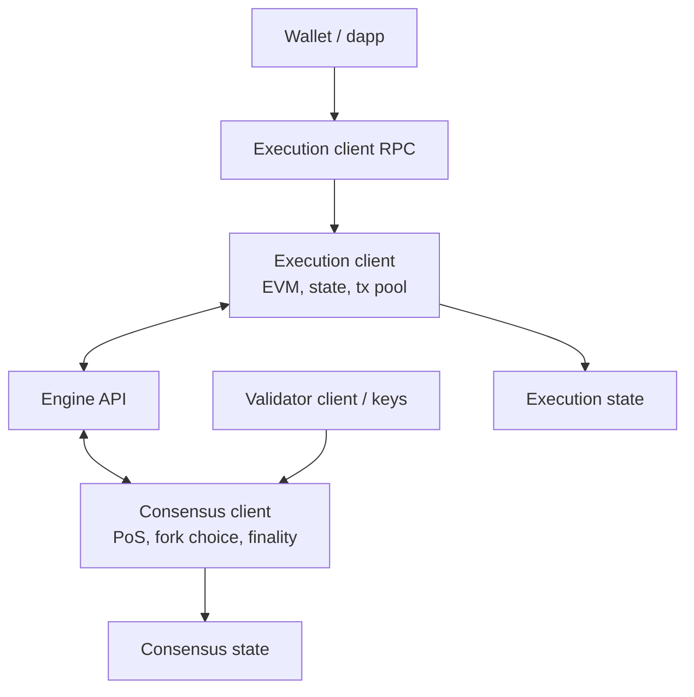
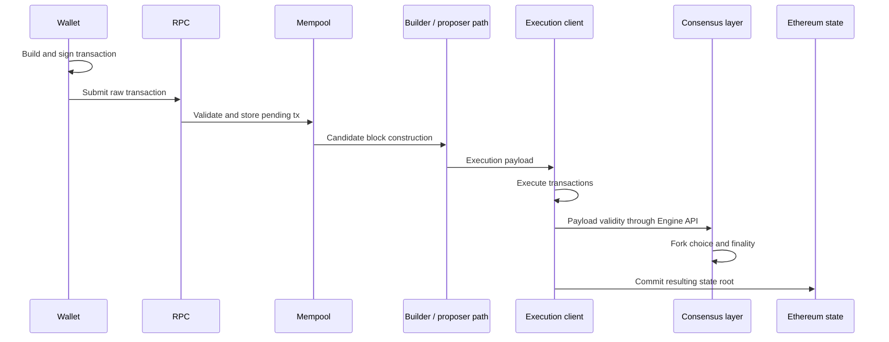
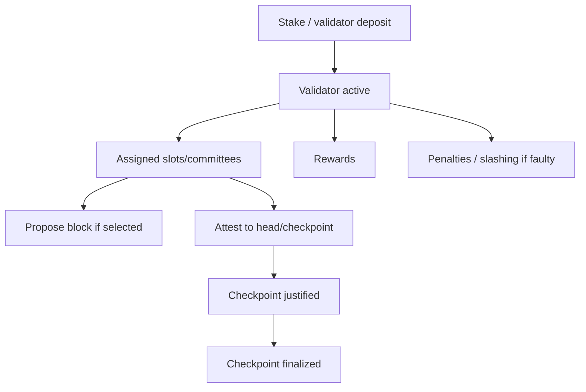
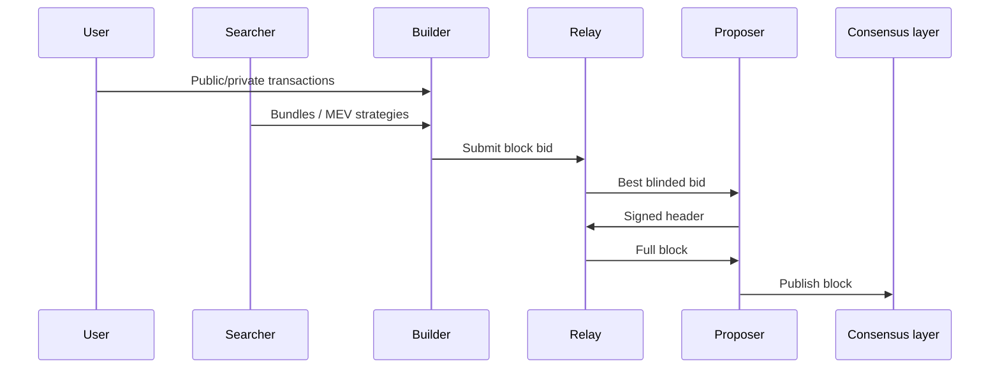
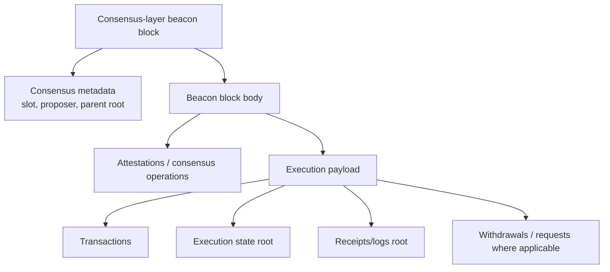
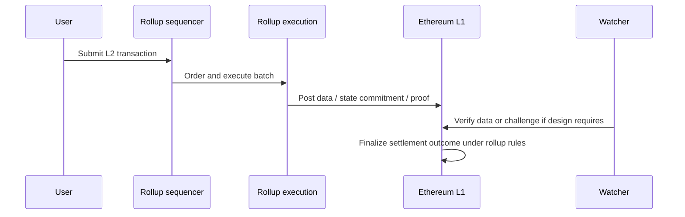
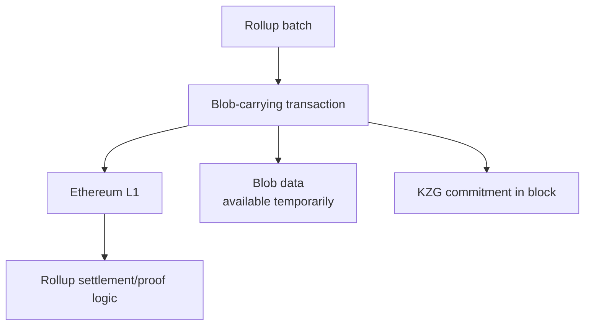
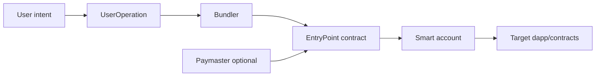
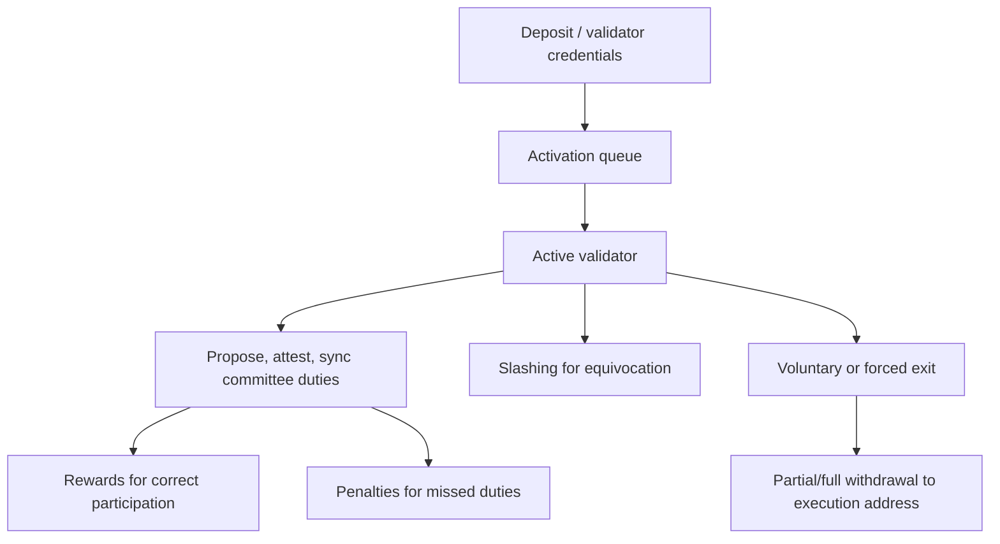

# Ethereum

Last verified: 2026-07-29.

Ethereum is a programmable blockchain that maintains a global state machine. Its native asset is ETH, but its central technical contribution is a general execution environment where accounts can deploy and call smart contracts. Ethereum began as a proof-of-work blockchain and now runs proof of stake. The current architecture separates the execution layer, which processes transactions and smart contracts, from the consensus layer, which runs validator consensus, fork choice, and finality.

The original Ethereum white paper proposed a blockchain with a built-in programming language for arbitrary state transition functions.[^eth-whitepaper] The Yellow Paper formalized Ethereum as a state-transition system and specified the Ethereum Virtual Machine (EVM).[^yellowpaper] Current Ethereum differs significantly from the original design: proof of work has been replaced by proof of stake, fees follow EIP-1559, staking withdrawals are enabled, rollup-centric scaling is the roadmap, and blobs introduced by EIP-4844 provide a separate data market for rollups.[^eth-history][^eip1559][^eip4844]

## Executive Summary

Ethereum generalizes the blockchain model from "who owns which coins" to "what is the current state of a shared programmable computer." Users submit transactions. Transactions change account balances, deploy contracts, call contract code, emit logs, and update contract storage. Every validating node re-executes transactions deterministically and checks that the resulting state root matches the block.

Ethereum has two account types:

- externally owned accounts (EOAs), controlled by private keys;
- contract accounts, controlled by EVM bytecode and storage.

ETH is required for transaction fees and staking. Ethereum has no fixed maximum supply. Since EIP-1559, each transaction pays a protocol-determined base fee that is burned, plus optional priority fees paid to validators. After the Merge, new issuance comes from validator rewards rather than proof-of-work mining.

Ethereum's current scaling strategy is rollup-centric. The base chain provides settlement, data availability, consensus, and security for Layer 2 systems. Dencun introduced blobs through EIP-4844, reducing rollup data costs by creating blob-carrying transactions and a blob fee market.[^eth-history][^eip4844]

As of 2026-07-29, the official Ethereum roadmap lists Pectra as activated on
2025-05-07 and Fusaka as activated on 2025-12-03. It lists Glamsterdam and
Hegotá as in development for the second half of 2026. Planned dates and EIP
scope can change until activation.[^eth-history]

## Historical Motivation And Evolution

Bitcoin showed that a public blockchain could maintain scarce digital money. Ethereum's original motivation was that many applications needed more expressive state transitions than Bitcoin Script could conveniently provide.

The white paper framed Bitcoin as a state transition system and then proposed Ethereum as a more general state transition system. Instead of creating a new blockchain for each application, Ethereum would provide a general-purpose platform where developers could write smart contracts.[^eth-whitepaper]

### Major Eras

| Era | Technical meaning | Current status |
|---|---|---|
| Original white paper | General-purpose blockchain with built-in programming language | Historical design reference |
| Frontier/Homestead | Early proof-of-work Ethereum | Historical |
| Metropolis upgrades | EVM and protocol improvements | Historical |
| Beacon Chain | Proof-of-stake consensus chain launched separately | Integrated after Merge |
| The Merge | Execution layer joined PoS consensus, PoW disabled | Active since 2022 |
| Shapella | Withdrawals enabled | Active since 2023 |
| Dencun | Blobs/proto-danksharding introduced | Active since 2024 |
| Pectra/Fusaka | Later execution/consensus upgrades | Listed in official timeline as activated by 2025 |
| Future roadmap | Danksharding, statelessness/Verkle, PBS, account abstraction | Proposed/in progress, not all active |

The most important shift is that Ethereum is no longer a proof-of-work chain. Historical references to miners, difficulty, ommers/uncles, and Ethash are no longer current consensus operation.

## Core Design Principles

Ethereum optimizes for programmable shared state. Its design accepts more complexity than Bitcoin in exchange for richer application logic.

| Principle | Technical meaning | Consequence |
|---|---|---|
| General state machine | Accounts and contracts share global mutable state | Rich applications and composability |
| Deterministic execution | Every node computes same result from same inputs | EVM must avoid nondeterminism |
| Gas metering | Every computation/storage operation is priced | Prevents unbounded computation |
| Contract composability | Contracts can call other contracts atomically | DeFi building blocks can interconnect |
| Layered scaling | L1 focuses on security/DA/settlement; L2s scale execution | Rollups become central |
| Off-chain governance | Protocol changes through EIPs, clients, social consensus | No formal on-chain governance |

## System Architecture

Current Ethereum has an execution layer and a consensus layer.



The execution client handles EVM transactions, state, receipts, logs, and execution payloads. The consensus client handles proof-of-stake blocks, attestations, fork choice, finality, validator duties, and consensus-layer networking.

This split became central at the Merge. Execution clients no longer run proof-of-work consensus; they receive consensus direction through the Engine API from consensus clients.[^eth-history]

## Ethereum State Model

Ethereum maintains a global state. The state maps addresses to accounts.

There are two account types:

| Account type | Controlled by | Contains code? | Initiates transactions? |
|---|---|---:|---:|
| Externally owned account | Private key | No | Yes |
| Contract account | EVM code | Yes | No, only reacts to calls |

An account contains:

- nonce;
- ETH balance;
- storage root;
- code hash.

For an EOA, the nonce counts transactions sent. For a contract account, the nonce is related to contract creation. Contract storage is a key-value store committed through trie structures. The Yellow Paper formalizes Ethereum around a state transition function: transactions transform one valid world state into another.[^yellowpaper]

### Account Model vs UTXO Model

Bitcoin tracks discrete UTXOs. Ethereum tracks accounts and mutable contract storage.

| Dimension | Bitcoin UTXO | Ethereum account/state |
|---|---|---|
| Ledger object | Unspent outputs | Accounts and storage |
| Spending | Consume outputs and create new outputs | Update balances/storage |
| Replay prevention | UTXO can be spent once | Account nonce |
| Programmability | Spending conditions | Persistent contract state |
| Parallelism | Independent UTXOs are naturally separable | Shared state creates conflicts |

Ethereum's shared mutable state enables composability but also creates state growth, MEV, and complex dependency risks.

## ETH And Monetary Policy

ETH is the native asset used for:

- transaction fees;
- staking deposits;
- validator rewards/penalties;
- DeFi collateral and liquidity;
- economic security.

Ethereum does not have a fixed maximum supply. Current net issuance depends on validator issuance, fees burned by EIP-1559, and activity levels.

### EIP-1559 Fees And Burning

EIP-1559 introduced type-2 transactions, a protocol base fee, elastic block capacity relative to a target, and burning of the base fee.[^eip1559]

Transaction fee components:

```text
effective_gas_price = base_fee_per_gas + priority_fee_per_gas
total_fee_paid = gas_used * effective_gas_price
burned = gas_used * base_fee_per_gas
validator_tip = gas_used * priority_fee_per_gas
```

The user sets:

- `maxFeePerGas`: maximum total fee per gas;
- `maxPriorityFeePerGas`: maximum tip per gas.

The base fee rises when blocks exceed the target gas usage and falls when below target. It is burned rather than paid to validators. This means high activity can reduce net ETH supply, but Ethereum's supply is not capped.

## Transactions

An Ethereum transaction is a signed instruction from an EOA that changes state. Ethereum.org lists fields including sender, recipient, signature, nonce, value, input data, gas limit, max priority fee, and max fee.[^eth-transactions]

Transaction types include:

- ETH transfer;
- contract deployment;
- contract call;
- typed transactions such as EIP-1559 transactions;
- blob-carrying transactions after EIP-4844.

| Field | Meaning | Failure mode it prevents or enables |
|---|---|---|
| `nonce` | Sender transaction counter | Prevents replay and orders same-account transactions |
| `to` | Recipient address, or empty for contract creation | Empty `to` changes interpretation to deployment |
| `value` | ETH transferred | Can trigger payable logic or fail if recipient rejects |
| `data` / calldata | Input bytes | Encodes function selector and arguments |
| `gasLimit` | Maximum gas the sender buys | Bounds execution cost; out-of-gas reverts state changes |
| Fee fields | Legacy gas price or EIP-1559 max/priority fees | Determines inclusion economics |
| Signature and chain ID | Authorization and replay domain | Prevents cross-chain replay when configured correctly |

Nonce management is a practical source of wallet and application complexity. If account nonce `7` is pending, nonce `8` cannot be executed before it. A low-fee transaction can therefore block later transactions from the same sender until replaced, included, or dropped by mempools.

### Transaction Lifecycle



If a transaction calls a contract and reverts, state changes from that call are reverted, but gas consumed before the revert is still charged. This is because nodes expended resources executing the transaction.

### Calldata And ABI

When an EOA calls a contract, the transaction `data` field contains calldata. For Solidity-style contracts, the first four bytes are usually a function selector: the first four bytes of the Keccak-256 hash of the function signature. The remaining calldata encodes arguments according to the ABI.[^eth-transactions]

Example:

```text
transfer(address,uint256)
keccak256(...) => first 4 bytes = function selector
calldata = selector || encoded_address || encoded_amount
```

## Gas And Resource Allocation

Gas is Ethereum's unit of metered computation and storage work. Every EVM operation has a gas cost. Gas prevents denial-of-service attacks and prices scarce execution resources.[^eth-gas]

Important terms:

| Term | Meaning |
|---|---|
| Gas limit | Maximum gas a transaction may consume |
| Gas used | Actual gas consumed |
| Intrinsic gas | Base cost before execution, including calldata/access costs |
| Base fee | Protocol fee per gas, burned |
| Priority fee | Tip paid to validator/proposer path |
| Refund | Partial refund for unused gas or certain operations, limited by rules |
| Block gas target | Target gas used per block under EIP-1559 |

Gas is not just a user fee. It is a safety mechanism for deterministic replicated computation. If computation were unmetered, a contract could loop forever and force every node to do unbounded work.

Gas has several sub-costs:

- **Intrinsic gas:** charged before execution for the transaction envelope and calldata.
- **Opcode gas:** charged for EVM instructions.
- **Memory expansion gas:** grows nonlinearly as temporary memory expands.
- **Storage gas:** high cost for persistent state writes because every full node must carry the resulting state.
- **Access costs:** affected by warm/cold account and storage access rules introduced by gas repricing upgrades.
- **Blob gas:** separate market for blob data after EIP-4844; it is not EVM execution gas.

Out-of-gas behavior is intentionally harsh. If execution runs out of gas, the state changes are reverted, but gas already spent is not refunded because validators and nodes still performed the computation. This makes gas estimation an application-level reliability problem, especially for contracts whose execution path depends on current state.

Gas also separates three ideas that are often mixed together:

- **Work accounting:** how much computation/storage/network burden an operation imposes.
- **Congestion pricing:** how expensive blockspace is at a particular moment.
- **User willingness to pay:** the maximum fee parameters a sender signs.

A transaction with a high `gasLimit` does not necessarily pay that full amount; unused gas is returned. A transaction with too low a `gasLimit` can fail even if the user offered a high fee per gas. A transaction with a generous gas limit but too low a max fee may sit pending because block builders can earn more from other transactions.

Storage illustrates the difference between temporary computation and long-term burden. Adding two numbers costs gas because every node must compute it once. Writing a new storage slot costs much more because every full node must carry the result as part of Ethereum state until the state is changed or future protocol designs alter state-management assumptions.

## Ethereum Virtual Machine

The EVM is a deterministic stack machine. It executes bytecode using:

- stack;
- memory;
- storage;
- calldata;
- return data;
- program counter;
- gas counter;
- execution context.

The stack holds 256-bit words. Memory is temporary per execution. Storage is persistent contract state. Calldata is read-only input to a call. Logs are emitted for off-chain indexing but are not directly readable by contracts as state.

The EVM can be modeled as a small deterministic interpreter:

```text
while not halted:
  opcode = code[program_counter]
  gas -= gas_cost(opcode, operands, current_state)
  if gas < 0: revert_out_of_gas()
  execute(opcode)
  update_stack_memory_storage_logs()
```

This simplified loop explains why Ethereum clients must agree on exact opcode semantics, gas costs, and exceptional cases. A disagreement about whether an opcode consumes 2,100 gas or 2,600 gas is not a billing bug; it can become a consensus split if clients compute different post-state roots.

### Calls And Creation

Contracts can:

- call other contracts;
- create contracts with `CREATE`;
- create deterministic-address contracts with `CREATE2`;
- use `DELEGATECALL` to execute another contract's code in the caller's storage context;
- use `STATICCALL` for calls that cannot modify state.

`DELEGATECALL` is powerful and dangerous. It enables proxy upgrade patterns, but a bug in delegated code can modify the proxy's storage.

### Reverts And Atomicity

Ethereum transaction execution is atomic at the transaction level. If an internal call reverts and the revert is not handled, state changes from that execution path are rolled back. Gas already consumed remains consumed.

This property enables complex DeFi actions that either complete as one unit or fail.

Atomicity is one reason DeFi composition works. A transaction can borrow assets, trade across several pools, repay the loan, and keep the remainder, all in one execution path. If any step fails, the whole transaction reverts and intermediate state changes disappear. This is powerful, but it also means contracts must be written under adversarial composition assumptions: another contract may call them in the middle of a complex transaction and exploit temporary price, balance, or authorization conditions.

## Smart Contracts And Programmability

Smart contracts are code deployed to Ethereum and executed by the EVM when called. They do not execute spontaneously. Some external actor must send a transaction, or another contract must call them during transaction execution.

Typical development flow:

1. Write source code in Solidity, Vyper, or another language.
2. Compile to EVM bytecode and ABI.
3. Deploy with a contract-creation transaction.
4. Interact by sending calldata to the contract address.
5. Index emitted events off-chain for user interfaces.

### Upgradeability

Contract code is normally immutable once deployed. Applications often use proxy patterns to allow upgradeable behavior:

- proxy contract holds storage and delegates calls;
- implementation contract contains logic;
- admin/governance can change implementation address.

Upgradeability is a trade-off. Immutable contracts reduce governance risk but cannot fix bugs easily. Upgradeable systems can patch bugs but introduce admin-key, governance, and delegatecall risks.

### Security Failure Modes

Common smart-contract risks include:

- reentrancy;
- bad access control;
- oracle manipulation;
- integer/precision errors;
- unsafe upgrade patterns;
- front-running and sandwich attacks;
- unchecked external calls;
- governance capture;
- faulty assumptions about token behavior.

Audits and formal verification reduce risk but do not eliminate it.

Security review usually combines unit tests, invariant/property tests, fuzzing, static analysis, manual audit, differential testing, economic scenario analysis, and, for high-value components, formal verification of selected properties. Formal verification does not prove that a product is safe in every real-world sense; it proves that a mathematical model satisfies specified properties under stated assumptions.

Many Ethereum bugs are integration bugs rather than isolated arithmetic mistakes. A lending protocol may be safe if an oracle is honest, a token follows ERC-20 behavior exactly, liquidity remains deep, governance cannot upgrade maliciously, and liquidators act quickly. The real system fails when one assumption changes: a token takes transfer fees, an oracle price is stale, a bridge asset depegs, a proxy admin key is compromised, or gas congestion prevents liquidations.

## Tokens And Digital Assets

ETH is native to the protocol. Most other Ethereum assets are smart-contract records.

ERC standards are interface conventions, not separate native asset types. An ERC-20 token is a contract exposing functions such as `balanceOf`, `transfer`, `approve`, and `transferFrom`. The ledger of token balances lives in contract storage, not in Ethereum's native account balance field.

| Standard | Asset model | Key idea |
|---|---|---|
| ERC-20 | Fungible tokens | Balances and allowances |
| ERC-721 | Non-fungible tokens | Unique token IDs |
| ERC-1155 | Multi-token standard | Fungible and non-fungible IDs in one contract |

Allowance risk is central to ERC-20. If Alice approves a contract to spend unlimited tokens, that contract or a compromised upgrade path can transfer those tokens later.

Wrapped assets and tokenized real-world assets add legal/custody assumptions. Owning a token may represent a claim, but the enforceability of that claim depends on off-chain legal structure.

ERC-20 allowances deserve special attention because they create a second layer of spending authority. Alice may own 1,000 tokens, but if she grants a protocol an unlimited allowance, the protocol can later call `transferFrom` to move those tokens according to the token contract's rules. Wallets often ask users to approve allowances before an application can operate. This is convenient, but it means token custody is partly controlled by a matrix of outstanding approvals.

Token behavior is also less uniform than simple examples suggest:

- some tokens charge transfer fees;
- some tokens rebase balances automatically;
- some tokens pause transfers;
- some tokens blacklist addresses;
- some tokens return no boolean value despite ERC-20 expectations;
- some tokens are upgradeable and can change behavior.

Smart contracts that assume every token behaves like a minimal textbook ERC-20 can break when integrated with real assets.

## Decentralized Applications And DeFi

Ethereum applications compose because contracts can call other contracts atomically.

DeFi primitives include:

- decentralized exchanges;
- automated market makers;
- lending protocols;
- collateral vaults;
- stablecoins;
- liquid staking tokens;
- restaking systems;
- bridges;
- DAO treasuries.

### AMM Example

A constant-product AMM keeps:

```text
x * y = k
```

where `x` and `y` are pool reserves. Buying token X removes X and adds Y, changing the marginal price. Liquidity providers earn fees but face impermanent loss when relative prices move.

DeFi risks are layered:

- smart-contract risk;
- oracle risk;
- governance risk;
- liquidation risk;
- MEV;
- bridge risk;
- dependency risk from composability.

Composability means a protocol's output can become another protocol's input. A liquid staking token can be used as lending collateral. The borrowed stablecoin can be deposited into an AMM. The LP token can be staked in another contract. This creates capital efficiency, but it also creates dependency chains. A bug or depeg in the first asset can propagate through collateral valuations, liquidations, governance positions, and liquidity pools.

Concrete liquidation scenario:

1. Alice deposits 10 ETH worth $30,000 as collateral.
2. She borrows 15,000 stablecoins.
3. The protocol requires collateral value to stay above 150% of debt.
4. ETH falls enough that Alice's collateral is worth $21,000.
5. Her collateral ratio is now 140%, below the requirement.
6. A liquidator repays part of her debt and receives collateral at a discount.

This mechanism protects the protocol from bad debt, but it depends on oracle freshness, liquidator competition, market liquidity, and gas conditions. During extreme volatility, all four can fail together.

## Proof Of Stake

Ethereum proof of stake uses validators rather than miners. Validators deposit stake and perform consensus duties.

Core concepts:

- 32 ETH deposit historically created one validator;
- Pectra's EIP-7251 increased maximum effective balance to 2048 ETH for validator consolidation/capital efficiency;[^eip7251]
- time is divided into 12-second slots and 32-slot epochs;
- validators propose blocks and attest to chain head/checkpoints;
- LMD-GHOST helps choose the head;
- Casper FFG finalizes checkpoints;
- slashing penalizes provable equivocation.



Finality requires supermajority participation by stake. Reverting finalized blocks would require slashable behavior by a large fraction of validators, making finality economic rather than purely probabilistic.

Weak subjectivity means nodes that are new or long offline need a recent trusted checkpoint to avoid certain long-range attacks.

| Mechanism | Purpose | Failure it addresses |
|---|---|---|
| LMD-GHOST | Chooses the head using latest validator messages | Short-term fork choice under network delay |
| Casper FFG | Justifies/finalizes checkpoints | Economic finality |
| Slashing | Punishes provable equivocation | Nothing-at-stake behavior |
| Inactivity leak | Lets chain recover finality when many validators are offline | Extended non-finality |
| Weak-subjectivity checkpoints | Protect long-offline/new nodes | Long-range attacks |
| Effective balance | Caps/normalizes validator weight for rewards and duties | Reward accounting and validator-set management |

Validator keys are operationally separated in many setups. A validator signing key signs duties and is hot enough to operate continuously. Withdrawal credentials control where withdrawals go and should be protected more conservatively. Remote signers and distributed-validator technologies try to reduce key compromise and correlated downtime, but they also add operational complexity.

## Block Production And MEV

Ethereum block production today involves proposers and often external block builders through MEV-Boost. Searchers identify opportunities such as arbitrage, liquidations, back-running, and sandwiching. Builders assemble blocks. Relays mediate between builders and proposers in MEV-Boost workflows.

This is proposer-builder separation in practice, but not yet fully enshrined in-protocol.

MEV affects:

- transaction ordering;
- censorship resistance;
- validator revenue;
- relay centralization;
- DeFi execution quality;
- private order flow.



This off-chain market can improve proposer revenue but weakens the simple mental model that validators independently build blocks from a public mempool. Censorship concerns arise when relays, builders, or large validators systematically exclude transactions. Proposed mechanisms such as enshrined PBS, inclusion lists, encrypted mempools, and related censorship-resistance tools are roadmap/research items unless activated in a specific fork.

## Ethereum Blocks

Post-Merge Ethereum has consensus-layer blocks containing execution payloads. The execution payload contains EVM-relevant block data.

Execution payload fields include items such as:

- parent hash;
- fee recipient;
- state root;
- receipts root;
- logs bloom;
- gas limit and gas used;
- timestamp;
- base fee;
- transactions;
- withdrawals after Shapella;
- blob-related commitments after Dencun.

Historical proof-of-work Ethereum had ommer/uncle blocks. Current proof-of-stake Ethereum does not use PoW ommers in active operation.

Ethereum clients distinguish head, safe, and finalized blocks. The head can change under fork choice. Safe/finalized labels represent stronger consensus confidence.

A post-Merge block is easiest to understand as two nested objects:



The consensus layer decides whether the beacon block is timely and valid under proof-of-stake rules. The execution layer decides whether the execution payload is valid under EVM/state-transition rules. The Engine API links these responsibilities. A block is not valid merely because a validator proposed it; both layers must accept their respective parts.

## Network Layer And Nodes

Ethereum has execution-layer and consensus-layer networking. Transactions gossip through execution-layer networks. Blocks, attestations, sync committee messages, and consensus data propagate through consensus-layer networking.

Node types:

| Node type | Role |
|---|---|
| Full node | Validates chain and tracks current state |
| Archive node | Retains historical state for arbitrary past queries |
| Light client | Verifies through compact consensus proofs/sync committees |
| Validator client | Performs validator duties using keys |
| Remote signer | Keeps validator keys separated from validator client |

Client diversity matters. A severe bug in a supermajority client can threaten finality or cause correlated slashing. Ethereum therefore values multiple execution and consensus client implementations.

Node operation is also a storage problem. A normal full node needs enough recent state to validate current blocks. An archive node stores historical state in a way that supports queries such as "what was this contract's storage at block N?" Archive access is useful for analytics and explorers, but it is not required for ordinary consensus validation. Pruning and snapshots help keep ordinary node operation feasible, while statelessness research aims to reduce the need for every validator to store all state locally.

Light clients use compact consensus information rather than re-executing all transactions. This is useful for wallets and constrained devices, but it changes the trust model: a light client verifies consensus summaries and proofs, while a full node independently validates execution.

## Cryptography

Ethereum uses several cryptographic primitives:

- Keccak-256 for addresses, function selectors, and hashing;
- ECDSA over secp256k1 for EOA transaction signatures;
- BLS signatures for validators and aggregation;
- Merkle-Patricia tries for execution state commitments;
- SSZ and Merkleization in consensus structures;
- KZG commitments for blobs after EIP-4844;
- planned Verkle-tree work for future state/statelessness improvements.

Ethereum's Keccak-256 differs from the final standardized SHA-3 variant in padding details, so documentation often explicitly says Keccak rather than SHA3.

Contract addresses are derived from creator and nonce for `CREATE`, and from deployer/salt/init-code hash for `CREATE2`.

## Scaling

Ethereum's current scaling strategy is rollup-centric. The L1 does not try to execute all user activity. It provides settlement, consensus, and data availability for L2s.

This is a deliberate architectural split. Ethereum L1 execution is expensive because every full node must execute every L1 transaction and maintain the resulting state. Rollups move most execution off L1, then use Ethereum for the parts that are hardest to decentralize: settlement, dispute resolution or proof verification, and data availability. This can increase user-facing throughput without requiring L1 validators to execute every rollup user's transaction.

The trade-off is that the user now depends on both Ethereum and the rollup system. The rollup's sequencer, bridge contracts, proof system, upgrade keys, data-publication behavior, and withdrawal path all become part of the effective security model.

Scaling components:

- optimistic rollups;
- ZK rollups;
- sequencers;
- fraud proofs;
- validity proofs;
- bridges;
- calldata and blobs;
- data availability sampling roadmap;
- shared sequencing;
- based rollups;
- validiums and volitions;
- account abstraction and UX improvements.

Rollup transaction flow in simplified form:



Optimistic rollups assume batches are valid unless challenged during a dispute window. Validity rollups submit cryptographic proofs that the state transition is valid. Both designs still need data availability: users and verifiers must be able to reconstruct the rollup state from published data or otherwise rely on additional data providers.

### Blobs And Proto-Danksharding

EIP-4844 introduced blob-carrying transactions. Blobs provide data for rollups that is not executed by the EVM and is stored ephemerally by consensus nodes. Blob data is committed using KZG commitments and priced through a separate blob gas market.[^eip4844]



Blobs reduce rollup data costs by separating data availability from EVM
execution gas. Full danksharding remains a roadmap item. Fusaka activated
PeerDAS, a data-availability-sampling mechanism for blob data, in December
2025; broader scaling work continues.[^eth-history]

Rollups need data availability because users must be able to reconstruct rollup state or prove fraud/validity from published data. If a rollup posts only a state root but withholds the transaction data behind that root, users may know that a commitment exists without being able to independently recover balances or exits.

| Data location | Cost profile | Security implication |
|---|---|---|
| Ethereum calldata | Expensive EVM-visible bytes | Strong L1 availability, high cost |
| Ethereum blobs | Cheaper, temporary consensus-layer data | Designed for rollup DA, not EVM execution |
| External DA committee | Potentially cheaper | Adds committee honesty/liveness assumptions |
| Validium-style off-chain DA | Lower L1 cost | Users depend on external data availability |

KZG commitments let the chain commit compactly to blob contents. The commitment is not the data itself; it is a cryptographic binding to data that must be available long enough for rollup participants to verify and store what they need.

## Account Abstraction

Traditional EOAs have rigid authorization: a secp256k1 key signs transactions and pays gas in ETH.

Account abstraction aims to make accounts more programmable:

- smart-contract wallets;
- social recovery;
- sponsored transactions;
- batched operations;
- alternative signature schemes;
- spending limits;
- session keys.

ERC-4337 implements application-layer account abstraction through user operations, bundlers, an entry point contract, and paymasters. It does not require a consensus-layer change. EIP-7702, included in Pectra according to the official Ethereum timeline, lets EOAs set code for transaction execution, enabling account-like functionality for regular accounts.[^eth-history][^eip7702]



The main distinction is location of enforcement. ERC-4337 works through contracts and off-chain bundlers, so the base protocol still sees an ordinary transaction to the entry point. Protocol-level changes such as EIP-7702 alter what regular accounts can do at the transaction-execution level.

## Oracles And External Data

Smart contracts cannot directly call arbitrary web APIs during consensus execution. All nodes must execute deterministically. If a contract could fetch a live web API directly, different nodes might receive different responses.

Oracles bring external data on-chain through transactions or signed reports.

Oracle risks include:

- stale data;
- manipulation;
- insufficient source diversity;
- governance/admin compromise;
- latency;
- dependency cascades in DeFi.

Oracle correctness is not guaranteed by Ethereum consensus. Ethereum can verify that oracle data was posted according to contract rules; it cannot know the off-chain fact is true by itself.

## Governance And Upgrades

Ethereum governance is off-chain. Protocol changes typically move through:

- EIPs;
- research discussion;
- client implementation;
- testnets and devnets;
- shadow forks;
- community review;
- coordinated hard-fork activation;
- node/operator/client upgrades.

Stakeholders include core developers, client teams, validators, application developers, L2 teams, users, exchanges, infrastructure providers, and ecosystem organizations.

Ethereum uses planned hard forks for protocol upgrades. This differs from Bitcoin's preference for soft-fork conservatism.

### Major Upgrades And Technical Significance

| Upgrade | Significance |
|---|---|
| Frontier | Initial Ethereum launch |
| Homestead | Early stability/protocol improvements |
| Byzantium/Constantinople/Istanbul | EVM, gas, cryptographic precompile, and difficulty-bomb changes |
| Berlin | Gas repricing/access-list groundwork |
| London | EIP-1559 base fee burn and fee-market change |
| Beacon Chain | PoS consensus chain launched separately |
| The Merge / Paris-Bellatrix | PoW disabled; execution connected to PoS consensus |
| Shapella | Staking withdrawals enabled |
| Dencun | EIP-4844 blobs/proto-danksharding |
| Pectra | EIP-7702 account behavior, validator/staking changes including EIP-7251 |
| Fusaka | Official timeline lists Fulu-Osaka as activated 2025-12-03; review current specifications when using details |

The official Ethereum roadmap and upgrade pages should be treated as the source
of truth for activated upgrade dates and included EIPs as of the note's
verification date.[^eth-history]

The present architecture is post-Merge, post-Shapella, post-Dencun, post-Pectra, and, according to the official timeline, post-Fusaka as of December 3, 2025.[^eth-history] Older sources that describe proof-of-work mining, uncle/ommer rewards, or pre-EIP-1559 fee auctions are historically important but no longer describe current mainnet operation.

## Additional Technical Deep Dives

### State Commitments And Tries

Ethereum blocks commit to execution results through roots such as the state root, transaction root, and receipt root. The state root commits to the global account state after executing the block. Receipts commit to transaction outcomes, logs, and gas used. This lets a block header summarize a large amount of state with compact cryptographic commitments.

The current Ethereum state structure is trie-based, historically described as Merkle-Patricia tries. This is different from Bitcoin's UTXO set: Ethereum must track mutable account balances, contract storage, bytecode hashes, and nonces. Contract storage is itself keyed storage, so a contract with a mapping may touch sparse keys across a very large logical address space.

### Current Versus Historical Block Fields

Historical proof-of-work Ethereum used ommers/uncles to reward near-miss blocks and reduce centralization pressure from propagation delays. After the Merge, proof-of-work ommer production is no longer part of current Ethereum consensus. Current blocks should be understood through the consensus-layer block plus execution payload model.

| Concept | Historical PoW Ethereum | Current PoS Ethereum |
|---|---|---|
| Block producer | Miner | Validator proposer, often using builder market |
| Sybil resistance | Hash power | Staked ETH |
| Ommers/uncles | Part of PoW-era rewards | Not active in current PoS operation |
| Finality | Probabilistic | Fork choice plus Casper FFG finality |
| Execution result | State root after transactions | State root inside execution payload |

### Rollup Security Assumption Stack

Rollups inherit some Ethereum properties but add their own assumptions. A useful mental model is an assumption stack:

1. Ethereum L1 consensus and data availability must remain live and correct.
2. The rollup bridge contracts on L1 must be correct.
3. The rollup proof system or fraud-proof game must be sound and live.
4. The sequencer must include or eventually allow user transactions.
5. Users or watchdogs must be able to observe data and challenge invalid behavior when the design requires it.
6. Upgrade keys, councils, and governance processes must not abuse emergency powers.

This is why "settles to Ethereum" is a meaningful security statement but not a complete one. The exact guarantees depend on the rollup's proof system, data availability choice, upgrade controls, sequencer decentralization, and withdrawal mechanism.

## Expanded Ethereum Topic Map

Ethereum has more moving parts than Bitcoin because it is both a settlement network and a programmable execution environment. This section expands the topics that most often require recursion: state, transactions, gas, EVM calls, token standards, DeFi mechanics, proof of stake, block production, scaling, account abstraction, and oracles.

### Global State And Account Internals

Ethereum's state is a mapping from addresses to accounts. Each account has fields whose interpretation depends on account type:

| Field | EOA | Contract account |
|---|---|---|
| Nonce | Number of transactions sent | Contract-creation counter |
| Balance | ETH owned by the account | ETH owned by the contract |
| Code hash | Empty code hash | Hash of deployed bytecode |
| Storage root | Empty storage | Root commitment to contract key-value storage |

An externally owned account (EOA) is controlled by a private key. A contract account is controlled by EVM code. A contract cannot initiate execution by itself because consensus execution begins with a transaction. Timers, keepers, bots, automation services, and users must submit transactions to trigger contract logic.

Ethereum's global state is shared mutable state. If a decentralized exchange updates a liquidity pool, the new reserves become part of the same state that lending protocols, arbitrage contracts, liquidators, wallets, and explorers may read. This shared state enables composability but creates congestion, MEV, and cascading-risk problems.

### Account Model Example: ETH Transfer Versus Contract Call

A simple ETH transfer updates two balances and the sender nonce:

```text
before:
  Alice: balance = 10 ETH, nonce = 5
  Bob:   balance = 1 ETH

transaction:
  from = Alice
  to = Bob
  value = 2 ETH
  nonce = 5

after:
  Alice: balance = 8 ETH - fee, nonce = 6
  Bob:   balance = 3 ETH
```

A contract call can touch many accounts and storage slots:

```text
Alice calls DEX.swap()
  Alice token balance decreases
  Pool token reserve changes
  Pool ETH reserve changes
  Alice receives ETH
  Event logs are emitted
  Arbitrage opportunity may appear in another pool
```

This is why Ethereum transactions are harder to reason about than simple balance transfers. The apparent recipient may be a contract that calls other contracts, emits logs, modifies storage, and conditionally reverts.

### Transaction Types And Replacement Behavior

Ethereum moved from legacy transactions with a single `gasPrice` to typed transaction envelopes. Typed envelopes allow new transaction formats without ambiguous legacy parsing. EIP-1559 introduced type-2 transactions with `maxFeePerGas` and `maxPriorityFeePerGas`; EIP-4844 introduced blob-carrying transactions for rollup data.[^eip1559][^eip4844]

Replacement is nonce-based. A sender can replace a pending transaction by submitting another transaction with the same nonce and sufficiently higher fee parameters under node policy. If a transaction is dropped from a local mempool, it may still exist elsewhere. Wallets therefore track pending nonces and sometimes need to "speed up" or "cancel" transactions by replacing them.

Private transaction submission sends transactions directly to builders, relays, or specialized RPC providers rather than the public mempool. This can reduce sandwich risk but introduces trust and censorship considerations.

### Receipts, Logs, And Events

Execution produces a receipt. A receipt records whether execution succeeded, gas used, logs emitted, and other metadata. Logs are cheaper than storage and are designed for off-chain indexing. Solidity events compile to log operations.

Logs are not contract-readable historical state. A contract cannot query "what events did I emit last month?" during execution. Indexers, wallets, explorers, and analytics systems read logs off-chain and build searchable databases.

### Detailed Gas Example

Suppose Alice sends a type-2 transaction with:

```text
gasLimit = 120,000
baseFee = 30 gwei
maxPriorityFeePerGas = 2 gwei
maxFeePerGas = 50 gwei
gasUsed = 80,000
```

The effective gas price is:

```text
effective_priority_fee = min(maxPriorityFeePerGas, maxFeePerGas - baseFee)
                       = min(2, 20)
                       = 2 gwei

effective_gas_price = baseFee + effective_priority_fee
                    = 32 gwei

total_paid = gasUsed * effective_gas_price
           = 80,000 * 32 gwei

burned = gasUsed * baseFee
       = 80,000 * 30 gwei

priority_fee_paid = gasUsed * 2 gwei
```

Unused gas is not charged. Gas consumed before a revert is charged. The base fee is burned. The priority fee flows through the block-production path.

### Storage Costs, Refunds, And State Growth

Persistent storage is expensive because it increases the long-term burden on node operators. A contract storage write can require every full node to carry additional state indefinitely unless pruning or statelessness techniques reduce that burden. Ethereum has repeatedly repriced gas costs to respond to denial-of-service risks and underpriced operations.

Refunds historically encouraged clearing storage, but large refunds also created block-size and gas-accounting complexity. Modern Ethereum limits refunds more tightly than early Ethereum. State rent, expiry, Verkle trees, statelessness, and related designs remain important research and roadmap topics rather than fully deployed solutions.

### EVM Call Semantics

Contract-to-contract calls are not simple function calls in a local program. They are message calls with separate contexts, gas forwarding, return data, and possible reverts.

| Call type | Storage context | Can modify state | Typical use |
|---|---|---|---|
| `CALL` | Callee storage | Yes | Normal external call |
| `DELEGATECALL` | Caller storage | Yes | Proxy patterns and libraries |
| `STATICCALL` | Callee storage | No | Read-only external call |
| `CREATE` | New contract storage | Yes | Deploy contract |
| `CREATE2` | New deterministic address | Yes | Counterfactual deployments/factories |

`DELEGATECALL` is central to upgradeable proxies. The proxy keeps storage, while implementation code executes as if it were the proxy. This means storage layout mistakes can corrupt state. A new implementation must preserve the expected variable layout unless the proxy pattern explicitly handles migration.

### Contract Deployment And Addresses

A contract-creation transaction contains initialization code. That initcode runs once and returns the runtime bytecode stored at the contract address. Constructor arguments are encoded into the deployment calldata. Contract addresses are derived from the deployer and nonce for `CREATE`, or from deployer, salt, and initcode hash for `CREATE2`.

This separation between initcode and runtime code explains why verified source code on an explorer must match the deployed runtime bytecode, compiler settings, constructor arguments, and linked libraries.

### Smart-Contract Security Examples

Reentrancy occurs when a contract makes an external call before updating its own accounting, allowing the callee to call back into the original contract while state is inconsistent.

```text
unsafe_withdraw(amount):
  send ETH to user        // external control transfer
  balances[user] -= amount
```

A safer pattern updates state before the external call:

```text
safe_withdraw(amount):
  balances[user] -= amount
  send ETH to user
```

Authorization bugs occur when a function assumes the caller is trusted but fails to check `msg.sender` or role state correctly. Oracle manipulation occurs when a protocol treats a manipulable spot price as if it were a robust external fact. Precision bugs occur because Solidity integer arithmetic cannot represent real numbers directly; DeFi protocols often use fixed-point scaling.

### Token Standards As Interface Conventions

Ethereum does not have a native "ERC-20 asset table" in protocol state. An ERC-20 token is a smart contract that exposes a conventional interface. Wallets and applications recognize the interface and display balances.

| Standard | Asset type | Key idea | Common risk |
|---|---|---|---|
| ERC-20 | Fungible token | Balances and allowances | Approval/allowance abuse |
| ERC-721 | Non-fungible token | Unique token IDs | Metadata permanence and ownership confusion |
| ERC-1155 | Multi-token standard | Fungible and non-fungible IDs in one contract | More complex accounting |

`approve`/`transferFrom` enables delegated spending. It also creates allowance risk: if Alice grants a malicious or compromised contract a large allowance, that contract may transfer her tokens until the allowance is reduced or exhausted.

NFT ownership is ownership of a token ID in a contract, not automatically legal ownership of an image, artwork, game item, or real-world asset. Metadata may be stored on-chain, on IPFS/content-addressed storage, or on ordinary servers. Off-chain metadata can create durability and trust assumptions.

### DeFi Mechanics: AMMs, Lending, Liquidations

An automated market maker (AMM) holds reserves and quotes prices from a formula rather than from an order book. The constant-product formula is:

```text
x * y = k
```

If a trader buys ETH from a pool containing ETH and USDC, ETH reserves decrease and USDC reserves increase. The marginal price worsens as trade size grows relative to pool liquidity; this is slippage. Liquidity providers earn fees but face impermanent loss when pool prices move relative to simply holding the assets.

Lending protocols usually require overcollateralization. A borrower deposits collateral worth more than the borrowed amount. If collateral value falls or debt value rises, liquidators can repay debt and seize collateral at a discount. This protects protocol solvency but creates oracle dependence and liquidation cascades during volatile markets.

### Stablecoins, Wrapped Assets, Bridges, And Legal Claims

Stablecoins are tokens designed to track an external unit such as USD. Their risk depends on collateral, issuer solvency, redemption rights, governance, custody, and smart-contract controls. Wrapped assets represent claims on assets elsewhere, such as BTC custodied by a bridge/custodian and represented as an ERC-20. Tokenized real-world assets add legal and operational layers: the token may track a claim, but courts, custodians, transfer agents, and regulations determine off-chain enforceability.

Bridges are frequent sources of systemic risk because they connect different security domains. A bridge may rely on multisigs, light clients, validators, optimistic challenge windows, or zero-knowledge proofs. The bridge's weakest assumption can dominate the safety of the wrapped asset.

### Proof-Of-Stake Lifecycle In More Detail



Validators are selected for duties by protocol randomness. Attestations vote for the head of the chain and for checkpoints. A checkpoint becomes justified when enough stake votes for it under Casper FFG; a later justified checkpoint can finalize an earlier one. Once finalized, reverting it would require a large amount of slashable stake or an extraordinary social recovery process.

Slashing is reserved for objectively provable dangerous behavior, such as proposing conflicting blocks for the same slot or making conflicting attestations. Ordinary downtime causes penalties but not slashing. Correlated failures matter: if many validators run the same buggy client or signing setup, they may fail or be slashed together.

### Safe, Finalized, Missed, And Reorged Blocks

Ethereum users often see block labels such as head, safe, and finalized. The head is the current fork-choice tip and can change. A safe block has stronger fork-choice confidence under honest assumptions. A finalized block has economic finality under Casper FFG. Missed slots occur when no valid block is proposed for a slot; time advances, but the chain may have no block for that slot.

Short reorgs can still occur near the head because attestations and network propagation are not instantaneous. Finality is therefore not "every block is instantly irreversible." It is a layered settlement model: fast head updates, safer recent blocks, and finalized checkpoints.

### Execution Clients, Consensus Clients, Validator Clients

Post-Merge Ethereum nodes are modular:

- **Execution client:** validates transactions, executes EVM, maintains execution state.
- **Consensus client:** runs beacon-chain consensus, fork choice, attestations, finality.
- **Validator client:** manages validator duties and signing requests.
- **Remote signer:** isolates validator keys from the validator client.

Client diversity is a security property. If one dominant client has a consensus bug, many validators could follow an invalid chain or be penalized. Diversity reduces correlated failure risk.

### Cryptography Beyond Signatures

Ethereum uses Keccak-256, which differs from the finalized SHA-3 standard despite historical naming confusion. EOAs use ECDSA over secp256k1. Validators use BLS signatures, which support aggregation: many validator signatures can be combined into a compact aggregate, reducing consensus overhead.

KZG commitments support blob commitments. Merkle-Patricia tries support current state commitments. Verkle trees are a roadmap direction intended to make witnesses smaller and stateless validation more practical. These are not interchangeable primitives: each has different proof sizes, trusted setup assumptions, performance trade-offs, and implementation complexity.

### Oracle Design Patterns

Oracle systems usually choose among trade-offs:

| Pattern | Description | Main risk |
|---|---|---|
| Single publisher | One party posts data | Direct trust in publisher |
| Multi-source median | Several reporters, medianized price | Reporter collusion or stale sources |
| Pull oracle | Users bring signed data when needed | Freshness and availability |
| TWAP | Time-weighted on-chain price | Manipulation over the averaging window |
| Prediction market | Market prices encode beliefs | Liquidity and incentive design |

Consensus can verify signatures, thresholds, and update rules. It cannot directly verify that an off-chain price, weather report, interest rate, or legal event is true.

### Current Roadmap Status And Proposed Mechanisms

Activated mechanisms in current Ethereum include proof of stake, EIP-1559 fee
burning, withdrawals, blobs/proto-danksharding, Pectra account and staking
changes, and Fusaka's data-availability and performance changes.[^eth-history]
As of 2026-07-29, Glamsterdam and Hegotá remain in development for the second
half of 2026.[^eth-history]

Roadmap or research areas include deeper proposer-builder separation, inclusion lists, statelessness, Verkle migration, more advanced data availability sampling, full danksharding, shared sequencing, based rollups, and further account-abstraction improvements. These should not be described as deployed guarantees unless the relevant EIP/spec has activated on mainnet.

## Security Model And Limitations

Ethereum security depends on:

- honest supermajority stake assumptions;
- slashing incentives;
- weak-subjectivity checkpoints;
- client diversity;
- validator key security;
- robust networking;
- correct execution clients;
- correct smart contracts;
- oracle integrity;
- bridge and rollup assumptions;
- social coordination under catastrophic failure.

Limitations include:

- state growth;
- complex smart-contract risk;
- MEV and censorship pressure;
- liquid staking concentration;
- correlated validator/client failures;
- bridge risk;
- rollup sequencer centralization;
- cross-rollup fragmentation;
- data availability roadmap complexity;
- governance coordination risk;
- quantum-computing concerns for current signature schemes.

Ethereum's security model is multi-domain. The base protocol may finalize correctly while an application fails because of a bad oracle. A rollup may settle to Ethereum while its centralized sequencer censors users temporarily. A bridge may hold assets on Ethereum while its off-chain validator set is compromised. These are not contradictions; they are different layers with different guarantees.

Proof of stake also changes the recovery model compared with proof of work. If validators finalize conflicting histories, their stake can be slashed, but the community may still need social coordination to decide how clients should recover from an extreme event. Weak subjectivity acknowledges this directly: a node that has been offline for a long time should obtain a recent checkpoint from a source it trusts socially or operationally.

MEV is both an economic feature and a security pressure. Arbitrage can keep markets aligned, and liquidation MEV can help lending protocols remain solvent. The same ordering power can enable sandwiches, censorship, private order-flow concentration, and builder/relay centralization. The protocol can reduce some harms, but it cannot remove the economic fact that transaction ordering has value in a shared-state system.

## Ethereum Compared With Bitcoin

| Dimension | Ethereum | Bitcoin |
|---|---|---|
| Original goal | Programmable blockchain / dapp platform | Peer-to-peer electronic cash |
| Data model | Account/global state | UTXO |
| Consensus today | Proof of Stake | Proof of Work |
| Block producers | Validators/proposers/builders | Miners/pools |
| Finality | Economic finality via PoS checkpoints | Probabilistic PoW confirmations |
| Issuance | Validator issuance, no fixed cap, base fee burn | Halving subsidy, near-21m cap |
| Fees | Gas, base fee burn, priority fee | Input-output difference, sat/vbyte market |
| Programmability | General smart contracts | Constrained Script |
| Tokens | Contract standards such as ERC-20/721/1155 | Overlay conventions or external layers |
| Node architecture | Execution + consensus clients | Integrated full-node validation model |
| Upgrades | Coordinated hard forks | Conservative soft-fork preference |
| Scaling | Rollup-centric, blobs/DA roadmap | Conservative L1, Lightning/sidechains/overlays |
| State growth | Contract/account state pressure | UTXO-set pressure |
| Governance | EIP-driven off-chain governance with frequent upgrades | BIP-driven conservative off-chain governance |

## Common Misconceptions

> **Misconception: Ethereum smart contracts run automatically.**  
> Contracts execute only when triggered by a transaction or another contract call during transaction execution.

> **Misconception: ETH has no monetary policy because there is no cap.**  
> Ethereum has protocol-defined issuance and burning rules. It does not have a fixed maximum supply like Bitcoin.

> **Misconception: Failed transactions are free.**  
> Failed/reverted transactions can consume gas because nodes executed work.

> **Misconception: Rollups are already fully decentralized because they settle to Ethereum.**  
> Rollups may inherit settlement guarantees while still adding sequencer, bridge, proof, upgrade, and data availability assumptions.

> **Misconception: Oracles make off-chain facts native to Ethereum.**  
> Oracles post claims/data on-chain. Ethereum verifies the posting rules, not the external truth itself.

## Mental Model

Ethereum is a programmable settlement and data-availability base layer for a large application ecosystem. EOAs sign transactions. Transactions call the EVM. Contracts update persistent storage and emit logs. Execution clients compute state transitions. Consensus clients run proof-of-stake fork choice and finality. ETH pays for computation, secures validators, and is burned through base fees. Scaling increasingly happens through rollups that execute off L1 while using Ethereum for settlement and data availability.

## Glossary

**ABI:** Application Binary Interface; convention for encoding contract calls and return values.

**Account abstraction:** Techniques that make account authorization and fee payment programmable.

**Attestation:** Validator vote about chain head/checkpoints in proof of stake.

**Base fee:** Protocol-determined fee per gas burned under EIP-1559.

**Blob:** EIP-4844 data object used mainly by rollups for cheaper data availability.

**Contract account:** Ethereum account controlled by EVM bytecode and storage.

**EOA:** Externally owned account controlled by a private key.

**EVM:** Ethereum Virtual Machine, the deterministic runtime for contract bytecode.

**Finalized block:** Block/checkpoint with strong economic finality under PoS assumptions.

**Gas:** Unit of metered EVM computation/storage work.

**KZG commitment:** Polynomial commitment scheme used for blob commitments.

**MEV:** Maximal extractable value from transaction ordering/inclusion/exclusion.

**Nonce:** Per-account replay-prevention counter.

**Rollup:** L2 that executes off-chain and posts data/proofs/commitments to a settlement layer.

**Slot:** 12-second time unit for Ethereum proof-of-stake block proposal opportunity.

**Smart contract:** EVM bytecode deployed at a contract account.

**Validator:** Proof-of-stake participant that proposes and attests to blocks.

## References

[^eth-whitepaper]: Vitalik Buterin, [Ethereum Whitepaper](https://ethereum.org/whitepaper/), original 2014 paper hosted by ethereum.org.
[^yellowpaper]: Gavin Wood, [Ethereum Yellow Paper](https://ethereum.github.io/yellowpaper/paper.pdf).
[^eth-docs]: ethereum.org, [Ethereum developer documentation](https://ethereum.org/developers/docs/).
[^eth-transactions]: ethereum.org, [Transactions](https://ethereum.org/developers/docs/transactions/).
[^eth-gas]: ethereum.org, [Gas and fees](https://ethereum.org/developers/docs/gas/).
[^eth-evm]: ethereum.org, [Ethereum Virtual Machine](https://ethereum.org/developers/docs/evm/).
[^eth-pos]: ethereum.org, [Proof of stake](https://ethereum.org/developers/docs/consensus-mechanisms/pos/).
[^eth-history]: ethereum.org, [Timeline of all Ethereum forks](https://ethereum.org/ethereum-forks/).
[^eth-roadmap]: ethereum.org, [Ethereum roadmap](https://ethereum.org/roadmap/).
[^eth-danksharding]: ethereum.org, [Danksharding](https://ethereum.org/roadmap/danksharding/).
[^eip1559]: EIP-1559, [Fee market change for ETH 1.0 chain](https://eips.ethereum.org/EIPS/eip-1559).
[^eip4844]: EIP-4844, [Shard Blob Transactions](https://eips.ethereum.org/EIPS/eip-4844).
[^eip7702]: EIP-7702, [Set Code for EOAs](https://eips.ethereum.org/EIPS/eip-7702).
[^eip7251]: EIP-7251, [Increase the MAX_EFFECTIVE_BALANCE](https://eips.ethereum.org/EIPS/eip-7251).
[^consensus-specs]: Ethereum Consensus Specs, [ethereum/consensus-specs](https://github.com/ethereum/consensus-specs).
[^execution-specs]: Ethereum Execution Specs, [ethereum/execution-specs](https://github.com/ethereum/execution-specs).
