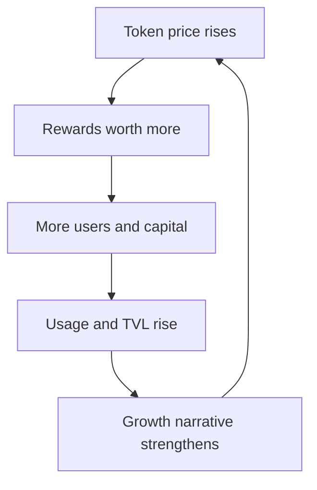

# Digital Assets, Token Taxonomy, And Economics

A digital asset is an electronically represented right, claim, unit, or object
that can be held or transferred. A cryptoasset is a digital asset whose
existence or transfer materially depends on cryptography and distributed-ledger
rules. Neither term gives one universal legal classification.

The same token can function simultaneously as a network resource, governance
instrument, speculative asset, collateral, and access credential. Economic,
technical, accounting, AML, securities, tax, and property-law classifications
may therefore differ.

## A Multi-Axis Taxonomy

One label is insufficient. Classify an asset along several axes.

### Issuance Layer

The issuance layer identifies where the unit comes from and which system can
change its supply. A native asset is accounted for by consensus itself, whereas
a contract token inherits both the chain and the contract's administrator and
code risks. A wrapped token adds a backing arrangement, and a tokenized offchain
asset adds a legal and operational bridge to property outside the ledger.

- **native asset:** created by the base protocol, such as BTC or ETH;
- **contract token:** created by application code on an existing chain;
- **bridged or wrapped token:** represents an asset locked, burned, or attested
  elsewhere;
- **tokenized offchain asset:** represents a legal claim linked to property,
  money, securities, commodities, or contractual rights.

### Fungibility

- **fungible:** units are intended to be interchangeable;
- **non-fungible:** each identifier can represent a distinct item or position;
- **semi-fungible:** units are interchangeable within a class or period but not
  universally.

### Economic Function

Economic function asks why anyone needs or values the unit. The same token can
serve several functions over time: ETH is a fee resource, staking asset,
collateral, and market asset. Each function connects value to a different
dependency, so classification should record the combination rather than force
one exclusive label.

- payment or exchange asset;
- utility or resource token;
- governance token;
- equity-, debt-, fund-, or derivative-like claim;
- stable-value instrument;
- receipt or claim token;
- staking or security asset;
- collectible, credential, or digital object.

### Control And Redemption

- no ordinary issuer or redeemer;
- centralized issuer with contractual redemption;
- protocol redemption against collateral;
- custodian-backed wrapper;
- algorithmic market mechanism;
- governance-controlled conversion.

### Transfer Environment

- one native chain;
- several native deployments;
- canonical bridge;
- third-party bridge;
- custodial internal ledger;
- permissioned or identity-restricted network.

## Native Assets

A native asset is part of a blockchain's protocol rather than a smart-contract
ledger.

It can:

- pay transaction fees;
- reward block producers;
- secure proof of stake;
- deter spam;
- serve as unit of account within the protocol;
- function as collateral.

### Bitcoin

BTC issuance follows Bitcoin consensus and the subsidy schedule plus fees. No
company promises redemption. Value depends on scarcity rules, network
acceptance, security, liquidity, and expectations.

### Ether

ETH pays execution and data fees, is staked by validators, and is used broadly
as onchain collateral. Issuance, fee burning, and staking economics are
protocol-governed.

### Native Does Not Mean Risk-Free

Native assets face:

- protocol and governance change;
- consensus attack;
- price volatility;
- custody loss;
- regulatory treatment;
- market and liquidity concentration.

## Contract Tokens

A token contract maps identifiers or addresses to balances and defines
transfer, mint, burn, approval, and metadata behavior.

Token standards improve interoperability but do not define:

- issuer identity;
- legal rights;
- supply credibility;
- redemption;
- price;
- governance quality.

### Fungible Tokens

ERC-20 and analogous standards support fungible balances. Implementations can
still:

- mint or burn;
- pause or freeze;
- blacklist;
- rebase balances;
- charge transfer fees;
- upgrade;
- return nonstandard results.

Integrations must examine deployed behavior, not only interface.

### NFTs

An NFT is a unique token identifier. It can represent:

- digital artwork reference;
- game item;
- membership;
- ticket;
- credential;
- domain name;
- legal or contractual claim.

The token normally contains or points to metadata. Ownership of the token does
not automatically transfer copyright, intellectual property, physical custody,
or legal title unless separate terms establish it.

Metadata can be:

- fully onchain;
- content-addressed through IPFS or similar storage;
- conventional URL controlled by a server;
- mutable by an administrator.

## Utility Tokens

A utility token provides access to a service, resource, discount, or protocol
function. Examples include payment for storage, computation, oracle reports, or
network usage.

Questions:

- Is the token actually required?
- Can the service set prices independently of token price?
- Does demand create token holding or only momentary purchase?
- Who controls supply and service terms?
- Does a company make profit-linked promises?

"Utility" is an economic description, not an automatic exemption from
securities or consumer law.

## Governance Tokens

Governance tokens can vote on:

- protocol parameters;
- upgrades;
- treasury spending;
- fees;
- collateral or markets;
- delegates and committees.

### Voting Power

Voting power is a control system, not merely a count of tokens. Delegation may
concentrate thousands of holders behind one representative; time locks may reward
long-term commitment; and councils may veto token votes. Analysis should measure
who can actually pass, block, and execute a proposal under realistic turnout.

Common mechanisms include:

- one token, one vote;
- delegated voting;
- time-weighted lock;
- quorum and proposal thresholds;
- bicameral token and council systems.

### Governance Value

Value can derive from:

- control over treasury;
- direct or indirect fee rights;
- influence over future economics;
- strategic control;
- expected market demand.

A token with no enforceable cash-flow claim can still have control value, but
control may be weak if teams, multisigs, foundations, or interface operators
retain practical authority.

### Governance Risks

- voter apathy;
- delegation concentration;
- borrowed-vote attacks;
- insider allocation;
- bribery;
- rushed proposals;
- legal ambiguity around fiduciary duties;
- treasury capture.

## Claim And Receipt Tokens

Receipt tokens make a position transferable and composable. Instead of recording
Alice's vault deposit only in an internal database, the protocol issues Alice a
token representing her proportional claim. She may then transfer that token or
use it as collateral elsewhere. This convenience creates a dependency chain:
the receipt is only as valuable as the underlying pool's accounting and its
ability to satisfy redemption.

DeFi creates tokens representing another position:

- lending deposit tokens;
- liquidity-provider shares;
- vault shares;
- staked or liquid-staking tokens;
- principal and yield tokens;
- bridge receipts.

The token's value depends on:

```text
claim value
= underlying assets
- liabilities and losses
- redemption frictions
```

The contract balance alone may not show:

- strategy debt;
- pending loss;
- illiquid collateral;
- withdrawal queue;
- slashing;
- bridge failure.

## Wrapped And Bridged Assets

### Same-Chain Wrapper

WETH wraps native ETH into an ERC-20-compatible contract token. ETH is deposited
and WETH minted; WETH is burned to withdraw ETH. This solves interface
compatibility.

### Custodial Wrapper

WBTC-style structures use custodians and merchants to hold native BTC and issue
tokens elsewhere. Users inherit custodian, governance, legal, and redemption
risk.

### Bridge-Minted Asset

A bridge locks or burns an asset on a source chain and mints a representation on
the destination. Security depends on:

- source finality;
- verifier or validator set;
- bridge contracts;
- keys and governance;
- destination chain;
- liquidity and redemption.

Several tokens with the same ticker can represent different bridges and claims.

## Tokenized Financial And Real-World Assets

A token can represent:

- share or bond;
- fund interest;
- Treasury exposure;
- invoice;
- commodity title;
- real estate interest;
- bank deposit.

The legal wrapper determines rights. Architecture can separate:

1. underlying asset or issuer;
2. special-purpose vehicle or fund;
3. registrar or transfer agent;
4. custodian;
5. token contract;
6. investor identity and restrictions;
7. cash and settlement asset.

The blockchain record may be authoritative, evidentiary, or merely operational.
See [Tokenization Of Securities, Funds, And Real-World Assets](../../05-digital-money-and-tokenization/03-tokenized-assets/tokenization-of-securities-funds-and-real-world-assets.md).

## Stable-Value Tokens

Stablecoins target a reference value through:

- fiat reserves and issuer redemption;
- crypto collateral and liquidation;
- synthetic hedging;
- commodity backing;
- algorithmic incentives.

They are not one asset class economically. A redeemable issuer liability,
overcollateralized protocol debt, and leveraged synthetic dollar have different
failure modes. See [Stablecoins](../../05-digital-money-and-tokenization/01-stablecoins/stablecoins.md).

## Supply Metrics

### Maximum, Total, And Circulating Supply

- **maximum supply:** protocol or contract upper bound, if credible;
- **total supply:** issued minus protocol-recognized burns;
- **circulating supply:** estimate of units available to market.

Circulating supply depends on methodology. Treasury, vesting, lost, bridged,
staked, or locked tokens may be treated differently.

### Market Capitalization

```text
market cap
= reference price
× circulating supply
```

It is not the cash invested or amount obtainable by selling every unit. Thin
float can generate a high implied valuation.

### Fully Diluted Valuation

```text
FDV
= price × fully diluted supply
```

FDV highlights future dilution but can mislead when maximum supply is
unreachable, emissions change through governance, or the present price depends
on low float.

## Issuance And Distribution

### Mechanisms

Issuance determines who bears dilution and what behavior the protocol rewards.
Mining and staking pay participants for security, a sale exchanges tokens for
funding, an airdrop distributes governance or usage rights, and collateralized
minting creates a liability against posted assets. Identical supply numbers can
therefore arise from very different economic contracts.

- proof-of-work mining;
- proof-of-stake rewards;
- public sale;
- private sale;
- team and investor allocation;
- airdrop;
- liquidity mining;
- protocol treasury;
- redemption-backed minting;
- collateralized borrowing.

### Initial Distribution

Assess:

- insider percentage;
- purchase price and terms;
- vesting and cliffs;
- governance power;
- market-making arrangements;
- foundation and treasury control;
- disclosure.

"Fair launch" lacks a universal definition. Mining access, early information,
hardware, and pre-launch development can still concentrate ownership.

## Vesting And Unlocks

Vesting restricts transfer or economic access over time.

Common schedules:

- cliff then linear release;
- periodic tranches;
- milestone-based;
- performance-based;
- immediate liquid token with contractual lock.

Onchain locks provide transparent enforcement if they actually control tokens.
Offchain agreements depend on counterparties and law.

Unlocks can affect:

- liquid supply;
- governance;
- selling pressure;
- staking concentration;
- collateral.

## Emissions

Let `S_t` be supply and `I_t` new issuance:

```text
nominal inflation rate
= (I_t) / (S_t)
```

Holder dilution depends on whether the holder receives proportional rewards.
A staker earning 5% while total supply grows 5% has little real token-share
growth before fees, taxes, slashing, and compounding.

### Fee Burning

If fees are burned:

```text
Δ S = issuance - burn
```

Net deflation does not guarantee price appreciation; demand and velocity also
change.

## Token Incentives

Tokens subsidize:

- liquidity;
- staking;
- borrowing;
- usage;
- development;
- governance participation.

Incentives can bootstrap networks but create mercenary behavior. A sustainable
system needs activity that remains when subsidy declines.

### Reflexivity



The loop reverses when price falls. If token issuance funds yield while the
token's value depends on deposited capital, the system may be circular.

## Revenue, Fees, And Value Accrual

Distinguish:

- user fees;
- protocol gross revenue;
- liquidity-provider or validator payments;
- retained treasury revenue;
- token-holder distributions;
- token burns;
- company revenue.

Token holders do not automatically own protocol cash flows. Governance can
redirect fees, but legal and practical ability to do so matters.

### Price-To-Fee Metrics

Ratios using market cap and fees can compare networks, but they require:

- consistent fee definition;
- removal of wash or subsidized activity;
- distinction between gross and retained value;
- understanding of token rights.

## Valuation Approaches

### Monetary Asset

Analyze store-of-value or transaction demand, velocity, security, liquidity,
and credible scarcity.

### Discounted Cash Flow

Appropriate only when token holders have reasonably estimable cash-flow rights:

```text
V_0 = Σ from t = 1 to ∞ of E[CF_t] / (1 + r)^t
```

### Resource Token

Value can relate to demand for blockspace, storage, computation, or collateral,
adjusted for velocity and substitution.

### Governance Or Control

Value resembles a control premium or option on future protocol economics, but
is difficult to quantify.

### Relative Valuation

Market-cap-to-fees, users, TVL, or developer metrics are easy to compute and
easy to misuse. Definitions, sybil activity, incentives, and cross-protocol
comparability matter.

## Legal And Economic Rights

For every token ask:

- Is there an identifiable issuer?
- Is there a contract with holders?
- Does holder have redemption, income, voting, or asset rights?
- Are rights enforceable and in which jurisdiction?
- Can an administrator freeze or destroy tokens?
- Who owns reserve or underlying assets?
- What happens in insolvency?
- Does protocol control equal legal ownership?

The token's name, white paper, or interface is not dispositive.

## Technical Risks

Token analysis must follow executable behavior. A familiar ticker and standard
interface do not show whether an administrator can mint, freeze, or upgrade, nor
whether a bridge representation is fully backed. Integration risk becomes
especially important when another protocol treats the token as collateral and
turns a token defect into lender bad debt.

- mint or upgrade authority;
- admin and pause keys;
- bridge dependency;
- nonstandard transfer behavior;
- rebase or fee-on-transfer;
- oracle and metadata;
- chain reorganization;
- contract exploit;
- lost keys;
- token spoofing and ticker collision.

## Taxonomy Summary

| Type | Principal value source | Main claim or risk |
|---|---|---|
| Native asset | Network use and monetary demand | Protocol and market |
| Utility token | Access to resource or service | Demand, issuer, design |
| Governance token | Control and possible economics | Participation and capture |
| Stablecoin | Par redemption or stabilization | Reserve/collateral and run |
| Wrapped token | Redeemability for underlying | Custodian or bridge |
| LP/vault token | Share of pool or strategy | Accounting and strategy |
| NFT | Unique digital identifier and associated rights | Metadata and legal scope |
| Tokenized security | Financial claim under law | Issuer, registry, custody |

## Analytical Checklist

1. Is the asset native, contractual, wrapped, or linked offchain?
2. What exact rights does one unit confer?
3. Who can issue, mint, burn, freeze, or upgrade?
4. What supply measures and unlocks apply?
5. How was ownership distributed?
6. What ongoing emissions and dilution exist?
7. Which fees accrue to whom?
8. What demand remains without incentives?
9. What bridge, custodian, oracle, and chain dependencies exist?
10. What happens during redemption stress, insolvency, or governance capture?

## Connections

- [Securities And Financial Instruments](../../01-financial-foundations/02-financial-markets/securities-and-financial-instruments.md)
  provides the claim framework.
- [Smart Contracts, Virtual Machines, And Token Standards](../../02-blockchain-foundations/03-execution-and-applications/smart-contracts-virtual-machines-and-token-standards.md)
  explains implementation.
- [Crypto Market Structure And Centralized Exchanges](../02-centralized-markets/crypto-market-structure-and-centralized-exchanges.md)
  explains trading and custody.
- [DeFi Architecture, Composability, And Governance](../../04-decentralized-finance/01-defi-foundations/defi-architecture-composability-and-governance.md)
  develops receipt tokens and incentives.

## References

- Financial Action Task Force,
  [FATF glossary: Virtual asset and VASP](https://www.fatf-gafi.org/en/pages/fatf-glossary.html)
- International Organization of Securities Commissions,
  [Investor education on crypto-assets](https://www.iosco.org/library/pubdocs/pdf/IOSCOPD668.pdf)
- Bank for International Settlements,
  [The technology of decentralized finance](https://www.bis.org/publ/work1066.htm)
- Ethereum.org,
  [Token standards](https://ethereum.org/developers/docs/standards/tokens/)
- Ethereum Improvement Proposals,
  [ERC-20](https://eips.ethereum.org/EIPS/eip-20),
  [ERC-721](https://eips.ethereum.org/EIPS/eip-721),
  [ERC-1155](https://eips.ethereum.org/EIPS/eip-1155), and
  [ERC-4626](https://eips.ethereum.org/EIPS/eip-4626)
- Financial Stability Board,
  [Regulation, supervision and oversight of crypto-asset activities and markets](https://www.fsb.org/2023/07/fsb-global-regulatory-framework-for-crypto-asset-activities/)
