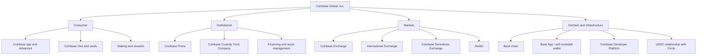
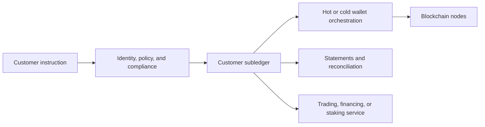
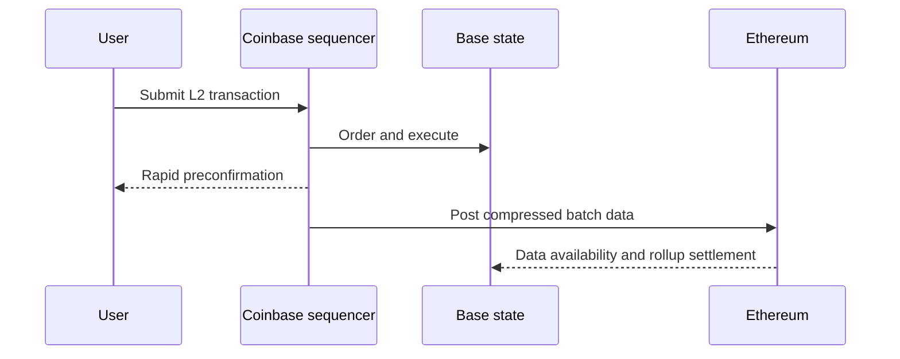

# Coinbase

Coinbase is best understood not as one exchange but as a group of connected
market, custody, infrastructure, stablecoin, blockchain, and financial-service
businesses. It serves retail users, professional traders, institutions,
developers, and token issuers through different products and legal entities.
Those functions reinforce one another, but they also create dependencies,
conflicts, and regulatory exposures.

This case study is neutral and educational. Product counts, licenses, economics,
and network design are dated to public information available in July 2026,
principally Coinbase Global's audited Form 10-K for the year ended December 31,
2025. A current legal or counterparty assessment must verify the relevant
contracting entity and jurisdiction.

## History and Strategic Evolution

Brian Armstrong and Fred Ehrsam founded Coinbase in 2012. Its early proposition
was a simple hosted service for buying, selling, and storing bitcoin. The company
then expanded along several axes:

- a retail brokerage and custodial account;
- a professional central-limit order book, historically branded GDAX and later
  Coinbase Pro before consolidation into Advanced trading;
- institutional custody and Coinbase Prime;
- staking and other asset services;
- exchange, wallet, node, data, and developer infrastructure;
- derivatives exchanges in the United States and internationally;
- the USDC stablecoin relationship with Circle;
- the Base Ethereum layer-2 network;
- subscriptions, cards, payments, and embedded wallets; and
- acquisitions including Tagomi, Bison Trails, FairX, One River Digital Asset
  Management, and Deribit.

Coinbase became a public company through a direct listing on Nasdaq in April
2021. Public reporting makes its financial model and risk concentrations more
visible than those of many privately held competitors.

The strategic direction has moved from “a place to buy crypto” toward an
integrated gateway to both centralized and onchain markets. The group can earn
when a user trades, holds USDC, stakes, subscribes, uses custody, finances a
position, transacts on Base, or builds through Coinbase infrastructure.

## Corporate and Product Map



This diagram is functional, not a complete legal-entity chart. A customer may
interact with several entities in one user experience. For example, Prime order
routing, custody, financing, fiat banking, and a derivative can involve different
Coinbase affiliates and third parties.

## Consumer Products

### Simple trading

The main Coinbase application provides quoted purchases, sales, conversions,
recurring buys, and fiat funding. A simple trade commonly includes a transaction
fee and a spread embedded in the quoted price. Coinbase controls the customer
account and normally settles the result in its internal ledger.

This brokerage-like experience is easier than managing an order book but can be
more expensive. The customer should distinguish:

- the reference market price;
- the quoted execution price and embedded spread;
- explicit Coinbase fee;
- card, bank, or payment-provider cost;
- blockchain withdrawal fee; and
- price movement before completion.

### Advanced trading

Advanced gives users direct access to order-book functionality, including market,
limit, and other instructions. Coinbase Exchange documents a continuous
first-come, first-served CLOB with price-time priority, self-trade prevention, and
execution at the resting order's price. Fees generally depend on trailing volume
and maker/taker status.

The retail and institutional interfaces can reach common market infrastructure,
but their economics differ. The 2025 Form 10-K explains that institutions pay
lower fees per transaction than consumers and that Advanced users pay lower
average rates than Simple users. Consequently, transaction revenue depends on
customer and product mix, not just total trading volume.

### Coinbase One

Coinbase One is a subscription intended to produce recurring revenue and increase
use across the platform. At the end of 2025 Coinbase described three tiers—
Basic, Preferred, and Premium—with benefits that can include limited reduced-fee
trading, USDC rewards, enhanced staking rewards, support, and partner offers.
The associated card can add interchange economics and encourage customers to
hold assets on platform.

“Zero trading fees” or reduced-fee allowances do not necessarily remove spreads,
product limits, payment charges, or market impact. Subscription value depends on
actual trading behavior and balances.

### Custodial account versus Base App

Assets in the core Coinbase account are held through Coinbase's custodial
infrastructure and reflected in its records. The **Base App**, evolved from
Coinbase Wallet, is a self-custodial product for onchain applications, trading,
payments, and social functions. Coinbase states that users control the
cryptographic keys by default, with an optional recovery signer.

These are different risk models despite a shared brand:

| Feature | Coinbase custodial account | Base App |
|---|---|---|
| Primary record | Coinbase subledger | blockchain state |
| Signing | Coinbase custody system | user-controlled wallet authorization |
| Recovery | account and provider procedures | wallet/recovery configuration |
| Trading | Coinbase and routed venues | smart contracts and onchain venues |
| Main risk | custodian, account, legal entity | keys, contracts, front end, chain |

## Markets and Execution

Coinbase's 2025 Form 10-K listed four exchange businesses:

- **Coinbase Exchange:** spot markets;
- **Coinbase International Exchange:** international spot and perpetual futures,
  subject to eligibility;
- **Coinbase Derivatives Exchange:** U.S. futures, including dated and
  perpetual-style contracts;
- **Deribit:** options, perpetuals, dated futures, and spot.

### Coinbase Exchange

The spot exchange runs the central matching engine used for supported pairs.
Customers pre-fund accounts; fills update internal balances. Deposits and
withdrawals connect that ledger to blockchains and banks.

Core market controls include product increments, price bands, self-trade
prevention, order status sequencing, and market surveillance. The public API
provides order, trade, ticker, and book feeds. As with any private engine, users
rely on the operator for fair sequencing, accurate data, and availability.

### Prime execution

Coinbase Prime is not just the Coinbase Exchange interface. It offers a smart
order router that can access Coinbase and external liquidity, plus OTC or agency
workflows. A parent order may be divided across venues based on price, depth,
fees, and constraints.

An institutional execution assessment should identify:

- whether Coinbase acts as agent or principal;
- eligible venues and routing logic;
- treatment of rebates and venue fees;
- pre-funded balances and settlement;
- information leakage and market impact;
- benchmark and transaction-cost analysis; and
- error, outage, and cancellation handling.

### Derivatives expansion

The acquisition of FairX, later Coinbase Derivatives Exchange, provided a U.S.
CFTC-regulated derivatives venue. Coinbase International Exchange extended
perpetual futures outside the United States. In August 2025 Coinbase completed
its acquisition of Deribit, a major crypto-options venue, adding options,
perpetuals, dated futures, and an established institutional user base.

Derivatives change Coinbase's risk profile. Options and leveraged perpetuals
require portfolio margin, mark and index prices, liquidation engines, insurance
or default arrangements, and 24-hour risk operations. Deribit also uses third-
party custodians for some assets according to Coinbase's filing, adding custody
relationships outside the core stack.

## Coinbase Prime

Prime integrates several services:

- execution through an exchange, router, or desk;
- qualified and other custody configurations;
- financing, margin, borrowing, and agency lending;
- staking and governance;
- APIs, FIX connectivity, reporting, and portfolio tools;
- settlement and transfer workflows.

These functions should be decomposed, because “Prime balance” can represent
custodied assets, trading balances, collateral, a financed position, or an
external settlement entitlement.

### Prime custody

Coinbase Custody Trust Company (CCTC) is a New York-chartered limited-purpose
trust company regulated by the NYDFS. Coinbase describes it as a qualified
custodian for relevant U.S. purposes. It provides cold custody, while the group
also offers orchestrated online-wallet capabilities.

Coinbase's 2026 documentation describes **Prime Custody** as an omnibus portfolio
with most assets offline and a smaller diversified online component. Customer
assets are described as legally segregated even when operationally commingled.
Trading and financing can occur while title remains within CCTC, with offchain
book-entry settlement. Segregated vault wallets support activities such as
staking that the omnibus wallet does not.

Qualified-custodian status is not a universal conclusion for every client or
asset. It depends on the entity, law, asset classification, and service. Coinbase
Inc., CCTC, Coinbase Credit, Deribit, and cash banks perform different roles.

### Financing

Coinbase provides eligible institutional customers with secured lending, margin,
shorting, working-capital loans, and agency lending. It may borrow fiat, crypto,
or stablecoins to support these services.

Financing creates:

- borrower credit and collateral risk;
- liquidation and gap risk in continuously traded volatile assets;
- stablecoin and bank dependencies;
- maturity and liquidity mismatch;
- rehypothecation and ownership questions;
- wrong-way risk when collateral falls with borrower quality.

The Form 10-K reported $1.35 billion of total loan receivables at year-end 2025,
principally fiat and payment-stablecoin receivables. This is a dated balance-sheet
measure, not the gross notional exposure of all financing activity.

## Custody Architecture and Customer Assets

Coinbase uses online and offline wallet tiers and an internal customer subledger.
Its filing states that a substantial majority of customer crypto assets are held
offline and that corporate crypto balances are separated from customer balances
in its financial reporting controls.

The operating chain is:



Customer assets can also leave or change form with instruction: withdrawals,
staking contracts, wrapped staking tokens, external venues, or financing
collateral. Coinbase states that total customer assets substantially exceed its
corporate assets and available insurance, as is normal for a custodian. Insurance
therefore should not be interpreted as a guarantee of all customer balances.

Coinbase is custodian to several U.S. spot bitcoin and ether exchange-traded
product issuers. This provides scale but creates concentration: common custody
infrastructure may support multiple funds whose creation/redemption and liquidity
needs become correlated during market stress.

## Staking

Coinbase operates validator infrastructure and also connects institutional
customers to third-party validators. For consumer staking it generally aggregates
or administers the technical process, passes through protocol rewards, and takes
a commission.

As of December 31, 2025, Coinbase reported approximately $7.5 billion of consumer
assets and $15.2 billion of institutional assets staked through its services.
These are point-in-time company figures, not guarantees of present balances.

Staking involves:

- protocol reward and commission economics;
- activation and exit queues;
- validator performance and slashing;
- custody and withdrawal-credential control;
- treatment of forks and protocol changes;
- third-party validator concentration;
- legal treatment of the service and rewards.

Coinbase also issues **cbETH**, a wrapped token representing ownership of ETH
staked through the platform plus accrued rewards. Transferring cbETH transfers
the economic claim, while its market price can diverge from the redemption value
because of liquidity, exit time, and Coinbase-specific risk.

## USDC and Circle

### Roles

Coinbase and Circle launched USDC through the CENTRE Consortium in 2018. The
governance arrangement later changed: Circle remains the issuer and provides
creation and redemption, while Coinbase distributes and integrates USDC and
shares in reserve economics.

The August 2023 Circle Agreement, as described by Coinbase:

- supports USDC ecosystem growth;
- pays Coinbase based partly on USDC held on Coinbase products;
- gives Coinbase and Circle economics linked to off-platform USDC; and
- allocates Coinbase 50% of a residual payment base after specified issuer,
  platform, partner, and reserve-management amounts.

This means Coinbase is economically exposed to:

```text
USDC reserve revenue
≈ eligible reserve balance × short-term yield
  - reserve-management costs
  - ecosystem and contractual allocations
```

Coinbase's exact revenue also depends on the proportion of USDC held on its
platform and contractual formulas.

### Financial importance

For 2025 Coinbase reported:

- stablecoin revenue of approximately **$1.349 billion**, up from $910 million in
  2024;
- $417.7 million of the increase attributed to higher average USDC held in
  Coinbase products;
- $314.1 million attributed to higher average off-platform USDC;
- a $290.8 million offset attributed to lower average interest rates; and
- $441.3 million of USDC rewards expense.

These figures show that gross stablecoin revenue is not the same as net profit.
Coinbase pays rewards to attract balances, incurs distribution costs, and depends
on Circle and reserve yields. Its filing estimated that a hypothetical 150-basis-
point change applied to 2025 daily Circle reserve balances would have changed
stablecoin revenue by $540.3 million, illustrating interest-rate sensitivity.

USDC also supports trading pairs, collateral, payments, Base activity, and user
retention. The relationship is thus both a direct revenue source and a network
strategy. Risks include a USDC depeg or run, reserve-bank disruption, changing
stablecoin law, restrictions on rewards, Circle operational failure, competing
stablecoins, and renegotiation of the agreement.

## Base

### Architecture

Base is an Ethereum layer-2 rollup built from the OP Stack. Its transaction data
is posted to Ethereum for data availability, and its rollup design allows
invalid state-transition claims to be challenged. Users can deposit from
Ethereum, transact on Base, and withdraw through the rollup bridge.

Base's public documentation states that, as of July 2026:

- Coinbase operates a single active sequencer;
- the sequencer orders transactions and submits data sufficient to reproduce
  blocks to Ethereum;
- validators independently derive and execute L2 state;
- users can submit through the sequencer or use L1 contracts for forced
  inclusion according to protocol rules; and
- Flashblocks provide rapid preconfirmations while L1 confirmation provides
  stronger finality.

The sequencer is not intended to be able to create an invalid finalized state,
but it has meaningful control over ordering, latency, and short-term availability.
Coinbase earns the spread between Base transaction fees and costs including
Ethereum data publication. Its 10-K classifies Base sequencer fees within other
transaction revenue.



### Strategic function

Base lowers transaction costs for onchain applications and creates a distribution
surface connected to Coinbase accounts, wallets, USDC, developers, and merchants.
It can generate sequencer revenue and increase demand for other Coinbase
services without requiring every activity to execute on the centralized exchange.

The ecosystem includes independent applications and tokens that Coinbase does
not issue or control. This limits the inference that an activity “on Base” is a
Coinbase service. At the same time, Coinbase's operation of the sequencer,
development role, interfaces, and brand create operational and reputational
connections.

Key risks include sequencer outage or censorship, rollup and bridge bugs,
Ethereum congestion, smart-contract scams, governance and upgrade concentration,
regulatory attribution, and competition from other L2s and chains.

## Coinbase Developer Platform

Coinbase Developer Platform (CDP) bundles APIs and software for wallets,
payments, onchain data, trading, stablecoins, and node access. Its role is to let
other businesses embed crypto functions without building every chain integration
and key system.

Wallet offerings can represent materially different control:

- user-custodied wallets where an end user authenticates and controls actions;
- developer-custodied wallets controlled programmatically by the application;
- Coinbase-custodied accounts under a Coinbase custody relationship.

A common SDK does not make those legal and security models equivalent. The
application must disclose who controls authorization, how recovery works, which
Coinbase entity participates, and whether assets appear on the application's or
custodian's books.

Developer infrastructure produces usage revenue and broadens distribution, but
it creates API, cloud, identity, and vendor concentration for customers. Exit
plans need key or account portability, transaction history, alternative nodes,
and replacement on/off-ramps.

## Revenue Model

Coinbase reported 2025 total revenue of approximately **$7.18 billion**:

- transaction revenue: **$4.06 billion**;
- the remainder primarily subscription and services plus corporate interest and
  other revenue.

Consumer transaction revenue was $3.32 billion, institutional transaction
revenue $480 million, and other transaction revenue $253 million. The large gap
between consumer and institutional revenue relative to volume reflects lower
institutional fee rates.

### Main revenue drivers

| Revenue stream | Economic driver | Major sensitivities |
|---|---|---|
| Consumer transactions | trading volume × effective fee/spread | asset prices, volatility, retail mix, competition |
| Institutional transactions | spot and derivatives volume × lower fee | market share, Deribit, fee compression |
| Stablecoin | USDC balances × reserve yield × agreement allocation | rates, USDC supply, platform share, regulation |
| Blockchain rewards | staked assets × protocol rewards × commission | token prices, staking rate, slashing, law |
| Custody | eligible assets under custody × fee schedule | ETF/client concentration, price, competition |
| Interest and finance | customer cash, loans, collateral, rates | defaults, liquidity, rates |
| Subscription/infrastructure | subscribers and developer usage | retention, pricing, reliability |
| Base and other transactions | network and processing activity × margin | Base usage, Ethereum costs, competition |

Transaction revenue remains cyclical. In 2025 it was 59% of net revenue, while
stablecoin and other services diversified the business. Diversification does not
remove common crypto-market exposure: higher token prices often raise trading,
custody value, staking value, and user engagement simultaneously.

### Costs and operating leverage

Important costs include transaction processing, blockchain rewards passed to
customers, USDC rewards, customer support and operations, technology, compliance,
sales, stock-based compensation, custody and security, and acquired-business
integration. Blockchain fees and rewards can vary with asset prices and network
conditions.

Because much infrastructure is fixed or semi-fixed, strong markets can produce
operating leverage. The reverse also applies when trading collapses. Regulatory
and security costs cannot safely fall in proportion to volume.

## Regulation and Legal Entities

Coinbase operates across overlapping regimes:

- state money-transmission and virtual-currency rules;
- New York trust-company custody;
- U.S. commodities and derivatives regulation;
- securities laws and asset classification;
- bank-secrecy, sanctions, and Travel Rule obligations;
- consumer, payments, privacy, and cyber requirements;
- MiCA and national regimes outside the United States;
- tax reporting and market-conduct rules.

Its licenses page is necessarily jurisdictional. A money-transmitter license does
not authorize securities activity; trust status does not cover every affiliate;
a derivatives-market registration does not govern spot; and international
products may be unavailable to U.S. users.

### SEC litigation

In June 2023 the SEC sued Coinbase, alleging that parts of its platform operated
as an unregistered exchange, broker, and clearing agency and that its staking
program involved an unregistered offering. In February 2025 the SEC dismissed
the case with prejudice. The SEC stated that dismissal reflected its policy
choice to support a new regulatory approach and was not an assessment of the
merits of the alleged claims.

The history illustrates regulatory regime risk rather than proving that every
Coinbase activity is or is not a securities activity. Asset, product, and
jurisdictional classification remain fact-specific.

## Risk Analysis

### Market and concentration risk

Revenue depends heavily on crypto prices, volatility, and volumes. Bitcoin,
ether, and selected other assets can dominate transactions. USDC and Circle are a
large services-revenue concentration. U.S. customers represented 84% of 2025
revenue according to the filing.

### Custody and cyber risk

Coinbase controls large customer asset pools and critical keys, identity systems,
withdrawal processes, APIs, and personal data. Threats include social
engineering, insider abuse, account takeover, wallet compromise, vendor breach,
and malicious smart-contract interactions. No insurance pool is large enough to
make operational security irrelevant.

### Credit and liquidity risk

Financing exposes Coinbase to borrowers, collateral volatility, stablecoins,
banks, and other custodians. Customer withdrawals and market-maker needs operate
continuously while some banking rails and cold processes do not. Offchain
settlement reduces transfers but creates receivables and reconciliation risk.

### Regulatory and political risk

Listings, staking, stablecoin rewards, custody, lending, derivatives, Base, and
developer products can fall under different or changing rules. Compliance costs,
product restrictions, enforcement, and inconsistent cross-border regimes can
affect both revenue and access.

### Technology and protocol risk

Coinbase depends on blockchains it does not control. Forks, congestion, smart-
contract exploits, validator slashing, token freezes, and bridge failures can
affect supported assets. Base adds rollup, sequencer, bridge, and Ethereum
dependencies. Deribit and acquired systems add integration complexity.

### Conflicts of interest

The group may list assets, operate markets, route orders, provide custody,
finance positions, stake assets, earn USDC reserve revenue, and operate Base.
Controls must address routing incentives, listing information, customer asset
use, stablecoin promotion, collateral valuation, and affiliated-service
selection.

### Competition

Coinbase competes with global CEXs on fees and liquidity; brokerages and fintechs
on distribution; custodians on safeguarding; decentralized protocols on
non-custodial execution; L2s on developers; stablecoins on payments; and software
providers on embedded infrastructure. Its integrated ecosystem is a moat only if
trust, service quality, and network effects outweigh switching costs and
concentration concerns.

## How to Analyze Coinbase Without Conflating Its Roles

For any use case, work through five questions:

1. **Which product and legal entity?** Coinbase exchange, CCTC, Prime financing,
   Deribit, Base, and CDP are not interchangeable.
2. **Where is the authoritative balance?** Coinbase ledger, a trust-company
   subledger, a derivative account, an Ethereum/Base address, or a smart
   contract?
3. **Who controls transfer and recovery?** Coinbase, customer, threshold
   participants, contract governance, or a third party?
4. **What is the economic exposure?** asset ownership, unsecured claim,
   collateral entitlement, staked claim, wrapped token, or trading P&L?
5. **Which dependencies remain?** Circle, bank, chain, sequencer, venue,
   sub-custodian, validator, oracle, or cloud.

This decomposition is more informative than treating “Coinbase” as a single
counterparty or technology.

## Related Notes

- [Crypto Market Structure and Centralized Exchanges](crypto-market-structure-and-centralized-exchanges.md)
- [Institutional Custody and Wallet Infrastructure](../04-wallets-and-custody/institutional-custody-and-wallet-infrastructure.md)
- [Stablecoins](../../05-digital-money-and-tokenization/01-stablecoins/stablecoins.md)
- [Blockchain Scaling and Modular Architecture](../../02-blockchain-foundations/04-scaling-and-modularity/blockchain-scaling-and-modular-architecture.md)
- [Staking, Liquid Staking, and Restaking](../../04-decentralized-finance/03-derivatives-staking-and-yield/staking-liquid-staking-and-restaking.md)
- [Digital-Asset Regulation](../../07-compliance-analytics-regulation-and-security/02-regulation/digital-asset-regulation.md)

## References

- Coinbase Global, Inc., [2025 Form 10-K](https://www.sec.gov/Archives/edgar/data/1679788/000167978826000015/coin-20251231.htm).
- Coinbase Investor Relations, [2025 Annual Report](https://investor.coinbase.com/financials/sec-filings/default.aspx).
- Coinbase Developer Documentation, [Exchange Matching Engine](https://docs.cdp.coinbase.com/exchange/concepts/matching-engine).
- Coinbase Help, [Introduction to Prime Custody](https://help.coinbase.com/en/prime/prime-custody/introduction).
- Coinbase, [Coinbase Prime](https://www.coinbase.com/prime).
- Coinbase, [Licenses](https://www.coinbase.com/legal/licenses).
- Coinbase, [Deribit Joins Coinbase](https://investor.coinbase.com/news/news-details/2025/Deribit-Joins-Coinbase-Unlocking-the-Future-of-Global-Crypto-Derivatives/).
- Base Documentation, [Protocol Overview](https://docs.base.org/base-chain/specs/protocol/overview).
- Base Documentation, [Base Terms of Service and Network Roles](https://docs.base.org/terms-of-service).
- Optimism Documentation, [OP Stack](https://docs.optimism.io/stack/getting-started).
- Circle, [USDC Reserve Management](https://www.circle.com/transparency).
- U.S. Securities and Exchange Commission, [SEC Announces Dismissal of Civil Enforcement Action Against Coinbase](https://www.sec.gov/newsroom/press-releases/2025-47).
- U.S. Securities and Exchange Commission, [Coinbase Litigation Release, June 2023](https://www.sec.gov/enforcement-litigation/litigation-releases/lr-25751).
