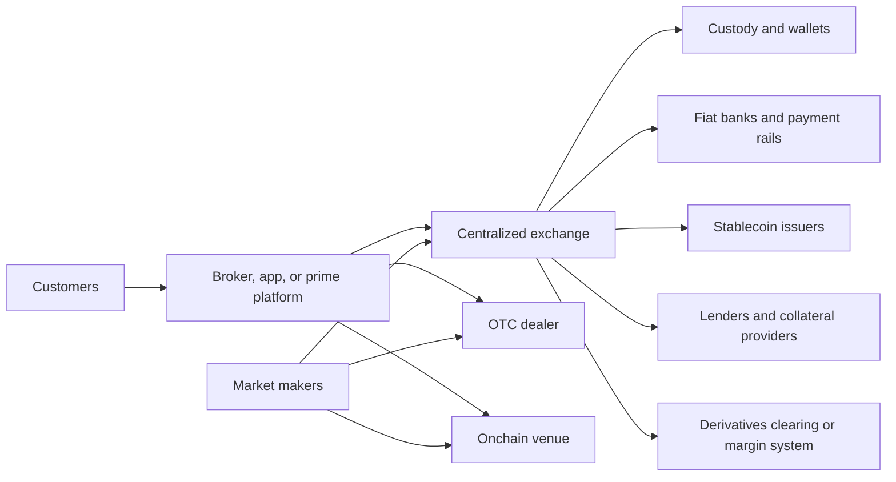
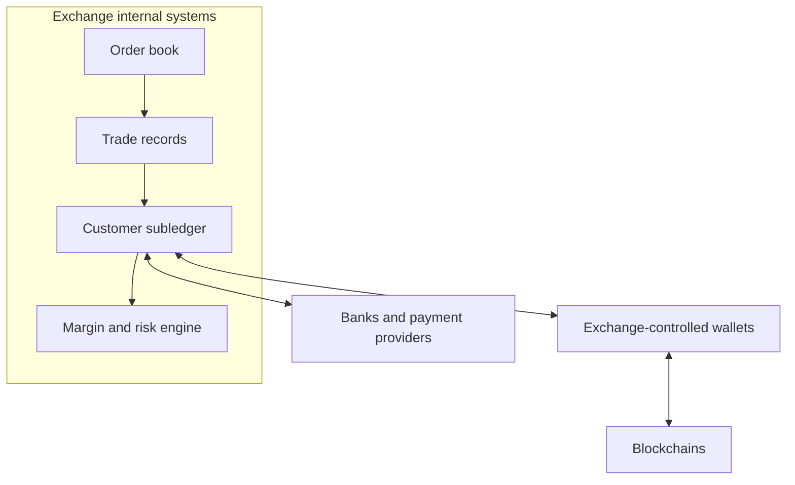

# Crypto Market Structure and Centralized Exchanges

Crypto markets combine public blockchain settlement with a large layer of
centralized intermediation. A centralized exchange (CEX) normally maintains an
offchain matching engine and customer ledger, controls deposit and withdrawal
wallets, and connects to banks, stablecoin issuers, market makers, custodians,
and derivatives infrastructure. Trades can execute in microseconds while the
underlying blockchain may not change at all.

This structure gives traders speed, familiar orders, fiat access, and capital
efficiency. It also concentrates custody, credit, liquidity, operational, and
conflict-of-interest risk. Understanding a CEX therefore requires more than
reading its trading screen: one must separate the legal entities, order book,
customer ledger, custody system, settlement process, and balance sheet.

## The Crypto Trading Ecosystem



The same corporate group may operate several boxes. Large crypto firms often
combine exchange, broker, custodian, dealer, lender, staking, token-listing, and
stablecoin relationships. The BIS calls such groups multifunction cryptoasset
intermediaries. Integration can improve service and netting but creates conflicts
and channels through which a failure in one function spreads to others.

### Principal actors

A centralized market is a network of distinct economic roles even when one
corporate group performs several of them. The exchange sets rules and matches
orders; brokers act for clients; dealers commit their own balance sheets; market
makers quote liquidity; custodians safeguard assets; and clearing or settlement
functions complete obligations. Combining roles can improve efficiency while
creating conflicts and concentrated failure.

- **Exchange operator:** sets market rules, admits members or users, lists assets,
  runs the matching engine, publishes data, and monitors activity.
- **Broker or agency desk:** routes a client's order to one or several venues,
  sometimes holding customer assets or extending credit.
- **Dealer:** trades as principal from its own inventory and earns a spread or
  takes market risk.
- **Market maker:** continuously quotes buy and sell orders, manages inventory
  across venues, and may receive fee discounts or incentives.
- **Prime service provider:** aggregates execution, custody, financing,
  collateral, and reporting. Crypto “prime brokerage” is not a uniform legal
  category.
- **Custodian:** safeguards assets and processes settlement. It may be the
  exchange itself, an affiliate, or an external provider.
- **Issuer:** creates a token traded on the venue and may control redemption,
  freezes, or market support.
- **On/off-ramp:** connects bank money, cards, or local payment systems to a
  trading balance.

## What Happens When a Customer Trades?

### Deposit

For a crypto deposit, the venue assigns an address or address-plus-memo, monitors
the chain, waits for its chosen confirmation threshold, and credits the internal
ledger. It may later sweep the asset into omnibus hot or cold wallets. The
customer's exchange balance is now a claim recorded by the venue, not an
independently controlled onchain output.

For fiat, a bank or payment provider receives funds into an account whose legal
structure may be in the exchange's name, for the benefit of customers, or through
another intermediary. Payment finality, chargeback, banking hours, and geographic
rules differ from blockchain deposits.

### Order entry and pre-trade controls

The exchange checks account status, available balance or margin, product access,
order syntax, price bands, and risk limits. It may reserve the required asset in
the ledger. Orders enter the matching engine through a user interface, REST API,
FIX connection, or streaming protocol.

### Matching

Most centralized spot venues use a continuous central limit order book (CLOB).
Buy orders are ranked from highest price to lowest; sell orders from lowest to
highest. At the same price, many systems use time priority.

```text
best bid = highest resting buy price
best ask = lowest resting sell price
spread   = best ask - best bid
midprice = (best bid + best ask) / 2
```

A newly arriving order that crosses resting liquidity is the **taker**; the
resting order is the **maker**. Matching produces fills and fees. Coinbase
Exchange, for example, publicly documents price-time priority and execution at
the resting order's price. Venue rules can differ on auction periods, hidden
orders, self-trade prevention, and tie breaking.

### Ledger settlement

After a fill, the exchange debits and credits internal balances:

```text
buyer:  quote asset decreases; base asset increases
seller: base asset decreases; quote asset increases
venue:  fee receivable increases
```

This is typically immediate book-entry settlement inside one intermediary. It is
not an onchain transfer between buyer and seller. The venue can net millions of
trades and move assets onchain only for deposits, withdrawals, treasury
rebalancing, or external settlement.

### Withdrawal

The customer requests an onchain transfer. The venue authenticates the user,
applies compliance and risk controls, selects a wallet, constructs and signs the
transaction, broadcasts it, and updates the ledger. Withdrawal pauses, manual
reviews, wallet maintenance, liquidity shortages, or network congestion can make
the practical exit time much longer than block time.

## Order Types and Execution

### Market and limit orders

A **market order** seeks immediate execution against available liquidity and
accepts uncertain price. A **limit order** sets the worst permitted price. A
marketable limit order combines immediate execution with a price boundary.

The quoted best price applies only to the displayed quantity. A large market
order “walks the book,” producing **slippage**. A useful benchmark is volume-
weighted average price:

```text
VWAP = sum(price_i × quantity_i) / sum(quantity_i)
```

**Implementation shortfall** compares the actual execution result, fees, and
opportunity cost with the price when the investment decision was made.

### Other instructions

- **post-only:** cancel or reprice if the order would immediately take liquidity;
- **immediate-or-cancel:** fill available quantity now and cancel the rest;
- **fill-or-kill:** execute the entire quantity immediately or cancel;
- **stop order:** activate when a trigger is reached;
- **reduce-only:** prevent a derivatives order from increasing exposure;
- **iceberg or hidden:** disclose less than the full resting quantity;
- **time-in-force:** define when the order expires.

Order semantics are venue-specific, especially during volatility. API clients
must handle partial fills, disconnects, duplicate submission, sequence gaps, and
orders whose status is temporarily unknown.

## Liquidity and Price Formation

Liquidity has several dimensions:

- **tightness:** the bid-ask spread;
- **depth:** quantity available near the current price;
- **resiliency:** speed at which liquidity replenishes after a trade;
- **immediacy:** ability to execute quickly;
- **breadth:** liquidity across assets, quote currencies, and order sizes.

Reported volume alone is not enough. It may be inflated by incentives,
self-trading, wash trading, or low-quality activity far from the best price.
Observable order-book depth can be canceled before execution. A sound comparison
uses executable spreads, realized slippage at several sizes, fill rates, market
impact, uptime, and withdrawal performance.

### Fragmentation and arbitrage

Bitcoin, ether, and stablecoins trade on many venues, in many legal entities and
quote currencies. Prices remain linked because arbitrageurs buy where cheaper and
sell where dearer. Arbitrage is not frictionless:

- assets and cash must be prefunded;
- blockchain transfers take time and fees;
- fiat rails have banking-hour constraints;
- venues impose limits and compliance reviews;
- stablecoins carry issuer and depeg risk;
- shorting or borrowing may be unavailable;
- counterparty and jurisdictional risks differ.

Consequently there is no single authoritative “crypto price.” An index must
define eligible venues, pair conversions, outlier rules, weighting, observation
window, and contingency behavior.

### Market makers

A market maker quotes both sides and earns spreads, maker rebates, or contractual
incentives while bearing inventory and adverse-selection risk. If informed
traders buy just before a price rises elsewhere, the maker's offer is “picked
off.” Makers hedge across exchanges, derivatives, OTC desks, and onchain pools.

Venue programs may provide fee tiers, loans, colocation, or token incentives.
These arrangements can deepen liquidity but create conflicts if an affiliated
maker has informational, credit, or execution advantages. Market-making
agreements should be distinguished from undisclosed price support by an issuer.

## Spot, Margin, Futures, and Options

### Spot

A spot trade changes entitlement to the base and quote assets. On a custodial
venue, the customer still relies on the exchange to deliver them. “Spot” does not
mean immediate external blockchain settlement or eliminate counterparty risk.

### Margin

Margin trading uses borrowed value. The venue calculates collateral value,
haircuts, maintenance margin, and liquidation thresholds. Cross margin shares
collateral across positions; isolated margin limits collateral to a position.
The lender may be the venue, another customer, or an external provider.

### Futures and perpetuals

A dated future settles or expires according to contract terms. A perpetual future
has no expiry and uses periodic funding or another mechanism to keep its price
near an index. Derivatives can be cash-settled or physically settled and may be
offered through a different legal entity from spot trading.

Leverage creates nonlinear liquidation risk. The venue's engine marks positions,
issues or automates margin changes, liquidates accounts, and may use insurance
funds, auto-deleveraging, or socialized losses when collateral is insufficient.

### Options

Options add volatility, expiry, exercise, and nonlinear risk. Venue architecture
must specify margin methodology, settlement index, exercise process, portfolio
netting, and default handling. A platform listing “options” may operate an
exchange, act as broker to another venue, or provide bilateral OTC contracts.

## Internal Ledgers, Custody, and Settlement Risk

The CEX model decouples rapid trade finality from slow or costly blockchain
settlement. It also makes the exchange's database and controls a critical
financial infrastructure.



Required reconciliations include:

```text
sum of customer and house entitlements by asset
    = controlled assets + external receivables - external obligations
```

The equality needs adjustments for pending deposits and withdrawals, chain
reorganizations, fees, staking, margin loans, derivatives P&L, and assets at
other venues. A liquid exchange can still be insolvent; a solvent exchange can
still lack assets immediately available for withdrawals.

### Pre-funding and off-exchange settlement

Conventional CEX access requires assets at the venue before trading. Custodian-
connected systems instead lock collateral elsewhere and give the venue a trading
entitlement, then settle net P&L periodically. This reduces custody exposure but
introduces collateral, reconciliation, legal, and settlement-agent dependencies.
The architecture is examined in
[Institutional Custody and Wallet Infrastructure](../04-wallets-and-custody/institutional-custody-and-wallet-infrastructure.md).

## Business Models

CEX revenues can include:

- retail transaction spreads or commissions;
- maker-taker trading fees;
- custody and withdrawal fees;
- stablecoin reserve-revenue sharing;
- interest on fiat or crypto balances;
- margin lending and financing;
- derivatives fees and liquidation charges;
- staking commissions;
- token listing, distribution, or service fees where permitted;
- subscriptions, data, APIs, and infrastructure.

Revenue quality differs. Retail spreads can be high but cyclically sensitive;
institutional fees are lower and depend on scale. Interest revenue depends on
rates and treatment of customer cash. Stablecoin arrangements create issuer
concentration. Proprietary positions, unsecured lending, or maturity
transformation add balance-sheet risk.

Fee schedules can obscure the effective price. A retail “instant buy” may include
a disclosed fee plus a spread and payment cost; an advanced order book may charge
lower explicit fees but require active order management.

## Conflicts of Interest

Vertically integrated firms can:

- operate a venue while trading as principal;
- custody customer assets while borrowing or pledging them;
- list a token issued by an affiliate;
- sell market data while giving selected firms faster access;
- route customer orders to affiliated liquidity;
- extend credit to market makers that support the venue;
- calculate an index used to liquidate customers;
- operate a stablecoin used as the quote and collateral asset.

These combinations are not proof of misconduct, but they require governance,
disclosure, surveillance, information barriers, fair-access rules, and financial
separation. IOSCO's crypto-market recommendations focus on conflicts, market
abuse, custody, client assets, operational risk, and cross-border cooperation.

## Market Integrity and Surveillance

Crypto markets face familiar manipulation plus blockchain-specific variants:

- wash trading and self-trading;
- spoofing and layering;
- pump-and-dump coordination;
- front-running and misuse of listing information;
- manipulation of thin spot markets used in derivative indices;
- cross-venue marking at valuation times;
- insider trading before listings or delistings;
- false reserve or partnership claims;
- manipulation through onchain attacks, oracle prices, or stablecoin depegs.

Surveillance must join order, cancel, trade, account, funding, device, and
blockchain data across related markets. Onchain transparency helps trace flows
but does not reveal beneficial identity or offchain intent. Fragmented
jurisdictions and pseudonymous accounts make cross-venue investigation difficult.

Controls include self-trade prevention, price collars, velocity limits, auction
or circuit-breaker rules, position limits, index governance, suspicious-activity
monitoring, employee trading restrictions, and listing-information controls.

## Proof of Reserves and Financial Assurance

A proof-of-reserves (PoR) process can combine:

1. a snapshot of customer liabilities;
2. a commitment such as a Merkle root that lets a customer test inclusion;
3. evidence that the platform controls specified onchain assets; and
4. an independent practitioner's procedures.

Kraken, for example, publishes asset-specific reserve ratios and user-verification
tools. Such evidence is useful but scoped. It may not establish all liabilities,
ownership free of liens, fiat assets, affiliate exposures, off-balance-sheet
guarantees, asset quality, controls between snapshots, or the ability to meet a
run. A customer inclusion proof does not prove that other customers were not
omitted.

A fuller assurance picture uses audited financial statements, regulatory
capital and liquidity reports where applicable, internal-control assurance,
onchain evidence, liability completeness, legal segregation, and governance.

## Risk Taxonomy

| Risk | Mechanism |
|---|---|
| Custody | keys, wallets, or withdrawal systems are compromised or unavailable |
| Credit | venue, affiliate, borrower, bank, stablecoin issuer, or settlement party defaults |
| Liquidity | withdrawals exceed liquid assets or collateral cannot be monetized |
| Market | house positions, collateral, or inventory lose value |
| Settlement | a trade or collateral leg is not delivered as expected |
| Operational | matching, ledger, API, node, cloud, or reconciliation fails |
| Legal | customer ownership, netting, product status, or insolvency treatment is uncertain |
| Conduct | manipulation, unfair access, conflicts, or misleading disclosure harms users |
| Concentration | one venue, bank, stablecoin, market maker, or cloud becomes critical |
| Cyber/insider | external attackers or privileged staff bypass controls |

The 2022 failure of FTX and related entities illustrated the interaction among
governance, affiliated trading, customer-asset misuse, opaque liabilities, and a
run. Other exchange failures have arisen from hacks, lost keys, banking problems,
fraud, and regulatory shutdown. “Exchange risk” is therefore a compound exposure,
not simply the probability of a wallet hack.

## Representative Centralized Venues

### Coinbase

Coinbase combines a retail broker interface, advanced exchange, institutional
Prime services, custody, staking, infrastructure, the Base network, and material
stablecoin economics. Coinbase Exchange documents a price-time-priority CLOB;
Prime can route across venues. Public-company reporting provides financial and
risk disclosures unusual among crypto venues. The separate
[Coinbase note](coinbase.md) examines entities and economics in depth.

### Kraken

Kraken operates spot and derivatives services through jurisdiction-specific
entities and emphasizes advanced order types, APIs, custody controls, and
periodic proof of reserves. Its product history makes it an important example of
an exchange expanding from crypto spot into regulated derivatives and broader
financial services. Product availability depends on jurisdiction.

### Binance

Binance grew through a broad global product set, deep liquidity, a large retail
base, derivatives, staking, custody-related services, the BNB ecosystem, and
regional affiliates. Its organizational and regulatory structure has changed
over time and must be evaluated by local legal entity. The relationship among
Binance, BNB, BNB Chain, stablecoins, market makers, and product entities makes
it a central case in multifunction-intermediary analysis.

### Gemini

Gemini combines a New York trust-company heritage with exchange and custody
services. Its history also illustrates that regulated custody, exchange, and
lending are separate risks: the Gemini Earn program involved exposure to Genesis,
not merely assets in standard exchange custody. Product labels and counterparties
must be traced to their contracts.

### Regional and specialized venues

Bitstamp, Crypto.com, OKX, Bybit, Bullish, Mercado Bitcoin, Bitso, Coincheck,
Upbit, and others serve different regulatory, geographic, or institutional
segments. Deribit is important in crypto options; CME offers regulated futures
through traditional infrastructure; specialist OTC dealers handle block trades.
A representative comparison should include local banking access, legal entity,
client eligibility, product type, custody, and settlement—not only headline
volume.

## Evaluating a Venue

### Market quality

- executable spread and depth at relevant order size;
- normal and stressed slippage;
- uptime, latency, API sequencing, and cancel performance;
- index and mark-price construction;
- maker concentration and incentive terms;
- surveillance, self-trade rules, and market-event controls.

### Financial and legal structure

- contracting entity for each spot, derivative, custody, and financing service;
- customer asset ownership, segregation, and permitted use;
- capital, liquidity, audited statements, and affiliate transactions;
- stablecoin, bank, custodian, and market-maker concentrations;
- default, close-out, and insolvency provisions.

### Operations and security

- deposit-confirmation and withdrawal-control design;
- hot/cold custody and sub-custodians;
- reconciliations and proof-of-reserves scope;
- incident history and transparent post-mortems;
- business continuity, geographic resilience, and exit capacity.

### Execution cost

Total cost includes fee, spread, slippage, market impact, financing, blockchain
fees, fiat conversion, withdrawal charges, and opportunity cost of prefunding.
Best execution cannot be inferred from the lowest maker-taker fee.

## CEXs Compared with Onchain Markets

| Dimension | Centralized exchange | Public onchain venue |
|---|---|---|
| Matching | private low-latency engine | smart contract, sequencer, or chain |
| Asset control during trade | often venue-controlled | usually user wallet or protocol escrow |
| Settlement | internal ledger, then external withdrawal | blockchain state change |
| Transparency | venue-selected market and financial data | public state, but identities and offchain dependencies remain opaque |
| Performance | high throughput and rich order types | constrained by chain and transaction ordering |
| Access | account, KYC, and jurisdiction controls | contract access, wallet, front-end and network constraints |
| Main trust | operator, custodian, ledger, legal entity | code, governance, oracle, chain, sequencing |

The categories increasingly overlap. Centralized venues integrate external
custody and onchain deposits; decentralized venues use centralized front ends,
sequencers, and market makers; brokers route across both. The useful question is
not whether a market is labeled centralized, but where execution, custody,
ordering, risk, and legal responsibility actually reside.

## Related Notes

- [Market Microstructure and Trading](../../01-financial-foundations/02-financial-markets/market-microstructure-and-trading.md)
- [Digital Assets: Token Taxonomy and Economics](../01-assets-and-economics/digital-assets-token-taxonomy-and-economics.md)
- [Coinbase](coinbase.md)
- [Wallets, Key Management, and Digital-Asset Custody](../04-wallets-and-custody/wallets-key-management-and-digital-asset-custody.md)
- [Decentralized Exchanges and Automated Market Makers](../03-decentralized-markets/decentralized-exchanges-and-automated-market-makers.md)
- [Digital-Asset Failures and Lessons](../../07-compliance-analytics-regulation-and-security/03-security-and-case-studies/digital-asset-failures-and-lessons.md)

## References

- IOSCO, [Policy Recommendations for Crypto and Digital Asset Markets](https://www.iosco.org/library/pubdocs/pdf/IOSCOPD747.pdf).
- Bank for International Settlements, [The Financial Stability Implications of Multifunction Cryptoasset Intermediaries](https://www.bis.org/fsi/fsisummaries/exsum_22202.htm).
- BIS Financial Stability Institute, [Cryptoasset Service Providers as Financial Intermediaries: Risks and Policy Approaches](https://www.bis.org/fsi/fsipapers27.htm).
- Financial Stability Board, [The Financial Stability Implications of Multifunction Crypto-Asset Intermediaries](https://www.fsb.org/2023/11/the-financial-stability-implications-of-multifunction-crypto-asset-intermediaries/).
- Coinbase Developer Documentation, [Exchange Matching Engine](https://docs.cdp.coinbase.com/exchange/concepts/matching-engine).
- Coinbase Developer Documentation, [Exchange Orders](https://docs.cdp.coinbase.com/exchange/concepts/orders).
- Kraken, [Proof of Reserves](https://www.kraken.com/proof-of-reserves).
- U.S. Commodity Futures Trading Commission, [Customer Advisory: Understand the Risks of Virtual Currency Trading](https://www.cftc.gov/LearnAndProtect/AdvisoriesAndArticles/customer_advisory_understand_the_risks_of_virtual_currency_trading.html).
- U.S. Securities and Exchange Commission, [Crypto Assets](https://www.investor.gov/additional-resources/spotlight/crypto-assets).
- Committee on Payments and Market Infrastructures and IOSCO, [Principles for Financial Market Infrastructures](https://www.bis.org/cpmi/publ/d101a.pdf).
