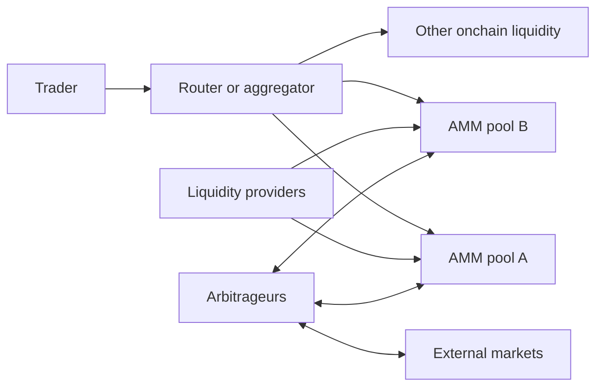
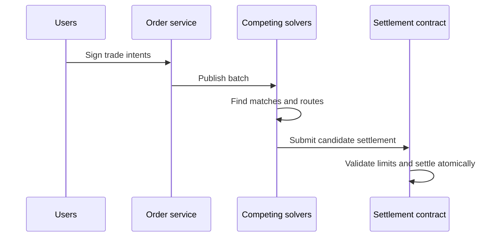

# Decentralized Exchanges and Automated Market Makers

A decentralized exchange (DEX) is a set of smart contracts and supporting
services through which users trade blockchain assets without transferring them
to a conventional exchange account. The trade changes public blockchain state;
the protocol, rather than a private customer subledger, enforces settlement.

“Decentralized” does not mean that every component is decentralized or risk-free.
A DEX can depend on a web interface, governance, upgrade keys, token lists,
oracles, routers, solvers, relayers, sequencers, and professional market makers.
The useful analysis identifies which functions are onchain, who can change them,
and what assumptions remain.

## From Order Books to Onchain Liquidity

Traditional exchanges match explicit bids and offers. Early public blockchains
were poorly suited to updating thousands of orders because each placement,
cancellation, and match consumed block space and waited for consensus.
Automated market makers (AMMs) instead hold token reserves in smart contracts and
quote trades from a deterministic function. A user can trade whenever the chain
executes, without waiting for a specific counterparty order.



The AMM does not know the economically correct price. Its reserve function gives
a price implied by current balances. Arbitrageurs trade when that price differs
from other markets, moving the pool toward the external price. Liquidity
providers pay for this price-discovery service through adverse selection and
receive fees in return.

## Constant-Product AMMs

### The invariant

In the simplest two-token constant-product market maker:

```text
x × y = k
```

where `x` and `y` are pool reserves and `k` is constant before fees. Ignoring
fees, a trader adding `Δx` receives `Δy` such that:

```text
(x + Δx)(y - Δy) = xy

Δy = y - xy/(x + Δx)
```

The marginal price of token X in units of Y is approximately:

```text
p_x = y / x
```

As the trader buys X, `x` falls and `y` rises, making further X increasingly
expensive. The curve always retains positive theoretical reserves and can quote
at any price, but trades become extremely costly near an axis.

### Fees

If the fee rate is `f`, only `(1-f)Δx` affects the pricing calculation:

```text
Δy = y - xy / (x + (1-f)Δx)
```

The full input enters the pool, so fees increase the value of reserves and the
effective `k`. In Uniswap v2, liquidity providers own fungible LP tokens
representing a pro-rata claim on both reserves and accumulated fees.

### Price impact and slippage

**Price impact** is the change caused by the trade relative to the pool's
pre-trade marginal price. **Slippage tolerance** is the user's maximum permitted
difference between quoted and executed output. Slippage can also come from
transactions executed before the user's transaction.

Small relative trades have low impact; large trades consume increasingly
expensive portions of the curve. Splitting across independent pools or routes can
improve execution, which is why aggregators solve a routing optimization problem.

### Numerical example

Suppose a zero-fee pool has 100 ETH and 200,000 USDC:

```text
k = 20,000,000
spot price ≈ 2,000 USDC/ETH
```

A trader adds 21,000 USDC to buy ETH:

```text
new USDC reserve = 221,000
new ETH reserve  = 20,000,000 / 221,000 ≈ 90.498
ETH received     ≈ 9.502
average price    ≈ 2,210 USDC/ETH
```

The trade pushes the marginal price to about 2,442 USDC/ETH. A real pool fee
reduces output further. The example shows why the displayed spot price cannot be
multiplied by arbitrary size.

## Liquidity-Provider Economics

An LP supplies an inventory strategy. In a constant-product pool, arbitrage
automatically sells the asset that has risen in external price and buys the asset
that has fallen. The LP ends with a different inventory than passive holding.

### Impermanent loss

For a 50/50 constant-product pool with an external relative price change `r`, the
value ratio of the LP position to simply holding the initial tokens, before fees,
is:

```text
LP / hold = 2√r / (1 + r)
```

The shortfall is often called impermanent loss:

```text
IL = 2√r / (1 + r) - 1
```

If price doubles (`r = 2`), the shortfall is about 5.72% before fees. It is
“impermanent” only because it narrows if the relative price returns. Once
liquidity is removed or the inventory is hedged, the economic result is realized.
The name can mislead: the loss relative to holding is genuine opportunity cost.

### Loss-versus-rebalancing

Impermanent-loss formulas compare endpoints and ignore the path and continuous
rebalancing. **Loss-versus-rebalancing (LVR)** measures the value transferred to
arbitrageurs because an AMM quotes a stale curve between external price updates.
Faster or better-informed traders capture this value. Volatility, block time,
transaction ordering, fee level, and competition determine the result.

An LP's approximate return is:

```text
fees + incentives + ancillary yield
- adverse selection/LVR
- inventory opportunity cost
- gas and rebalancing costs
- smart-contract and token losses
```

High advertised fee APR can reflect volatile, toxic flow and may not imply
profitability.

### Other LP risks

- one reserve token can depeg, default, freeze, rebase, or be exploited;
- a narrow price range can become inactive and hold almost one asset;
- incentives can fall or their token price can collapse;
- governance can alter fees or emissions;
- an LP manager or vault adds strategy and custody risk;
- front-running and just-in-time liquidity can redistribute fees;
- tax and accounting treatment can differ from holding.

## Concentrated Liquidity

Uniswap v3 lets an LP allocate capital to a chosen price interval rather than the
entire range from zero to infinity. Within the interval, the position behaves
like a constant-product pool with larger **virtual reserves**; outside it, the
position is entirely one token and earns no swap fees until price returns.

For a position with liquidity `L` between prices `p_a` and `p_b`, its translated
curve can be represented as:

```text
(x + L/√p_b)(y + L√p_a) = L²
```

Price space is divided into discrete ticks. Active liquidity is the sum of
positions whose ranges contain the current tick. A swap moves the square-root
price through ticks, adding or removing active liquidity at boundaries.

### Capital efficiency

If a pair normally trades in a tight band, concentrating liquidity there
provides much greater depth per dollar. This is especially useful for correlated
assets such as stablecoin pairs or ETH and liquid-staking tokens.

Capital efficiency is not free:

- the LP must choose a range;
- narrower ranges experience greater inventory turnover and can go out of range;
- positions are non-fungible because ranges and fee histories differ;
- rebalancing costs gas and can realize losses;
- professional automation can outperform passive LPs.

Concentrated liquidity makes the pool resemble a collection of limit-order-like
positions, but an LP position is not a simple limit order: it supplies continuous
two-way inventory across a range and earns fees while active.

## Stable-Swap Curves

A constant-product curve uses capital inefficiently when both assets should trade
near parity. A constant-sum curve:

```text
x + y = k
```

offers a constant one-to-one price but can be completely drained if one asset
loses its peg. Curve's StableSwap invariant interpolates between constant-sum
behavior near balance and constant-product behavior farther away. An
amplification parameter `A` controls how tightly liquidity is concentrated near
the target relationship.

This design offers low slippage for stablecoins, wrapped forms of the same asset,
or correlated staking tokens, while retaining a rising price as reserves become
imbalanced. It does not know whether a peg is fundamentally sound. During a
depeg, arbitrageurs can leave LPs holding mostly the impaired asset. A large `A`
improves normal-time depth but can let more value exit near the old peg before
the curve reacts.

Curve's later CryptoSwap designs use an internal price scale and dynamically
concentrated liquidity for assets that are not expected to remain at one-to-one.

## Weighted and Multi-Asset Pools

Balancer generalized the constant-product idea to weights:

```text
V = ∏ balance_i ^ weight_i

where ∑ weight_i = 1
```

A two-token 80/20 pool holds a strategic 80/20 exposure instead of 50/50.
Balancer also supports multi-token pools, stable math, managed parameters, and
customizable hooks in newer architecture. Pools can function as:

- index-like portfolios that rebalance through arbitrage;
- liquidity for project treasury tokens with less quote-asset requirement;
- stable or boosted pools containing yield-bearing assets;
- building blocks behind vault strategies.

The increased expressiveness adds parameter, oracle, rate-provider, and hook
dependencies. A yield-bearing token's nominal balance may need a rate conversion
to determine economic value.

## Uniswap's Protocol Generations

### v2

Uniswap v2 deploys a separate pair contract for each ERC-20 pair. It uses the
constant-product invariant, fungible LP tokens, cumulative-price observations,
and flash swaps. Any user can create a pool. Liquidity can fragment across
duplicate pairs and fee or token variants.

### v3

Uniswap v3 introduced concentrated liquidity, several fee tiers, tick-based
positions, and improved time-weighted observations. Each position is represented
by a non-fungible claim defined by pool, lower tick, upper tick, and liquidity.

### v4

Uniswap v4 places pools in a singleton `PoolManager` contract. Flash accounting
tracks net token deltas and settles them at the end of a locked operation,
reducing transfers in complex routes. Optional **hooks** run before or after pool
initialization, liquidity changes, swaps, or donations. They can implement
dynamic fees, custom curves, oracles, limit-order behavior, or incentives.

The core can be non-upgradeable while a chosen hook contains arbitrary code and
its own governance. A v4 pool's security is therefore the composition of
PoolManager, router, hook, tokens, and any external dependencies. “Uniswap v4
pool” is no longer a sufficiently specific risk description.

## Routers and Aggregators

A pool contract exposes a swap primitive. A **router** handles multi-hop trades,
token approvals, native-token wrapping, slippage constraints, and position
operations. An **aggregator** compares paths across several DEXs and can split an
order.

For route `A → B → C`, output depends on:

- liquidity and fees in both pools;
- price impact at the chosen sizes;
- gas and L2 data cost;
- token-transfer behavior;
- current block state;
- MEV and transaction inclusion.

The route with the highest gross output may not have the best net result after
gas. Aggregators can improve execution but introduce smart-contract, API,
simulation, and allowance risk. Their quoted route can become stale before
execution.

## Batch Auctions and Intent-Based Trading

Not every DEX is an AMM. CoW Protocol lets users sign offchain **intents** that
specify desired trades and constraints. Solvers compete to produce a batch
settlement. Orders can match directly through a “coincidence of wants”; residual
amounts can use onchain AMMs or other liquidity.



Batching can reduce intra-batch ordering games and allow price improvement, but
the system depends on solver competition, order availability, settlement rules,
and censorship resistance. Solvers may use private liquidity or centralized
computation even though final settlement is onchain.

An intent does not prescribe the execution path; it delegates pathfinding within
constraints. This improves abstraction but requires users to understand what they
authorize, how expiration and partial fill work, who can submit, and what
information solvers observe.

## MEV and Transaction Ordering

Public pending transactions disclose potential trades before final ordering. A
searcher can:

- arbitrage an AMM after an external price move;
- place a trade before and after a victim's large swap—a sandwich;
- compete to liquidate or capture an oracle update;
- provide just-in-time liquidity for one transaction;
- back-run a route to restore prices.

A sandwich raises the victim's execution price up to the allowed slippage and
captures the difference. Defenses include tighter slippage, private order flow,
batch auctions, dynamic fees, better routing, and protocols that internalize or
auction ordering value.

Not all arbitrage is harmful. AMMs require arbitrage to align prices. The policy
question is how surplus from ordering is allocated among traders, LPs,
validators/sequencers, searchers, and protocol governance.

## Oracles and AMM Prices

An AMM spot price can be manipulated with a sufficiently large temporary trade,
especially using a flash loan. A lending protocol should not normally value
collateral from one instantaneous pool reserve ratio.

Time-weighted average price (TWAP) observations reduce sensitivity to one block:

```text
TWAP = (cumulative price at t2 - cumulative price at t1) / (t2 - t1)
```

Manipulating a TWAP requires sustaining distortion across the window, but cost
depends on liquidity, block control, and arbitrage. TWAPs lag real markets and
can fail during genuine rapid moves. External oracle networks introduce their
own data and governance assumptions. Oracle design belongs to the consuming
protocol's risk model, not just the DEX.

## Token and Smart-Contract Hazards

Permissionless pool creation means a ticker and logo are not evidence of the
intended token. Attackers create lookalike assets and malicious pools. Tokens can
also:

- charge transfer fees;
- rebase balances;
- blacklist or pause;
- return non-standard values;
- execute callbacks;
- prevent selling through malicious logic;
- be upgradeable by an issuer;
- represent a bridge or protocol claim.

Routers and pool math may not support every behavior. Users should verify
contract address, chain, token powers, pool contract, liquidity, and route.

Approvals are a standing risk. An ERC-20 `approve` authorizes a spender to move
tokens later; unlimited allowances survive the immediate trade. Permit signatures
can create the same authority without an approval transaction. Hardware-wallet
confirmation is useful only if the message and spender are intelligible.

## Governance and Protocol Economics

DEX governance may control:

- protocol-fee activation and allocation;
- approved deployments or canonical interfaces;
- treasury and incentive programs;
- routers, token lists, gauges, or fee recipients;
- emergency and upgrade powers for mutable components.

Liquidity-provider fees are not necessarily protocol revenue. In Uniswap v2 and
v3, fees historically accrued primarily to LPs unless a protocol-fee mechanism
was activated for relevant deployments. Front-end fees, sequencer economics,
governance-token value, and treasury flows are separate.

Curve's vote-escrow and gauge system illustrates incentive governance: locked
governance tokens influence which pools receive token emissions. This can create
“bribes” or vote-incentive markets where protocols pay for liquidity. The
resulting APY may be subsidy rather than organic trading demand.

## DEX Risk Framework

| Risk | Example failure mechanism |
|---|---|
| Contract | arithmetic, callback, reentrancy, accounting, or upgrade flaw |
| Token | depeg, freeze, fee-on-transfer, malicious implementation |
| LP economic | adverse selection and volatility exceed fees |
| MEV | sandwiching, back-running, censorship, solver extraction |
| Oracle | manipulated, stale, or inappropriate price consumed elsewhere |
| Governance | key compromise, capture, malicious proposal |
| Interface | DNS or front-end compromise, wrong token list |
| Chain/L2 | reorg, halt, sequencer outage, bridge failure |
| Composability | dependent protocol, vault, hook, or rate provider fails |
| Legal/compliance | access restrictions, sanctions, developer/operator liability |

“Non-custodial” narrows the risk of an exchange misusing a customer account, but
the user can still lose assets atomically to bad code or a bad signature.
Blockchain settlement is final execution of the programmed rules, not a
guarantee that the trade was economically fair.

## Evaluating a DEX Trade

Before execution, identify:

1. exact input and output contract addresses and chains;
2. route, pools, hooks, bridges, and external calls;
3. expected output, minimum output, fee, gas, and price impact;
4. allowance or permit authority granted;
5. transaction simulation and balance changes;
6. likely MEV exposure and private-routing options;
7. upgrade, pause, and governance powers;
8. token redemption and issuer risks.

For a liquidity position, additionally model price paths, active range, volume,
fee share, adverse selection, rebalancing, incentives, and tail failure of each
asset. TVL and historical APR are not sufficient.

## CEX and DEX Are Converging

Centralized exchanges increasingly route to external venues and support
self-custodial wallets. DEXs increasingly use offchain solvers, sequencers,
professional market makers, and curated interfaces. A trade can begin in a
centralized application, route through an onchain aggregator, settle in a smart
contract, and return to qualified custody.

The canonical distinction remains useful:

- a CEX trade normally changes a private intermediary's ledger;
- a DEX trade normally changes blockchain state under smart-contract rules.

But a full risk analysis follows custody, ordering, execution, settlement,
governance, and legal responsibility through the actual path.

## Related Notes

- [Market Microstructure and Trading](../../01-financial-foundations/02-financial-markets/market-microstructure-and-trading.md)
- [Crypto Market Structure and Centralized Exchanges](../02-centralized-markets/crypto-market-structure-and-centralized-exchanges.md)
- [Smart Contracts, Virtual Machines, and Token Standards](../../02-blockchain-foundations/03-execution-and-applications/smart-contracts-virtual-machines-and-token-standards.md)
- [Oracles, Indexers, and Offchain Data](../../02-blockchain-foundations/03-execution-and-applications/oracles-indexers-and-offchain-data.md)
- [Onchain Order Books and Derivatives Venues](onchain-order-books-and-derivatives-venues.md)
- [DeFi Risk, Security, and Economic Attacks](../../04-decentralized-finance/04-defi-risk-and-failures/defi-risk-security-and-economic-attacks.md)

## References

- Uniswap, [Uniswap v2 Core Whitepaper](https://docs.uniswap.org/whitepaper.pdf).
- Uniswap, [Uniswap v3 Core Whitepaper](https://app.uniswap.org/whitepaper-v3.pdf).
- Uniswap, [Uniswap v4 Core Whitepaper](https://app.uniswap.org/whitepaper-v4.pdf).
- Uniswap Developers, [Concentrated Liquidity](https://developers.uniswap.org/docs/get-started/concepts/liquidity-providers/concentrated-liquidity).
- Uniswap Developers, [Hooks](https://developers.uniswap.org/docs/get-started/concepts/hooks).
- Curve Finance, [StableSwap Whitepaper](https://docs.curve.finance/assets/pdf/whitepaper_stableswap.pdf).
- Curve Finance, [CryptoSwap Whitepaper](https://docs.curve.finance/assets/pdf/whitepaper_cryptoswap.pdf).
- Balancer, [Balancer Documentation](https://docs.balancer.fi/).
- Balancer, [Weighted Math](https://docs.balancer.fi/concepts/explore-available-balancer-pools/weighted-pool/weighted-math.html).
- CoW Protocol, [Protocol Documentation](https://docs.cow.fi/).
- Paradigm, [Loss-Versus-Rebalancing](https://www.paradigm.xyz/2022/11/lvr).
- Flashbots, [Maximal Extractable Value](https://docs.flashbots.net/new-to-mev).
- Bank for International Settlements, [Decentralised Finance: A Functional Approach](https://www.bis.org/publ/work1227.htm).
