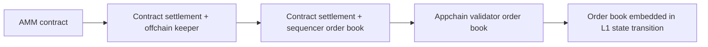
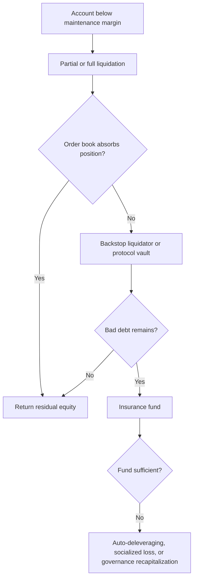

# Onchain Order Books and Derivatives Venues

Onchain trading systems increasingly reproduce the central-limit order book,
margin engine, and perpetual futures of centralized exchanges while keeping
balances and settlement under blockchain rules. Their architectures range from
smart contracts with an offchain sequencer to application-specific chains whose
consensus directly executes every order.

The label “onchain” is not binary. An order may be signed offchain, stored in
validator memory, sequenced by one operator, matched by consensus, and settled
in a smart contract. The right comparison maps each stage.

## Execution-Architecture Spectrum



| Function | Questions |
|---|---|
| Custody | Are collateral and balances in contracts, a bridge, native chain state, or operator accounts? |
| Order entry | Is an order an onchain transaction or an offchain signature/message? |
| Sequencing | Who decides order and can censor, delay, or front-run? |
| Matching | Does a contract, sequencer, validator mempool, or consensus engine match? |
| Risk | Where are margin, oracle, liquidation, and position limits enforced? |
| Settlement | What event makes the fill final, and can state be challenged or reorganized? |
| Governance | Who changes markets, fees, code, or validators? |

Performance usually comes from moving some work away from a general-purpose
chain. This can be sound, but the removed work becomes an explicit trust,
availability, or governance assumption.

## Central-Limit Order Books Onchain

A CLOB contains bids and asks at discrete price ticks. A typical matching rule is
price-time priority:

1. the highest bid and lowest ask have price priority;
2. among orders at one price, the earlier order fills first;
3. a crossing taker executes against resting makers;
4. partial fills leave a reduced resting order.

On a general-purpose blockchain, every order and cancel competes for block space.
Market makers update quotes rapidly, so storing all messages permanently is
expensive. Implementations use several techniques:

- offchain signed orders settled only when filled;
- a centralized sequencer with onchain account settlement;
- validator-maintained in-memory orders, with fills committed to consensus;
- a specialized appchain optimized for order messages;
- native exchange state embedded in a purpose-built L1.

### Order state and finality

An API acknowledgment is not necessarily final. Possible states include:

```text
created → accepted → propagated → resting → partially filled
                                      ↘ canceled/expired
                         filled → consensus/finality
```

A user may see an order in one node's book before every validator sees it.
Cancellation competes with fills. Network partition, sequence gaps, validator
differences, and chain reorganization can create temporary uncertainty. Trading
clients need idempotent client IDs, authoritative sequence numbers, and explicit
finality rules.

## Perpetual Futures

A perpetual future is a leveraged derivative with no expiry. It tracks an
underlying index through margin, liquidation, arbitrage, and periodic funding
payments rather than delivery at a maturity date.

For a linear contract:

```text
unrealized P&L_long  = quantity × (mark price - entry price)
unrealized P&L_short = quantity × (entry price - mark price)
```

The contract may be denominated and collateralized differently. A BTC/USD
perpetual margined in USDC is linear in dollar P&L. An inverse contract margined
in BTC has nonlinear coin-denominated P&L. A contract quoted from a USDT index
but settled in USDC contains an implicit USDC/USDT basis assumption.

### Funding

Funding transfers value between longs and shorts, normally without being protocol
revenue. A simplified rate is:

```text
funding rate = premium component + interest component
funding payment = position notional × funding rate × time fraction
```

If the perpetual trades above spot, longs commonly pay shorts, encouraging
shorting and discouraging longs. The exact index, premium calculation, clamps,
sampling window, and interval differ by venue.

Funding does not guarantee convergence. In a stressed market it can become
extreme, be capped, or fail to attract enough arbitrage because borrowing,
withdrawal, or counterparty constraints prevent the hedge.

## Margin and Leverage

### Initial and maintenance margin

**Initial margin** is required to open exposure; **maintenance margin** is the
minimum equity before liquidation.

```text
account equity
  = collateral value
  + realized P&L
  + unrealized P&L
  - accrued fees and funding

margin ratio = account equity / risk-weighted position notional
```

The simple displayed leverage:

```text
leverage = position notional / allocated equity
```

does not fully describe liquidation risk because maintenance tiers, cross
positions, funding, collateral haircuts, oracle movement, and fees also matter.

### Cross and isolated margin

- **Isolated margin** bounds a position to allocated collateral. Failure should
  not consume unrelated cross-margin balances, subject to venue rules.
- **Cross margin** shares equity across positions. Profits in one market can
  support losses in another, improving capital efficiency but linking positions.
- **Portfolio margin** estimates net risk across correlated derivatives and
  options scenarios. It is model-sensitive and can fail when correlations break.

Collateral may itself be volatile, bridged, yield-bearing, or centrally issued.
Haircuts and concentration limits prevent one dollar of risky collateral from
being treated as one dollar of loss-absorbing capacity.

## Mark Price and Oracle Design

Liquidating from the last traded price permits manipulation in a thin order book.
Venues therefore distinguish:

- **index price:** composite of external spot or derivative markets;
- **mark price:** a smoothed or constrained measure used for P&L and liquidation;
- **last price:** most recent venue trade;
- **oracle price:** signed or consensus-provided reference.

A robust index defines constituent venues, weights, stale-data rules, outlier
filters, stablecoin conversions, and fallback behavior. External CEX dependence
creates a paradox: a decentralized derivative can rely on centralized markets
for liquidation truth.

The mark should resist a one-trade attack but track genuine moves quickly enough
to avoid delayed insolvency. Too much smoothing lets underwater positions persist;
too little makes liquidations manipulable.

## Liquidations and Default Waterfalls

When equity falls below maintenance margin, the system reduces or transfers the
position. A common waterfall is:



Liquidation design specifies:

- trigger price and maintenance tier;
- partial versus full close;
- liquidation limit or penalty;
- who receives liquidation profit;
- maximum slippage and position caps;
- insurance-fund ownership;
- backstop market makers or vault;
- auto-deleveraging priority;
- treatment during oracle or chain failure.

Liquidation is a market order into stressed liquidity. If many correlated
accounts fail together, impact can push prices further, creating a cascade.
Transparent rules help analysis but do not create liquidity.

## Insurance Funds and Auto-Deleveraging

An insurance fund absorbs losses when liquidation proceeds do not cover account
liabilities. It is funded through fees, liquidation surplus, protocol capital, or
governance allocations. Its adequacy depends on stress loss, not nominal balance.
If the fund is held in the venue's own token, its value may fall when needed.

**Auto-deleveraging (ADL)** forcibly reduces profitable opposing positions when
bad debt cannot otherwise be absorbed. ADL protects protocol solvency by imposing
execution on users who did not default. Ranking often considers leverage and
profit. Traders must include ADL in tail-risk and hedge-continuity analysis.

## dYdX

### Evolution

dYdX moved through several architectures. Earlier Ethereum versions used smart
contracts for lending and margin. The v3 perpetual exchange settled positions on
StarkEx while a centrally operated order book and sequencer provided fast
matching. The later dYdX Chain is a sovereign Cosmos-SDK application chain using
CometBFT consensus and a validator set.

The evolution illustrates a core trade-off: a general-purpose rollup gives
Ethereum settlement and specialized proving, while an appchain can place the
trading engine closer to consensus and tune the entire network for market data.

### Order book

On dYdX Chain, validators maintain and gossip short-term orders in memory rather
than committing every resting order to permanent state. Matches and resulting
positions become state transitions. Longer-lived conditional orders can require
different state handling. Validators propose blocks containing operations under
the chain's protocol rules.

This reduces storage and fees for cancels but introduces distributed-memory
behavior. Validators can have temporarily different views; order propagation,
proposer selection, and consensus determine fills. The chain's governance can
adjust spam limits, market parameters, margin, and other controls.

### Risk and governance

Accounts use subaccounts, collateral, perpetual positions, and protocol margin
rules. If a subaccount falls below maintenance, protocol-generated liquidation
orders match against book liquidity. Public documentation states that the
insurance fund takes liquidation profits or losses under the software's default
configuration.

DYDX is used for chain staking and governance. Validator concentration, client
software, governance participation, oracle operation, bridges, front ends, and
indexers remain important. “The order book is decentralized” does not answer
whether a user has resilient RPC access or whether stake is broadly distributed.

## Hyperliquid

### HyperCore and HyperEVM

Hyperliquid is a purpose-built L1. **HyperCore** contains native spot and
perpetual order books, clearing, margin, liquidations, staking, bridges, and
vaults. **HyperEVM** supplies an EVM environment connected to the L1's native
financial state.

Hyperliquid states that every order, cancel, trade, and liquidation in HyperCore
is included in chain operation and receives one-block finality under HyperBFT.
Order books use price-time priority. Consensus and mempool logic are aware of
exchange actions; documentation specifies an in-block category ordering that
places cancels before new GTC/IOC orders within proposed action groups.

Embedding the order book in the state transition gives deterministic market
behavior and high performance, but places substantial responsibility on the
custom validator software and validator set. It differs from deploying an
auditable Solidity exchange contract on Ethereum.

### Oracle and clearing

Validators publish prices derived from specified external venues. The
stake-weighted median of validator submissions feeds a mark price used in
margining, liquidations, triggers, and funding. The design diversifies external
sources but remains exposed to exchange data, validator implementation, and
stablecoin denomination.

Perpetuals are generally USDC-margined. Hyperliquid documents cross and isolated
margin, asset-specific maximum leverage, hourly funding, margin tiers, and
position/order limits.

### Liquidation

Liquidatable positions first enter the order book as market orders. Larger
positions can be partially liquidated. If equity falls further and the book
does not restore compliance, a liquidator vault can take over positions. The
protocol's HLP vault also participates in market making and backstop liquidation,
so depositors receive strategy gains and losses rather than a risk-free protocol
yield.

### Bridge and decentralization considerations

USDC deposited from Arbitrum is credited after a threshold of stake-weighted
validators attests. Withdrawals use validator signatures and a dispute period,
with a mechanism to lock and later unlock the bridge under specified thresholds.
The bridge is a separate security boundary from HyperCore consensus.

Evaluation should examine validator count and stake concentration, binary and
source availability, bridge controls, oracle sources, front-end dependencies,
governance, emergency powers, HLP concentration, and the operational role of
Hyperliquid Labs. High throughput and transparent state do not themselves prove
decentralized control.

## GMX

GMX uses a pool-counterparty model rather than a CLOB. Traders open leveraged
positions against market-specific liquidity pools represented by GM tokens.
Keepers execute orders using signed oracle prices; smart contracts enforce
position, fee, and pool accounting.

### Pool economics

A GM pool holds designated long and short backing tokens. Its token value can be
summarized as:

```text
GM token price
  = (pool asset value + net pending trader P&L) / GM token supply
```

LPs earn a share of trading, swap, borrowing, and liquidation-related fees, but
are exposed to trader P&L and token inventory. If traders profit in aggregate,
pool value falls; if traders lose, pool value rises. Market-specific pools
isolate risk more than one universal counterparty pool.

### Balancing mechanisms

GMX uses several linked controls:

- price impact based on changes in long/short open-interest imbalance;
- funding transfers from the dominant side toward the minority side;
- borrowing fees tied to utilization and reserved liquidity;
- open-interest caps and reserve factors;
- oracle-based execution and keeper submission;
- P&L caps for certain pool operations;
- liquidations and auto-deleveraging.

Orders are created onchain and executed in a second transaction when keepers
provide prices. Slippage tolerance covers oracle movement during the delay,
while protocol price impact is a separate economic adjustment. This differs from
walking an order book.

GMX therefore transfers market-making risk to passive pools. It can offer
execution without visible depth, but capacity is bounded by pool assets,
open-interest balance, governance parameters, and oracle confidence.

## Hybrid and Other Designs

Representative patterns include:

- **Vertex and similar rollup venues:** a sequencer matches offchain orders while
  smart contracts or a rollup settle balances, sometimes combining an AMM with
  the order book;
- **Jupiter Perpetuals and pool models:** liquidity providers back leveraged
  trader positions with oracle pricing and utilization fees;
- **Aevo and options rollups:** offchain order books with rollup or contract
  settlement;
- **Drift on Solana:** a decentralized limit order book, AMM/backstop liquidity,
  keepers, and cross-margined positions;
- **injective-style appchains:** exchange modules and order books integrated into
  chain execution.

The design space is converging around fast offchain or native-chain order
handling plus verifiable state, not literal placement of every quote into an
expensive general-purpose contract.

## Sequencers, Validators, and Fair Ordering

Low latency creates value. The actor ordering transactions can:

- privilege its own or selected flow;
- delay cancellations;
- observe orders before publication;
- extract liquidations;
- censor addresses or markets;
- halt the venue.

Possible mitigations include multiple sequencers, consensus ordering, encrypted
mempools, frequent batch auctions, cancel-priority rules, public proposer policy,
MEV auctions, and forced inclusion. Each adds latency or complexity. “First
come” also requires defining the clock: arrival at a gateway, sequencer, proposer,
or consensus?

Colocation on a blockchain can still exist economically through faster network
paths to validators, private endpoints, or stake relationships. Public state
improves after-the-fact auditability but does not eliminate latency advantage.

## Liquidity and Market-Maker Economics

An order-book venue needs competitive two-sided quotes. Market makers bear:

- inventory and adverse selection;
- cross-venue hedge and transfer risk;
- chain, bridge, and oracle outages;
- liquidation and ADL risk;
- funding and collateral basis;
- API and sequence integrity;
- governance and token-incentive risk.

Token emissions, maker rebates, vault capital, or foundation loans may bootstrap
liquidity. Sustainable depth ultimately requires organic flow and reliable
hedging. Reported notional volume should be evaluated with spread, depth,
maker concentration, incentive cost, and wash-trading controls.

Pool venues replace explicit maker quotes with LP balance-sheet capital. They
still require arbitrageurs and governance to tune imbalances. Order-book and pool
models can coexist: a pool can backstop a book while professional makers improve
the top of book.

## Derivatives Venue Risk

| Risk | Order-book manifestation | Pool manifestation |
|---|---|---|
| Liquidity | book gaps; liquidation slippage | pool capacity and imbalance |
| Counterparty | clearinghouse/insurance solvency | LP pool absorbs trader P&L |
| Oracle | mark and liquidation manipulation | execution and P&L mispricing |
| Sequencing | cancel/fill ordering and MEV | keeper delay and oracle timing |
| Collateral | haircut, bridge, stablecoin failure | backing-token and utilization risk |
| Governance | parameter or market changes | pool caps, fees, oracle configuration |
| Technology | chain, matching, API, bridge | contracts, keepers, oracle, chain |

Leverage magnifies small defects. A one-percent oracle or execution error can
consume a large fraction of margin at 20× leverage. Composability adds further
risk when perpetual positions or LP tokens become collateral elsewhere.

## Evaluation Framework

### Instrument

- exact payoff, index, collateral, settlement unit, funding, and expiry;
- cross, isolated, or portfolio margin;
- position tiers, limits, and ADL;
- treatment of stablecoin or collateral depeg.

### Execution

- where orders reside and how price-time priority is defined;
- authoritative timestamps and sequence recovery;
- cancellation guarantees and chain finality;
- market-maker concentration and actual depth;
- sequencer/validator censorship and MEV controls.

### Risk engine

- mark and index sources, weights, and fallbacks;
- liquidation trigger, penalty, partial-close logic, and backstop;
- insurance-fund composition and stress sufficiency;
- pool P&L, caps, utilization, and governance.

### Infrastructure and control

- chain security and validator distribution;
- bridge, custody, and stablecoin dependencies;
- upgrade, admin, emergency, and market-listing powers;
- node, API, indexer, keeper, and front-end resilience;
- audited code and transparent incident history.

### Legal and market structure

- operator, developer, governance, and user legal relationships;
- derivatives and exchange regulatory perimeter;
- sanctions and access controls;
- customer claim in a bridge, vault, or insolvency;
- data, surveillance, and dispute processes.

The key insight is that decentralizing custody and settlement does not eliminate
the functions of an exchange or clearinghouse. It relocates them into code,
validators, governance, oracle networks, bridges, and shared liquidity. Those
components must be analyzed with the same care as their centralized analogues.

## Related Notes

- [Market Microstructure and Trading](../../01-financial-foundations/02-financial-markets/market-microstructure-and-trading.md)
- [Decentralized Exchanges and Automated Market Makers](decentralized-exchanges-and-automated-market-makers.md)
- [Crypto Market Structure and Centralized Exchanges](../02-centralized-markets/crypto-market-structure-and-centralized-exchanges.md)
- [Peer-to-Peer Networks, Finality, and Forks](../../02-blockchain-foundations/02-consensus-and-networks/peer-to-peer-networks-finality-and-forks.md)
- [Onchain Derivatives, Structured Products, and Yield](../../04-decentralized-finance/03-derivatives-staking-and-yield/onchain-derivatives-structured-products-and-yield.md)
- [DeFi Risk, Security, and Economic Attacks](../../04-decentralized-finance/04-defi-risk-and-failures/defi-risk-security-and-economic-attacks.md)

## References

- dYdX Community, [dYdX Chain Technical Documentation](https://docs.dydx.community/dydx-chain-technical-docs/).
- dYdX Community, [Liquidations on dYdX Chain](https://help.dydx.trade/en/articles/166991-liquidations-on-dydx-chain).
- dYdX Foundation, [Validators and CometBFT](https://www.dydx.foundation/validators/introduction).
- Hyperliquid, [Technical Overview](https://hyperliquid.gitbook.io/hyperliquid-docs).
- Hyperliquid, [Order Book](https://hyperliquid.gitbook.io/hyperliquid-docs/hypercore/order-book).
- Hyperliquid, [Oracle](https://hyperliquid.gitbook.io/hyperliquid-docs/hypercore/oracle).
- Hyperliquid, [Liquidations](https://hyperliquid.gitbook.io/hyperliquid-docs/trading/liquidations).
- Hyperliquid, [Bridge](https://hyperliquid.gitbook.io/hyperliquid-docs/hypercore/bridge).
- GMX, [Contract Architecture](https://docs.gmx.io/docs/api/contracts/architecture/).
- GMX, [Fees, Funding, Borrowing, and Price Impact](https://docs.gmx.io/docs/trading/fees/).
- GMX, [Providing Liquidity](https://docs.gmx.io/docs/providing-liquidity/).
- Bank for International Settlements, [Decentralised Finance: A Functional Approach](https://www.bis.org/publ/work1227.htm).
