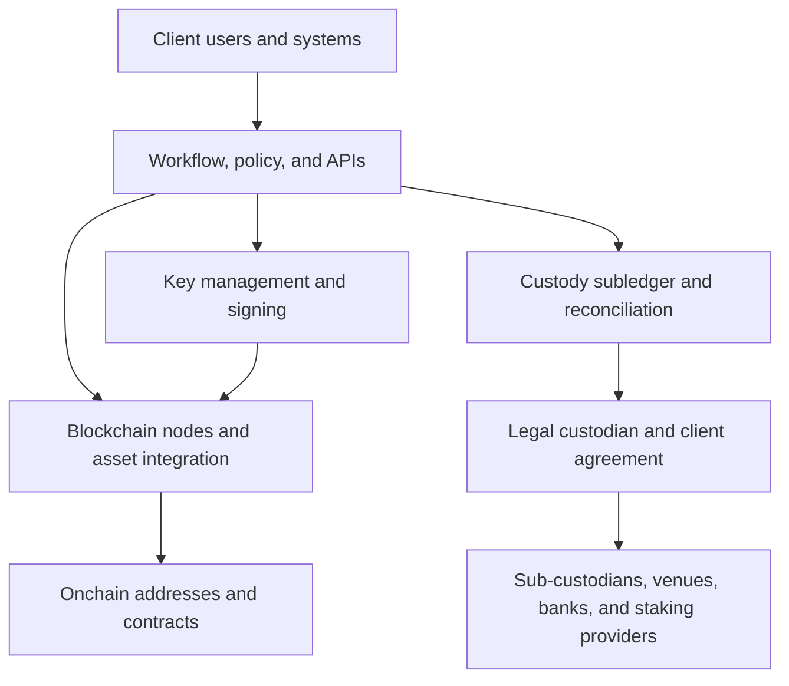
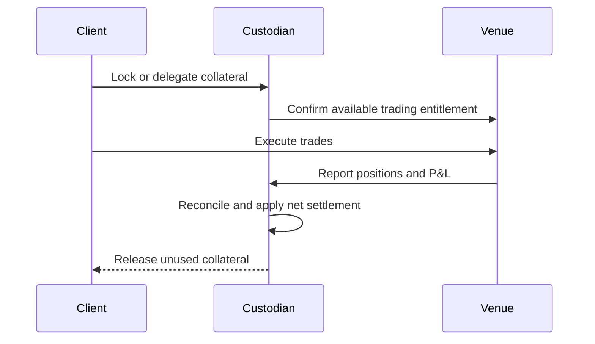

# Institutional Custody and Wallet Infrastructure

Institutional digital-asset custody is delivered through several businesses that
look similar in a product demonstration but play different legal and technical
roles. A software company may supply signing technology without accepting
possession or fiduciary duties. A trust company may be the legal custodian while
subcontracting wallet infrastructure. A bank may place assets with a specialist
sub-custodian. A prime platform may combine custody, trading, financing, staking,
and settlement through several affiliated legal entities.

This note provides a neutral framework for understanding those models and applies
it to representative providers. Product capabilities, licenses, supported assets,
and legal entities change frequently; the descriptions are based on public
information available in July 2026 and should not replace current contractual
and regulatory due diligence.

## The Institutional Custody Stack

A complete service can contain at least six layers:

1. **Legal custody:** the entity that contracts to safeguard client assets and
   whose regulatory status, fiduciary duties, segregation, and insolvency
   treatment matter.
2. **Wallet and signing infrastructure:** HSM, multisignature, MPC/TSS,
   smart-contract, or hybrid systems that create and exercise authority.
3. **Governance and orchestration:** identities, roles, approvals, policies,
   address books, transaction decoding, and APIs.
4. **Blockchain integration:** nodes, indexers, fee and nonce management,
   confirmation rules, token support, and protocol-upgrade handling.
5. **Books and records:** customer entitlements, positions, valuation,
   reconciliations, statements, and audit evidence.
6. **Asset services and connectivity:** staking, governance, trading, fiat,
   financing, collateral, and post-trade settlement.

The layers need not come from one supplier. Their division determines control,
portability, concentration, and incident response.

## Direct Custody, Sub-Custody, and Technology Enablement

### External legal custodian

The client transfers administrative control to a regulated or otherwise
contracted custodian. The custodian controls the signing arrangement, maintains
the definitive customer subledger, and processes instructions. This can provide
independent safeguarding, established audit processes, and a recognized legal
relationship. It introduces custodian counterparty risk, withdrawal dependencies,
asset-support limits, and possible sub-custodian exposure.

### Direct custody enabled by technology

A bank, exchange, fund, or fintech licenses wallet infrastructure but remains the
custodian or controller. The technology provider may participate in threshold
signing or operate policy and network services, yet lack unilateral transfer
authority and have no custody agreement with the end client. The institution
retains control and can customize operations, but also retains responsibility for
key governance, books and records, asset due diligence, compliance, recovery, and
legal treatment.

### Sub-custody

A primary custodian places keys or assets with a specialist while maintaining
the client relationship and custody records. This resembles traditional global
custody networks, but digital assets can make the sub-custodian unusually central
because it may operate the actual signing system. Due diligence must trace the
entire chain: client, primary custodian, technology provider, sub-custodian,
exchange, staking operator, and cash bank.

### Embedded and developer custody

Wallet-as-a-service products let an application create end-user or
developer-controlled wallets through APIs. Authentication may use passkeys,
social login, TEEs, MPC shares, or recovery services rather than visible seed
phrases. These improve product usability, but “wallet ownership” depends on who
can authenticate, alter recovery, supply code, or cooperate to sign. Embedded
wallet infrastructure is not automatically regulated custody.

## Segregated and Omnibus Operating Models

A custodian can hold each client's assets in dedicated onchain key groups, pool
assets across addresses while segregating them in its subledger, or combine both.

| Dimension | Dedicated onchain structure | Omnibus structure |
|---|---|---|
| Attribution | Easier to map address to client | Depends more heavily on internal books |
| Key operations | More wallets and signing objects | Custodian can optimize key and liquidity tiers |
| Privacy | Public holdings may identify a client | External observers see pooled activity |
| Fees and UTXOs | Less opportunity to net or batch | Greater batching and liquidity efficiency |
| Staking/DeFi | Positions can be client-specific | May require separate wallets or allocation logic |
| Assurance focus | Address/control evidence plus records | Completeness and integrity of subledger are central |

Operational commingling does not necessarily mean legal commingling. Coinbase
Prime Custody, for example, publicly describes an omnibus wallet in which client
assets are operationally commingled but legally segregated. Fidelity Digital
Assets describes omnibus wallets with segregation in books and records and
distribution across online and several offline environments. These are provider
descriptions; the enforceable result depends on contracts and applicable law.

## Provider Archetypes and Case Studies

### Fireblocks

Fireblocks began primarily as digital-asset infrastructure. Its platform combines:

- MPC-based wallets, including its MPC-CMP threshold-signing protocol;
- secure execution environments for signing components and exchange credentials;
- a transaction Policy Engine using source, destination, asset, amount, and
  approval conditions;
- Vault accounts that can represent segregated or omnibus arrangements;
- blockchain connectivity and token integrations; and
- the Fireblocks Network for authenticated connections among customers,
  exchanges, fiat providers, and counterparties.

The platform can enable a customer to operate direct custody: the customer
controls its signing shares and policies, while Fireblocks supplies coordinated
technology. Fireblocks' own educational material explicitly distinguishes this
from acting as legal custodian. The distinction has become entity-specific:
Fireblocks also established Fireblocks Trust Company, a New York limited-purpose
trust company, and a network connecting users to licensed custodians. One must
therefore identify whether a deployment uses Fireblocks software, Fireblocks
Trust Company, a third-party custodian, or a combination.

Architecturally, Fireblocks is strong at transaction orchestration and
connectivity, but its security cannot be reduced to “the private key never
exists.” Endpoint authentication, policy administration, recovery, workspace
governance, cloud and enclave assumptions, API credentials, transaction decoding,
and the availability of coordinating services remain material.

### BitGo

BitGo combines technology and regulated custody entities. Its public developer
documentation distinguishes:

- custody and self-custody;
- hot and cold arrangements;
- native multisignature and MPC/TSS; and
- wallet, settlement, staking, trading, and infrastructure services.

Many BitGo wallet designs use a two-of-three structure with user, backup, and
BitGo keys or shares. In self-custody models, the client manages user and backup
authority while BitGo participates as a co-signer and service provider. In
custody wallets, BitGo entities manage the keys and use offline procedures;
public documentation describes operator verification and separate signing
stages. Availability differs by asset because some chains support onchain
multisignature while others use threshold signatures.

The group operates several regulated entities. Its licensing page, as of July
2026, lists BitGo Bank & Trust, National Association in the United States,
BitGo New York Trust Company, and regulated entities in other jurisdictions.
The precise contracting entity and permitted service must be checked rather than
attributing every group license to every product.

BitGo is a useful example of why product mode matters as much as vendor name.
“A BitGo wallet” could mean client-controlled multisig, client-controlled MPC,
offline co-signing, regulated cold custody, or an omnibus Go Account, each with a
different control and legal model.

### Copper

Copper combines MPC-based custody, trading connectivity, staking, and post-trade
services. Its most distinctive public architecture is **ClearLoop**, an
off-exchange settlement network.

With conventional exchange trading, a client deposits assets into an address
controlled by the venue and becomes exposed to that venue for return of the
assets. Under ClearLoop:

1. the client holds assets at Copper;
2. an amount is delegated and locked in a ClearLoop account;
3. the exchange credits a virtual trading balance;
4. trading occurs on the exchange;
5. profit and loss is calculated by the exchange; and
6. periodic settlement moves net entitlements on Copper's infrastructure.

Copper states that its trust and collateral structure is designed to protect
delegated client assets and exchange collateral, although coverage and terms can
vary by connected venue. The model reduces the quantity and duration of assets
transferred to exchanges; it does not eliminate exchange exposure. Risks remain
in P&L calculation, margin sufficiency, settlement timing, legal enforceability,
Copper custody, data reconciliation, and treatment of open positions if a party
defaults. Public documentation notes that insufficient exchange collateral can
delay settlement and trigger a margin call.

ClearLoop illustrates the difference between trade execution and asset
settlement. A “balance” displayed at the exchange can be a trading entitlement
backed by assets held elsewhere rather than an onchain deposit at the venue.

### Anchorage Digital

Anchorage Digital combines custody with staking, trading, settlement, governance,
and other institutional services through jurisdiction-specific entities.
Anchorage Digital Bank National Association is a federally chartered U.S.
digital-asset bank, while Anchorage Digital Singapore holds a Major Payment
Institution license. Legal scope still depends on the client, entity, and asset.

Its public custody material emphasizes offline key protection while enabling
asset participation rather than treating cold storage as passive. Its Atlas
settlement network is described as ring-fenced and integrated with custody,
allowing participants to trade and settle crypto and fiat positions across
counterparties. As with all off-exchange systems, analysis should separate:

- where onchain assets remain;
- who owns or controls collateral;
- whether trading creates a bilateral or network claim;
- how frequently positions settle;
- which entity guarantees, calculates, or merely facilitates settlement; and
- what happens on participant or custodian default.

### Taurus

Taurus is an infrastructure provider with several modular products:

- **Taurus-PROTECT** for hot, warm, and cold custody and wallet governance;
- **Taurus-CAPITAL** for issuing and administering tokenized assets; and
- **Taurus-PRIME** for trading cryptocurrencies and tokenized securities.

The platform is used by banks and other institutions that may remain the legal
custodian. Its relevance is therefore broader than key storage: custody,
tokenization, and marketplace functions can share asset definitions, identity,
permissions, lifecycle processing, and operational controls. This can reduce
integration fragmentation but creates a need for clear component boundaries,
deployment ownership, change governance, and exit plans.

Taurus SA is FINMA-regulated in Switzerland as a securities firm, while Taurus
technology may be licensed or deployed by other regulated institutions. The
regulatory status of the technology supplier should not be transposed to a
client's service without examining the actual arrangement.

### Coinbase Custody and Coinbase Prime

Coinbase offers retail exchange services, institutional trading, financing,
staking, infrastructure, and custody through different entities. Coinbase
Custody Trust Company (CCTC) is a New York-chartered limited-purpose trust
company regulated by the NYDFS.

Coinbase Prime integrates trading, financing, settlement, and custody. Its
**Prime Custody** portfolio, documented in 2026, is designed to keep crypto and
cash assets within CCTC while routing trades across venues and settling
off-chain. Coinbase describes the model as omnibus with most assets offline and
a smaller online component for withdrawals, while customer assets are legally
segregated. Segregated Prime Vault wallets are used for functions such as
staking that the omnibus wallet does not support.

The arrangement demonstrates entity decomposition inside an integrated product:
CCTC provides custody and settlement; Coinbase, Inc. provides routing; financing
can involve other Coinbase entities; and outside banks provide fiat accounts.
“Coinbase counterparty risk” is therefore not one exposure. The detailed
[Coinbase note](../02-centralized-markets/coinbase.md) covers the company and
economics beyond custody.

### Fidelity Digital Assets

Fidelity Digital Assets supplies custody and execution within the wider Fidelity
group. Its published custody papers describe an omnibus model with customer
segregation in books and records, online wallets, multiple offline tiers,
geographic and personnel controls, maker-checker authorization, and SOC 1
assurance.

Fidelity's public rationale for omnibus custody is instructive: a custodian can
spread assets across more key groups than clients, manage hot/cold liquidity,
batch activity, and reduce public attribution without assigning one key group to
each customer. The trade-off is stronger dependence on the completeness of the
custodian's liabilities and internal records. The model should be evaluated
through reconciliation, audit scope, withdrawal rules, and insolvency treatment,
not by counting visible addresses.

### Bank custodians

Traditional custodians and universal banks—including BNY, State Street, Standard
Chartered's Zodia Custody venture, and others—have developed or announced
digital-asset services with varying geographies and asset coverage. Some build
key management internally; some use infrastructure vendors; some appoint a
specialist sub-custodian; and some limit service to tokenized securities or
particular client classes.

Their advantages may include existing custody relationships, cash and securities
integration, regulatory capital, familiar controls, and global servicing. Those
strengths do not automatically establish mature blockchain support. Evaluation
still requires asset-level evidence, withdrawal and recovery testing, signer
architecture, node operations, fork and staking policies, 24/7 support, and the
sub-custody chain.

## Comparative Map

The following describes principal public positioning, not an exclusive
classification:

| Provider | Main archetype | Signing/custody emphasis | Adjacent capabilities |
|---|---|---|---|
| Fireblocks | wallet infrastructure plus separate trust/custodian network | MPC, policy engine, direct-custody enablement | transfer network, tokenization, payments, off-exchange |
| BitGo | regulated custodian and wallet platform | multisig and MPC; custody and self-custody modes | settlement, trading, staking, wallets-as-a-service |
| Copper | custodian and post-trade network | MPC custody | ClearLoop, collateral, staking, trading connectivity |
| Anchorage Digital | regulated bank/custody group | institutional custody and asset participation | staking, trading, governance, settlement |
| Taurus | bank-oriented modular infrastructure and regulated marketplace | hot/warm/cold custody platform | tokenization and trading |
| Coinbase | exchange/prime group with trust-company custodian | omnibus and segregated qualified custody | routing, financing, staking, settlement |
| Fidelity Digital Assets | institutional custodian and execution provider | omnibus, online and deep-cold tiers | execution and broader Fidelity integration |

Marketing terms such as “military-grade,” “bank-grade,” “air-gapped,” “qualified,”
and “bankruptcy remote” are hypotheses to verify. A comparative assessment should
use exact legal entities and testable controls.

## Off-Exchange Settlement

The failure of centralized venues made pre-funded trading balances a central
market-structure concern. Custodian-connected networks attempt to preserve venue
liquidity while reducing principal left at the venue.

This is not automatically delivery-versus-payment. During the interval between
trade and settlement, one party has replacement-cost exposure to the other and
relies on accurate positions. The design should specify:

- collateral ownership, control, haircuts, and permissible reuse;
- initial and variation margin;
- settlement frequency and finality;
- calculation agent and dispute process;
- venue, custodian, and client default waterfalls;
- portability of open positions;
- intraday exposure and concentration limits;
- legal effectiveness across jurisdictions; and
- operational fallback if APIs disagree or a network is unavailable.

Fireblocks Off Exchange, Copper ClearLoop, BitGo Go Network, and custodian or
prime-broker settlement services implement different versions of this idea.
They should be compared as collateral and settlement systems, not merely as
wallet features.

## Staking and DeFi from Custody

Supporting staking can require moving assets to protocol contracts, controlling
validator withdrawal credentials, or delegating to an operator. The custodian
must allocate rewards and losses, disclose slashing and lockup, and establish
whether staked assets remain in custody under applicable law. “Assets never
leave custody” may mean legal custody continues even though their onchain state
changes.

DeFi access is more complex. A custodied token may be exchanged for a receipt
token, deposited into upgradeable contracts, bridged, or exposed through
allowances. The service must decide who selects protocols, controls governance,
bears smart-contract loss, values positions, and can unwind during an incident.
Some custodians permit only allowlisted interactions; others provide connection
technology while the client assumes protocol risk.

## Portability and Concentration

Key control does not ensure practical portability. Migration may require:

- transferring every supported asset onchain;
- recreating addresses and counterparty allowlists;
- replacing embedded APIs and webhooks;
- rebuilding staking, exchange, and collateral connections;
- exporting transaction history and entitlement records;
- changing smart-contract owners or token-issuer roles; and
- coordinating frozen, vesting, bridged, or unsupported positions.

MPC key-share portability can be particularly subtle. If one vendor share is
required, the client may need a cryptographic key-transfer protocol or onchain
migration rather than a simple backup export. An exit plan should be designed
and rehearsed before distress.

Using several custodians can reduce provider concentration but fragments
liquidity, integrations, policies, and reconciliation. Independent technology
stacks may still share cloud providers, node services, identity systems, auditors,
or sub-custodians. Concentration analysis should follow actual dependencies.

## Due-Diligence Framework

### Legal and regulatory

- Which entity signs the agreement, and for which assets and jurisdictions is it
  authorized?
- Is the provider legal custodian, technology provider, sub-custodian, trustee,
  broker, settlement agent, or several entities?
- How are client ownership, segregation, liens, staking, rehypothecation, and
  insolvency addressed?
- Which subcontractors and cash banks hold assets?

### Technical and operational

- What key scheme, threshold, hardware, and deployment model apply to each chain?
- Who can change policy, code, signers, or recovery settings?
- How are transaction intent, smart-contract calls, and token approvals decoded?
- What hot, warm, and cold tiers exist, and how are limits rebalanced?
- Are independent node, broadcast, and recovery paths available?
- How are forks, upgrades, airdrops, staking, and unsupported tokens handled?

### Books, assurance, and finance

- Are accounts omnibus, address-segregated, legally segregated, or a mixture?
- How frequently are onchain balances, subledger liabilities, and cash
  reconciled?
- What do SOC, financial-statement, penetration-test, and regulatory reports
  actually cover?
- What insurance events, entities, limits, exclusions, and deductibles apply?
- How are fees charged for custody, withdrawals, staking, trading, and network
  usage?

### Resilience and exit

- What are demonstrated withdrawal and recovery times in normal and stressed
  conditions?
- Can the client operate if the provider, identity system, cloud region, or API
  fails?
- Has the complete disaster-recovery and key-migration path been tested?
- In an insolvency, who has the evidence and authority required to return assets?

The right comparison is not a single ranking of providers. It is a mapping from a
specific custody obligation to a concrete legal entity, control architecture,
operating process, and failure model.

## Related Notes

- [Wallets, Key Management, and Digital-Asset Custody](wallets-key-management-and-digital-asset-custody.md)
- [Crypto Market Structure and Centralized Exchanges](../02-centralized-markets/crypto-market-structure-and-centralized-exchanges.md)
- [Coinbase](../02-centralized-markets/coinbase.md)
- [Staking, Liquid Staking, and Restaking](../../04-decentralized-finance/03-derivatives-staking-and-yield/staking-liquid-staking-and-restaking.md)
- [Tokenization Platforms and Market Case Studies](../../05-digital-money-and-tokenization/03-tokenized-assets/tokenization-platforms-and-market-case-studies.md)

## References

- Fireblocks, [What Is Fireblocks?](https://developers.fireblocks.com/docs/what-is-fireblocks).
- Fireblocks, [Digital Asset Custody: Direct Custody, Wallet Options, and More](https://www.fireblocks.com/report/digital-asset-custody).
- Fireblocks, [Global Custodian Network](https://www.fireblocks.com/global-custodians).
- BitGo Developer Portal, [Wallet Types](https://developers.bitgo.com/docs/wallet-types).
- BitGo, [Global Licenses](https://www.bitgo.com/company/licenses/).
- Copper, [ClearLoop](https://copper.co/en/products/clearloop).
- Copper Developer Portal, [ClearLoop Introduction](https://developer.copper.co/guides/clearloop/introduction).
- Copper Developer Portal, [ClearLoop Settlements](https://developer.copper.co/guides/clearloop/settlements).
- Anchorage Digital, [Institutional Custody](https://www.anchorage.com/platform/custody).
- Anchorage Digital, [Settlement Network](https://www.anchorage.com/platform/settlement).
- Taurus, [Taurus-PROTECT](https://www.taurushq.com/en/products/protect).
- Coinbase Help, [Introduction to Prime Custody](https://help.coinbase.com/en/prime/prime-custody/introduction).
- Coinbase, [Coinbase Prime](https://www.coinbase.com/prime).
- Fidelity Digital Assets, [The Omnibus Model for Custody](https://www.fidelitydigitalassets.com/research-and-insights/omnibus-model-custody).
- Fidelity Digital Assets, [The Omnibus Model for Custody Revisited](https://www.fidelitydigitalassets.com/research-and-insights/omnibus-model-custody-revisited).
- U.S. Office of the Comptroller of the Currency, [Interpretive Letter 1184](https://www.occ.treas.gov/topics/charters-and-licensing/interpretations-and-decisions/2025/int1184.pdf).
