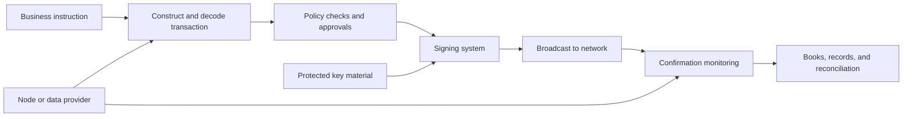
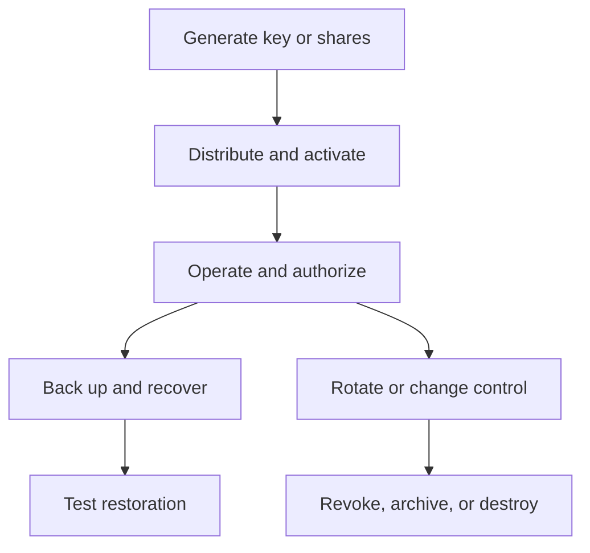

# Wallets, Key Management, and Digital-Asset Custody

A blockchain does not normally store coins or tokens *inside a wallet*. It stores
state—such as unspent transaction outputs or account balances—and accepts state
changes authorized according to its protocol. A wallet observes that state,
constructs transactions, and obtains the signatures or other proofs needed to
authorize them. Custody is the broader legal and operational arrangement through
which a person or organization safeguards that authority and administers the
assets associated with it.

This distinction matters. A private key is not the asset, but control of a key may
be sufficient to transfer an asset irreversibly. Conversely, possessing one key
may not confer unilateral control where an account uses multisignature,
threshold signing, time locks, guardians, or other programmable authorization.
Good custody therefore protects an *authorization system*, not merely a secret
string.

## From Keys to Transactions

### Public-key authorization

Most blockchain accounts ultimately rely on asymmetric cryptography:

1. a private key is generated from high-quality random entropy;
2. a public key is mathematically derived from it;
3. an address or locking script is derived from the public key or from a program;
4. the holder signs transaction data with the private key; and
5. network participants verify the signature without learning the private key.

The exact construction differs by network. Bitcoin commonly uses secp256k1
elliptic-curve keys and spends transaction outputs by satisfying scripts.
Ethereum externally owned accounts also use secp256k1, but derive a 20-byte
address from a public key and authorize account-based transactions. Other
networks use Ed25519, BLS signatures, or multiple supported schemes. A custody
system must therefore manage chain-specific key types, signing payloads,
derivation paths, address encodings, fee rules, and replay protections.

A signature proves that a valid signing key approved a particular message. It
does not prove that:

- the signer saw an accurate human-readable description;
- the destination was intended;
- the called smart contract is safe;
- the transaction complies with an organization's policy; or
- the signed bytes will have the effect claimed by a user interface.

Custody controls must bridge this semantic gap between cryptographic validity and
business intent.

### What a wallet contains

A wallet can combine several functions:

- key or signing-authority management;
- address generation and account discovery;
- blockchain-node or data-provider connectivity;
- balance and transaction-history presentation;
- fee estimation, nonce or UTXO selection, and transaction construction;
- transaction simulation and human-readable decoding;
- policy enforcement, approvals, and signing;
- broadcasting, confirmation monitoring, and reconciliation;
- interfaces to decentralized applications.

Some products perform all these functions. Others are deliberately split. A
watch-only wallet may know addresses and balances but hold no private signing
material. An institutional orchestration platform may construct and approve
transactions while a separate HSM, MPC service, or legal custodian supplies the
signature. Calling all of these products a “wallet” conceals materially
different trust and failure models.



### Addresses are not identities

An address is a protocol-level destination or account identifier, not necessarily
a person, customer, or wallet. One actor may control many addresses; one address
may be controlled jointly; an exchange deposit address may map to a customer only
in the exchange's internal ledger; and a smart-contract address is governed by
code rather than a single private key. Address reuse, change outputs, deposit
memos, proxy contracts, and chain-specific address formats complicate both
operations and analytics.

Sending an asset to a syntactically valid but wrong address may be irreversible.
The same-looking address can exist on several EVM-compatible networks even
though each network has separate state. Operational controls therefore validate
the network, asset contract, destination, memo or tag, and intended transaction
method—not only the visible address.

## Seeds and Hierarchical Deterministic Wallets

Early wallets generated unrelated keys, making backup difficult. Hierarchical
deterministic (HD) wallets derive a tree of keys from a root seed. Bitcoin
Improvement Proposal 32 defines extended keys consisting of key material and a
chain code. An extended private key can derive descendant private and public
keys; an extended public key can derive certain non-hardened descendant public
keys without spending authority.

BIP-39 defines a widely implemented conversion between machine-generated entropy
and a mnemonic sentence, then derives a seed using a password-based function.
The words are an encoding of entropy plus a checksum, not a password invented by
the user. Human-created “brain wallets” generally have insufficient entropy and
are unsafe. An optional BIP-39 passphrase changes the derived seed; losing it is
equivalent to losing the wallet.

BIP-44 gives a common derivation hierarchy:

```text
m / purpose' / coin_type' / account' / change / address_index
```

The apostrophe denotes hardened derivation. Hardened derivation prevents an
extended public key plus a descendant private key from exposing an ancestor
private key, at the cost of preventing public-only derivation across that edge.
Wallet interoperability depends not merely on the seed words but also on the
derivation scheme, curve, script type, and account-discovery rules.

HD designs reduce backup burden but concentrate risk. A root seed or sufficiently
powerful extended private key can regenerate an entire subtree. An extended
public key cannot normally spend, but disclosure can expose address history and
destroy privacy. Seed backup, derivation metadata, passphrases, and restoration
procedures must all be managed as part of the recovery package.

## Wallet and Custody Models

### Self-custody, hosted wallets, and legal custody

**Self-custody** means the asset owner administers the signing authority without
a third-party custodian able to transfer assets on its own. The owner may still
use hardware, software, cloud, recovery, or transaction-relay providers.
Self-custody is therefore not the absence of dependencies.

In a **hosted or custodial wallet**, a provider controls or participates in the
signing arrangement and maintains a customer entitlement in its records.
Customer transfers may occur entirely within the provider's internal ledger;
only deposits, withdrawals, treasury rebalancing, or settlement create onchain
transactions.

A **legal custodian** accepts contractual or statutory safeguarding duties. Its
obligations can include recordkeeping, asset segregation, authorization,
settlement, reporting, corporate actions, staking administration, and return of
assets. Whether a technology provider is a regulated or qualified custodian is a
jurisdiction- and service-specific legal question. Technical participation in a
signature is not by itself legal custody, while legal custody may be delivered
using a technology subcontractor or sub-custodian.

### Custodial control is a spectrum

| Model | Where authorization resides | Principal advantage | Principal risk |
|---|---|---|---|
| Single-key software wallet | One device or software secret | Simple and portable | One compromise or loss can be total |
| Hardware wallet | Key in a dedicated user device | Isolates signing from general-purpose host | Supply-chain, firmware, backup, and user-confirmation risks |
| Multisignature account | Several independent keys; threshold enforced onchain | Transparent separation of control | Chain support, coordination, signer and contract risk |
| HSM-backed custody | Key in controlled cryptographic hardware | Mature access controls and audit integration | Device, operator, backup, and concentration risks |
| MPC/TSS wallet | Key shares jointly produce a signature | Flexible distributed control; ordinary onchain signature | Protocol implementation, coordination, and vendor risks |
| Smart-contract wallet | Programmable onchain authorization | Recovery, limits, roles, batching | Contract bugs, upgrade and dependency risk |
| Exchange omnibus custody | Provider-controlled wallets plus internal customer ledger | Liquidity and operational convenience | Counterparty, commingling, insolvency, and withdrawal risk |

No row is inherently “non-custodial” or “institutional.” The result depends on
who controls components, whether a provider can change policy or recover shares,
what legal duties apply, and what happens during insolvency.

## Hot, Warm, and Cold Arrangements

These labels describe operational accessibility, not cryptographic algorithms.

- **Hot** keys are online or readily available to automated systems. They support
  rapid withdrawals and application interactions but have the largest remote
  attack surface.
- **Cold** keys are generated, stored, and used in an environment isolated from
  production networks, often with manual ceremonies. They reduce online exposure
  but make signing, patching, recovery, and urgent response slower.
- **Warm** arrangements occupy the middle: connected only during controlled
  workflows, or distributed so that an online component alone cannot sign.

A common architecture keeps a bounded liquidity buffer in hot wallets and most
assets in colder tiers. Rebalancing limits, velocity controls, delayed
withdrawals, and anomaly detection contain hot-wallet loss. “Air-gapped” should
not be treated as a complete control: transaction data crosses the gap, people
operate the process, software must be installed, and backup material must exist.

Cold storage can fail through poor randomness, compromised ceremony equipment,
malicious transaction substitution, lost backups, unavailable approvers, or
untested recovery. Security must cover the entire lifecycle:



## HSMs, Multisignature, and Threshold Signing

### Hardware security modules

An HSM is a cryptographic module designed to generate and use sensitive keys
inside a protected boundary. It can enforce authenticated roles, allowed
algorithms, non-exportability, quorum controls, audit events, and tamper
responses. FIPS 140-3 defines security requirements and four qualitative levels
for cryptographic modules; a validation applies to a specified module
configuration, not automatically to the whole custody service.

An HSM prevents some forms of raw-key extraction, but it will sign an authorized
request presented through its interface. Transaction-policy enforcement,
authentication, administration, firmware governance, high availability,
backup, and disaster recovery remain system responsibilities. A compromised
application with valid HSM credentials can be as dangerous as an extracted key.

### Onchain multisignature

Multisignature requires a threshold of independent keys—for example, two of
three—to authorize an action. Bitcoin can express thresholds through scripts;
EVM systems commonly use a smart-contract account. The network verifies the
threshold logic, making the authorization structure auditable onchain.

Security depends on genuine independence. Three keys stored in the same cloud
account do not provide the resilience suggested by “three signers.” Signers
should differ where appropriate by person, role, device, administrative domain,
location, and recovery path. Governance must address signer replacement,
threshold changes, emergency response, and liveness if a signer disappears.

Multisignature can reveal the policy onchain, may use more block space, and is
not uniformly supported across assets. Smart-contract multisig introduces code,
deployment, module, and upgrade risks. It can nevertheless provide unusually
clear evidence of which keys authorized a transaction.

### Multiparty computation and threshold signature schemes

In threshold signing, participants hold shares and jointly compute a valid
signature without reconstructing the private key in one place. Distributed key
generation can create shares without a dealer ever knowing the complete secret.
The resulting signature often looks like an ordinary single-key signature to the
blockchain, enabling support without special onchain scripts.

“MPC” is a broad computation technique; a production wallet normally uses a
specific threshold signature protocol. Evaluation requires concrete questions:

- Is the protocol threshold ECDSA, EdDSA, Schnorr, or another scheme?
- How are shares generated, refreshed, backed up, and replaced?
- Can any service or recovery process reconstruct the full key?
- Which parties must be online, honest, and available?
- Are authenticated channels and malicious-party protections used?
- Can a vendor change policy, supply a signing component, or deny service?
- Has the exact implementation been independently reviewed?

Threshold signing moves risk rather than eliminating it. It reduces single-point
key theft, but adds protocol complexity, availability dependencies, share
metadata, endpoint security, and coordinated-upgrade risk. A signer endpoint can
approve a malicious payload without exposing its share.

## Smart-Contract Wallets and Account Abstraction

A smart-contract wallet stores assets in a contract whose code defines valid
actions. It can support several roles, spending limits, allowlists, session keys,
time locks, guardians, social recovery, batched actions, and token-paid or
sponsored fees. The controlling keys become replaceable inputs to an
authorization policy rather than an immutable account identity.

On Ethereum, ERC-4337 introduced a parallel user-operation flow with bundlers,
an EntryPoint contract, and optional paymasters, while EIP-7702 enables an
externally owned account to delegate code for transactions. These mechanisms
improve usability but add actors and code paths. Custody analysis must include
the account implementation, upgrade authority, EntryPoint, modules, bundlers,
paymasters, and fallback recovery.

Programmability can express strong institutional controls, but also creates:

- implementation and upgrade vulnerabilities;
- unexpected delegate-call or module authority;
- chain-specific deployment and address differences;
- dependence on relayers or bundlers for liveness;
- difficult transaction decoding; and
- recovery logic that becomes a bypass if guardians are weak.

## Segregation, Omnibus Wallets, and Books and Records

Onchain segregation and legal segregation are distinct.

In a **segregated-address** model, assets attributed to a customer or fund are
held at dedicated addresses. This improves traceability but increases address,
fee, privacy, and operational complexity. It still does not establish that the
customer owns the legal claim or exclusively controls the keys.

In an **omnibus** model, assets for many customers share addresses. The custodian
maintains ownership entitlements in a subledger. This can improve liquidity
management and reduce transaction costs, but makes the integrity of internal
records, reconciliations, and legal segregation essential.

Three quantities should reconcile:

```text
customer entitlements in the internal ledger
    = assets recorded in custody books
    = controlled onchain assets plus valid in-transit adjustments
```

Differences can arise from confirmations, fees, staking, forks, airdrops,
wrapped assets, pending withdrawals, exchange balances, and chain reorganizations.
Reconciliation rules must define finality, pricing cutoffs, asset identifiers,
and exception ownership.

Segregation in records may protect customers only if applicable law and
contracts recognize it, assets are not pledged or reused contrary to agreement,
and operational records can establish ownership during insolvency. Terms such as
“custody,” “safeguarding,” “deposit,” and “ownership” should never substitute for
analysis of the legal arrangement.

### Proof of reserves is not proof of custody quality

A proof-of-reserves exercise may demonstrate control over certain onchain assets
at a time and may compare them with customer liabilities using a Merkle tree or
auditor procedure. It does not by itself show:

- that all liabilities and affiliates were included;
- ownership free of liens or borrowed-window-dressing;
- continuing control after the observation time;
- asset-liability matching by token;
- operational security or governance quality;
- solvency, liquidity, or legal segregation.

Proof of reserves can supplement, but not replace, financial statements,
liability verification, internal controls, and legal analysis.

## Transaction Governance

Institutional custody is a control system surrounding the signer. A robust
workflow separates:

1. **instruction:** an authenticated request identifies account, asset, amount,
   network, destination, purpose, and timing;
2. **construction:** software selects inputs or nonce, calculates fees, and
   creates exact signing bytes;
3. **interpretation:** decoding and simulation show expected balance and
   contract-state changes;
4. **policy:** limits, allowlists, risk screening, role permissions, and
   segregation of duties are checked;
5. **approval:** authorized people or systems attest to the business action;
6. **signing:** protected signers authorize only the approved payload;
7. **broadcast and monitoring:** systems submit, replace if permitted, and
   monitor finality;
8. **reconciliation:** independent records verify the resulting state.

Controls can include dual approval, four-eyes administration, just-in-time
access, withdrawal cooling periods, per-asset and per-destination limits,
out-of-band confirmation, sanctions screening, contract allowlists, byte-level
hash comparison, and emergency suspension. Automation should be bounded; manual
approval should be informed by decoded data rather than an opaque hash.

Smart-contract transactions require particular care. Token approvals can confer
future transfer authority, proxies can change implementation, and a signature
may authorize offchain orders or permits rather than an immediate transfer.
Custody inventory should therefore include standing allowances, signed but
unexecuted messages, delegated session keys, staking positions, bridge claims,
and governance rights.

## Backup, Recovery, and Business Continuity

Key loss and key compromise require different responses. A lost key may demand
restoration; a compromised key demands rapid migration or policy replacement
before an attacker acts. Recovery systems must not create an easier attack path
than daily signing.

Design questions include:

- What precise material is required to restore each chain and account?
- Are backups encrypted, geographically separated, versioned, and inventoried?
- Who can assemble shares or authorize recovery?
- Can restoration be tested without exposing production authority?
- How are deceased, unavailable, sanctioned, or malicious approvers replaced?
- What happens if a vendor, cloud, identity provider, or entire region fails?
- Can funds move if the primary user interface and policy engine are unavailable?
- Are contract upgrade keys and operational keys recovered separately?

Recovery rehearsals should prove end-to-end ability to derive the correct
addresses, construct and sign, broadcast through independent infrastructure, and
reconcile the result. Merely verifying that a backup file can be read is
insufficient.

## Asset Servicing

Custody is not passive key storage. Networks and token contracts create
administrative events:

- protocol forks and chain upgrades;
- airdrops and token migrations;
- staking rewards, slashing, and validator exits;
- governance votes;
- rebases and interest-bearing token exchange rates;
- smart-contract upgrades or pauses;
- freezes, clawbacks, and allowlist changes;
- bridge migrations and wrapped-asset redemptions.

A custodian needs an explicit support policy for each asset and event. Supporting
transfers does not necessarily imply support for staking, governance, DeFi,
forked assets, or every token sent to an address. Asset due diligence covers
technical integration, legal classification, liquidity, sanctions controls,
issuer powers, node operation, finality, and incident procedures.

## Legal, Counterparty, and Insolvency Questions

Custody analysis begins with “who can authorize a transfer?” but cannot end
there. It must determine:

- the contracting entity and governing law;
- whether the customer owns the asset or has a contractual claim;
- whether assets are held in trust, agency, bailment, or another form;
- whether sub-custodians or exchanges are used;
- whether assets may be lent, pledged, staked, or otherwise encumbered;
- liability standards for theft, negligence, forks, and protocol failure;
- audit, reporting, insurance, and record-access rights;
- treatment of assets and keys in insolvency;
- termination, portability, and return procedures.

Regulatory terms vary. In the United States, for example, the OCC has stated that
national banks and federal savings associations may provide crypto-asset custody
and may use sub-custodians subject to safe-and-sound operation and third-party
risk management. Separate securities, investment-adviser, commodities, money
transmission, trust-company, and state rules may apply. A provider's license in
one capacity does not answer the treatment of every asset, client, or service.

Insurance must also be read narrowly. Policies may cover specified theft or
employee events but exclude market loss, smart-contract failure, client-device
compromise, war, or assets beyond stated limits. Coverage at a provider does not
necessarily give customers a direct claim.

## Threat Model

| Threat | Examples | Representative controls |
|---|---|---|
| Secret compromise | malware, insider theft, backup exposure | distributed authority, protected modules, endpoint hardening |
| Malicious authorization | phishing, altered destination, blind signing | trusted decoding, simulation, out-of-band verification |
| Governance compromise | admin takeover, policy change, collusion | separation of duties, thresholds, immutable logs, delays |
| Availability loss | signer outage, lost share, vendor failure | redundancy, tested recovery, independent broadcast paths |
| Software and supply chain | wallet update, library or firmware compromise | reproducible builds, signing, staged updates, attestation |
| Protocol and asset | fork, reorg, contract exploit, freeze | asset review, confirmation rules, incident playbooks |
| Record failure | wrong entitlement or reconciliation | independent subledger, daily reconciliation, audit trail |
| Legal/counterparty | insolvency, lien, sub-custodian failure | segregation, contractual controls, due diligence |

Security choices involve trade-offs. More signers can reduce compromise risk but
increase liveness and coordination risk. Cold processes reduce remote attack
surface but slow emergency movement. Automation improves consistency but can
scale a faulty policy. The appropriate design follows the asset, transaction
frequency, threat actors, recovery objective, legal duties, and tolerated loss.

## A Framework for Evaluating a Custody Design

1. **Map the authority.** Identify every key, share, contract role, administrator,
   recovery actor, vendor service, and human approval capable of influencing a
   transfer.
2. **Map the legal chain.** Identify custodian, subcontractors, account structure,
   ownership claim, governing law, and insolvency treatment.
3. **Trace representative transactions.** Follow deposits, withdrawals, contract
   calls, staking, recovery, and emergency transfers from instruction through
   reconciliation.
4. **Test independence.** Ask whether nominally separate controls share the same
   device, identity provider, administrator, cloud, or recovery path.
5. **Examine failure modes.** Model compromise, collusion, unavailability,
   software error, chain incident, and provider insolvency.
6. **Verify evidence.** Review architecture, key ceremonies, access logs,
   reconciliations, audits, penetration tests, assurance reports, insurance, and
   recovery exercises.
7. **Reassess continuously.** Chains, contracts, signers, software, regulation,
   and supported services change after onboarding.

The central lesson is that “who holds the key?” is too small a question. Digital-
asset custody is the coordinated design of cryptography, software, people,
governance, accounting, law, and recovery around the ability to change
blockchain state.

## Related Notes

- [Cryptography and Blockchain Data Structures](../../02-blockchain-foundations/01-core-architecture/cryptography-and-blockchain-data-structures.md)
- [Smart Contracts, Virtual Machines, and Token Standards](../../02-blockchain-foundations/03-execution-and-applications/smart-contracts-virtual-machines-and-token-standards.md)
- [Digital Assets: Token Taxonomy and Economics](../01-assets-and-economics/digital-assets-token-taxonomy-and-economics.md)
- [Institutional Custody and Wallet Infrastructure](institutional-custody-and-wallet-infrastructure.md)
- [Crypto Market Structure and Centralized Exchanges](../02-centralized-markets/crypto-market-structure-and-centralized-exchanges.md)
- [Blockchain, Smart-Contract, and Operational Security](../../07-compliance-analytics-regulation-and-security/03-security-and-case-studies/blockchain-smart-contract-and-operational-security.md)

## References

- NIST, [Recommendation for Key Management: SP 800-57 Part 1 Rev. 5](https://csrc.nist.gov/pubs/sp/800/57/pt1/r5/final).
- NIST, [FIPS 140-3: Security Requirements for Cryptographic Modules](https://csrc.nist.gov/pubs/fips/140-3/final).
- Bitcoin Improvement Proposals, [BIP-32: Hierarchical Deterministic Wallets](https://bips.dev/32/).
- Bitcoin Improvement Proposals, [BIP-39: Mnemonic Code for Generating Deterministic Keys](https://bips.dev/39/).
- Bitcoin Improvement Proposals, [BIP-44: Multi-Account Hierarchy for Deterministic Wallets](https://bips.dev/44/).
- Ethereum.org, [Ethereum Accounts](https://ethereum.org/developers/docs/accounts/).
- Ethereum.org, [Account Abstraction](https://ethereum.org/roadmap/account-abstraction/).
- Ethereum Improvement Proposals, [ERC-4337: Account Abstraction Using Alt Mempool](https://eips.ethereum.org/EIPS/eip-4337).
- Ethereum Improvement Proposals, [EIP-7702: Set EOA Account Code for One Transaction](https://eips.ethereum.org/EIPS/eip-7702).
- U.S. Office of the Comptroller of the Currency, [Interpretive Letter 1170: Authority of a National Bank to Provide Cryptocurrency Custody Services](https://www.occ.treas.gov/topics/charters-and-licensing/interpretations-and-decisions/2020/int1170.html).
- U.S. Office of the Comptroller of the Currency, [Interpretive Letter 1184: Clarification of Bank Authority Regarding Crypto-Asset Custody Services](https://www.occ.treas.gov/topics/charters-and-licensing/interpretations-and-decisions/2025/int1184.pdf).
