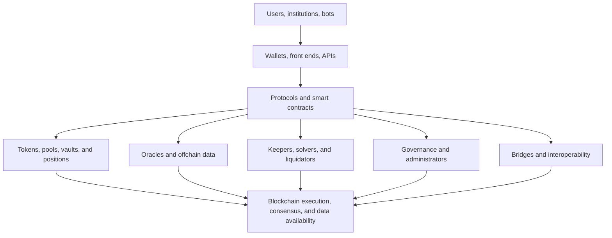
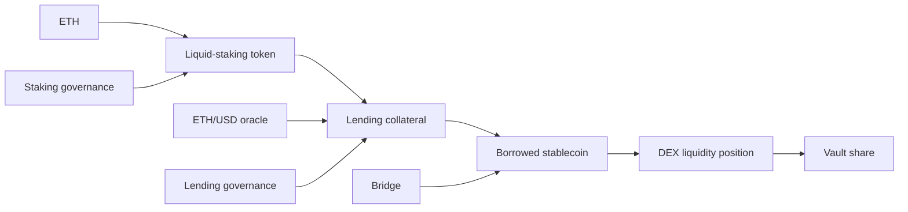
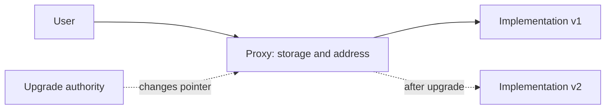
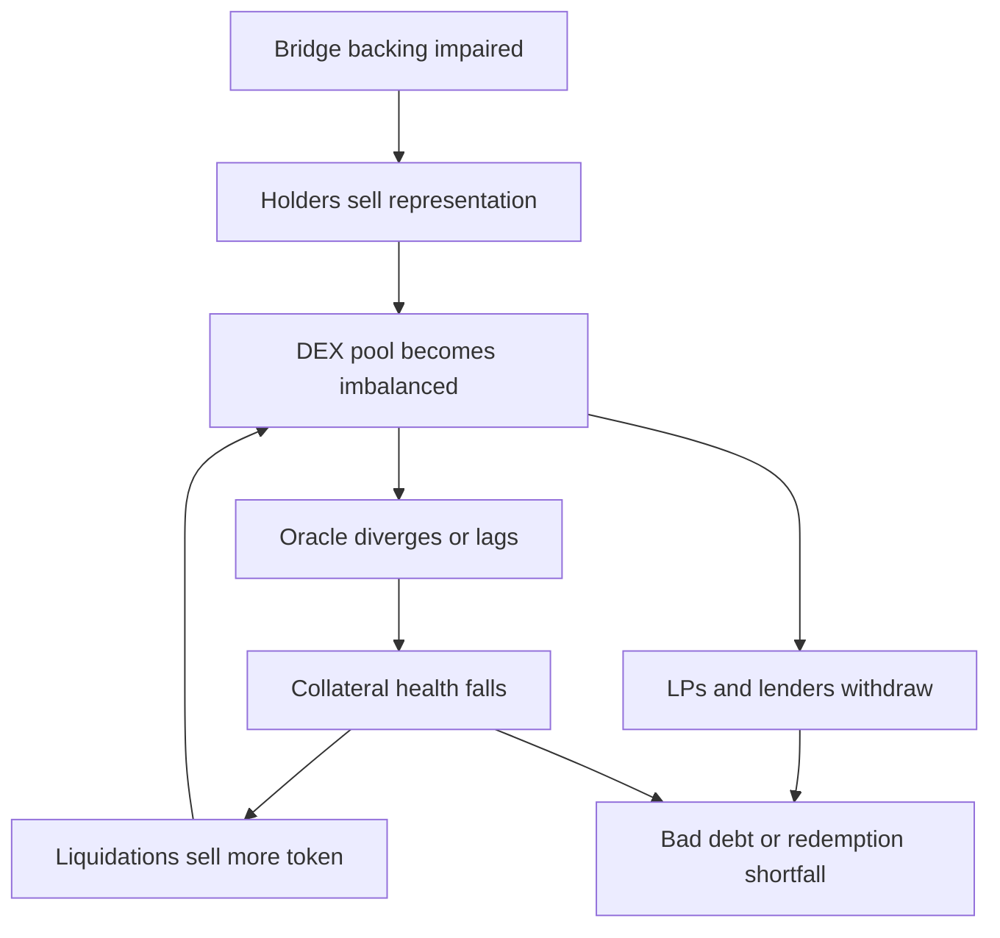

# DeFi Architecture, Composability, and Governance

Decentralized finance (DeFi) uses blockchain programs to provide trading,
lending, payments, derivatives, asset management, and related financial
functions. Users interact through transactions rather than conventional account
instructions, and shared state lets one protocol call another within the same
execution environment.

DeFi does not remove intermediation. It replaces or redistributes intermediary
functions among smart contracts, governance, oracles, liquidity providers,
keepers, front ends, sequencers, bridges, token issuers, and developers. Some
rules are more transparent and mechanically enforced; other dependencies become
more complex.

## What Makes a System DeFi?

A useful definition emphasizes architecture rather than branding:

- assets and positions are represented on a blockchain;
- core financial state transitions are executed by smart contracts or native
  chain modules;
- users can interact from wallets without the protocol operator maintaining a
  conventional bilateral account for every action;
- rules, balances, and transactions are substantially observable;
- settlement occurs under blockchain consensus.

These properties exist on a spectrum. A protocol may have immutable contracts
but a centralized website; permissionless execution but administrator-controlled
oracles; token governance but concentrated voting; or decentralized settlement
on a chain with one sequencer.

“Non-custodial” means that an operator does not conventionally hold a user's
wallet key. Assets can still be locked in protocol contracts, transferred by an
approval, frozen by a token issuer, or lost through a contract failure.

Likewise, **permissionless** needs an object. Contract calls may be open to any
address while the official interface blocks locations, the oracle reporter set
is permissioned, new markets require governance approval, and block inclusion
depends on a centralized sequencer. Useful descriptions say who may deploy,
use, supply liquidity, liquidate, govern, validate, and operate interfaces
rather than assigning one label to the whole system.

### Financial Functions Have Not Disappeared

Conventional finance bundles recordkeeping, custody, risk approval, pricing,
liquidity, execution, settlement, governance, and dispute handling into firms
and infrastructures. DeFi redistributes them:

| Financial function | Common DeFi implementation | Residual dependency |
|---|---|---|
| Recordkeeping | Contract storage and chain history | Correct code, consensus, indexing |
| Authorization | Wallet signature and contract roles | Key custody and intelligible signing |
| Credit protection | Overcollateralization and liquidation | Oracle, liquidity, liquidators |
| Market making | AMM pools or onchain/offchain orders | LP capital, arbitrage, transaction ordering |
| Settlement | Atomic state transition | Chain finality and bridge assumptions |
| Change control | Token vote, multisig, timelock | Participation, keys, delegates, legal pressure |
| User access | Front end, wallet, API, direct call | Domains, RPCs, sequencer, compliance controls |

Automation makes some rules observable and consistent, but it also executes
mistakes at machine speed. A liquidation formula does not decide whether its
oracle reflects an orderly market; a token vote does not by itself provide
fiduciary judgment; and transparent code does not ensure that ordinary users
can understand bytecode or complex balance sheets.

## The DeFi Stack



### Settlement layer

The underlying L1 or L2 supplies ordering, execution, state, and finality.
Protocol safety inherits chain assumptions: validator or sequencer behavior,
reorganizations, censorship, fee markets, data availability, bridge design, and
upgrades.

### Asset layer

Native coins, fungible tokens, NFTs, stablecoins, wrapped assets, and receipt
tokens provide the balance-sheet items. Each adds issuer, bridge, redemption,
freeze, governance, or accounting properties beyond the DeFi protocol.

Each asset should be treated as somebody's balance-sheet item. A stablecoin can
be an issuer liability backed by reserves; a vault token is a claim on strategy
assets; a wrapped token is an obligation of a custodian or bridge; an LP token
is a residual share of pool inventory. DeFi positions often stack these claims,
so the visible token is not the ultimate asset and may not have direct recourse
to it.

### Protocol layer

Smart contracts define pools, collateral, interest, swaps, margin, claims, and
governance. A protocol is usually several contracts rather than one address:
proxies, implementations, registries, factories, vaults, adapters, and libraries.

### Service layer

Oracles supply prices; keepers trigger time-sensitive actions; indexers construct
queryable history; solvers find routes; relayers submit signed messages; and
front ends help users construct transactions. These services may be competitive,
permissionless, allowlisted, or operated by one team.

### Governance and organization layer

A DAO, foundation, company, token holders, multisig signers, delegates, risk
service providers, and developers can all influence the protocol. Their legal
and operational roles may not match onchain labels.

## Financial Primitives

A primitive is a reusable operation or claim:

- token transfer and approval;
- swap against a pool or order;
- deposit into a vault and receive shares;
- lend an asset and receive an interest-bearing claim;
- post collateral and mint or borrow;
- stake and receive reward or liquid-staking claims;
- create a derivative position;
- escrow assets subject to conditions;
- verify an oracle, identity, or cross-chain message.

Complex products compose primitives. A leveraged yield strategy might:

1. deposit ETH into a liquid-staking protocol;
2. receive an interest-bearing staking token;
3. supply it as lending collateral;
4. borrow a stablecoin;
5. swap the stablecoin for more ETH;
6. repeat.

The user now depends on the chain, staking protocol, validator set, lending
market, stablecoin, DEX, oracle, and liquidation network. The transaction may be
simple while the economic graph is not.

The balance sheet after the loop is more informative than the list of calls.
The user owns a staking receipt and owes stablecoin debt; the lender owns a
claim on a pool exposed to the user's collateral; the stablecoin itself may be
another issuer's liability; and the DEX LPs absorb the inventory used to execute
the swap. No new unencumbered capital appears merely because each claim is
represented by a transferable token.

## Atomicity

Within one blockchain transaction, all included calls normally succeed or all
revert. This **atomicity** permits safe multi-step operations:

```text
borrow → swap → repay
```

If repayment fails, the whole transaction reverts. Flash loans use this property
to lend without conventional collateral for the duration of one transaction.
Atomicity can reduce settlement principal risk and enable arbitrage, refinancing,
collateral swaps, and liquidations.

For example, a borrower can flash-borrow 100,000 units of debt asset, repay an
old lending position, withdraw collateral, sell part of that collateral for the
debt asset, and repay the flash loan. If the sale produces insufficient output,
the transaction reverts and the old position remains. Atomicity removes the
risk of being left between those onchain steps, but the borrower still faces
fees, MEV, oracle conditions, and failure to find a profitable route.

Atomicity is scoped. It may not extend:

- across two chains with independent finality;
- to an offchain bank payment;
- across asynchronous withdrawal queues;
- through an oracle update that arrives later;
- to legal ownership outside the blockchain.

Cross-domain systems often replace atomicity with messaging, escrow, timeout,
liquidity providers, or trusted coordination.

## Composability

**Technical composability** means a contract can call another contract through a
known interface. **Economic composability** means the resulting claims and risks
behave coherently.

A vault can deposit into a lending pool; a DEX can trade the vault share; another
protocol can accept that share as collateral. This creates “money-lego”
innovation without bilateral integration agreements.

Benefits include:

- reuse of audited primitives and existing liquidity;
- rapid product development;
- transparent, programmable settlement;
- open competition among interfaces and strategies;
- the ability to route or refinance positions atomically.

Costs include:

- dependencies that are hard for users to see;
- correlated liquidation and liquidity shocks;
- propagation of oracle or governance failures;
- recursive leverage and double-counted TVL;
- version and interface incompatibility;
- inability of one protocol to pause another.

### Total value locked is not capital

TVL usually sums the market value of assets held by contracts. If a staked ETH
receipt is deposited into a lending protocol and its vault share is deposited
elsewhere, several protocols may count claims on the same underlying ETH.
Aggregate TVL can therefore double count and is not equivalent to equity, loss-
absorbing capital, deposits, or unique economic resources.

### Dependency graph

Risk analysis should trace both direct calls and economic collateral:



The graph exposes correlated points that a contract-address list misses.

### Technical And Economic Composition Can Diverge

A token can be technically transferable but unsuitable as collateral. Its
redemption may be delayed, its price may rely on a shallow pool, or an issuer
may freeze it. Conversely, two protocols may never call each other directly yet
be economically coupled because both use the same stablecoin, collateral,
oracle, bridge, or liquidators. The dependency graph must therefore include:

- code calls and upgrade paths;
- asset and redemption chains;
- shared price and data sources;
- liquidity needed for exits and liquidation;
- governance, signers, sequencers, and infrastructure; and
- incentives that attract the same capital.

This is the recursive nature of composability risk: a protocol depends on a
token, the token depends on a vault, the vault depends on a bridge, and the
bridge depends on source-chain finality and a verifier set.

## Protocol Contracts and Upgradeability

Blockchain code is immutable at its deployed address, but protocol behavior can
still change:

- users migrate to new contract versions;
- a proxy delegates calls to a replaceable implementation;
- a registry points to new modules;
- governance changes parameters;
- an adapter or oracle address is replaced;
- a token contract itself upgrades.

### Proxy pattern

With an upgradeable proxy, users call a stable proxy address that stores state.
The proxy uses `delegatecall` to execute code from an implementation address.
An administrator can replace that address.



Upgradeability enables bug fixes and features but creates storage-layout,
initialization, access-control, and malicious-upgrade risk. An audit of the
current implementation is not assurance about future code.

### Immutability trade-off

Immutable contracts constrain administrator risk and make rules predictable, but
known bugs may be unfixable. Upgradeable systems can respond quickly, but users
must trust the upgrade process. Intermediate controls include:

- multisignature administrators;
- timelocks that allow review and exit;
- narrowly scoped roles;
- onchain governance;
- staged caps and pause functions;
- immutable core with replaceable adapters;
- opt-in migration rather than forced upgrade.

Timelocks are not uniformly beneficial. A delay gives users warning, but it also
slows emergency patches and advertises a vulnerability before remediation.

Change control should be described as a lifecycle:

1. somebody has authority to propose a code or parameter change;
2. delegates, signers, or token holders approve it;
3. a timelock or operational delay may apply;
4. an executor submits the transaction;
5. contracts verify authority and change state;
6. monitors and users observe the result; and
7. rollback, pause, migration, or another proposal handles errors.

Weakness at any stage matters. A token vote can be broadly distributed while
the executor key is centralized. A timelock can be visible while the emergency
council has a bypass. A passed proposal can contain malicious calldata that
voters did not decode.

## Oracles

Smart contracts cannot independently observe external prices, rates, weather,
identity, or bank balances. An oracle imports an attested value or calculates a
measure from onchain state.

Oracle design includes:

- source venues and instruments;
- aggregation and outlier rules;
- update triggers, heartbeat, and deviation thresholds;
- publisher and signer set;
- onchain verification;
- stale-data and sequencer-outage handling;
- governance and fallback;
- manipulation cost relative to protocol exposure.

Lending and derivatives depend on oracles precisely when markets are stressed.
A delayed but unmanipulable price can allow bad debt; a fast but thin price can
trigger false liquidations. The consuming protocol needs bounds, caps, and
incident behavior appropriate to the asset.

The detailed architecture is covered in
[Oracles, Indexers, and Offchain Data](../../02-blockchain-foundations/03-execution-and-applications/oracles-indexers-and-offchain-data.md).

## Keepers, Liquidators, Solvers, and Relayers

Contracts do not wake themselves. A transaction must call them.

- **Keepers** trigger interest updates, auctions, expiries, rebalances, or oracle
  submissions.
- **Liquidators** repay debt or take over positions when collateral rules fail.
- **Solvers** compete to fulfill user intents or batch trades.
- **Relayers/bundlers** submit signed messages or account-abstraction operations.

Open participation creates redundancy only if actions are profitable and
infrastructure is accessible. During congestion, gas cost can exceed the reward.
Allowlisted actors improve predictability but concentrate censorship and outage
risk. Protocols use bounties, auctions, priority fees, private order flow, or
backstop operators to sustain liveness.

Economic permissionlessness requires a viable business case for these actors.
A liquidation function callable by anyone is not operationally decentralized
if only one bot has the infrastructure, private transaction channel, or capital
to use it. Conversely, a small specialist set can be resilient if roles are
replaceable, incentives are transparent, and a backstop exists. Count actors,
but also test concentration of revenue, infrastructure, and failure domains.

## Liquidity as Shared Infrastructure

Financial contracts need assets available for trade, borrowing, redemption, and
liquidation. DeFi pools aggregate liquidity under transparent rules, but
liquidity is state-dependent.

“$1 billion in a pool” does not mean $1 billion can be withdrawn:

- borrowers have used some assets;
- a swap changes price along a curve;
- one reserve may be impaired;
- assets may be locked or bridged;
- governance may pause;
- withdrawals can race in the same block.

Protocols add utilization-based rates, withdrawal queues, caps, isolation,
liquidity incentives, or backstop capital. Incentive emissions attract nominal
liquidity but can disappear when token rewards fall.

## Token Incentives

Governance or reward tokens are distributed to users, liquidity providers,
borrowers, delegates, and developers. Incentives can:

- subsidize early liquidity;
- decentralize ownership;
- compensate risk-taking;
- encourage governance participation;
- direct liquidity among pools.

They can also obscure negative underlying economics. A protocol can pay a
borrower more in tokens than the interest charged, producing activity that ends
when subsidy stops. An APY should be decomposed:

```text
net return
  = cash/protocol fees
  + token emissions at realizable price
  + asset appreciation
  - financing, hedging, gas, slippage, and losses
```

Token emissions are dilution to other token holders unless financed by acquired
value. “Protocol revenue,” “fees,” “earnings,” and “token-holder value” should
not be used interchangeably.

Consider a pool offering 12% displayed APY: 4% comes from borrower interest and
8% from reward tokens at the current quoted price. If reward-token selling
reduces its realizable value by half and gas, slippage, and hedging cost 2%, the
economic return is closer to 6% before credit and smart-contract loss. The
headline number combines cash flow, dilution-funded subsidy, price assumptions,
and costs with different risk.

## Governance

### Token voting

A common process is:

1. forum discussion and informal signaling;
2. proposal creation by an address meeting a threshold;
3. voting power measured at a snapshot;
4. quorum and majority rules;
5. queue in a timelock;
6. onchain execution.

Voting power may be based on liquid tokens, delegated votes, vote-escrow locks,
staking, or a bicameral design. Delegation lets specialists vote without taking
token custody, but can concentrate influence.

### Governance is more than votes

Material control can also sit with:

- multisig emergency committees;
- a foundation controlling trademarks and grants;
- a company maintaining front ends and code;
- risk firms recommending parameters;
- oracle administrators;
- bridge or sequencer operators;
- developers with repository and deployment access;
- large delegates and token treasuries.

An onchain proposal may simply ratify work designed elsewhere. Conversely,
contracts can prevent a company from unilaterally changing deployed rules.

Governance power should be tested with realistic coalitions, not total token
supply. Quorum may exclude lost, bridged, or inactive units; delegates may
control votes without owning tokens; a treasury may vote its own holdings; and
the proposal threshold may prevent small holders from initiating change. The
ability to pass, veto, delay, execute, and bypass are distinct powers.

### Governance risks

- low turnout and rational voter apathy;
- borrowed or purchased voting power;
- delegate conflicts and concentration;
- malicious calldata hidden in a proposal;
- treasury capture;
- legal pressure on identifiable participants;
- emergency authority that bypasses governance;
- slow response to exploits;
- governance attack using a flash loan where snapshots or locks are weak.

Governance analysis maps exact permissions and token distribution, then tests
how quickly each can act.

## Protocol, DAO, Foundation, and Company

These terms refer to different things:

- **protocol:** deployed code, specifications, and network of users;
- **DAO:** governance process or community coordinating protocol decisions;
- **foundation:** legal entity supporting development, grants, or ecosystem;
- **company/labs team:** employees and shareholders building software or
  interfaces;
- **front-end operator:** entity hosting a website or API;
- **token holder:** owner of a governance or economic token, not necessarily an
  owner of the company or protocol assets.

A governance token usually does not give corporate shares, creditor priority, or
a direct legal claim on fees unless documents and code establish one. A DAO may
not be a legal person, yet participants can still face jurisdiction-specific
obligations.

## Decentralization Framework

Rather than assign one label, score distinct control surfaces:

| Surface | More concentrated | More distributed |
|---|---|---|
| Contract upgrade | one key | constrained governance and timelock |
| Oracle | one publisher | diverse sources and independent signers |
| Execution | one sequencer | permissionless/rotating validator set |
| Keeper | proprietary bot | open profitable action |
| Front end | one domain | multiple interfaces and direct calls |
| Governance | insiders/treasury | broad delegated participation |
| Liquidity | one maker/vault | many independent providers |
| Development | one closed team | open implementations and contributors |

Distribution can reduce one failure mode while adding coordination and
accountability problems. The objective is not a maximum score but a transparent
match between control and the financial risk it governs.

### Worked Failure Propagation

Suppose a bridged stablecoin is collateral in a lending market and paired with
native stablecoins in a DEX. A bridge exploit calls backing into question:



Every contract can behave exactly as coded while the system loses money. The
failure crosses bridge security, token redemption, market liquidity, oracle
design, lending parameters, liquidation capacity, and user incentives. This is
why protocol review must include economic state transitions and not stop at
individual contract audits.

### Section Summary

| Principle | Practical implication |
|---|---|
| DeFi redistributes intermediation | Map every function and its operator or incentive |
| Onchain settlement is scoped | Offchain and cross-chain legs need separate finality |
| Composability stacks claims | Trace through wrappers to ultimate assets and liabilities |
| Open calls do not guarantee liveness | Test profitability, access, and actor concentration |
| Governance is executable authority | Map proposal, approval, delay, execution, and bypass |
| Transparency is data, not comprehension | Reconstruct state, privileges, and economic meaning |

## Risk Categories

### Technical

Contract bugs, proxy errors, compromised keys, oracle failures, chain outages,
bridge exploits, and front-end attacks can cause direct loss or unavailability.

### Financial

Market moves, liquidity gaps, collateral correlation, bad debt, funding,
stablecoin depegs, leverage, and bank-run dynamics can break an otherwise correct
contract.

### Governance and operational

Parameter mistakes, malicious upgrades, poor monitoring, keeper failure, and
weak incident response connect human decisions to automated execution.

### Composability and systemic

One receipt token can be collateral across many markets. A depeg causes
liquidations, AMM imbalance, oracle stress, and vault withdrawals simultaneously.
Transparent positions can help monitoring while also allowing bots to race exits.

### Legal and conduct

Developers, front ends, governance, issuers, or service providers may fall within
financial, sanctions, consumer, tax, or data rules. Permissionless contracts do
not settle questions of disclosure, manipulation, fiduciary duty, or legal
ownership.

## Reading a DeFi Protocol

A disciplined review proceeds from state and authority:

1. **Identify assets and claims.** What is deposited, received, owed, redeemable,
   or merely priced?
2. **Trace state transitions.** How do deposit, trade, borrow, liquidation,
   withdrawal, and failure work?
3. **Map contracts.** Find proxies, implementations, factories, modules, oracles,
   and external protocols.
4. **Map privilege.** List every role able to upgrade, pause, mint, seize, change
   parameters, or replace dependencies.
5. **Model economics.** Test normal operation and stressed prices, liquidity,
   congestion, and correlated exits.
6. **Verify offchain systems.** Examine front ends, indexers, keepers, signers,
   sequencers, and legal entities.
7. **Read evidence.** Specifications, code, audits, formal verification, risk
   reports, governance history, and incidents each answer different questions.

An audit is not a guarantee and a high TVL is not proof of safety. Longevity can
provide evidence of real-world operation, but upgrades and new collateral reset
parts of that history.

## Related Notes

- [Smart Contracts, Virtual Machines, and Token Standards](../../02-blockchain-foundations/03-execution-and-applications/smart-contracts-virtual-machines-and-token-standards.md)
- [Decentralized Exchanges and Automated Market Makers](../../03-digital-assets-and-market-structure/03-decentralized-markets/decentralized-exchanges-and-automated-market-makers.md)
- [Onchain Lending and Credit](../02-onchain-lending/onchain-lending-and-credit.md)
- [Onchain Derivatives, Structured Products, and Yield](../03-derivatives-staking-and-yield/onchain-derivatives-structured-products-and-yield.md)
- [DeFi Risk, Security, and Economic Attacks](../04-defi-risk-and-failures/defi-risk-security-and-economic-attacks.md)

## References

- IOSCO, [Final Report with Policy Recommendations for Decentralized Finance](https://www.iosco.org/library/pubdocs/pdf/IOSCOPD754.pdf).
- Bank for International Settlements, [DeFi Risks and the Decentralisation Illusion](https://www.bis.org/publ/qtrpdf/r_qt2112b.htm).
- Bank for International Settlements, [The Oracle Problem and the Future of DeFi](https://www.bis.org/publ/bisbull76.htm).
- Financial Stability Board, [The Financial Stability Risks of Decentralised Finance](https://www.fsb.org/2023/02/the-financial-stability-risks-of-decentralised-finance/).
- Ethereum.org, [Upgrading Smart Contracts](https://ethereum.org/developers/docs/smart-contracts/upgrading/).
- OpenZeppelin, [Governance](https://docs.openzeppelin.com/contracts/5.x/api/governance).
- OpenZeppelin, [Access Control](https://docs.openzeppelin.com/contracts/5.x/access-control).
- Ethereum Improvement Proposals, [ERC-1967: Proxy Storage Slots](https://eips.ethereum.org/EIPS/eip-1967).
- Ethereum Improvement Proposals, [ERC-1822: Universal Upgradeable Proxy Standard](https://eips.ethereum.org/EIPS/eip-1822).
- Ethereum.org, [Trillion Dollar Security Project Report](https://ethereum.org/reports/trillion-dollar-security.pdf).
