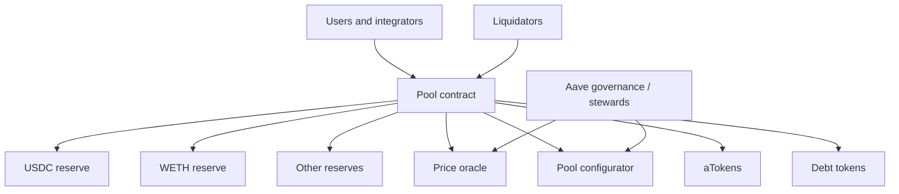
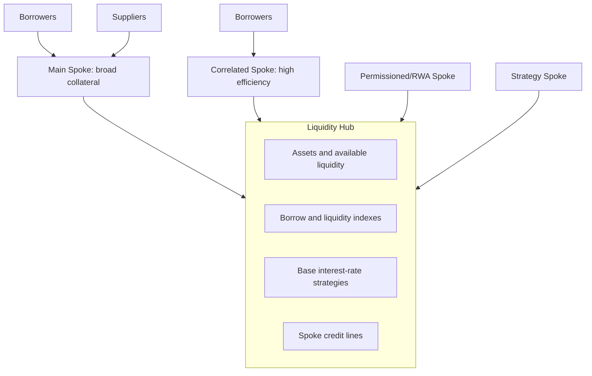

# Aave

Aave is a multi-asset onchain lending protocol. Suppliers provide liquidity;
borrowers post collateral and draw assets; interest rates respond to utilization;
and permissionless liquidators protect the pools. Over several versions Aave has
added flash loans, delegated credit, collateral isolation, high-efficiency modes,
cross-chain governance, a protocol stablecoin, and modular liquidity hubs.

This note covers the protocol rather than treating Aave Labs, the Aave DAO, the
AAVE token, the Aave interface, and each deployment as one entity. Parameters
change through governance and differ by network and market. Version 4 launched
on Ethereum on March 30, 2026 and later on Avalanche; substantial V3 markets
continue to operate. Descriptions are current to July 2026.

## Evolution

### ETHLend and Aave V1

The project began as ETHLend, an early peer-to-peer lending design. It rebranded
to Aave and launched a pooled-liquidity protocol in 2020. V1 introduced the
recognizable supply-and-borrow model and flash loans.

### V2

V2 improved gas efficiency, collateral and debt swaps, repayment with collateral,
credit delegation, flash-liquidation tooling, and tokenized debt. It expanded
from Ethereum to other networks. V2 markets are now legacy compared with V3/V4.

### V3

V3 focused on capital efficiency and risk containment:

- **efficiency mode (eMode)** for correlated collateral and debt;
- **isolation mode** for riskier collateral with a debt ceiling;
- **siloed borrowing** to prevent selected debt assets from coexisting with
  other borrows;
- supply and borrow caps;
- portal/cross-chain liquidity concepts;
- granular governance and risk administration;
- multiple network deployments.

Each V3 deployment contains its own liquidity and risk. “Aave liquidity” across
chains is therefore not one redeemable pool.

### V4

V4 replaces the monolithic per-market pool with **Liquidity Hubs** and **Spokes**:

- a Hub holds assets, maintains debt and liquidity indexes, sets base rates, and
  extends controlled credit lines;
- a Spoke defines user interactions, collateral, risk factors, liquidations, and
  premiums;
- several specialized Spokes can draw from one Hub;
- separate Hubs create broader solvency boundaries.

The design seeks to share liquidity without forcing every collateral into one
risk profile.

## Aave V3 Architecture



The **Pool** is the primary user entry point for supply, withdraw, borrow, repay,
flash loan, and liquidation. The **PoolConfigurator** applies governance-approved
asset parameters. An addresses provider and registries identify components.
Oracles value collateral and debt.

### Reserves

Each listed asset is a reserve with:

- supplied and borrowed balances;
- available liquidity;
- liquidity and variable-debt indexes;
- interest-rate strategy;
- LTV, liquidation threshold, and bonus if collateral;
- reserve factor;
- supply and borrow caps;
- pause, freeze, collateral, and borrowing flags;
- eMode, isolation, and silo settings.

A V3 “market,” such as Ethereum Core, is a collection of reserves that share an
account-level risk engine. Network and market names are part of the position
identity.

### aTokens

Supplying an asset mints an **aToken**, such as aUSDC, representing a claim on
the reserve. The economic balance grows as interest accrues, commonly through a
liquidity index and rebasing balance presentation. aTokens can be transferred
and composed, subject to health checks when used as collateral.

The underlying may be borrowed, so an aToken is a pool claim rather than a
segregated claim on idle tokens at the contract.

### Debt tokens

Variable debt is represented through non-transferable scaled debt balances.
Multiplication by the variable-borrow index gives current debt. Non-
transferability prevents a borrower from escaping an obligation by transferring
the token.

Earlier versions and configurations included stable-rate debt; V3 governance
subsequently deprecated stable borrowing in major markets. Current reserve
configuration must be checked.

## Supply and Borrow

### Supply

A supplier approves the Pool to transfer an ERC-20 and calls `supply`. The
protocol transfers the asset and mints aTokens. The supplier can enable eligible
deposits as collateral.

Supply yield comes primarily from borrower interest:

```text
supply rate
≈ variable borrow rate × utilization × (1 - reserve factor)
```

Token incentives may be added separately. The displayed APY can change every
block as utilization or governance parameters change.

### Borrow

A borrower must have enough collateral capacity. The protocol:

1. reads oracle values;
2. applies each collateral's LTV and configuration;
3. checks caps, asset status, eMode/isolation constraints, and health;
4. transfers the debt asset;
5. records scaled debt.

Borrowing reduces available reserve liquidity but does not remove supplier
claims. At high utilization, suppliers may be unable to withdraw until repayment
or new supply.

### Repay and withdraw

Anyone can repay debt for an address if approvals and call parameters permit.
Withdrawing collateral is allowed only if the remaining account satisfies the
risk calculation. Users can also disable collateral use subject to health.

## Interest Rates

### V3 utilization curve

Each reserve has an interest-rate strategy. A simplified variable rate uses a
kink at optimal utilization:

```text
if U ≤ U_opt:
    r = base + slope1 × U/U_opt
else:
    r = base + slope1
        + slope2 × (U-U_opt)/(1-U_opt)
```

The steep post-kink slope protects withdrawal liquidity. Parameters differ
because stablecoins, volatile assets, and staking derivatives have different
borrow demand and liquidity.

Interest indexes are updated when reserve-affecting transactions occur using
elapsed time. View functions calculate the accrued value between updates.

### V4 rates and risk premiums

In V4, the Hub calculates a base price of liquidity from aggregate asset
utilization. Spokes apply borrower-specific or position-specific **risk
premiums** according to collateral quality and configuration. The architecture
separates:

```text
borrow rate = shared base liquidity rate + applicable risk premium
```

The objective is to stop low-risk borrowers from paying the same rate as
borrowers whose collateral creates greater risk, while preserving shared
liquidity. It adds model and parameter questions: how premiums are calculated,
how Spoke credit lines constrain loss, and how revenue and deficits allocate
between Hub and Spoke.

## Collateral Risk

### LTV and liquidation threshold

V3 distinguishes:

- **LTV:** borrowing power used when opening or modifying a position;
- **liquidation threshold:** higher boundary at which collateral begins to be
  liquidated;
- **liquidation bonus:** extra collateral given to a liquidator.

The account health factor is:

```text
HF =
  sum(collateral value_i × liquidation threshold_i)
  / total debt value
```

`HF < 1` makes the account liquidatable.

### eMode

eMode groups strongly correlated assets—for example, different USD stablecoins
or ETH-correlated staking assets—and permits higher LTV and liquidation
thresholds when borrowing within the category. Correlation reduces ordinary
price risk but not basis, redemption, smart-contract, or depeg risk.

The high capital efficiency can make positions sensitive to small deviations.
Category membership, allowed debt, oracle treatment, and liquidation liquidity
must be examined.

### Isolation mode

An asset in isolation mode can serve as collateral only under restricted
conditions, typically allowing selected “borrowable in isolation” assets and
enforcing a debt ceiling. The ceiling bounds how much system debt can be created
against a newer or riskier collateral.

Isolation is not the same as a fully separate pool. The borrowed asset can still
come from a shared reserve; the feature bounds exposure rather than creating a
separate supplier claim.

### Supply and borrow caps

A supply cap limits protocol exposure and prevents a low-liquidity token from
dominating collateral. A borrow cap limits debt concentration and liquidity
usage. Caps can be changed by governance or constrained stewards.

### Siloed borrowing

If an asset is marked siloed, an address borrowing it cannot simultaneously
borrow other assets in that position. This contains interactions involving a
debt asset with specialized oracle or market risk.

## Liquidation

### V3 process

When health falls below one, a liquidator selects a debt asset to repay and a
collateral asset to receive. The protocol validates oracle prices, eligibility,
close factor, and available balances.

Aave's current public help documentation describes a V3-style rule:

- up to 50% of debt may be liquidated when HF is above 0.95 and collateral and
  debt exceed dust thresholds;
- up to 100% can be liquidated at HF 0.95 or below or for sufficiently small
  positions;
- a liquidation should not leave prohibited dust.

Exact deployed code and parameters govern.

Liquidators often use flash loans to obtain the debt asset, seize collateral,
sell it through a DEX, repay the flash loan, and retain the net bonus. Competition
creates priority-fee and MEV effects.

### V4 process

V4 aims to repay only enough debt to restore a configurable **target health
factor**, rather than applying a fixed close percentage in normal cases. Its
liquidation bonus increases as health deteriorates, up to a maximum. This tries
to:

- reduce unnecessary borrower liquidation;
- make riskier positions more attractive to liquidators;
- avoid a one-size-fits-all static bonus.

The design must balance two problems. A small eligible repayment and low bonus
near HF 1 may be uneconomic for liquidators; waiting for a larger bonus increases
deficit risk. Gas, position size, collateral depth, and target health determine
the outcome.

## Flash Loans

Aave popularized pooled flash loans. The receiver borrows one or several assets,
executes arbitrary logic, and repays principal plus fee before the call ends.
Otherwise the transaction reverts.

Uses include:

- arbitrage;
- liquidation;
- collateral and debt swaps;
- migration between markets;
- refinancing and self-liquidation.

The Pool can also support a simple flash-loan path with lower overhead. Fees and
waivers depend on governance and receiver roles. Flash loans do not create
persistent credit exposure but temporarily reduce reserve liquidity within
execution and enable large atomic operations.

## Credit Delegation

An aToken supplier can approve another address to borrow against the delegator's
collateral through debt-token allowance. The protocol enforces the delegator's
health but does not assess the delegatee's offchain credit. The delegator bears
repayment risk and needs a legal or trust arrangement where appropriate.

Credit delegation demonstrates that protocol-level collateral and bilateral
credit can coexist. It does not convert Aave into an underwriter.

## Aave V4 Hub and Spoke



### Hub

The Hub is the economic accounting core for its assets. It:

- holds underlying liquidity;
- mints and burns Hub shares/claims;
- tracks total debt and asset utilization;
- accrues liquidity and borrow indexes;
- assigns credit capacity to connected Spokes;
- receives base-rate interest and fees.

It does not itself decide whether a user's collateral is sufficient; the Spoke
does.

### Spoke

A Spoke implements a lending-market policy:

- accepted collateral and borrowable assets;
- collateral factors and health calculation;
- risk premiums;
- liquidation logic;
- caps, permissions, and asset adapters;
- user positions.

New Spokes can serve specialized collateral or access requirements without
deploying a full duplicate pool. The Hub must constrain how much debt each Spoke
can create so a Spoke failure cannot consume unbounded shared liquidity.

### Multiple Hubs

Aave V4 launched on Ethereum with Core, Prime, and Plus Hubs. Hubs can separate
solvency and supplier risk preferences. Cross-Hub credit lines or prefixed claims
can connect them, but these connections reintroduce exposure that must be traced.

The architecture is more flexible than V3 and newer. V3's long production history
should not be automatically attributed to every V4 module or Spoke.

## GHO

GHO is an Aave-governed, U.S.-dollar-referenced stablecoin. Unlike borrowing an
existing USDC reserve, a user can create new GHO against collateral through an
approved **Facilitator**.

### Facilitators and buckets

A Facilitator can mint and burn GHO under its logic. Governance assigns each a
**bucket capacity**, the maximum outstanding amount it may create. The initial
Aave lending Facilitator mints when users borrow GHO and burns when they repay or
are liquidated.

```text
maximum GHO issuance
≤ sum of approved facilitator bucket capacities
```

Facilitators enable different issuance channels but create heterogeneous risk.
One may use Aave collateralized borrowing; another can use a stability or
cross-chain mechanism. GHO analysis follows every Facilitator and its backing.

Interest paid on Aave-facilitated GHO goes to the Aave DAO rather than to
suppliers because no external lender supplied the newly minted principal.

### Peg mechanisms

The borrowing rate influences supply: a high rate encourages repayment and burn;
a lower rate encourages minting. Secondary-market liquidity, incentives, and
redemption/arbitrage mechanisms support the peg.

The GHO Stability Module (GSM) exchanges GHO with approved stablecoin assets
under caps, fees, and price rules. It creates more direct arbitrage around the
peg but exposes GHO to the accepted asset and any freezes or depegs. Governance
and GHO Stewards can adjust bounded parameters.

GHO's complete monetary treatment belongs in the stablecoin notes; here it is a
protocol revenue and debt component.

## Governance

AAVE token holders or delegates govern through proposals and onchain execution.
The process has included:

- asset listings and removals;
- risk and rate parameters;
- new network deployments;
- treasury and incentive programs;
- contract upgrades;
- GHO Facilitators and buckets;
- service-provider mandates.

The DAO relies on specialist contributors for risk modeling, technical delivery,
finance, governance coordination, oracle integration, and security. Bounded
**Stewards** can change selected parameters within onchain rate and magnitude
limits without a full proposal for each adjustment.

This improves response time but creates delegated authority. Evaluation should
map the steward contract, signer threshold, allowed changes, cooldowns, revocation,
and monitoring rather than treating all parameter changes as direct token votes.

Cross-chain governance uses messaging and executors to transmit Ethereum
governance decisions to deployments. Bridge/messaging security and local
emergency roles become part of governance.

## Safety Module and Umbrella

### Legacy Safety Module

Historically, users staked AAVE or an AAVE/WETH Balancer LP token. Governance
could slash a portion after a shortfall. This used a governance token as a
general backstop, even though its value could fall during an Aave incident.

### Umbrella

Umbrella, launched in 2025, uses staked aTokens and GHO to cover deficits in the
corresponding asset and network. For example, staked aUSDC for a particular
deployment covers that deployment's USDC deficit.

When bad debt exceeds an offset and meets configured conditions, automated logic
can burn the corresponding staked aTokens, reducing supplier claims to match
remaining pool assets. Advantages include:

- coverage asset matches deficit asset;
- per-asset and per-network isolation;
- automatic rather than governance-delayed response;
- transparent target coverage and incentives.

Stakers retain normal aToken yield plus incentives but accept slashing and
cooldown risk. Umbrella is a funded loss-allocation mechanism, not external
insurance. Coverage depends on the amount staked, configured assets, and
activation for each deployment.

## Revenue and Token Economics

Protocol cash flows can include:

- reserve-factor share of borrower interest;
- GHO borrowing interest;
- flash-loan fees;
- liquidation or fee allocations where configured;
- treasury yield and ecosystem assets.

Outflows include service-provider budgets, incentives, safety-module rewards,
grants, and operations. Gross borrower interest is mostly paid to suppliers and
is not DAO revenue.

AAVE is a governance and ecosystem token, not a conventional equity share in
Aave Labs. Token value may reflect voting, treasury policy, safety participation,
buyback or distribution decisions, and market expectations, but legal and
onchain claims must be checked directly.

## Principal Risks

### Collateral and oracle

An accepted token can depeg, be exploited, freeze, or lose liquidity. An oracle
can lag or fail. High-LTV correlated modes are particularly sensitive to small
basis breaks.

### Liquidity and concentration

High utilization prevents immediate withdrawals. Large suppliers, borrowers,
stablecoins, liquid-staking tokens, or a single collateral category can dominate
a market. Cross-chain liquidity is fragmented.

### Smart contracts and governance

Pool, proxy, configurator, oracle, bridge, GHO, Umbrella, and V4 Hub/Spoke code
all form the attack surface. Upgrade and emergency authority trades immutability
for response capability.

### Liquidation and MEV

Fast price moves, sequencer outages, gas spikes, DEX depth, and liquidator
competition can produce bad debt. Liquidation bonuses transfer value from
borrowers and may trigger collateral sales.

### V4-specific

Shared Hubs create new credit-line and accounting relationships among Spokes.
Risk premiums, target-health liquidation, and cross-Hub structures have less
production history than V3. Isolation is only as strong as enforced credit caps
and dependency boundaries.

### GHO and backstop

GHO can deviate from its peg, Facilitators can differ in backing, and GSM assets
can fail. Umbrella coverage can be insufficient and stakers may exit after
cooldown when risk rises.

## How to Analyze an Aave Position

For the exact network, version, market, Hub, and Spoke:

1. list supplied assets, collateral flags, debt, and receipt/debt tokens;
2. retrieve LTV, liquidation thresholds, caps, eMode/isolation, and oracle;
3. stress collateral, debt, interest, and depeg paths;
4. compare withdrawal amount with available liquidity;
5. identify governance, steward, pause, upgrade, and cross-chain authority;
6. map DEX depth and liquidator path;
7. determine Umbrella or other deficit coverage;
8. include wrapper, vault, bridge, and front-end dependencies.

“Aave APY” is not one risk or one rate. It is a claim on a specific asset reserve
inside a specific deployed architecture.

## Related Notes

- [Onchain Lending and Credit](onchain-lending-and-credit.md)
- [Morpho](morpho.md)
- [Sky, Maker, and Spark](sky-maker-spark.md)
- [Stablecoins](../../05-digital-money-and-tokenization/01-stablecoins/stablecoins.md)
- [DeFi Risk, Security, and Economic Attacks](../04-defi-risk-and-failures/defi-risk-security-and-economic-attacks.md)

## References

- Aave, [Aave Protocol Documentation](https://aave.com/docs).
- Aave, [Aave V4 Is Live on Ethereum](https://aave.com/blog/aave-v4-live-ethereum).
- Aave, [Aave V4 Launches on Avalanche](https://aave.com/blog/aave-v4-live-avalanche).
- Aave, [Borrow Tokens](https://aave.com/help/borrowing/borrow-tokens).
- Aave, [Health Factor and Liquidations](https://aave.com/help/borrowing/liquidations).
- Aave, [Umbrella](https://aave.com/help/umbrella/umbrella).
- Aave Governance, [Introducing GHO](https://governance.aave.com/t/introducing-gho/8730).
- Aave Governance, [Aave V4 Activation on Ethereum Mainnet](https://governance.aave.com/t/arfc-aave-v4-activation-on-ethereum-mainnet/24293).
- Aave Governance, [Aave V4 Interest Rates](https://governance.aave.com/t/aave-v4-interest-rates/23966).
- Aave Governance, [Overview of Aave V4's Liquidation Engine](https://governance.aave.com/t/overview-of-aave-v4-s-liquidation-engine/23531).
- Aave, [Aave Community and Stewards](https://aave.com/help/governance/aave-community).
- Aave V3 Core, [Source Code](https://github.com/aave/aave-v3-core).
- Aave V4, [Source Code and Audits](https://github.com/aave/aave-v4).
