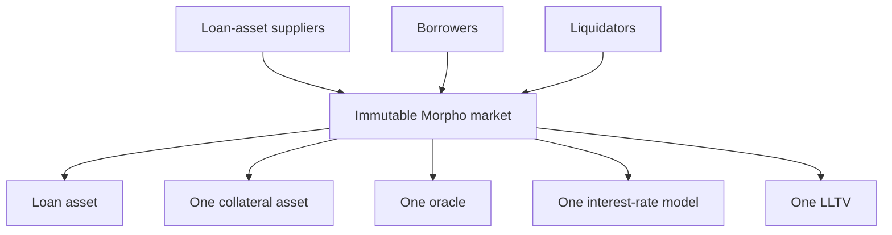
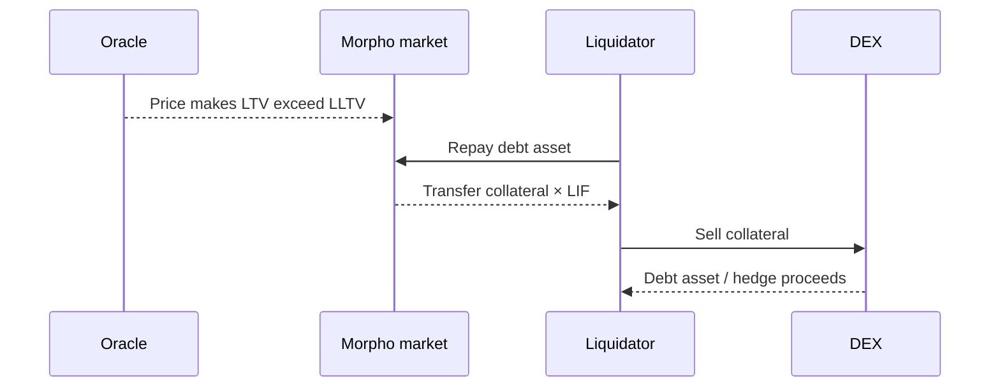
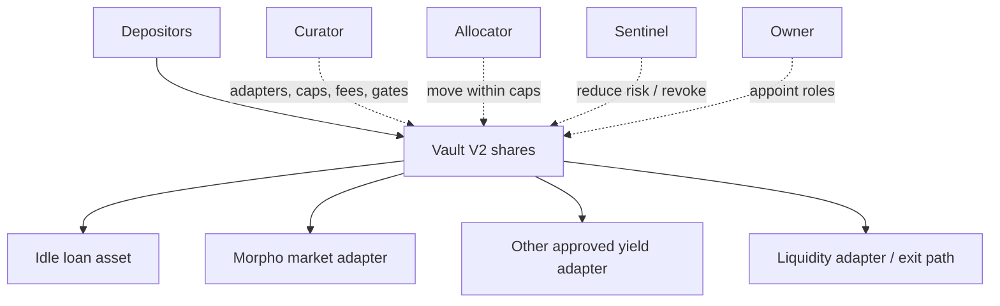

# Morpho

Morpho is a family of non-custodial lending primitives built around permissionless
market creation, immutable core parameters, and separate layers for risk
curation. Its current variable-rate protocol creates isolated markets, while
vaults package selected markets and other yield sources for suppliers. Its
earlier Optimizers improved rates on top of Aave and Compound and are now
deprecated. Newer fixed-rate work uses the Midnight protocol family.

The distinctions matter. “Depositing in Morpho” can mean supplying directly to
one immutable market, buying a share of a curator-managed vault, or using an
interface that routes among markets. Each exposes the user to a different set of
assets, permissions, and loss allocation.

This note reflects public documentation available in July 2026.

## Evolution

### Morpho Optimizers

The original Morpho Optimizers were peer-to-peer matching layers above Aave and
Compound. If a supplier and borrower could be matched directly, Morpho allocated
the underlying protocol's interest spread between them. Unmatched liquidity fell
back to the base pool.

```text
base pool supply rate < matched supplier rate
matched borrower rate < base pool borrow rate
```

Users retained the underlying pool's collateral factors, oracle, liquidation,
and liquidity assumptions while adding Morpho contracts and matching logic. The
design improved rates without creating a new independent lending risk engine.

The Optimizers have been deprecated through governance. They remain important
historically but should not be confused with the current isolated-market
protocol.

### Morpho's isolated variable-rate markets

The protocol historically branded **Morpho Blue**, now commonly documented
simply as Morpho variable-rate markets, introduced a minimal immutable core.
Anyone can create a market defined by:

```text
(loan asset, collateral asset, oracle, IRM, LLTV)
```

Each exact tuple is an independent pool of supplier assets and borrower debt.
Market risk does not automatically spread to another tuple.

### MetaMorpho and vaults

Isolation makes direct supply harder: a USDC supplier must choose among many
collaterals, oracles, LLTVs, and interest models. MetaMorpho vaults, later called
Morpho Vaults V1, accepted one loan asset and allocated it across curated Morpho
markets subject to caps and a withdrawal queue.

Vault V2 broadens the architecture with adapters, granular exposure identifiers,
absolute and relative caps, management and performance fees, several operational
roles, optional access gates, and in-kind or forced-exit mechanisms.

### Midnight

Morpho's newer **Midnight** architecture targets fixed-rate and fixed-maturity
credit. A market can accept several collateral assets against one loan asset and
maturity, with post-maturity liquidation as well as health-based liquidation.
It is distinct from the canonical variable-rate five-parameter market.

## Core Isolated Market



### Market identity

A market ID is derived from the parameter tuple. Two markets with the same
WETH collateral and USDC loan asset but different oracles or LLTVs are separate:

- liquidity is not automatically shared;
- interest and utilization differ;
- supplier loss is isolated;
- borrower positions do not net;
- one can be safe while the other fails.

Permissionless creation does not imply that every tuple is endorsed, curated, or
visible in a particular interface.

### Loan asset and collateral asset

The **loan asset** is supplied, borrowed, repaid, and withdrawn. The
**collateral asset** is posted by borrowers and cannot itself be rehypothecated
through that market. This separation lets the interest model target high loan-
asset utilization without reserving liquidity of the collateral for borrower
withdrawals while debt is open.

One-collateral isolation makes risk legible. It can be less capital-efficient for
a borrower with a portfolio of collateral because positions cannot share excess
health across markets.

### LLTV

The **Liquidation Loan-to-Value** is the maximum debt/collateral value ratio
before liquidation:

```text
LTV = borrowed loan assets
      / oracle value of collateral in loan-asset units

health factor = collateral value × LLTV / debt
```

The position becomes liquidatable when `LTV ≥ LLTV` under the implementation's
rounding and accrued balances.

Unlike Aave V3, the core market does not have a separate lower “borrowing LTV”
and higher liquidation threshold. The borrower can approach the LLTV, but doing
so leaves almost no safety buffer.

### Oracle

The market creator selects an oracle contract that prices collateral in loan-
asset units. The core is oracle-agnostic. This permits:

- Chainlink-style feed composition;
- vault-share and staking-token rate adapters;
- fixed or specialized prices;
- custom sources for new assets.

The oracle address is immutable for that market. A bad or discontinued oracle
cannot be replaced in place. Users can repay/withdraw or migrate to a new market,
but open positions and lender liquidity remain subject to the old oracle until
resolved.

Oracle immutability prevents governance substitution but raises lifecycle risk.
Evaluation includes source availability, decimals, inversion, stale behavior,
sequencer checks, rate-provider powers, and whether the oracle can revert.

### Interest-rate model

The market selects an **IRM** from those enabled by Morpho governance. The IRM
address is immutable. A market can also use no IRM where supported, producing
zero interest.

The widely used **AdaptiveCurveIRM** targets utilization around 90%. It does not
just map current utilization to one fixed kink curve; it adapts the rate level
over time according to whether utilization remains above or below target. In
simplified terms:

```text
U > target for time → increase reference rate
U < target for time → decrease reference rate
```

Then a curve around the target produces the instantaneous borrow rate. The model
seeks to learn the market-clearing rate without governance updates.

This responsiveness introduces path dependence. Two markets at the same
utilization can have different rates because their prior imbalance differed.
Suppliers should examine rate history and available liquidity, not only current
APY.

## Accounting

Each market tracks total supply assets and shares, total borrow assets and shares,
and individual positions.

For suppliers:

```text
supplier assets
≈ supplier shares / total supply shares × total supply assets
```

For borrowers:

```text
borrower debt
≈ borrower borrow shares / total borrow shares × total borrow assets
```

Interest increases total borrow assets and total supply assets according to the
IRM and elapsed time. A protocol fee, if activated for the market, diverts a
portion of borrower interest by minting fee shares to a recipient rather than
transferring cash each block.

Share accounting requires careful rounding. Small “dead” or virtual shares and
rounding-direction rules help resist first-depositor or donation manipulation.
Integrators should use protocol preview and conversion functions rather than
reimplementing approximate arithmetic.

## Supply, Borrow, and Withdrawal

### Direct supplier

A supplier selects one exact market, deposits the loan asset, and receives
internal supply shares. The supplier's yield and loss depend only on borrowers
and collateral in that market, plus common core-contract risk.

Direct supply gives maximum transparency but requires continuous evaluation:

- collateral and its liquidity;
- oracle;
- LLTV;
- IRM and utilization;
- borrower concentration;
- liquidator readiness;
- market size and idle cash.

### Borrower

A borrower supplies the market's collateral, then borrows the loan asset subject
to LLTV and available liquidity. Collateral can be added or withdrawn as long as
health remains sufficient.

Collateral is not part of supplier liquidity. Suppliers receive the loan asset
when borrowers repay or liquidators repay debt; they do not directly redeem for
collateral.

### Withdrawal liquidity

Suppliers can withdraw only available loan assets:

```text
available = total supplied assets - total borrowed assets
```

At 99% utilization, accounting claims can be solvent while immediate liquidity
is only 1%. The adaptive rate may become high, but repayment is not instantaneous.
Vault withdrawal routing can move among markets, yet it cannot create loan assets
if every allocation is illiquid.

## Liquidation

A permissionless liquidator repays part or all of an unhealthy borrower's debt
and receives collateral at an incentive factor.

Morpho defines the **Liquidation Incentive Factor (LIF)** from LLTV, capped by a
maximum. Public documentation expresses it as:

```text
LIF = min(
  1.15,
  1 / (0.3 × LLTV + 0.7)
)
```

For an 86% LLTV this is approximately 1.05, or a 5% gross bonus. The entire
incentive goes to the liquidator under the core design.



Liquidations are first-come-first-served rather than an auction. Liquidators can
use callbacks and flash liquidity. Profit depends on the oracle-market basis,
DEX depth, gas, and transaction ordering.

### Bad debt

If all collateral is seized and debt remains, the shortfall is borne by lenders
in that market. Isolation prevents it from directly reducing another market's
supplier assets, but a vault allocated to the failed market passes the loss to
its shareholders.

Bad-debt realization has varied among legacy vault versions and wrappers. An
integrator must identify whether losses are reflected immediately in share price,
remain as unrecoverable receivables until explicit recognition, or are covered by
an external party.

## Morpho Vaults V1

A V1 MetaMorpho vault is an ERC-4626-style share vault for one underlying loan
asset. The owner appoints a curator and allocator; configured caps limit each
market. A withdrawal queue specifies which markets should be tapped for
redemptions.

Key roles historically include:

- **owner:** appoints high-level roles and can control selected configuration;
- **curator:** selects markets and caps, usually subject to timelock;
- **allocator:** moves liquidity within approved limits and adjusts withdrawal
  ordering;
- **guardian:** can cancel pending risky changes or react defensively.

The vault abstracts market selection but creates a managed risk portfolio.
“Non-custodial” means roles cannot simply transfer arbitrary vault assets to
themselves under intended code; they can still change future allocation and risk
within permissions.

## Morpho Vaults V2

Vault V2 generalizes beyond one hard-coded protocol.



### Adapters

An adapter translates between the vault and an external yield source and reports
`realAssets()`. Adapters make the vault extensible without adding every strategy
to core code. They also add:

- adapter implementation and valuation risk;
- external protocol risk;
- registry governance;
- inconsistent liquidity and loss behavior;
- potential rate-report manipulation.

Morpho governance maintains an official adapter registry used by Vault V2
deployments, but a curator's exact registry and adapters must be checked.

### Caps and risk IDs

Caps can be absolute amounts or relative percentages. They apply to adapter-
defined identifiers, allowing limits by:

- exact market;
- collateral token;
- oracle;
- protocol or adapter;
- another abstract exposure encoded by the adapter.

This is more expressive than a cap per market and helps prevent several markets
with the same risky collateral from bypassing a portfolio limit.

### Roles

- **Owner** manages role appointments but is designed not to allocate assets
  directly.
- **Curator** sets strategic configuration, adapters, caps, fees, gates, and
  appoints allocators; material increases are typically timelocked.
- **Allocator** actively moves capital only among enabled targets within caps.
- **Sentinel** can take defensive actions such as reducing caps, deallocating, or
  revoking pending changes.

Role separation constrains a compromised allocator from approving a new malicious
adapter. It does not prevent an allocator from making poor choices within caps or
creating temporary illiquidity.

### Fees and gates

Vault V2 supports performance fees on yield and management fees on assets, within
contract caps. Optional gates can restrict who receives or sends shares or
assets, enabling permissioned products. A gated vault is not permissionless
merely because its core contracts are public.

### Exits

Idle assets and a liquidity adapter support normal withdrawals. An in-kind or
forced-deallocation path can allow a user to exchange vault shares for direct
positions in underlying systems when cash liquidity is unavailable, sometimes
with a penalty. This preserves a form of exit while transferring complexity and
illiquid claims to the user.

“Guaranteed exit” should therefore be read as a contract-defined claim path, not
a guarantee of immediate redemption into the original liquid token at par.

## Curators

A curator is an entity or group that constructs the vault's risk policy.
Representative curators in the ecosystem have included specialist risk firms,
asset managers, and DeFi organizations.

Curator assessment covers:

- legal identity and conflicts;
- market, oracle, and adapter selection process;
- quantitative limits and stress tests;
- allocator automation and key security;
- monitoring and incident response;
- fee incentives;
- change disclosure and timelock length;
- track record, including losses and recoveries.

A recognizable curator does not guarantee a vault, and a vault name can be
copied. Contract address and onchain roles are authoritative.

## Governance

Morpho governance intentionally has limited power over the immutable core. Public
documentation lists powers including:

- enabling LLTV values and IRMs for new markets;
- setting a protocol fee, capped at 25% of borrower interest, and fee recipient;
- controlling the MORPHO treasury;
- administering the upgradeable wrapped MORPHO token;
- code licensing and protocol ENS names.

Governance cannot change the five parameters of an existing market, seize
positions, or upgrade the core contract. It can influence which new configurations
are creatable and how interfaces or incentives develop.

Token holders vote through Snapshot; approved actions are implemented by a
governance multisig under the documented process. This is not fully trustless
execution from token vote. The multisig, proposal threshold, delegation,
treasury concentration, and legal Morpho Association are separate control
surfaces.

### MORPHO token

MORPHO has a documented maximum supply of one billion. Transferability was
enabled in November 2024. The original immutable token can be wrapped one-to-one
into an upgradeable voting-enabled token.

The token governs limited protocol functions and treasury resources. It does not
automatically represent equity in the Morpho Association, a curator, or every
vault's fees.

## Morpho Association and Interfaces

The Morpho Association is a French nonprofit supporting development, research,
security, adoption, documentation, and an interface. Core protocols can be used
through other interfaces or directly.

This separation matters in regulation and resilience:

- an interface can curate or restrict displayed markets;
- interface terms do not alter immutable market rules;
- the Association can influence code and ecosystem distribution without
  controlling user positions;
- users still depend on RPC, indexing, wallets, and oracle services.

## Comparison with Aave

| Dimension | Morpho isolated market | Aave V3 | Aave V4 |
|---|---|---|---|
| Core risk unit | one loan/collateral/oracle/IRM/LLTV tuple | multi-asset market/pool | Hub solvency boundary plus Spoke |
| Market creation | permissionless from allowed IRM/LLTV | governance listing | governance-defined Hubs/Spokes |
| Parameter mutability | tuple immutable | governance/stewards change reserve settings | governed Hub/Spoke configuration |
| Supplier choice | direct market or curated vault | reserve within a listed pool | Hub/Spoke route |
| Cross-collateral | no, per market | account-level | Spoke-defined |
| Liquidity | fragmented by tuple; vaults route | pooled per deployment | shared within Hub |
| Main extra actor | curator/allocator for vault user | DAO risk service providers | Spoke governance and risk-premium system |

Neither is categorically safer. Morpho trades shared contagion for market
selection and fragmentation. Aave trades curation and governance complexity for
pooled liquidity and account-level capital efficiency.

## Risks

### Direct market

- immutable bad oracle or IRM;
- high LLTV or thin collateral liquidity;
- borrower concentration;
- near-total utilization and delayed withdrawal;
- liquidation MEV and insufficient incentive;
- bad debt socialized among that market's lenders.

### Vault

- curator, allocator, sentinel, and owner decisions;
- timelocked future changes;
- adapter and external-protocol failures;
- cap identifiers that omit a correlated exposure;
- valuation or loss-recognition differences;
- fee dilution and illiquid exits;
- copied branding or misleading interface metadata.

### Protocol and ecosystem

- core-contract or arithmetic failure;
- governance fee or whitelist choices;
- MORPHO governance/multisig concentration;
- interface, API, indexer, and oracle dependencies;
- token and bridge risk on each deployment;
- composability when vault shares become collateral.

Immutability is a constraint on governance and also a constraint on remediation.
A safe migration depends on borrowers repaying, suppliers withdrawing, or
liquidity being refinanced; no administrator can simply patch an existing tuple.

## Evaluating a Morpho Position

### Direct supply

1. verify chain, market ID, and all five parameters;
2. analyze collateral contract, redemption, liquidity, and concentration;
3. read oracle code and source/fallback behavior;
4. understand IRM path, current rate, target utilization, and available cash;
5. inspect borrower distribution and liquidation profitability;
6. model bad debt and no-backstop loss.

### Vault supply

1. identify vault version and exact address;
2. list adapters, markets, risk IDs, caps, and current allocations;
3. identify owner, curator, allocators, sentinels, and pending timelocks;
4. calculate all fees and incentives;
5. examine idle assets, withdrawal/liquidity adapter, and in-kind exit;
6. trace loss recognition through every wrapper.

### Borrow

1. calculate LTV and health with the exact oracle decimals;
2. stress collateral/loan basis and accrued interest;
3. estimate liquidator bonus versus DEX depth and gas;
4. preserve a buffer appropriate to volatility and oracle update;
5. plan repayment if supply liquidity, interface, or oracle fails.

The core lesson is that Morpho separates immutable market mechanics from
discretionary portfolio construction. That makes the location of judgment
clearer, but it does not eliminate judgment.

## Related Notes

- [Onchain Lending and Credit](onchain-lending-and-credit.md)
- [Aave](aave.md)
- [Other Onchain Credit Protocols](other-onchain-credit-protocols.md)
- [Oracles, Indexers, and Offchain Data](../../02-blockchain-foundations/03-execution-and-applications/oracles-indexers-and-offchain-data.md)
- [DeFi Risk, Security, and Economic Attacks](../04-defi-risk-and-failures/defi-risk-security-and-economic-attacks.md)

## References

- Morpho, [Protocol Overview](https://docs.morpho.org/learn/).
- Morpho, [Variable-Rate Market Overview](https://docs.morpho.org/developers/borrow/).
- Morpho, [Oracle](https://docs.morpho.org/learn/concepts/oracle/).
- Morpho, [Interest-Rate Model](https://docs.morpho.org/learn/concepts/irm/).
- Morpho, [Liquidation](https://docs.morpho.org/learn/concepts/liquidation/).
- Morpho, [Vault V2](https://docs.morpho.org/learn/concepts/vault-v2/).
- Morpho, [Curators](https://docs.morpho.org/learn/concepts/curator/).
- Morpho, [Morpho Governance](https://docs.morpho.org/learn/governance/organization/).
- Morpho, [The MORPHO Token](https://docs.morpho.org/learn/governance/morpho-token/).
- Morpho, [Morpho Optimizers — Deprecated](https://legacy.docs.morpho.org/morpho-optimizers/overview).
- Morpho, [Midnight Overview](https://docs.morpho.org/learn/concepts/midnight/).
- Morpho Blue, [Core Source Code](https://github.com/morpho-org/morpho-blue).
- Morpho Vaults V2, [Source Code](https://github.com/morpho-org/vault-v2).
