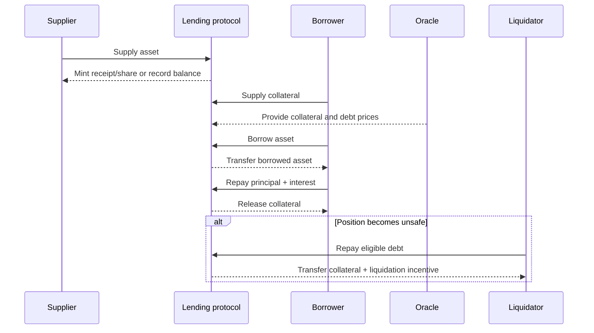
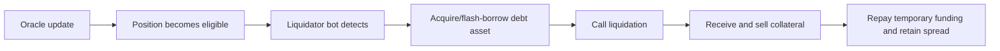
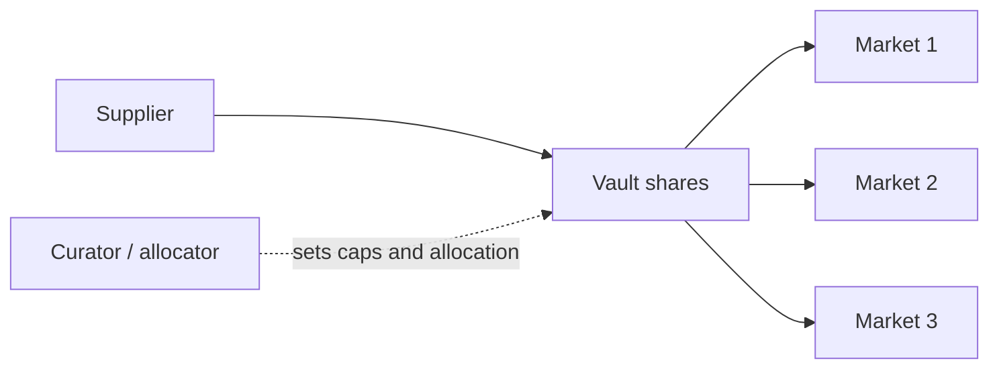

# Onchain Lending and Credit

Onchain lending protocols connect suppliers of an asset with borrowers through
smart contracts. Interest, collateral, debt, and liquidation are recorded in
blockchain state, and positions can interact with other protocols.

Most large permissionless markets do not assess a borrower's income or promise
to repay. They protect suppliers by requiring blockchain collateral worth more
than the debt and by selling that collateral automatically when a price-based
threshold is breached. This is closer to continuously margined secured financing
than to a household unsecured loan.

## Balance-Sheet View

For a simple lending pool:

| Participant | Asset | Liability/equity |
|---|---|---|
| Supplier | claim on pool principal and interest | liquidity and protocol risk |
| Borrower | borrowed token | debt plus interest, secured by collateral |
| Protocol | reserve/fee claim and smart-contract balances | obligations encoded to suppliers |
| Liquidator | collateral purchased at a discount | debt asset paid to protocol |

The pool contract holds or accounts for supplied assets. Some are lent out;
unused assets provide withdrawal and new-borrow liquidity.

```text
total supplied
  = available liquidity + outstanding principal
    ± accrued accounting adjustments
```

The supplier does not usually have a claim on one named borrower. It holds a
fungible or share-based claim on the pool. Losses from bad debt can therefore be
socialized across that market unless a reserve, backstop, or isolating mechanism
absorbs them.

## Core Lifecycle



Interest accrues according to indexes or share prices rather than by updating
every account each block. A user's scaled balance can remain constant while a
global index grows with elapsed time.

## Pooled and Isolated Market Designs

### Shared cross-collateral pool

Protocols such as Aave and Compound historically aggregate many supplied assets
and allow approved collateral to support borrowing from several reserves. A user
can supply multiple assets, borrow multiple assets, and have one account-level
health calculation.

Advantages:

- aggregated liquidity and capital efficiency;
- fungible supplier positions;
- easier refinancing and cross-collateral borrowing;
- mature risk and liquidation infrastructure.

Risks:

- one weak collateral can create bad debt in a shared system;
- oracle and parameter relationships are complex;
- correlated positions liquidate together;
- governance must approve and continually manage assets.

Supply caps, borrow caps, isolation modes, siloed borrowing, and asset categories
contain some cross-market risk.

### Isolated pair

An isolated market defines one collateral asset, one loan asset, one oracle, one
interest-rate model, and one maximum loan-to-value or liquidation threshold.
Morpho Blue and Euler-style vaults are representative of modular isolation.

Advantages:

- risk from a new collateral is bounded to that market;
- permissionless creation is more feasible;
- parameters are explicit and immutable or narrowly scoped;
- different risk preferences can coexist.

Costs:

- liquidity fragments among many parameter combinations;
- users and suppliers must evaluate each market;
- duplicate markets can have poor depth;
- curation, routing, and vault layers become important.

### Hub-and-spoke and modular designs

Newer architectures try to share base liquidity while isolating collateral rules
in modules or “spokes.” A liquidity hub owns asset accounting and rate indexes;
spokes define collateral, user risk, and premiums. This seeks the liquidity
efficiency of a pool with clearer risk segmentation. It adds inter-module
accounting and governance complexity.

## Collateral and Borrowing Capacity

### Loan-to-value

For one collateral asset:

```text
current LTV = debt value / collateral value
```

The **maximum LTV** determines new borrowing capacity. The **liquidation
threshold** is normally higher, giving a buffer between the point at which no
more borrowing is allowed and the point at which liquidation begins.

Example:

```text
collateral value             = $100,000
maximum LTV                  = 75%
liquidation threshold        = 80%
maximum initial debt         = $75,000
liquidation begins near debt = $80,000
```

Borrowing the full $75,000 leaves only a 6.25% fall in collateral value before
the debt/collateral ratio reaches 80%, ignoring interest. “25% overcollateralized”
can therefore represent a fragile position in volatile collateral.

### Health factor

A common account metric is:

```text
health factor
  = sum(collateral value_i × liquidation threshold_i)
    / sum(debt value_j)
```

Liquidation begins when the factor falls below 1. Prices, debt interest,
withdrawals, new borrowing, and parameter changes alter it.

There is no universally safe health factor. Required buffer depends on:

- collateral and debt volatility;
- correlation and basis risk;
- oracle update and market liquidity;
- chain congestion and liquidation speed;
- interest and funding;
- position size relative to exit liquidity.

### Collateral factor versus liquidation threshold

Terminology differs. Compound's “collateral factor,” Morpho's LLTV, and Aave's
LTV/liquidation threshold do not map perfectly. Always read the mathematical
condition. A parameter called 80% may mean borrowing power, liquidation LTV,
haircut, or remaining collateral value.

## Interest-Rate Models

### Utilization

For a single loan asset:

```text
utilization U
  = total borrows / (available liquidity + total borrows)
```

If $80 million is borrowed from $100 million of pool assets, utilization is 80%.
High utilization means strong demand but weak withdrawal liquidity.

### Kinked rate curve

Many protocols set a target or optimal utilization `U*` and use a piecewise
linear borrow rate:

```text
if U ≤ U*:
    r_b = base + slope1 × U/U*

if U > U*:
    r_b = base + slope1
          + slope2 × (U-U*)/(1-U*)
```

The steep second slope raises borrowing cost near full utilization, encouraging
repayment and new supply. It is a feedback mechanism, not a guarantee. In a
market panic, borrowers may be unable or unwilling to repay at any practical
rate.

### Supplier rate

A simplified supplier rate is:

```text
r_s ≈ r_b × U × (1 - reserve factor)
```

If borrowers pay 10%, utilization is 70%, and the protocol retains 10% of
interest:

```text
r_s ≈ 10% × 70% × 90% = 6.3%
```

The unborrowed 30% earns no borrower interest, explaining the utilization term.
Actual implementations use indexes, rate compounding, bad debt, incentives, and
fees that can alter displayed APY.

### Variable and fixed-like rates

Most onchain debt reprices algorithmically. Some systems have offered
stable-rate or fixed-maturity borrowing, but genuine fixed rates require term
liquidity, rate swaps, zero-coupon claims, or rules for early exit. A rate merely
called “stable” may be rebalanced under conditions and is not necessarily fixed
for the loan's life.

## Receipt Tokens, Shares, and Debt Tokens

When a supplier deposits 1,000 USDC, the protocol can represent the claim in
different ways:

- a rebasing receipt balance that grows;
- a fixed quantity multiplied by a liquidity index;
- vault shares whose exchange rate increases;
- a non-transferable internal accounting position.

For a share model:

```text
share price = pool assets / total shares
user claim  = user shares × share price
```

Debt can similarly be represented by scaled balances multiplied by a borrow
index. Transferability matters. A receipt token can be traded, deposited as
collateral, bridged, or placed in a vault, creating composability and layered
risk.

## Liquidation Mechanics

### Why liquidation exists

If collateral falls below debt, anonymous borrowers can abandon the position.
The protocol therefore sells collateral before that point. Permissionless
liquidators monitor state and compete to repay debt in exchange for collateral
at a discount.

A simplified liquidation:

```text
debt repaid by liquidator = $10,000
liquidation bonus         = 5%
collateral received       = $10,500 at oracle price
```

The $500 gross incentive must cover gas, price movement, swap slippage, capital,
and failed transaction attempts.

### Close factor and target health

A **close factor** limits what fraction of debt one liquidation can repay. Fixed
partial liquidation reduces borrower impact but can require repeated calls.
Full liquidation resolves risk faster but can over-liquidate.

Some newer designs calculate just enough repayment to restore a target health
factor and vary the bonus with position severity. This resembles a dynamic
auction: worsening positions offer more incentive.

### Liquidation pipeline



The process can be atomic through a flash loan. That lowers liquidator capital
requirements but does not ensure profitability or available DEX liquidity.

### Cascades

Liquidators sell seized collateral, pushing its market price down. Lower prices
make more positions eligible. If many users hold similar leverage, the feedback
loop becomes:

```text
price fall → liquidations → collateral sales → further price fall
```

Oracle lag, block congestion, DEX depth, position caps, liquidation bonus,
partial-close rules, and collateral correlation determine cascade severity.

## Bad Debt and Insolvency

Bad debt arises when realizable collateral value is less than debt plus
liquidation costs. Causes include:

- price gaps faster than oracle/liquidator response;
- thin or manipulated collateral;
- oracle error;
- chain or sequencer outage;
- token freeze or transfer failure;
- collateral exploit or depeg;
- too-generous risk parameters;
- failed liquidation logic.

Protocols can use:

- reserve factors and treasury assets;
- insurance or safety modules;
- deficit auctions or governance-token issuance;
- supplier loss socialization;
- debt write-offs and recovery modules;
- isolation and caps that bound loss.

A governance token described as a backstop absorbs loss only if the activation
mechanism is credible, liquid, legally/technically executable, and valuable
during stress. Its price can be negatively correlated with protocol safety.

## Liquidity Risk for Suppliers

A supplier position can be solvent but illiquid. If nearly all USDC is borrowed,
early withdrawers receive available cash while later users wait for repayment or
new supply. High rates are designed to attract liquidity, but they may rise
because withdrawal risk is already high.

Metrics include:

```text
available liquidity
utilization
withdrawal amount / available liquidity
borrower concentration
collateral concentration
rate sensitivity and repayment elasticity
```

A receipt token may trade below its accounting exchange rate when redemption is
constrained or protocol credit is questioned.

## Flash Loans

A flash loan must be repaid, with fee, before the transaction ends; otherwise the
whole transaction reverts. It is unsecured only across transaction time, not a
persistent extension of credit.

Legitimate uses:

- collateral and debt refinancing;
- arbitrage;
- liquidation;
- collateral swap;
- debt migration;
- atomic leverage.

Attackers also use flash liquidity to scale oracle manipulation or governance
attacks. The flash loan supplies temporary capital; the underlying vulnerability
is normally a protocol that assumes capital cannot be borrowed or that reads a
manipulable state.

## Vaults and Curators

Isolated markets shift market selection to suppliers. A vault can aggregate
deposits and allocate them across approved lending markets according to caps and
rules. A **curator** selects markets, oracles, LLTVs, and allocations.

This creates a layered structure:



Vaults improve usability and liquidity routing but add:

- curator diligence and conflict risk;
- allocation-model and rebalancing risk;
- withdrawal queues or idle-liquidity decisions;
- performance and management fees;
- upgrade, guardian, and admin permissions;
- correlated exposure across selected markets.

An “immutable lending market” does not make an upgradeable vault immutable.
Supplier analysis follows the complete wrapper.

## Uncollateralized and Real-World Credit

Onchain credit can rely on sources other than liquid crypto collateral:

- underwritten corporate or market-maker loans;
- permissioned borrower pools;
- invoices, receivables, funds, or securities held in legal vehicles;
- tokenized claims with offchain enforcement;
- reputation or identity attestations;
- delegated credit lines.

The blockchain can automate funding, interest, transfer, and reporting, but
cannot seize offchain assets without legal and operational agents. Credit quality
depends on underwriting, documentation, seniority, collateral perfection,
servicing, reporting, and recovery.

Such products introduce:

- borrower default and fraud;
- information asymmetry;
- maturity mismatch and redemption gates;
- legal-vehicle and jurisdiction risk;
- valuation that is not continuously observable;
- dependence on originators and servicers;
- securities and lending regulation.

“Real-world asset backed” describes a dependency, not safety. The token holder
needs an enforceable claim through the legal chain.

## Credit Delegation

Some pooled protocols allow a depositor to delegate borrowing capacity to
another address under an offchain or onchain agreement. The protocol recognizes
the delegator's collateral, but repayment recourse and underwriting lie between
the parties. This moves credit risk to the delegator rather than making it
disappear.

## Interest, Leverage, and Recursive Positions

Borrowers use onchain lending to:

- obtain liquidity without selling an appreciated asset;
- create leveraged long exposure;
- short by borrowing and selling an asset;
- hedge;
- fund market making;
- arbitrage rates or incentives;
- obtain stablecoin working capital.

A recursive leveraged long repeats:

```text
deposit collateral → borrow stablecoin → buy collateral → redeposit
```

If maximum LTV is `L` and the loop is frictionless, theoretical gross collateral
exposure approaches:

```text
initial capital × 1/(1-L)
```

At `L = 0.75`, the limit is 4× gross collateral and 3× debt. Real positions stop
earlier due to liquidation buffers, slippage, rates, and caps. Recursive leverage
amplifies oracle, liquidity, and interest-rate risk.

## Parameter Design

For each collateral and debt market, governance or market creators set:

- borrowing LTV and liquidation threshold/LLTV;
- liquidation bonus and close/target rules;
- supply and borrow caps;
- debt ceiling for isolated collateral;
- interest-rate curve and reserve factor;
- oracle and price bounds;
- asset freeze, pause, or borrowability;
- eMode/correlation categories;
- collateral and borrower eligibility.

Parameters interact. A high LLTV may be safe for two reliably redeemable forms of
the same asset but unsafe when redemption pauses. A generous liquidation bonus
attracts liquidators but penalizes borrowers and may accelerate selling. A low
cap contains loss but can make a market uneconomic and illiquid.

Risk service providers use volatility, liquidity, market depth, concentration,
oracle quality, and stress simulation. Historical data may not contain protocol
depegs, governance changes, or adversarial manipulation.

## Systemic Connections

Lending is a leverage engine at the center of DeFi. It connects:

- stablecoin demand and issuance;
- DEX liquidation liquidity;
- liquid-staking collateral;
- bridge and wrapped-asset claims;
- oracle networks;
- yield vaults and recursive strategies;
- governance-token backstops.

A stablecoin depeg can simultaneously lower collateral, raise debt, impair DEX
exit, and weaken a backstop treasury. Position-level overcollateralization does
not prevent system-level correlation.

## Protocol Archetypes

| Archetype | Representative systems | Core trade-off |
|---|---|---|
| shared pool | Aave, Compound | liquidity aggregation versus shared collateral risk |
| immutable isolated market | Morpho Blue | explicit isolation versus curation and fragmentation |
| modular vault/market | Euler, Morpho vaults | flexible risk packaging versus curator complexity |
| CDP stablecoin | Maker/Sky, Liquity | borrower mints system liability against collateral |
| underwritten credit | Maple and permissioned pools | capital efficiency versus borrower/legal credit risk |
| tokenized-asset finance | Centrifuge and related structures | offchain yield versus legal/servicing dependencies |

Separate notes examine [Aave](aave.md), [Morpho](morpho.md), and
[Sky, Maker, and Spark](sky-maker-spark.md).

## Evaluation Framework

### For suppliers

- What exact claim or share is received?
- Which borrowers and collateral markets can use the asset?
- Is risk pooled, isolated, or curated?
- What portion is withdrawable now and under stress?
- Where does yield come from: borrower interest, emissions, or external
  strategy?
- Who absorbs bad debt and in what order?

### For borrowers

- Which oracle and liquidation threshold apply?
- How volatile is collateral relative to debt?
- How quickly can the interest curve reprice?
- What liquidation amount, bonus, and transaction ordering apply?
- Can the collateral be frozen, depegged, or become illiquid?
- Can governance change parameters on an open position?

### For the system

- Are contracts immutable, upgradeable, pausable, or modular?
- Who lists assets and controls caps?
- How concentrated are suppliers, borrowers, collateral, and liquidators?
- What happens if the oracle, DEX, chain, stablecoin, or bridge fails?
- Are accounting indexes and reserves reconciled and monitored?
- Has bad-debt recovery been used in practice?

Onchain transparency makes these questions more measurable, but it does not
answer them automatically. The financial substance remains secured lending,
liquidity transformation, leverage, and default management implemented through
shared code.

## Related Notes

- [Financial Risk Management](../../01-financial-foundations/03-risk-and-regulatory-foundations/financial-risk-management.md)
- [DeFi Architecture, Composability, and Governance](../01-defi-foundations/defi-architecture-composability-and-governance.md)
- [Aave](aave.md)
- [Morpho](morpho.md)
- [Sky, Maker, and Spark](sky-maker-spark.md)
- [DeFi Risk, Security, and Economic Attacks](../04-defi-risk-and-failures/defi-risk-security-and-economic-attacks.md)

## References

- Aave, [Borrow Tokens](https://aave.com/help/borrowing/borrow-tokens).
- Aave, [Health Factor and Liquidations](https://aave.com/help/borrowing/liquidations).
- Aave, [Aave Protocol Technical Documentation](https://aave.com/docs).
- Compound, [Compound III Documentation](https://docs.compound.finance/).
- Morpho, [Morpho Documentation](https://docs.morpho.org/).
- Euler, [Euler Documentation](https://docs.euler.finance/).
- Bank for International Settlements, [DeFi Lending: Intermediation Without Information?](https://www.bis.org/publ/bisbull57.htm).
- Bank for International Settlements, [Crypto Carry](https://www.bis.org/publ/work1087.htm).
- Financial Stability Board, [The Financial Stability Risks of Decentralised Finance](https://www.fsb.org/2023/02/the-financial-stability-risks-of-decentralised-finance/).
- Ethereum Improvement Proposals, [ERC-4626 Tokenized Vault Standard](https://eips.ethereum.org/EIPS/eip-4626).
