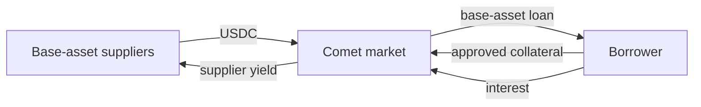
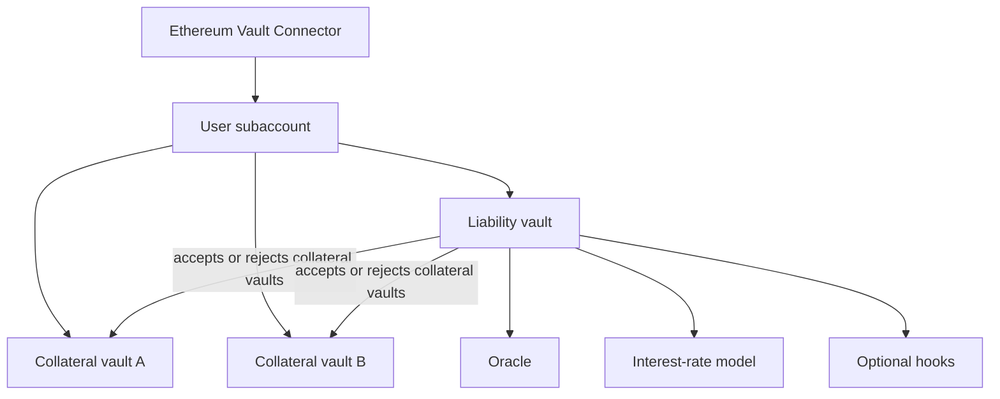
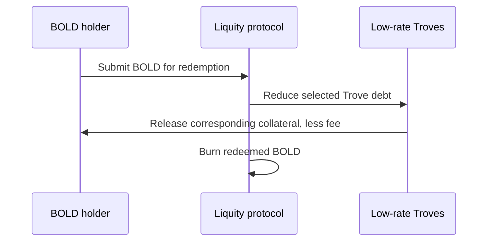
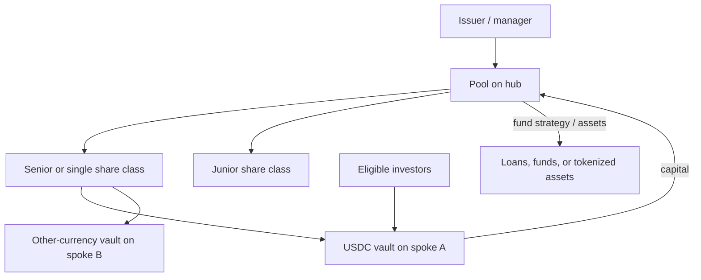

# Other Onchain Credit Protocols: Compound, Euler, Liquity, Maple, Centrifuge, and Credit Design Patterns

There is no single architecture called "DeFi lending." Protocols that appear
similar in an interface may implement fundamentally different claims:

- a lender may own a pro rata share of a pooled money market;
- a borrower may create a protocol stablecoin against a personal Vault;
- a depositor may delegate credit selection to a vault curator;
- an investor may fund a legally documented loan to an identified company; or
- a token holder may own shares in an offchain asset portfolio administered by
  an issuer.

This note compares several influential systems that complement the canonical
studies of [Aave](aave.md), [Morpho](morpho.md), and
[Sky/Maker/Spark](sky-maker-spark.md). The objective is not to rank products.
It is to identify who supplies capital, who chooses the borrower, what secures
the claim, how losses are allocated, and which parts of the process exist
outside smart contracts.

## 1. A Credit-System Taxonomy

### 1.1 Five recurring designs

| Design | Capital source | Typical borrower | Main underwriting mechanism | Representative systems |
|---|---|---|---|---|
| Multi-asset pooled market | Depositors | Pseudonymous wallet | Overcollateralization and listed-asset parameters | Compound V2, Aave |
| Base-asset market | Depositors in one principal loan asset | Pseudonymous wallet | Approved collateral and account liquidity | Compound III |
| Modular isolated vaults | Depositors in individual vaults | Pseudonymous wallet | Vault creator's collateral, oracle, LTV, and rate choices | Euler V2, Morpho |
| Stablecoin-minting Vaults | Newly issued stablecoin | Pseudonymous wallet | Overcollateralization, redemptions, or auctions | Liquity, Sky |
| Managed private credit / tokenized pools | Identified investors or vault depositors | Identified legal entity | Offchain diligence, legal documents, collateral, covenants, and servicing | Maple, Centrifuge, Goldfinch |

These categories can overlap. A managed credit pool may place idle cash into a
permissionless money market. A protocol-created stablecoin may fund a pooled
lending application. An ERC-4626 vault can represent either algorithmic onchain
loans or an actively managed offchain portfolio.

### 1.2 The questions that matter

Before considering interest rates or total value locked, determine:

1. **What is the lender's legal and technical asset?** A rebasing token, vault
   share, account balance, NFT, or contractual note?
2. **Who owes repayment?** A smart-contract position, a protocol balance sheet,
   or a legal borrower?
3. **Who chooses credit risk?** Governance, any market creator, a curator, pool
   delegate, asset manager, or each lender?
4. **What collateral can actually be seized?** Onchain tokens, custodied assets,
   receivables, or only an unsecured promise?
5. **How is value measured?** Continuous oracle pricing, periodic net asset
   value, or an underwriter's financial model?
6. **What happens after default?** Atomic liquidation, socialized bad debt,
   withdrawal impairment, restructuring, or court enforcement?

The same advertised annual percentage yield can compensate for very different
combinations of liquidity, duration, credit, smart-contract, and operational
risk.

## 2. Compound

Compound established several core money-market conventions: interest-bearing
receipt tokens, utilization-based rates, governance-listed collateral, account
liquidity, and permissionless liquidation. Compound V2 and Compound III
(`Comet`) should be treated as different architectures.

### 2.1 Compound V2

Each V2 market is represented by a `cToken` contract. Suppliers deposit an
underlying asset and receive cTokens. The cToken exchange rate against the
underlying asset rises as borrowers pay interest:

```text
underlying claim
= cTokens held × exchange rate
```

An account may enter selected markets as collateral and borrow from other
markets. The `Comptroller` coordinates:

- which markets are listed;
- collateral factors;
- account liquidity;
- borrow and supply permissions;
- liquidation eligibility; and
- COMP reward distribution.

The account is safe when discounted collateral value exceeds borrowed value:

```text
liquidity =
Σ_i (P_i × C_i × f_i) - Σ_j (P_j × B_j) > 0
```

where `P_i` is price, `C_i` collateral quantity, `f_i` collateral factor,
and `B_j` borrowed quantity.

This cross-market design improves capital efficiency but creates shared
dependencies. A bad oracle or listed collateral can affect lenders of other
assets through insolvency in the common account system.

### 2.2 Utilization and interest

For a market with cash `K`, borrows `B`, and reserves `R`:

```text
U = (B) / (K+B-R)
```

The interest-rate model maps utilization to a borrow rate. A reserve factor
retains part of borrower interest for the protocol; the remainder funds
suppliers:

```text
r_s ≈ r_b × U × (1-ρ)
```

where `r_s` is the supply rate, `r_b` the borrow rate, and `ρ` the
reserve factor. The formula explains why a quoted borrower rate is higher than
the supplier rate and why idle liquidity reduces depositor yield.

### 2.3 Compound III / Comet

Compound III reverses some V2 choices. Each Comet deployment has one **base
asset** that can be borrowed, such as USDC, plus approved collateral assets.
Users can supply the base asset to earn interest or supply collateral to borrow
the base asset. Collateral generally does not itself become a borrowable pool in
that deployment.



This isolates the principal asset and avoids a long chain in which every listed
asset is simultaneously collateral and borrowable liquidity. Multiple Comet
deployments can exist for different base assets or networks.

Important elements include:

- a proxy through which users interact with an upgradeable implementation;
- collateral `assetInfo` configurations and supply caps;
- price feeds;
- base borrow and supply rate curves;
- an account's principal and accrued balance indices;
- liquidation through collateral absorption; and
- protocol reserves and collateral sales.

In Comet, an underwater account can be *absorbed*: the protocol repays its base
debt, takes its collateral, and later sells collateral through configured
functions. This differs operationally from a liquidator directly repaying a
chosen amount and immediately receiving collateral in the same transaction.

### 2.4 Compound governance and risk

COMP-token governance and delegated voting control protocol changes, normally
through proposals and timelocks. Upgradeability makes governance and proposal
code part of the security boundary. Compound's 2021 incident, in which a
governance-approved Comptroller upgrade caused excessive COMP distributions,
showed that correctly executed governance can still install faulty logic.

Main risks include:

- base-asset and collateral oracle failure;
- governance or upgrade error;
- insufficient collateral-sale liquidity;
- concentration in one base asset or stablecoin issuer;
- rate-model and liquidity stress; and
- integration confusion between V2 cTokens and III Comet positions.

## 3. Euler

Euler V1 was a permissionless lending protocol that suffered a major exploit in
March 2023. The attacker later returned most of the stolen assets, but the event
remains relevant: modular financial software can fail through interactions
between donation, health, liquidation, and accounting logic even when each
feature has a plausible purpose.

Euler V2 was redesigned around two building blocks:

- the **Euler Vault Kit (EVK)**, for creating lending vaults; and
- the **Ethereum Vault Connector (EVC)**, for account coordination, batching,
  subaccounts, and collateral control.

### 3.1 EVK credit vaults

An EVK vault is an ERC-4626-compatible pool for one underlying asset with
borrowing functionality. It can specify:

- which other vaults are accepted as collateral;
- loan-to-value and liquidation loan-to-value limits;
- price oracles;
- an interest-rate model;
- supply and borrow caps;
- governance and upgrade configuration; and
- optional hook logic.

The liability vault decides which collateral vaults it accepts. This is a
subtle but important direction of control: a USDC lender's vault determines
which collateral claims may support USDC debt.



Some vaults can be collateral-only and not borrowable. Vaults can be assembled
into clusters that behave like curated multi-asset markets, while the primitive
remains modular.

### 3.2 EVC accounts and composability

The EVC lets a user:

- batch several actions atomically;
- operate subaccounts derived from one address;
- enable collateral and controllers;
- defer health checks until the end of a valid batch; and
- simulate complex operations.

Deferred checks enable efficient refinancing and leverage loops, but correctness
depends on ensuring that every path restores solvency before control returns.
Hooks increase flexibility while adding code and authorization risk.

### 3.3 Liquidation

Euler V2 uses a Dutch-auction-style liquidation discount. As a position becomes
less healthy, the available discount can increase, subject to configuration.
Liquidators take liability and collateral under rules intended to restore
health.

Analysis must cover:

- oracle behavior during the auction;
- whether collateral can be sold deeply enough;
- liquidation discounts versus expected slippage;
- vault caps and concentration;
- correlated accepted collateral; and
- whether hook logic changes ordinary liquidation assumptions.

### 3.4 Permissionlessness versus curation

Anyone may deploy an EVK vault, but existence is not endorsement. Official
interfaces, curators, labels, and governed clusters can provide discovery and
risk selection. This creates two distinct questions:

1. Is the underlying framework implemented correctly?
2. Is this particular vault configuration and administrator trustworthy?

A safe framework can host a dangerous vault. Conversely, a conservative vault
can still inherit risk from shared connectors, external oracles, or accepted
collateral.

## 4. Liquity

Liquity is a stablecoin-borrowing design rather than a conventional
depositor-funded money market. Borrowers create stablecoins against ether or
liquid-staking-token collateral. Its strong design preference is minimal
governance and immutable contracts.

### 4.1 Liquity V1 and LUSD

In V1, borrowers open ETH-backed positions called **Troves** and mint `LUSD`.
The protocol uses:

- a minimum collateral ratio;
- a Stability Pool funded by LUSD depositors;
- redistribution of debt and collateral if the pool cannot absorb all
  liquidations;
- redemptions of LUSD for ETH at face value; and
- a one-time borrowing fee rather than a continuously set governance interest
  rate.

When a Trove is liquidated, Stability Pool LUSD is burned against the debt and
depositors receive collateral. Depositors are therefore not passive stablecoin
savers: they underwrite liquidations and exchange stablecoin exposure for ETH
during stress.

### 4.2 Liquity V2 and BOLD

V2 introduced `BOLD`, backed by separate WETH, wstETH, and rETH borrowing
branches. Each branch has its own Troves, Stability Pool, collateral limits, and
liquidation path, while BOLD holders have exposure to the system as a whole.

Its most distinctive feature is **borrower-set interest rates**. A borrower
chooses an annual rate rather than accepting a governance-set or purely
utilization-derived curve. The rate affects both cost and redemption priority:
positions paying lower rates are generally redeemed before higher-rate
positions.

This creates a market-like mechanism:

- a very low rate reduces borrowing cost but increases redemption exposure;
- a higher rate protects the position further back in the redemption queue but
  costs more;
- delegated rate managers can adjust rates for users; and
- upfront or premature-adjustment fees discourage rapid queue manipulation.

Borrower interest is directed principally to branch Stability Pool depositors,
with a portion available for protocol-incentivized liquidity according to the
current design.

### 4.3 Redemptions and peg support

When BOLD trades below one dollar, a holder can redeem BOLD for approximately
one dollar of collateral, less fees. Redemptions reduce borrower debt and remove
stablecoins from circulation.



Redemption is not the same as issuer redemption against a bank reserve. It is a
forced deleveraging mechanism across borrower positions. Borrowers can lose
collateral exposure while their debt falls, even though they are not
liquidated.

### 4.4 Liquidation hierarchy

V2 first uses the relevant Stability Pool. If it is insufficient, the design
supports just-in-time liquidation or redistribution within the affected
collateral branch. Branch-level shutdown thresholds address extreme
undercollateralization or oracle failure.

The architecture isolates a borrower in one branch from another branch's
collateral mechanics, but BOLD is a shared multi-collateral stablecoin.
Therefore:

- an ETH borrower does not directly inherit an rETH Trove's debt;
- an ETH Stability Pool depositor selects ETH liquidation exposure; but
- every BOLD holder can be affected if any branch leaves unbacked BOLD.

### 4.5 Minimal governance trade-off

Immutable code limits the ability of token governance to change collateral,
rates, or seize funds. It also prevents ordinary governance from patching a
defect or adapting risk parameters. V2 governance has a narrow incentive
allocation role rather than broad control over core credit rules.

Minimal governance therefore exchanges discretionary intervention risk for
inflexibility and greater dependence on the original design being correct.

## 5. Maple

Maple combines smart-contract pools with identified borrowers, professional
underwriting, legal terms, active collateral monitoring, and loan servicing. It
is closer to a technology-enabled private-credit manager than to a
permissionless overcollateralized money market.

### 5.1 Actors and legal process

The core actors include:

- **liquidity providers**, who deposit assets into pools and receive ERC-4626
  pool shares;
- a **pool delegate**, who administers the pool and its strategies;
- **Maple Direct**, which originates and underwrites institutional loans;
- **borrowers**, which complete approval and negotiate terms;
- protocol governance and operational/security roles; and
- custodians and legal entities supporting collateral and pool segregation.

The loan process has material offchain steps:

1. identify and diligence the borrower;
2. negotiate a term sheet and legal agreement;
3. configure an onchain loan request;
4. fund and draw the loan;
5. monitor collateral and covenants;
6. collect scheduled interest and principal; and
7. refinance, liquidate, restructure, or enforce if necessary.

Smart contracts make balances and scheduled terms observable, but they cannot
replace financial-statement analysis, legal documentation, or recovery work.

### 5.2 Pool shares and yield

Depositors receive ERC-4626 shares whose exchange value rises as the pool earns
interest:

```text
share value =
(cash + performing loan value + other strategy value - recognized losses)
/ shares outstanding
```

The difficult input is loan value. An onchain token balance is directly
observable; the realizable value of a loan depends on borrower credit,
collateral, custody, market liquidity, and enforcement.

Products such as syrupUSDC and syrupUSDT provide tokenized access to segregated
Maple pools and may combine secured lending with other disclosed strategies,
including basis trading or DeFi liquidity deployment. The asset accepted at
deposit does not imply that all portfolio assets are the same stablecoin.

### 5.3 Liquidity and withdrawal queues

Loans have terms, while depositors may want liquidity sooner. A pool therefore
cannot promise unlimited immediate redemption unless it holds enough cash or
can sell assets.

Maple's withdrawal process can use a queue, fulfilled as liquidity becomes
available. Secondary-market exchange may offer faster exit, but the price can
deviate from reported share value.

This is a standard open-ended-fund tension:

```text
liquid claims held by investors
   versus   
less-liquid assets held by the pool
```

### 5.4 Underwriting and collateral

Overcollateralized institutional loans can still differ from atomic DeFi loans:

- collateral may be held by a third-party custodian;
- margin calls may provide a cure period;
- liquidation may require operational action;
- the borrower is a legal counterparty;
- eligible collateral and haircuts are selected by an underwriter; and
- recovery rights depend on documentation and jurisdiction.

This may allow more nuanced credit decisions than a smart contract, but it adds
human, model, custodian, and legal risks.

## 6. Centrifuge

Centrifuge provides infrastructure for tokenized investment products and asset
pools. It is broader than a single lending protocol: issuers or managers can
create pools with share classes, vaults, permissions, valuation processes, and
cross-chain distribution.

### 6.1 Pools, share classes, and vaults

A Centrifuge pool can contain:

- one or more share classes;
- ERC-20 share tokens;
- multiple deposit/redemption vaults;
- permission rules for investors;
- asset and share-price updates;
- synchronous ERC-4626 or asynchronous request flows; and
- deployments on spoke chains coordinated through a hub.



A token is only the representation layer. Its actual claim depends on pool
documents, issuer structure, share-class waterfall, transfer restrictions,
asset ownership, and insolvency treatment.

### 6.2 Asynchronous investment flows

Private-credit and real-world asset funds often cannot calculate a final share
price or provide liquidity instantly. An asynchronous vault may separate:

1. request submission;
2. eligibility and approval;
3. price determination;
4. share issuance or asset reservation; and
5. final claim.

This is more operationally complex than an immediate ERC-4626 deposit, but it
can accurately represent assets with periodic valuation, investor checks, and
settlement windows.

### 6.3 Tranching

Multiple share classes can allocate losses and returns differently. In a
simplified senior/junior structure:

- junior capital absorbs initial losses;
- senior capital receives payment first and may earn a lower return;
- excess spread can compensate junior risk; and
- triggers can restrict distributions when asset performance deteriorates.

Tranching redistributes risk; it does not remove it. If losses exceed the junior
buffer, senior investors are impaired.

### 6.4 Trust boundaries

For tokenized offchain assets, verify:

- asset originator and servicer;
- legal issuer and bankruptcy remoteness;
- collateral perfection;
- cash custody and account control;
- valuation agent and update frequency;
- investor eligibility and transfer controls;
- waterfall implementation;
- delinquency and write-down policy;
- cross-chain message security; and
- authority to pause, upgrade, or override.

Onchain transparency may show what the manager reported and which transfers
occurred. It does not independently prove every receivable exists or is
collectible.

## 7. Goldfinch as a Historical Credit Pattern

Goldfinch's original architecture illustrates community-selected private
credit. Identified borrowers create Borrower Pools with specified interest,
limit, payment frequency, and term. Backers provide first-loss junior capital;
a diversified Senior Pool supplies senior capital according to a leverage
model.

This pattern attempts to use decentralized participants for underwriting:

```text
Backers select borrower and absorb first loss
                    ↓
Senior Pool follows with senior capital
                    ↓
Borrower draws, deploys, and repays under legal terms
```

The protocol demonstrates both the promise and limit of "onchain credit
history." A public repayment record can inform future lenders, but reputation
alone does not ensure repayment. Offchain collateral agreements, local
enforcement, borrower identity, and recovery remain decisive.

Because products and governance evolve, Goldfinch's current activities should
not be inferred solely from its V1 architecture. The case is most useful as a
design pattern for senior/junior capital and delegated due diligence.

## 8. Cross-Protocol Comparison

| Dimension | Compound III | Euler V2 | Liquity V2 | Maple | Centrifuge |
|---|---|---|---|---|---|
| Core object | Base-asset Comet market | Modular credit vault | Stablecoin Trove and branch | Managed lending pool | Tokenized investment pool |
| Borrowed asset | One base asset per deployment | Asset of a liability vault | Newly created BOLD | Pool currency | Depends on strategy |
| Borrower identity | Usually pseudonymous | Usually pseudonymous | Pseudonymous | Identified and approved | Issuer/borrower structure-dependent |
| Credit selection | Governance configuration | Vault creator/governor and lender choice | Immutable branch rules | Professional underwriter/delegate | Issuer, manager, and investors |
| Main security | Liquid onchain collateral | Configurable onchain collateral | ETH/LST collateral, Stability Pools, redemptions | Legal loan plus managed collateral | Pool assets, legal claim, waterfall |
| Valuation | Oracles | Configurable oracles | Chainlink collateral prices | Onchain balances plus underwriting/servicing | Manager/issuer NAV and asset reports |
| Liquidation/default | Protocol absorbs and sells collateral | Dutch-style liquidation | Pool burn, JIT liquidation, redistribution | Margin call, liquidation, restructuring/enforcement | Asset workout and share-class loss allocation |
| Governance | Token governance and upgrades | Per-vault configuration plus framework governance | Minimal core governance | Multisig/timelock and operational roles | Pool manager plus protocol controls |
| Liquidity mismatch | Utilization can block withdrawal | Vault utilization can block withdrawal | Stablecoin market liquidity and redemptions | Loan terms versus withdrawal queue | Often explicit asynchronous redemption |

## 9. Risk Allocation

### 9.1 Permissionless onchain credit

In Compound, Euler, and Liquity, borrower identity is usually irrelevant.
Solvency relies on collateral value and rapid liquidation. Principal risks are:

- oracle failure;
- collateral volatility and liquidity;
- smart-contract defects;
- governance or configuration errors;
- congestion and MEV;
- stablecoin depegs; and
- liquidity utilization.

### 9.2 Managed and offchain credit

In Maple, Centrifuge pools, and comparable systems, borrower and asset identity
matter. Additional risks include:

- misrepresentation or fraud;
- underwriting/model error;
- covenant breach;
- custodian and bank failure;
- legal-document defects;
- weak security interests;
- servicing and collection failures;
- stale or discretionary valuation;
- jurisdictional enforcement; and
- maturity mismatch.

The presence of KYC is not itself a credit control. Identity makes diligence and
enforcement possible; it does not make the counterparty solvent.

### 9.3 Curator and manager risk

Vault and pool shares delegate decisions. Evaluate the delegate's:

- mandate and permitted assets;
- track record;
- economic stake and fee structure;
- conflicts of interest;
- authority to change limits;
- operational controls and key management;
- valuation and reporting policy;
- emergency powers; and
- replaceability.

Code-enforced caps reduce discretion but cannot validate offchain facts or
guarantee good parameter choices.

## 10. Interest Rates Are Not Directly Comparable

An apparent 8% yield can be:

- floating utilization interest from pseudonymous overcollateralized borrowers;
- a fixed-rate loan to a trading company;
- stablecoin issuance incentives;
- liquidation compensation;
- a leveraged basis trade;
- rewards paid in a volatile governance token; or
- portfolio income net or gross of fees and expected losses.

Compare expected net return:

```text
E[R_net] =
R_cash
+ R_incentives
- E[credit loss]
- E[liquidity cost]
- E[operational and smart-contract loss]
- fees
```

Token incentives should be valued separately from contractual cash yield.
Reported APY may assume reinvestment, a stable token price, uninterrupted
rewards, and immediate liquidity.

## 11. A Due-Diligence Framework

### 11.1 Contract layer

- Is the code immutable, governed, or upgradeable?
- Which implementation and deployment were audited?
- Who controls pause, caps, oracle selection, and asset recovery?
- Are external hooks, adapters, or connectors privileged?
- Can one market create losses in another?

### 11.2 Economic layer

- What creates borrower demand?
- How concentrated are assets and borrowers?
- What market depth exists for liquidation?
- How are reserves, first-loss capital, or insurance funded?
- Can liabilities be withdrawn faster than assets mature?

### 11.3 Offchain layer

- Who is the legal creditor?
- Where is collateral held?
- Are security interests perfected and enforceable?
- Who calculates NAV and recognizes impairment?
- What happens upon borrower, issuer, manager, or custodian insolvency?
- Are reports independently verified?

### 11.4 Position layer

Risk is position-specific. A conservative USDC lender in one Euler vault does
not have the same exposure as an aggressive cross-collateral borrower. A Maple
pool share depends on its current loan book, not the average historical
performance of the platform. A Liquity borrower, BOLD holder, and Stability Pool
depositor each bear different risks.

## 12. Design Lessons

1. **Isolation moves risk; it does not eliminate it.** A bad market may be
   contained, while vault depositors or shared stablecoin holders still lose.
2. **Permissionlessness requires discovery and curation.** Anyone can create a
   market; users still need a way to distinguish configurations.
3. **Immutability is a real trade-off.** It constrains malicious governance and
   also prevents ordinary repair.
4. **A token standard says little about credit quality.** ERC-4626 standardizes
   vault accounting interfaces, not the assets, valuation, or manager.
5. **Onchain settlement does not make an offchain claim self-enforcing.**
   Documentation, custody, and courts remain relevant.
6. **Liquidity is an asset property and a liability promise.** A withdrawal
   queue honestly represents maturity mismatch; instant redemption may conceal
   or transfer it.
7. **Architecture must be versioned.** Compound V2 and III, Euler V1 and V2, and
   Liquity V1 and V2 are materially different systems.

## Related Notes

- [Onchain Lending and Credit](onchain-lending-and-credit.md)
- [Aave](aave.md)
- [Morpho](morpho.md)
- [Maker, Sky, and Spark](sky-maker-spark.md)
- [Financial Risk Management](../../01-financial-foundations/03-risk-and-regulatory-foundations/financial-risk-management.md)
- [Tokenization of Securities, Funds, and Real-World Assets](../../05-digital-money-and-tokenization/03-tokenized-assets/tokenization-of-securities-funds-and-real-world-assets.md)

## References

- Compound, [Compound III documentation](https://docs.compound.finance/)
- Compound, [Compound V2 documentation](https://docs.compound.finance/v2/)
- Compound, [Comet repository](https://github.com/compound-finance/comet)
- Compound Governance, [Proposal 62: Comptroller fix](https://www.comp.xyz/t/compound-proposal-62/2136)
- Euler, [Euler V2 introduction](https://docs.euler.finance/introduction/)
- Euler, [Euler Vault Kit overview](https://docs.euler.finance/developers/evk/)
- Euler, [Ethereum Vault Connector documentation](https://docs.euler.finance/developers/evc/)
- Euler, [Security documentation and audits](https://docs.euler.finance/security/)
- Euler Labs, [Euler Finance attack review](https://www.euler.finance/blog/euler-finance-attack-review)
- Liquity, [Official Liquity V2 documentation](https://docs.liquity.org/)
- Liquity, [Borrowing and liquidations](https://docs.liquity.org/v2-faq/borrowing-and-liquidations)
- Liquity, [Redemptions and delegation](https://docs.liquity.org/v2-faq/redemptions-and-delegation)
- Liquity, [Risk disclosure](https://docs.liquity.org/v2-documentation/risk-disclosure)
- Liquity, [Liquity V1 documentation](https://docs.liquity.org/liquity-v1/)
- Maple, [Protocol actors](https://docs.maple.finance/technical-resources/protocol-overview/protocol-actors)
- Maple, [Borrower introduction](https://docs.maple.finance/maple-for-borrowers/introduction)
- Maple, [Syrup structure and strategies](https://docs.maple.finance/syrupusdc-for-lenders/introduction)
- Maple, [Withdrawals](https://docs.maple.finance/syrupusdc-for-lenders/risk)
- Centrifuge, [Pools](https://docs.centrifuge.io/user/concepts/pools/)
- Centrifuge, [Vaults](https://docs.centrifuge.io/user/concepts/vaults/)
- Centrifuge, [Architecture](https://docs.centrifuge.io/developer/protocol/architecture/)
- Goldfinch, [Borrowers and Borrower Pools](https://docs.goldfinch.finance/goldfinch/goldfinch-v1/protocol-mechanics/borrowers)
- Goldfinch, [Capital providers](https://docs.goldfinch.finance/goldfinch/goldfinch-v1/borrower-mechanics/goldfinchs-capital-providers)
