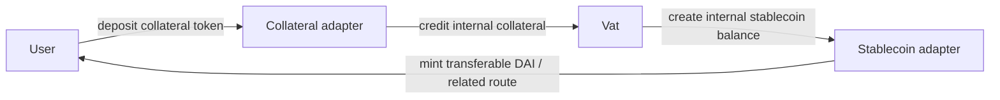
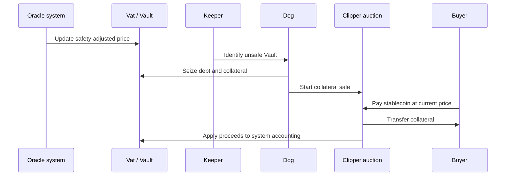
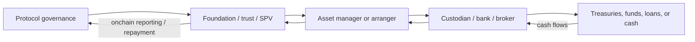
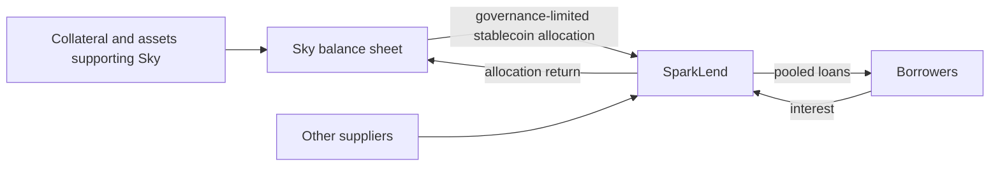
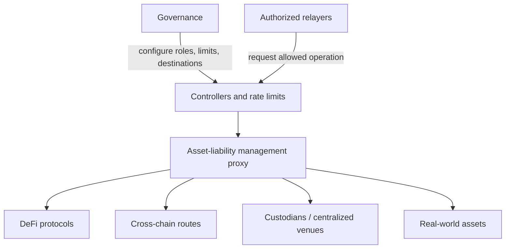

# Maker, Sky, and Spark: Decentralized Stablecoin Credit and Capital Allocation

Maker, now part of the broader Sky ecosystem, is one of the earliest and most
influential decentralized credit systems. Its central product began as Dai
(`DAI`), a dollar-targeting stablecoin created when users borrowed against
collateral held in smart-contract Vaults. Over time, the system expanded from a
crypto-collateralized lending protocol into a managed onchain balance sheet
containing stablecoins, tokenized real-world assets, protocol-owned liquidity,
and credit allocations to other protocols.

Sky is not best understood as an unrelated successor to Maker. It is an
evolution of the same economic system. The legacy Maker contracts and
terminology remain important because much of the core accounting, collateral,
rate, and liquidation machinery continues to underlie the newer tokens and
interfaces. Sky introduced, among other things:

- `USDS`, a newer stablecoin convertible with DAI;
- `sUSDS`, a tokenized savings position;
- `SKY`, the newer governance token associated with the migration from `MKR`;
- a reworked governance and organizational model; and
- specialized ecosystem projects, including Spark.

Spark is a capital-allocation and user-product layer linked to Sky. It includes
a lending market, savings products, and infrastructure that deploys liquidity
across chains and venues. The relationship is economically significant: Sky can
create or allocate stablecoin liquidity, while Spark distributes and invests
that liquidity under governance-defined constraints.

This note explains the system as credit infrastructure rather than as a set of
brand names. It first develops the balance-sheet logic, then the contracts, the
stablecoin peg, governance, the Maker-to-Sky transition, Spark, and the risks
created by connecting decentralized contracts to centralized assets and
offchain legal claims.

## 1. The Core Economic Idea

### 1.1 A stablecoin is a liability of a system

A dollar-referenced stablecoin may behave like cash to its holder, but it is an
economic liability of its issuer or protocol. If a protocol has issued 100
million units intended to be worth one dollar each, the protocol needs assets,
claims, or mechanisms capable of supporting roughly 100 million dollars of
redemption value.

Maker's original model created DAI as overcollateralized debt. A borrower might
lock $150 of collateral and create 100 DAI. The borrower's position is a secured
loan:

| Borrower's position | Protocol's economic view |
|---|---|
| Receives newly created DAI | Issues a stablecoin liability |
| Locks collateral | Obtains a secured claim over collateral |
| Owes principal plus a stability fee | Accrues an interest-like receivable |
| May recover collateral by repaying | May liquidate collateral if safety fails |

The protocol does not lend out a pre-existing depositor's DAI in this
transaction. It creates new DAI against a secured debt position. This resembles
money creation through collateralized credit more than a pooled lending market
such as Aave.

### 1.2 Simplified balance sheet

At system level:

```text
Assets and claims                       Liabilities and loss absorption
-----------------------------------     -----------------------------------
Collateral securing Vault debt          DAI and USDS in circulation
Stablecoins held by PSMs                 Savings claims such as sUSDS
Tokenized real-world assets              Accrued system expenses
Loans and protocol allocations           Surplus / protocol capital
Accrued stability fees                   Residual bad debt, if any
```

This is an economic representation, not a legal or accounting opinion. Some
"assets" are smart-contract-controlled tokens; others are contractual claims
held through foundations, trusts, special-purpose vehicles, or regulated
intermediaries. Their enforceability, liquidity, and credit quality differ.

A useful solvency approximation is:

```text
net assets =
market value of realizable assets
- stablecoin and other senior liabilities
```

The word *realizable* matters. An illiquid loan reported at face value may not
cover stablecoin liabilities during stress. Haircuts should therefore reflect
price risk, liquidation costs, legal enforceability, delay, and counterparty
risk.

### 1.3 Why overcollateralization is necessary

Crypto collateral can lose value much faster than a traditional secured lender
can renegotiate a loan. Smart contracts compensate by:

- requiring collateral worth more than the debt;
- obtaining continuously updated prices from oracles;
- making liquidation permissionless;
- selling collateral before its value falls below the debt plus costs; and
- imposing debt ceilings and other risk limits by collateral type.

If `C` is collateral value and `D` is current debt, define:

```text
collateralization ratio = (C) / (D)
```

Suppose 10 ETH worth $2,000 each secure 10,000 DAI:

```text
$20,000 / 10,000 = 200%
```

If the liquidation ratio is 150%, liquidation becomes possible when the
collateral is worth less than $15,000, subject to the protocol's oracle and
auction mechanics. The buffer is meant to cover adverse price movement during
the liquidation interval, not merely the initial debt.

## 2. Historical Evolution

### 2.1 From Single-Collateral Dai to Multi-Collateral Dai

The first production version, Single-Collateral Dai, accepted only pooled ether
(`PETH`) as collateral. It used a distinct stablecoin later called `SAI`.
Multi-Collateral Dai launched in 2019 and introduced the present DAI token,
multiple collateral types, the Dai Savings Rate, and revised liquidation and
governance machinery.

This transition illustrates a recurring protocol-design problem: an asset can
retain its user-facing purpose while the contracts and risk model beneath it
change. A canonical note should therefore distinguish:

- the unit and token held by users;
- the accounting system that creates it;
- the current front end and brand;
- the governance process that changes risk parameters; and
- legacy contracts that may still contain assets.

### 2.2 From Maker to Sky

Maker governance pursued a long-running restructuring commonly associated with
the "Endgame" plan. The public Sky launch introduced USDS and SKY while
preserving conversion routes to the older DAI and MKR assets. The transition is
better described as a controlled migration than as a simple token rename.

As of July 2026:

- DAI and USDS coexist;
- the official converter supports fee-free 1:1 conversion in either direction
  between DAI and USDS;
- USDS is an upgradeable ERC-20 implementation, unlike the older DAI design;
- sUSDS is an ERC-4626 tokenized savings vault;
- the governance-token transition from MKR to SKY has involved staged
  governance and integration changes; and
- legacy Maker terminology remains visible in core-contract documentation.

Upgradeability changes the trust model. It can allow defects or changing
requirements to be addressed, but an authorized governance process can also
alter token behavior. Users must evaluate both smart-contract code and control
over future implementations.

## 3. The Core Accounting System

### 3.1 The Vat

The `Vat` is the internal ledger and Vault engine. It records:

- collateral credited to the system;
- collateral locked in each Vault;
- normalized debt per Vault;
- accumulated rate factors per collateral type;
- internal stablecoin balances;
- bad-debt balances; and
- system-wide and collateral-specific debt ceilings.

The Vat deliberately does not transfer ordinary ERC-20 tokens itself. Adapter
contracts move assets between external token contracts and internal accounting.
This separation makes the accounting kernel comparatively general, but gives
authorized adapters powerful privileges.

Two data structures are central:

| Structure | Important fields | Meaning |
|---|---|---|
| `Urn` | `ink`, `art` | A particular Vault's locked collateral and normalized debt |
| `Ilk` | `Art`, `rate`, `spot`, `line`, `dust` | Aggregate state and limits for a collateral type |

An *ilk* is a configured collateral category, not merely a token symbol.
Different risk configurations or adapters for economically similar assets may
be separate ilks.

The current debt of a Vault is approximately:

```text
debt = art × rate
```

`art` is normalized debt. `rate` is a cumulative multiplier updated as stability
fees accrue. This design avoids updating every Vault every block. A rate change
updates the collateral type's accumulator, changing the computed debt of all
Vaults in that category.

### 3.2 External tokens and internal units

Maker-derived contracts use fixed-point units with different precisions,
including:

- `wad`: `10^(18)`, commonly used for token-scale quantities;
- `ray`: `10^(27)`, commonly used for rates; and
- `rad`: `10^(45)`, used for high-precision internal value.

This is not incidental implementation trivia. Confusing decimal domains can
produce catastrophic errors in integrations. It also explains why a user may
see an external ERC-20 DAI or USDS balance while core modules maintain an
internal stablecoin balance represented differently.

### 3.3 Adapters

A collateral adapter takes custody of an external token and credits a
corresponding internal collateral balance. A stablecoin adapter converts between
the Vat's internal accounting balance and transferable ERC-20 tokens.



An adapter is a trust boundary. If it reports collateral that was not actually
received, mishandles decimal conversion, or has excessive authorization, the
Vat's otherwise correct arithmetic can be backed by false state.

### 3.4 Main supporting modules

The system is modular:

- **Spot / oracle modules** transform external prices into conservative
  collateral values used by the Vat.
- **Jug** accumulates stability fees for collateralized debt.
- **Pot** historically implements the Dai Savings Rate.
- **Dog** identifies unsafe Vaults and initiates collateral liquidation.
- **Clipper contracts** sell particular collateral types through auctions.
- **Vow** aggregates system surplus and bad debt.
- **Join adapters** connect ERC-20 assets and the internal ledger.
- **Governance spells** execute approved parameter and contract changes,
  generally subject to authorization and delay mechanisms.

The module names should not obscure the conventional financial functions:
secured-loan servicing, collateral valuation, margin monitoring, liquidation,
asset conversion, treasury accounting, and governance-controlled risk limits.

## 4. Vault Lifecycle

### 4.1 Opening and drawing

A user chooses a collateral type, deposits collateral, and creates stablecoin
debt. The resulting position must satisfy that ilk's safety constraint:

```text
collateral value at safety-adjusted price
≥ outstanding debt
```

The protocol controls at least:

- a debt ceiling for the collateral type;
- a global system debt ceiling;
- a debt floor that prevents uneconomically small Vaults;
- the stability-fee rate;
- an oracle and safety margin;
- a liquidation ratio;
- a liquidation penalty; and
- auction capacity and timing parameters.

Borrowers can add collateral or repay debt. Withdrawing collateral or drawing
more debt is allowed only if the resulting position remains safe.

### 4.2 Stability fees

The stability fee is the cost of maintaining debt. It is conceptually similar
to interest but is implemented through an accumulating debt multiplier. If
principal is `D_0`, the effective annualized rate is `r`, and the time is
`t` years:

```text
D_t ≈ D_0(1+r)^t
```

Actual contract calculations use per-second fixed-point compounding and only
materialize certain updates when a public function is called. The economic
accrual nevertheless belongs to the elapsed period.

Rate policy affects several objectives at once:

- the demand to borrow and create stablecoins;
- protocol income;
- the attractiveness of holding or saving the stablecoin;
- the peg through changes in supply; and
- borrower liquidation risk.

There is no single rate that independently optimizes growth, revenue, peg
stability, and credit safety.

### 4.3 Liquidation

When oracle-valued collateral no longer supports the debt, a keeper can trigger
liquidation. The unsafe debt and collateral are removed from the Vault's normal
state, and collateral is offered for sale. In the current liquidation design,
the sale price follows a governance-configured decreasing-price curve rather
than requiring the older two-sided auction sequence.



Auction parameters balance conflicting risks:

- a price that declines too slowly may leave debt unresolved during a crash;
- a price that declines too quickly transfers excess value to liquidators;
- inadequate transaction inclusion or keeper capital can prevent competitive
  bidding;
- stale or manipulated oracle prices can liquidate safe Vaults or protect unsafe
  ones; and
- too much simultaneous liquidation can overwhelm market depth.

If a sale raises more than the debt and penalty, residual value may be returned
according to the liquidation rules. If it raises too little, the system records
a shortfall. Surplus and loss-absorption mechanisms must then reconcile the bad
debt.

## 5. Peg Management

Overcollateralization supports solvency but does not by itself keep a token near
one dollar in secondary markets. The market price is produced by supply,
demand, redemption or conversion paths, expectations, and liquidity.

### 5.1 Credit supply and rates

If the stablecoin trades above one dollar, making borrowing cheaper can
encourage new issuance, while lower savings incentives can reduce holding
demand. If it trades below one dollar, higher borrowing costs can encourage
repayment and contraction, while higher savings rates can encourage demand.
These responses are neither instant nor guaranteed.

### 5.2 Peg Stability Modules

A Peg Stability Module (PSM) provides a quoted conversion between the protocol's
stablecoin and an external reference stablecoin such as USDC. Ignoring fees:

```text
1 USDC -> PSM -> approximately 1 protocol stablecoin
1 protocol stablecoin -> PSM -> approximately 1 USDC
```

This creates an arbitrage band. If the protocol stablecoin trades at $1.01,
arbitrageurs can deposit reference collateral, create units near $1, and sell
them. If it trades at $0.99, arbitrageurs can buy it and redeem through the PSM.
Configured fees determine the practical boundaries.

The newer LitePSM design separates a reserve pool from the Vat-facing mechanism
and can use buffers and automated liquidity management. The precise deployment
must be inspected rather than inferred from the generic PSM name.

A PSM improves price stability by importing another stablecoin's redemption
mechanism and market liquidity. It also imports that asset's risks:

- issuer credit and reserve risk;
- freeze, blacklist, and upgrade powers;
- bank and custodian exposure;
- jurisdictional and sanctions risk; and
- concentration in a single external issuer.

During the March 2023 USDC depeg, DAI also traded below its target because USDC
and USDC-linked positions represented a meaningful part of its backing and peg
infrastructure. The episode demonstrates that diversification by token label is
not necessarily diversification by underlying risk.

### 5.3 DAI–USDS conversion

The official converter exchanges DAI and USDS 1:1 in either direction without a
fee. Economically, this makes them closely connected claims on the same broader
system. They are not technically identical:

| Dimension | DAI | USDS |
|---|---|---|
| Role | Legacy/currently circulating stablecoin | Newer Sky stablecoin |
| Contract lineage | Maker-era token | Sky-era token |
| Conversion | Convertible to USDS | Convertible to DAI |
| Upgrade model | Older design | UUPS/ERC-1967 upgradeable design |
| Integrations | Broad historical integration base | Newer integrations and Sky products |

The converter reduces price divergence but cannot eliminate smart-contract,
governance, liquidity, or market-access differences between the tokens.

## 6. Savings and Protocol Profitability

### 6.1 Savings is funded, not created from nowhere

DAI or USDS placed into a savings mechanism can accrue value at a
governance-defined rate. The economic funding ultimately comes from the system's
asset returns and policy:

- stability fees paid by Vault borrowers;
- yield on stablecoin reserves;
- interest and fees from real-world asset portfolios;
- returns from protocol credit allocations;
- market-making or liquidity activity; and
- temporarily, a reduction in protocol surplus or other incentives.

For sustainability:

```text
asset income + other recurring revenue
≥ savings expense + operating losses and costs
```

A protocol can set savings expense above current income as a growth or monetary
policy, but the difference must be financed and cannot persist indefinitely
without adequate surplus or future earnings.

### 6.2 sUSDS

`sUSDS` is an ERC-4626 vault token representing a claim on USDS deposited into
the Sky Savings Rate mechanism. A holder owns shares, not a fixed number of
underlying dollars. As value accrues, the amount of USDS redeemable per share
increases.

If:

```text
share price =
USDS assets attributed to the vault / sUSDS shares outstanding
```

then yield generally appears through a rising share price rather than by
recurrently sending more sUSDS tokens to every wallet. ERC-4626 standardizes
deposit, withdrawal, and preview interfaces, which aids integration but does not
guarantee asset safety or a particular rate.

### 6.3 Surplus and losses

The Vow accounts for system surplus and bad debt. At a high level:

- stability fees and related income increase surplus;
- liquidation shortfalls create system debt;
- surplus can offset debt;
- governance can direct excess value through configured treasury or
  token-economic mechanisms; and
- severe deficits may require extraordinary loss absorption or emergency
  actions.

Stablecoin holders are economically senior to governance-token holders in the
sense that the governance layer is expected to manage residual gains and absorb
losses. Smart contracts and legal structures, however, do not necessarily create
the same formal creditor hierarchy as a regulated bank or corporate insolvency
regime.

## 7. Real-World Assets

### 7.1 Why the system added offchain assets

Crypto-backed borrowing demand and rates can be volatile. Real-world assets
(RWAs), including short-duration government securities and private-credit
arrangements, can:

- diversify protocol income;
- connect stablecoin liabilities to dollar-denominated assets;
- reduce exclusive dependence on leveraged crypto borrowers; and
- provide returns when onchain borrowing demand is weak.

They also transform the system. A purely onchain position can be liquidated by
code. A bond portfolio or loan may require a legal entity, bank account,
custodian, administrator, broker, trustee, and enforceable contract.

### 7.2 Legal and operational chain



The token held by the protocol may represent a legal claim rather than direct
ownership of the underlying asset. Analysis must trace:

1. who owns the asset under applicable law;
2. who owes payment to whom;
3. whether protocol governance or token holders can enforce the claim;
4. insolvency remoteness and creditor priority;
5. custody and cash-account segregation;
6. valuation and reporting frequency;
7. redemption gates and settlement time; and
8. what an onchain oracle update legally signifies.

An oracle can report that a loan is worth $100 million. It cannot make the
borrower pay, perfect a security interest, or accelerate judicial enforcement.

### 7.3 Asset-liability management

Stablecoin liabilities can move continuously and may be redeemed during market
stress. Offchain assets may settle only on business days or be subject to notice
periods. The protocol therefore faces a classic maturity and liquidity mismatch.

Risk management should distinguish:

- **solvency:** whether asset value ultimately exceeds liabilities;
- **liquidity:** whether cash is available when conversions occur;
- **duration:** sensitivity to interest-rate changes;
- **credit risk:** probability and severity of non-payment;
- **basis risk:** divergence between stablecoin demand and asset values;
- **operational risk:** errors across legal and technical intermediaries; and
- **concentration risk:** correlated exposure to issuers, banks, custodians, or
  jurisdictions.

This makes Sky increasingly comparable to a transparent, programmable
asset-liability manager, while still lacking many legal protections, liquidity
facilities, and supervisory arrangements associated with banks or regulated
money-market funds.

## 8. Governance and Control

### 8.1 What governance controls

Governance is not limited to cosmetic protocol settings. Depending on the module
and migration stage, it can influence:

- collateral admission and removal;
- debt ceilings and liquidation ratios;
- stability and savings rates;
- oracle selection;
- authorized adapters and other privileged contracts;
- PSM fees and capacity;
- real-world asset mandates;
- capital allocations to Spark or other components;
- treasury and token-economic actions;
- upgrades to upgradeable contracts; and
- emergency responses.

The system therefore contains both immutable accounting rules and mutable
authorization. Decentralization must be evaluated function by function.

### 8.2 Governance execution

Maker-era governance used MKR-weighted voting through the `Chief` contract.
Approved actions are packaged in executable *spells*, with a pause/delay
mechanism intended to give observers time to inspect consequential changes.
Emergency and security processes add further actors and permissions.

The MKR-to-SKY transition includes changes to token voting and governance
infrastructure. A historical MKR diagram should not automatically be treated as
the current control map. Integrators need to verify:

- which token and voting contract currently control a module;
- whether delegation is supported;
- the executive-vote and delay process;
- emergency powers;
- proxy and upgrade administrators; and
- cross-chain governance message paths.

### 8.3 Governance attacks and capture

Governance power can authorize contracts that mint unbacked stablecoins or
misappropriate collateral. Defenses may include governance-token economic
costs, delays, monitoring, emergency controls, participation incentives, and
social coordination. None makes capture impossible.

Key risks include:

- concentrated voting power;
- borrowed or economically hedged voting positions;
- malicious proposals hidden in complex code;
- voter apathy and delegated-power concentration;
- compromised delegates or operational signers;
- rushed emergency execution; and
- conflicts between stablecoin holders, borrowers, savers, governance-token
  holders, and ecosystem projects.

## 9. Spark

Spark is best understood through three product families rather than as only a
lending application.

### 9.1 SparkLend

SparkLend is an overcollateralized pooled lending market derived from the Aave
V3 codebase. Users supply supported assets and borrow against collateral.
Interest rates depend on utilization and configured curves, and unsafe positions
can be liquidated.

What differentiates the economic model is its relationship to Sky. Sky can
provide a large stablecoin credit facility or liquidity allocation, allowing
SparkLend to offer stablecoin funding without relying entirely on retail
deposits. This connects two forms of credit creation:



SparkLend should still be analyzed as its own lending market. Borrower
liquidations, reserve configurations, oracle dependencies, smart-contract
changes, and market liquidity create risks distinct from the underlying
stablecoin.

### 9.2 Spark Savings

Spark packages savings exposure into composable vault products. Its
documentation identifies products including sUSDS and `spUSDC`. Their economic
routes differ:

- sUSDS represents USDS deposited into the Sky Savings Rate mechanism;
- other savings vaults may accept a different asset and allocate it through
  Spark's controlled infrastructure.

The user-facing asset name does not fully identify the risk. A USDC-denominated
savings token can expose holders to the vault contracts, Spark allocation
logic, Sky credit, external venues, bridging, and USDC issuer risk.

### 9.3 Spark Liquidity Layer

The Spark Liquidity Layer allocates capital across DeFi, centralized venues,
real-world assets, and multiple networks. Its onchain architecture includes
asset-holding proxies, controllers that specify permitted operations, relayers,
and rate limits that cap flows.

The general control pattern is:



A controller can make a broad proxy safe only if its allowed targets,
functions, slippage bounds, rate limits, and role administration are correct.
Security audits of this layer explicitly note dependencies outside the audited
contracts, such as centralized stablecoin controls and bridge attestations.

The Liquidity Layer introduces professional asset-management concepts into
onchain governance:

- mandates and eligible investments;
- counterparty and protocol limits;
- liquidity buffers;
- duration and currency constraints;
- performance benchmarks;
- rebalancing;
- independent reporting; and
- operational separation between policy and execution.

Code-enforced limits can strengthen a mandate, but relayers, governance, legal
entities, and external custodians remain part of the trust model.

### 9.4 Spark governance and SPK

Spark has its own `SPK` token and governance processes, while remaining
economically connected to Sky. The result is layered governance: one community
may authorize capital, another may manage product parameters, and external
protocols govern the venues in which funds are deployed.

Layered governance can specialize decision-making. It can also create:

- ambiguous responsibility after a loss;
- mismatched incentives between capital provider and allocator;
- dependency on multiple governance quorums and emergency processes;
- token-voting concentration at each layer; and
- slower incident response.

## 10. Comparison with Aave and Morpho

| Dimension | Sky/Maker Vaults | Aave | Morpho |
|---|---|---|---|
| Primary function | Create a protocol stablecoin against assets | Pool supplied assets and lend them | Immutable isolated lending markets plus vault allocation |
| Source of borrowed asset | Newly issued DAI/USDS or allocated protocol liquidity | Existing supplier deposits and configured mechanisms | Direct market liquidity supplied by lenders/vaults |
| Market structure | Collateral-type debt positions in one accounting system | Multi-asset pools/reserves | One loan asset, collateral asset, oracle, LLTV, and IRM per market |
| Lender role | Stablecoin holders fund the liability indirectly; savers opt into yield | Suppliers explicitly fund reserves | Direct lenders or vault depositors fund markets |
| Risk governance | Extensive asset-liability and monetary policy | Listed-asset and pool risk parameters | Market creation is permissionless; vault curators allocate |
| Liquidation | Collateral auctions / sales | Liquidators repay debt and seize collateral | Liquidators close unhealthy isolated positions |
| Major special risk | Stablecoin solvency, peg, governance, and offchain assets | Shared-pool contagion, parameter, and oracle risk | Isolated-market quality and curator risk |

SparkLend itself resembles Aave more than it resembles a Maker Vault, but its
funding relationship with Sky embeds it inside the broader stablecoin balance
sheet.

## 11. Principal Risks

### 11.1 Collateral and liquidation risk

Fast price declines, thin markets, failed transactions, congestion, or
misconfigured auctions can produce a shortfall. Correlation increases during
stress, so nominally different crypto collateral may collapse together.

### 11.2 Oracle risk

Incorrect, stale, or manipulable prices can permit excess borrowing or cause
unjust liquidation. Delayed-price mechanisms reduce some manipulation risk but
give market prices time to move away from the value used by the protocol.

### 11.3 Stablecoin and peg risk

The target is not a guarantee. Loss of confidence, impaired assets, a PSM
counterparty failure, governance concerns, or inadequate liquidity can move DAI
and USDS below one dollar. Demand shocks can also produce a premium.

### 11.4 Smart-contract and authorization risk

The core contracts, adapters, token converters, proxies, cross-chain systems,
and external integrations form a large attack surface. An authorized module can
be more dangerous than an ordinary application contract because it may change
core balances. Upgradeable USDS and other proxy-based components add governance
and implementation risk.

### 11.5 Real-world asset and legal risk

Offchain claims depend on law, documentation, intermediaries, banking access,
sanctions compliance, custody, and enforcement. Onchain governance cannot
unilaterally override insolvency law or recover assets from an uncooperative
counterparty.

### 11.6 Liquidity and maturity mismatch

Stablecoins and savings shares can be transferred or redeemed rapidly, while
loans and securities may take days or months to monetize. A solvent system can
therefore face a liquidity crisis.

### 11.7 Governance and organizational risk

Complex organizational transitions create risks of unclear authority, low
participation, incompatible incentives, and errors during contract migration.
Brand simplicity can conceal technical and governance complexity.

### 11.8 Cross-protocol and cross-chain risk

Spark allocations expose the system to other protocols, bridges, custodians,
stablecoin issuers, and networks. Rate limits reduce maximum loss over a defined
interval but do not eliminate loss, mispricing, or correlated failure.

## 12. Lessons from Stress Events

### 12.1 Black Thursday, March 2020

During a sharp ether price decline and Ethereum congestion, Maker liquidations
experienced weak competition and some collateral auctions cleared for zero DAI.
The system accumulated bad debt and later used MKR issuance as part of
recapitalization. The event motivated major liquidation-system changes.

General lesson: a protocol that is solvent at oracle prices may fail to realize
those prices when keeper infrastructure, transaction inclusion, and bidder
liquidity break simultaneously.

### 12.2 USDC depeg, March 2023

When uncertainty about reserves held at Silicon Valley Bank caused USDC to trade
below one dollar, DAI also weakened because of its substantial exposure to USDC
and PSM-based convertibility.

General lesson: an onchain asset can inherit offchain bank risk through its
collateral. A near-instant conversion facility transmits both liquidity and
contagion.

### 12.3 Governance and migration as continuous risk

Maker/Sky did not reach a final static architecture. Changes to collateral,
RWAs, token contracts, governance, and ecosystem allocations are part of normal
operation. Due diligence is consequently a process, not a one-time contract
audit.

## 13. How to Analyze the Ecosystem

A rigorous analysis separates six layers:

1. **Token:** What contract is held, and is it upgradeable, freezeable, or
   convertible?
2. **Accounting:** Where are issuance, debt, surplus, and bad debt recorded?
3. **Assets:** What economically backs the liabilities, with what haircuts and
   liquidity?
4. **Control:** Which governance, multisigs, relayers, legal entities, and
   emergency actors can change or move value?
5. **Market infrastructure:** Which oracles, keepers, exchanges, bridges,
   custodians, and banks are needed during stress?
6. **Legal claim:** What rights exist if an offchain obligor or custodian fails?

For a current snapshot, verify at least:

- DAI, USDS, sUSDS, MKR, SKY, and SPK contract addresses;
- live conversion routes and restrictions;
- current governance contracts and delegates;
- collateral and debt-ceiling composition;
- PSM reserves and external issuer concentration;
- savings and borrowing rates;
- Spark allocation destinations and limits;
- real-world asset reports and legal structures;
- audit scope and code version; and
- emergency and upgrade authorities.

No single metric such as total value locked, stablecoin market capitalization,
or advertised savings rate captures this system. It is simultaneously a
stablecoin issuer, secured-credit engine, onchain treasury, governance system,
and capital allocator.

## Related Notes

- [Onchain Lending and Credit](onchain-lending-and-credit.md)
- [Aave](aave.md)
- [Morpho](morpho.md)
- [Stablecoins](../../05-digital-money-and-tokenization/01-stablecoins/stablecoins.md)
- [Tokenization of Securities, Funds, and Real-World Assets](../../05-digital-money-and-tokenization/03-tokenized-assets/tokenization-of-securities-funds-and-real-world-assets.md)
- [Oracles, Indexers, and Offchain Data](../../02-blockchain-foundations/03-execution-and-applications/oracles-indexers-and-offchain-data.md)
- [DeFi Architecture, Composability, and Governance](../01-defi-foundations/defi-architecture-composability-and-governance.md)

## References

- Sky Protocol Documentation, [USDS](https://developers.skyeco.com/protocol/tokens/usds/)
- Sky Protocol Documentation, [sUSDS (Savings USDS)](https://developers.skyeco.com/protocol/tokens/susds/)
- Sky Protocol Documentation, [DAI](https://developers.skyeco.com/protocol/tokens/dai/)
- Sky Protocol Documentation, [SKY](https://developers.skyeco.com/protocol/tokens/sky/)
- Sky Protocol Documentation, [Token and Governance Upgrade](https://developers.skyeco.com/guides/sky/token-governance-upgrade/overview/)
- Sky Protocol Documentation, [Vat (Core Accounting)](https://developers.skyeco.com/protocol/core/vat/)
- Sky Protocol Documentation, [Collateral Liquidation](https://developers.skyeco.com/protocol/vaults/collateral-liquidation/)
- Sky Protocol Documentation, [Rates Overview](https://developers.skyeco.com/protocol/rates/ovreview/)
- Sky Protocol Documentation, [LitePSM](https://developers.skyeco.com/protocol/liquidity/litepsm/)
- MakerDAO, [The Maker Protocol: MakerDAO's Multi-Collateral Dai System](https://makerdao.com/whitepaper/White%20Paper%20-The%20Maker%20Protocol_%20MakerDAO%E2%80%99s%20Multi-Collateral%20Dai%20(MCD)%20System-FINAL-%20021720.pdf)
- Spark Documentation, [Spark documentation portal](https://docs.spark.fi/)
- Spark Documentation, [Spark Savings](https://docs.spark.fi/products/spark-savings)
- Spark Documentation, [SparkLend](https://docs.spark.fi/products/sparklend)
- Spark Documentation, [Spark Liquidity Layer](https://docs.spark.fi/products/spark-liquidity-layer)
- ChainSecurity, [Spark ALM Controller security assessment](https://docs.spark.fi/assets/Chainsecurity-Spark-Liquidity-Layer-2024-10-22.pdf)
- ChainSecurity, [SparkLend deployment verification](https://docs.spark.fi/assets/Chainsecurity-SparkLend-Deployment-Verification.pdf)
- MakerDAO Forum, [Black Thursday: Overview and timeline](https://forum.makerdao.com/t/black-thursday-response-thread/1433)
- Circle, [USDC reserve risk update following the failure of Silicon Valley Bank](https://www.circle.com/blog/an-update-on-usdc-and-silicon-valley-bank)
