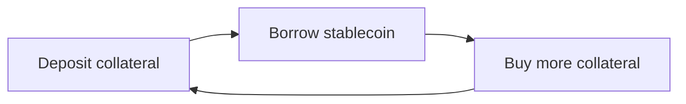

# Onchain Derivatives, Structured Products, and Yield

Derivatives separate economic exposure from direct ownership of an asset. A
trader can gain or hedge bitcoin price exposure without transferring bitcoin,
lock a future interest rate without lending for the full period, or buy
protection against a price move while retaining the underlying asset.

Onchain derivatives reproduce these functions through smart contracts,
stablecoins, oracle prices, liquidity pools, order books, and automated margin
systems. They can make positions transparent and composable, but they do not
remove leverage, counterparty, liquidity, model, or operational risk. They often
replace a traditional clearinghouse with a protocol whose solvency depends on
collateral, liquidation, insurance, governance, and market incentives.

This note develops the instruments from first principles, then explains
perpetual futures, options, synthetic assets, structured vaults, yield
tokenization, basis trades, recursive strategies, and the sources and risks
behind reported DeFi yields.

## 1. Derivative Foundations

### 1.1 Spot ownership versus derivative exposure

A spot asset gives its holder the asset itself or a direct claim on it. A
derivative is a contract whose value depends on an underlying variable:

- an asset price;
- interest or staking yield;
- volatility;
- an exchange rate;
- a credit event;
- an index;
- a funding rate; or
- an event outcome.

The underlying may be deliverable at settlement, but many crypto derivatives
settle only the gain or loss in stablecoins or another collateral asset.

### 1.2 Long and short positions

A **long** position benefits when the referenced value rises. A **short**
position benefits when it falls. At maturity, a simplified cash-settled linear
long entered at price `K` has:

```text
long payoff = final reference price - K
short payoff = K - final reference price
```

Leverage means the position's notional exposure exceeds posted collateral:

```text
leverage = absolute position notional / account equity
```

A $100,000 position supported by $10,000 of equity is 10× leveraged. A 5%
adverse move consumes roughly half the initial equity before fees and funding.
Leverage magnifies percentage gains and losses; it does not change the
underlying asset's volatility.

### 1.3 Margin

**Initial margin** is the collateral needed to open or enlarge a position.
**Maintenance margin** is the minimum equity needed to keep it open. If account
equity falls below maintenance margin, the protocol can liquidate or transfer
positions.

```text
account equity
= collateral value + realized P&L + unrealized P&L
- accrued fees and funding
```

Margin can be:

- **isolated**, where each position has a dedicated loss limit;
- **cross-margined**, where several positions share collateral; or
- **portfolio-margined**, where modeled offsets between positions reduce the
  required amount.

Portfolio margin can recognize that a long call offsets a short call or that
spot collateral offsets a short future. Its efficiency depends on a model.
Unmodeled basis changes, volatility jumps, depegs, or correlation breakdowns
can make the offset less protective than assumed.

## 2. Futures and Forwards

### 2.1 Dated contracts

A forward is an agreement to transact at a future date and price. A futures
contract standardizes the terms and is normally margined and marked to market.
Crypto venues list cash-settled and deliverable futures with weekly, monthly, or
quarterly expiries.

The difference between futures price `F` and spot price `S` is the **basis**:

```text
basis = F - S
annualized basis ≈ (F / S - 1) × days per year / days to expiry
```

When futures trade above spot, the market is in **contango**. When below spot,
it is in **backwardation**. Basis reflects financing, custody, staking or other
asset yield, shorting constraints, leverage demand, risk, and market
segmentation.

At expiry, robust settlement should make the futures price converge to the
settlement index. Before expiry, basis can move independently of spot.

### 2.2 Cash-and-carry

A cash-and-carry trade buys spot and shorts an equivalent future:

```text
long 1 BTC spot
short 1 BTC future
```

The first-order price delta is near zero. If the future was sold above spot and
both legs can be maintained, convergence can earn the basis. The return is not
risk free. It depends on:

- exchange and custodian solvency;
- margin calls before expiry;
- the settlement index;
- borrowing and financing cost;
- spot custody and bridge risk;
- execution slippage;
- stablecoin collateral quality; and
- the ability to close both legs.

The 2022 failure of FTX is a clear example of why an apparently hedged trade can
lose money through venue exposure rather than market direction.

## 3. Perpetual Futures

### 3.1 Why perpetuals need funding

A perpetual future has no expiry. Without a convergence date, its market price
could drift indefinitely from spot. Most designs use periodic **funding
payments** between longs and shorts.

If the perpetual trades above its index, funding is usually configured so longs
pay shorts. This makes long exposure more expensive and short exposure more
attractive. If it trades below the index, shorts may pay longs.

For position notional `N` and funding rate `f` for the interval:

```text
funding payment = N × f
```

Sign conventions differ by venue. Funding is a transfer between positions in
many systems, not necessarily protocol revenue. Some protocols use skew-based
formulas rather than the observed premium alone.

### 3.2 Index, mark, and execution prices

Three prices should be distinguished:

- **index price:** an external reference assembled from spot markets;
- **mark price:** a risk-management price used for P&L and liquidation; and
- **execution price:** the price at which an order is filled.

Using the last trade for liquidation allows a thin or manipulated print to
destroy positions. A robust mark may combine index and bounded premium
information, but then depends on oracle availability and methodology.

### 3.3 Venue architectures

Perpetual venues use several designs:

| Design | Liquidity source | Price formation | Main risk bearer |
|---|---|---|---|
| Central limit order book | Market-maker orders | Bids and offers | Traders, market makers, insurance fund |
| Oracle-priced liquidity pool | Shared asset pool | Oracle plus impact formula | LPs and traders |
| Synthetic debt pool | Protocol collateral/debt backing | Oracle and skew controls | Stakers or liquidity providers |
| Hybrid offchain matching | Signed/offchain orders, onchain settlement | Order matching plus oracle controls | Traders, operators, protocol backstops |

The canonical market-structure treatment is in
[Onchain Order Books and Derivatives Venues](../../03-digital-assets-and-market-structure/03-decentralized-markets/onchain-order-books-and-derivatives-venues.md).

### 3.4 Skew and funding

Let long open interest be `L` and short open interest be `S`:

```text
market skew = L - S
```

A positive skew means the protocol has more trader longs than shorts. Funding,
price impact, and fees can be adjusted to encourage the opposite side. A
liquidity pool that is counterparty to net trader exposure may need to hedge
externally or charge for inventory risk.

Synthetix Perps V3, for example, exposes market skew, funding rate, and funding
velocity. It uses asynchronous orders settled by keepers with oracle data,
cross-margin accounts, configurable collateral, market-size limits, and
liquidation parameters. This is not a universal model; it illustrates how an
onchain derivatives engine separates trader accounts, oracle settlement,
liquidity provision, and governance configuration.

### 3.5 Liquidation and bad debt

Liquidation must occur while collateral can still cover losses and costs:

```text
equity <= maintenance margin → liquidation eligible
```

The liquidator may close, take over, or auction a position. A liquidation fee
incentivizes execution. If prices gap faster than liquidation or the oracle is
unavailable, the account may become negative.

Backstops can include:

- an insurance fund built from fees;
- automatic deleveraging of profitable opposing traders;
- socialized loss;
- LP capital;
- governance-controlled recapitalization; or
- bankruptcy auctions.

Each method decides who is the residual counterparty. "Non-custodial" does not
mean no one bears default losses.

## 4. Options

### 4.1 Calls and puts

A call gives its holder the right, but not the obligation, to buy or receive the
positive difference above strike `K`. A put pays for a fall below the strike.
For final price `S_T`:

```text
call payoff = max(S_T - K, 0)
put payoff  = max(K - S_T, 0)
```

The buyer pays a premium. The buyer's maximum loss is normally the premium; an
uncovered option seller can face much larger losses. American options permit
exercise before expiry; European options only at expiry. Many onchain options
are European and cash-settled because this simplifies exercise and collateral.

### 4.2 What determines premium

Premium reflects:

- spot or forward price;
- strike;
- time to expiry;
- expected volatility;
- interest and asset yield;
- skew and supply/demand;
- collateral and venue risk; and
- market liquidity.

**Implied volatility** is the volatility input that makes a pricing model match
the market premium. It is a price-derived expectation and risk premium, not a
guaranteed forecast.

The main sensitivities, or Greeks, are:

| Greek | First-order meaning |
|---|---|
| Delta | Price sensitivity to a change in underlying |
| Gamma | Change in delta as underlying changes |
| Vega | Sensitivity to implied volatility |
| Theta | Sensitivity to passage of time |
| Rho | Sensitivity to interest rates |

An option seller may delta-hedge by trading spot or perpetuals. Gamma causes the
required hedge to change. In a volatile market, repeated rebalancing can be
costly even if the original option was priced using a reasonable average
volatility.

### 4.3 Onchain options architecture

An options venue needs:

- an instrument registry for underlying, strike, expiry, and call/put type;
- collateral and margin accounting;
- forward and volatility inputs;
- an order book, AMM, request-for-quote process, or vault seller;
- settlement-price rules;
- liquidation;
- exercise/expiry processing; and
- a loss waterfall.

Derive illustrates a combined options and perpetual venue with standard and
portfolio margin. Its portfolio-margin model shocks forward prices and implied
volatility across scenarios, then adds contingencies for basis, oracle
confidence, collateral, and stablecoin depeg risk. The approach recognizes
portfolio offsets while explicitly acknowledging model incompleteness.

### 4.4 Option liquidity problems

Each underlying can have many strikes and expiries. Liquidity fragments across
the resulting grid. Automated market makers must quote a volatility surface,
manage inventory Greeks, and hedge. Order books require sophisticated market
makers and rapid updates.

Additional risks include:

- stale volatility parameters;
- incorrect expiry or settlement data;
- manipulation of a thin settlement index;
- insufficient collateral for short options;
- sudden jumps beyond modeled scenarios; and
- inability to liquidate complex portfolios within blockspace limits.

## 5. Synthetic Assets

A synthetic asset tracks a reference without holding it one-for-one. A protocol
might create synthetic gold, equity-index, foreign-exchange, or crypto exposure
against pooled collateral.

### 5.1 Debt-pool model

In a pooled model, liquidity providers issue or back synthetic claims. If users
profit, the backing pool owes more; if users lose, it owes less. The protocol
must:

- value each synthetic position;
- maintain enough collateral;
- charge fees or funding for imbalanced exposure;
- limit market size;
- obtain reference prices;
- liquidate weak backing accounts; and
- decide who absorbs residual debt.

This differs from a fully reserved tokenized security. A synthetic stock may
track price but give no shareholder vote, dividend claim, issuer relationship,
or ownership of an actual share.

### 5.2 Oracle and market-closure risk

Real-world references have trading hours, corporate actions, fragmented price
sources, and legal restrictions. A synthetic market may trade continuously
while the underlying exchange is closed. During that interval, price is an
estimate and gaps can occur when the reference market reopens.

## 6. Structured Products and Strategy Vaults

A structured product combines instruments into a defined payoff. Traditional
examples include principal-protected notes, autocallables, and reverse
convertibles. Onchain strategy vaults often package option selling, leverage,
liquidity provision, or yield allocation into transferable shares.

### 6.1 Covered-call vault

A simple covered-call strategy:

1. holds an underlying asset;
2. sells call options against it;
3. collects premium; and
4. repeats at each expiry.

The strategy earns premium in flat or moderately rising markets but gives up
upside above the strike. It still bears most downside in the underlying.
Calling premium "yield" can conceal that it is compensation for selling
convexity.

### 6.2 Cash-secured put vault

A vault holds cash or stablecoins and sells puts. If the underlying falls below
the strike, the strategy loses or acquires the asset at an effective price above
market. High option premium generally accompanies high expected or demanded
risk.

### 6.3 Vault-share mechanics

An ERC-4626 share can standardize deposits and redemptions, but strategy
accounting must handle:

- unrealized option value;
- pending settlements;
- deposits just before gains;
- withdrawals just before losses;
- management and performance fees;
- asynchronous position closure; and
- stale or manipulable NAV.

A vault can be non-custodial at the contract layer while depending on a manager,
keeper, oracle, exchange, bridge, or multisig.

### 6.4 Principal protection is conditional

Onchain products sometimes describe principal tokens or senior tranches as
"protected." Protection can mean only that another tranche absorbs losses
first. If losses exceed that buffer, or the underlying protocol fails, principal
is impaired. The protecting asset and legal seniority must be identified.

## 7. Yield Tokenization

Yield tokenization separates a yield-bearing asset into a principal claim and a
future-yield claim. Pendle is the leading implementation pattern.

### 7.1 Standardized Yield, PT, and YT

Pendle wraps a yield-bearing asset into **Standardized Yield** (`SY`), which
provides a common interface. SY can be split into:

- **Principal Token (`PT`)**: redeemable for the accounting asset at maturity;
- **Yield Token (`YT`)**: entitled to yield and configured rewards until
  maturity.

Before expiry:

```text
1 unit of principal-and-yield claim ↔ 1 PT + 1 YT
PT price + YT price ≈ accounting-asset price
```

At expiry, YT no longer earns future yield and PT can be redeemed according to
the market's accounting asset. That accounting asset may not be identical to
one unit of the named wrapper. Integrators must read the exact redemption unit.

### 7.2 PT as a zero-coupon claim

PT normally trades below the expected maturity redemption value. Buying at a
discount and redeeming at maturity creates a fixed implied return if:

- the underlying yield protocol remains solvent;
- the SY adapter functions;
- the accounting asset retains value;
- redemption remains available; and
- the holder can wait until maturity.

The fixed rate is therefore conditional, not sovereign risk-free.

For PT price `p` per unit redeemable at 1 after `d` days:

```text
simple annualized implied yield ≈ (1 / p - 1) × 365 / d
```

Actual interfaces may use compounding conventions.

### 7.3 YT as leveraged yield exposure

YT costs only the present value of expected yield but receives the yield on a
full unit of accounting asset. It is therefore economically leveraged to:

- changes in underlying APY;
- rewards or points;
- time remaining;
- implied-yield repricing; and
- underlying protocol performance.

If realized yield is below the yield implied by the purchase price, the holder
can lose money even while receiving positive distributions. YT trends toward
zero at expiry because no future yield remains.

### 7.4 Yield AMM

Pendle's AMM trades PT against SY and enables YT trades through routing and
flash-swap mechanics. The curve concentrates liquidity around an implied-yield
range and tightens as maturity approaches.

LP returns can include:

- underlying SY yield;
- PT's maturity convergence;
- swap fees;
- incentive tokens; and
- losses from adverse yield movement, depeg, or protocol failure.

Yield-token markets add dependencies on the source protocol, SY wrapper, PT/YT
accounting, AMM, oracle, and secondary liquidity.

## 8. Sources of DeFi Yield

Yield is a transfer or economic return, not a property created by token
wrapping. Every sustainable source should trace to a payer or productive
activity.

| Source | Economic payer | Main risks |
|---|---|---|
| Lending interest | Borrowers | Default, liquidation, utilization, oracle |
| Trading fees | Traders | Volume decline, LP adverse selection |
| Staking rewards | Network issuance and transaction users | Slashing, token price, validator risk |
| Stablecoin reserve income | Borrowers, Treasury issuer, or reserve counterparties | Issuer, duration, bank, legal risk |
| Perpetual funding | Imbalanced side of market | Funding reversal, exchange and margin risk |
| Futures basis | Leveraged demand and financing market | Convergence, margin, venue risk |
| Option premium | Protection or convexity buyers | Large nonlinear losses |
| Liquidation gains | Unsafe borrowers | Execution competition, bad collateral |
| Token incentives | Existing or future token holders | Dilution and token-price collapse |
| MEV | Transaction users and protocols | Competition, reorg, legal/ethical issues |
| Private credit | Legal borrowers | Credit, recovery, liquidity |

### 8.1 Real yield versus incentives

"Real yield" is commonly used for return paid from protocol revenue rather than
new governance tokens. The label is imprecise. Revenue can itself be risky,
temporary, leveraged, or generated by selling options. A better decomposition
is:

```text
net expected return
= recurring cash or asset income
+ incentive-token value
- expected credit and trading losses
- fees, slippage, hedging, and gas
- expected smart-contract and operational loss
```

### 8.2 APY and APR

APR generally states a simple annual rate. APY includes compounding:

```text
APY = (1 + periodic rate)^(periods per year) - 1
```

Reported APY may extrapolate a rate observed for only hours, assume continuous
reinvestment, ignore gas, or value an incentive token at the current price.
Comparisons require the same time window, compounding, currency, fee treatment,
and risk basis.

## 9. Delta-Neutral and Basis-Based Yield

### 9.1 Delta hedging

A delta-neutral portfolio aims for limited first-order sensitivity to the
underlying price. One example is:

```text
long $100 of ETH exposure
short $100 of ETH perpetual exposure
approximate net delta = 0
```

The portfolio can still have:

- funding-rate exposure;
- basis risk;
- collateral depeg risk;
- exchange/custodian exposure;
- liquidation risk;
- imperfect hedge sizing;
- fees and slippage; and
- nonlinear exposure from options or liquid-staking tokens.

Delta neutrality is local and first-order. It does not mean value cannot change.

### 9.2 Ethena as a packaged basis strategy

Ethena's USDe is supported by backing assets and offsetting short derivatives.
Protocol revenue can include perpetual funding, dated-futures basis, staking
rewards, and returns on liquid stable assets. `sUSDe` passes a policy-defined
portion of protocol returns to stakers.

The structure transforms a managed hedged portfolio into a transferable
synthetic dollar. Its risks include:

- negative funding or compressed basis;
- derivatives-venue failure;
- off-exchange settlement and custodian failure;
- margin dislocation;
- collateral and liquid-staking-token basis;
- stablecoin reserve and bank exposure;
- execution capacity at large scale; and
- governance and operational controls.

Hedging price delta protects against one risk factor. It does not create the
same claim as a fiat-backed stablecoin redeemable against segregated cash and
Treasury reserves.

## 10. Recursive Positions and Leverage Loops

A user can deposit a yield-bearing asset, borrow against it, buy more of the
same asset, and repeat:



If collateral yield exceeds borrowing cost, the loop shows positive carry.
Leverage amplifies both the spread and every underlying risk.

For collateral yield `y_c`, borrowing cost `y_b`, and exposure multiple `m`, a
rough carry approximation is:

```text
leveraged carry ≈ m × y_c - (m - 1) × y_b
```

This ignores fees, rate changes, token incentives, liquidation, and price basis.
If the collateral depegs or the borrow rate rises above asset yield, the trade
can rapidly become unprofitable.

Recursive use can hide system leverage. A lending protocol accepts an LST; the
LST represents staked ETH; the user borrows ETH, stakes again, and repeats. TVL
may count related claims several times even though the system has not acquired
equivalent independent economic capital.

## 11. Composability and Risk Transformation

Structured DeFi positions commonly form chains:

```text
base asset
→ staked or lent receipt token
→ yield wrapper
→ principal/yield token
→ lending collateral
→ borrowed stablecoin
→ liquidity position
→ vault share
```

Each layer can be individually overcollateralized while the full chain remains
fragile. Risks include:

- circular collateral;
- correlated oracle inputs;
- maturity mismatch;
- incompatible pause or redemption behavior;
- liquidation cascades;
- governance changes at any dependency;
- bridge or cross-chain failure; and
- inability to unwind all legs atomically.

The final token name does not communicate the dependency graph. A complete
analysis traces each redemption and liquidation path to the base assets.

## 12. Risk Management

### 12.1 Market and basis risk

Stress spot, volatility, correlations, funding, and basis independently. A
hedged position can lose when the hedge instrument diverges from the exposure
being hedged.

### 12.2 Liquidity risk

Open interest is not executable liquidity. Evaluate order-book depth, AMM price
impact, liquidation capacity, withdrawal queues, and the cost of closing all
legs during stress.

### 12.3 Oracle risk

Derivatives may depend on spot, forward, volatility, collateral, and stablecoin
prices. Confidence intervals and circuit breakers can reduce risk, but stale
prices can also delay liquidation and accumulate bad debt.

### 12.4 Margin-model risk

Scenario sets based on historical moves may omit a future jump. Portfolio
offsets can fail across venues or settlement times. Conservative add-ons,
concentration limits, and liquidity charges are necessary because model output
is not a guarantee.

### 12.5 Smart-contract and governance risk

Account engines, order settlement, vault accounting, adapters, liquidation,
upgrades, and emergency controls are all in scope. Audit coverage must match the
deployed version and configuration.

### 12.6 Counterparty and custody risk

Fully onchain protocols have counterparties in the economic sense even if no
legal broker stands between traders. Hybrid strategies add exchanges,
custodians, market makers, banks, and offchain settlement providers.

### 12.7 Legal and regulatory risk

Derivatives are heavily regulated in many jurisdictions. A permissionless smart
contract does not determine whether operating a front end, marketing a product,
or facilitating leveraged trading requires authorization. Tokenized options,
synthetics, and yield notes may also be securities or collective investment
products depending on rights and distribution.

## 13. A Position-Analysis Checklist

For any derivative or yield strategy, document:

1. exact payoff and maximum gain/loss;
2. underlying, index, oracle, and settlement method;
3. leverage and margin model;
4. liquidation trigger, incentives, and loss waterfall;
5. collateral assets and depeg assumptions;
6. yield payer and whether income is fixed, floating, or subsidized;
7. maturity, lockup, and withdrawal mechanics;
8. liquidity under normal and stressed conditions;
9. all protocol, bridge, custodian, and venue dependencies;
10. governance, upgrade, pause, and operational control;
11. fees, compounding, and incentive-token assumptions; and
12. legal claim and regulatory perimeter.

The central discipline is to replace a product label such as "fixed yield,"
"delta neutral," or "principal protected" with a complete payoff and dependency
map.

## Related Notes

- [Onchain Order Books and Derivatives Venues](../../03-digital-assets-and-market-structure/03-decentralized-markets/onchain-order-books-and-derivatives-venues.md)
- [DeFi Architecture, Composability, and Governance](../01-defi-foundations/defi-architecture-composability-and-governance.md)
- [Onchain Lending and Credit](../02-onchain-lending/onchain-lending-and-credit.md)
- [Staking, Liquid Staking, and Restaking](staking-liquid-staking-and-restaking.md)
- [Stablecoins](../../05-digital-money-and-tokenization/01-stablecoins/stablecoins.md)
- [Financial Risk Management](../../01-financial-foundations/03-risk-and-regulatory-foundations/financial-risk-management.md)

## References

- BIS Committee on the Global Financial System, [The role of margin requirements and haircuts in procyclicality](https://www.bis.org/publ/cgfs36.htm)
- CFTC, [Futures fundamentals](https://www.cftc.gov/LearnAndProtect/AdvisoriesAndArticles/FuturesMarketBasics/index.htm)
- CFTC, [Options basics](https://www.cftc.gov/LearnAndProtect/AdvisoriesAndArticles/OptionsBasics/index.htm)
- Synthetix, [Perps V3 documentation](https://docs.synthetix.io/developer-docs/for-perp-integrators/perps-v3)
- Synthetix, [Perps V3 data dictionary](https://docs.synthetix.io/developer-docs/for-developers/data-dictionary)
- Derive, [Portfolio margin](https://docs.derive.xyz/docs/portfolio-margin-1)
- Derive, [Standard margin](https://docs.derive.xyz/docs/standard-margin-1)
- Derive, [Liquidations](https://docs.derive.xyz/docs/liquidations-1)
- Pendle, [Protocol introduction](https://docs.pendle.finance/)
- Pendle, [Yield-tokenization contracts](https://docs.pendle.finance/pendle-v2-dev/Contracts/YieldTokenization)
- Pendle, [Principal Token](https://docs.pendle.finance/pendle-v2/ProtocolMechanics/YieldTokenization/PT)
- Pendle, [Yield Token](https://docs.pendle.finance/pendle-v2/ProtocolMechanics/YieldTokenization/YT)
- Pendle, [AMM](https://docs.pendle.finance/pendle-v2/ProtocolMechanics/LiquidityEngines/AMM)
- Ethena, [USDe overview](https://docs.ethena.fi/solution-overview/usde-overview)
- Ethena, [Protocol revenue explanation](https://docs.ethena.fi/solution-overview/protocol-revenue-explanation)
- Ethena, [Risks](https://docs.ethena.fi/solution-overview/risks)
- ERC-4626, [Tokenized Vault Standard](https://eips.ethereum.org/EIPS/eip-4626)
- FTX Trading Ltd., [Chapter 11 information and court filings](https://restructuring.ra.kroll.com/FTX/)

