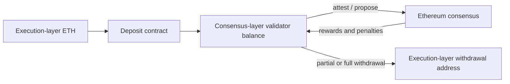
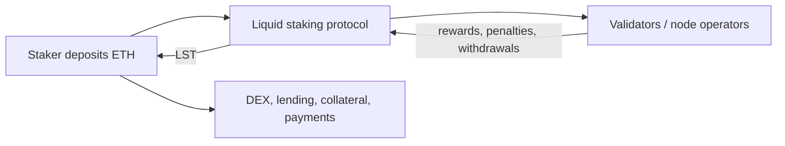
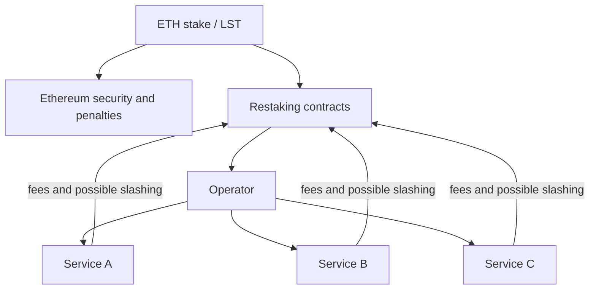

# Staking, Liquid Staking, and Restaking

Proof-of-stake networks require participants to place assets at risk while they
validate blocks and consensus messages. Correct work earns rewards. Provably
conflicting behavior can destroy stake, and poor availability can reduce
rewards or incur penalties.

Liquid staking transforms a relatively illiquid validator position into a
transferable token. Restaking extends the same economic capital to secure
additional services. Each layer increases usability and potential return, but
also adds contracts, operators, governance, liquidity, and loss conditions.

This note uses Ethereum as the principal implementation because its validator,
liquid-staking, and restaking ecosystems are the most developed. The concepts
also apply to other proof-of-stake networks, although delegation, unbonding,
slashing, and token designs differ.

## 1. Why Staking Exists

### 1.1 Consensus as an economic security problem

A distributed network needs a rule for deciding which blocks and state history
are canonical. In proof of stake, validators are selected and weighted using
assets committed to the protocol. The stake serves two functions:

- it helps allocate participation and voting weight; and
- it creates collateral that can be penalized for objectively prohibited
  behavior.

Security does not come from locking tokens alone. It comes from:

- a consensus protocol with clear safety and liveness rules;
- independent validators that actually verify;
- clients implementing those rules correctly;
- network communication;
- credible detection and punishment;
- economically meaningful stake;
- a distributed operator and infrastructure set; and
- social agreement on exceptional recovery.

### 1.2 Rewards and their payer

Validator return can include:

- newly issued protocol assets;
- transaction priority fees;
- protocol-defined block rewards;
- maximum extractable value (MEV);
- delegation or pool commission; and
- incentives from staking protocols.

New issuance dilutes non-stakers. Transaction fees are paid by network users.
MEV is extracted from ordering and inclusion opportunities. These sources have
different sustainability and distribution effects.

A useful decomposition is:

```text
gross validator return
= consensus issuance
+ transaction and execution rewards
+ MEV
- downtime and protocol penalties
- infrastructure and operating cost
```

For a delegator or liquid-staking holder:

```text
net staking return
= gross validator return
- operator and protocol fees
- additional product losses and costs
```

An advertised staking APR may omit validator activation delays, exit queues,
missed duties, compounding conventions, gas, token-price changes, and taxes.

## 2. Ethereum Validator Mechanics

Ethereum separates the execution layer, which processes transactions and smart
contracts, from the consensus layer, which coordinates validators and finality.
A validator runs both:

- a consensus client; and
- an execution client.

The validator client uses signing keys to propose and attest.

### 2.1 Deposits and validator accounts

Historically, an Ethereum validator deposited 32 ETH and had a maximum effective
balance of 32 ETH. The Pectra upgrade introduced **compounding validators**
through EIP-7251:

- **Type 1 / legacy validator:** effective balance capped at 32 ETH;
- **Type 2 / compounding validator:** effective balance can grow from 32 ETH to
  2,048 ETH in 1 ETH increments, subject to protocol mechanics.

Compounding validators allow consolidation and reduce the number of separately
operated validator records needed for a large stake. They do not turn the
validator into a freely transferable execution-layer account.



### 2.2 Keys and withdrawal credentials

Validator operation separates:

- the **signing key**, kept online to attest and propose; and
- the **withdrawal credential**, which controls where withdrawals go and can be
  kept under stronger custody.

This separation limits what a compromised online validator key can directly
steal. It can still cause missed rewards or slashable messages. The withdrawal
address is therefore a critical ownership and recovery control.

EIP-7002 allows eligible execution-layer withdrawal credentials to initiate
exits and partial withdrawals. This improves control when signing keys are held
by a delegated operator, but custody contracts and operational agreements must
be analyzed against the actual credential type.

### 2.3 Activation and exit queues

Deposited validators do not necessarily begin immediately. Activation is rate
limited. Full exits are also rate limited through a churn mechanism so a large
fraction of security cannot disappear at once.

An exit has several stages:

1. submit a valid voluntary or execution-triggered exit;
2. wait through the exit queue;
3. stop active validation when the exit becomes effective;
4. wait until the balance is withdrawable; and
5. wait for the consensus-layer sweep or applicable withdrawal process.

"Withdrawals are enabled" does not mean every staker can obtain ETH instantly.
Queue duration depends on network demand and protocol limits.

### 2.4 Rewards

Validators can earn consensus rewards for:

- timely source, target, and head attestations;
- proposing blocks;
- including attestations and other consensus operations;
- participating in sync committees; and
- correct network service.

Execution-layer rewards include priority fees and MEV-related payments directed
to a configured fee recipient. Reward variance is high for small operators
because block proposals are infrequent random events.

For legacy validators, excess balance above 32 ETH is periodically swept to the
withdrawal address. For compounding validators, rewards can increase effective
balance up to 2,048 ETH; partial withdrawals below that cap require the
appropriate triggered process.

### 2.5 Penalties versus slashing

Ordinary penalties address missed duties, usually from downtime or connectivity
problems. **Slashing** addresses provably contradictory consensus behavior,
including:

- proposing two blocks for the same slot;
- making two conflicting attestations for the same target; and
- creating a surround vote.

Slashing forcibly exits the validator and burns stake. The penalty grows when
many validators are slashed in a correlated interval, so a coordinated attack
or shared operational defect is more costly than one isolated mistake.

This creates a major infrastructure lesson: identical clients, cloud providers,
remote signers, or key-management procedures can turn independent-looking
validators into one correlated risk.

### 2.6 Inactivity leak

If the network cannot finalize, inactive validators lose balance more quickly
through an inactivity leak. The objective is to reduce the weight of
non-participating validators until the remaining active set can finalize. A
network partition can therefore penalize honest operators on the disconnected
side even without malicious behavior.

## 3. Solo Staking, Delegation, and Custodial Staking

### 3.1 Solo staking

A solo staker controls keys, hardware, clients, fee recipient, and withdrawal
credentials. Advantages include:

- direct protocol participation;
- no intermediary fee;
- independent client and infrastructure choice;
- no staking-pool smart-contract risk; and
- stronger contribution to validator diversity.

Costs include:

- technical operation and monitoring;
- hardware, network, and backup requirements;
- key-management risk;
- illiquidity during queues; and
- stochastic rewards.

### 3.2 Staking as a service

A service operates validators for a customer. Models differ:

- customer retains withdrawal credentials;
- provider controls both operational and withdrawal keys;
- regulated custodian holds assets and delegates operation;
- pooled service aggregates many customers; or
- provider supplies only infrastructure software.

The phrase "non-custodial staking" should be decomposed. The provider may not
control withdrawals but may still be able to cause slashing, redirect execution
rewards, censor, or delay an exit.

### 3.3 Exchange staking

A centralized exchange may credit an internal account while staking pooled
assets. The customer usually owns a contractual claim on the exchange, not a
protocol validator balance or onchain receipt token. Risks include insolvency,
commingling, withdrawal suspension, operational concentration, and unclear
treatment of slashing.

## 4. Liquid Staking

### 4.1 The liquidity problem

Native staking positions are subject to activation, exit, and withdrawal
processes. They also require operational expertise. A liquid staking protocol
accepts stake and issues a **liquid staking token (LST)** representing a claim on
pooled or assigned staked assets and rewards.



LST liquidity comes from two routes:

- **protocol withdrawal:** burn or redeem the token and wait for underlying
  validator liquidity; or
- **secondary market:** sell to another user immediately at the available
  price.

The market price can diverge from redemption value when exits are slow,
liquidity is thin, or confidence falls.

### 4.2 Rebasing and exchange-rate tokens

Two common accounting models are:

**Rebasing token**

```text
token balance increases as staking rewards are reported
```

**Exchange-rate token**

```text
token quantity remains constant
ETH claim per token rises over time
```

Lido's stETH is rebasing. Its wrapped form, wstETH, has a fixed share quantity
whose value in stETH rises. Rocket Pool's rETH is an exchange-rate token.

Wrapping can improve compatibility with lending and bridges, but it does not
remove the underlying protocol risk.

### 4.3 LST value

A simplified backing rate is:

```text
claim per LST
= (staked principal + recognized rewards - penalties - fees)
/ LST supply
```

The onchain exchange rate may rely on oracle reports because consensus-layer
balances are not ordinary smart-contract storage. It may update discretely even
though rewards and penalties occur continuously.

The market price additionally reflects:

- expected withdrawal time;
- DEX liquidity;
- leverage and collateral demand;
- protocol confidence;
- bridge location;
- incentives; and
- demand for the token in DeFi.

### 4.4 LST depeg

Calling an LST "pegged to ETH" can be misleading. It is a yield-bearing claim,
not necessarily an immediately redeemable one-ETH token. A discount can arise
from:

- long exit queues;
- mass leveraged-position unwinds;
- smart-contract or governance fear;
- validator losses;
- oracle delays;
- concentrated DEX liquidity;
- bridge impairment; or
- doubts about the legal or operational claim.

A temporary market discount does not automatically imply insolvency, but it can
trigger liquidations when lending protocols use market-price oracles.

## 5. Lido

### 5.1 Core pooled staking

Users deposit ETH and receive stETH shares. The protocol allocates deposits
through the Staking Router to node-operator modules. An oracle committee reports
consensus-layer balances and updates accounting. Rewards net of protocol fees
increase stETH value through rebasing.

Major components include:

- the deposit and buffered-ETH logic;
- node-operator modules and the Staking Router;
- accounting and validator-exit oracles;
- the stETH share system;
- an ERC-721 withdrawal queue;
- governance and emergency controls; and
- DEX liquidity and DeFi integrations.

Withdrawal requests are represented by NFTs while awaiting fulfillment. ETH in
the protocol buffer, validator exits, and available withdrawals can fund the
queue. A user can alternatively sell stETH or wstETH on a secondary market.

### 5.2 Operator selection and modules

Lido historically used a curated operator set. The Staking Router introduced
modules with different admission and bonding models, including community
staking. The economic questions are:

- who may operate;
- how much stake each operator receives;
- whether the operator posts a bond;
- how performance and slashing are measured;
- how correlated infrastructure is limited; and
- who can remove or force-exit validators.

Token-holder decentralization does not by itself produce operator
decentralization.

### 5.3 Lido V3 and stVaults

Lido V3, active on Ethereum mainnet as of July 2026, adds **stVaults** alongside
the Core Pool. A vault lets a staker select an operator and configuration while
optionally minting fungible stETH against the isolated stake.

Core-pool stETH is minted against pooled internal shares. stVault stETH is
represented as external shares and is overcollateralized using reserve-ratio and
health constraints. This allows customized staking positions to access common
stETH liquidity while attempting to contain operator-specific risk.

The design introduces additional controls:

- vault owner and operator roles;
- reserve ratios and minting limits;
- operator risk tiers;
- health monitoring;
- forced exits and bad-debt handling;
- governance adapters and committees; and
- vault disconnect or ossification paths.

It is therefore more flexible and more complex than the original pooled model.
An stVault user must analyze both the fungible stETH system and the particular
vault/operator configuration.

### 5.4 Governance

LDO governance influences protocol modules and parameters. Lido V3 also includes
Dual Governance, through which stETH holders can signal opposition and delay or
veto eligible DAO actions under defined rules.

Governance analysis should still identify:

- proxy and upgrade control;
- oracle membership;
- module and operator admission;
- emergency-brake actors;
- forced-exit authority;
- fee changes; and
- the practical concentration of voting and delegation.

## 6. Rocket Pool

Rocket Pool combines liquid staking for rETH holders with permissionless node
operation through **minipools**.

### 6.1 Minipools

A node operator contributes a bond and a minipool contract combines it with ETH
from the rETH deposit pool to create validator stake. Documentation has
supported bond configurations in which, for example, 8 operator ETH are matched
with 24 pool ETH to form a 32 ETH validator.

The operator:

- runs validator infrastructure;
- earns rewards on bonded capital;
- receives commission for operating pooled ETH;
- bears performance and slashing exposure;
- may stake RPL subject to current protocol economics; and
- manages one or more minipools.

Protocol parameters evolve, so the current bond, commission, and RPL rules
should be verified rather than inferred from historical descriptions.

### 6.2 rETH

Ordinary stakers deposit ETH and receive rETH. rETH does not rebase; its
redemption value in ETH is intended to rise with net staking rewards.

The design distributes operator risk across the minipool set and uses operator
bonds as first-loss alignment. It also depends on:

- enough operators and deposit matching;
- oracle DAO reports;
- smart contracts and upgrades;
- rETH market liquidity;
- RPL economics and governance; and
- the ability to exit validators.

### 6.3 Smoothing Pool

Block proposals and MEV rewards are highly variable. Rocket Pool's optional
Smoothing Pool aggregates execution-layer rewards from participating operators
and distributes them across the group according to protocol rules. This reduces
variance while introducing shared accounting and correct fee-recipient
configuration as dependencies.

## 7. Lido and Rocket Pool Compared

| Dimension | Lido | Rocket Pool |
|---|---|---|
| Main liquid token | stETH / wstETH | rETH |
| Token accounting | Rebasing shares; wrapped non-rebasing form | Non-rebasing exchange-rate token |
| Core operator model | Staking Router modules, including curated and community paths | Permissionless minipools with operator bond |
| User withdrawal | Protocol queue represented by NFT or secondary sale | Protocol liquidity/redemption mechanics or secondary sale |
| Operator capital | Module-dependent; V3 vault reserve rules | ETH bond and current RPL economics |
| Governance | LDO DAO, modules, committees, Dual Governance | Protocol DAO and Oracle DAO roles |
| Special architecture | V3 stVaults can mint stETH against isolated overcollateralized stake | Minipools combine operator and pooled ETH |
| Principal systemic concern | Stake, governance, oracle, and stETH integration concentration | Operator capacity, minipool/oracle design, RPL and rETH liquidity |

Neither token is "just staked ETH." Each is a protocol claim with different
operators, accounting, governance, and liquidity.

## 8. Restaking

### 8.1 The idea

Native Ethereum stake secures Ethereum consensus. **Restaking** opts the same
economic stake into additional services. EigenLayer calls these services
Actively Validated Services (AVSs); other ecosystems use terms such as networks,
distributed secure services, or modules.

Examples can include:

- data availability;
- decentralized sequencing;
- oracle networks;
- bridges;
- coprocessors;
- fast-finality services; and
- application-specific validation.



Restaking amortizes staked capital across services. It does not automatically
give those services Ethereum's consensus security. Each service needs
well-defined tasks, verifiable faults, credible slashing, a sufficiently diverse
operator set, and value at stake large enough to deter corruption.

### 8.2 Native and liquid restaking

**Native restaking** historically redirected validator withdrawal credentials
or used newer protocol mechanisms so validator stake could be subject to
restaking conditions.

**LST restaking** deposits an LST into restaking contracts. The restaker bears:

- underlying Ethereum validator risk;
- LST-protocol risk;
- LST price and liquidity risk;
- restaking-contract risk; and
- the selected services' slashing and operational risk.

The exact enforceability of slashing can differ between native stake and an LST
claim.

### 8.3 Restakers, operators, and services

In EigenLayer's model:

- restakers supply or opt in stake;
- operators receive delegation and run service software;
- AVSs register tasks and security conditions;
- allocation sets or related groupings associate stake with slashable work;
- rewards compensate operators and delegators; and
- withdrawal delays preserve a window for penalties to be enforced.

Delegation does not mean the operator owns principal. It means the operator can
affect rewards and can expose delegated stake to penalties under opted-in rules.

### 8.4 Slashing design

A slashable condition must be:

- precise;
- attributable to a particular operator;
- objectively provable or governed through a credible adjudication process;
- resistant to false accusations;
- enforceable before stake exits; and
- proportionate to harm.

Some faults are easy to prove, such as signing conflicting messages. Others,
such as returning an incorrect computation when inputs are disputed, require
more elaborate fraud proofs, committees, or dispute games.

Restakers should not treat all AVS names as equivalent risk. One service may
have no active slashing; another may expose a large allocated amount to a broad
fault condition.

## 9. Liquid Restaking Tokens

A liquid restaking protocol accepts ETH, LSTs, or restaked positions and issues
a **liquid restaking token (LRT)**. The LRT makes a heterogeneous strategy
fungible and usable in DeFi.

### 9.1 What the LRT represents

An LRT can bundle:

- one or several base LSTs;
- multiple operators;
- multiple AVSs;
- changing allocations;
- restaking rewards;
- points and incentive tokens;
- protocol fees;
- withdrawal queues; and
- potential slashing losses.

A single exchange rate can hide changing risk composition. Portfolio managers
or governance may choose operators and services on behalf of passive token
holders.

### 9.2 Principal-agent problem

The manager may be rewarded for maximizing visible APY or points while token
holders bear tail losses. Controls can include:

- published allocation mandates;
- per-operator and per-service caps;
- independent risk committees;
- delayed changes;
- transparent slashable amounts;
- insurance or first-loss capital;
- withdrawal rights; and
- governance accountability.

No wrapper makes heterogeneous slash conditions economically identical.

### 9.3 LRT depeg and leverage

LRTs can trade below their accounting value when:

- withdrawals are queued;
- underlying LSTs depeg;
- an operator or service is suspected of a fault;
- rewards disappoint;
- points speculation reverses;
- DEX liquidity is concentrated; or
- leveraged holders are liquidated.

If an LRT is used as collateral to borrow ETH and recursively restake, a modest
discount can trigger forced sales into the same limited liquidity pool.

## 10. Shared Security and Its Limits

### 10.1 Cost of corruption

A simplified cryptoeconomic argument compares:

```text
cost of corruption > profit from corruption
```

The comparison requires more than headline restaked value:

- how much stake is actually allocated and slashable for this service?
- what fraction of operators must collude?
- can the service detect and prove the attack?
- how quickly can an attacker withdraw?
- is the stake liquid and hedged?
- would governance actually enforce a slash?
- what external value can the attack capture?

Ten billion dollars deposited in a restaking ecosystem does not mean every
service has ten billion dollars of economic security.

### 10.2 Overlapping commitments

If the same stake secures many services, its nominal security can be counted
several times. Correlated failure can generate claims larger than the stake.
This resembles an insurer underwriting multiple correlated risks against the
same capital.

Risk limits should consider:

- aggregate slashable exposure per operator;
- correlations between AVS software and infrastructure;
- simultaneous-fault scenarios;
- concentration in one LST or LRT;
- stake that is rehypothecated or hedged; and
- the loss waterfall if several services slash.

### 10.3 Intersubjective faults

Some harmful behavior cannot be proven by a deterministic onchain predicate.
Systems may rely on governance, committees, forks, or social consensus to decide
what occurred. That introduces legal and political questions about due process,
conflicts, and final authority.

## 11. Staking Centralization and Network Effects

Liquid tokens benefit from deep liquidity and integrations. This creates a
feedback loop:

```text
more stake
→ deeper LST liquidity and more collateral integrations
→ lower transaction and financing cost
→ more demand
→ more stake
```

Concentration can occur at several different layers:

- liquid-staking protocol;
- node operator;
- cloud and geographic region;
- consensus and execution client;
- MEV relay and block builder;
- oracle committee;
- governance delegate;
- custodian; and
- restaking operator.

A protocol can have many token holders but few operators, or many operators all
using the same client and cloud. Decentralization metrics should therefore be
multidimensional.

## 12. MEV and Proposer Infrastructure

Validators can earn MEV by choosing transaction order or accepting blocks built
by specialized builders. Proposer-builder separation through external relays
can improve revenue and reduce the need for each validator to run a searcher,
but it concentrates dependencies.

Questions include:

- which relays and builders dominate?
- can they censor transactions?
- does the validator validate the received block?
- where are fees sent?
- what happens if a relay fails near proposal time?
- are MEV rewards pooled or smoothed?

MEV income is volatile and may come at the expense of users through
front-running, sandwiching, or liquidation extraction.

## 13. Risk Map

### 13.1 Native staking risks

- validator key compromise;
- double signing and slashing;
- downtime and missed rewards;
- client bugs;
- execution/consensus incompatibility;
- hardware, network, and time-sync failure;
- activation and exit queues;
- protocol changes; and
- ETH price volatility.

### 13.2 Liquid staking risks

All native risks, plus:

- smart contracts and upgrades;
- oracle accounting;
- node-operator selection;
- withdrawal-queue liquidity;
- LST market discount;
- governance capture;
- DeFi integration and bridge risk; and
- concentration.

### 13.3 Restaking risks

All underlying risks, plus:

- additional slashing rules;
- operator software for several services;
- unproven AVS economics;
- overlapping commitments;
- allocation-manager discretion;
- withdrawal-delay and dispute processes;
- rewards-token volatility; and
- ambiguity over which stake is truly slashable.

### 13.4 Liquid restaking risks

All restaking risks, plus:

- wrapper and vault contracts;
- portfolio valuation;
- manager and governance risk;
- secondary-market liquidity;
- hidden strategy changes;
- recursive collateral use; and
- run dynamics.

## 14. Due Diligence

### For a validator or operator

- Who controls signing and withdrawal keys?
- Which clients, hosting providers, regions, and relays are used?
- How is double signing prevented during failover?
- What monitoring and incident response exist?
- Who bears slashing and downtime losses?
- Can the asset owner force an exit?

### For an LST

- What exactly is the holder's redemption claim?
- Is the token rebasing or exchange-rate based?
- How are rewards, penalties, and fees reported?
- Who selects operators and controls upgrades?
- How long can withdrawals take under stress?
- What DEX liquidity exists without incentives?

### For restaking

- Which services are opted into?
- How much stake is allocated and slashable to each?
- What precise faults cause a slash?
- Who proves or adjudicates them?
- How are rewards split?
- What is the withdrawal delay?
- Can one operator fault affect several services?

### For an LRT

- Which assets, operators, and services are inside?
- Who can change allocations and how quickly?
- Does the exchange rate recognize pending penalties?
- What liquidity or withdrawal queue supports exits?
- Is the token used recursively as collateral?
- Are returns cash rewards, token incentives, or points?

The correct object of analysis is the full chain from validator stake to the
final token holder, not merely the last wrapper.

## Related Notes

- [Consensus Mechanisms](../../02-blockchain-foundations/02-consensus-and-networks/consensus-mechanisms.md)
- [Peer-to-Peer Networks, Finality, and Forks](../../02-blockchain-foundations/02-consensus-and-networks/peer-to-peer-networks-finality-and-forks.md)
- [Ethereum](../../02-blockchain-foundations/05-major-blockchains/ethereum.md)
- [Onchain Derivatives, Structured Products, and Yield](onchain-derivatives-structured-products-and-yield.md)
- [Onchain Lending and Credit](../02-onchain-lending/onchain-lending-and-credit.md)
- [Wallets, Key Management, and Digital-Asset Custody](../../03-digital-assets-and-market-structure/04-wallets-and-custody/wallets-key-management-and-digital-asset-custody.md)

## References

- Ethereum.org, [Proof-of-stake](https://ethereum.org/developers/docs/consensus-mechanisms/pos/)
- Ethereum.org, [Proof-of-stake rewards and penalties](https://ethereum.org/developers/docs/consensus-mechanisms/pos/rewards-and-penalties/)
- Ethereum.org, [Staking withdrawals](https://ethereum.org/staking/withdrawals/)
- Ethereum Launchpad, [Validator FAQ](https://launchpad.ethereum.org/en/faq)
- EIP-4895, [Beacon chain push withdrawals as operations](https://eips.ethereum.org/EIPS/eip-4895)
- EIP-7002, [Execution layer triggerable withdrawals](https://eips.ethereum.org/EIPS/eip-7002)
- EIP-7251, [Increase the MAX_EFFECTIVE_BALANCE](https://eips.ethereum.org/EIPS/eip-7251)
- Lido, [Core Lido contract architecture](https://docs.lido.fi/contracts/lido/)
- Lido, [Withdrawal Queue ERC-721](https://docs.lido.fi/contracts/withdrawal-queue-erc721/)
- Lido, [Staking Router](https://docs.lido.fi/contracts/staking-router/)
- Lido, [Lido V3 technical paper](https://docs.lido.fi/lido-v3-whitepaper/)
- Lido, [Protocol levers and governance controls](https://docs.lido.fi/guides/protocol-levers/)
- Lido, [Security audits](https://docs.lido.fi/security/audits/)
- Rocket Pool, [Protocol introduction](https://docs.rocketpool.net/protocol/)
- Rocket Pool, [Creating a minipool validator](https://docs.rocketpool.net/guides/node/create-validator.html)
- Rocket Pool, [Fee distributors and Smoothing Pool](https://docs.rocketpool.net/node-staking/fee-distrib-sp)
- Rocket Pool, [Protocol glossary](https://docs.rocketpool.net/protocol/glossary)
- EigenLayer, [The Restaking Collective white paper](https://docs.eigenlayer.xyz/assets/files/EigenLayer_WhitePaper-88c47923ca0319870c611decd6e562ad.pdf)
- EigenLayer, [Protocol documentation](https://docs.eigenlayer.xyz/)
- EigenLayer, [Risks and security](https://docs.eigenlayer.xyz/eigenlayer/security/)
- Symbiotic, [Protocol documentation](https://docs.symbiotic.fi/)
- Ethereum Foundation, [Trillion Dollar Security report](https://ethereum.org/reports/trillion-dollar-security.pdf)

