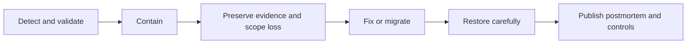

# DeFi Risk, Security, and Economic Attacks

DeFi risk is not synonymous with a smart-contract bug. A protocol can execute
exactly as programmed and still fail because an oracle was manipulable, a
liquidation market disappeared, governance was captured, collateral lost its
value, or several individually sound protocols formed an unstable loop.

Conversely, a protocol can survive a code defect because deposits are capped,
privileges are delayed, monitors detect the issue, a pause limits damage, and
operators communicate clearly. Security is therefore a system property:

```text
security
= correct code
+ sound financial mechanism
+ reliable dependencies
+ constrained authority
+ effective operations
+ adequate loss absorption
```

This note builds a complete risk taxonomy, explains major attack patterns,
develops threat-modeling and control practices, and extracts lessons from
carefully selected incidents. Incident losses are cited as approximate because
asset prices, recoveries, and accounting definitions differ.

## 1. Assets, Invariants, and Adversaries

### 1.1 Start with the protected assets

A threat model should identify what can be harmed:

- user principal;
- protocol reserves and treasury;
- stablecoin backing;
- governance control;
- oracle integrity;
- private keys and upgrade authority;
- availability and withdrawal rights;
- accounting records;
- confidential user information;
- reputation and legal permissions; and
- downstream protocols that depend on the system.

The most important asset may be an authorization rather than a token balance.
An upgrade key can install code capable of moving every token later.

### 1.2 State the invariants

An invariant is a condition that should always hold. Examples:

- total shares represent no more than recognized assets;
- a withdrawal cannot claim the same assets twice;
- debt cannot increase without corresponding collateral or accounted system
  deficit;
- no position can withdraw collateral while unhealthy;
- only authorized governance can upgrade a proxy;
- a signed message cannot be replayed on another chain;
- stablecoin minting cannot exceed a configured credit ceiling; and
- an AMM's accounting remains internally consistent after every swap.

An exploit often combines legitimate functions into a sequence that violates an
unstated invariant.

### 1.3 Model adversaries and failures

Threat modeling should not assume that every harmful outcome begins with a
criminal hacker. A rational trader may exploit a price rule exactly as written;
a governance delegate may be bribed; and an honest oracle can stop updating
during an outage. The protocol experiences each as a failed invariant even
though intent and legal treatment differ. Modeling malicious and accidental
paths together reveals controls that depend too heavily on one narrative.

Adversaries can include:

- an ordinary user with flash-loan access;
- a block builder or searcher controlling transaction ordering;
- a compromised governance delegate;
- a malicious or bribed oracle reporter;
- a privileged administrator;
- a dishonest node operator or bridge validator;
- an external borrower or custodian;
- a front-end or DNS attacker; and
- another protocol whose failure propagates automatically.

Also model non-malicious faults:

- programming error;
- misconfigured parameter;
- network congestion;
- chain reorganization;
- cloud outage;
- stale market data;
- legal freeze;
- operator mistake; and
- unexpected user behavior.

## 2. Smart-Contract Risk

### 2.1 Reentrancy

Reentrancy occurs when a contract calls an external address before completing
its own state update, and the recipient calls back into a vulnerable path.

Vulnerable pattern:

```text
1. read user balance
2. send tokens or native asset
3. external recipient calls withdraw again
4. original call updates balance too late
```

Controls include checks-effects-interactions, reentrancy guards, pull-payment
patterns, and explicit analysis of cross-function and cross-contract
reentrancy. Token hooks and callbacks make external calls less obvious than a
direct native-asset transfer.

### 2.2 Arithmetic and precision

Modern Solidity checks ordinary overflow and underflow, but financial arithmetic
still fails through:

- rounding in the wrong direction;
- precision loss before multiplication;
- decimal mismatch between tokens;
- share inflation when a vault is nearly empty;
- accumulated index error;
- division by zero;
- signed/unsigned conversion; and
- units such as seconds versus years or basis points versus decimals.

Rounding should normally favor protocol solvency rather than let a user repeat a
small favorable error thousands of times.

### 2.3 Share and donation attacks

An ERC-4626-style vault can be vulnerable when an attacker manipulates the ratio
of assets to shares, particularly around the first deposit. If external asset
transfers increase assets without minting shares, a victim's deposit can round
to very few or zero shares.

Controls include virtual assets/shares, minimum initial liquidity, careful
rounding, and treating unsolicited transfers consistently. The token standard
does not guarantee a safe economic implementation.

### 2.4 Authorization and initialization

Common failures include:

- an uninitialized proxy that anyone can initialize;
- an implementation contract with unsafe initialization;
- missing access control on mint, upgrade, or sweep functions;
- incorrect role-admin hierarchy;
- reused signatures or nonces;
- unsafe `delegatecall`;
- arbitrary external-call capability; and
- an owner unintentionally renouncing a needed emergency role.

Authorization tests should prove both who **can** act and who **cannot**.

### 2.5 Upgradeability

A proxy separates stored state from implementation code. Upgrades introduce:

- administrator compromise;
- malicious governance;
- storage-layout collision;
- initialization mistakes;
- incompatible interfaces;
- audit-version mismatch; and
- unexpected behavior for integrations.

Controls can include a transparent upgrade process, timelock, narrowly scoped
multisig, storage-layout checks, immutable rollback paths, and monitoring of
implementation changes. An upgrade can bypass every property previously
verified in the old code.

### 2.6 Token incompatibility

Protocols may assume ERC-20 tokens:

- return a Boolean;
- transfer exactly the requested amount;
- have 18 decimals;
- never rebase;
- cannot blacklist;
- have no callback;
- and maintain a stable exchange rate.

Fee-on-transfer, rebasing, upgradeable, pausable, and permissioned tokens break
these assumptions. Wrappers and asset listings must define supported behavior.

## 3. Oracle Risk and Manipulation

### 3.1 The oracle boundary

A blockchain cannot natively know an offchain market price. An oracle system
selects data sources, aggregates observations, signs or transmits a result, and
updates the chain. The protocol then interprets that value.

Failures can occur at each stage:

- source markets are manipulated or closed;
- reporters collude or go offline;
- aggregation is biased;
- updates are delayed;
- confidence is ignored;
- decimals or quote direction are wrong;
- the consumer uses the feed for an unsupported purpose; or
- governance changes the oracle.

### 3.2 Spot-price manipulation

If a lending protocol values collateral using the current price in one shallow
AMM, an attacker can:

1. borrow temporary capital;
2. buy the collateral token and raise its pool price;
3. deposit or revalue the token as expensive collateral;
4. borrow valuable assets;
5. reverse the trade and repay temporary capital; and
6. leave bad debt.

The flash loan supplies scale but is not the root vulnerability. The unsafe
oracle and credit rule are.

### 3.3 TWAP and multi-source limits

A time-weighted average price increases manipulation cost because the attacker
must sustain distortion. It also lags genuine moves and can make liquidations
late. A multi-source median reduces dependence on one venue but can inherit
correlated prices and common stablecoin or exchange dependencies.

Oracle design should match:

- required update speed;
- collateral volatility;
- market depth;
- liquidation latency;
- maximum credit exposure;
- acceptable deviation;
- chain congestion; and
- fallback behavior.

### 3.4 Safe consumer controls

Consumers can use:

- heartbeat and staleness checks;
- minimum/maximum price bounds;
- deviation circuit breakers;
- confidence intervals;
- sequencer-uptime feeds on rollups;
- conservative loan-to-value ratios;
- supply and borrow caps;
- delayed activation of a new feed;
- independent fallback sources; and
- a fail-safe mode that restricts new risk without trapping repayment.

"The oracle is decentralized" is not enough. The entire market-to-contract path
must be evaluated.

## 4. Flash Loans and Atomic Capital

A flash loan must be repaid within one transaction or the transaction reverts.
It lets any actor temporarily command large capital without prior wealth or
credit.

Legitimate uses include arbitrage, collateral swaps, and refinancing. Attack
uses include:

- oracle manipulation;
- governance-vote borrowing;
- liquidation manipulation;
- exploiting rounding at scale;
- changing AMM reserves before a calculation; and
- executing several dependent steps atomically.

Flash loans compress a multi-day capital plan into one transaction. Security
assumptions should therefore never rely on an attacker being unable to obtain
large temporary balances.

Controls target the vulnerable mechanism:

- time-weighted voting power;
- governance proposal delays;
- manipulation-resistant prices;
- per-block rate limits;
- caps;
- snapshot rules; and
- invariants across the full atomic sequence.

## 5. Governance Risk

### 5.1 Legitimate governance can be dangerous

Governance may control upgrades, treasuries, minting, collateral, oracles,
bridges, and pauses. Attacks can use:

- borrowed voting power;
- accumulated or purchased tokens;
- compromised delegates;
- malicious proposal code;
- low participation;
- ambiguous proposal text;
- execution before observers can react; or
- social pressure during an emergency.

### 5.2 Beanstalk

In April 2022, an attacker used flash-borrowed voting power and Beanstalk's
onchain governance path to execute a proposal that transferred protocol assets.
Approximately $77 million of non-Bean assets was reported stolen. The protocol
later removed the vulnerable governance model and used a multisig and offchain
voting during recovery.

Lesson: a vote threshold based on current token balance is not meaningful
security if voting power can be acquired and exercised inside one atomic
transaction. Proposal delay, voting snapshots, code review, execution delay,
and limits on governance's direct asset-moving power are distinct controls.

### 5.3 Governance controls

- voting power based on a prior block or locked duration;
- proposal thresholds and quorum;
- separate voting and execution delays;
- human-readable and bytecode-level proposal review;
- independent simulation;
- cancellation by a constrained security body;
- caps on a single proposal's economic effect;
- emergency procedures with expiry; and
- transparent delegate conflicts and concentration.

A multisig can be safer than instantaneous token voting for some emergencies,
but it creates signer and accountability risk. The appropriate comparison is
between explicit control models, not "centralized" and "decentralized" labels.

## 6. Economic-Design Attacks

### 6.1 Price manipulation versus bad economics

An attacker does not need a coding error if the protocol offers an economically
inconsistent trade. Examples:

- minting a stablecoin against reflexive collateral;
- redeeming at a stale fixed price;
- receiving incentives worth more than the cost of circular activity;
- borrowing against a token whose liquidity is much smaller than its oracle
  value;
- selling unlimited insurance below expected loss; or
- using the protocol's own token as dominant loss-absorbing capital.

### 6.2 Reflexive collateral

If protocol token `G` backs stablecoin `S`, confidence loss can create:

```text
S redemption pressure
→ minting or selling G
→ G price decline
→ lower backing capacity
→ more pressure on S
```

TerraUSD and LUNA in May 2022 demonstrated the destructive scale of this
reflexivity. The conversion mechanism maintained parity only while the market
could absorb the governance/absorber asset. Once confidence and liquidity
collapsed together, nominal arbitrage capacity was not real loss-absorbing
capital.

### 6.3 Thin collateral

Market capitalization is not liquidation value. A token with a quoted price and
large supply may have little executable depth. Credit limits should be related
to:

- stressed sale capacity;
- concentration and float;
- DEX and centralized-venue depth;
- volatility and gap risk;
- oracle venues;
- holder concentration; and
- correlation with other collateral.

### 6.4 Incentive attacks

Liquidity mining can produce mercenary capital that exits when rewards fall.
Attackers can wash trade, self-lend, or move capital among wallets to extract
incentives. Controls require identity-resistant economic design, reward caps,
time weighting, and measurement of net new useful liquidity rather than raw
volume.

## 7. Lending and Liquidation Risk

### 7.1 Liquidation is a market

Solvency depends on someone being willing and able to:

- observe unsafe positions;
- obtain repayment assets;
- submit a transaction;
- compete for block inclusion;
- accept collateral;
- hedge or sell it; and
- bear price movement.

If expected incentive is smaller than gas, slippage, capital, and risk, rational
liquidators do nothing.

### 7.2 Bad debt paths

Bad debt can result from:

- price gaps;
- stale oracles;
- unavailable blockspace;
- unprofitable small positions;
- liquidation caps that are too low;
- collateral transfer failure;
- stablecoin depeg;
- correlated mass liquidation; and
- a code defect in the liquidation path.

The protocol needs an explicit waterfall: borrower collateral, liquidation
penalty, reserves, safety module, junior capital, governance dilution,
socialization, or creditor impairment.

### 7.3 Euler V1, March 2023

Euler V1's exploit combined donation-to-reserves functionality, leverage, and a
liquidation path to create an unhealthy account and extract value. The attacker
later returned most funds, but the incident showed that:

- a feature can be locally intended and globally unsafe;
- solvency checks must cover every state transition;
- liquidation bonuses can amplify a manufactured deficit; and
- composable actions require sequence-level invariant tests.

Euler V2 was redesigned rather than treating the incident as a minor patch.

### 7.4 Maker's Black Thursday, March 2020

Ether crashed while Ethereum was congested. Some Maker collateral auctions had
weak bidding and cleared for zero DAI, creating system bad debt.

Lesson: oracle valuation, auction design, keeper software, bidder liquidity,
stablecoin availability, and transaction inclusion are one liquidation system.
Testing the auction contract alone is insufficient.

## 8. AMM, Liquidity, and MEV Risk

### 8.1 Impermanent loss and adverse selection

An AMM LP continuously offers liquidity against an algorithmic curve.
Arbitrageurs trade when the pool price is stale relative to external markets.
The LP therefore tends to sell assets that rise and buy assets that fall.
Trading fees compensate for this exposure only if volume and fee income exceed
adverse selection and other losses.

### 8.2 Sandwich attacks

A searcher observes a pending swap:

1. trades ahead to move the pool price;
2. lets the victim execute with worse slippage; and
3. reverses after the victim.

Controls include tight slippage bounds, private order flow, batch auctions,
intent-based execution, and MEV-aware routing. A zero minimum output is an
authorization to accept almost any price.

### 8.3 Just-in-time liquidity

An actor can add concentrated liquidity immediately before a large swap, collect
fees, and remove it after. This can dilute passive LP fees. Whether it harms
traders or improves execution depends on the design and price range.

### 8.4 Vyper/Curve pools, July 2023

A compiler defect in particular Vyper versions made reentrancy protections fail
for affected contracts. Several Curve ecosystem pools were exploited.

Lessons:

- compiler and build toolchains are part of the trusted computing base;
- similar source code can produce vulnerable bytecode under one version;
- audit scope must include deployed compiler settings;
- protocol integrations create contagion through LP tokens and lending
  collateral; and
- disclosure and coordinated white-hat action can materially reduce loss.

## 9. Stablecoin and Run Risk

A stablecoin combines asset quality, liquidity transformation, redemption, and
confidence. Run risk grows when:

- redemption is restricted or slow;
- backing is opaque or illiquid;
- holders are concentrated;
- the stablecoin is dominant collateral elsewhere;
- secondary-market liquidity depends on incentives;
- backing contains related stablecoins;
- governance can change claims; or
- revenue depends on a volatile strategy.

USDC's March 2023 depeg transmitted to DAI through PSM and reserve exposure.
This was not a smart-contract exploit. It was bank and reserve uncertainty
propagating through onchain composability.

## 10. Bridge and Cross-Chain Risk

Bridges often hold or authorize assets larger than ordinary application
contracts. Their security may depend on:

- light-client verification;
- external validators or multisigs;
- optimistic challenge periods;
- guardian keys;
- message ordering and replay protection;
- source and destination finality;
- upgrade administrators; and
- relayers and liquidity providers.

If a bridge falsely accepts a deposit, it can mint unbacked wrapped assets.
Those assets may then be sold or used as collateral before other protocols can
react. Bridge design is covered in depth in
[Blockchain Interoperability and Bridges](../../06-interoperability-privacy-and-enterprise-dlt/01-interoperability/blockchain-interoperability-and-bridges.md).

## 11. Composability and Systemic Risk

### 11.1 Dependency graph

Consider:

```text
LST
→ bridge wrapper
→ lending collateral
→ borrowed stablecoin
→ DEX LP token
→ yield vault
→ collateral in another lending market
```

A defect at the first layer can trigger:

1. LST discount;
2. lending liquidations;
3. stablecoin sales;
4. LP imbalance;
5. vault losses; and
6. liquidations in the final market.

Atomic composability accelerates normal arbitrage and crisis transmission.

### 11.2 Common dependencies

Protocols that appear diversified may share:

- the same stablecoin;
- oracle network;
- admin multisig signers;
- RPC and cloud providers;
- bridge;
- front-end hosting;
- governance delegates;
- audit firm;
- collateral; and
- block builder or sequencer.

Risk aggregation must identify common causes, not count protocol names.

### 11.3 Procyclicality

Rising prices support more borrowing, leverage, TVL, and token incentives.
Falling prices cause collateral calls, forced selling, reduced liquidity, and
further price declines. Because DeFi liquidations are automatic, the cycle can
move faster than discretionary credit markets.

## 12. Operational and Front-End Risk

Even immutable contracts depend on operations:

- deployment scripts and address verification;
- DNS and web hosting;
- wallet transaction construction;
- APIs, RPCs, and indexers;
- keepers and liquidators;
- oracle operations;
- multisig signing;
- monitoring and alerting;
- incident communication; and
- software supply chains.

A compromised front end can ask users to approve a malicious contract while the
canonical protocol remains safe. Users should verify domains, contract
addresses, approvals, and transaction simulations.

Protocols should maintain:

- reproducible deployments;
- signed releases;
- hardware-backed administrative keys;
- separate proposer and executor roles;
- tested disaster recovery;
- multiple RPC and monitoring paths;
- public status communication; and
- clear authority during incidents.

## 13. Security Engineering Lifecycle

### 13.1 Specification

Write:

- actor and trust assumptions;
- state machine;
- economic invariants;
- privilege map;
- dependency list;
- failure and recovery modes;
- parameter bounds; and
- maximum credible loss.

Code review cannot recover a security property that was never specified.

### 13.2 Testing

These methods answer different questions. Unit tests show that known examples
behave as expected, while invariant fuzzing searches unfamiliar sequences for a
property violation. Fork testing adds the current behavior of real tokens,
oracles, and venues; economic simulation asks whether rational actors and
liquidity conditions can make correct code insolvent. A high coverage percentage
does not substitute for choosing the right properties.

Use complementary methods:

- unit tests for expected paths;
- integration tests for module interactions;
- fuzzing for unexpected inputs;
- invariant/property testing over action sequences;
- fork tests using live dependencies;
- differential testing against a reference implementation;
- stress simulations for prices, liquidity, and queues;
- adversarial governance simulations; and
- deployment rehearsals.

### 13.3 Audit

An audit is a time-bounded review of specified code and assumptions. Verify:

- exact commit and compiler;
- deployed bytecode;
- included and excluded modules;
- unresolved findings;
- privilege and economic review;
- changes after the audit; and
- whether the live configuration matches assumptions.

Several audits do not mathematically guarantee safety. They can provide diverse
review and reduce correlated blind spots.

### 13.4 Formal verification

Formal methods prove specified properties within a model. They are valuable for
accounting, access control, state transitions, and arithmetic. Limits include:

- an incomplete or wrong specification;
- unmodeled external contracts;
- compiler/runtime assumptions;
- governance changing the verified code;
- economic behavior outside the model; and
- state-space or tooling constraints.

"Formally verified" should always be followed by "which property, against which
model and version?"

### 13.5 Bug bounties and disclosure

A bounty creates a legal and economic path for researchers to report issues.
Its scope, maximum reward, payment reliability, safe-harbor terms, and response
speed determine credibility. Bounties complement rather than replace internal
security and audits.

## 14. Runtime Risk Controls

### 14.1 Caps and rate limits

Controls include:

- supply and borrow caps;
- stablecoin debt ceilings;
- bridge message and mint limits;
- per-transaction and per-time-window outflow limits;
- collateral concentration limits;
- open-interest limits;
- oracle deviation limits; and
- governance spending caps.

A cap converts an unknown exploit into a bounded one only if the attacker cannot
reset or bypass it.

### 14.2 Circuit breakers and pauses

A pause can stop new borrowing, swaps, minting, or withdrawals. Good design:

- pauses the minimum dangerous function set;
- still permits repayment or risk reduction when safe;
- separates emergency activation from permanent control;
- expires or requires review;
- has tested unpause procedures; and
- publicly documents role holders.

Pausing withdrawals can prevent theft and also trap innocent users. The trade-off
must be explicit.

### 14.3 Timelocks

A timelock gives users and monitors time to inspect and exit before an upgrade.
It is ineffective if:

- users cannot withdraw in time;
- the change is too complex to review;
- an emergency path bypasses delay;
- monitoring is absent; or
- governance can change the timelock itself immediately.

### 14.4 Monitoring

Monitor:

- implementation and role changes;
- oracle staleness and deviation;
- abnormal minting or borrowing;
- pool imbalance and liquidity depth;
- bad debt and health-factor distribution;
- governance proposals and voting concentration;
- bridge flows;
- treasury and multisig movements;
- front-end integrity; and
- dependency status.

Alerts require an owner, severity, response playbook, and escalation path.

## 15. Incident Response

### 15.1 Preparation

Before an incident:

- identify decision authority;
- maintain private communication channels;
- pre-negotiate exchange, stablecoin issuer, and law-enforcement contacts where
  appropriate;
- test pause and upgrade transactions;
- preserve logs and tracing tools;
- define disclosure thresholds; and
- plan user claims and loss accounting.

### 15.2 Response sequence



Containment may involve a pause, oracle change, cap reduction, front-end
warning, validator coordination, or white-hat rescue. Every intervention must
consider whether it creates a worse exploit path.

### 15.3 Postmortem

A useful postmortem includes:

- exact timeline and transaction hashes;
- vulnerable assumptions and code;
- attacker prerequisites;
- gross loss, recovered assets, and net user impact;
- control failures;
- response actions and authority;
- remediation and independent review; and
- remaining uncertainty.

"Sophisticated attacker" is not a root cause. Root causes are specific design,
implementation, control, or operational failures.

## 16. Risk Measurement

### 16.1 Value at risk is insufficient

Historical volatility models poorly capture smart-contract exploits, oracle
failure, governance capture, and stablecoin runs. Use:

- scenario analysis;
- reverse stress testing;
- dependency graphs;
- liquidity-at-risk;
- maximum extractable value;
- loss-given-failure estimates;
- attack-cost analysis; and
- concentration and common-cause metrics.

### 16.2 Attack profitability

A simplified condition is:

```text
expected attacker profit
= extractable value
- manipulation and capital cost
- fees and MEV leakage
- probability-weighted recovery or enforcement cost
```

Defenses can reduce extractable value with caps, increase manipulation cost with
better oracles and delays, and improve detection/recovery. Security should
remain robust even when temporary capital is abundant.

### 16.3 Maximum credible loss

For each privileged role and failure:

- what value can move immediately?
- what can move before monitors react?
- what depends on market liquidity?
- what contagion can occur downstream?
- what assets are recoverable or freezeable?
- which loss absorber pays first?

TVL is not necessarily maximum loss, but it is also not always the ceiling:
minting unbacked assets and using them elsewhere can create downstream loss
beyond deposits in the first protocol.

## 17. Incident Lessons at a Glance

| Incident | Primary mechanism | General lesson |
|---|---|---|
| Maker, March 2020 | Congestion and failed auction competition | Liquidation depends on market infrastructure, not only collateral ratios |
| Beanstalk, April 2022 | Flash-loan governance capture | Voting power, proposal, and execution need time separation |
| Terra, May 2022 | Reflexive stablecoin absorber and run | Nominal arbitrage is not external loss-absorbing capital |
| Euler V1, March 2023 | Multi-function accounting/liquidation exploit | Test invariants across sequences, not functions in isolation |
| USDC/DAI, March 2023 | Offchain bank uncertainty and collateral linkage | Composability transmits traditional counterparty risk |
| Curve ecosystem, July 2023 | Compiler-induced reentrancy failure | Toolchains and deployed bytecode are part of audit scope |

The lesson is not to blacklist one feature. Flash loans, governance, auctions,
oracles, upgradeability, and wrappers all have legitimate uses. Each creates a
capability that must be constrained by invariants and layered controls.

## 18. A Comprehensive Review Checklist

### Architecture

- Map assets, contracts, chains, oracles, bridges, keepers, and offchain actors.
- Identify upgrade, pause, mint, sweep, and parameter authority.
- Trace every redemption and liquidation path.

### Financial risk

- Stress prices, correlations, rates, liquidity, and stablecoin pegs.
- Compare liabilities with realizable assets.
- Define bad-debt and loss waterfalls.
- Measure collateral concentration and stressed sale depth.

### Technical risk

- Review exact deployed bytecode and dependencies.
- Test reentrancy, arithmetic, authorization, initialization, and token
  incompatibility.
- Fuzz action sequences and assert invariants.

### Governance and operations

- Evaluate token concentration, delegates, multisigs, timelocks, and emergency
  powers.
- Verify monitoring, key custody, deployment, and incident procedures.
- Determine whether front ends and APIs can misdirect users.

### Composability

- Inventory upstream and downstream integrations.
- Identify circular collateral and shared dependencies.
- Model simultaneous unwinds rather than one-protocol failure.

### Transparency

- Require current parameter and role disclosures.
- Separate audited facts from assumptions.
- Date risk assessments because configurations change.

Security is not a badge conferred by an audit or a high TVL. It is continuous
evidence that the system's code, economics, dependencies, controls, and
operations preserve defined properties under both ordinary use and adversarial
stress.

## Related Notes

- [DeFi Architecture, Composability, and Governance](../01-defi-foundations/defi-architecture-composability-and-governance.md)
- [Onchain Lending and Credit](../02-onchain-lending/onchain-lending-and-credit.md)
- [Decentralized Exchanges and Automated Market Makers](../../03-digital-assets-and-market-structure/03-decentralized-markets/decentralized-exchanges-and-automated-market-makers.md)
- [Oracles, Indexers, and Offchain Data](../../02-blockchain-foundations/03-execution-and-applications/oracles-indexers-and-offchain-data.md)
- [Smart Contracts, Virtual Machines, and Token Standards](../../02-blockchain-foundations/03-execution-and-applications/smart-contracts-virtual-machines-and-token-standards.md)
- [Financial Risk Management](../../01-financial-foundations/03-risk-and-regulatory-foundations/financial-risk-management.md)

## References

- IOSCO, [Policy Recommendations for Decentralized Finance](https://www.iosco.org/library/pubdocs/pdf/IOSCOPD744.pdf)
- BIS, [DeFi risks and the decentralisation illusion](https://www.bis.org/publ/qtrpdf/r_qt2112b.htm)
- BIS, [The oracle problem and the future of DeFi](https://www.bis.org/publ/bisbull76.htm)
- Bank of Canada, [Analysis of DeFi Oracles](https://www.bankofcanada.ca/2024/07/staff-discussion-paper-2024-10/)
- CPMI-IOSCO, [Principles for Financial Market Infrastructures](https://www.bis.org/cpmi/publ/d101a.pdf)
- Ethereum, [Smart contract security](https://ethereum.org/developers/docs/smart-contracts/security/)
- Solidity, [Security considerations](https://docs.soliditylang.org/en/latest/security-considerations.html)
- OpenZeppelin, [Contracts security documentation](https://docs.openzeppelin.com/contracts/api/security)
- OpenZeppelin, [ERC-4626 inflation attack and defenses](https://docs.openzeppelin.com/contracts/4.x/erc4626)
- Trail of Bits, [Building Secure Contracts](https://secure-contracts.com/)
- Chainlink, [The blockchain oracle problem](https://chain.link/education-hub/oracle-problem)
- Euler Labs, [Euler Finance attack review](https://www.euler.finance/blog/euler-finance-attack-review)
- Beanstalk, [Governance exploit report](https://bean.money/blog/beanstalk-governance-exploit)
- Beanstalk, [Barn recapitalization documentation](https://docs.bean.money/almanac/farm/barn)
- MakerDAO Forum, [Black Thursday response thread](https://forum.makerdao.com/t/black-thursday-response-thread/1433)
- MakerDAO, [Liquidations 2.0 executive summary](https://docs.makerdao.com/smart-contract-modules/dog-and-clipper-detailed-documentation)
- Curve Finance, [Postmortem: Vyper compiler reentrancy bug](https://hackmd.io/@LlamaRisk/BJzSKHNjn)
- Vyper, [Security advisories](https://github.com/vyperlang/vyper/security/advisories)
- Circle, [USDC and Silicon Valley Bank update](https://www.circle.com/blog/an-update-on-usdc-and-silicon-valley-bank)
- Chainalysis, [The Chainalysis 2023 Crypto Crime Report: DeFi hacks](https://www.chainalysis.com/blog/2022-biggest-year-ever-for-crypto-hacking/)
- Immunefi, [Crypto losses reports](https://immunefi.com/reports/)
