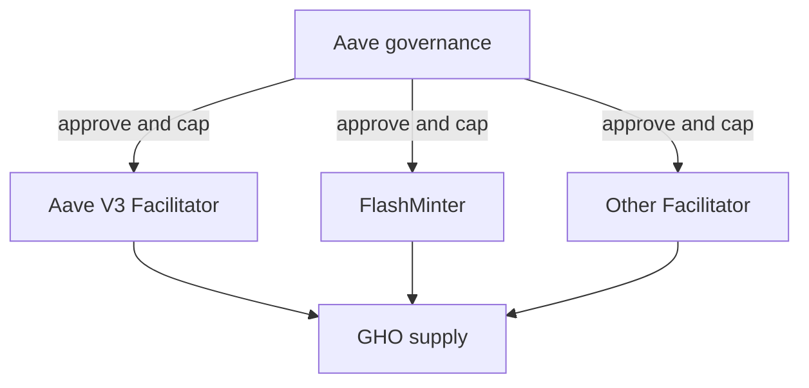

# Stablecoin Issuers and Protocols: USDT, USDC, Paxos, PYUSD, Sky, GHO, Liquity, and Ethena

Stablecoins with the same one-dollar target can represent fundamentally
different claims. USDC is a liability of a private issuer supported by reserve
assets. DAI and USDS are liabilities of an onchain credit system. LUSD and BOLD
are created against ETH-family collateral with immutable or minimally governed
mechanics. USDe is supported through backing assets and derivatives hedges.

This note is a casebook. The common foundations—reserve quality, redemption,
depegs, token administration, and comparisons with bank money—are developed in
[Stablecoins](stablecoins.md). Each profile here answers the same questions:

1. Who creates the token?
2. What is the holder's claim?
3. What supports the liability?
4. How does issuance and redemption work?
5. Who controls contracts and risk parameters?
6. How is the system funded?
7. Which failures matter most?

Facts and product availability are dated to July 2026 unless a historical date
is stated.

## 1. Analytical Template

### 1.1 Legal and economic layers

Separate:

- **brand:** the name users recognize;
- **legal issuer:** the entity that owes redemption or issues the token;
- **reserve owner:** the entity, trust, or vehicle holding assets;
- **distributor:** exchange, wallet, payment company, or protocol interface;
- **token administrator:** addresses able to mint, burn, freeze, or upgrade;
- **custodians and banks:** entities holding offchain assets;
- **primary customer:** party able to mint or redeem directly; and
- **secondary holder:** party buying through markets without a direct issuer
  account.

PayPal USD is the clearest illustration: PayPal supplies the brand and major
distribution, while Paxos Trust Company is the issuer under the applicable
terms.

### 1.2 Quantitative balance-sheet questions

For a reserve-backed issuer:

```text
reserve surplus
= fair value of realizable reserve assets
- stablecoins outstanding
- senior reserve claims and expected liquidation costs
```

For a crypto-backed protocol:

```text
protocol net asset buffer
= realizable collateral and other assets
- stablecoin liabilities
- bad debt and senior obligations
```

Reported assets at face value are not necessarily realizable under stress.

### 1.3 Control questions

Create a role map:

| Capability | Potential controller |
|---|---|
| Mint/burn | Issuer operations, facilitator, Vault engine |
| Freeze/blacklist | Issuer compliance administrator |
| Upgrade | Company multisig, DAO, proxy admin |
| Change collateral | DAO or protocol governance |
| Change rates | Issuer policy, DAO, immutable formula |
| Move reserves | Issuer, trustee, custodian, manager |
| Pause redemption | Issuer/legal process or contract role |
| Bridge supply | Issuer attester, bridge validators, governance |

Claims about decentralization should be tied to individual capabilities.

## 2. Tether and USDT

### 2.1 Structure and role

USDT, launched in 2014 under its earlier Realcoin history, is issued by entities
in the Tether group under published legal terms. It is available on multiple
blockchains and is extensively used as a trading quote asset, exchange
collateral, cross-border value-transfer instrument, and DeFi asset.

USDT's network effect comes from:

- deep liquidity across centralized exchanges;
- distribution in regions with limited dollar banking access;
- support on high-throughput, low-fee networks;
- long operating history; and
- integration into market-making and settlement systems.

Network effects also create concentration: a USDT operational, reserve, or
regulatory event can affect many venues at once.

### 2.2 Holder claim and redemption

Tether's legal terms govern direct issuance and redemption. Direct customers
must complete onboarding, satisfy eligibility, and comply with minimums, fees,
and review. Many holders instead trade through intermediaries.

Therefore distinguish:

```text
issuer redemption at contractual terms
≠ guaranteed immediate retail conversion on every exchange
```

Secondary price depends on confidence that eligible arbitrageurs can and will
use the primary route.

### 2.3 Reserves and reporting

Tether publishes daily circulation information and quarterly reserve reports
with independent assurance as of reporting dates. Reserve categories have
included US Treasury bills, overnight reverse repos, money-market funds, cash
and bank deposits, precious metals, bitcoin, secured loans, and other
investments, with composition changing over time.

As of the March 31, 2026 report displayed on Tether's transparency page, Tether
reported assets exceeding stablecoin liabilities. This is a management reserve
report subject to the assurance scope described by BDO, not a substitute for
reading the issuing entities' complete legal and financial position.

Risk analysis should examine:

- percentage in directly held short-term Treasuries and repo;
- bank and custodian concentration;
- secured-loan collateral and counterparties;
- valuation and liquidity of bitcoin, gold, and investments;
- asset encumbrance;
- issuing-entity liabilities outside token redemption;
- audit/assurance scope; and
- access to cash during a weekend or run.

### 2.4 Token control

USDT contracts differ by chain. Common issuer controls include minting,
freezing, and address blocking. These can implement sanctions, theft response,
and legal orders. They also mean USDT is not censorship-resistant in the manner
of an immutable bearer asset.

Multi-chain analysis must reconcile:

- authorized supply on each network;
- tokens held in treasury;
- contract and administrator addresses;
- chain swaps;
- third-party bridged representations; and
- obsolete or unsupported deployments.

### 2.5 Economics

Tether can earn the spread between reserve-asset returns and the low or zero
interest paid to USDT holders:

```text
issuer income
≈ average reserves × portfolio yield
- custody, banking, compliance, distribution, and operating costs
- credit and market losses
```

Higher short-term interest rates and larger circulation increase gross reserve
income. Investments outside the core reserve can create additional gains and
losses.

### 2.6 Principal risks

- reserve credit, market, and liquidity risk;
- access to banking and custodians;
- legal-entity and insolvency structure;
- regulatory restrictions across jurisdictions;
- direct-redemption access and operational capacity;
- freeze and key-control risk;
- assurance frequency and scope;
- chain and bridge risk; and
- systemic concentration in crypto market structure.

## 3. Circle, USDC, and EURC

### 3.1 Issuer model

Circle issues USDC through regulated affiliates and issues EURC under its
applicable European structure. USDC is native on many blockchains and is widely
used in DeFi, exchanges, payments, tokenized asset settlement, and institutional
services.

Circle is also a technology and distribution company. Its products include
issuer accounts, APIs, wallets infrastructure, and Cross-Chain Transfer
Protocol (CCTP). The token claim and the software services should be analyzed
separately.

### 3.2 Reserve composition

Circle states that USDC is backed by highly liquid cash and cash-equivalent
assets held separately from operating funds for the benefit of holders. The
majority of reserves is held through the Circle Reserve Fund (`USDXX`), an
SEC-registered Rule 2a-7 government money-market fund managed by BlackRock,
with custody by BNY, alongside bank deposits and other disclosed eligible
arrangements.

The fund layer means reserve analysis includes:

- fund assets and maturity;
- fund custodian;
- Circle's ownership or claim structure;
- bank deposits outside the fund;
- repo counterparties and collateral;
- redemption liquidity between fund and issuer; and
- treatment for token holders if Circle fails.

Circle publishes frequent reserve data and monthly third-party assurance.

### 3.3 Issuance and retail access

Approved Circle Mint customers can create and redeem USDC through supported
banking rails. Circle Mint is an institutional service rather than a universal
retail account. Retail holders normally rely on exchanges, wallets, and market
liquidity.

Under MiCA, Circle states that eligible holders of its e-money tokens have
applicable redemption rights under the issuer terms. Rights can differ by legal
entity, jurisdiction, and product.

### 3.4 CCTP

CCTP moves native USDC between supported chains through:

1. burning USDC on the source chain;
2. observing the burn and finality;
3. obtaining an attestation from Circle's service; and
4. minting native USDC on the destination.

This avoids locking source USDC to issue a third-party wrapper. It depends on
Circle's attestation infrastructure, source/destination contracts, finality,
rate limits, and key security.

### 3.5 Administrative controls

USDC contract implementations can include:

- minter roles;
- pausing;
- blacklisting;
- balance seizure/burning under authorized processes;
- proxy upgradeability; and
- signature authorization.

The issuer can respond to stolen funds or sanctions, but token holders and DeFi
protocols inherit issuer-control risk.

### 3.6 March 2023 depeg

Circle disclosed that $3.3 billion of USDC reserves were held at Silicon Valley
Bank when it failed. USDC traded below one dollar while access and recovery were
uncertain. Circle later stated that it would cover any shortfall, and USDC
returned to par after US authorities protected depositors and banking access
normalized.

Lessons:

- cash at a bank is a bank credit exposure;
- assurance at a prior date does not remove intraday or subsequent events;
- weekend blockchain markets can price risk while banks are closed;
- concentration matters even in a conservative reserve; and
- USDC exposure propagated into DAI and DeFi pools.

### 3.7 Business model and distribution

Circle earns reserve income and shares economics with important distribution
partners. Coinbase's public filings show material USDC-related revenue and user
reward expense. This illustrates that a stablecoin arrangement includes
distribution contracts not visible in the token.

### 3.8 Principal risks

- bank, custodian, fund, and repo dependencies;
- rate sensitivity of reserve income;
- legal redemption and insolvency treatment;
- issuer administrator and upgrade controls;
- sanctions and blacklist risk;
- CCTP and multi-chain operations;
- reliance on large distributors; and
- regulatory requirements across entities.

## 4. Paxos, USDP, and Branded Stablecoins

### 4.1 Paxos Trust Company

Paxos Trust Company is a New York limited-purpose trust company supervised by
the New York State Department of Financial Services. It issues Pax Dollar
(`USDP`) and provides regulated stablecoin infrastructure for branded products.

This model separates:

- the regulated issuance and reserve function;
- a distribution brand;
- the token contracts;
- user interfaces; and
- payment integrations.

### 4.2 USDP

Paxos states that USDP is redeemable one-for-one for US dollars and supported
by cash and cash equivalents. It publishes monthly reserve composition and
attestation reports.

The NYDFS stablecoin guidance applicable to supervised issuers addresses
reserve backing, segregation, redemption, and independent attestation. A
regulated trust structure provides defined oversight but does not remove
technology, bank, custodian, or operational risk.

### 4.3 BUSD as a lifecycle lesson

Paxos historically issued Binance USD (`BUSD`). In February 2023, NYDFS ordered
Paxos to cease minting new BUSD. Existing tokens remained supported for an
orderly redemption period under the announced process.

BUSD shows:

- the exchange brand and legal issuer were different;
- a token can remain technically transferable after new issuance stops;
- regulatory action can cause supply to contract without a reserve loss;
- liquidity and integrations can decline during wind-down; and
- users must follow the issuer's redemption timeline rather than assume a token
  remains permanent.

### 4.4 Global Dollar and infrastructure partnerships

Paxos also supports stablecoin infrastructure and products whose economics may
share reserve income with distributors. Each program requires its own issuer,
reserve, jurisdiction, contract, and redemption analysis; "powered by Paxos"
does not make every token legally identical.

## 5. PayPal USD

### 5.1 Issuer versus brand

PayPal USD (`PYUSD`) is branded and distributed by PayPal but issued by Paxos
Trust Company. PayPal's terms explicitly state this distinction.

Paxos is responsible for the stablecoin issuance and reserve under its terms.
PayPal provides wallet, commerce, transfer, and exchange functions to eligible
customers. Other wallets can hold the onchain token without becoming PayPal
accounts.

### 5.2 Reserves and redemption

Published terms describe PYUSD as backed by:

- US dollar deposits;
- US Treasuries; and
- US Treasury reverse-repurchase agreements held under the stated custodial
  structure for holders.

Paxos publishes PYUSD transparency reports. Direct conversion rights and
processes differ between:

- Paxos customers;
- PayPal or Venmo users;
- exchange customers; and
- self-custodied holders.

### 5.3 Chains and contracts

PYUSD expanded beyond its original Ethereum deployment to additional supported
networks. As of PayPal's 2026 terms, supported chains named there include
Ethereum, Solana, Arbitrum, and Stellar. Availability changes; verify official
contracts rather than a token symbol.

Each deployment creates:

- chain-specific finality and fee behavior;
- contract and upgrade risk;
- issuer mint/burn operations;
- bridge or native-supply reconciliation; and
- different wallet and exchange liquidity.

### 5.4 Payments use

PYUSD can support:

- wallet-to-wallet transfer;
- checkout and merchant settlement;
- cross-border remittance products;
- onchain transfers;
- crypto trading; and
- conversion within PayPal services.

Actual payment economics include PayPal account eligibility, fees, exchange
rates, merchant contracts, consumer protection, compliance, and fiat payout.
The ERC-20 or other token transfer is one part of the service.

### 5.5 Principal risks

- Paxos issuer and reserve risk;
- PayPal platform and account risk;
- administrator and freeze controls;
- supported-chain differences;
- product eligibility and fees;
- brand/issuer confusion; and
- regulatory change.

## 6. Sky: DAI, USDS, and sUSDS

### 6.1 Credit-created stablecoins

DAI and USDS are not issued by receiving one dollar into a corporate reserve
account. The Sky system creates stablecoin liabilities through:

- collateralized Vault debt;
- Peg Stability Modules;
- real-world asset and treasury positions;
- protocol allocations; and
- governance-authorized modules.

DAI and USDS convert one-to-one through the official converter without fees.
Their token designs differ: USDS uses an upgradeable Sky-era implementation,
while DAI is the older Maker-era asset.

### 6.2 Balance sheet

Assets and claims can include:

- crypto collateral securing Vaults;
- external stablecoins in PSMs;
- short-duration government-security structures;
- private credit;
- protocol loans and allocations; and
- accrued fees.

Liabilities include DAI, USDS, savings claims, and system debt. Governance-token
economics and surplus provide residual loss absorption, but the system does not
have the same legal capital and resolution structure as a bank.

### 6.3 Peg

Peg support combines:

- one-to-one external-stablecoin conversion within configured modules;
- DAI–USDS conversion;
- borrowing and stability fees;
- savings rates;
- liquidation;
- market liquidity; and
- governance policy.

This imports external stablecoin and RWA risks while improving dollar liquidity.

### 6.4 Savings

`sUSDS` is an ERC-4626 share representing USDS deposited into the Sky Savings
Rate mechanism. Its value accrual is funded by protocol income and policy, not
an independent guarantee.

### 6.5 Principal risks

- collateral and liquidation;
- oracle and smart contracts;
- governance capture;
- PSM stablecoin concentration;
- RWA legal and liquidity risk;
- asset-liability maturity mismatch;
- upgradeable USDS control;
- organizational and token migration; and
- Spark and cross-protocol allocations.

See [Maker, Sky, and Spark](../../04-decentralized-finance/02-onchain-lending/sky-maker-spark.md)
for the full architecture.

## 7. Aave and GHO

### 7.1 Facilitator model

GHO is an Aave-governed stablecoin. A **Facilitator** can mint and burn GHO up
to its governance-approved **bucket capacity**. Each Facilitator can implement
a different issuance strategy.



The bucket contains risk at the facilitator level but does not make every GHO
unit separately attributable after minting.

### 7.2 Aave V3 issuance

The initial principal Facilitator lets users borrow GHO against collateral in
the Aave V3 Ethereum market. Unlike ordinary Aave borrowing, the GHO is created
by the Facilitator rather than drawn from supplier deposits. Repayment burns
GHO, and interest flows to the Aave DAO under the configured design.

GHO debt inherits Aave collateral, oracle, health-factor, and liquidation
mechanics.

### 7.3 Flash minting

The FlashMinter can create GHO inside a transaction provided it is repaid and
burned before completion. It supports arbitrage and refinancing without
creating persistent supply up to its allowed capacity.

### 7.4 Stability modules and cross-chain supply

GHO uses governance-configured stability mechanisms for conversion with
approved stablecoins. Current architecture has evolved to support reserves and
remote GSMs on additional networks, while Chainlink CCIP routes support
cross-chain mint/burn accounting.

This adds:

- approved stablecoin issuer risk;
- facilitator and reserve controls;
- CCIP messaging and finality;
- multi-network governance; and
- liquidity allocation risk.

### 7.5 Governance

Aave governance can change:

- Facilitators and bucket capacities;
- borrow and savings-related rates;
- GSM assets and fees;
- bridge configuration;
- treasury allocations; and
- relevant contract upgrades.

Delegated governance, executors, stewards, and service providers make the
practical control map broader than AAVE token voting alone.

### 7.6 Principal risks

- Aave V3 collateral and liquidation risk;
- Facilitator-specific credit or operational risk;
- governance and cap management;
- stablecoin collateral in GSMs;
- oracle and smart-contract risk;
- cross-chain messaging;
- DEX liquidity and peg reflexivity; and
- concentration of revenue and policy in the DAO.

## 8. Liquity: LUSD and BOLD

### 8.1 LUSD

Liquity V1 lets users open ETH-backed Troves and create LUSD. Its design
emphasizes immutable contracts and minimal governance. Stability uses:

- overcollateralized ETH positions;
- Stability Pool liquidations;
- redistribution when necessary;
- LUSD redemption for ETH at face value; and
- algorithmic borrowing/redemption fees.

LUSD's collateral purity avoids fiat-stablecoin issuer risk but concentrates
exposure in ETH and liquidation performance.

### 8.2 BOLD

Liquity V2 creates BOLD against separate ETH, wstETH, and rETH branches. Each
branch has:

- its own Troves and Stability Pool;
- fixed collateral rules;
- borrower-set interest rates;
- liquidation paths; and
- shutdown thresholds.

BOLD is one shared stablecoin. A borrower is isolated to a branch, while BOLD
holders are exposed to the solvency of all branches.

### 8.3 Borrower-set rates

Borrowers choose their interest rate. Lower-rate Troves are earlier in the
redemption sequence, creating a trade-off:

```text
lower interest cost ↔ greater probability of redemption
```

Borrower interest principally rewards Stability Pool depositors, while a
portion supports governance-directed protocol liquidity incentives under the
current design.

### 8.4 Redemptions

A BOLD holder can exchange BOLD for approximately one dollar of collateral,
less applicable fee. The system reduces selected borrower debt and releases
collateral. Redemptions support a price floor but can alter borrower exposure
without liquidating the position.

### 8.5 Minimal governance

Core contracts and collateral choices are designed to be immutable.
Governance's narrow role focuses on incentive allocation. This limits capture
and arbitrary parameter change but also prevents ordinary upgrades if
assumptions become obsolete.

### 8.6 Principal risks

- ETH and LST price/correlation risk;
- Lido and Rocket Pool dependencies for LST branches;
- oracle failure;
- insufficient Stability Pool liquidity;
- branch shutdown and redistribution;
- redemption and DEX liquidity;
- immutable-code defects; and
- common BOLD exposure across branches.

## 9. Ethena: USDe and sUSDe

### 9.1 Synthetic-dollar architecture

Ethena creates USDe against accepted backing assets and opens offsetting short
derivative positions. The aim is to reduce net directional exposure:

```text
long backing-asset delta + short derivative delta ≈ zero
```

Backing assets can include liquid stable assets and crypto or liquid-staking
assets. Derivative positions are managed across approved venues using
off-exchange settlement and custodian arrangements.

### 9.2 Minting and redemption

Direct mint/redeem access is subject to Ethena's eligibility and compliance
rules. Users can also acquire USDe in secondary markets. Minting requires the
protocol to accept assets and establish or adjust hedges. Redemption reverses
the economic process.

Scalability depends on:

- available short open interest;
- margin and collateral acceptance;
- custodian and venue capacity;
- execution liquidity;
- stable-asset capacity; and
- the cost of hedging.

### 9.3 Revenue

Potential protocol revenue includes:

- perpetual-futures funding;
- dated-futures basis;
- staking rewards on ETH-related backing; and
- returns on stable assets.

Funding and basis are market prices, not contractual constants. They can fall or
turn negative. Reserve funds and policy can smooth distributions but cannot make
all future funding positive.

### 9.4 sUSDe

Users who stake USDe receive sUSDe, a reward-accruing token under the protocol's
distribution policy. A USDe holder does not necessarily receive protocol yield;
staking changes the claim and may introduce cooldown or liquidity conditions.

The advertised return should be decomposed into:

- staking rewards;
- funding/basis;
- stable-asset return;
- protocol reserve or incentive support;
- fees; and
- loss provisions.

### 9.5 Custody and exchange exposure

Ethena states that backing is held with audited contracts and off-exchange
custodial providers rather than transferred into ordinary exchange custody for
the full amount. Assets are delegated or made available as margin through
settlement arrangements.

This reduces but does not eliminate:

- exchange default and P&L settlement risk;
- custodian failure;
- operational authorization risk;
- legal enforceability;
- delayed margin movement;
- counterparty concentration; and
- disagreement over account balances.

### 9.6 Principal risks

- persistent negative funding;
- futures basis reversal;
- hedge mismatch and slippage;
- venue, custodian, and settlement-provider failure;
- stablecoin and LST collateral depeg;
- margin and liquidation;
- reserve-fund adequacy;
- operational and governance control;
- smart contracts and oracle feeds;
- liquidity during mass redemption; and
- regulatory treatment.

## 10. Other Material Designs

### 10.1 crvUSD

Curve's crvUSD is a crypto-backed stablecoin using LLAMMA, a liquidation AMM
that gradually converts collateral as positions approach risk boundaries.
Gradual conversion can reduce binary liquidation but introduces path
dependence, AMM liquidity, oracle, peg-keeper, and monetary-policy risk.

### 10.2 FRAX

Frax has evolved through multiple designs, from fractional-algorithmic
mechanisms toward more fully collateralized and protocol-balance-sheet models,
alongside staking and other ecosystem assets. Any analysis must identify the
current version and backing rather than repeat its launch-era mechanism.

### 10.3 USDD and related ecosystem stablecoins

Stablecoins associated with a particular chain or governance token may use
overcollateralization, market operations, and protocol-controlled reserves.
Reported collateral ratio should be adjusted for liquidity, endogenous token
value, custodial control, and redemption access.

### 10.4 Yield-bearing stablecoin wrappers

Tokens such as sUSDS, sUSDe, lending receipt tokens, and tokenized Treasury
shares may all trade near a dollar while accruing yield. They are not identical
to the base stablecoin:

- exchange value may rise above one;
- withdrawals can queue;
- another protocol layer controls assets;
- rewards can change; and
- they may have securities or fund characteristics.

## 11. Cross-Case Comparison

| Token | Primary creator | Main backing | Direct price support | Broad control model |
|---|---|---|---|---|
| USDT | Tether issuer entity | Fiat reserve portfolio and other disclosed assets | Issuer redemption for eligible customers | Corporate issuer and token admins |
| USDC | Circle issuer affiliate | Cash, government MMF, Treasuries/repo, bank deposits | Issuer redemption and market arbitrage | Regulated corporate issuer and token admins |
| USDP | Paxos Trust | Cash and cash equivalents under supervised structure | Paxos redemption | Regulated trust issuer |
| PYUSD | Paxos Trust, PayPal-branded | Deposits, Treasuries, Treasury repo | Paxos/PayPal conversion routes and markets | Paxos issuance plus PayPal distribution |
| DAI/USDS | Sky protocol | Vault collateral, PSM assets, RWAs, allocations | Conversion, PSMs, rates, liquidation | Token governance, modules, legal structures |
| GHO | Governance-approved Facilitators | Facilitator-specific, initially Aave collateral | GSMs, rates, liquidity, Facilitator burn | Aave governance and Facilitators |
| LUSD | Immutable Liquity V1 | ETH Troves | ETH redemption and contraction | Minimal governance / immutable core |
| BOLD | Immutable Liquity V2 branches | ETH, wstETH, rETH | Redemptions, Stability Pools, interest market | Immutable core, narrow incentive governance |
| USDe | Ethena protocol | Backing assets plus derivative hedges | Mint/redeem, hedging, market liquidity | Protocol contracts, operations, custodians, governance |

## 12. Risk Is Holder-Specific

Different participants in the same stablecoin arrangement bear different risk:

- a direct issuer customer can redeem but has onboarding and bank dependencies;
- a self-custodied holder has bearer control but may lack direct redemption;
- a DEX LP bears depeg and inventory rebalancing risk;
- a lender bears borrower and stablecoin risk;
- a savings-token holder adds another protocol layer;
- a bridged holder adds bridge and destination-chain risk; and
- a derivatives trader can be liquidated because collateral depegs briefly.

The claim should be analyzed at the wallet and chain actually held, not at the
brand level.

## 13. Comparative Due Diligence

For every profile, maintain a dated table:

| Field | Evidence |
|---|---|
| Legal issuer and terms | Issuer legal agreement and regulatory registry |
| Outstanding supply | Onchain contracts reconciled with issuer report |
| Reserve or collateral | Current report, contracts, custody evidence |
| Redemption eligibility | Terms, minimums, fees, operating hours |
| Token administrators | Verified contracts and role holders |
| Chains and bridges | Official deployment registry |
| Assurance/audits | Exact entity, date, scope, standard, and code commit |
| Revenue source | Financial statements, reserve policy, protocol accounting |
| Loss waterfall | Terms, contracts, governance, capital, insurance |
| Incidents | Primary postmortems and transaction evidence |

Do not copy a reserve percentage, APY, contract list, or regulator from an
undated comparison. These facts change.

## 14. Core Lessons

1. Brand and legal issuer may differ.
2. A fiat-backed token is only as strong as its reserve, legal claim, custody,
   controls, and redemption operation.
3. A protocol stablecoin is a balance-sheet and liquidation system, not merely
   a smart-contract token.
4. Minimal governance reduces discretionary risk and increases inflexibility.
5. A facilitator cap bounds one issuance route but introduces route-specific
   credit analysis.
6. Delta hedging removes only a defined market sensitivity.
7. Multi-chain availability expands usefulness and the operational attack
   surface.
8. Yield-bearing versions are new claims with additional risks.
9. A regulatory license supplies oversight and rules, not a guarantee against
   loss.
10. The holder's actual redemption and custody path determines practical
    stability.

## Related Notes

- [Stablecoins](stablecoins.md)
- [Maker, Sky, and Spark](../../04-decentralized-finance/02-onchain-lending/sky-maker-spark.md)
- [Aave](../../04-decentralized-finance/02-onchain-lending/aave.md)
- [Other Onchain Credit Protocols](../../04-decentralized-finance/02-onchain-lending/other-onchain-credit-protocols.md)
- [Onchain Derivatives, Structured Products, and Yield](../../04-decentralized-finance/03-derivatives-staking-and-yield/onchain-derivatives-structured-products-and-yield.md)
- [Coinbase](../../03-digital-assets-and-market-structure/02-centralized-markets/coinbase.md)

## References

### Tether

- Tether, [Transparency and reserve reports](https://tether.to/transparency/)
- Tether, [Legal terms](https://tether.to/legal/)
- Tether, [Frequently asked questions](https://tether.to/en/faqs/)
- BDO Italia, [Independent assurance reports, available through Tether transparency](https://tether.to/transparency/?tab=reports)

### Circle

- Circle, [USDC transparency and reserves](https://www.circle.com/transparency)
- Circle, [USDC terms](https://www.circle.com/legal/usdc-terms)
- Circle Developers, [USDC](https://developers.circle.com/stablecoins/what-is-usdc)
- Circle Developers, [Cross-Chain Transfer Protocol](https://developers.circle.com/cctp)
- Circle, [Update on USDC and Silicon Valley Bank](https://www.circle.com/blog/an-update-on-usdc-and-silicon-valley-bank)
- Coinbase Global, [2025 Form 10-K](https://investor.coinbase.com/financials/sec-filings/default.aspx)

### Paxos and PayPal

- Paxos, [USDP overview](https://docs.paxos.com/guides/stablecoin/usdp)
- Paxos, [Stablecoin transparency](https://www.paxos.com/transparency)
- Paxos, [US dollar-backed stablecoin terms](https://www.paxos.com/terms-and-conditions/usd-stablecoin-terms-conditions)
- New York State Department of Financial Services, [Guidance on the Issuance of U.S. Dollar-Backed Stablecoins](https://www.dfs.ny.gov/industry-guidance/industry-letters/il20220608-issuance-stablecoins)
- New York State Department of Financial Services, [Paxos and BUSD order](https://www.dfs.ny.gov/consumers/alerts/Paxos_and_Binance)
- PayPal, [Cryptocurrency terms, including PYUSD issuer and supported networks](https://www.paypal.com/us/legalhub/paypal/cryptocurrencies-tnc)
- PayPal Developer, [Using PYUSD for commerce](https://developer.paypal.com/community/blog/pyusd-stablecoin/)

### Protocol stablecoins

- Sky Protocol, [USDS](https://developers.skyeco.com/protocol/tokens/usds/)
- Sky Protocol, [sUSDS](https://developers.skyeco.com/protocol/tokens/susds/)
- Sky Protocol, [Vat core accounting](https://developers.skyeco.com/protocol/core/vat/)
- Aave, [GHO technical paper](https://governance.aave.com/uploads/short-url/6B2t8gC8Sf4WOafAcgOrdCg0Nka.pdf)
- Aave Governance, [GHO introduction and Facilitator model](https://governance.aave.com/t/introducing-gho/8730)
- Aave Governance, [Remote GSM architecture](https://governance.aave.com/t/remotegsm-upgrade-enabling-l2-gsms-for-gho/24240)
- Liquity, [Liquity V2 documentation](https://docs.liquity.org/)
- Liquity, [V2 risk disclosure](https://docs.liquity.org/v2-documentation/risk-disclosure)
- Liquity, [V1 documentation](https://docs.liquity.org/liquity-v1/)
- Ethena, [USDe overview](https://docs.ethena.fi/solution-overview/usde-overview)
- Ethena, [Protocol revenue](https://docs.ethena.fi/solution-overview/protocol-revenue-explanation)
- Ethena, [Risks](https://docs.ethena.fi/solution-overview/risks)
- Ethena, [Custodian attestations](https://docs.ethena.fi/solution-overview/transparency)
- Curve, [crvUSD documentation](https://docs.curve.finance/crvUSD/overview/)
- Frax, [Protocol documentation](https://docs.frax.finance/)

