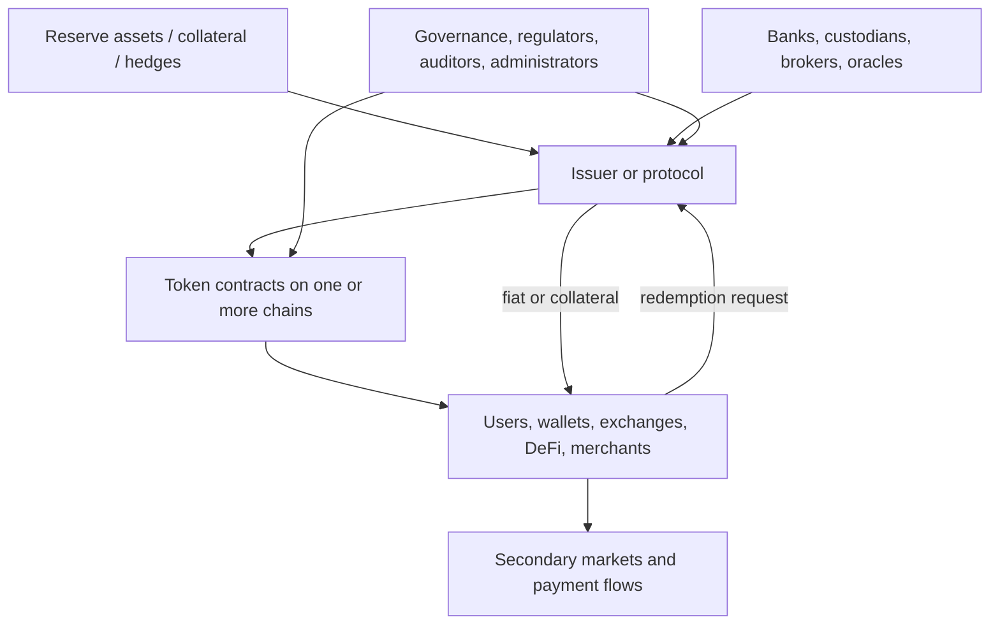
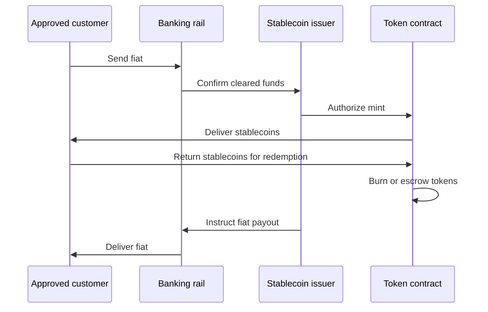
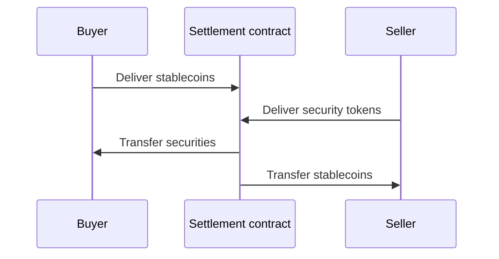
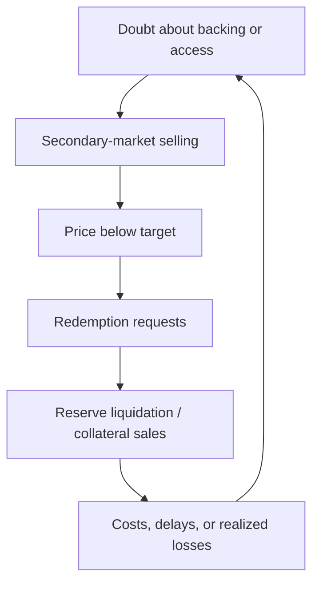

# Stablecoins: Money-Like Tokens, Issuance, Reserves, Mechanisms, and Risk

A stablecoin is a digital token designed to maintain a relatively stable value
against a reference. Most target one unit of a fiat currency, especially the US
dollar. Others reference euros, gold, baskets, consumer prices, or a unit
defined by a protocol.

The word *stable* describes an objective, not a guarantee. A token's market
price can diverge from its reference, redemption can be delayed, backing assets
can lose value, and the issuer or protocol can fail. Correct analysis begins
with the claim and stabilization mechanism:

- Who issues or creates the token?
- What does its holder legally and economically own?
- What assets or positions support it?
- Who can redeem, for what, at what price, and how quickly?
- Which arbitrageurs can act when the market price deviates?
- Who absorbs losses?
- Which contracts, chains, custodians, banks, and governance bodies are needed?

Stablecoins sit at the intersection of money, payments, funds, secured credit,
crypto trading, and software. Similar user interfaces can conceal very
different instruments.

## 1. What Makes a Token a Stablecoin?

### 1.1 Stability relative to what?

Stability is relative:

- **single-fiat reference:** one token targets one US dollar or euro;
- **commodity reference:** one token targets a weight of gold;
- **basket reference:** value tracks several currencies or assets;
- **crypto unit:** value tracks another digital asset;
- **purchasing-power target:** the system attempts to offset inflation; or
- **protocol unit of account:** a rule defines value without direct legal
  redemption.

A USD stablecoin may be stable in dollars but volatile in Swiss francs or in
real purchasing power. "Stable asset" is therefore less precise than
"USD-referenced token."

### 1.2 Price target, convertibility, and redemption

Three concepts are distinct:

- **target:** the intended reference price;
- **convertibility:** a mechanism exchanges the token for another asset;
- **redemption right:** a holder has an enforceable claim against an issuer or
  reserve.

An AMM can convert Token X near one dollar without the holder having any legal
right against an issuer. Conversely, a holder may have a legal redemption right
but be unable to exercise it immediately because of eligibility, banking hours,
minimums, sanctions review, or insolvency.

### 1.3 Stablecoin arrangement

The token contract is only one component:



A sound assessment includes issuance, reserve management, custody, transfer,
redemption, governance, compliance, technology, and distribution.

## 2. Who Can Issue Digital Money?

### 2.1 Private stablecoin issuers

A private company or other legally authorized entity can issue a reserve-backed
stablecoin, subject to applicable law. It receives money or eligible assets,
mints tokens, manages reserves, and promises redemption under contractual and
regulatory terms.

Examples include:

- Circle issuing USDC;
- Tether group entities issuing USDT;
- Paxos issuing Pax Dollar and issuing or providing infrastructure for
  branded tokens;
- PayPal USD issued by Paxos under its applicable structure; and
- regulated issuers of euro-denominated e-money tokens.

The brand visible to users may differ from the legal issuer. The legal terms,
regulatory authorization, reserve ownership, and redemption obligor determine
the claim.

### 2.2 Banks

A bank can issue:

- an ordinary deposit recorded on its internal ledger;
- a tokenized representation of a deposit;
- a stablecoin liability under a distinct legal regime; or
- a token used only for settlement among approved participants.

These are not automatically the same instrument. A tokenized deposit remains a
claim on a commercial bank and may be inside the deposit, prudential, and
resolution framework. A separately issued payment stablecoin may have
ring-fenced reserves and different insolvency treatment.

### 2.3 Decentralized protocols

A smart-contract system can create a stablecoin against collateral or other
positions. No single company necessarily promises fiat redemption. Examples
include DAI/USDS, GHO, LUSD/BOLD, and synthetic designs.

Calling issuance "decentralized" does not eliminate actors. Governance, oracle
providers, collateral issuers, keepers, front ends, developers, and legal
entities can remain material.

### 2.4 Central banks

Only a central bank or legally authorized monetary authority can issue a true
central bank digital currency. A CBDC is a liability of the central bank, like
cash or reserves in the relevant legal system. A privately issued token does not
become a CBDC because it uses central-bank money as backing.

The distinction is the issuer and liability:

| Instrument | Issuer / obligor | Typical backing or asset side |
|---|---|---|
| CBDC or reserves | Central bank | Central-bank balance sheet |
| Bank deposit / tokenized deposit | Commercial bank | Bank's loan and securities portfolio, liquidity, capital |
| Fiat-backed stablecoin | Authorized private issuer | Segregated or designated reserve assets |
| Crypto-backed stablecoin | Smart-contract protocol | Onchain collateral and protocol claims |
| Synthetic stablecoin | Protocol or issuer structure | Hedged positions, collateral, and counterparties |

## 3. Fiat-Backed Stablecoins

### 3.1 Issuance and redemption

The basic primary-market cycle is:



The stablecoin supply expands when tokens are minted and contracts when they are
burned. An onchain mint proves that the authorized minter created tokens; it
does not by itself prove that reserve funds arrived.

### 3.2 Primary and secondary markets

Direct issuer access may be limited to approved customers. Most retail holders
buy and sell through exchanges, brokers, wallets, or DEXs.

If a token trades at $1.01 and approved customers can mint at $1, they can mint
and sell, expanding supply. If it trades at $0.99 and they can redeem at $1,
they can buy and redeem, contracting supply.

Arbitrage is limited by:

- onboarding and eligibility;
- minimum transaction size;
- bank cutoffs and holidays;
- mint/redeem fees;
- blockchain confirmation and gas;
- sanctions or fraud review;
- issuer and bank capacity;
- transfer restrictions; and
- confidence that redemption will complete.

The market price can therefore move outside a narrow band during stress.

### 3.3 Reserve composition

Possible reserve assets include:

- cash and bank deposits;
- short-dated government bills;
- overnight reverse repos backed by government securities;
- government money-market fund shares;
- certificates of deposit or commercial paper;
- secured loans;
- precious metals;
- crypto assets; and
- other investments.

"100% backed" is incomplete. Ask:

1. backed by which assets?
2. valued how and at what date?
3. held by which legal entity and custodian?
4. segregated for whose benefit?
5. subject to which creditors or liens?
6. liquid within what time?
7. exposed to which currency, duration, and credit risks?

### 3.4 Reserve liquidity

If all holders redeem, reserves must be converted into payment cash. A simple
liquidity ladder separates:

- immediately available bank balances;
- same-day repo or money-market liquidity;
- short-dated securities that can be sold;
- assets requiring longer settlement;
- encumbered or lent assets; and
- illiquid or credit-impaired positions.

Even a solvent reserve can face a timing problem. Stablecoins trade continuously
while banks and securities settlement systems may not.

### 3.5 Duration and interest-rate risk

A short Treasury bill has low credit risk but is not identical to cash. Longer
fixed-rate securities lose market value when rates rise:

```text
approximate price change ≈ -duration × change in yield
```

An issuer that promises immediate redemption at par while holding long-duration
assets can face realized losses in a run. Regulations often limit reserve
duration and eligible assets for this reason.

### 3.6 Segregation and insolvency

Reserve assets can be:

- owned outright by the issuer;
- held in trust for token holders;
- held in custodial accounts for their benefit;
- placed in a bankruptcy-remote vehicle; or
- subject to a statutory safeguarding regime.

Marketing language is not a substitute for legal analysis. Determine whether
token holders have:

- a direct claim against the issuer;
- a beneficial interest in reserves;
- priority over general creditors;
- a right to redeem directly;
- or only a claim through an intermediary.

Bank deposits in the reserve create exposure to those banks. Deposit insurance,
if any, may apply to the issuer or account under specific limits rather than
separately to every token holder.

## 4. Reserve Reporting and Assurance

### 4.1 Transparency report

An issuer can publish reserve categories, counterparties, maturity bands,
circulation, mint/burn flows, and wallet addresses. This is management-provided
information unless independently verified.

### 4.2 Attestation versus audit

An **attestation** or assurance engagement tests specified management assertions
at a date or over a defined period. An **audit** of financial statements covers
a broader financial reporting framework, controls and disclosures, though it
also provides reasonable rather than absolute assurance.

Questions include:

- what entity and liabilities were covered?
- was the test point-in-time or period-wide?
- were assets independently confirmed?
- were encumbrances and related parties considered?
- what assurance standard and level applied?
- were internal controls tested?
- were subsequent events included?

A monthly snapshot can be accurate on the reporting date while missing
intra-month risk changes.

### 4.3 Proof of reserves

Onchain proof can show tokens held at identified addresses. Fiat reserves,
Treasury securities, liabilities, loans, and legal claims require external
evidence. A complete solvency view is:

```text
net reserve
= verified realizable reserve assets
- all stablecoin liabilities
- senior claims, liens, and expected costs
```

Asset proof without complete liabilities is not proof of solvency.

## 5. Crypto-Collateralized Stablecoins

### 5.1 Vault issuance

A user deposits volatile collateral and borrows newly created stablecoins:

```text
collateral value = $150
stablecoin debt  = $100
initial collateralization ratio = 150%
```

The protocol uses excess collateral, oracle prices, liquidation, debt ceilings,
and fees to protect the stablecoin.

Examples:

- Sky/Maker Vaults creating DAI or USDS;
- Aave markets and facilitators creating GHO;
- Liquity Troves creating LUSD or BOLD.

### 5.2 Stabilization mechanisms

Crypto-backed systems can combine:

- debt repayment and burning;
- stablecoin savings demand;
- stability or borrowing fees;
- redemption for collateral;
- Peg Stability Modules;
- direct arbitrage routes;
- governance incentives; and
- protocol-owned liquidity.

No single mechanism ensures both solvency and a tight peg. Overcollateralization
supports loss absorption; redemption or conversion supports price arbitrage;
liquidity makes the arbitrage executable.

### 5.3 Liquidation

If collateral falls below safety requirements, liquidators repay or burn debt
and acquire collateral. A buffer must cover:

- oracle delay;
- price movement;
- transaction inclusion;
- liquidation incentive;
- DEX slippage;
- gas; and
- collateral transfer risk.

During correlated crashes, collateral can fall faster than it can be sold.
Protocol reserves or governance capital may absorb residual bad debt.

### 5.4 Centralized collateral inside decentralized systems

A protocol can be decentralized at the smart-contract layer while holding USDC,
tokenized Treasuries, or real-world loans. It then inherits:

- issuer freeze and redemption powers;
- bank and custodian risk;
- sanctions and jurisdictional risk;
- legal enforcement;
- offchain valuation; and
- market-hours mismatch.

DAI's March 2023 depeg following USDC reserve uncertainty demonstrated this
transmission.

## 6. Synthetic and Delta-Hedged Stablecoins

A synthetic dollar aims to maintain dollar value through collateral and an
offsetting derivative rather than only cash reserves.

Example:

```text
long $100 of crypto backing
short $100 of crypto derivatives
approximate net price delta = 0
```

If the backing rises, the short loses; if it falls, the short gains. Ethena's
USDe is a prominent implementation using backing assets, derivatives hedges,
off-exchange custody arrangements, and stable assets.

Potential income includes:

- perpetual funding;
- dated-futures basis;
- staking rewards; and
- returns on stable reserve assets.

Risks include:

- funding turning negative;
- derivatives venue default;
- custodian and settlement-provider failure;
- margin calls and liquidation;
- hedge mismatch;
- collateral depeg;
- insufficient market capacity; and
- operational execution.

"Delta neutral" addresses first-order asset-price exposure. It does not address
counterparty, basis, liquidity, or legal risk.

## 7. Algorithmic and Reflexive Designs

### 7.1 Uncollateralized adjustment

Some systems attempt to stabilize price principally by changing supply,
incentivizing secondary tokens, or using bonds and seigniorage rather than
holding adequate external assets.

When price falls below target, the system must persuade someone to remove
stablecoins from circulation in exchange for a claim on future growth. If
confidence disappears, that claim loses value precisely when it is needed.

### 7.2 Reflexive absorber token

Suppose stablecoin `S` can be exchanged for $1 worth of governance token `G`:

```text
falling demand for S
→ S redeemed for newly issued G
→ G sold
→ G price falls
→ more G needed per redemption
→ confidence and liquidity fall further
```

TerraUSD (`UST`) and LUNA collapsed through this dynamic in May 2022. The system
had a conversion rule but not sufficient external capital to satisfy a
system-wide run.

### 7.3 Partially collateralized and hybrid designs

Hybrid systems combine collateral with algorithmic supply management. Analysis
should calculate the stressed value of external collateral and treat the
endogenous token conservatively. A token issued by the same system is not
independent capital.

## 8. Commodity-Backed Stable Tokens

Gold tokens such as PAX Gold or Tether Gold aim to represent allocated or
otherwise specified bullion. They are stable relative to a weight of gold, not
to dollars.

Questions include:

- exact quantity and purity per token;
- legal owner and custodian;
- allocated versus unallocated metal;
- vault location;
- inspection and assurance;
- physical and cash redemption minimums;
- storage and delivery fees;
- sanctions and eligibility; and
- treatment in custodian or issuer insolvency.

The token can trade away from net metal value when redemption is costly or
restricted.

## 9. Token Contracts and Administrative Control

### 9.1 Common functions

Fiat-backed stablecoin contracts often include:

- mint and burn;
- pause;
- blacklist or denylist;
- forced balance removal or freezing;
- ownership or role transfer;
- signature-based approvals;
- proxy upgrades; and
- chain-specific bridge functions.

These controls can respond to theft, sanctions, court orders, and contract
defects. They also create censorship, key-compromise, governance, and legal
risks.

### 9.2 Upgradeability

An upgradeable proxy preserves balances while changing logic. Verify:

- proxy administrator;
- implementation contract;
- governance and timelock;
- emergency process;
- storage compatibility;
- audit scope; and
- ability to exit before a change.

An issuer's published reserve policy says nothing about whether its mint key can
be compromised.

### 9.3 Mint and burn controls

Operational design should separate:

- customer approval;
- fiat settlement confirmation;
- mint instruction;
- onchain execution;
- reconciliation;
- redemption authorization; and
- token burning.

Daily reconciliation should connect bank/custodian records, issuer subledgers,
token supply on every chain, pending transfers, and bridge state.

## 10. Multi-Chain Issuance and Bridging

### 10.1 Native issuance

An issuer may deploy canonical contracts on several networks and manage supply
on each. Total liabilities are the sum across all native deployments.

Native versions can still differ in:

- contract features;
- administrator addresses;
- finality;
- token standards;
- blacklisting behavior;
- upgrade process; and
- local liquidity.

### 10.2 Wrapped stablecoins

A third-party bridge can lock a stablecoin on Chain A and mint a wrapped version
on Chain B. The holder then depends on:

```text
stablecoin issuer
+ original-chain security
+ bridge contracts and validators
+ destination-chain security
+ wrapper liquidity
```

A token symbol is not proof of canonical issuance. Wallets and applications
must verify contract addresses and bridge provenance.

### 10.3 Burn-and-mint transfer

Issuer-supported systems such as Circle's Cross-Chain Transfer Protocol can burn
native tokens on a source chain and mint native tokens on a destination after
an attestation. This avoids a pool of wrapped claims but adds attestation,
message, finality, and issuer infrastructure dependencies.

Cross-chain stablecoin risk is covered further in
[Blockchain Interoperability and Bridges](../../06-interoperability-privacy-and-enterprise-dlt/01-interoperability/blockchain-interoperability-and-bridges.md).

## 11. Stablecoin Uses

### 11.1 Crypto trading

Stablecoins serve as:

- quote currency;
- settlement asset;
- derivatives collateral;
- lending asset;
- AMM pair;
- treasury balance;
- bridge asset; and
- unit of account.

This makes a major stablecoin a systemically important dependency inside crypto
markets. A freeze or depeg affects exchanges, loans, derivatives, and liquidity
simultaneously.

### 11.2 Payments

Potential benefits:

- 24/7 transfer;
- programmable settlement;
- common asset across applications;
- global wallet reach;
- lower reconciliation between compatible systems; and
- atomic delivery-versus-payment.

The blockchain transaction is not the whole payment:

- payer must acquire tokens;
- merchant may need fiat;
- sanctions and fraud controls apply;
- refunds and disputes need processes;
- fees include gas, spreads, and conversion;
- privacy may be limited; and
- legal finality may differ from ledger finality.

### 11.3 Cross-border transfers

Stablecoins can replace parts of a correspondent chain with:

```text
local fiat → stablecoin → blockchain transfer → local fiat
```

This may reduce time and intermediaries where liquid on/off-ramps exist. Total
cost still includes both FX legs, compliance, liquidity, banking, taxes, and
local access. A dollar stablecoin can also increase dollarization in economies
where the domestic currency is weak.

### 11.4 DeFi

Stablecoins enable loans and trading without taking direct volatile-asset
exposure. But treating every stablecoin as one dollar in collateral or AMM
accounting creates contagion. Risk parameters should distinguish issuer,
reserve, chain, bridge, and liquidity.

### 11.5 Tokenized asset settlement

A stablecoin can provide the cash leg for tokenized securities:



Atomic delivery-versus-payment removes principal risk between the two legs only
if both tokens are valid claims and the transaction is legally final. It does
not remove issuer or asset risk.

## 12. Stablecoin Business Models

### 12.1 Reserve income

For reserve assets `R`, average asset yield `y`, and annual operating costs `C`:

```text
approximate pre-loss income = R × y - C
```

When rates rise, fiat-backed stablecoin issuers can earn substantial interest.
Token holders often receive no direct reserve yield. This creates a valuable
interest-free or low-cost liability for the issuer.

Revenue is sensitive to:

- circulation;
- interest rates;
- reserve composition;
- revenue sharing with distributors;
- custody and banking fees;
- compliance cost; and
- credit or market losses.

### 12.2 Distribution economics

Wallets, exchanges, and platforms may receive a share of reserve income or
rewards based on user balances. Coinbase's disclosed USDC economics illustrate
how distribution can be financially material.

Distribution incentives can improve adoption and also concentrate balances at
large intermediaries.

### 12.3 Protocol stablecoin economics

Crypto-backed issuers can earn:

- stability or borrow fees;
- liquidation fees;
- reserve and RWA income;
- PSM conversion fees;
- protocol allocation returns; and
- governance-token value.

They may pay savings rates or liquidity incentives. Sustainability requires
recurring asset income to cover savings expense, operations, and losses over
time.

## 13. Depegs and Runs

### 13.1 Depeg taxonomy

| Cause | Typical mechanism |
|---|---|
| Reserve doubt | Holders sell faster than authorized redeemers can contract supply |
| Bank/custodian failure | Reserve cash becomes inaccessible or uncertain |
| Collateral crash | Liquidation cannot realize enough value |
| Oracle failure | Protocol mints excess debt or liquidates incorrectly |
| Redemption restriction | Arbitrage boundary widens |
| Smart-contract exploit | Backing or mint authority is compromised |
| Bridge failure | Wrapped tokens become unbacked |
| Governance attack | Rules, reserves, or minting are changed |
| Reflexive run | Absorber token collapses as redemptions grow |
| Liquidity shock | Market price gaps despite ultimate solvency |

### 13.2 Above-peg trading

A premium can result from:

- urgent demand for exchange collateral;
- blocked banking rails;
- geographic capital controls;
- network-specific scarcity;
- delayed minting; or
- confidence differences among stablecoins.

Stability analysis should cover both sides.

### 13.3 Run dynamics



First-mover advantage intensifies a run if early redeemers receive par while
late holders bear losses. Par redemption, liquid reserves, capital, transparent
information, and credible supervision can reduce this incentive.

## 14. Stablecoins Compared with Other Money

| Dimension | Cash | Bank deposit | Fiat-backed stablecoin | Tokenized deposit | CBDC |
|---|---|---|---|---|---|
| Issuer | Central bank/state system | Commercial bank | Private stablecoin issuer | Commercial bank | Central bank |
| Holder's claim | Central-bank liability embodied in note | Claim on bank | Contract/statutory claim defined by arrangement | Deposit claim on issuing bank | Direct central-bank liability |
| Asset backing | Central-bank balance sheet | Bank assets and capital | Designated reserve assets | Bank assets and capital | Central-bank balance sheet |
| Deposit insurance | Not needed in same sense | Often eligible within limits | Generally not ordinary deposit insurance | Depends on legal treatment | Not needed in same sense |
| Transfer rail | Physical | Bank/payment systems | Blockchain and issuer controls | Permissioned or public token rail | CBDC platform |
| Programmability | Low | API/payment-rule dependent | Smart-contract composability | Bank-controlled programmability | Policy and architecture dependent |
| Credit risk | Sovereign/monetary | Bank credit, mitigated by regulation | Issuer, reserve, custodian | Bank credit | Central bank |
| Par conversion | Native unit | Supported by banking system | Depends on redemption | Deposit conversion and interbank settlement | Native unit |

### 14.1 E-money

In the EU, a token referencing one official currency generally falls into
MiCA's **e-money token** category and is subject to issuer, reserve, redemption,
governance, and other requirements. The exact legal classification varies by
jurisdiction.

### 14.2 Money-market funds

A government money-market fund owns a portfolio and issues fund shares with a
regulated investment claim. A stablecoin may hold such a fund in reserve but
the stablecoin holder does not automatically become a shareholder in that fund.
The issuer and legal structure stand between them.

## 15. Regulation

Stablecoin rules focus on the gap between a token that trades near par and a
claim that can reliably be redeemed at par. Authorization governs who may make
that promise; reserve, segregation, liquidity, and capital rules govern whether
it can be honored through stress; conduct and disclosure rules govern how users
understand it. Different regimes allocate these functions differently, so the
issuer's legal category matters as much as the token technology.

Stablecoin regulation generally addresses:

- permitted issuers;
- authorization and supervision;
- eligible reserve assets;
- one-to-one backing;
- segregation and custody;
- redemption at par;
- capital and liquidity;
- risk management and recovery;
- disclosure and assurance;
- AML/CFT and sanctions;
- technology and operational resilience; and
- cross-border recognition.

As of July 2026:

- the EU's MiCA framework distinguishes e-money tokens referencing a single
  official currency from asset-referenced tokens and imposes issuer and reserve
  rules;
- the US GENIUS Act became Public Law 119-27 in July 2025 and established a
  federal/state framework for permitted payment-stablecoin issuers, one-to-one
  eligible reserves, redemption policy, monthly disclosure, and supervision;
  and
- FSB monitoring found that global implementation of its stablecoin
  recommendations remained uneven as of 2025.

Regulatory detail is jurisdiction-specific and changes. See
[Digital-Asset Regulation](../../07-compliance-analytics-regulation-and-security/02-regulation/digital-asset-regulation.md)
for the broader framework.

## 16. Issuer and Protocol Examples

### USDT

USDT is issued by Tether entities on multiple chains and is the longest-running
large dollar stablecoin. Tether publishes circulation data and quarterly
reserve reports with independent assurance. Analysis should distinguish each
issuing entity and terms, reserve categories, direct-redemption eligibility,
chain contract, and regulatory accessibility.

### USDC

USDC is issued by Circle affiliates. Circle states that reserves consist of
highly liquid cash and cash-equivalent assets, with a majority held through the
Circle Reserve Fund, a government money-market fund managed by BlackRock, plus
bank deposits and related eligible instruments. Circle publishes frequent
reserve disclosure and monthly assurance. Direct Circle Mint access is not the
same as retail secondary-market access.

### DAI and USDS

DAI and USDS are liabilities of the Sky protocol's broader onchain balance
sheet. They are connected through a fee-free 1:1 converter. Backing includes
Vault debt, stablecoin reserve mechanisms, real-world assets, and protocol
allocations. Their risk differs from a simple one-for-one cash reserve.

### GHO

GHO is Aave's protocol stablecoin. Approved facilitators can create and burn GHO
within governance-set buckets. Borrowing through Aave is a principal issuance
route. The facilitator model distributes mint capability while governance
controls limits and rates.

### LUSD and BOLD

Liquity V1 creates ETH-backed LUSD. Liquity V2 creates multi-branch BOLD against
ETH, wstETH, and rETH, with borrower-set interest, Stability Pools, liquidations,
and redemptions. The contracts emphasize immutability and limited governance.

### USDe

Ethena's USDe packages a delta-hedged strategy with backing assets, derivative
shorts, custodial arrangements, and protocol operations. It should be analyzed
as a synthetic dollar rather than assumed equivalent to cash-reserve tokens.

Detailed profiles are in
[Stablecoin Issuers and Protocols](stablecoin-issuers-and-protocols.md).

## 17. Due-Diligence Framework

### Claim and issuer

- Identify the exact legal issuer and terms.
- Determine who may redeem and whether the right passes to all holders.
- Analyze insolvency priority and reserve segregation.

### Reserves and collateral

- Reconcile circulation with liabilities.
- Examine asset composition, maturity, currency, credit, and liquidity.
- Identify custodians, banks, liens, and concentration.
- Stress market values and redemption timing.

### Mechanism

- Document mint, burn, redemption, liquidation, and peg arbitrage.
- Identify caps, fees, queues, and market makers.
- Model what happens when every holder tries to exit.

### Technology

- Verify contracts on each chain.
- Identify upgrade, pause, blacklist, and mint authority.
- Map bridges, oracles, and cross-chain attestation.
- Match audits to deployed versions.

### Operations and compliance

- Review key management, reconciliations, incident response, and business
  continuity.
- Understand sanctions, fraud, and transaction-monitoring controls.
- Determine which activities or addresses can be frozen.

### Economics

- Identify the issuer's revenue and expense.
- Separate reserve yield from token-holder yield.
- Test sensitivity to rates, circulation, rewards, and distribution partners.

### Market

- Measure primary redemption capacity and secondary liquidity.
- Analyze concentration by chain, venue, wallet, and DeFi protocol.
- Do not treat exchange price or market capitalization as reserve evidence.

## 18. Core Lessons

1. A stablecoin is a liability or protocol claim, not a dollar merely because it
   trades near one.
2. Stability depends on both solvency and executable liquidity.
3. Redemption rights and access determine the arbitrage boundary.
4. Reserve quality includes legal ownership, custody, maturity, and
   encumbrance—not only asset names.
5. Crypto-backed and synthetic designs exchange issuer reserve risk for
   collateral, oracle, liquidation, derivatives, and governance risk.
6. A decentralized token can contain centralized collateral and controls.
7. Multi-chain distribution multiplies contracts and bridge dependencies.
8. Onchain transparency cannot prove offchain reserves without external
   assurance.
9. Yield must come from borrowers, reserve assets, derivatives counterparties,
   incentives, or risk taking.
10. The correct comparison with deposits and CBDCs begins with the issuer and
    legal claim.

## Related Notes

- [Money, Banking, and Balance Sheets](../../01-financial-foundations/01-money-banking-and-payments/money-banking-and-balance-sheets.md)
- [Payments, Clearing, and Settlement](../../01-financial-foundations/01-money-banking-and-payments/payments-clearing-and-settlement.md)
- [Maker, Sky, and Spark](../../04-decentralized-finance/02-onchain-lending/sky-maker-spark.md)
- [Central Bank Digital Currencies](../02-cbdcs-and-bank-money/central-bank-digital-currencies.md)
- [Tokenized Deposits and Commercial Bank Money](../02-cbdcs-and-bank-money/tokenized-deposits-and-commercial-bank-money.md)
- [DeFi Risk, Security, and Economic Attacks](../../04-decentralized-finance/04-defi-risk-and-failures/defi-risk-security-and-economic-attacks.md)

## References

- Financial Stability Board, [High-level Recommendations for Global Stablecoin Arrangements](https://www.fsb.org/2023/07/high-level-recommendations-for-the-regulation-supervision-and-oversight-of-global-stablecoin-arrangements-final-report/)
- Financial Stability Board, [Global Regulatory Framework for Crypto-asset Activities](https://www.fsb.org/2023/07/fsb-global-regulatory-framework-for-crypto-asset-activities/)
- Financial Stability Board, [2025 thematic review of framework implementation](https://www.fsb.org/2025/10/fsb-finds-significant-gaps-and-inconsistencies-in-implementation-of-crypto-and-stablecoin-recommendations/)
- CPMI-IOSCO, [Application of the Principles for Financial Market Infrastructures to stablecoin arrangements](https://www.bis.org/cpmi/publ/d206.htm)
- BIS, [Stablecoins: risks, potential and regulation](https://www.bis.org/publ/work905.htm)
- BIS, [Stablecoins: framing the debate](https://www.bis.org/speeches/sp260420.htm)
- Circle, [USDC transparency and reserve disclosures](https://www.circle.com/transparency)
- Circle, [What is USDC?](https://developers.circle.com/stablecoins/what-is-usdc)
- Circle, [Cross-Chain Transfer Protocol](https://developers.circle.com/cctp)
- Tether, [Transparency and reserve reports](https://tether.to/transparency/)
- Tether, [Legal terms](https://tether.to/legal/)
- Paxos, [Stablecoin transparency](https://www.paxos.com/transparency)
- Sky Protocol, [USDS](https://developers.skyeco.com/protocol/tokens/usds/)
- Sky Protocol, [Vat core accounting](https://developers.skyeco.com/protocol/core/vat/)
- Aave, [GHO documentation](https://aave.com/docs/developers/gho)
- Liquity, [Liquity V2 documentation](https://docs.liquity.org/)
- Ethena, [USDe overview](https://docs.ethena.fi/solution-overview/usde-overview)
- European Union, [Regulation (EU) 2023/1114 on Markets in Crypto-assets](https://eur-lex.europa.eu/legal-content/EN/TXT/?uri=CELEX:32023R1114)
- US Congress, [S.1582, GENIUS Act, Public Law 119-27](https://www.congress.gov/bill/119th-congress/senate-bill/1582)
- President's Working Group on Financial Markets, FDIC and OCC, [Report on Stablecoins](https://home.treasury.gov/system/files/136/StableCoinReport_Nov1_508.pdf)
- Terra Research Forum, [Terra Ecosystem Revival Plan and historical governance record](https://agora.terra.money/)
- Circle, [Update on USDC and Silicon Valley Bank](https://www.circle.com/blog/an-update-on-usdc-and-silicon-valley-bank)
