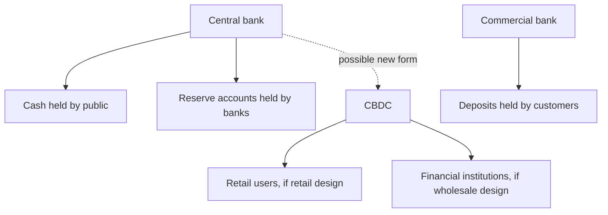
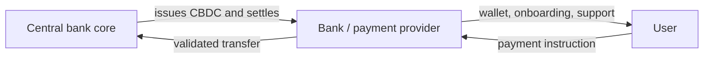
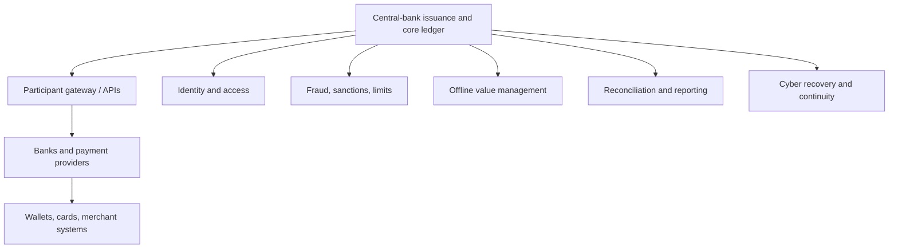
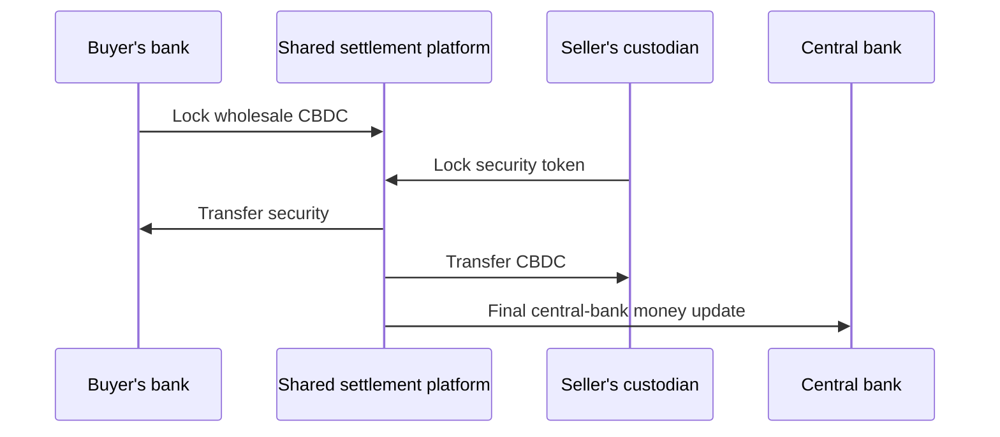

# Central Bank Digital Currencies

A central bank digital currency (CBDC) is a digital liability of a central bank,
denominated in the sovereign unit of account. It is a new form of central bank
money, distinct from physical cash and usually distinct from the reserve
accounts already available to banks and selected financial institutions.

The defining feature is the issuer, not the technology. A token on a blockchain
is not a CBDC unless the central bank is legally the obligor. A commercial bank
deposit backed by central-bank reserves remains commercial-bank money. A
privately issued stablecoin remains a private liability. A CBDC could use
distributed ledger technology, a centralized database, hardware tokens, or a
combination.

CBDC design is public infrastructure and monetary policy, not merely a software
project. Decisions about access, privacy, intermediaries, holding limits,
offline use, remuneration, and legal tender determine how it affects banks,
payments, financial inclusion, and state power.

## 1. Central Bank Money

### 1.1 Existing forms

Central banks already issue:

- **banknotes and coins** or coordinate coin issuance: physical bearer money
  available to the public; and
- **reserve and settlement balances:** electronic accounts available mainly to
  banks, governments, and eligible financial institutions.

Retail users normally hold commercial-bank deposits, not direct electronic
central-bank claims.



### 1.2 Liability hierarchy

| Money form | Issuer | Principal credit exposure |
|---|---|---|
| Cash | Central bank/state monetary system | Sovereign/central-bank |
| Reserve balance | Central bank | Central-bank |
| Retail CBDC | Central bank | Central-bank |
| Commercial-bank deposit | Commercial bank | Bank, mitigated by regulation, capital, liquidity and insurance |
| Tokenized deposit | Commercial bank | Bank |
| Stablecoin | Private issuer or protocol | Issuer/reserve or protocol/collateral |

CBDC gives holders a direct central-bank claim. It does not require a reserve
portfolio segregated one-for-one in the stablecoin sense; it is supported by
the central bank's balance sheet and legal/monetary framework.

## 2. Retail and Wholesale CBDCs

### 2.1 Retail CBDC

A retail CBDC is available to households and businesses for ordinary payments
and potentially as a store of value. It may complement cash and deposits.

Possible uses:

- person-to-person transfer;
- point-of-sale and online payments;
- government disbursements;
- remittances;
- emergency or offline payments;
- programmable or conditional payment services; and
- access to public digital money without a bank deposit.

Retail scale creates demanding requirements for throughput, privacy, fraud
management, customer support, inclusion, device recovery, and cyber resilience.

### 2.2 Wholesale CBDC

A wholesale CBDC is restricted to financial institutions or market
participants. It can be used for:

- interbank settlement;
- securities delivery-versus-payment;
- foreign-exchange payment-versus-payment;
- collateral and repo settlement;
- tokenized asset platforms; and
- cross-border institutional payments.

Wholesale central-bank money already exists as reserves. A wholesale CBDC is
valuable only if its new representation, access, operating hours, or
programmability improves existing infrastructure.

### 2.3 The access spectrum

CBDC is not binary:

```text
central-bank reserves
→ expanded reserve access
→ wholesale CBDC on a programmable platform
→ intermediated retail CBDC
→ direct retail CBDC accounts or tokens
```

Each step changes participants, operations, and risk.

## 3. Issuance and Distribution Models

### 3.1 Direct model

The central bank onboards users, maintains accounts or wallets, processes
payments, handles support, and performs compliance.

Advantages:

- direct control over service and ledger;
- no intermediary credit exposure in the user relationship;
- unified implementation.

Disadvantages:

- enormous operational and customer-service role;
- identity, fraud, and dispute-management burden;
- concentration of sensitive data;
- competition with private payment providers and banks; and
- single-platform cyber importance.

### 3.2 Intermediated or two-tier model

The central bank issues CBDC and maintains the core ledger or liability, while
banks and payment service providers:

- onboard users;
- perform KYC and account recovery;
- provide wallets and interfaces;
- screen transactions;
- offer merchant services; and
- submit transactions to the core system.



The user can hold a central-bank claim while interacting through a private
intermediary. The architecture must ensure an intermediary failure does not
erase or trap the claim.

### 3.3 Hybrid model

Intermediaries maintain customer-facing records and transaction services, while
the central bank retains a backup or periodic record sufficient to honor claims
if an intermediary fails. The term *hybrid* is used inconsistently; the actual
ledger and recovery design matter.

### 3.4 Synthetic CBDC

A synthetic CBDC is normally a private issuer's liability fully backed by
central-bank reserves, with supervision and redemption. Because the central
bank is not the direct obligor to the end holder, it is economically closer to
e-money or a narrow-bank stablecoin than a true CBDC.

## 4. Account-Based and Token-Based Designs

### 4.1 Account-based

The system asks:

```text
Is this actor authorized to instruct the account?
```

Ownership is established through identity, account records, and authentication.
Recovery is comparatively straightforward. Privacy depends on who can access
the account and transaction data.

### 4.2 Token-based

The system asks:

```text
Is this digital object genuine, unspent, and controlled by the presenter?
```

Authorization may use keys, secure hardware, or bearer-like credentials.
Token-based does not mean anonymous or necessarily blockchain-based. Tokens can
still be registered, traceable, and recoverable.

### 4.3 Hybrid representation

A retail system can use token-like local wallets for offline transactions while
reconciling to an account-based core. Labels are less useful than explicit
answers about:

- identity;
- ownership proof;
- ledger location;
- duplicate-spend prevention;
- loss recovery;
- traceability; and
- legal finality.

## 5. Why Consider a CBDC?

### 5.1 Preserve access to public money

As cash use declines, households may transact almost entirely in private bank
and platform money. A retail CBDC can preserve a public, risk-free monetary
option in digital commerce and support confidence that different forms of money
remain exchangeable at par.

### 5.2 Competition and resilience

A public rail can:

- create common acceptance;
- reduce dependence on a few card or wallet providers;
- provide a fallback payment method;
- establish interoperability standards; and
- allow private services to compete above a common settlement layer.

It can also crowd out private innovation if interfaces, pricing, or access are
poorly designed.

### 5.3 Payment efficiency

Potential improvements include:

- continuous settlement;
- lower reconciliation;
- direct central-bank finality;
- programmable DvP/PvP;
- fewer correspondent layers; and
- standardized APIs.

Existing instant-payment systems may deliver many of these benefits without a
new money form. The relevant comparison is CBDC versus achievable improvements
to current rails.

### 5.4 Financial inclusion

A CBDC may help people without bank accounts if it offers:

- low-cost wallets;
- simple onboarding;
- feature-phone, card, or offline access;
- agents for cash conversion;
- accessible design;
- low transaction minimums; and
- broad merchant acceptance.

A smartphone-only system tied to an existing bank account can reproduce
exclusion.

### 5.5 Monetary sovereignty

Authorities may respond to:

- domestic dependence on foreign payment networks;
- widespread foreign-currency stablecoins;
- declining cash;
- private platform money;
- cross-border dollarization; and
- competition from another country's CBDC.

Sovereignty arguments must still be balanced against user choice, efficiency,
and cross-border interoperability.

## 6. Financial Stability and Bank Funding

### 6.1 Deposit substitution

Households may move deposits into CBDC:

```text
customer deposit decreases
→ bank needs reserves to fund CBDC conversion
→ bank replaces funding, sells assets, or reduces lending
```

If CBDC becomes a large store of value, banks can lose a stable source of
funding. They may replace it with wholesale funding at higher or more volatile
cost.

### 6.2 Run acceleration

During concern about a bank, users could move deposits into risk-free CBDC
quickly and at scale. Digital transfers already enable fast runs into other
banks or money-market funds, but CBDC may provide a uniquely direct safe asset.

Controls can include:

- individual holding limits;
- non-remuneration;
- tiered negative or unattractive rates above a threshold;
- conversion limits during exceptional conditions;
- delayed large transfers;
- intermediated liquidity arrangements; and
- central-bank lending facilities for banks.

Restrictions protect bank funding but make CBDC less cash-like.

### 6.3 Balance-sheet example

Before conversion:

| Commercial bank assets | Commercial bank liabilities |
|---|---|
| Reserves: 20 | Customer deposits: 100 |
| Loans/securities: 90 | Other funding: 5 |
| | Equity: 5 |

If customers convert 10 of deposits to CBDC:

| Commercial bank assets | Commercial bank liabilities |
|---|---|
| Reserves: 10 | Customer deposits: 90 |
| Loans/securities: 90 | Other funding: 5 |
| | Equity: 5 |

The central bank reduces the bank's reserves and issues 10 of CBDC. If
conversions exceed liquid reserves, the bank needs asset sales, borrowing, or
central-bank liquidity.

## 7. Monetary Policy

### 7.1 Non-interest-bearing CBDC

A non-remunerated CBDC resembles cash. It provides a floor alternative to
deposits but may be less attractive as a savings asset when rates are positive.

### 7.2 Interest-bearing CBDC

An interest-bearing CBDC can transmit policy rates directly to holders. It can
also compete strongly with deposits, enlarge the central-bank balance sheet,
and change credit allocation.

Tiered remuneration could apply:

```text
balance up to threshold → 0% or policy-linked rate
balance above threshold → lower or negative rate
```

This requires account or identity linkage across wallets to prevent users from
evading thresholds by opening many accounts.

### 7.3 Negative rates and public trust

CBDC could technically support negative rates more directly than cash. If cash
remains available, users can switch to banknotes. Restricting cash to enforce
negative rates would be a political and social choice, not an inherent CBDC
feature.

### 7.4 Helicopter money and fiscal transfers

Governments could distribute benefits through CBDC wallets. The fiscal
authority still needs legal appropriation, eligibility rules, and funding.
CBDC makes delivery possible; it does not decide or finance the policy.

## 8. Privacy, Data, and Surveillance

### 8.1 Cash benchmark

Cash provides strong transaction privacy for ordinary face-to-face use.
Electronic payments generate records at banks, merchants, processors, telecom
providers, and devices. CBDC privacy should be compared with both.

### 8.2 Data layers

A CBDC does not create one monolithic database by necessity. Identity evidence
may remain with an intermediary, the core ledger may record only pseudonymous
account or token identifiers, and analytics systems may receive selected event
data. Separating these layers reduces unnecessary access, but requires reliable
linkage and a lawful process for investigation, correction, and customer support.

Potential data include:

- identity and onboarding;
- wallet identifiers;
- transaction amount and time;
- payer and payee;
- merchant category;
- location and device;
- compliance alerts; and
- recovery history.

Ask who can see each field:

- central bank;
- intermediary;
- merchant;
- law enforcement;
- tax authority;
- technology vendor;
- analytics provider; or
- counterparty.

### 8.3 Privacy models

Possible designs:

- central bank sees all identified transactions;
- intermediaries see customers, central bank sees pseudonymous settlement;
- data is split among parties;
- small transactions receive simplified due diligence;
- offline transfers disclose only upon later reconciliation;
- cryptographic proofs demonstrate compliance without revealing full data; or
- legal and technical controls require warrants or dual authorization.

Privacy is institutional as well as cryptographic. A system can encrypt data
yet permit one authority to decrypt everything.

### 8.4 AML/CFT

Retail CBDC must address customer due diligence, sanctions, suspicious
transactions, fraud, and law-enforcement access. Tiered wallets can apply lower
limits to simplified onboarding.

Perfect cash-like anonymity conflicts with certain compliance objectives.
Perfect traceability can chill legitimate activity and create abuse risk. The
balance requires legislation, proportionality, minimization, security,
transparency, and independent oversight.

## 9. Programmability

### 9.1 Programmable money versus programmable payments

**Programmable money** embeds conditions in the currency itself, potentially
restricting who can hold it, where it can be spent, or when it expires.

**Programmable payments** keep money fungible but let users or applications
instruct conditional transfers:

- escrow;
- pay-on-delivery;
- recurring payment;
- DvP;
- tax split;
- spending controls chosen by the user.

The distinction matters for fungibility and public trust.

### 9.2 Risks of issuer-level conditions

- money ceases to be universally fungible;
- policy errors can freeze legitimate funds;
- state or vendors gain granular control;
- merchants need complex rule evaluation;
- offline use becomes difficult;
- discrimination and exclusion can be automated; and
- cyber compromise can affect national payments.

Many central-bank projects emphasize conditional payments provided by
intermediaries rather than arbitrary central-bank restrictions on every unit.

## 10. Offline CBDC

### 10.1 Objectives

Offline payment can improve:

- resilience during network outages;
- inclusion in remote areas;
- disaster and conflict response;
- privacy for small payments; and
- cash-like immediacy.

### 10.2 Double-spend problem

If two devices cannot contact the ledger, a malicious holder might spend the
same balance twice. Controls include:

- tamper-resistant secure elements;
- limited offline balances;
- transaction counters;
- short offline duration;
- risk allocation to wallet providers;
- deferred detection and penalties;
- device-to-device cryptographic protocols; and
- periodic online reconciliation.

Offline CBDC usually provides bounded rather than unlimited finality.

### 10.3 Loss and recovery

Cash-like bearer privacy can mean lost devices cause lost money. Account-linked
recovery reduces loss but creates identity and traceability. A system can offer
several wallet tiers with different trade-offs.

## 11. Technology Architecture

### 11.1 Centralized ledger

A conventional replicated database can provide:

- high throughput;
- mature access control;
- deterministic administration;
- operational familiarity; and
- clear central-bank authority.

Because the central bank is the trusted issuer, a public permissionless
consensus mechanism may add little.

### 11.2 Permissioned DLT

A permissioned ledger can distribute validation among the central bank, banks,
or public institutions. Potential benefits include shared state, programmable
assets, resilience, and integration with tokenized markets.

Costs include consensus complexity, data replication, governance, privacy, and
vendor interoperability. A permissioned DLT is not decentralized in the same
sense as Bitcoin or Ethereum.

### 11.3 Public blockchain issuance

A central bank could issue on a public chain, but would inherit:

- public fees and congestion;
- validator and protocol governance;
- transparent metadata;
- smart-contract and bridge risk;
- forks and finality policy;
- global unrestricted composability; and
- difficulty enforcing platform-level rules.

It might instead use a controlled token platform interoperable with public
networks through regulated gateways.

### 11.4 Core components



The system must operate at national critical-infrastructure standards.

## 12. Legal Foundations

Legislation may need to establish:

- central-bank authority to issue;
- legal-tender status;
- nature of the holder's property or claim;
- finality of transfers;
- intermediary roles;
- privacy and lawful access;
- AML/CFT obligations;
- liability for unauthorized or offline payments;
- insolvency treatment;
- holding and remuneration powers;
- counterfeit and cyber offenses; and
- cross-border use.

A pilot token used by staff may not yet be legal-tender CBDC. The ECB's planned
digital euro pilot explicitly distinguishes its beta instrument from an issued
digital euro pending legislation and a final issuance decision.

## 13. Wholesale Settlement and Tokenized Markets

### 13.1 Delivery-versus-payment

Tokenized securities require a cash leg. Wholesale CBDC can enable:



Atomic exchange can reduce principal risk, but legal ownership, finality, failed
transactions, liquidity, and operational recovery still require rules.

### 13.2 Three cash-leg models

1. **Wholesale CBDC on the asset platform:** central-bank liability is native to
   the programmable ledger.
2. **Synchronized conventional RTGS:** a trigger coordinates an asset-ledger
   transfer with reserve-account settlement.
3. **Private settlement token:** commercial bank or private token settles on
   platform and converts to reserves elsewhere.

Each offers different central-bank credit, liquidity, and integration.

### 13.3 Intraday liquidity

Atomic gross settlement can increase liquidity needs relative to netting.
Participants may need:

- intraday central-bank credit;
- collateral mobility;
- queuing and liquidity-saving mechanisms;
- netting windows;
- interoperability with RTGS; and
- automated liquidity management.

Faster technology does not create settlement liquidity.

## 14. Cross-Border CBDCs

### 14.1 Current frictions

Cross-border payments involve:

- incompatible systems;
- correspondent banking;
- FX conversion;
- different operating hours;
- compliance duplication;
- trapped liquidity; and
- legal uncertainty.

CBDCs can improve messaging and settlement only if jurisdictions coordinate
access, FX, compliance, and legal rules.

### 14.2 Models

- **compatible domestic systems:** common standards, separate ledgers;
- **interlinked systems:** technical gateways exchange messages and value;
- **single multi-CBDC platform:** several central banks issue on shared
  infrastructure;
- **foreign access:** nonresidents or foreign institutions hold domestic CBDC;
- **corridor arrangement:** limited participants and currencies.

### 14.3 Payment-versus-payment

PvP makes two currency transfers conditional:

```text
transfer Currency A if and only if transfer Currency B
```

This reduces FX principal risk. It does not eliminate market, liquidity,
counterparty-onboarding, sanctions, or operational risk.

### 14.4 Policy concerns

A foreign CBDC can improve cross-border settlement while changing monetary and
political dependencies. If residents substitute into a foreign digital currency,
the domestic banking system can lose deposits and the central bank can lose
monetary control. The platform may also expose transactions to another
jurisdiction's access, sanctions, and operational rules.

- currency substitution and dollarization;
- capital flow controls;
- sanctions;
- foreign central-bank dependence;
- data sovereignty;
- emergency powers;
- exchange-rate and monetary policy; and
- conflict of laws.

## 15. CBDC Compared with Fast Payments and Stablecoins

### 15.1 Fast-payment system

FedNow, TIPS, UPI, Pix, and similar services transfer commercial-bank money and
settle between institutions in central-bank money. They are payment rails, not
new currencies.

| Question | Fast payment | Retail CBDC |
|---|---|---|
| Customer asset | Bank deposit | Central-bank liability |
| Customer credit risk | Commercial bank | Central bank |
| Intermediary | Bank/payment provider | Design-dependent |
| New money form | No | Yes |
| Offline bearer possibility | Limited/design-specific | Potential design goal |

### 15.2 Stablecoin

Stablecoins can operate globally on public networks and integrate with smart
contracts. CBDCs have sovereign backing and public-policy governance.

| Dimension | Private fiat stablecoin | CBDC |
|---|---|---|
| Issuer | Private legal entity | Central bank |
| Backing | Reserve portfolio | Central-bank balance sheet |
| Profit motive | Reserve income/services | Public-policy mandate |
| Redemption | Issuer terms and law | Conversion within monetary system |
| Network | Often public blockchain | Any chosen architecture |
| Control | Issuer and regulator | Central bank and legislation |
| Global availability | Potentially broad | Policy-restricted |

### 15.3 Tokenized deposit

A tokenized deposit can provide programmable bank money without shifting credit
intermediation to the central bank. It remains a claim on one bank and needs
interbank settlement to preserve par.

## 16. Real-World Programs

### 16.1 Sand Dollar, Bahamas

The Central Bank of The Bahamas began national release of the Sand Dollar in
October 2020. Authorized financial institutions and payment providers
distribute wallets. Objectives include inclusion and resilient payments across
an island geography. Offline capability and merchant adoption remain important
practical dimensions.

### 16.2 eNaira, Nigeria

The Central Bank of Nigeria launched the eNaira as legal tender and a direct
central-bank liability. The experience highlights that issuance does not ensure
adoption. Wallet usability, identity, merchant acceptance, existing payment
alternatives, trust, and policy context determine use.

### 16.3 e-CNY, China

The People's Bank of China has conducted large-scale e-CNY pilots through a
two-tier operating model. e-CNY is positioned as a digital form of central-bank
money in circulation, distributed through authorized operators. Features have
included tiered wallets, controllable anonymity, offline exploration, and
integration with retail payment services.

It should not be conflated with balances in Alipay or WeChat Pay, which are
private payment arrangements backed by commercial-bank money.

### 16.4 Digital rupee, India

The Reserve Bank of India runs retail and wholesale digital-rupee pilots. RBI
states that e₹ is legal tender and its liability. Retail wallets are provided
through participating banks and nonbanks, support person and merchant payments,
and interoperate with UPI QR codes. Wholesale pilots began with government
securities settlement and have expanded use-case experimentation.

### 16.5 Digital euro

The Eurosystem completed its preparation phase in October 2025 and continues
technical readiness and legislative support. As of July 2026:

- no final issuance decision has been made;
- the ECB states that issuance would be considered only after legislation;
- 36 payment service providers were selected for a pilot;
- the operational pilot is planned for the second half of 2027 for 12 months;
  and
- the Eurosystem aims to be technically ready for potential first issuance in
  2029 if legislation is adopted in 2026.

The proposed design emphasizes intermediated access, online and offline
payment, privacy, broad acceptance, and coexistence with cash.

### 16.6 United States

The Federal Reserve states that it has made no decision to issue a CBDC and
would proceed only with authorizing law. FedNow is an instant-payment service
for participating financial institutions, not a CBDC.

## 17. Adoption and Network Effects

A CBDC can be technically successful and economically unused. Adoption depends
on:

- a problem users recognize;
- acceptance by merchants;
- distribution through trusted providers;
- interoperability with existing QR, card, and bank systems;
- privacy confidence;
- fees;
- reliable offline and recovery functions;
- incentives and government use;
- ease of conversion; and
- competition from cash, deposits, and mobile money.

Mandating use can raise adoption statistics while harming trust or choice. A
sound evaluation distinguishes transaction count, active users, stored
balances, merchant acceptance, and unique use cases.

## 18. Cyber and Operational Resilience

CBDC is critical national infrastructure. Threats include:

- core ledger compromise;
- counterfeit creation;
- mass account takeover;
- intermediary and wallet breaches;
- denial of service;
- supply-chain attacks;
- insider abuse;
- privacy database theft;
- offline double spend;
- cryptographic obsolescence; and
- destructive data corruption.

Controls require:

- layered architecture and least privilege;
- hardware-backed key management;
- independent reconciliation of total issuance;
- geographic and technology diversity;
- offline recovery and immutable logs;
- continuous red-team testing;
- vendor exit plans;
- transaction and velocity limits;
- coordinated incident response; and
- tested degraded modes.

A centralized ledger can be resilient through replication; a DLT can be fragile
if all validators share one operator or software defect.

## 19. Decision Framework

A central bank should begin with objectives:

1. What problem cannot be solved adequately by cash, fast payments, regulation,
   or upgraded reserves?
2. Who needs a direct central-bank claim?
3. Is the use retail, wholesale, or both?
4. What bank-funding and monetary-policy effects are acceptable?
5. What level of privacy is legally and socially required?
6. Which intermediaries should compete?
7. What happens offline and during national outages?
8. How are fraud, mistakes, and lost devices resolved?
9. Is programmability at money or payment level?
10. How will foreign access and FX work?

Then select architecture. Beginning with "blockchain or database?" reverses the
proper order.

## 20. Core Lessons

1. A CBDC is defined by a direct central-bank liability, not by blockchain.
2. Retail and wholesale CBDCs solve different problems.
3. Intermediation can preserve private-sector competition while the central
   bank remains the issuer.
4. Privacy depends on institutions, law, data architecture, and cryptography.
5. Holding limits and non-remuneration reduce bank disintermediation but reduce
   usefulness.
6. Offline payments require bounded risk and later reconciliation.
7. Programmable payments need not make the currency itself conditional.
8. A wholesale CBDC must improve on reserves and RTGS, not merely rename them.
9. Cross-border benefit requires policy and legal coordination as much as
   technical interoperability.
10. Pilots, prototypes, and issued legal tender are distinct stages.

## Related Notes

- [Money, Banking, and Balance Sheets](../../01-financial-foundations/01-money-banking-and-payments/money-banking-and-balance-sheets.md)
- [Payments, Clearing, and Settlement](../../01-financial-foundations/01-money-banking-and-payments/payments-clearing-and-settlement.md)
- [Cross-Border Payments and FX](../../01-financial-foundations/01-money-banking-and-payments/cross-border-payments-and-fx.md)
- [Stablecoins](../01-stablecoins/stablecoins.md)
- [Tokenized Deposits and Commercial Bank Money](tokenized-deposits-and-commercial-bank-money.md)
- [Tokenization of Securities, Funds, and Real-World Assets](../03-tokenized-assets/tokenization-of-securities-funds-and-real-world-assets.md)

## References

- BIS Committee on Payments and Market Infrastructures and Markets Committee, [Central bank digital currencies](https://www.bis.org/cpmi/publ/d174.htm)
- BIS, [Central bank digital currency survey and crypto work](https://www.bis.org/publ/bppdf/bispap159.pdf)
- BIS, [Central bank digital currencies: foundational principles and core features](https://www.bis.org/publ/othp33.htm)
- BIS Innovation Hub, [CBDC projects and reports](https://www.bis.org/about/bisih/topics/cbdc.htm)
- IMF, [Central Bank Digital Currency Virtual Handbook](https://www.imf.org/en/topics/digital-payments-and-finance/central-bank-digital-currency/virtual-handbook)
- IMF, [CBDC Data Use and Privacy Protection](https://www.imf.org/en/publications/fintech-notes/issues/2024/08/30/central-bank-digital-currency-data-use-and-privacy-protection-554103)
- IMF, [Cyber Resilience of the CBDC Ecosystem](https://www.imf.org/en/Publications/fintech-notes/Issues/2023/09/08/Cyber-Resilience-of-the-Central-Bank-Digital-Currency-Ecosystem-538152)
- European Central Bank, [Digital euro](https://www.ecb.europa.eu/euro/digital_euro/html/index.en.html)
- European Central Bank, [Progress on the digital euro](https://www.ecb.europa.eu/euro/digital_euro/progress/html/index.en.html)
- European Central Bank, [Digital euro pilot](https://www.ecb.europa.eu/euro/digital_euro/pilot/html/index.en.html)
- Federal Reserve, [CBDC Frequently Asked Questions](https://www.federalreserve.gov/cbdc-faqs.htm)
- Federal Reserve, [Money and Payments: The U.S. Dollar in the Age of Digital Transformation](https://www.federalreserve.gov/publications/money-and-payments-discussion-paper.htm)
- Central Bank of The Bahamas, [Digital payments and Sand Dollar](https://www.centralbankbahamas.com/digital-payments)
- Central Bank of Nigeria, [eNaira](https://www.cbn.gov.ng/currency/enaira.html)
- People's Bank of China, [Progress of Research and Development of E-CNY in China](http://www.pbc.gov.cn/en/3688110/3688172/4157443/4293696/2021071614584691871.pdf)
- Reserve Bank of India, [Concept Note on Central Bank Digital Currency](https://www.rbi.org.in/Scripts/PublicationReportDetails.aspx?UrlPage=&ID=1218)
- Reserve Bank of India, [Digital Rupee FAQs](https://www.rbi.org.in/scripts/FAQView.aspx?Id=169)
- Reserve Bank of India, [Wholesale Digital Rupee pilot](https://www.rbi.org.in/Scripts/BS_PressReleaseDisplay.aspx?prid=54616)
- Bank of England and HM Treasury, [The digital pound consultation](https://www.bankofengland.co.uk/the-digital-pound)
- Sveriges Riksbank, [E-krona project](https://www.riksbank.se/en-gb/payments--cash/e-krona/)
