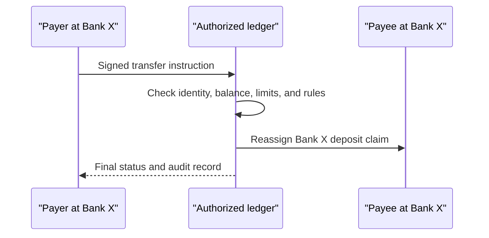
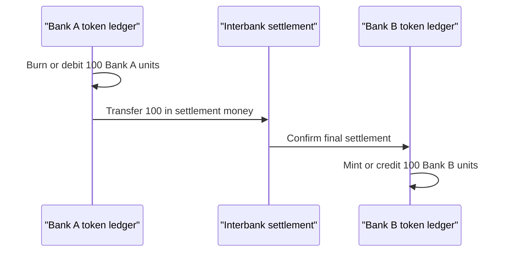
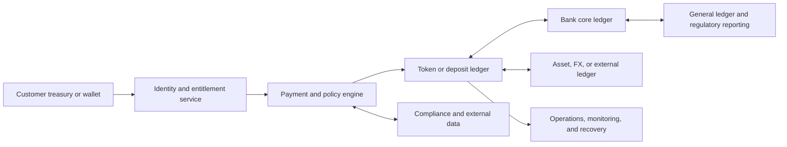

# Tokenized Deposits and Commercial-Bank Money

## Scope

A tokenized deposit represents a claim on a commercial bank using a programmable
ledger. It is not merely a stable-price cryptoasset and it is not central-bank
money. Its economic meaning comes from banking law, the issuing bank's balance
sheet, convertibility at par, and the payment and settlement arrangements around
it.

This note explains:

- how ordinary bank deposits function as money;
- what changes, and what does not, when a deposit is tokenized;
- the difference between deposit tokens, internal blockchain deposit ledgers,
  stablecoins, e-money, and wholesale central-bank money;
- single-bank and multi-bank architectures;
- issuance, transfer, redemption, settlement, and reconciliation;
- programmability, privacy, interoperability, and compliance;
- effects on liquidity, credit, regulation, and the singleness of money; and
- production systems and public experiments including Kinexys, Citi Token
  Services, the Regulated Liability Network, Project Guardian, and Project
  Agorá.

The term is not perfectly standardized. A product called a "tokenized deposit"
may be an onchain bearer-like token, a permissioned ledger entry, or an interface
to an existing deposit account. The legal claim and settlement mechanics matter
more than the label.

## 1. Begin with Ordinary Commercial-Bank Money

Most money used by households and firms is a deposit liability of a commercial
bank. If a customer has a balance of 1,000 currency units, the bank records:

```text
Customer:
asset = claim on the bank for 1,000

Bank:
liability = deposit owed to the customer for 1,000
```

The deposit is not a segregated pile of notes or central-bank reserves. The bank
uses funding from deposits and other liabilities to hold loans, securities,
reserves, and other assets. A depositor therefore bears exposure to the bank,
subject to deposit insurance, resolution law, account priority, and other
protections.

Deposits function at par because several institutions work together:

- banks promise redemption in the unit of account;
- payments between customers of the same bank are internal book transfers;
- payments across banks settle through central-bank money or an agreed
  settlement arrangement;
- prudential regulation constrains bank capital and liquidity;
- supervision, resolution, and deposit insurance support confidence; and
- central banks provide a common settlement asset and, in stress, may provide
  liquidity against eligible collateral.

This is the **singleness of money**: a currency unit should have the same value
regardless of which regulated bank records the deposit. One dollar at Bank A is
normally accepted as one dollar at Bank B, not traded at a market exchange rate
that reflects the relative credit quality of the two banks.

Tokenization does not make those foundations unnecessary. It changes the
recording and transfer technology while trying to preserve the monetary and
legal properties that make deposits useful.

## 2. What Is a Tokenized Deposit?

A tokenized deposit is a digital representation of a commercial-bank deposit
whose ownership, transfer, or use is recorded on a programmable ledger. In a
strong form, the token itself is the bank's deposit liability. In a weaker form,
the ledger is a technical sub-ledger or instruction layer linked to a
conventional account.

Four questions identify the instrument precisely:

1. **Who owes the money?** The issuing commercial bank, not the central bank and
   not merely a special-purpose reserve company.
2. **What legal claim does the holder have?** A deposit claim, an e-money claim,
   a contractual redemption claim, or only a beneficial interest?
3. **How does transfer change the claim?** Does the transferee become a
   depositor of the same bank, receive a claim on another bank, or merely receive
   a token while offchain books change separately?
4. **How is par redemption and interbank settlement achieved?** Through the
   issuer's accounts, central-bank reserves, a clearing mechanism, or another
   arrangement?

### 2.1 Tokenization is more than digitization

Bank deposits have been digital for decades. A database balance is digital, but
it is not necessarily tokenized. Tokenization generally adds some combination
of:

- standardized programmable objects;
- atomic state changes shared among authorized parties;
- digitally signed instructions;
- conditional transfers controlled by smart contracts;
- integration with tokenized securities or collateral;
- continuous availability; and
- a common transaction record that reduces bilateral reconciliation.

The boundary is architectural rather than metaphysical. A permissioned
blockchain and a replicated database can implement similar economic outcomes.
The useful question is whether the ledger and operating model improve
coordination, controls, availability, or composability enough to justify their
complexity.

### 2.2 Fungibility and account identity

An ordinary account balance is associated with a known legal customer. A
general-purpose blockchain token is often a bearer-like object: control of a key
can be sufficient to transfer it. Banks normally cannot allow unrestricted
bearer circulation because they must identify customers, enforce sanctions and
court orders, protect clients, and maintain accurate legal records.

Deposit-token systems therefore commonly add:

- allowlisted wallets;
- verified identity linked to addresses;
- transfer restrictions;
- issuer powers to freeze, reverse, burn, or reissue;
- transaction limits and jurisdiction rules;
- privacy layers that restrict data visibility; and
- recovery procedures for lost or compromised keys.

The result is usually a controlled digital liability, not censorship-resistant
cash.

## 3. A Taxonomy of Bank-Issued Digital Money

### 3.1 Internal blockchain deposit ledgers

A bank can maintain a permissioned ledger on which its customers move balances.
The balance remains part of the conventional account relationship, and clients
may never hold a portable token. The ledger acts as a payment rail and
sub-ledger.

This model simplifies legal continuity because the underlying claim remains an
ordinary deposit. It can provide 24/7 transfers between customers of one banking
group, but it creates a closed network unless linked to other banks or ledgers.

### 3.2 Deposit tokens

A deposit token is designed as a transferable onchain representation of a bank
deposit. It may interact directly with tokenized assets and smart contracts.
Depending on the structure, minting may move a customer's account balance into a
designated blockchain deposit account, or the token may constitute the deposit
record itself.

Deposit tokens can operate on private networks or on public blockchains with
permissioned token contracts. A public chain provides common infrastructure and
composability, while the token contract preserves issuer controls and restricts
eligible holders.

### 3.3 Tokenized deposit receipts

Some instruments are receipts or certificates backed by deposits rather than
deposits themselves. The holder's direct legal counterparty may be a trustee,
special-purpose entity, or token issuer rather than the deposit-taking bank.
This extra layer affects insolvency treatment, regulatory classification, and
redemption.

### 3.4 E-money and stored value

E-money is typically a redeemable claim on a non-bank or specially licensed
issuer, backed by safeguarded funds or high-quality liquid assets. Its legal
regime differs by jurisdiction. It usually does not fund bank lending in the
same way as an ordinary deposit.

### 3.5 Stablecoins

A fiat-referenced stablecoin is normally a claim, contractual arrangement, or
economic exposure linked to an issuer or protocol that holds reserve assets.
Even when a stablecoin is fully backed by bank deposits, Treasury bills, or
money-market instruments, the holder generally does not have the same claim as a
depositor at the reserve bank.

Stablecoins may circulate across many venues and trade away from par. They are
often designed as bearer-like tokens. Deposit tokens instead seek to keep the
holder within the regulated banking perimeter and maintain par through the
banking settlement system.

### 3.6 Central-bank digital currency and tokenized reserves

A CBDC is a liability of the central bank. Retail CBDC is intended for the
public; wholesale CBDC or tokenized reserves are restricted to eligible
financial institutions. A commercial-bank deposit token remains a liability of
the issuing bank.

This liability distinction is fundamental:

| Instrument | Typical issuer | Holder's primary exposure | Typical users |
|---|---|---|---|
| Banknote | Central bank | Central bank | Public |
| Wholesale reserve | Central bank | Central bank | Eligible institutions |
| Retail CBDC | Central bank | Central bank | Public or broad user set |
| Ordinary deposit | Commercial bank | Bank, with applicable protections | Bank clients |
| Tokenized deposit | Commercial bank | Issuing bank | Usually verified clients |
| E-money | Licensed issuer | Issuer and safeguarding structure | Public or clients |
| Reserve-backed stablecoin | Company or trust structure | Issuer, reserve, custodian, and legal structure | Eligible or broad onchain users |
| Crypto-collateralized stablecoin | Protocol and collateral system | Collateral, smart contracts, governance, and market liquidity | Onchain users |

See [Stablecoins](../01-stablecoins/stablecoins.md) and
[Central-Bank Digital Currencies](central-bank-digital-currencies.md) for the
full treatments.

## 4. Lifecycle: Issue, Transfer, and Redeem

Consider a customer converting 10 million units from an ordinary deposit into a
deposit token issued by the same bank.

### 4.1 Issuance

The customer sends an authenticated instruction. The bank verifies eligibility,
available funds, sanctions status, limits, and the destination wallet. It then
either:

- debits the ordinary account and credits a designated tokenized-deposit
  liability account; or
- locks or earmarks the conventional balance and mints a corresponding token.

The onchain contract emits a mint event. The bank's core ledger, general ledger,
and token ledger must remain consistent.

### 4.2 Transfer within one bank

If both parties are clients of the same bank, a token transfer changes which
customer owns the bank liability. No interbank reserve movement is required.



This can operate outside conventional payment windows if the bank's risk,
liquidity, fraud, and support functions are designed for continuous operation.

### 4.3 Redemption

The holder submits the token to the issuer. The bank burns or immobilizes it and
credits an ordinary deposit account or pays through another rail. Redemption
must be reconciled so that the same liability is never spendable both onchain
and in the core account system.

### 4.4 Balance-sheet effect

Conversion between an ordinary deposit and the same bank's deposit token usually
reclassifies a liability rather than changing the bank's total assets or
liabilities:

```text
Before:
ordinary customer deposits             10

After:
ordinary customer deposits              0
tokenized customer deposits             10
```

If funds arrive from another bank, the receiving bank gains reserves or another
interbank claim and issues a new deposit. If a customer redeems into a payment
to another bank, the issuing bank may lose reserves. Tokenization does not
eliminate bank liquidity management.

## 5. The Interbank Problem

A single-bank token is straightforward: everyone holds a claim on one issuer.
A multi-bank system must preserve par value while claims move among banks.

Assume Alice holds 100 units issued by Bank A and wants to pay Bob, a customer
of Bank B. Several models are possible.

### 5.1 Closed transfer of the original claim

Bob receives Bank A's token and becomes a creditor of Bank A. Bank B may provide
the wallet interface but does not issue the money. This resembles a bearer claim
circulating beyond the issuer's own clients.

Problems include:

- Bank B must accept and manage exposure to Bank A;
- different bank tokens may trade at different values;
- onboarding and legal relationships become complicated;
- recipients may accumulate claims on many issuers; and
- supervision, deposit protection, and resolution treatment may be unclear.

### 5.2 Burn-and-mint with interbank settlement

Bank A's token is burned, Bank B issues a new token to Bob, and the two banks
settle the underlying obligation in central-bank money.



Atomic coordination can make the three actions succeed together or fail
together. This model most closely reproduces conventional interbank payment
economics.

### 5.3 Shared multi-bank ledger

Banks can operate on a common platform that records each institution's
liabilities and connects them to a settlement asset. Smart contracts can
orchestrate payment, compliance, foreign exchange, and asset delivery.

A shared ledger does not imply a shared balance sheet. Each bank remains
responsible for its own liabilities. The data model must identify the issuer of
every monetary claim and the settlement event that transforms one claim into
another.

### 5.4 Joint or special-purpose issuance

Banks can jointly support a token issued by a consortium or special-purpose
entity. This may improve fungibility, but the instrument may cease to be a
direct deposit claim on a specific bank. Governance, reserve ownership,
insolvency remoteness, and regulatory classification then become central.

## 6. Singleness of Money

The BIS distinguishes two broad models.

In a bearer-style model, tokens issued by different banks circulate and may be
exchanged in secondary markets. Holders price issuer credit and liquidity risk.
A unit issued by Bank A could trade at 0.999 units of Bank B money, weakening
singleness.

In a non-bearer model, the payment transforms the payer's deposit at Bank A into
the payee's deposit at Bank B, with the interbank leg settled in central-bank
money. The user sees one unit of account even though the banking system contains
multiple private issuers.

Tokenized money therefore needs more than nominal one-for-one backing. It needs:

- clear redemption at par;
- a common settlement asset;
- effective interbank clearing and liquidity;
- equivalent legal and prudential standards;
- operational interoperability; and
- credible treatment if an issuer fails.

Stable value in normal markets is an outcome of this system, not a property that
software can declare.

## 7. Programmability

Programmable ledgers can make a payment conditional on another verified event.
Useful patterns include:

- **delivery versus payment:** cash moves only if securities move;
- **payment versus payment:** one currency moves only if the other moves;
- **escrow:** funds release when agreed conditions are met;
- **treasury sweeps:** balances move when time or threshold conditions occur;
- **margin:** collateral or cash moves after a validated margin call;
- **invoice payment:** payment executes after approval or receipt of goods;
- **machine-triggered payment:** a trusted device or data service triggers a
  predefined obligation; and
- **purpose constraints:** funds may be spent only among authorized parties or
  for defined asset types.

### 7.1 Programmable payments versus programmable money

This distinction prevents confusion.

- **Programmable payment:** software decides when and where otherwise ordinary
  money moves.
- **Programmable money:** restrictions are embedded in the monetary instrument
  itself and persist as it changes hands.

Most commercial applications need programmable payments. Persistent restrictions
on money can impair fungibility, create operational traps, and raise legal or
social concerns. A robust design keeps general money fungible while placing
business logic in a controlled transaction layer.

### 7.2 Atomicity is conditional, not magical

Two assets can settle atomically only if the system controls both state changes
or has a trustworthy protocol joining them. If a smart contract waits for an
offchain event, it inherits oracle risk. If one leg is on another ledger, it
inherits bridge or interoperability risk. If a legal transfer requires an
offchain registry update, technical finality may precede legal finality.

Programmability reduces some coordination failures while creating dependencies
on code, identity, data, governance, and exception handling.

## 8. Architecture

### 8.1 Ledger choices

A tokenized-deposit system may use:

- a bank-controlled private ledger;
- a consortium permissioned ledger;
- a public permissionless base layer with permissioned contracts;
- a rollup or other public-chain execution layer;
- multiple ledgers joined by interoperability protocols; or
- a conventional core ledger with blockchain used only for selected workflows.

The selection affects who validates, who sees transactions, how upgrades occur,
what fees are paid, which applications are composable, and how outages are
handled.

### 8.2 Core components



The visible token contract is only one component. A production service also
needs:

- client onboarding and legal agreements;
- signing, key custody, and entitlement management;
- transaction screening and behavioral monitoring;
- limits and liquidity controls;
- ledger reconciliation and accounting;
- cyber monitoring and incident response;
- business continuity and disaster recovery;
- regulatory reporting and audit evidence;
- upgrades and smart-contract governance; and
- customer support and dispute processes.

### 8.3 Public-chain deployment

A bank can issue a permissioned deposit token on a public chain. Benefits may
include access to existing wallets, developers, tokenized assets, and shared
infrastructure. Risks include:

- dependence on public validators and protocol governance;
- volatile or congested transaction fees;
- forks and probabilistic or protocol-defined finality;
- public metadata leakage;
- smart-contract and bridge exposure;
- sanctions or policy questions involving validators and infrastructure
  providers; and
- the need to distinguish the authentic contract from lookalike tokens.

Permissioning the token does not permission the underlying network.

### 8.4 Private and permissioned deployment

A private network can give regulated operators predictable governance,
confidentiality, and performance. It may integrate closely with bank controls.
Its limitations are narrower distribution, dependence on consortium governance,
and the risk of reproducing isolated databases with an expensive shared-ledger
layer.

## 9. Identity, Privacy, and Compliance

Bank money is not anonymous. Banks must know account holders and meet AML,
sanctions, fraud, tax, reporting, and recordkeeping obligations. At the same
time, placing every payment in a broadly visible shared ledger can reveal
salaries, counterparties, positions, and trading strategies.

A sound privacy design separates roles and data:

- validators need enough information to establish valid state transitions;
- banks need customer and transaction information required by law;
- counterparties need evidence that conditions were satisfied;
- regulators or auditors may require authorized access;
- competitors should not see confidential business data; and
- the public should not receive unnecessary personal information.

Techniques include permissioned channels, encryption, pseudonymous addresses,
selective disclosure credentials, zero-knowledge proofs, trusted execution
environments, and fully homomorphic encryption. Each changes the trust,
performance, and operational model. Privacy should be designed into the
transaction lifecycle, not added after deployment.

See
[Privacy and Confidential Computing for Blockchains](../../06-interoperability-privacy-and-enterprise-dlt/02-privacy/privacy-and-confidential-computing-for-blockchains.md).

## 10. Finality, Reversibility, and Exceptions

Blockchain discussions often treat immutability as an absolute benefit. Banking
systems also need to handle:

- mistaken payments;
- fraud and account takeover;
- sanctions freezes;
- court orders;
- insolvency stays;
- deceased or incapacitated customers;
- lost keys;
- erroneous data or smart-contract execution; and
- operational incidents.

Technical finality answers when the ledger will no longer reorganize a
transaction. Legal finality answers when the transfer discharges an obligation
and cannot be unwound through ordinary insolvency or payment-system rules.
Operational policy answers who can freeze, compensate, or reverse an outcome.
These are distinct.

An issuer may preserve ledger history while executing a compensating transfer,
freeze, or reissuance. Such powers should be explicit, access-controlled,
auditable, and subject to governance. Hidden administrator keys undermine both
security analysis and legal predictability.

## 11. Liquidity and Balance-Sheet Consequences

### 11.1 Continuous availability

A 24/7 ledger does not automatically create 24/7 interbank liquidity. If
central-bank settlement, foreign-exchange markets, or correspondent accounts are
closed, a bank may need prefunded balances, intraday credit, liquidity buffers,
or deferred final settlement.

Always-on services also change operating requirements:

- liquidity must be monitored continuously;
- risk and sanctions controls need continuous coverage;
- outages no longer have a natural overnight maintenance window;
- interest accrual and end-of-day accounting need clear cutoffs; and
- clients may move large balances outside traditional market hours.

### 11.2 Deposit migration

If customers move money from ordinary accounts into a token issued by the same
bank, the bank may retain its funding. If they move into another bank's token,
a stablecoin, or a CBDC, the original bank can lose deposits and reserves.

At system level, tokenized deposits generally remain commercial-bank
liabilities. Stablecoin purchases may move deposits from users' banks to reserve
banks, concentrating funding. Retail CBDC can move liabilities from commercial
banks to the central bank. The macroeconomic effect depends on who issues the
instrument and where the backing assets reside.

### 11.3 Credit creation

Commercial banks create deposits when they extend loans. A tokenized deposit can
remain part of this elastic credit-money system. A fully prefunded token
segregated against central-bank money may instead behave more like narrow money.

Design choices about backing, transferability, and redemption therefore affect
not only technology but the allocation of credit and liquidity in the economy.

## 12. Regulation, Law, and Accounting

The legal analysis is jurisdiction-specific, but recurring questions include:

- Is the token legally a deposit?
- Which entity or branch is the issuer?
- Is the holder a direct customer of that entity?
- Does deposit insurance apply, and within what limits?
- Is the claim transferable without novation or a new account agreement?
- What law governs ownership and transfer?
- When is settlement final?
- What happens in bank resolution?
- Are wallets accounts, custody arrangements, or technical addresses?
- Do payment-services, e-money, securities, or cryptoasset rules also apply?
- How are interest, fees, tax, and unclaimed property treated?

On the bank's books, a true deposit token is generally a deposit liability, but
accounting systems must reconcile the onchain population with the bank's
sub-ledger and general ledger. Off-balance-sheet treatment should not be inferred
from the use of a token.

Capital, liquidity, large-exposure, operational-resilience, outsourcing, and
data-localization rules may apply even if no new legal instrument is created.
Banks also need contractual allocation of losses arising from smart contracts,
validators, custodians, or interoperability providers.

## 13. Tokenized Deposits and Securities Settlement

Tokenized securities need a compatible cash leg. Without it, a platform may
record the asset transfer onchain but settle cash later through conventional
rails, recreating principal risk and reconciliation.

Possible cash legs include:

- wholesale CBDC or tokenized central-bank reserves;
- a tokenized commercial-bank deposit;
- a conventional account transfer synchronized with the asset ledger;
- a stablecoin; or
- a platform-specific settlement token.

For delivery versus payment, analyze:

1. whether cash and asset transfers are technically atomic;
2. whether both legs are legally final;
3. whose liability the cash represents;
4. whether the recipient can reuse or redeem it immediately;
5. whether the cash asset is available when markets operate;
6. how failed transactions and corporate actions are handled; and
7. what happens if an issuer, ledger, or bridge fails.

Faster settlement can reduce replacement-cost exposure and collateral needs, but
it can also increase the need for precisely timed funding. Netting reduces gross
liquidity needs; atomic gross settlement may require more intraday liquidity.
The optimal design balances credit risk, liquidity, and operational complexity.

## 14. Production Systems and Experiments

Product descriptions change. The examples below explain design patterns and
should be checked against current official documentation.

### 14.1 Kinexys Digital Payments and JPM Coin

J.P. Morgan's blockchain business, formerly called Onyx and now Kinexys, has
operated a permissioned payment ledger for institutional clients. Its
applications include intragroup funding, cross-border transfers, programmable
payments, and settlement linked to tokenized assets.

The historically named JPM Coin System represented U.S.-dollar and euro deposits
held at J.P. Morgan within a permissioned environment. The system functioned as
both a deposit-account ledger and payment rail.

J.P. Morgan subsequently introduced a USD deposit token, JPM Coin with ticker
JPMD, on Base, an Ethereum layer 2. The bank describes conversion through a
Blockchain Deposit Account and restricts transacting parties to vetted
participants. This public-chain deployment illustrates the distinction between:

- an internal permissioned blockchain deposit system; and
- a permissioned bank liability issued on public blockchain infrastructure.

The issuer remains central in both. Smart contracts and public settlement do not
turn the bank claim into a decentralized stablecoin.

### 14.2 Citi Token Services

Citi Token Services for Cash provides institutional clients with near-real-time
cross-border payments and liquidity transfers among participating Citi
locations. Citi states that clients use existing accounts and do not need to
hold tokens directly.

This is an important alternative model: blockchain can coordinate tokenized
bank liabilities behind an account-based client interface. End-user custody of
a transferable token is not required to obtain continuous processing and
programmable workflows.

Citi has also explored smart-contract-based trade-finance and cash applications.
The exact service availability depends on entity, market, approvals, currencies,
and transaction limits.

### 14.3 Regulated Liability Network

The Regulated Liability Network concept explores a shared platform containing
regulated liabilities such as commercial-bank money and central-bank money. UK
and U.S. experiments have examined whether a common ledger can support payments
and settlement while retaining the two-tier banking system.

The conceptual contribution is a partitioned shared ledger:

- each bank issues and controls its own liabilities;
- customers remain legally connected to their banks;
- regulated institutions share transaction infrastructure;
- central-bank money provides a settlement anchor; and
- common functionality can coordinate multiple liabilities and assets.

An experiment does not itself establish a new payment system or prove a
commercial business case. Legal, governance, operating, and network-adoption
questions remain.

### 14.4 Project Guardian

The Monetary Authority of Singapore's Project Guardian has brought public and
private institutions together to test asset tokenization and decentralized
finance in regulated contexts. Its experiments have included tokenized deposits,
foreign exchange, funds, bonds, and liquidity pools.

The project illustrates how a deposit token can serve as a settlement asset for
tokenized financial instruments, but each pilot has its own architecture and
legal assumptions. Results should not be generalized into a claim that all
public-chain settlement is legally final or production-ready.

### 14.5 Project Agorá

Project Agorá is a BIS Innovation Hub and Institute of International Finance
public-private project involving central banks and private financial
institutions. It explores a multi-currency shared programmable platform
combining tokenized wholesale central-bank money with tokenized
commercial-bank deposits.

Its target is not a universal retail token. It addresses wholesale cross-border
payment frictions: sequential correspondent chains, fragmented compliance,
limited operating hours, prefunding, opacity, and reconciliation. The prototype
reported in 2026 demonstrated atomic multi-currency settlement patterns and
embedded workflow and compliance logic.

Agorá also makes clear why the hard problems are institutional:

- different currencies and central banks;
- legal settlement finality across jurisdictions;
- correspondent and intermediary roles;
- AML and sanctions responsibilities;
- privacy among banks and clients;
- foreign-exchange liquidity;
- governance of a shared platform; and
- migration from existing infrastructure.

A successful prototype establishes technical feasibility under its assumptions,
not automatic production adoption.

## 15. Benefits and Limits

### 15.1 Potential benefits

Tokenization can make a bank liability participate directly in programmable
asset workflows. If cash and a security share compatible settlement logic, both
legs can change ownership atomically instead of being reconciled across separate
systems. The benefit depends on common standards, legal finality, and usable
liquidity; issuing isolated tokens at many banks can recreate fragmentation.

- continuous intrabank or network payments;
- faster liquidity movement across branches and time zones;
- atomic settlement with tokenized assets;
- fewer reconciliations among shared-ledger participants;
- programmable treasury, collateral, and trade workflows;
- traceable transaction state;
- integration with onchain financial applications; and
- retention of regulated commercial-bank money as the settlement asset.

### 15.2 Principal limitations and risks

- closed networks and weak interoperability;
- concentration in major issuing banks or platform operators;
- fragmented bank-specific tokens;
- unclear cross-border legal treatment;
- smart-contract, key-management, and operational risk;
- public-ledger privacy leakage;
- dependence on offchain identity and compliance services;
- liquidity needs outside central-bank operating hours;
- administrator abuse or governance failure;
- difficulty coordinating core banking and onchain ledgers; and
- uncertain demand if existing instant-payment systems already meet user needs.

Tokenization should be evaluated against credible alternatives: upgraded APIs,
real-time gross settlement, instant-payment rails, ISO 20022 messaging,
conventional escrow, and synchronized databases. A blockchain is useful when
multiple parties genuinely need shared state, programmable coordination, and
controlled asset composability.

## 16. Evaluation Framework

For any bank-issued digital-money product, document the following.

### Legal and monetary character

1. exact issuer and issuing branch;
2. governing law and claim type;
3. depositor status and insurance treatment;
4. redemption promise and timing;
5. insolvency and resolution treatment; and
6. method for maintaining par value.

### Architecture

7. ledger type and validator set;
8. token contract, account, or sub-ledger model;
9. source of truth and reconciliation design;
10. identity and wallet model;
11. upgrade, pause, freeze, and recovery powers;
12. finality and fork handling; and
13. external chains, bridges, or data dependencies.

### Payment and settlement

14. intrabank versus interbank transfer method;
15. interbank settlement asset;
16. operating hours and liquidity arrangements;
17. DvP, PvP, and conditional-payment support;
18. conversion to ordinary deposits and cash; and
19. exception, dispute, and erroneous-payment handling.

### Risk and governance

20. prudential and payment-system treatment;
21. AML, sanctions, fraud, and transaction monitoring;
22. privacy and data-access model;
23. cyber resilience and key custody;
24. operator and participant governance;
25. transaction economics and fee model; and
26. network adoption and exit arrangements.

The analysis is complete only when the token, the bank liability, the settlement
asset, and the legal transfer all fit together.

## 17. Key Takeaways

1. A tokenized deposit is commercial-bank money recorded or represented on a
   programmable ledger; its value derives from the bank and legal framework, not
   from token code alone.
2. Digitization and tokenization are different. The claimed benefit is shared,
   programmable state and asset composability, not merely an electronic balance.
3. Single-bank transfers are simpler than multi-bank transfers. Multi-bank money
   requires a mechanism that preserves par, commonly through conversion and
   settlement in central-bank money.
4. A stablecoin backed by bank deposits is not automatically a bank deposit of
   the token holder.
5. Continuous technical operation does not eliminate liquidity, compliance, or
   support constraints.
6. Programmable payments are usually more useful and less fragmenting than
   permanently programmable money.
7. Atomic settlement can reduce principal risk, but gross instant settlement may
   increase intraday funding needs relative to netting.
8. Public and private ledgers can both support deposit tokens; each creates
   different governance, privacy, interoperability, and dependency risks.
9. The strongest evaluation starts with issuer, legal claim, redemption, and
   settlement—not the product name or blockchain.

## Related Notes

- [Money, Banking, and Balance Sheets](../../01-financial-foundations/01-money-banking-and-payments/money-banking-and-balance-sheets.md)
- [Payments, Clearing, and Settlement](../../01-financial-foundations/01-money-banking-and-payments/payments-clearing-and-settlement.md)
- [Cross-Border Payments and Foreign Exchange](../../01-financial-foundations/01-money-banking-and-payments/cross-border-payments-and-fx.md)
- [Stablecoins](../01-stablecoins/stablecoins.md)
- [Central-Bank Digital Currencies](central-bank-digital-currencies.md)
- [Tokenization of Securities, Funds, and Real-World Assets](../03-tokenized-assets/tokenization-of-securities-funds-and-real-world-assets.md)
- [Blockchain Interoperability and Bridges](../../06-interoperability-privacy-and-enterprise-dlt/01-interoperability/blockchain-interoperability-and-bridges.md)

## References

- Bank for International Settlements, [Stablecoins versus tokenised deposits: implications for the singleness of money](https://www.bis.org/publ/bisbull73.htm)
- Bank for International Settlements, [The tokenisation continuum](https://www.bis.org/publ/bisbull72.htm)
- Bank for International Settlements, [The future monetary system](https://www.bis.org/publ/arpdf/ar2023e3.htm)
- Bank for International Settlements, [The next-generation monetary and financial system](https://www.bis.org/publ/arpdf/ar2025e3.htm)
- BIS Innovation Hub, [Project Agorá](https://www.bis.org/about/bisih/topics/fmis/agora.htm)
- BIS Innovation Hub, [Project Agorá: a shared programmable platform for wholesale cross-border payments](https://www.bis.org/publ/othp110.htm)
- Committee on Payments and Market Infrastructures, [Considerations for the use of stablecoin arrangements in cross-border payments](https://www.bis.org/cpmi/publ/d220.htm)
- Financial Stability Board, [The Financial Stability Implications of Tokenisation](https://www.fsb.org/2024/10/the-financial-stability-implications-of-tokenisation/)
- J.P. Morgan, [JPM Coin](https://www.jpmorgan.com/kinexys/digital-payments/jpm-coin)
- J.P. Morgan, [Introducing Kinexys](https://www.jpmorgan.com/insights/payments/blockchain-digital-assets/introducing-kinexys)
- J.P. Morgan Payments Developer Portal, [Kinexys Digital Payments](https://developer.payments.jpmorgan.com/blog/guides/blockchain)
- Citi, [Digital Assets and Citi Token Services](https://www.citigroup.com/global/businesses/services/services-digital-assets)
- UK Finance, [Regulated Liability Network](https://www.ukfinance.org.uk/policy-and-guidance/reports-and-publications/regulated-liability-network-uk-discovery-phase)
- Federal Reserve Bank of New York, [Regulated Liability Network proof of concept](https://www.newyorkfed.org/aboutthefed/nyic/facilitating-wholesale-digital-asset-settlement)
- Monetary Authority of Singapore, [Project Guardian](https://www.mas.gov.sg/schemes-and-initiatives/project-guardian)
- Bank of England, [The Bank of England's approach to innovation in money and payments](https://www.bankofengland.co.uk/paper/2024/dp/the-boes-approach-to-innovation-in-money-and-payments)
- Basel Committee on Banking Supervision, [Prudential treatment of cryptoasset exposures](https://www.bis.org/bcbs/publ/d545.htm)
