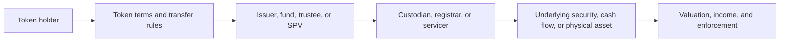
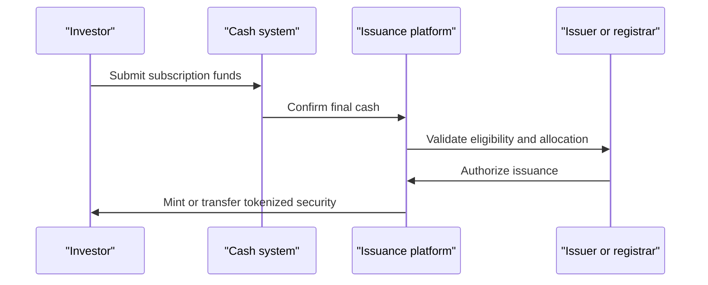
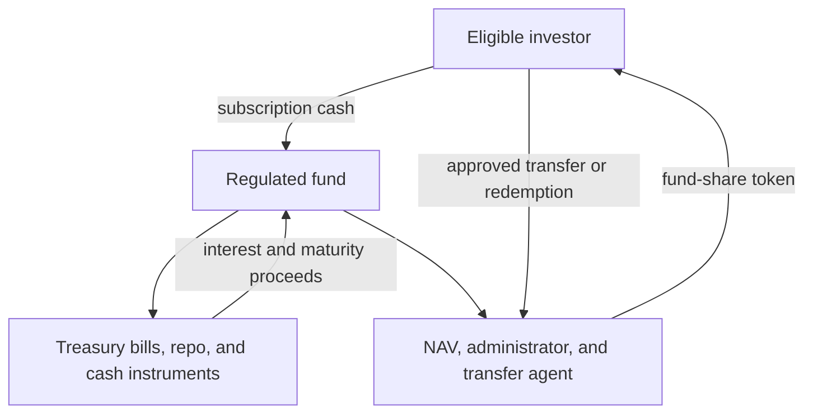

# Tokenization of Securities, Funds, and Real-World Assets

## Scope

Tokenization uses a programmable ledger to issue or represent an asset, a claim,
or a set of rights as a digital token. In regulated finance, the difficult part
is rarely creating the token. The difficult part is ensuring that control of the
token corresponds to legally enforceable ownership, that the asset is correctly
serviced, and that cash, custody, compliance, and insolvency arrangements work
through the full lifecycle.

This note builds a framework for tokenized bonds, equities, fund interests,
private-market assets, real estate, commodities, receivables, and collateral. It
distinguishes native issuance from digital wrappers, explains the operating
model from issuance through redemption, and evaluates both benefits and risks.

## 1. What Is Being Tokenized?

The phrase "real-world asset" is used loosely. It can refer to:

- a conventional security represented on a blockchain;
- a fund whose portfolio remains in conventional custody while fund shares are
  tokenized;
- a contractual claim on a special-purpose vehicle that owns an asset;
- a warehouse receipt or title document representing a commodity;
- a loan, invoice, or other receivable;
- a legal interest in real estate;
- an onchain synthetic exposure whose payoff references an external price; or
- an unverified token that merely claims to be backed by something.

These are not economically equivalent. A learner should trace the chain of
rights:

The token holder may own the underlying asset directly, own a security issued by
an entity that owns the asset, hold a beneficial interest through a nominee, or
only have a contractual promise from the token issuer. The token's market name
does not answer this.

## 2. Native, Digitally Twinned, and Wrapped Assets

### 2.1 Native digital issuance

A native digital security is created on the ledger at issuance. The ledger is
the authoritative ownership record, or is legally integrated with it. Transfers,
interest, redemption, and other events can be processed through the same
infrastructure.

Examples include a bond issued under a legal framework that recognizes the DLT
register, or a fund whose official shareholder register is maintained through a
transfer agent using blockchain records.

### 2.2 Digital twin

A digital twin represents a conventional asset that continues to exist in a
separate registry or custody system. The token and traditional record must be
synchronized.

This can accelerate distribution or settlement, but introduces **double-record
risk**:

- Which record is legally authoritative?
- Can the conventional asset move while the token remains outstanding?
- Who reconciles supply and ownership?
- What happens when records disagree?

### 2.3 Custodial wrapper

An entity can custody an asset and issue tokens representing claims on it. Gold
tokens and some tokenized Treasury products use this pattern. The holder depends
on the issuer, custodian, contractual terms, and redemption process.

### 2.4 Synthetic token

A synthetic token uses collateral and derivatives or an oracle-based smart
contract to reproduce an asset's price. It does not convey ownership of that
asset. A token tracking a stock price is not a share unless it grants the legal
rights of a shareholder.

This distinction affects:

- dividends and voting;
- insolvency priority;
- market and counterparty risk;
- regulatory classification;
- tax;
- corporate actions; and
- enforceability.

## 3. What a Security Represents

Tokenization does not erase the underlying instrument.

### 3.1 Bonds

A bond is a debt claim. Its terms specify principal, coupon, maturity, ranking,
covenants, events of default, governing law, and payment mechanics. A tokenized
bond still needs:

- an issuer legally bound to pay;
- offering and disclosure documents;
- investor eligibility checks;
- a register or ownership mechanism;
- calculation and payment agents;
- corporate-action and default processes;
- withholding-tax treatment; and
- a cash settlement asset.

Smart contracts may automate coupon calculations and distributions, but they
cannot guarantee that the issuer has funds or replace legal enforcement after
default.

### 3.2 Equity

Equity represents residual ownership and governance rights. A tokenized share
must address voting, dividends, pre-emption, transfer restrictions, disclosure
thresholds, beneficial ownership, and the company's legally recognized share
register.

Fractional tokens may be shares, interests in a vehicle that owns shares, or
broker-held entitlements. Each gives different rights.

### 3.3 Fund interests

A tokenized fund token represents shares or units in an investment vehicle. The
portfolio may consist of Treasury bills, money-market instruments, private
credit, bonds, equities, or digital assets. Tokenization of the fund unit does
not imply tokenization of the portfolio.

The investor remains exposed to:

- portfolio market and credit risk;
- fund liquidity and redemption rules;
- manager, administrator, custodian, and transfer-agent risk;
- net asset value calculation;
- fees and dilution;
- legal segregation of assets; and
- smart-contract and wallet infrastructure.

### 3.4 Loans, private credit, and receivables

A token can represent a participation in a loan, a note issued by a funding
vehicle, or a beneficial interest in receivables. The essential analysis covers:

- borrower and originator;
- underwriting and verification;
- perfection and priority of security interests;
- servicing and collection;
- cash-flow waterfall;
- representations and warranties;
- concentration and fraud risk;
- defaults, workouts, and enforcement; and
- whether transfer requires borrower consent.

Onchain visibility of token transfers does not make offchain borrower data
accurate.

### 3.5 Real estate

Direct tokenization of title is possible only where the authoritative land
registry and applicable law recognize it. More commonly, tokens represent
shares, partnership interests, or debt issued by a vehicle that owns property.

Investors then own an interest in the vehicle, not a fractional piece of land in
the cadastral register. They remain exposed to management, leverage,
maintenance, tenants, taxes, local law, valuation, and illiquidity.

### 3.6 Commodities

A commodity token may represent title to identified goods, a claim on a pooled
inventory, a warehouse receipt, or an unsecured issuer promise. Due diligence
includes:

- existence and quality of inventory;
- custody location and insurance;
- inspection and audit;
- liens and competing claims;
- storage costs;
- allocation versus unallocated claims;
- minimum redemption size; and
- transport and delivery.

## 4. The Tokenized-Asset Lifecycle

### 4.1 Structuring and issuance

The issuer selects the legal instrument, jurisdiction, venue, investor class,
ledger, token standard, service providers, and cash leg. Offering documents
define the rights. Eligible investors complete onboarding and receive authorized
wallets or custodial accounts.

Issuance can occur against cash:

When cash and security are on compatible infrastructure, delivery versus payment
can make both transfers conditional. Otherwise the platform synchronizes an
onchain asset with an offchain payment and retains settlement exposure during
the gap.

### 4.2 Primary distribution

Securities laws may restrict offers to qualified, accredited, professional, or
otherwise eligible investors. Token contracts may implement:

- address allowlists;
- jurisdiction restrictions;
- investor caps;
- holding periods;
- position limits;
- forced transfers;
- lockups; and
- transfer-agent approval.

Wallet allowlisting is not complete compliance. The system must keep identity
current, aggregate beneficial ownership across wallets, screen transfers, and
handle lost keys and legal orders.

### 4.3 Secondary transfer

A technically transferable token may not have a liquid market. Liquidity
requires buyers, sellers, market makers, price information, custody, financing,
venue access, and regulatory permission. Fractionalization can reduce minimum
ticket size but cannot create fundamental demand.

Secondary transfers must update the legally relevant ownership record. If a
transfer on a public chain is only an instruction awaiting offchain registrar
approval, its apparent finality may be misleading.

### 4.4 Servicing

Assets generate events after issuance:

- coupons and dividends;
- interest-rate resets;
- calls, puts, conversions, and tenders;
- proxy voting;
- splits and reorganizations;
- capital calls and distributions;
- collateral substitutions;
- defaults and restructurings;
- fees and tax withholding; and
- maturity or liquidation.

Smart contracts can calculate and initiate events, but trusted data and legal
judgment remain necessary. An oracle may provide a reference rate; it does not
decide a disputed covenant breach.

### 4.5 Redemption and cancellation

At maturity or redemption, the holder submits the token, eligibility and payment
details are checked, cash is delivered, and the token is burned or marked
redeemed. For physical assets, redemption may require logistics, fees, and
minimum quantities.

Supply integrity requires controls ensuring that issued tokens never exceed the
recognized underlying claims.

## 5. Records, Ownership, and Custody

### 5.1 What is the authoritative record?

Possible models include:

- the blockchain is the statutory or contractual register;
- the transfer agent maintains the official register and uses blockchain as its
  technology;
- a conventional register is authoritative and the blockchain is a mirror;
- an omnibus custodian is the registered holder while tokens represent
  beneficial interests; or
- a special-purpose issuer owns the asset and maintains a token-holder register.

Every analysis should name the authoritative record and the process for resolving
conflicts.

### 5.2 Token custody is not asset custody

Custody can exist at several layers:

1. private keys controlling the token;
2. the registered security or fund interest;
3. underlying portfolio securities;
4. physical assets or title documents; and
5. cash awaiting investment or distribution.

Different institutions may perform each role. A digital-asset custodian securing
wallet keys does not necessarily custody the Treasury bills held by a tokenized
fund.

### 5.3 Lost keys and recovery

Regulated securities generally cannot become ownerless because a private key is
lost. Systems commonly use:

- custodial recovery;
- multi-party authorization;
- issuer reissuance after identity verification;
- token freeze and burn;
- court-ordered transfer; or
- smart-account recovery.

These features make the instrument operable under law but create administrator
and governance risk. Powers and procedures should be transparent.

## 6. Cash Settlement and Atomicity

A tokenized market needs money that can move with the asset. Choices include:

- central-bank reserves or wholesale CBDC;
- tokenized commercial-bank deposits;
- stablecoins;
- synchronized conventional bank payments; and
- platform settlement tokens.

Delivery versus payment reduces principal risk only when the cash asset is
reliable and both legs achieve legal finality.

### 6.1 Gross settlement versus netting

Atomic instant settlement is often presented as unambiguously superior. In
practice:

- gross settlement reduces the duration of counterparty exposure;
- netting substantially reduces cash and securities needed for settlement;
- prefunding every trade can increase liquidity costs;
- market makers use credit and netting to support liquidity; and
- immediate settlement leaves less time to correct errors or arrange funding.

A system can combine programmable settlement with scheduled netting, central
clearing, intraday credit, or conditional liquidity facilities. Tokenization
does not dictate one market design.

### 6.2 Settlement fails

Smart contracts can prevent a trade from settling if either leg is missing, but
the economic failure remains. The market still needs rules for buy-ins,
penalties, substitution, default management, and customer communication.

## 7. Tokenized Funds and Yield-Bearing Cash Alternatives

Tokenized money-market and Treasury funds have become a prominent bridge between
onchain markets and conventional assets.

### 7.1 Economic structure

A typical product works as follows:

The token is a fund share, not a dollar deposit. Its price or accumulated income
reflects fund accounting. The fund may distribute income as new tokens, a rising
net asset value, or cash.

### 7.2 Why onchain users hold them

- access to short-term government yield;
- regulated fund structure;
- continuous or extended transfer capability among eligible wallets;
- use as collateral;
- faster subscription and redemption workflows; and
- integration with stablecoin and exchange infrastructure.

### 7.3 Risks

Tokenized funds retain ordinary fund risks and add digital ones:

- the underlying portfolio can lose value;
- redemptions may be delayed or suspended;
- quoted NAV is calculated through offchain processes;
- public-chain transfers can be disrupted or congested;
- smart contracts, keys, and allowlists can fail;
- secondary wrappers can bypass direct holding restrictions;
- liquidity can be fragmented across chains; and
- using fund shares as near-money can create rapid collateral and redemption
  dynamics.

A yield-bearing fund token is not the same as a stablecoin designed for immediate
payment at a fixed unit value.

## 8. Collateral Mobility

Collateral markets are a strong use case because the same securities are
frequently pledged, substituted, valued, and moved across institutions.

Tokenization can allow:

- near-real-time proof of control or encumbrance;
- atomic collateral delivery and cash release;
- automated margin calls;
- rapid substitution;
- shared eligibility rules;
- reduced duplicate reconciliations; and
- movement outside conventional settlement windows.

But the system must prevent double pledging and correctly represent legal
control. A token locked in a smart contract may not create a perfected security
interest under the governing law. The collateral receiver must know:

- who legally owns the asset;
- where it is held;
- whether prior liens exist;
- how valuation and haircuts work;
- whether it can be reused;
- how it is liquidated after default; and
- whether transfer remains possible during network or custodian failure.

Tokenization improves collateral mobility only if legal mobility follows
technical mobility.

## 9. Claimed Benefits and Their Preconditions

| Claimed benefit | Required condition | Frequent limitation |
|---|---|---|
| Faster settlement | Compatible cash and asset legs with legal finality | Offchain cash or registry remains slow |
| Lower reconciliation | Participants use a common authoritative state | Firms retain parallel books and interfaces |
| Fractional access | Distribution law and servicing support small holders | Illiquidity and costs remain |
| More liquidity | Buyers, sellers, market makers, financing, and venue access | Tokenization alone creates no demand |
| Automation | Reliable data, code, governance, and exception processes | Real events require judgment and oracles |
| Transparency | Relevant data is accurate and visible to authorized users | Privacy and commercial sensitivity constrain access |
| 24/7 operation | Cash, liquidity, compliance, and support also operate | Underlying markets and service providers close |
| Fewer intermediaries | Their functions are genuinely automated or combined | Legal, custody, compliance, and servicing functions persist |
| Better collateral use | Tokens are legally controllable and interoperable | Siloed networks and liens block reuse |

The strongest benefits arise from **functional integration**: asset, money,
identity, and workflow logic operate on compatible platforms. Merely placing a
digital wrapper around one step can add reconciliation instead of removing it.

## 10. New and Amplified Risks

### 10.1 Legal uncertainty

If law does not recognize the ledger transfer, the holder may have only a claim
against an intermediary. Cross-border systems face conflicting property,
securities, insolvency, and data laws.

### 10.2 Operational and cyber risk

Smart-contract defects, compromised keys, validator failures, cloud outages,
faulty upgrades, and bridge exploits can interrupt markets or create losses.
Immutability can make erroneous automation harder to correct.

### 10.3 Fragmentation

The same asset may exist on several ledgers, through several wrappers, with
different liquidity pools. Bridges and custodial conversions reconnect them but
add trust and operational risk.

### 10.4 Liquidity risk

Faster settlement can compress funding timelines. Twenty-four-hour redemption
expectations may conflict with underlying assets that trade only during market
hours. Fire sales can transmit stress between onchain and conventional markets.

### 10.5 Leverage and composability

A tokenized asset can be deposited into lending, derivatives, and collateral
protocols. Composability increases utility but can obscure leverage and create
rapid liquidation chains. Permissioned base tokens do not control every
derivative wrapper built around them.

### 10.6 Governance and concentration

Issuers, platform operators, tokenization agents, or infrastructure providers
may control upgrades, freezes, data, and interoperability. A shared platform can
reduce bilateral complexity while becoming a systemically important common
dependency.

### 10.7 Oracle and information risk

Offchain assets require prices, reference rates, ownership data, servicing
events, and proof of reserves. Incorrect or stale information can make a
technically valid token state economically false.

## 11. Regulation and Market Infrastructure

Tokenizing a security normally does not remove securities regulation. Applicable
requirements may include:

- prospectus or registration;
- private-placement exemptions;
- broker-dealer or investment-firm rules;
- exchange or trading-venue authorization;
- central securities depository and settlement rules;
- transfer-agent and registrar duties;
- fund regulation;
- custody and client-asset protection;
- market-abuse surveillance;
- AML, sanctions, and tax reporting;
- prudential requirements; and
- operational resilience.

Regulators generally apply "same activity, same risk, same regulatory outcome"
while considering technology-specific risks. Classification depends on rights
and activities, not whether the instrument uses a blockchain.

Financial market infrastructures should be assessed using the same core
principles as conventional systems: legal basis, governance, credit and
liquidity risk, settlement finality, custody, default management, operational
risk, access, efficiency, and transparency.

### 11.1 Regulatory sandboxes and pilot regimes

Jurisdictions have created sandboxes or DLT pilot frameworks that permit limited
experimentation under tailored conditions. These can clarify rules and generate
evidence, but a sandbox approval is not a general endorsement, and a pilot may
not scale economically or legally.

## 12. A Due-Diligence Framework

### Asset and rights

1. What exact asset or claim does the token represent?
2. Is it native, twinned, wrapped, or synthetic?
3. Who is the issuer and obligor?
4. What rights exist to income, voting, redemption, and enforcement?
5. What offering documents and governing law apply?

### Ownership and custody

6. Which record is legally authoritative?
7. Who holds the underlying asset and in what capacity?
8. Are assets segregated and insolvency remote?
9. How are supply and reserves reconciled and audited?
10. What happens after key loss, fraud, or a court order?

### Lifecycle

11. How are issuance, transfer, servicing, corporate actions, and redemption
    performed?
12. What data and oracles are required?
13. Which actions are automated and which require legal judgment?
14. How are errors, defaults, restructurings, and disputes handled?

### Market and settlement

15. Who may hold and trade?
16. Where does price discovery occur?
17. What creates secondary liquidity?
18. What is the cash settlement asset?
19. Are DvP and finality both technical and legal?
20. What financing, netting, and liquidity arrangements exist?

### Technology and governance

21. Which ledger, validators, token standard, and bridges are used?
22. Who can upgrade, pause, freeze, mint, burn, or force transfer?
23. How are privacy and compliance implemented?
24. What are the cyber, custody, and business-continuity controls?
25. Can participants migrate or recover if the platform fails?

The central test is simple: can the complete legal and operational lifecycle be
explained without using the word "token" as a substitute for the missing steps?

## 13. Key Takeaways

1. Tokenization changes how rights are recorded, transferred, and programmed; it
   does not by itself create the rights.
2. A token may represent direct ownership, an SPV security, a fund share, a
   receipt, or synthetic exposure. These must not be conflated.
3. The authoritative ownership record and insolvency treatment matter more than
   the blockchain explorer.
4. Native issuance avoids some synchronization problems; digital twins and
   wrappers introduce additional records and counterparties.
5. Tokenized funds are securities with portfolio, liquidity, and operational
   risks, not interest-bearing stablecoins.
6. Atomic DvP requires a reliable cash leg and legal finality for both legs.
7. Fractionalization lowers denomination but does not create liquidity.
8. Faster gross settlement can reduce exposure while increasing prefunding and
   intraday liquidity needs.
9. Asset servicing, custody, identity, compliance, and default enforcement
   remain essential even when transfers are automated.
10. Tokenization is most valuable when it integrates multiple lifecycle
    functions, not when it adds a blockchain copy beside unchanged processes.

## Related Notes

- [Securities and Financial Instruments](../../01-financial-foundations/02-financial-markets/securities-and-financial-instruments.md)
- [Financial Market Infrastructure](../../01-financial-foundations/02-financial-markets/financial-market-infrastructure.md)
- [Tokenized Deposits and Commercial-Bank Money](../02-cbdcs-and-bank-money/tokenized-deposits-and-commercial-bank-money.md)
- [Stablecoins](../01-stablecoins/stablecoins.md)
- [Wallets, Key Management, and Digital-Asset Custody](../../03-digital-assets-and-market-structure/04-wallets-and-custody/wallets-key-management-and-digital-asset-custody.md)
- [Tokenization Platforms and Market Case Studies](tokenization-platforms-and-market-case-studies.md)
- [Blockchain Interoperability and Bridges](../../06-interoperability-privacy-and-enterprise-dlt/01-interoperability/blockchain-interoperability-and-bridges.md)

## References

- Committee on Payments and Market Infrastructures, [Tokenisation in the context of money and other assets: concepts and implications for central banks](https://www.bis.org/cpmi/publ/d225.htm)
- International Organization of Securities Commissions, [Tokenization of Financial Assets: Final Report](https://www.iosco.org/library/pubdocs/pdf/IOSCOPD809.pdf)
- Financial Stability Board, [The Financial Stability Implications of Tokenisation](https://www.fsb.org/2024/10/the-financial-stability-implications-of-tokenisation/)
- Bank for International Settlements, [The next-generation monetary and financial system](https://www.bis.org/publ/arpdf/ar2025e3.htm)
- Bank for International Settlements, [The rise of tokenised money market funds](https://www.bis.org/publ/bisbull115.htm)
- Bank for International Settlements, [Tokenisation for the real world](https://www.bis.org/speeches/sp240209.htm)
- BIS Consultative Group on Innovation and the Digital Economy, [Leveraging tokenisation for payments and financial transactions](https://www.bis.org/publ/othp92.htm)
- CPMI-IOSCO, [Principles for Financial Market Infrastructures](https://www.bis.org/cpmi/publ/d101a.htm)
- International Capital Market Association, [Bond Data Taxonomy](https://www.icmagroup.org/market-practice-and-regulatory-policy/fintech-and-digitalisation/bond-data-taxonomy/)
- International Capital Market Association, [DLT and bond market tracker](https://www.icmagroup.org/market-practice-and-regulatory-policy/fintech-and-digitalisation/distributed-ledger-technology-dlt/)
- U.S. Securities and Exchange Commission, [Investor Bulletin: Mutual Funds and ETFs](https://www.investor.gov/introduction-investing/general-resources/news-alerts/alerts-bulletins/investor-bulletins/mutual-funds-and-exchange-traded-funds-etfs-guide-investors)
- DTCC, [Digital Assets](https://www.dtcc.com/digital-assets)
- European Securities and Markets Authority, [DLT Pilot Regime](https://www.esma.europa.eu/esmas-activities/markets-and-infrastructure/dlt-pilot-regime)
- UK Financial Conduct Authority, [Digital Securities Sandbox](https://www.fca.org.uk/firms/digital-securities-sandbox)

