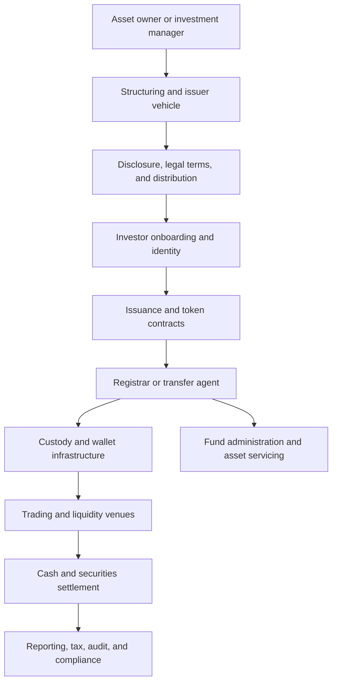
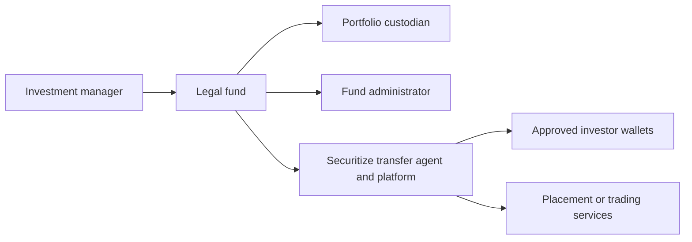
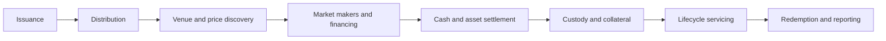

# Tokenization Platforms and Market Case Studies

## Scope and Reading Method

Tokenization platforms combine technology with regulated functions such as
issuance, transfer agency, custody, fund administration, broker-dealer activity,
trading, and settlement. No single platform necessarily performs all of them,
and the same brand may include several separately regulated entities.

This note maps the platform stack and studies representative implementations.
It is a neutral technical and financial comparison, not a ranking. Product
features and market figures change quickly; specific descriptions are current to
July 2026 unless a different date is stated.

Before comparing companies, read
[Tokenization of Securities, Funds, and Real-World Assets](tokenization-of-securities-funds-and-real-world-assets.md).
It explains the legal and economic structures that platforms implement.

## 1. The Platform Stack

### 1.1 Structuring

The asset must be placed into a recognized legal form: a bond, fund, note,
partnership interest, trust certificate, warehouse receipt, or other claim.
Technology providers often work with external counsel, administrators,
custodians, and special-purpose vehicles.

### 1.2 Primary distribution

A placement agent, broker-dealer, investment firm, bank, or licensed platform
may solicit and onboard investors. Rules depend on jurisdiction and offering
type. A public website does not imply a public offering.

### 1.3 Tokenization and transfer controls

The technology layer:

- creates contracts and token classes;
- binds wallets to verified investors;
- mints and burns;
- applies transfer restrictions;
- records ownership or mirrors a register;
- processes distributions;
- exposes APIs and reports; and
- connects several blockchains or custodians.

### 1.4 Transfer agency or registrar

This function determines the recognized holder, maintains records, processes
transfers, applies restrictions, and handles lost credentials and corporate
actions. It is often more legally important than the token contract.

### 1.5 Fund administration and asset custody

An administrator calculates net asset value, keeps fund books, and coordinates
subscriptions, redemptions, expenses, and reporting. A conventional custodian
holds the portfolio. A digital-asset custodian controls token keys. These roles
must not be conflated.

### 1.6 Secondary trading

A regulated venue may match buyers and sellers. Some tokens can transfer
peer-to-peer only between approved investors; others trade on an alternative
trading system or another licensed market. Technical transferability is not
liquidity.

### 1.7 Settlement and interoperability

Platforms connect to bank payments, stablecoins, deposit tokens, or central-bank
money. Cross-chain issuance can use separate share classes, canonical
burn-and-mint, or a bridge. Each model affects supply control and risk.

## 2. Securitize

### 2.1 Business and regulatory functions

Securitize provides a technology and regulated-services stack for digital
securities. In the United States, different affiliates perform functions that
include:

- SEC-registered transfer agency;
- broker-dealer and placement activity;
- operation of an alternative trading system;
- fund administration; and
- investment-adviser-related services.

The separation matters: "Securitize" is a commercial group, while the legal
counterparty and regulated entity differ by service.

### 2.2 Issuance model

The platform supports onboarding, wallet authorization, token issuance,
subscription and redemption records, transfer restrictions, distributions, and
reporting. It supports multiple public blockchains.

For a tokenized fund, the typical division of labor is:

Securitize does not become the investment manager or underlying portfolio
custodian merely because it mints fund tokens.

### 2.3 BUIDL

BlackRock launched the BlackRock USD Institutional Digital Liquidity Fund,
known as BUIDL, with Securitize in March 2024. The product is a private fund for
eligible investors, not a bank deposit or general-purpose stablecoin.

The original announced structure included:

- BlackRock as investment manager;
- investments in cash, U.S. Treasury bills, and repurchase agreements;
- BNY Mellon as custodian and administrator;
- Securitize as transfer agent and tokenization platform;
- Securitize Markets as placement agent;
- daily dividend accrual paid as additional tokens monthly;
- a targeted stable value of one U.S. dollar per token; and
- transfers among pre-approved investors.

The fund later expanded across several blockchain networks. Separate network
availability requires controls that keep share classes and total supply aligned.
Wormhole has been used for cross-chain interoperability. This introduces a
dependency beyond the fund portfolio and core registrar.

BUIDL illustrates how a tokenized security can become onchain collateral. By
2026, integrations had enabled qualified users to use it in exchange and
off-exchange collateral arrangements. This does not make it risk-free cash:
margin rules, custody, fund liquidity, eligibility, and liquidation policy still
apply.

### 2.4 Other Securitize products

The platform has supported tokenized exposures from managers including Apollo,
Hamilton Lane, KKR, and VanEck. Products differ substantially:

- Treasury and money-market strategies have short-duration liquid portfolios;
- private-credit and private-equity funds have valuation and redemption
  constraints;
- feeder funds add an intermediary vehicle;
- a token may be a specific share class rather than the entire fund; and
- jurisdiction and investor qualification vary.

Company-wide asset totals are not a substitute for product-level analysis.

## 3. Franklin Templeton Benji

### 3.1 Fund structure

The Franklin OnChain U.S. Government Money Fund is a U.S.-registered money
market fund. Its shares are represented as BENJI tokens. Franklin Templeton's
transfer agent maintains the official share-ownership record through the
blockchain-integrated Benji system.

This design is especially instructive because the public-chain record is
integrated with conventional regulated fund recordkeeping rather than acting as
an unaffiliated wrapper.

### 3.2 Economics

The fund invests under its prospectus in government securities, cash, and
repurchase agreements. One BENJI token represents one fund share. Income accrues
through the fund and is reflected through distributions of additional shares.

The token is:

- a mutual-fund share;
- subject to the fund's prospectus, fees, and risks;
- controlled in the official records by the transfer agent; and
- available only through supported accounts, wallets, and networks.

It is not:

- a direct Treasury security;
- an FDIC-insured bank deposit;
- a promise by a blockchain validator; or
- freely transferable to any anonymous address.

### 3.3 Multi-network recordkeeping

Benji supports transaction activity on multiple public blockchains. Multi-chain
availability can improve reach but complicates:

- a single authoritative shareholder record;
- prevention of duplicate supply;
- corporate actions and distributions;
- chain outages and forks;
- wallet support; and
- transfers between networks.

The transfer agent's control and reconciliation processes are therefore central
to the design.

## 4. Ondo Finance

Ondo develops tokenized products and infrastructure connecting public
blockchains to conventional securities. Product names, legal issuers, and
eligibility should be evaluated separately.

### 4.1 OUSG

OUSG provides eligible investors with tokenized exposure to short-term U.S.
government securities and related institutional products. Its portfolio and
wrapper have evolved over time; current official materials must be used rather
than assuming the original structure remains unchanged.

Key analytical questions are:

- which legal vehicle issues the token;
- what portfolio instruments it holds;
- who manages and custodies them;
- how net asset value and income are reflected;
- subscription and redemption currencies and timing;
- investor and jurisdiction restrictions;
- which networks and bridges are used; and
- whether third-party protocols accept the token as collateral.

### 4.2 USDY

USDY is structured as a tokenized note backed by short-term U.S. Treasuries and
bank deposits. It is not a stablecoin with guaranteed constant price. Its value
is intended to reflect accrued yield, subject to product terms, assets, fees,
issuer structure, and eligibility.

The note structure means holders analyze the issuer's obligation and collateral
arrangements, rather than treating each token as direct ownership of an
identified Treasury bill.

### 4.3 Ondo Global Markets

Ondo has also developed infrastructure for tokenized exposure to publicly traded
securities. A token referencing a stock or ETF can be:

- a legally recognized beneficial interest in a held security;
- a secured issuer obligation;
- a derivative or synthetic claim; or
- another wrapper.

Corporate actions, voting, dividends, market hours, price divergence, and
redemption determine how closely the token reproduces the conventional asset.
The product's legal documents, not the ticker, give the answer.

## 5. Bank and Market-Infrastructure Platforms

### 5.1 Kinexys Digital Assets

Kinexys by J.P. Morgan combines digital-payment and digital-asset applications.
Its Digital Financing application has supported intraday repo transactions, and
its Tokenized Collateral Network has been used to transfer tokenized collateral
interests.

The design pattern is institutional:

- known participants;
- controlled assets and entitlements;
- integration with bank cash and custody;
- near-real-time DvP;
- shared workflow records; and
- legal agreements outside the ledger.

Kinexys demonstrates that tokenization can target financing and collateral
mobility rather than public secondary trading.

### 5.2 DTCC Digital Assets

DTCC is a major post-trade market infrastructure group. Its digital-asset work
has included ComposerX, Digital Launchpad, tokenization services, and a
Collateral AppChain.

Its position differs from a startup issuer platform. DTCC's comparative role is
connectivity to established depository, clearing, data, and post-trade
processes. Its experiments emphasize:

- institutional scale;
- network-agnostic interoperability;
- asset lifecycle orchestration;
- privacy and access control;
- collateral mobility; and
- integration rather than wholesale replacement of existing infrastructure.

A demonstration shows workflow feasibility; production legal finality and broad
participant adoption require separate evidence.

### 5.3 SIX Digital Exchange

SIX Digital Exchange combines issuance, trading, central securities depository,
and settlement infrastructure for digital securities within Swiss regulatory
frameworks. It represents an integrated regulated-market model rather than a
public DeFi model.

Its architecture highlights a core institutional question: should DLT functions
be added to incumbent market infrastructure, built as a parallel regulated
venue, or developed on open public networks?

### 5.4 Deutsche Börse D7 and Clearstream

Deutsche Börse's D7 infrastructure supports digital issuance and post-trade
processes under European and German electronic-securities frameworks.
Not every digital security uses a blockchain; central registries and DLT
registers can coexist under law.

This is a useful reminder that "tokenization" is one part of securities
digitization. Legal electronic issuance, standardized data, and automated
workflows can produce value without a permissionless chain.

## 6. Public-Sector and Industry Projects

### 6.1 Project Guardian

The Monetary Authority of Singapore launched Project Guardian to test
institutional asset tokenization and decentralized-finance mechanisms with
regulated financial institutions.

Use cases have covered:

- foreign exchange and tokenized deposits;
- tokenized bonds and repo;
- digitally issued funds;
- private credit;
- structured products;
- portfolio construction; and
- interoperable networks.

Project Guardian has also produced frameworks and standards work, including
efforts toward common asset models and network interoperability. Its lasting
value may be shared specifications and legal-operating knowledge rather than any
single pilot transaction.

### 6.2 Project Helvetia

The BIS Innovation Hub, Swiss National Bank, and SIX tested settlement of
tokenized assets using wholesale central-bank money. Later phases included
production-environment experimentation with participant banks and real bond
issuances.

The project compares:

- issuing wholesale CBDC on the asset platform; and
- linking the DLT platform to the existing central-bank payment system.

The comparison exposes a general trade-off: common-ledger atomicity versus reuse
of established settlement infrastructure.

### 6.3 Project Genesis and Hong Kong tokenized green bonds

Hong Kong initiatives have explored tokenized green-bond issuance and the
connection of verified environmental data to financial instruments. The
government has also issued tokenized green bonds.

Tokenization can improve lifecycle data and reporting, but the environmental
claim is only as reliable as project standards, measurement, verification, and
oracles. A blockchain preserves submitted data; it does not prove that emissions
were reduced.

### 6.4 European Investment Bank digital bonds

The European Investment Bank has issued digital bonds using several
infrastructures and settlement models. These transactions demonstrate native
digital issuance, but differences in governing law, depository structure,
central-bank money access, and platform design mean they should be compared at
the lifecycle level rather than grouped as one technology.

### 6.5 Sovereign digital bonds

Jurisdictions including Hong Kong, Slovenia, the Philippines, and Thailand have
explored or completed forms of digital government debt issuance. Sovereign
involvement can catalyze standards and cash settlement, but a successful issue
does not guarantee an active secondary market.

## 7. Comparing Platform Models

| Model | Representative examples | Strength | Structural limitation |
|---|---|---|---|
| Regulated tokenization stack | Securitize | Combines issuance technology with regulated services | Relies on multiple entities and external custodians |
| Asset-manager-native recordkeeping | Franklin Templeton Benji | Official fund record integrated with public chains | Primarily tied to the manager's products |
| Onchain product and distribution platform | Ondo | Designed for crypto-market integration | Wrapper, eligibility, and product structures vary |
| Bank-led network | Kinexys | Integrated cash, credit, custody, and institutional controls | Bank or participant network is permissioned |
| Incumbent market infrastructure | DTCC, SIX, Clearstream | Links to established post-trade and legal frameworks | Migration and consortium coordination can be slow |
| Public-sector experiment | Guardian, Helvetia | Tests policy, standards, and cross-industry design | Pilot scope does not establish commercial scale |
| Public-chain protocol | General smart-contract platforms | Open developer and wallet ecosystem | Compliance, privacy, legal finality, and bridge risks |

The models can converge. A regulated transfer agent can issue on public chains;
an incumbent infrastructure can operate an appchain; a bank token can settle a
public-chain fund; and a public protocol can provide interoperability to
permissioned assets.

## 8. Interoperability and Multi-Chain Assets

An asset available on several networks can use:

1. separate legally recognized share classes;
2. one canonical issuance plus locked-and-minted representations;
3. burn on the source and mint on the destination;
4. a registrar that reassigns the official record between network addresses; or
5. a custodial omnibus wrapper on each chain.

These approaches are not equivalent.

Questions include:

- Is supply globally capped?
- Who authorizes cross-chain movement?
- Does a bridge compromise the asset if attacked?
- Is the destination token the same legal security?
- Can corporate actions reach every chain?
- What happens when one chain halts or forks?
- Can an investor redeem without using the bridge?
- Are holder eligibility rules consistent?

Cross-chain availability increases distribution but also increases the security
perimeter.

## 9. From Tokenized Product to Market

A market needs more than issuance:

Many projects succeed at minting but remain isolated because they lack:

- compatible cash;
- secondary venues;
- market makers;
- collateral eligibility;
- custody support;
- common identity;
- data standards;
- cross-platform transfer; or
- sufficient investor demand.

The next phase of tokenization is therefore less about token creation and more
about market plumbing.

## 10. Neutral Evaluation Template

For a platform or product, record:

### Company and legal perimeter

- parent group and relevant subsidiaries;
- licenses and jurisdictions;
- exact regulated role of each entity;
- issuer and product vehicle;
- conflicts of interest; and
- whether claims are company-reported or independently verified.

### Product

- asset and legal rights;
- portfolio and manager;
- custodian and administrator;
- fees, yield treatment, NAV, and redemption;
- eligible investors;
- authoritative ownership record; and
- insolvency treatment.

### Technology

Technology diligence asks whether the platform can preserve the instrument's
legal state through its full lifecycle. Minting a token is only the first step:
the system must enforce eligibility, process corporate actions, reconcile
authoritative records, recover keys, handle chain changes, and integrate cash
settlement. A broad chain list is less important than reliable support for those
events.

- supported networks and token standards;
- contract administration powers;
- identity and transfer controls;
- key custody and recovery;
- oracle and data dependencies;
- cross-chain mechanism;
- audits and incident history; and
- reconciliation with offchain systems.

### Market

- issuance outstanding by product, with date and source;
- primary and secondary liquidity;
- trading and settlement venues;
- cash leg;
- collateral use;
- concentration by issuer, chain, and service provider; and
- realistic alternative infrastructure.

Avoid vendor rankings built from incomparable metrics. "Assets tokenized" may
mean current net asset value, cumulative issuance, assets represented, or assets
for which software was used. "Transactions processed" may be notional, not
revenue or assets under custody.

## 11. Key Takeaways

1. A tokenization platform is a service stack, not just smart-contract software.
2. Regulated functions may be split among affiliated and external entities.
3. Securitize demonstrates an integrated transfer-agent, distribution,
   administration, and technology model; BUIDL is a fund share, not a stablecoin.
4. Benji integrates a regulated fund's official ownership record with public
   blockchains.
5. Ondo products show why each wrapper, issuer, and portfolio must be analyzed
   separately.
6. Kinexys, DTCC, SIX, and Clearstream emphasize institutional settlement and
   lifecycle infrastructure rather than unrestricted bearer trading.
7. Public projects such as Guardian and Helvetia generate standards and evidence,
   but pilots are not proof of scaled production economics.
8. Multi-chain issuance expands reach while adding supply, bridge, fork, and
   corporate-action risk.
9. The binding constraints are increasingly cash, identity, legal finality,
   liquidity, custody, and interoperability—not the ability to mint tokens.

## Related Notes

- [Tokenization of Securities, Funds, and Real-World Assets](tokenization-of-securities-funds-and-real-world-assets.md)
- [Tokenized Deposits and Commercial-Bank Money](../02-cbdcs-and-bank-money/tokenized-deposits-and-commercial-bank-money.md)
- [Stablecoin Issuers and Protocols](../01-stablecoins/stablecoin-issuers-and-protocols.md)
- [Financial Market Infrastructure](../../01-financial-foundations/02-financial-markets/financial-market-infrastructure.md)
- [Institutional Custody and Wallet Infrastructure](../../03-digital-assets-and-market-structure/04-wallets-and-custody/institutional-custody-and-wallet-infrastructure.md)
- [Blockchain Interoperability and Bridges](../../06-interoperability-privacy-and-enterprise-dlt/01-interoperability/blockchain-interoperability-and-bridges.md)

## References

- Securitize, [BlackRock launches BUIDL](https://investors.securitize.io/news/news-details/2024/BlackRock-Launches-Its-First-Tokenized-Fund-BUIDL-on-the-Ethereum-Network-03-20-2024/default.aspx)
- Securitize, [BUIDL expands to Solana](https://investors.securitize.io/news/news-details/2025/BlackRock-and-Securitize-Debut-New-BUIDL-Share-Class-on-Solana-Network-03-25-2025/default.aspx)
- Securitize, [Fund services](https://securitize.io/fund-services)
- Franklin Templeton, [Benji](https://digitalassets.franklintempleton.com/benji/)
- Franklin Templeton, [Franklin OnChain U.S. Government Money Fund prospectus](https://www.franklintempleton.com/forms-literature/download-preview/9001-P)
- Ondo Finance, [Documentation](https://docs.ondo.finance/)
- J.P. Morgan, [Kinexys](https://www.jpmorgan.com/kinexys)
- DTCC, [Digital Assets](https://www.dtcc.com/digital-assets)
- DTCC, [Tokenized real-time collateral management platform](https://www.dtcc.com/news/2025/april/02/dtcc-announces-new-platform-for-tokenized-real-time-collateral-management)
- SIX Digital Exchange, [About SDX](https://www.sdx.com/)
- Clearstream, [D7 digital post-trade platform](https://www.clearstream.com/clearstream-en/securities-services/d7)
- Monetary Authority of Singapore, [Project Guardian](https://www.mas.gov.sg/schemes-and-initiatives/project-guardian)
- BIS Innovation Hub, [Project Helvetia](https://www.bis.org/about/bisih/topics/cbdc/helvetia.htm)
- BIS Innovation Hub, [Project Genesis](https://www.bis.org/about/bisih/topics/green_finance/genesis.htm)
- Hong Kong Monetary Authority, [Tokenised green bond](https://www.hkma.gov.hk/eng/news-and-media/press-releases/2023/02/20230216-3/)
- European Investment Bank, [EIB launches digital bond issuance on a blockchain platform](https://www.eib.org/en/press/all/2021-141-european-investment-bank-eib-issues-its-first-ever-digital-bond-on-a-public-blockchain)
- International Capital Market Association, [DLT and bond market tracker](https://www.icmagroup.org/market-practice-and-regulatory-policy/fintech-and-digitalisation/distributed-ledger-technology-dlt/)
- International Organization of Securities Commissions, [Tokenization of Financial Assets](https://www.iosco.org/library/pubdocs/pdf/IOSCOPD809.pdf)
