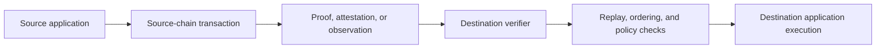
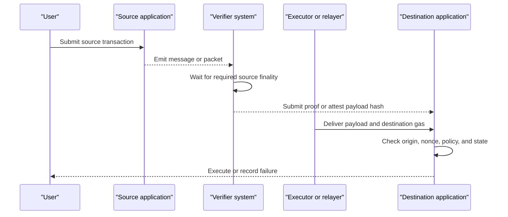

# Blockchain Interoperability and Bridges

## Scope

Blockchains are separate state machines. A contract on one chain cannot natively
read another chain's current state or cause it to execute a transaction. An
interoperability system supplies evidence about a source chain to a destination
and coordinates what should happen next.

This note explains cross-chain messaging, asset bridges, atomic swaps, light
clients, validator networks, optimistic verification, zero-knowledge proofs,
shared sequencers, and enterprise ledger integration. It emphasizes trust
assumptions, finality, failure modes, and application design.

## 1. The Fundamental Problem

Suppose a user locks an asset on Chain A and expects a representation to be
minted on Chain B. Chain B must answer:

1. Did the lock transaction really occur?
2. Is it final enough that Chain A will not reverse it?
3. Does the message come from the authorized source contract?
4. Has this message already been processed?
5. Is the requested destination action valid?
6. Who pays for delivery and execution?
7. What happens if either chain halts, reorganizes, or changes protocol?

Blockchains deliberately do not share a universal clock, validator set, state,
or finality rule. A bridge therefore creates a new distributed system whose
security depends on both chains **and** on the verification and custody mechanism
between them.



## 2. Interoperability Is More Than Asset Bridging

### 2.1 State and data queries

An application may need evidence of a balance, vote, identity credential, price,
or event on another ledger without moving an asset.

### 2.2 Arbitrary messaging

A general message can instruct a destination contract to call a function with
specified data. This enables cross-chain governance, lending, swaps, and
application state synchronization.

### 2.3 Asset transfer

An asset bridge coordinates supply or custody so that value appears on another
chain without unauthorized duplication.

### 2.4 Atomic exchange

Two parties exchange assets on different ledgers so that either both transfers
complete or neither does. Hashed timelock contracts can do this for compatible
assets without a general messaging bridge.

### 2.5 Cross-network workflow

Enterprise systems may coordinate permissioned ledgers, public chains, payment
systems, and conventional databases. The workflow can include identity,
approvals, legal records, and privacy, not just a smart-contract message.

## 3. Asset-Transfer Models

### 3.1 Lock and mint

The original asset is locked in a source-chain contract or custodian. A wrapped
representation is minted on the destination.

```text
Source supply:
circulating original decreases by 100
locked original increases by 100

Destination supply:
wrapped representation increases by 100
```

On return, the wrapped token is burned and the original is released.

The destination holder owns a claim on the bridge's locked pool, not the native
asset itself. If custody or verification fails, wrapped tokens can become
unbacked.

### 3.2 Burn and mint

A multichain issuer burns canonical units on the source and mints the same asset
on the destination. No locked backing pool is required, but mint authority and
global supply accounting must be secure.

Native stablecoin cross-chain protocols often use this model. The issuer remains
able to recognize and control supply on every supported chain.

### 3.3 Liquidity network

Liquidity providers pay users on the destination and later rebalance or settle
among themselves. Users receive native destination assets rather than wrapped
claims.

Benefits include faster user fulfillment and reduced wrapped-asset exposure.
Risks include:

- liquidity-provider solvency;
- inventory imbalance;
- pricing and fee risk;
- delayed final settlement;
- relayer censorship; and
- fallback behavior when liquidity disappears.

### 3.4 Canonical versus third-party bridges

A canonical bridge is recognized by the chain or asset issuer. A third-party
bridge provides an alternative route, often with different speed and trust.
Canonical does not mean risk-free: a rollup's canonical bridge depends on its
proof system, upgrade keys, sequencer, and parent chain.

Multiple wrappers of the same asset fragment liquidity. Token tickers alone do
not identify the canonical contract.

## 4. Verification Models

### 4.1 Externally verified committee

A validator, relayer, oracle, or multisignature committee observes the source
chain and attests to messages. The destination accepts a threshold of signatures.

Advantages:

- supports heterogeneous chains;
- relatively simple and fast;
- predictable destination cost; and
- can add institutional governance.

Risks:

- committee compromise or collusion;
- concentrated keys;
- weak incentives or slashing;
- software common-mode failures; and
- governance capture.

Calling a committee "decentralized" is insufficient. Analyze membership,
threshold, operator independence, key security, rotation, monitoring, and
consequences of false signing.

### 4.2 Light-client verification

The destination maintains a compact client of the source chain and verifies
consensus headers and inclusion proofs.

This can inherit source-chain security more directly, but:

- verifying another consensus may be expensive;
- finality and validator-set updates are chain-specific;
- one chain may not support the cryptography needed efficiently;
- upgrades can break the client; and
- the destination chain's own security still applies.

IBC in the Cosmos ecosystem is the best-known standardized light-client and
packet model. It separates clients, connections, channels, and application
packets.

### 4.3 Optimistic verification

Messages are presumed valid after a challenge window unless a watcher submits
fraud evidence. Security requires at least one honest, live watcher with an
economic ability to challenge.

Trade-offs:

- lower routine verification cost;
- delayed finality;
- dependence on watchers and dispute contracts;
- challenge-period liquidity costs; and
- risk when data needed for a challenge is unavailable.

### 4.4 Zero-knowledge or validity proofs

A prover generates a succinct proof that a source-chain state transition,
consensus event, or message is valid. A destination verifier checks the proof.

Potential strengths:

- cryptographic verification rather than a signing committee;
- compact onchain checks;
- possible privacy; and
- reduced need to replay source execution.

Constraints:

- complex circuits and proving systems;
- source-chain consensus must be represented correctly;
- prover latency and cost;
- trusted setup for some systems;
- verifier and circuit bugs;
- upgrade risk; and
- difficulty supporting many heterogeneous chains.

"ZK bridge" describes a proof technique, not a complete security guarantee.

### 4.5 Native or shared verification

Chains can share validators, a settlement layer, or a common interoperability
hub. Examples include rollups settling to the same layer, zones connected
through a hub, or chains secured by a shared validator set.

Shared security reduces some external assumptions but increases common-mode and
concentration risk. It also does not automatically provide synchronous execution
or shared liquidity.

### 4.6 Configurable multi-verifier systems

Some protocols let each application choose several verifier networks and a
threshold. Diversity can reduce dependence on one mechanism, but configuration
becomes part of application security.

If an application chooses one weak verifier, the protocol's menu of stronger
options does not protect it. Users must analyze the actual pathway
configuration, not only the protocol's maximum capabilities.

## 5. Message Lifecycle

A general cross-chain message normally follows these phases:



### 5.1 Dispatch

The source contract commits a payload containing:

- source and destination identifiers;
- sender and recipient application;
- nonce or unique message ID;
- data payload;
- gas or execution options; and
- sometimes a timeout.

### 5.2 Observation and finality

Verifiers observe the source event and wait according to the chain's finality
model. Too few confirmations expose the bridge to reorganization. Excessive
waiting harms latency.

Finality is not uniform:

- BFT chains may have explicit finality;
- proof-of-work chains provide increasing economic confidence;
- rollups depend on sequencers, proofs, and a parent chain;
- optimistic rollups have challenge periods for canonical exits; and
- administratively controlled chains may reverse through governance.

### 5.3 Verification

The destination records that the message meets the configured security rule.
Verification should bind the exact source chain, source contract, destination,
nonce, and payload so an attacker cannot replay a valid message elsewhere.

### 5.4 Execution

An executor pays destination gas and calls the recipient. Verification and
execution are often separated: a malicious executor should not forge a message,
and another party should be able to deliver a verified message.

Destination execution can fail because of insufficient gas, changed state,
reverting application logic, or exhausted limits. Systems need retry and refund
rules that do not allow double execution.

## 6. Ordering, Replay, and Partial Failure

### 6.1 Exactly once versus at least once

A transport may deliver a message more than once. The destination application
must be idempotent or record processed IDs.

### 6.2 Ordered versus unordered channels

Ordered channels process nonces sequentially. They preserve sequence but one
failed message can block later messages. Unordered channels allow parallel
execution but applications must prevent invalid reordering.

### 6.3 Cross-chain transactions are asynchronous

There is no global transaction that rolls back both independent chains. Once the
source action is final, a failed destination action needs:

- retry;
- compensation;
- refund through another message;
- manual governance; or
- a state machine that waits before final source commitment.

Application designers should use saga-like workflows and explicit intermediate
states rather than pretend that remote calls are synchronous.

### 6.4 Timeouts

Different chains have different notions of time and block height. Timeout logic
must specify which chain's clock governs and prevent both refund and destination
execution from succeeding.

## 7. Atomic Swaps

Hashed timelock contracts let two parties exchange assets using a shared secret.

1. Alice selects a secret and publishes its hash.
2. Alice locks Asset A for Bob, redeemable with the secret before a timeout.
3. Bob locks Asset B for Alice with the same hash and a shorter timeout.
4. Alice redeems Asset B, revealing the secret.
5. Bob uses the revealed secret to redeem Asset A.

If no redemption occurs, both eventually refund.

HTLCs minimize third-party verification but have limits:

- both ledgers need compatible hash and timelock features;
- participants must remain online;
- one party learns market information before completion;
- capital is locked during timeouts;
- privacy is limited; and
- arbitrary application state is not synchronized.

Adaptor signatures and more advanced cryptography can improve privacy and
functionality for some chains.

## 8. Bridge Security

Bridges have suffered some of the largest digital-asset exploits because they
combine high-value custody with complex, privileged cross-chain logic.

### 8.1 Main attack surfaces

A bridge is exposed wherever a remote event becomes local authority. An attacker
may compromise the humans or keys attesting to the event, exploit the code that
verifies it, confuse its source domain, or induce the bridge to act before source
finality. The resulting message can be perfectly valid on the destination chain
while economically false.

- compromised validator or multisignature keys;
- forged or incorrectly verified proofs;
- source-address or chain-ID confusion;
- replay and nonce bugs;
- token mint or custody-contract vulnerabilities;
- upgrade-key compromise;
- faulty message parsing;
- destination reentrancy or arbitrary-call behavior;
- oracle and price manipulation;
- relayer or sequencer censorship;
- compromised front ends and DNS;
- chain reorganizations; and
- governance capture.

### 8.2 The weakest-link rule

For a bridged asset:

```text
effective security is bounded by the weakest critical dependency
```

Dependencies include the source chain, destination chain, bridge verifier,
custody or mint contract, governance, application, oracle, and user wallet.
Diversifying validators does not fix an unlimited upgrade key.

### 8.3 Blast-radius controls

Useful controls include:

- per-asset and per-path rate limits;
- delayed large transfers;
- circuit breakers;
- independent anomaly monitoring;
- validator and implementation diversity;
- hardware-protected keys;
- least-privilege contracts;
- staged upgrades and timelocks;
- emergency pause with transparent governance;
- proof and configuration monitoring;
- insurance or loss-allocation arrangements; and
- explicit recovery plans.

Rate limits do not prevent every attack, but can bound losses while responders
act.

### 8.4 Audits and bug bounties

Audits are snapshots, not guarantees. Cross-chain code needs:

- specification and invariant testing;
- fuzzing and formal verification where appropriate;
- adversarial testing of reorgs and partial failure;
- independent implementation reviews;
- continuous monitoring;
- meaningful bug bounties; and
- transparent incident disclosure.

## 9. Bridge Risk for Applications and Assets

An application that accepts a bridged token as collateral inherits bridge risk.
If unauthorized units are minted on one chain, attackers may:

1. deposit them into lending or trading protocols;
2. borrow or swap into sound assets;
3. propagate losses across chains and venues; and
4. leave the bridge and integrated protocols insolvent.

Risk controls include:

- identifying exact contract and bridge provenance;
- collateral haircuts by route;
- supply caps;
- oracle design that handles depegs;
- isolation modes;
- issuer-native redemption;
- monitoring locked backing against issued supply; and
- rapid governance processes with constrained authority.

A token with the same ticker can have different risk on each chain.

## 10. Liquidity and User Experience

Interoperability affects market structure.

### 10.1 Fragmentation

Assets, applications, and users spread across chains. Each venue develops its
own liquidity and price. Bridges reconnect them but create fees, latency, and
risk.

### 10.2 Intents and solvers

Instead of choosing a bridge and route, a user can state an outcome: "deliver
100 units of Asset B on Chain Y." Solvers compete to fulfill it using their
liquidity and later settle.

Intent systems can improve execution and hide complexity, but users depend on:

- clear constraints and minimum output;
- solver competition;
- settlement and bond mechanisms;
- protection from order-flow exploitation;
- fallback when no solver fills; and
- correct destination and asset identity.

### 10.3 Chain abstraction

Wallets and applications may sponsor gas, route messages, unify balances, and
present one account across chains. This improves usability while concentrating
complexity in account, relayer, and solver infrastructure. Hidden bridging is
still bridging.

## 11. Enterprise and Permissioned-Ledger Interoperability

Institutional networks often require:

- verified organizations and roles;
- confidential data partitions;
- policy approval before asset movement;
- legally recognized identities;
- integration with core systems;
- deterministic governance;
- audit and regulatory access; and
- interoperability without exposing data to a public relay chain.

Frameworks such as Hyperledger Cacti provide connectors, relays, and libraries
for data sharing, asset transfer, and atomic exchange across heterogeneous DLTs.
They emphasize preservation of each network's governance and may avoid a
mandatory intermediate chain.

Enterprise interoperability is not automatically safer. Trust moves into
membership services, notaries, relays, policy engines, certificate authorities,
and operators.

## 12. Protocol Families

| Family | Examples | Core verification idea | Main analytical focus |
|---|---|---|---|
| Light-client protocol | IBC | Destination verifies source consensus proofs | Client correctness and upgrade support |
| Configurable messaging | LayerZero | Application-selected verifier networks and threshold | Actual pathway configuration |
| Oracle and committee network | Chainlink CCIP | Independent oracle nodes plus risk controls | Committee, risk network, and admin controls |
| Validator-chain gateway | Axelar | Proof-of-stake validator network authorizes gateways | Validator concentration and gateway control |
| Optimistic messaging | Across, Nomad-style designs | Watchers can challenge invalid messages | Challenge window and honest watcher |
| Native rollup bridge | Ethereum rollup bridges | Parent-chain proofs and rollup protocol | Upgrade keys, sequencer, proof and delays |
| Liquidity bridge | Across and solver systems | Liquidity providers fulfill then settle | LP solvency and settlement |
| Enterprise toolkit | Hyperledger Cacti | Connectors, relays, policies, and proofs | Deployment-specific trust and identity |

Protocol brands evolve. Evaluate the deployed version and message path.

## 13. Evaluation Checklist

### Source and destination

1. exact chain IDs and finality assumptions;
2. source and destination contract addresses;
3. behavior during reorgs, halts, and forks;
4. supported upgrades; and
5. legal meaning of the transferred asset or message.

### Verification

6. proof or attestation mechanism;
7. validator, oracle, watcher, or prover set;
8. threshold, independence, and economic security;
9. confirmation depth and challenge period;
10. onchain verifier mutability; and
11. actual application-level configuration.

### Execution

12. relayer and executor permissions;
13. ordering and replay protection;
14. gas payment and retry;
15. failure, timeout, and refund semantics; and
16. arbitrary-call and reentrancy constraints.

### Assets

17. lock-and-mint, burn-and-mint, or liquidity model;
18. custody of backing;
19. global supply accounting;
20. redemption without the bridge;
21. rate limits and caps; and
22. treatment after exploit or chain fork.

### Governance and operations

23. upgrade, pause, freeze, and mint authority;
24. key custody and signer rotation;
25. monitoring and incident response;
26. audits and disclosed incidents;
27. fee and incentive model; and
28. recovery and loss allocation.

## 14. Key Takeaways

1. Cross-chain systems transport evidence and coordinate state; chains cannot
   natively trust one another.
2. A bridge adds a new security domain on top of both connected chains.
3. Wrapped assets are claims on custody and verification arrangements, not
   automatically the native asset.
4. Verification may use committees, light clients, optimistic challenges,
   validity proofs, or shared security. Each has distinct assumptions.
5. Verification and execution should be separated so a relayer cannot forge
   messages and messages remain deliverable.
6. Cross-chain workflows are asynchronous and need explicit retries,
   compensation, ordering, and timeout logic.
7. Application configuration determines security in modular interoperability
   protocols.
8. Token tickers do not identify bridge provenance or legal rights.
9. Rate limits, caps, monitoring, and recovery reduce blast radius but do not
   replace correct verification.
10. Interoperability must cover money, identity, privacy, legal finality, and
    governance—not only technical packet delivery.

## Related Notes

- [Blockchain Architecture](../../02-blockchain-foundations/01-core-architecture/blockchain-architecture.md)
- [Peer-to-Peer Networks, Finality, and Forks](../../02-blockchain-foundations/02-consensus-and-networks/peer-to-peer-networks-finality-and-forks.md)
- [Blockchain Scaling and Modular Architecture](../../02-blockchain-foundations/04-scaling-and-modularity/blockchain-scaling-and-modular-architecture.md)
- [LayerZero](layerzero.md)
- [Interoperability Protocols](interoperability-protocols.md)
- [DeFi Risk, Security, and Economic Attacks](../../04-decentralized-finance/04-defi-risk-and-failures/defi-risk-security-and-economic-attacks.md)
- [Tokenization Platforms and Market Case Studies](../../05-digital-money-and-tokenization/03-tokenized-assets/tokenization-platforms-and-market-case-studies.md)

## References

- NIST, [Blockchain Networks: Token Design and Management Overview](https://csrc.nist.gov/pubs/ir/8301/final)
- IETF, [Secure Asset Transfer Protocol architecture](https://datatracker.ietf.org/doc/draft-ietf-satp-architecture/)
- Cosmos, [IBC protocol documentation](https://ibc.cosmos.network/)
- Ethereum, [Bridges](https://ethereum.org/en/developers/docs/bridges/)
- LayerZero, [Protocol overview](https://docs.layerzero.network/v2/concepts/protocol/protocol-overview)
- Chainlink, [CCIP architecture](https://docs.chain.link/ccip/concepts/architecture)
- Axelar, [Network documentation](https://docs.axelar.dev/)
- Hyperledger Cacti, [Documentation](https://hyperledger-cacti.github.io/cacti/)
- BIS Committee on Payments and Market Infrastructures, [Linking fast payment systems across borders](https://www.bis.org/cpmi/publ/d223.htm)
- Financial Stability Board, [The Financial Stability Implications of Tokenisation](https://www.fsb.org/2024/10/the-financial-stability-implications-of-tokenisation/)
- European Union Agency for Cybersecurity, [Distributed Ledger Technology: Cybersecurity Challenges](https://www.enisa.europa.eu/publications/blockchain-security)
- Trail of Bits, [Building Secure Contracts: Not So Smart Contracts](https://github.com/crytic/not-so-smart-contracts)
