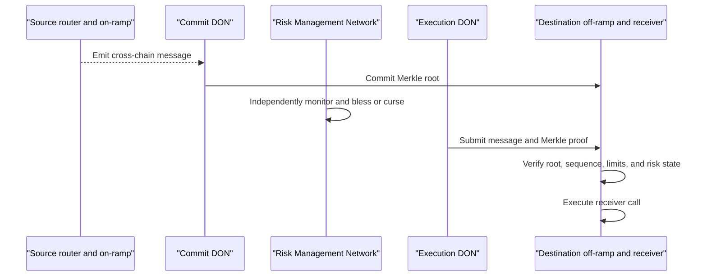
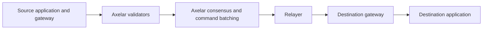
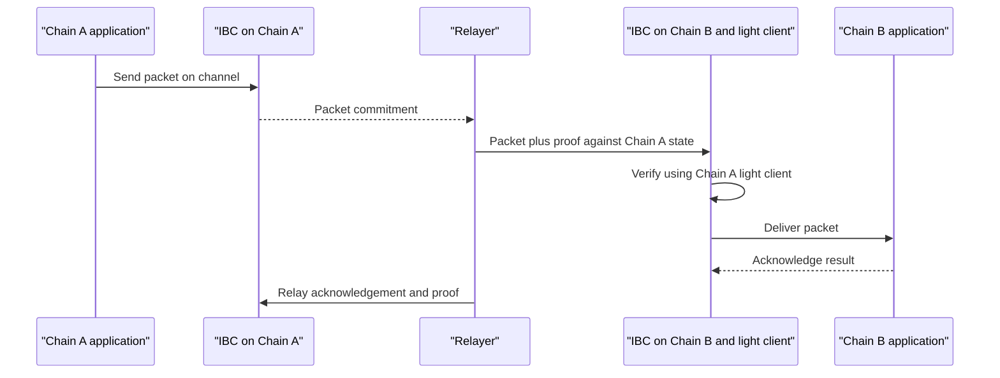

# Interoperability Protocols: CCIP, Axelar, Wormhole, IBC, XCM, and Cacti

## Scope

Interoperability protocols should be compared by what a destination chain
verifies, not by the number of networks or messages shown on a marketing page.
This note studies six material designs:

- Chainlink Cross-Chain Interoperability Protocol, or CCIP;
- Axelar;
- Wormhole;
- Cosmos Inter-Blockchain Communication, or IBC;
- Polkadot Cross-Consensus Messaging, or XCM; and
- Hyperledger Cacti.

They solve overlapping but different problems. Some provide external
verification across unrelated chains; some rely on onchain light clients; some
operate inside a shared-security ecosystem; and Cacti is a modular integration
toolkit rather than a mandatory public relay network.

Read [Blockchain Interoperability and Bridges](blockchain-interoperability-and-bridges.md)
first for the verification models and common risks.

## 1. Comparison Dimensions

For every protocol, ask:

1. What emits the source message?
2. Who or what establishes that it is final and authentic?
3. What proof or signatures does the destination verify?
4. Who delivers and executes it?
5. Are applications free to select or change security?
6. Who can upgrade contracts, rotate signers, or pause traffic?
7. How are assets issued, locked, burned, and rate-limited?
8. What happens during chain reorg, halt, congestion, or partial failure?
9. Is the system general messaging, asset transfer, data query, or workflow
   integration?
10. Does a specific integration add weaker adapters or administrator keys?

## 2. Chainlink CCIP

### 2.1 Architecture

CCIP provides arbitrary messaging and token transfer across supported networks.
Its core design uses separate decentralized oracle networks:

- a **Commit DON** observes source events, reaches consensus, and commits a
  Merkle root of messages to the destination;
- an **Execution DON** observes committed roots and submits message proofs for
  execution; and
- an independent **Risk Management Network** monitors activity and can trigger
  protective actions.

Exact terminology and implementation evolve, so deployed contracts and current
official documentation control.

### 2.2 Token models

CCIP supports:

- lock or burn on the source and mint or release on the destination;
- token pools operated by issuers or applications;
- rate limits by lane and token;
- arbitrary data with token transfer; and
- programmable token transfers.

An issuer can integrate an existing token and retain control of its pools.
CCIP verifies and transports instructions; it does not establish reserve backing
or legal rights.

### 2.3 Security model

Security depends on:

- Chainlink node operators and their software;
- the separate DONs and Risk Management Network;
- source and destination contracts;
- finality configuration;
- administrative and upgrade controls;
- token-pool owners; and
- rate limits.

The Risk Management Network is defense in depth. It does not make compromise of
other components impossible. Independence of operators, implementations, and
infrastructure should be evaluated rather than assumed.

### 2.4 Strengths and limitations

Strengths include integration with the broader Chainlink operator ecosystem,
separation of commit and execution, token-pool controls, and explicit risk
monitoring. Limitations include dependence on external oracle committees and
protocol governance, support constrained to integrated networks, and complexity
across several contracts and roles.

## 3. Axelar

### 3.1 Network model

Axelar operates a proof-of-stake blockchain whose validators observe connected
chains and collectively authorize messages. Gateways on external chains receive
and validate commands approved through Axelar consensus.

The network supports General Message Passing and asset-transfer services.

Validators run processes for supported external chains, vote on events, and
participate in signing commands. Relayers submit approved commands to
destinations.

### 3.2 Amplifier and programmable interoperability

Axelar has developed additional services, including Interchain Token Service and
an Amplifier model intended to make new-chain connections and custom validator
sets more flexible. A particular route may therefore use different verification
arrangements from the base validator network.

As with LayerZero, product-level flexibility means the exact integration path
must be identified.

### 3.3 Security model

Critical assumptions include:

- stake distribution and validator concentration;
- external-chain observation correctness;
- threshold-signature and key-management design;
- gateway contract correctness;
- network governance and upgrades;
- relayer liveness;
- source finality; and
- any route-specific validator set.

Stake can deter false behavior only if misbehavior is attributable, slashable,
and worth less than the value an attacker can extract. Cross-chain value may
exceed the protocol's economic stake.

### 3.4 Strengths and limitations

A common validator network gives one integration model across heterogeneous
chains and a native environment for coordination. It also creates a shared
security dependency: a failure of Axelar consensus, gateway authorization, or
key material can affect many connected paths.

## 4. Wormhole

### 4.1 Core messaging

Wormhole contracts on source chains emit messages. A Guardian Network observes
them and produces Verifiable Action Approvals, or VAAs. Destination contracts
verify the Guardian signatures before consuming the payload.

As of July 2026, official documentation describes 19 canonical Guardians and a
13-of-19 signature threshold. Some chains use delegated observation:

- a configured subset directly observes the chain;
- canonical Guardians wait for the delegate quorum;
- the final VAA still contains the canonical 13-of-19 authorization.

This preserves destination contract compatibility but creates a route-specific
assumption at the observation layer.

### 4.2 Delivery

VAAs can be delivered manually or by a relayer. Wormhole's Executor framework
provides permissionless request-and-quote delivery. A relayer should be unable
to alter an authenticated VAA, but it can delay delivery.

### 4.3 Asset and application products

Wormhole supports:

- generic messaging;
- wrapped token transfers;
- issuer-controlled native token transfers;
- cross-chain queries;
- governance coordination;
- intent and solver settlement; and
- developer SDKs and user interfaces.

Every product adds application contracts and sometimes additional trust beyond
the Core messaging layer.

### 4.4 Governance and security

Guardian supermajority governance can rotate the Guardian set and upgrade
ecosystem contracts. Defense-in-depth mechanisms described by Wormhole include
global supply accounting, monitoring, rate governance, and security programs.

Wormhole suffered a major exploit in February 2022 when a verification flaw in
the Solana token-bridge contract enabled unauthorized minting. The event
illustrates that a sound signer threshold cannot protect a faulty destination
verifier. Current code and controls should be assessed separately from the
historical version, but the architectural lesson remains.

### 4.5 Strengths and limitations

Wormhole supports heterogeneous execution environments and provides portable
signed artifacts that applications can relay flexibly. Its central assumption is
the Guardian authorization process, including delegated observation where used,
plus correctness and governance of destination contracts.

## 5. Cosmos IBC

### 5.1 Client-based verification

IBC is a protocol specification for authenticated packet communication between
independent state machines. Instead of relying on one external signing
committee, each chain hosts a light client of the other chain or of an
intermediate verified path.

Core abstractions include:

- **clients**, which track and verify counterparty consensus;
- **connections**, which bind compatible clients;
- **channels**, which connect application modules;
- **packets**, carrying data, sequence, and timeout information; and
- **relayers**, which transport proofs and packets without being trusted for
  correctness.

### 5.2 Relayers

Relayers are permissionless transport processes. A malicious relayer cannot
forge a valid state proof but can censor by refusing to relay. Other relayers can
restore liveness.

### 5.3 ICS-20 token transfer

The fungible-token transfer application tracks source and denomination paths.
Tokens leaving their source chain are escrowed, and vouchers are minted on the
destination. Multi-hop paths appear in denomination traces, preventing tokens
with different provenance from being silently treated as identical.

### 5.4 Security model

IBC security depends on:

- correctness of light-client implementations;
- counterparty consensus and validator assumptions;
- timely client updates;
- trusted initial client state;
- unbonding and trusting periods for Tendermint-style clients;
- channel application logic;
- governance and upgrades; and
- relayer availability.

A client can expire if not updated within its trusting period. Misbehaviour
proofs can freeze clients. Chains with incompatible finality or cryptography need
special clients or alternate mechanisms.

### 5.5 Strengths and limitations

IBC offers protocol-level verification and standardized packet semantics with
untrusted relayers. It is strongest where chains expose verifiable consensus and
compatible state proofs. Supporting arbitrary heterogeneous chains can be more
expensive and engineering-intensive than adding them to a committee-based
network.

## 6. Polkadot XCM

### 6.1 A language, not a transport

Cross-Consensus Messaging, or XCM, is a format and language for expressing
instructions across consensus systems. It is not itself a bridge or delivery
network. Transport mechanisms carry XCM between parachains, the relay chain, or
external consensus systems.

XCM instructions can express:

- asset withdrawal, deposit, and transfer;
- execution-fee purchase;
- remote calls;
- reserve-backed asset movement;
- teleportation under strong trust;
- query and response; and
- error handling.

### 6.2 Shared-security environment

Within Polkadot, parachains rely on relay-chain shared security and cross-chain
message queues. This reduces the need for an unrelated external validator
committee between sibling parachains.

The system must still reason about:

- origin conversion and permissions;
- asset location and reserve;
- execution weight and fees;
- queue congestion;
- remote runtime upgrades;
- replay and version compatibility; and
- application-level authorization.

### 6.3 Asset movement

XCM distinguishes mechanisms:

- **reserve-backed transfer:** the trusted reserve location holds or accounts for
  the asset while representations move elsewhere;
- **teleport:** trusted systems adjust supply directly, requiring strong mutual
  trust; and
- **local representation or bridge route:** external bridges add their own
  verification.

An XCM message to an external chain is only as secure as the bridge transporting
it.

### 6.4 Strengths and limitations

XCM provides a rich, asset-aware instruction language within a coordinated
ecosystem. It is more than an arbitrary byte payload. Its assumptions are easiest
to manage inside shared Polkadot security; heterogeneous external connectivity
requires additional bridges.

## 7. Hyperledger Cacti

### 7.1 Toolkit model

Hyperledger Cacti is an open-source, pluggable framework for connecting
heterogeneous blockchains and DLT networks. It resulted from merging the Cactus
and Weaver projects.

Unlike a public bridge with one mandatory validator network, Cacti provides
components from which an organization or consortium constructs a deployment:

- ledger connectors and drivers;
- relays;
- interoperability modules;
- identity and membership components;
- standardized APIs;
- asset-exchange and transfer libraries;
- state-sharing mechanisms; and
- transaction orchestration.

Supported modules have covered technologies including Hyperledger Fabric,
Besu, Corda, and Ethereum clients, with maturity varying by connector.

### 7.2 Design goals

Cacti aims to preserve the sovereignty of connected networks:

- no mandatory intermediary blockchain;
- no required modification to the underlying DLT;
- deployment-specific governance;
- support for permissioned privacy and identity; and
- modular transaction pipelines.

The Weaver-derived architecture uses asynchronous, message-oriented relays and
network interoperability modules. Cactus-derived components emphasize plugins,
connectors, and application integration.

### 7.3 Trust model

Cacti does not supply one universal security model. A deployment may verify:

- participant signatures and certificates;
- ledger proofs;
- notary or relay attestations;
- policy approvals; or
- application-specific consensus.

Security therefore depends on:

- connected network membership services;
- relay operators;
- certificate and key management;
- proof verification;
- policy engines;
- connector correctness;
- transaction orchestration; and
- consortium governance.

This is appropriate for enterprise integration, but "uses Hyperledger Cacti"
does not describe the deployed trust boundary.

## 8. Side-by-Side Comparison

| Protocol | Verification root | Delivery | Configuration | Natural domain |
|---|---|---|---|---|
| CCIP | Chainlink Commit and Execution DONs plus risk network | Oracle nodes or execution services | Protocol lanes, pools, limits | Public-chain messaging and tokens |
| Axelar | Proof-of-stake Axelar validators and gateways | Relayers | Network and route-specific | Heterogeneous public chains |
| Wormhole | Guardian-signed VAAs, currently canonical 13-of-19; delegated observation on some chains | Permissionless Executor or manual relay | Core plus product contracts | Heterogeneous public chains |
| IBC | Onchain light clients and state proofs | Untrusted relayers | Clients, connections, channels | Verifiable sovereign chains |
| XCM | Shared-consensus mechanisms internally; bridge-dependent externally | Polkadot message queues or bridge | Instruction and origin policies | Polkadot ecosystem |
| Cacti | Deployment-specific proofs, identities, and policies | Relays and connectors | Highly modular | Enterprise and permissioned DLT |

## 9. Failure-Mode Comparison

### CCIP

- correlated DON or node failure;
- Risk Management Network failure or bypass;
- faulty on-ramp, off-ramp, router, or token pool;
- administrator compromise;
- incorrect rate or finality configuration.

### Axelar

- validator or threshold-key compromise;
- stake concentration;
- external-chain observation failure;
- gateway-contract or governance failure;
- route-specific Amplifier weakness.

### Wormhole

- Guardian supermajority or delegated-observation compromise;
- VAA verifier defect;
- governance-message compromise;
- integration contract bug;
- wrong finality consistency setting.

### IBC

- light-client bug or expired client;
- invalid trusted state;
- counterparty consensus failure;
- relayer censorship;
- channel application or timeout bug.

### XCM

- origin conversion or instruction-filter error;
- asset-reserve misunderstanding;
- insufficient execution weight;
- queue congestion;
- external bridge compromise.

### Cacti

- relay, connector, or policy-engine compromise;
- certificate-authority or membership failure;
- inconsistent enterprise governance;
- non-atomic partial execution;
- privacy leakage between networks.

## 10. Selection Framework

Choose based on requirements, not brand reach.

### If minimizing external trust is primary

Prefer a well-audited light client or native shared-security route where
technically and economically feasible. Verify upgrade and client assumptions.

### If heterogeneous chain support and fast integration are primary

Committee or oracle-network designs may be practical. Bound exposure with
limits, verifier diversity, and explicit governance.

### If application-specific security is required

A configurable protocol such as LayerZero can compose verifiers, but the
application must own configuration operations and monitoring.

### If rich asset-aware instructions operate inside one ecosystem

XCM supplies a cross-consensus language and shared-security transport in
Polkadot. IBC supplies standardized packets and light clients among sovereign
chains.

### If connecting permissioned enterprise networks

Cacti or a comparable integration framework may preserve membership, privacy,
and governance without forcing assets through a public bridge token. The
deployment must define its own verification and failure semantics.

### If users primarily want an outcome

An intent and solver layer can improve user experience, but should settle through
a clearly analyzed messaging or native asset protocol.

## 11. Key Takeaways

1. CCIP separates commitment, execution, and independent risk monitoring, but
   remains an oracle-network security model.
2. Axelar uses a proof-of-stake coordination chain and external gateways,
   concentrating security in its validator and gateway system.
3. Wormhole creates portable Guardian-signed VAAs; destination verifier
   correctness is as important as signer threshold.
4. IBC verifies counterparty consensus with light clients and treats relayers as
   untrusted transport.
5. XCM is an instruction language; its security comes from the transport and
   consensus route carrying it.
6. Cacti is a deployment toolkit, not one universal bridge network or trust
   model.
7. Shared-security protocols reduce some bridge assumptions only within their
   native ecosystem.
8. Product modules, adapters, and live route configurations can be weaker than a
   protocol's core.
9. The best comparison states exactly what the destination verifies and who can
   change that rule.

## Related Notes

- [Blockchain Interoperability and Bridges](blockchain-interoperability-and-bridges.md)
- [LayerZero](layerzero.md)
- [Enterprise Ethereum and Hyperledger](../03-enterprise-dlt/enterprise-ethereum-and-hyperledger.md)
- [Consensus Mechanisms](../../02-blockchain-foundations/02-consensus-and-networks/consensus-mechanisms.md)
- [Alternative Layer 1s and Appchains](../../02-blockchain-foundations/05-major-blockchains/alternative-layer-1s-and-appchains.md)

## References

- Chainlink, [CCIP architecture](https://docs.chain.link/ccip/concepts/architecture)
- Chainlink, [CCIP risk management](https://docs.chain.link/ccip/concepts/ccip-risk-management)
- Chainlink, [CCIP token transfer](https://docs.chain.link/ccip/concepts/cross-chain-token)
- Axelar, [Documentation](https://docs.axelar.dev/)
- Axelar, [Whitepaper](https://docs.axelar.dev/axelar_whitepaper.pdf)
- Axelar, [General Message Passing](https://docs.axelar.dev/dev/general-message-passing/overview/)
- Wormhole, [Architecture](https://wormhole.com/docs/protocol/architecture/)
- Wormhole, [Guardians](https://wormhole.com/docs/protocol/infrastructure/guardians/)
- Wormhole, [Verifiable Action Approvals](https://wormhole.com/docs/protocol/infrastructure/vaas/)
- Wormhole, [Security](https://wormhole.com/docs/protocol/security/)
- Cosmos, [IBC documentation](https://ibc.cosmos.network/)
- Cosmos SDK, [IBC overview](https://docs.cosmos.network/ibc/latest/)
- IBC protocol specification, [ICS repository](https://github.com/cosmos/ibc)
- Polkadot, [XCM documentation](https://wiki.polkadot.network/learn/learn-xcm/)
- Polkadot SDK, [XCM documentation](https://paritytech.github.io/polkadot-sdk/master/polkadot_sdk_docs/reference_docs/xcm/)
- Hyperledger Cacti, [Introduction](https://hyperledger-cacti.github.io/cacti/)
- Hyperledger Cacti, [Architecture](https://hyperledger-cacti.github.io/cacti/architecture/)
- Hyperledger Cacti, [Source repository](https://github.com/hyperledger-cacti/cacti)

