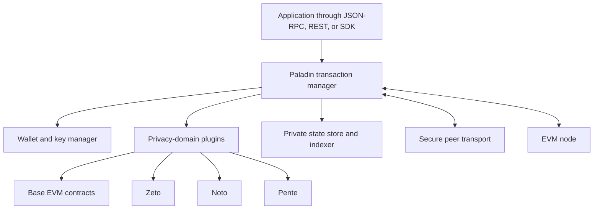
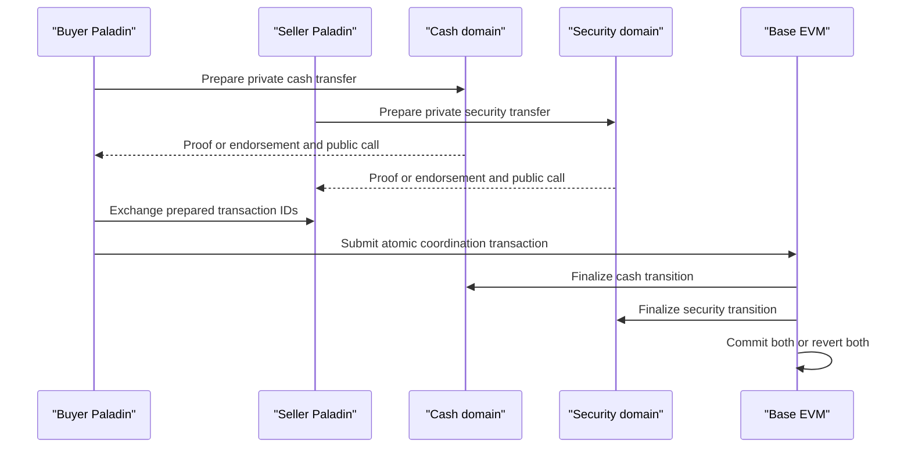

# Paladin: Programmable Privacy for EVM

## Scope

Paladin is an open-source runtime for privacy-preserving tokens, private smart
contracts, and atomic workflows on unmodified EVM networks. It is hosted as an
incubating project by LF Decentralized Trust and is primarily implemented by a
maintainer community associated with Kaleido.

Paladin does not impose one privacy technique. It provides a common transaction
manager, wallet, state store, key integration, secure peer communication, and
plugin interface for **privacy domains**. Its reference domains are:

- **Noto:** issuer- or notary-validated private tokens;
- **Zeto:** zero-knowledge-proof private tokens; and
- **Pente:** privacy groups that execute general private EVM contracts.

This note describes the 0.x and developing V1 architecture as documented through
July 2026. Paladin was still an incubating project with V1 work in progress, so
production readiness must be evaluated for the exact release.

## 1. The Problem Paladin Solves

Public EVM networks expose contract storage, call data, events, balances, and
transaction graphs. Permissioned EVM networks restrict membership but normally
replicate state to all validators. Financial applications often need:

- amounts and owners hidden from non-participants;
- business logic visible only to a transaction group;
- selective disclosure to issuer, auditor, or regulator;
- token policies such as allowlisting;
- private DvP and PvP;
- interoperable assets using different privacy mechanisms;
- finality anchored in a common ledger; and
- enterprise key, API, and operational integration.

Prior private-transaction managers such as Tessera distributed encrypted payloads
to participant subsets. They enabled private EVM state but made cross-group and
cross-asset composition difficult.

Paladin treats privacy as an application runtime problem. Each private asset or
contract domain has its own proof and trust model, while the base EVM orders
final state commitments and atomically coordinates prepared actions.

## 2. Architectural Principles

### 2.1 Unmodified base EVM

Paladin runs beside a normal EVM node. Privacy does not require validators to
install a modified consensus client. Public contracts on the base ledger store
commitments, nullifiers, proofs, endorsements, or masked state and finalize
transactions.

This allows use on permissioned or public EVM chains. It does not make every
network equally suitable: fees, finality, metadata, validator policy, and data
residency differ.

### 2.2 Domains

A privacy domain is a complete implementation of:

- private state model;
- transaction assembly;
- proof or endorsement;
- onchain verification;
- state transition and finalization;
- identity and key requirements; and
- private data distribution.

A Paladin node can participate in several domains simultaneously. The common
runtime coordinates them.

### 2.3 Base-ledger atomicity

Private transactions are prepared offchain, but final state transitions are
submitted to public EVM contracts. A coordinator contract can invoke several
prepared domain transitions in one EVM transaction:

```text
if every domain transition validates:
    all finalize in the same base-ledger transaction
else:
    the EVM transaction reverts
```

This supports atomic DvP and PvP among private assets without requiring them to
share one privacy implementation.

### 2.4 Selective distribution

Detailed private state is sent only to involved Paladin nodes through secure
channels. The base chain contains masked records sufficient for ordering,
uniqueness, and verification.

Data availability becomes a participant responsibility. A recipient must obtain
the state it will need to spend or audit.

## 3. Runtime Components



### 3.1 Transaction manager

The transaction manager is the coordinating engine. It:

- receives high-level transactions;
- resolves identities and keys;
- invokes domain logic to assemble private inputs and outputs;
- distributes private state;
- gathers proofs, signatures, or endorsements;
- sequences prepared transactions;
- submits the public EVM transaction;
- tracks confirmation and reorganization;
- indexes resulting state; and
- reports receipts.

The runtime must handle long-running, multi-party workflows rather than only one
local contract call.

### 3.2 Wallet and key management

Paladin derives or integrates keys for:

- public EVM signing;
- privacy-domain ownership;
- encryption and secure messaging;
- zero-knowledge proofs; and
- organizational identities.

Enterprise deployments can connect external signing and key-management
systems. Each domain can use different key types.

### 3.3 Private state store

Nodes retain states they are entitled to see. State can include token notes,
private contract storage, transaction inputs, outputs, and receipts.

The base ledger is the common finality source, but it may not contain plaintext
needed to reconstruct a private world. Backup, retention, replication, and
recovery of private state are therefore essential.

### 3.4 Peer transport

Paladin nodes discover one another and exchange encrypted private payloads.
Authentication binds organizational identity to endpoints and keys.

Transport confidentiality does not prove that a state transition is valid; the
domain's proof or endorsement mechanism does that.

### 3.5 Domain plugin interface

Domains plug into the runtime through gRPC and can use Go, Java, WebAssembly, or
other supported runtimes. The interface lets the transaction manager ask a
domain to:

- initialize or deploy;
- assemble a transaction;
- identify required parties and states;
- endorse or prove;
- prepare public call data;
- validate events; and
- index resulting states.

Modularity permits new ZK, FHE, notary, or other privacy systems, but domain code
becomes part of the trusted computing base.

## 4. Noto: Notarized Private Tokens

### 4.1 Trust model

Noto uses a notary to validate private token transactions. Transacting parties
share private details with the notary, which checks policy and co-signs an
EIP-712 typed transaction or otherwise authorizes finalization.

The notary can be:

- the asset issuer;
- a designated regulated operator;
- a set of parties using threshold approval; or
- private EVM logic running in Pente.

The privacy model hides details from general ledger participants, not from the
notary and transaction counterparties.

### 4.2 State model

A private token can use note-like states:

- each state represents an amount and owner;
- spending consumes input states;
- change and recipient outputs are created;
- masked IDs or commitments appear onchain;
- private state is distributed to entitled parties; and
- the notary prevents invalid or double-spent transitions.

### 4.3 Advantages

- straightforward policy and exception handling;
- issuer can enforce KYC, sanctions, freezes, and supply;
- comparatively mature enterprise trust model;
- efficient relative to complex ZK proofs; and
- notary logic can be made programmable.

### 4.4 Risks

- notary observes private transactions;
- notary can censor or become unavailable;
- compromised notary can authorize invalid transitions unless onchain checks
  constrain it;
- policy changes depend on governance; and
- centralization may be unacceptable for some assets.

Noto is useful when a trusted issuer already exists. Calling it private should
not be confused with trustless.

## 5. Zeto: Zero-Knowledge Private Tokens

### 5.1 Trust model

Zeto uses zero-knowledge proofs so the base EVM contract can validate hidden
state transitions without a transaction-specific notary.

A transfer proof can establish:

- input notes are valid;
- the sender knows their ownership secrets;
- inputs have not been spent;
- values balance;
- outputs are well formed;
- amounts lie in a valid range; and
- optional policy requirements hold.

The onchain contract verifies the proof and records commitments and nullifiers.

### 5.2 Variants

Zeto provides a family of token patterns rather than one contract. Variants can
trade off:

- amount confidentiality;
- participant anonymity;
- encrypted onchain versus offchain state;
- nullifier-based history masking;
- fungible versus non-fungible assets;
- allowlists or deny lists;
- encryption scheme; and
- proof cost.

Official documentation and deployed circuit names should be used to identify the
exact variant.

### 5.3 State and encryption

Private note data may be:

- stored offchain and shared with recipients, while only commitments are
  onchain; or
- encrypted onchain so authorized recipients can recover it.

Some Zeto designs include lattice-based encryption choices intended to improve
resistance to future quantum attacks for confidentiality. This does not make the
entire system post-quantum: signatures, proof systems, base-chain consensus, and
key infrastructure must also be considered.

### 5.4 Advantages

- public verification without a transaction notary;
- amounts and ownership can remain hidden;
- double-spend prevention through nullifiers;
- policy logic can be encoded in circuits; and
- portable shared-ledger finality.

### 5.5 Risks

- circuit or verifier bugs can permit hidden inflation;
- proving cost and latency;
- trusted setup for proof systems that require it;
- difficult circuit upgrades;
- small anonymity sets;
- recipient data availability;
- key loss; and
- public metadata from transaction submission.

ZK moves trust from an operator toward cryptography and circuit correctness; it
does not remove implementation trust.

## 6. Pente: EVM Privacy Groups

### 6.1 Private EVM worlds

Pente lets a group of known parties execute general EVM smart contracts in a
private state world. It uses the Besu EVM implementation loaded ephemerally by
the Paladin runtime.

Each privacy group has:

- membership;
- a private genesis and world state;
- private contracts and accounts;
- endorsement rules;
- encrypted state distribution; and
- a public base-ledger contract anchoring transitions.

Group members can see and execute private logic; outsiders see masked state and
public finalization.

### 6.2 Ephemeral execution

Instead of keeping one continuously running EVM process for every privacy group,
Pente constructs the relevant EVM state on demand to:

- propose a transaction;
- pre-execute for endorsement;
- validate an endorsed transition; and
- produce a receipt after base-chain confirmation.

The runtime then discards the execution instance while retaining private state.
This supports many privacy groups without a permanent node process per group.

### 6.3 Endorsement

Required group members reproduce or validate execution and endorse the resulting
state transition. Policies can require all or an M-of-N subset, depending on
release and configuration.

The public contract verifies the endorsements and finalizes the masked state
transition. Privacy derives from group-restricted payloads; correctness derives
from endorsement and base-chain ordering.

### 6.4 Advantages and risks

Advantages:

- general Solidity/EVM business logic;
- familiar development model;
- private contracts, not only tokens;
- flexible group governance; and
- composition with Noto and Zeto through prepared transactions.

Risks:

- group members see plaintext;
- endorsement collusion;
- unavailable endorsers;
- private-state loss;
- inconsistent execution or software versions;
- metadata revealing group activity;
- complex membership changes; and
- privacy group fragmentation.

Pente is closer to a consortium micro-ledger anchored to EVM than to a
zero-knowledge rollup.

## 7. Atomic DvP and PvP

Consider a buyer paying private cash for a private bond.



The cash could be Noto while the security is Zeto, or the private agreement could
run in Pente. Domains do not need identical privacy because the base EVM joins
their public finalization calls.

Limits:

- preparation is offchain and can time out;
- parties may withhold endorsements;
- private data must reach recipients;
- gas and finality remain public-chain concerns;
- a domain can be valid yet legally fail to transfer title; and
- atomic code execution does not ensure offchain asset performance.

## 8. Global and Private State

Paladin separates:

- **global state:** commitments, nullifiers, signatures, proofs, and contract
  status visible on the base chain;
- **private state:** plaintext token notes, contract storage, identities, and
  transaction details held by entitled nodes.

Global state supplies common ordering and double-spend prevention. Private state
supplies the information needed to build future transactions.

This creates a data-availability obligation. A party receiving a commitment
without its private preimage or state cannot use the asset. Systems need:

- acknowledged delivery;
- encrypted backup;
- organizational replication;
- retention policy;
- state recovery;
- schema and version migration; and
- controlled disclosure to audit or resolution functions.

## 9. Identity and Privacy

Enterprise privacy uses several identities:

- organizational identity for peer authentication;
- EVM account for gas and submission;
- domain-specific spending key;
- proving or encryption key;
- legal customer identity; and
- privacy-group membership.

Separating them reduces public correlation, but Paladin nodes and business
systems need mappings. Mapping stores are sensitive and should be access
controlled, auditable, and minimized.

KYC and sanctions can be implemented through:

- Noto notary policy;
- Zeto allowlist proofs;
- Pente private policy logic;
- verifiable credentials; or
- pre-transaction workflow.

Each leaks different information and gives different parties control.

## 10. Deployment and Operations

A production deployment includes:

- Paladin runtime per organization or trust zone;
- EVM node or RPC connectivity;
- domain contracts and plugins;
- databases and private state backup;
- secure peer endpoints;
- enterprise key management;
- identity and certificate lifecycle;
- monitoring and metrics;
- gas funding;
- upgrade coordination; and
- incident response.

Operational questions:

- Who operates a node for each legal entity?
- Can one managed operator host mutually distrusting parties?
- How is private data separated in memory, storage, and logs?
- How are state and keys recovered?
- How are chain reorgs handled?
- How are domain and runtime versions coordinated?
- Who can deploy or upgrade public verifier contracts?
- What happens when a notary or group member is offline?

Privacy protocols expand, rather than remove, operational responsibilities.

## 11. Maturity and Governance

Paladin moved from an LF Decentralized Trust lab into an incubating project.
The 2026 annual review described active 0.x releases and work toward V1,
including distributed sequencing and production observability enhancements.

An incubating open-source project can be suitable for experimentation and
selected production use, but adopters should assess:

- release stability and upgrade compatibility;
- maintainer diversity;
- security audit coverage;
- circuit and contract audits;
- performance under representative workflows;
- support and operational ownership;
- documented public adopters;
- vulnerability process; and
- long-term governance.

Open governance and Apache 2.0 licensing reduce proprietary dependency; they do
not guarantee maturity or an independent operator ecosystem.

## 12. Comparison of the Three Domains

| Property | Noto | Zeto | Pente |
|---|---|---|---|
| Primary purpose | Private tokens | ZK private tokens | General private EVM contracts |
| Validation | Notary endorsement | Onchain proof verification | Group execution and endorsement |
| Who sees transaction plaintext | Parties and notary | Involved parties/prover, depending on variant | Privacy-group members |
| Public state | Masked states and authorization | Commitments, nullifiers, and proofs | Masked world-state transition and endorsements |
| Main trust | Notary correctness and availability | Circuit, proof system, keys, and data | Group members, execution, and data |
| Policy flexibility | High through notary logic | Must be encoded in circuits or associated contracts | High through private Solidity |
| Performance | Generally lower cryptographic cost | Proving and verification overhead | Multi-party execution and endorsement |
| Decentralization | Depends on notary set | Can avoid transaction notary | Depends on group endorsement |

No domain is universally best. Issuer-controlled cash may naturally use Noto;
widely transferable confidential assets may prefer Zeto; complex bilateral or
consortium agreements may use Pente.

## 13. Evaluation Checklist

1. exact Paladin and domain versions;
2. base chain and finality;
3. domain used for each asset or workflow;
4. public and private state definitions;
5. notary, prover, or endorsement trust;
6. participant and key identities;
7. private data distribution and backup;
8. proof circuits, setup, and audits;
9. notary policy and availability;
10. privacy-group membership and threshold;
11. atomic coordinator and prepared-state expiry;
12. metadata leakage and gas submission;
13. contract and plugin upgrade control;
14. wallet and enterprise KMS integration;
15. performance for end-to-end DvP or PvP;
16. legal linkage to tokens and records;
17. incident recovery and dispute evidence; and
18. project maturity and operational support.

## 14. Key Takeaways

1. Paladin is a modular privacy runtime around unmodified EVM, not a new base
   blockchain.
2. The base ledger orders and atomically finalizes masked domain transitions.
3. Noto trusts a configurable notary; Zeto trusts ZK circuits and proofs; Pente
   trusts privacy-group execution and endorsements.
4. A common transaction manager lets different privacy domains participate in
   one DvP or PvP workflow.
5. Pente uses ephemeral Besu EVM execution to provide general private contract
   worlds.
6. Public commitments do not replace private data delivery and backup.
7. Privacy from outsiders does not imply privacy from notaries, group members,
   or infrastructure operators.
8. Domain plugins, public verifier contracts, key systems, and Paladin operations
   all belong in the trusted computing base.
9. Paladin remained an incubating, rapidly evolving project in 2026, so exact
   release maturity matters.

## Related Notes

- [Privacy and Confidential Computing for Blockchains](privacy-and-confidential-computing-for-blockchains.md)
- [Zama](zama.md)
- [Enterprise Ethereum and Hyperledger](../03-enterprise-dlt/enterprise-ethereum-and-hyperledger.md)
- [Tokenized Deposits and Commercial-Bank Money](../../05-digital-money-and-tokenization/02-cbdcs-and-bank-money/tokenized-deposits-and-commercial-bank-money.md)
- [Financial Market Infrastructure](../../01-financial-foundations/02-financial-markets/financial-market-infrastructure.md)

## References

- LF Decentralized Trust, [Paladin project](https://www.lfdecentralizedtrust.org/projects/paladin)
- LF Decentralized Trust, [Paladin incubation proposal](https://lf-decentralized-trust.github.io/project-proposals/proposals/incubation/paladin.html)
- LF Decentralized Trust, [2026 Paladin annual review](https://lf-decentralized-trust.github.io/governance/project-updates/2026/2026-annual-paladin/)
- Paladin, [Documentation](https://lfdt-paladin.github.io/paladin/head/)
- Paladin, [Architecture](https://lfdt-paladin.github.io/paladin/head/architecture/)
- Paladin, [Source repository](https://github.com/LFDT-Paladin/paladin)
- Zeto, [Documentation](https://lfdt-paladin.github.io/zeto/latest/)
- Zeto, [Source repository](https://github.com/LFDT-Paladin/zeto)
- LF Decentralized Trust, [Paladin announcement](https://www.lfdecentralizedtrust.org/blog/announcing-paladin-an-lf-decentralized-trust-lab-for-programmable-privacy-on-evm)
- LF Decentralized Trust, [Paladin becomes an incubating project](https://www.lfdecentralizedtrust.org/blog/paladin-a-unified-programmable-privacy-framework-for-evm-becomes-newest-lf-decentralized-trust-project)
- Kaleido and LF Decentralized Trust, [Deep Dive into Paladin](https://www.linuxfoundation.org/hubfs/Deep%20Dive%20Into%20Paladin%20-%20Kaleido%20Webinar%20Slides.pdf)
- Hyperledger Besu, [Documentation](https://besu.hyperledger.org/)
- Ethereum, [EIP-712: Typed structured data hashing and signing](https://eips.ethereum.org/EIPS/eip-712)

