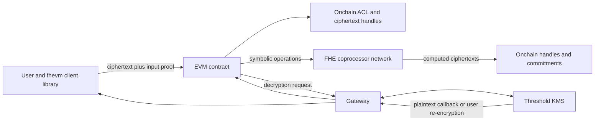

# Zama, TFHE, and fhEVM

## Scope

Zama develops open-source fully homomorphic encryption libraries and the fhEVM
stack for confidential smart contracts on EVM-compatible networks. The central
idea is that contracts operate on encrypted values without exposing plaintext to
validators or coprocessors.

fhEVM is a hybrid architecture, not ordinary Solidity running FHE instructions
inside every validator. Contracts record symbolic encrypted operations and
access permissions; offchain coprocessors perform expensive FHE computation; a
Gateway coordinates requests; and a threshold Key Management System controls
decryption.

The software and protocol have evolved rapidly. This note explains the
architecture rather than promising a specific deployment status or performance
figure. Implementers should verify the release and network they use.

## 1. FHE Foundation

Fully homomorphic encryption permits evaluation of functions over ciphertext:

```text
encrypted x and encrypted y
        |
        v
homomorphic computation without plaintext
        |
        v
encrypted result

decrypt(encrypted result) = same result as plaintext computation
```

Zama's core Rust library, TFHE-rs, implements the TFHE family of schemes. TFHE is
well suited to programmable operations over encrypted integers and Boolean
values. Bootstrapping refreshes ciphertext noise and can evaluate functions.

Three key categories matter:

- **public key:** users encrypt inputs;
- **secret key:** authorized decryption; and
- **evaluation key:** coprocessors compute over ciphertext without learning
  plaintext.

The evaluation key is large and public to authorized compute operators. It
enables computation but should not enable decryption.

## 2. Why FHE Needs a Blockchain Architecture

A cryptographic primitive can evaluate over ciphertexts, but an application still
needs shared rules for who may submit ciphertexts, which computation is
authorized, how encrypted state changes become final, and who can decrypt an
output. A blockchain architecture supplies ordering and state, while Zama's
additional services supply ciphertext validation, computation, and controlled
decryption. Security depends on the composition of all those layers.

A standalone FHE library does not answer:

- who accepts encrypted inputs;
- how malformed ciphertexts are rejected;
- which contract may use a ciphertext;
- how computations are ordered and finalized;
- who stores results;
- who may request decryption;
- how decryption key shares are governed;
- how coprocessor results are verified; or
- how fees and availability work.

fhEVM adds these distributed-system and application layers.

## 3. High-Level Architecture



### 3.1 User client

The client obtains the network FHE public key and encrypts plaintext locally.
It creates compact encrypted input data plus a zero-knowledge proof of knowledge
or validity. The proof prevents arbitrary malformed handles and binds inputs to
the intended context.

Privacy begins before the transaction leaves the device. Sending plaintext to a
frontend server for encryption defeats the model.

### 3.2 EVM contracts and FHE library

Developers write Solidity using encrypted types and operations exposed through
the fhEVM library. Examples include encrypted:

- Boolean;
- unsigned integers of supported widths;
- addresses; and
- fixed-size byte values in supported releases.

Typical operations include arithmetic, bitwise operations, comparisons,
selection, casting, and encrypted randomness.

The Solidity transaction does not carry the full ciphertext through ordinary
EVM arithmetic. It uses ciphertext handles and records a sequence of operations
for the coprocessor.

### 3.3 Access Control List

Encrypted values are subject to onchain permissions. The ACL records which
contracts or accounts may use a ciphertext.

Permission patterns include:

- permanent allowance to a contract or account;
- allowance to the current contract;
- transient allowance during one transaction; and
- permission for a user to request decryption or re-encryption.

This makes encrypted values composable under explicit authorization. Without
correct ACL updates, a destination contract may receive a handle it cannot use;
with excessive permissions, confidential state may be exposed or manipulated.

### 3.4 Coprocessors

FHE computation is too expensive for ordinary EVM execution. Coprocessors:

- observe finalized symbolic operations;
- retrieve ciphertext material;
- use evaluation keys;
- compute encrypted results; and
- make result ciphertexts available and verifiable for the onchain system.

The coprocessor should not learn plaintext. It remains a critical availability
and integrity component. Protocol versions add proofs and consensus mechanisms
so contracts do not blindly trust one compute server.

### 3.5 Gateway

The Gateway coordinates between EVM contracts, coprocessors, and the KMS. It
listens for requests, obtains the required outputs and proofs, and returns
decryption or re-encryption results.

Because this is asynchronous, a contract cannot always branch immediately on a
secret result within the same transaction. It may request decryption and later
receive a callback.

### 3.6 Threshold KMS

The KMS holds shares of the FHE secret key using a threshold multi-party
protocol. No one operator should possess the complete decryption key.

The KMS:

- participates in key generation;
- validates authorized requests;
- decrypts values requested for public contract use;
- re-encrypts values to a user's public key for private viewing; and
- rotates or manages keys according to protocol governance.

This is the most important confidentiality trust root. If the threshold is
compromised, protected historical state under the key may be decryptable.

## 4. Encrypted Input Lifecycle

Suppose Alice privately transfers an amount.

1. The client retrieves the network public key.
2. Alice encrypts the amount locally.
3. The client generates an input proof that binds the ciphertext to Alice and the
   target contract.
4. Alice submits ciphertext handles and proof in a normal EVM transaction.
5. The contract validates and converts the external input into an encrypted
   type.
6. It grants itself permission to use the value.
7. It symbolically subtracts the amount from Alice's encrypted balance and adds
   it to Bob's.
8. Coprocessors evaluate the encrypted operations.
9. New ciphertext handles represent updated balances.
10. The contract grants Bob permission to request his balance.

The chain can order and authenticate the transaction without learning amount or
balances.

## 5. Confidential ERC-20 Pattern

A confidential token can store encrypted balances while keeping some metadata
public.

### 5.1 Public elements

Confidential execution does not make the entire transaction invisible. Validators
still need enough public information to order calls, charge fees, and agree on the
state transition. Observers may consequently learn who interacted with which
contract and when, even if amounts and balances remain encrypted; traffic analysis
therefore remains relevant.

Often public:

- token contract;
- transaction sender;
- destination function;
- gas and timing;
- mint and burn calls;
- administrator changes; and
- encrypted-state handles.

Potentially encrypted:

- balance;
- transfer amount;
- allowance amount;
- bid or price; and
- selected policy attributes.

### 5.2 Balance sufficiency

The contract computes an encrypted comparison:

```text
can transfer = encrypted balance >= encrypted amount
```

It then selects between the proposed new balances and unchanged balances without
revealing whether the condition was true. Returning a public "insufficient
balance" error would leak information.

This illustrates an FHE programming rule: normal control flow and reverts can
leak secret predicates. Contracts use encrypted conditional selection and
carefully designed public outputs.

### 5.3 Supply and regulation

FHE does not define token economics. The issuer still controls minting,
redemption, backing, freezes, sanctions policy, and legal claims. A confidential
stablecoin remains an issuer liability or contractual claim.

Regulators and auditors may receive purpose-limited access, aggregate proofs, or
authorized decryption. The governance must be explicit.

## 6. Decryption and Re-Encryption

### 6.1 Public decryption

A contract can request that an encrypted value be decrypted and returned through
a Gateway callback. Once plaintext is posted to the chain, it becomes public.

Use cases include:

- revealing an auction winner after bidding ends;
- publishing a governance result;
- resolving an encrypted conditional; or
- making an aggregate statistic public.

The request and callback must be protected from replay, wrong ciphertext,
unauthorized response, and out-of-date state.

### 6.2 User decryption

An authorized user may ask the KMS to re-encrypt a ciphertext under a temporary
user public key. The user signs authorization tied to:

- user address;
- contract;
- ciphertext handle;
- target public key; and
- validity period or domain.

The KMS returns ciphertext that only the user's local private key can decrypt.
Plaintext need not appear onchain.

### 6.3 Access revocation

Revoking future ACL permission does not erase plaintext already disclosed. It
also may not protect historical ciphertext if a user retained a valid
re-encryption or the system key is later compromised.

## 7. Symbolic Execution and Asynchrony

FHE operations are represented symbolically during the EVM transaction.
Consequences include:

- a handle may exist before computation completes;
- downstream operations can reference encrypted results;
- public decryption requires later asynchronous completion;
- coprocessor throughput and queues affect latency;
- chain reorgs require coprocessors to follow canonical operations; and
- applications need pending, completed, and failed states.

Developers must not treat an FHE call as ordinary local arithmetic. The protocol
is a distributed compute pipeline.

## 8. Integrity and Verifiability

Confidentiality alone is insufficient. A malicious coprocessor could otherwise
return an arbitrary ciphertext.

Potential safeguards include:

- deterministic recomputation by several coprocessors;
- coprocessor consensus or threshold attestation;
- zero-knowledge proofs of correct computation;
- commitments tying operations to chain state;
- KMS verification before decryption;
- challenge and slashing mechanisms; and
- rate and operation limits.

The exact mechanism is release- and deployment-specific. An evaluator should
identify:

1. how many coprocessors exist;
2. whether one result or a threshold is accepted;
3. what is proven cryptographically;
4. who can register operators;
5. what happens on disagreement; and
6. how unavailable computation is recovered.

## 9. Trust and Threat Model

### 9.1 KMS collusion

If enough KMS parties collude, they may decrypt protected state. Threshold size,
operator independence, hardware security, geographic diversity, key rotation,
and audit logs matter.

### 9.2 Coprocessor integrity or outage

False or unavailable computation can corrupt or stall applications unless proofs
and redundancy are effective.

### 9.3 Malformed inputs

Attackers can submit invalid ciphertexts, replay handles, or try to exploit type
conversion. Input proofs, sender and contract binding, and ACL validation address
this.

### 9.4 Smart-contract leakage

Public branches, errors, events, access grants, or decrypted callbacks can expose
secret facts even when cryptography is correct.

### 9.5 Client compromise

Malicious frontends can read plaintext before encryption, substitute recipient
addresses, or request excessive disclosure.

### 9.6 Metadata leakage

The public chain still exposes address, timing, contract, gas, and access
patterns. FHE is confidential state, not automatic anonymity.

### 9.7 Upgrade and governance risk

Contracts, operator sets, KMS thresholds, libraries, and parameters may be
upgradeable. Governance might introduce a weak key set or altered access rules.

### 9.8 Cryptographic risk

Parameter choices must reflect known attacks and desired security levels.
FHE is a developing field with complex implementations, large evaluation keys,
and nontrivial side channels.

## 10. Performance and Cost

FHE is much more expensive than plaintext computation.

Costs arise from:

- client encryption and proof generation;
- large ciphertexts and evaluation keys;
- bootstrapping;
- coprocessor CPU or accelerator use;
- storage and data availability;
- Gateway and KMS communication;
- onchain handles and ACL updates; and
- decryption latency.

Performance claims require a full workload:

- encrypted type and bit width;
- operation mix;
- sequential dependency depth;
- parallelism;
- security parameters;
- hardware;
- number of coprocessors;
- proof or consensus mode;
- batch size; and
- end-to-end finality.

An isolated encrypted addition benchmark does not predict a private exchange or
credit workflow.

## 11. Use Cases

### 11.1 Sealed-bid auctions

Bids remain encrypted during the auction. FHE computes the winner and price;
only the final outcome is decrypted. Metadata and bidder eligibility still need
controls.

### 11.2 Confidential payments

Balances and amounts remain encrypted. Contracts enforce conservation and
policy. The issuer can retain selective disclosure and freeze capabilities.

### 11.3 Private voting

Votes remain encrypted while tallying occurs homomorphically. The final count is
decrypted. Eligibility, coercion resistance, and duplicate-vote prevention
remain separate problems.

### 11.4 Hidden-order trading

Orders or limits can remain encrypted to reduce information leakage. Matching,
fair ordering, settlement, and market surveillance must be designed around
asynchronous encrypted computation.

### 11.5 Credit and identity

A contract can evaluate encrypted income, assets, score, or credential
attributes. Output minimization is essential: repeated yes/no queries can
reconstruct private inputs.

### 11.6 Confidential onchain games and coordination

Hidden state enables games, prediction mechanisms, and coordination that public
state normally makes impossible.

## 12. FHE Compared with Other Privacy Models

| Property | fhEVM/FHE | ZK application | Privacy group | TEE |
|---|---|---|---|---|
| Persistent encrypted state | Native design goal | Possible with commitments | Private to group | Private inside enclave |
| General computation | Supported but expensive | Circuit-specific | General EVM among members | General code |
| Who sees plaintext during compute | No evaluator by design | Prover usually sees its witness | Group members | Enclave |
| Verification | Coprocessor protocol and proofs | Cryptographic proof | Shared ledger marker and group consensus | Attestation |
| Key trust | Threshold decryption key | Proving keys or setup, depending on system | Group encryption keys | Hardware root and app keys |
| Main cost | Homomorphic compute and key system | Proof generation and circuit engineering | Private-state synchronization | Hardware trust and side channels |

Hybrid use is often strongest: ZK validates inputs, FHE computes confidential
state, and threshold MPC governs decryption.

## 13. Evaluation Checklist

1. exact fhEVM and contract-library release;
2. deployment network and addresses;
3. supported encrypted types and operations;
4. input proof and context binding;
5. ACL model and default permissions;
6. coprocessor number, integrity mechanism, and operator set;
7. KMS threshold, operators, key generation, and rotation;
8. Gateway authentication and replay protection;
9. public versus user-specific decryption;
10. metadata and control-flow leakage;
11. transaction, operation, and rate limits;
12. end-to-end workload latency and cost;
13. chain reorg and failure handling;
14. contract, operator, and protocol upgrade governance;
15. cryptographic audits and security parameters;
16. client and frontend security;
17. data retention and lawful disclosure; and
18. recovery after operator loss or key compromise.

## 14. Key Takeaways

1. Zama's fhEVM brings TFHE-based encrypted types to EVM applications through a
   hybrid onchain and offchain architecture.
2. Users encrypt inputs locally and prove their validity; contracts manipulate
   handles and symbolic operations.
3. Coprocessors perform expensive homomorphic computation without the decryption
   key.
4. A threshold KMS controls the most sensitive capability: decryption and
   user-specific re-encryption.
5. The Gateway makes decryption asynchronous and coordinates several system
   components.
6. ACL permissions are part of confidentiality and composability; misuse can
   either break applications or expose data.
7. FHE hides values but not public transaction metadata.
8. Secret-dependent reverts and public branches can leak protected facts.
9. Performance must be measured end to end with real encrypted workloads.
10. The actual deployment's coprocessor integrity, KMS threshold, upgrades, and
    release matter more than the general FHE label.

## Related Notes

- [Privacy and Confidential Computing for Blockchains](privacy-and-confidential-computing-for-blockchains.md)
- [Paladin](paladin.md)
- [Smart Contracts, Virtual Machines, and Token Standards](../../02-blockchain-foundations/03-execution-and-applications/smart-contracts-virtual-machines-and-token-standards.md)
- [Cryptography and Blockchain Data Structures](../../02-blockchain-foundations/01-core-architecture/cryptography-and-blockchain-data-structures.md)

## References

- Zama, [fhEVM documentation](https://docs.zama.ai/fhevm)
- Zama, [Architectural overview](https://docs.zama.ai/fhevm/explanations/architecture_overview)
- Zama, [FHE on blockchain](https://docs.zama.ai/fhevm/fundamentals/architecture_overview/fhe-on-blockchain)
- Zama, [Encryption, decryption, re-encryption, and computation](https://docs.zama.ai/fhevm/fundamentals/architecture_overview/d_re_ecrypt_compute)
- Zama, [Encrypted inputs](https://docs.zama.ai/fhevm/smart-contract/inputs)
- Zama, [Access Control List](https://docs.zama.ai/fhevm/smart-contract/acl)
- Zama, [Supported encrypted types](https://docs.zama.ai/fhevm/smart-contract/types)
- Zama, [TFHE-rs documentation](https://docs.zama.ai/tfhe-rs)
- Zama, [fhEVM source repositories](https://docs.zama.ai/fhevm/references/repositories)
- Zama, [FHEVM release change log](https://docs.zama.ai/change-log)
- Zama, [Security and bug bounty](https://www.zama.ai/programs/bug-bounty-program)
- HomomorphicEncryption.org, [Homomorphic Encryption Standard](https://homomorphicencryption.org/standard/)
