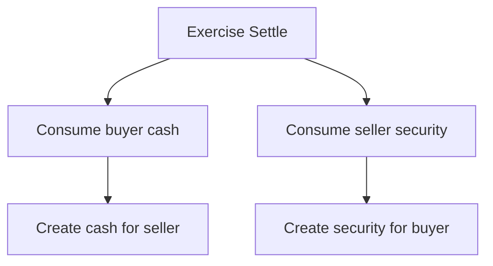
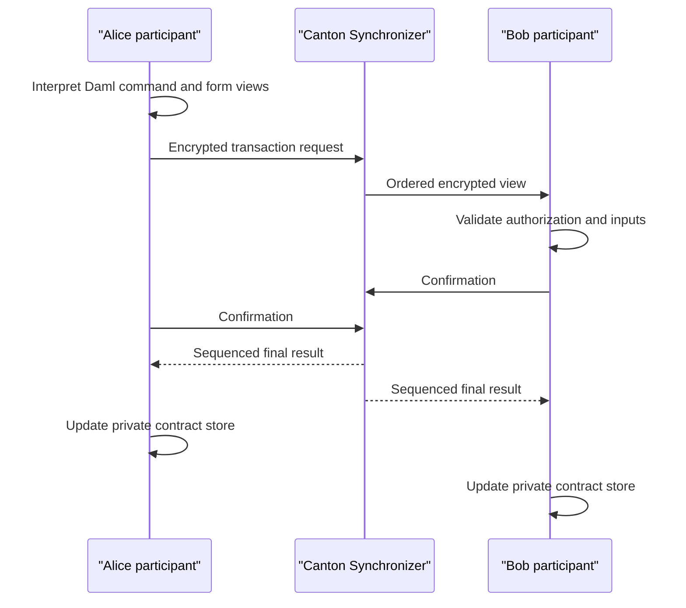
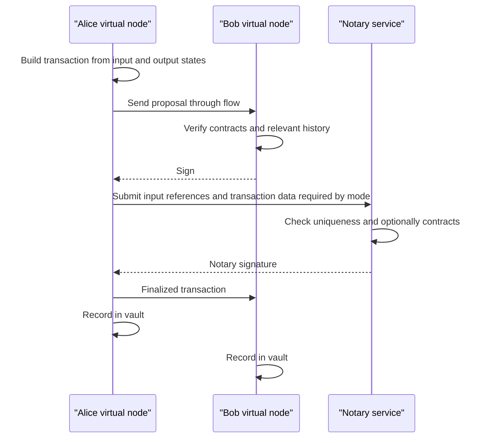

# Canton, Daml, Corda, and Institutional Ledger Architectures

## Scope

Institutional distributed ledgers are designed for identified organizations,
need-to-know data sharing, legal assets, long-running workflows, and governed
operations. Canton/Daml and R3 Corda approach these requirements differently
from public blockchains and from enterprise Ethereum.

This note explains:

- Digital Asset's Daml contract model and Canton synchronization protocol;
- the Canton Network and Global Synchronizer;
- Corda's states, transactions, contracts, flows, notaries, and virtual nodes;
- privacy, identity, finality, atomicity, and interoperability in each; and
- how both compare with public chains and permissioned EVM systems.

Product versions matter. Canton documentation cited here is from the 3.x
generation, and the Corda discussion centers on Corda 5.2. Legacy Corda 4 and
earlier Canton terminology should not be mixed without explicit mapping.

## 1. Why Institutional Ledgers Differ

A public blockchain broadcasts transactions so every validator can independently
execute and verify a common global state. This supports open participation but
creates problems for regulated markets:

- positions and counterparties are commercially sensitive;
- personal data cannot be indiscriminately replicated;
- legal identities and authority matter;
- assets have issuer-defined transfer rules;
- workflows may require several organizations to approve;
- errors and defaults need governed resolution;
- transaction volume should not force every participant to store all data; and
- participants may need independent infrastructure and data control.

Institutional ledgers commonly use:

- permissioned membership;
- point-to-point or need-to-know data;
- deterministic contract code;
- explicit party authorization;
- shared uniqueness or ordering services;
- private local state;
- standardized application APIs; and
- governance outside consensus code.

They trade open censorship resistance for privacy, legal integration, and known
operators.

## 2. Daml Contract Model

Daml is a smart-contract language and ledger model developed by Digital Asset.
It models agreements among named parties.

### 2.1 Templates and contracts

A template defines:

- contract data;
- one or more signatories;
- observers;
- choices that authorized controllers may exercise; and
- resulting contract creations or archival.

A contract instance is immutable. To change an agreement, a consuming choice
archives the old contract and creates new contracts.

```text
Active contract:
Bond(owner = Alice, issuer = Bank, amount = 100)

Exercise Transfer controlled by Alice:
consume old Bond
create Bond(owner = Bob, issuer = Bank, amount = 100)
```

This resembles a generalized UTXO model: active contracts are consumed and new
ones created, though Daml transactions can form rich trees of actions.

### 2.2 Parties and authorization

A Daml party is a logical identity hosted by a participant node. Roles include:

- **signatory:** must authorize creation and is bound by the contract;
- **observer:** may see the contract and its creation or archival;
- **controller:** may exercise a specified choice; and
- **choice observer:** observes that exercise.

Authorization is inferred from contract structure and choice controllers.
Application code cannot simply impersonate another party.

### 2.3 Transaction trees

A choice can create, fetch, and exercise other contracts. The resulting
transaction is a tree. All consequences either commit atomically or fail.

This enables DvP:



The tree structure also determines privacy. A party sees actions in which it has
a stake and the consequences needed to validate those actions.

## 3. Canton Architecture

Canton is a protocol and node architecture that synchronizes Daml ledgers while
preserving need-to-know privacy.

### 3.1 Participants

A participant node:

- hosts one or more Daml parties;
- executes Daml commands;
- stores private contracts relevant to its parties;
- validates transactions;
- connects to one or more Synchronizers;
- manages keys and topology;
- exposes gRPC and JSON ledger APIs; and
- sends and receives encrypted protocol messages.

Each participant has a partial ledger view. It does not store all network
transactions.

### 3.2 Synchronizers

A Synchronizer supplies:

- ordered encrypted message delivery; and
- mediation of the multi-participant confirmation protocol.

The Synchronizer should not see plaintext transaction payloads. Relevant
participants independently validate the subtransactions they are entitled to
see and send confirmations.



The protocol resembles two-phase commit with Byzantine-resilient and privacy
properties tailored to the deployment. Sequencing determines order; mediation
coordinates a consistent accept or reject outcome.

### 3.3 Network of networks

A participant can connect to multiple Synchronizers. Contracts can be reassigned
between them under protocol rules. Applications and assets therefore retain
independent infrastructure while connecting for transactions.

This is the basis for Canton's "network of networks" positioning. It does not
mean arbitrary external blockchains automatically become atomic. They must use
Canton-compatible participants, models, and synchronization or an adapter with
additional trust.

## 4. Canton Privacy

### 4.1 Need-to-know visibility

A participant receives only transaction views relevant to its hosted parties.
Privacy operates at subtransaction level, not merely whole-transaction level.

Parties may be:

- informees of an action because they authorize or have a stake; or
- witnesses because they need to see a consequence in the transaction tree.

This lets a complex DvP show each participant enough to validate its portion
without revealing unrelated branches.

### 4.2 Private contract store

Each participant stores active and historical data relevant to its parties.
Privacy is not achieved by encrypting one global database that everyone holds;
unauthorized parties do not receive the payload.

### 4.3 Divulgence and disclosure

Sometimes a party must see a contract it does not permanently observe to
validate a transaction consequence. Canton calls certain such visibility
**divulgence**.

To use a contract in a later transaction, a non-stakeholder may require explicit
**disclosure** through an application channel. This distinction avoids making
every temporary counterparty a permanent observer.

### 4.4 Metadata

The synchronization protocol is designed to hide transaction structure and
parties from uninvolved participants and the Synchronizer as far as required.
Operators still observe some network timing, volume, connection, and topology
data. Privacy claims should distinguish payload from operational metadata.

## 5. Canton Integrity and Finality

Relevant participants validate:

- contract code and package versions;
- party authorization;
- input contract activeness;
- deterministic transaction consequences; and
- signatures and protocol messages.

The Synchronizer orders requests and coordinates confirmation so conflicting
uses of a contract cannot both commit.

### 5.1 No universal replication

Integrity does not require every node to replay every transaction. Each
participant verifies the portion affecting it, while the protocol coordinates
consistent finality.

### 5.2 Topology

Canton topology records define:

- node and party identities;
- key mappings;
- which participant hosts a party;
- Synchronizer membership;
- vetted Daml packages;
- permissions and trust certificates; and
- operator governance.

A participant explicitly controls which application packages it is willing to
execute. Topology changes are signed, authorized, and synchronized.

### 5.3 Failure and recovery

Production operation must handle:

- participant outage;
- sequencer or mediator failure;
- key rotation;
- stale topology;
- lost private contract data;
- package incompatibility;
- reassignment between Synchronizers; and
- disaster recovery without double processing.

Private data must be backed up by the participants entitled to it. A global
block explorer cannot reconstruct missing private state.

## 6. Canton Network and Global Synchronizer

### 6.1 Public-permissioned connectivity

The Canton Network is an ecosystem of Canton applications and participant nodes.
The Global Synchronizer provides shared synchronization across applications
while preserving participant-controlled data and validation.

Users and institutions interact through validator or participant infrastructure
and applications rather than broadcasting full plaintext to a universal
validator set.

### 6.2 Decentralized operation

Official network materials describe Super Validators operating Global
Synchronizer infrastructure with BFT ordering and governance. A two-thirds
majority is used for specified consensus and governance decisions.

Governance includes:

- operator onboarding and configuration;
- Synchronizer rules;
- software and protocol changes;
- traffic and fee mechanisms; and
- applications supporting network operation.

Decentralized operation should be measured by live operator concentration,
threshold, software diversity, keys, governance rights, and failure recovery.

### 6.3 Canton Coin

Canton Coin is a network-native application and utility mechanism used to pay
for Global Synchronizer activity and reward infrastructure and application
utility. Its tokenomics are implemented through Daml applications often
described under the Splice codebase.

Canton Coin is not the settlement asset for every Canton application. Tokenized
cash, deposits, stablecoins, and securities can be separate Daml assets with
their own issuers and terms.

### 6.4 Institutional applications

Canton ecosystem applications have targeted:

- securities issuance and registry;
- repo and collateral;
- fund and asset servicing;
- trading and post-trade;
- tokenized cash;
- margin and risk workflows; and
- atomic settlement across applications.

Company-reported notional volumes should be interpreted carefully. Monthly
"assets tokenized" or transaction notional is not the same as assets locked,
revenue, unique ownership, or secondary-market liquidity.

## 7. Corda Fundamentals

Corda is an institutional DLT platform developed by R3. It uses point-to-point
flows and a UTXO-style ledger rather than global broadcast.

### 7.1 States

A state is an immutable fact shared among specified participants. It can
represent:

- cash;
- a bond;
- a trade;
- an obligation;
- identity or reference data; or
- workflow status.

A transaction consumes input states and creates output states.

### 7.2 Contracts

Contract code checks whether a proposed state transition is valid. It is
deterministic and cannot perform arbitrary networking or I/O during verification.

Contracts commonly validate:

- required signatures;
- conservation of amounts;
- issuer identity;
- permitted state changes;
- time windows; and
- attachment or reference data.

### 7.3 Commands and signatures

Commands state the intended action and required signing parties. A transaction
is valid when:

- input states exist and are unconsumed;
- contract rules pass;
- required signers sign;
- time and reference constraints pass; and
- the notary confirms uniqueness.

### 7.4 Flows

Flows are long-running application processes that communicate point to point.
They:

- negotiate transaction data;
- gather signatures;
- exchange dependencies;
- request notarization;
- finalize and record;
- call external systems; and
- checkpoint across restarts.

Contract logic answers "is this transition valid?" Flow logic answers "how do
the organizations reach and complete it?"

### 7.5 Notary

The notary is Corda's uniqueness service. It ensures an input state is not
consumed twice and signs successful notarization.

A notary may be operated as a cluster. Its trust and fault-tolerance model
depends on deployment.

## 8. Corda Transaction Lifecycle



Only involved parties receive the transaction. The notary's visibility depends
on protocol.

## 9. Corda Privacy and Notary Modes

### 9.1 Non-validating notary

A non-validating notary sees input references and the information needed for
uniqueness but not full transaction content. Participants verify transaction
contracts and backchains.

Advantages:

- notary learns less transaction data;
- participants independently verify provenance; and
- notary responsibility is limited.

Limitations:

- recipients may need the full chain of predecessor transactions back to
  issuance;
- backchains can leak history to later holders;
- storage and verification grow; and
- new participants may download substantial dependencies.

### 9.2 Contract-verifying notary

Corda 5 transaction privacy enhancements allow a notary to verify contract
validity as well as uniqueness. Recipients can trust notarized outputs without
receiving the full backchain.

Trade-off:

- recipients learn less historical data;
- the notary sees full content needed for verification;
- notary availability and correctness become more important;
- the operator may take greater legal and operational responsibility; and
- provenance must be modeled explicitly if needed.

Privacy is redistributed from future holders toward the notary.

### 9.3 Confidential identities

Corda can use transaction-specific or confidential identities to reduce direct
correlation, while membership and identity services retain organizational
linkage. Network-layer and counterparty metadata remain.

## 10. Corda 5 Architecture

Corda 5 separates logical members from shared compute through **virtual nodes**.
A virtual node combines:

- member identity;
- application package;
- vault and databases;
- keys;
- network membership; and
- flow context.

Stateless worker processes execute and checkpoint flows for many virtual nodes.
Worker types handle messaging, flows, persistence, crypto, verification, REST,
and other platform functions.

Benefits:

- horizontal scaling;
- multi-tenancy;
- failover of checkpointed flows;
- separation of identity from physical server; and
- centralized operational platform for several application networks.

Risks:

- complex distributed deployment;
- shared-cluster isolation;
- message-bus and database dependencies;
- upgrade and package coordination;
- larger operational footprint than one self-contained node; and
- platform operator concentration.

## 11. Identity and Membership

### Canton

- parties are logical ledger identities;
- participant nodes host parties;
- signed topology maps parties, nodes, keys, packages, and Synchronizers;
- participants choose trusted infrastructure and packages; and
- privacy follows Daml stakeholder roles.

### Corda

- members join application networks;
- membership group managers govern admission and network information;
- X.500-style identities and certificates bind organizations;
- virtual nodes represent member contexts; and
- CorDapps and flows determine counterparties and data sharing.

In both, permissioning is not merely a node allowlist. It includes application
code, identities, roles, keys, and governance.

## 12. Atomicity and Interoperability

### 12.1 Canton

Daml transaction composition can atomically consume and create contracts across
applications when hosted participants share compatible synchronization. The
Global Synchronizer is designed to connect independently controlled applications
without a wrapped-asset bridge.

### 12.2 Corda

A Corda transaction can atomically transform several states on one application
network and notary context. Flows coordinate multi-party approval. Cross-network
or cross-ledger exchange requires:

- shared or compatible notary arrangements;
- application-level protocols;
- external connectors;
- HTLCs;
- interoperability frameworks; or
- trusted escrow and synchronization.

### 12.3 External systems

Neither platform makes conventional registers, payment systems, or public
blockchains automatically atomic. An adapter may:

- observe external finality;
- lock or reserve an asset;
- issue a representation;
- obtain a notary or participant attestation; and
- compensate after failure.

The adapter's trust and legal effect must be analyzed separately.

## 13. Canton, Corda, and Enterprise Ethereum

| Property | Canton/Daml | Corda 5 | Permissioned Ethereum/Besu |
|---|---|---|---|
| State model | Active Daml contracts | UTXO states | Account and contract storage |
| Data distribution | Need-to-know subtransaction views | Point-to-point to participants | Usually replicated; privacy manager or privacy layer for subsets |
| Workflow | Daml choices plus applications | Stateful flows | Smart contracts plus offchain services |
| Uniqueness/order | Synchronizer protocol | Notary | Consensus validators |
| Smart-contract language | Daml | JVM languages for contracts and flows | Solidity and EVM languages |
| General global state | No universal plaintext | No universal plaintext | Common EVM state |
| Privacy root | Stakeholder views and encrypted synchronization | Participant sharing and notary mode | Permissioning, privacy manager, ZK/FHE, or private groups |
| Atomic composition | Daml transaction trees across compatible apps | Transactions across states; flows coordinate | Native synchronous contract calls on one chain |
| Open public deployment | Canton Network is public-permissioned | Usually application network | Public or private EVM |

### 13.1 Development philosophy

Daml starts from rights and obligations among parties. Corda separates
deterministic contracts from conversational flows. Ethereum starts from a
globally replicated programmable state machine.

The best fit depends on:

- participant trust;
- need-to-know privacy;
- open composability;
- legal identity;
- programming ecosystem;
- existing infrastructure;
- governance; and
- operational capacity.

## 14. Risks and Limitations

### Shared concerns

Canton and Corda disclose data selectively, so each participant must preserve
the private state and evidence needed to prove its position. This replaces the
public chain's universal replication with operational duties around identity,
backups, version coordination, and recovery. A failed participant may not be able
to reconstruct history merely by downloading a global ledger.

- operator and governance concentration;
- identity and certificate compromise;
- private-state loss;
- inconsistent software or contract versions;
- difficult consortium upgrades;
- limited public developer ecosystem relative to Ethereum;
- integration and migration costs;
- legal uncertainty across jurisdictions;
- platform vendor dependency; and
- lack of liquidity despite technical connectivity.

### Canton-specific

- Synchronizer and topology complexity;
- participant reliance on proprietary enterprise components or support;
- partial views complicating investigation and analytics;
- private data availability;
- governance and economic design of the Global Synchronizer; and
- application composition requiring Daml and compatible network participation.

### Corda-specific

- notary concentration and mode trade-offs;
- backchain privacy and scalability;
- complex Corda 5 worker operations;
- flow version compatibility;
- fragmentation into application networks; and
- migration differences between Corda 4 and 5.

## 15. Evaluation Checklist

### Legal and business

1. assets, contracts, and legal records represented;
2. authoritative register;
3. participant roles and obligations;
4. finality and dispute treatment;
5. governance and liability; and
6. exit or migration.

### Privacy and identity

7. exact data visible to each party, participant, notary, Synchronizer, and
   operator;
8. metadata leakage;
9. identity and certificate lifecycle;
10. private data storage, backup, and disclosure;
11. audit and regulatory access; and
12. cross-transaction linkability.

### Integrity

13. contract execution and package governance;
14. uniqueness or ordering service;
15. validator, mediator, sequencer, or notary threshold;
16. double-spend prevention;
17. failure and recovery;
18. key management; and
19. upgrade controls.

### Operations and interoperability

20. node and worker architecture;
21. API and legacy-system integration;
22. transaction throughput and end-to-end latency;
23. external cash and asset settlement;
24. cross-network trust;
25. observability and incident response; and
26. total operating and coordination cost.

## 16. Key Takeaways

1. Institutional ledgers replace global plaintext replication with identified
   parties, need-to-know data, and governed coordination.
2. Daml models immutable contracts, signatories, observers, and controlled
   choices; transaction trees commit atomically.
3. Canton participants hold party-specific state, while Synchronizers order
   encrypted messages and coordinate confirmation without reading payloads.
4. The Global Synchronizer connects Canton applications under decentralized BFT
   operation and governance, but live concentration and topology still matter.
5. Corda uses UTXO states, deterministic contracts, point-to-point flows, and a
   notary for uniqueness.
6. Corda's non-validating notary preserves privacy from the notary but can expose
   backchains to recipients; contract-verifying mode reverses that trade-off.
7. Corda 5 virtual nodes separate member identity from shared worker
   infrastructure, improving scale while increasing operational complexity.
8. Canton atomicity and Corda transaction finality apply within their modeled
   systems; external ledgers still require trusted interoperability.
9. Neither architecture is "a private blockchain" in a simple sense. Their
   visibility, validation, and coordination models are materially different.

## Related Notes

- [Enterprise Ethereum and Hyperledger](enterprise-ethereum-and-hyperledger.md)
- [Privacy and Confidential Computing for Blockchains](../02-privacy/privacy-and-confidential-computing-for-blockchains.md)
- [Paladin](../02-privacy/paladin.md)
- [Financial Market Infrastructure](../../01-financial-foundations/02-financial-markets/financial-market-infrastructure.md)
- [Tokenization Platforms and Market Case Studies](../../05-digital-money-and-tokenization/03-tokenized-assets/tokenization-platforms-and-market-case-studies.md)
- [Blockchain Interoperability and Bridges](../01-interoperability/blockchain-interoperability-and-bridges.md)

## References

- Digital Asset, [Canton participant architecture](https://docs.digitalasset.com/operate/3.4/overview/index.html)
- Digital Asset, [Canton Synchronizer](https://docs.digitalasset.com/subnet/3.4/overview/index.html)
- Digital Asset, [Daml ledger structure](https://docs.digitalasset.com/overview/3.4/explanations/ledger-model/ledger-structure.html)
- Digital Asset, [Daml ledger privacy](https://docs.digitalasset.com/overview/3.5/explanations/ledger-model/ledger-privacy.html)
- Digital Asset, [Canton topology](https://docs.digitalasset.com/overview/3.4/explanations/canton/topology.html)
- Digital Asset, [Daml language documentation](https://docs.digitalasset.com/build/3.4/)
- Canton Network, [Global Synchronizer](https://www.canton.network/global-synchronizer)
- Canton Network, [Documentation](https://docs.canton.network/)
- Canton Network, [The Case for Canton](https://www.canton.network/hubfs/Canton%20Network%20Files/whitepapers/The%20Case%20for%20Canton.pdf)
- R3, [Corda 5.2 key concepts](https://docs.r3.com/en/platform/corda/5.2/key-concepts.html)
- R3, [Corda states and transactions](https://docs.r3.com/en/platform/corda/5.2/developing-applications/ledger/utxo-ledger.html)
- R3, [Corda flows](https://docs.r3.com/en/platform/corda/5.2/developing-applications/ledger/flows.html)
- R3, [Corda non-validating notary](https://docs.r3.com/en/platform/corda/5.2/developing-applications/ledger/notaries/non-validating-notary.html)
- R3, [Corda transaction privacy enhancements](https://docs.r3.com/en/platform/corda/5.2/developing-applications/ledger/enhanced-ledger-privacy.html)
- R3, [Corda technical whitepaper](https://docs.r3.com/en/pdf/corda-technical-whitepaper.pdf)
- Hyperledger Besu, [Documentation](https://besu.hyperledger.org/)
