# Enterprise Ethereum and Hyperledger

Last verified: 2026-07-29.

Enterprise Ethereum means Ethereum-compatible infrastructure adapted for
institutional settings: permissioned networks, known legal entities,
operational controls, privacy requirements, audit trails, regulated asset
workflows, and integration with banking systems. Hyperledger Besu and
Hyperledger FireFly occupy different layers within these systems and interact
with custody, compliance, database, API, and governance components.

The underlying EVM, gas, account, smart-contract, proof-of-stake, and token
concepts are covered in
[Ethereum](../../02-blockchain-foundations/05-major-blockchains/ethereum.md).
Here, those mechanisms are examined where they affect permissioned execution,
middleware, privacy, identity, operations, and regulated workflows.

## Scope And Positioning

Public Ethereum knowledge is necessary but insufficient for institutional deployments. A bank cannot usually deploy a settlement system by pointing an application at a public RPC endpoint and calling a token contract. Regulated institutions must identify customers, control access, protect confidential data, recover from operational incidents, separate duties, report to regulators, manage keys, prove audit evidence, and integrate with existing ledgers.

Enterprise Ethereum deployments usually sit between three worlds:

- **Blockchain protocol world:** Ethereum-compatible execution, blocks, state, smart contracts, signatures, consensus, and node networking.
- **Institutional technology world:** core banking systems, ERP platforms, payment gateways, data warehouses, middleware, service management, HSMs, identity systems, and observability.
- **Legal and compliance world:** customer identity, legal-entity status, sanctions controls, AML monitoring, data retention, settlement finality, dispute resolution, and regulatory reporting.

Besu mainly addresses the blockchain node and execution-client layer. FireFly mainly addresses middleware, multiparty workflow, APIs, eventing, off-chain data coordination, and application integration. Neither one solves custody, legal ownership, compliance, customer identity, or governance by itself.

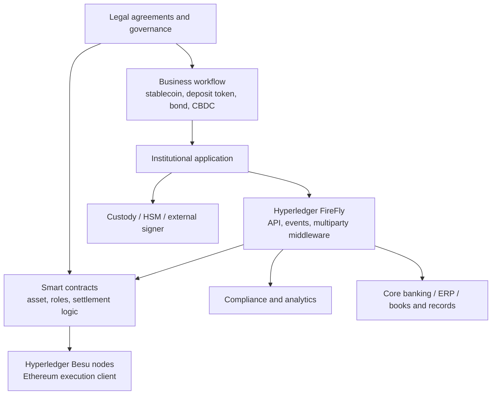

## Institutional Infrastructure Problem

Traditional finance already has ledgers. A commercial bank has core banking ledgers for deposits and loans. A custodian has securities position records. A central securities depository records legal ownership or immobilized securities positions. A payment system moves settlement instructions. SWIFT and ISO 20022 messages carry structured payment or securities messages between institutions. None of this is "paper-based" in the naive sense; it is highly digital, but it is fragmented across institutions.

The hard problem is that every institution maintains its own authoritative records. Bank A records that it has sent a payment. Bank B records that it has received it. A correspondent bank may record an intermediate leg. A settlement system records final settlement. A reconciliation team checks whether the records agree. If they do not, operations teams investigate breaks, missing messages, timing differences, failed instructions, duplicate entries, and data-format mismatches.

Distributed ledgers may reduce some of this fragmentation by giving multiple institutions a shared state machine. They can help when the same business fact must be agreed by several parties: ownership of a tokenized bond, cash leg of a DvP settlement, identity of a network participant, or completion of a workflow step. They do not remove the need for legal agreements, identity, governance, operational resilience, regulatory controls, or off-chain asset administration.

| Model | Core mechanism | Strength | Weakness |
|---|---|---|---|
| Conventional multi-ledger settlement | Separate internal ledgers plus messages and reconciliation | Mature legal frameworks, existing controls | Fragmented records, reconciliation cost, delayed settlement |
| Public Ethereum application | Open network, public state, permissionless users | Global composability, large ecosystem | Public data, volatile fees, regulatory uncertainty, limited direct governance |
| Permissioned Ethereum network | Known validators and controlled membership | Privacy/governance control, deterministic finality with PoA | Consortium coordination, reduced openness, operational burden |
| Hybrid public/private system | Private workflows anchored to or interoperating with public chains | Balance between control and public liquidity/auditability | Complex risk model, bridge and data-boundary issues |

> **Important distinction:** A blockchain can make a digital state transition tamper-evident and mutually visible. It does not automatically make an off-chain asset exist, make a legal transfer valid, identify a customer, or satisfy a regulator.

## Institutional Requirements

### Identity

Institutional identity has several layers that ordinary public-chain wallets do not distinguish:

- **Customer identity:** the natural person or business customer subject to KYC.
- **Legal-entity identity:** the bank, issuer, custodian, broker, central bank, or network operator.
- **Wallet identity:** the blockchain address or custody account used to sign transactions.
- **Node identity:** the peer-to-peer node participating in the network.
- **Validator identity:** the entity authorized to propose or validate blocks.
- **Application identity:** the backend service calling APIs.
- **Machine identity:** certificates, service accounts, and workload identities used by infrastructure.

In a regulated network, a blockchain address is rarely allowed to remain a bare pseudonym. It is mapped to an internal customer record, legal entity, account, role, or operational wallet. That mapping may live in an identity registry, a FireFly identity model, a bank customer database, a smart contract registry, or a governance document. The mapping must support lifecycle events: onboarding, evidence collection, address issuance, key rotation, suspension, revocation, and offboarding.

PKI and X.509 certificates often appear at the network and API layer. A certificate may authenticate a node, an API client, a mutual TLS connection, or an organization. This is different from an Ethereum account key, which authorizes an on-chain transaction. Confusing these layers creates brittle systems: a node certificate proves network membership, while an account signature proves transaction authorization.

### Permissioning

Permissioning is the discipline of deciding who may connect, submit, validate, call, mint, burn, transfer, upgrade, or observe. Besu documentation distinguishes node permissioning from account permissioning, and notes that local permissioning affects the node under your control rather than automatically enforcing rules across the entire network.[^besu-permissioning]

| Permission layer | Question answered | Typical mechanism | Failure mode |
|---|---|---|---|
| Network-level | Which nodes can connect? | Node allowlists, certificates, static peers, firewall rules | Unauthorized peer access or inconsistent connectivity |
| Validator-level | Which nodes produce blocks? | QBFT/IBFT validator set voting or governance | Liveness loss, capture, or disputed membership |
| Account-level | Which addresses can transact? | Local permissioning, contract allowlists, middleware policy | One node rejects what another accepts |
| Contract-level | Which roles can call functions? | Role-based access control in smart contracts | Unauthorized mint/burn/upgrade/transfer |
| Application-level | Which users can invoke business APIs? | IAM, API gateways, entitlements | Backend bypass or privilege escalation |

Inconsistent permissioning is a serious operational problem. If Bank A blocks an account locally but Bank B's validator still includes a transaction from that account, Bank A may refuse to relay or submit through its node, but the chain may still contain the transaction if consensus rules permit it. System-wide restrictions must be enforced by shared governance, contract rules, or consensus-level policy, not only by one participant's local configuration.

### Privacy And Confidentiality

Privacy in institutional blockchain means more than hiding data from the public internet. It asks exactly who can see transaction existence, participants, amounts, payloads, contract calls, resulting state, metadata, audit evidence, and off-chain attachments.

| Data category | Public Ethereum | Private network without private payloads | Privacy-enabled enterprise network |
|---|---|---|---|
| Transaction existence | Public | Visible to network members | Often visible as marker/metadata |
| Sender/recipient | Public addresses | Member-visible addresses | May still leak participants |
| Amounts | Public token events/state | Member-visible | Hidden in private payload/state or confidential asset design |
| Contract call data | Public | Member-visible | Payload may be off-chain/encrypted |
| Private documents | Should be off-chain | Usually off-chain | Encrypted off-chain with hash/on-chain proof |
| Regulatory audit access | External analytics | Consortium reports | Selective disclosure / auditor node / evidence export |

Besu's current documentation positions privacy for private networks around Paladin rather than treating older privacy-manager approaches as the center of new design.[^besu-poa] Older Quorum-style private transaction architectures used privacy managers such as Tessera and historically Orion to distribute encrypted payloads and place marker transactions on-chain. Those ideas remain important for understanding legacy deployments, but a current architecture should verify support status before selecting components.

Privacy groups or channel-like designs reduce data visibility among consortium members, but they do not eliminate metadata leakage. If Bank A and Bank B transact privately, Bank C may still infer activity from marker transactions, timing, gas usage, node traffic, or business reports. Privacy design therefore combines technical controls, governance controls, and operational controls.

### Governance

Consortium governance is the institutional layer that decides who is allowed to operate infrastructure and how disputes are handled. It is not optional background paperwork. In a permissioned Ethereum network, governance directly affects validator membership, protocol upgrades, emergency pauses, smart-contract upgrades, privacy group membership, node admission, and incident handling.

Governance artifacts usually include:

- network rulebook or operating agreement;
- validator admission and removal rules;
- software upgrade policy;
- smart-contract change-control policy;
- incident response playbook;
- key compromise procedure;
- dispute resolution process;
- data retention and audit policy;
- member exit and data-access rules.

Technical governance and legal governance must align. A contract may allow a multisig to pause transfers, but the legal agreement must define when that authority can be used. A validator vote may remove a bank's node, but the membership agreement must define whether that action is allowed and what happens to the bank's customers.

### Compliance And Auditability

Compliance checks occur before, during, and after settlement. A transfer may require KYC/KYB checks, sanctions screening, wallet risk screening, account permission checks, transaction monitoring, Travel Rule data exchange, suspicious-activity escalation, and reporting. The blockchain transaction is only one event in that control chain.

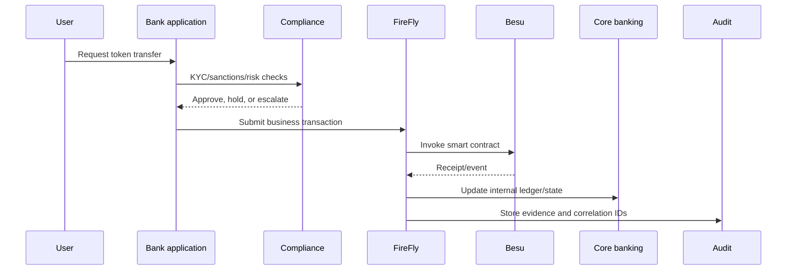

Auditability means more than immutability. Auditors need evidence that a transaction was authorized, screened, signed by the correct key, submitted by the correct service, included in the correct block, reconciled to internal books, and reported where required. FireFly-style correlation IDs and event records are often as important for audit as the raw block hash.

### Operations, Performance, And Finality

Institutional systems need high availability, observability, disaster recovery, controlled upgrades, and service-level objectives. A four-validator QBFT network may provide immediate finality, but it also has liveness limits: Besu documentation states QBFT and IBFT 2.0 require at least four validators for Byzantine fault tolerance and at least two-thirds of validators operating to create blocks.[^besu-poa]

Operational design therefore asks:

- how many validators are needed for fault tolerance and governance legitimacy;
- whether validators are distributed across institutions, regions, and cloud providers;
- which nodes serve RPC traffic versus consensus duties;
- how backups are restored without corrupting state;
- how node replacement preserves identity and validator membership;
- how upgrades are tested and rolled out;
- what RPO and RTO apply to each component.

| Requirement | Component that usually addresses it |
|---|---|
| Ethereum-compatible execution | Besu |
| Deterministic permissioned finality | QBFT or IBFT 2.0 in Besu |
| Business workflow APIs | FireFly |
| Multiparty messages and data exchange | FireFly |
| Key protection | HSM, MPC, Web3Signer, custody platform |
| Customer identity | KYC/KYB platform and bank IAM |
| Compliance screening | Analytics/sanctions systems |
| Audit evidence | FireFly records, logs, SIEM, blockchain receipts |
| Books and records | Core banking, ERP, securities ledger |
| Observability | Prometheus, Grafana, logs, traces, SIEM |

## Enterprise Ethereum Stack

An enterprise deployment is a layered system. The blockchain node is only one layer.

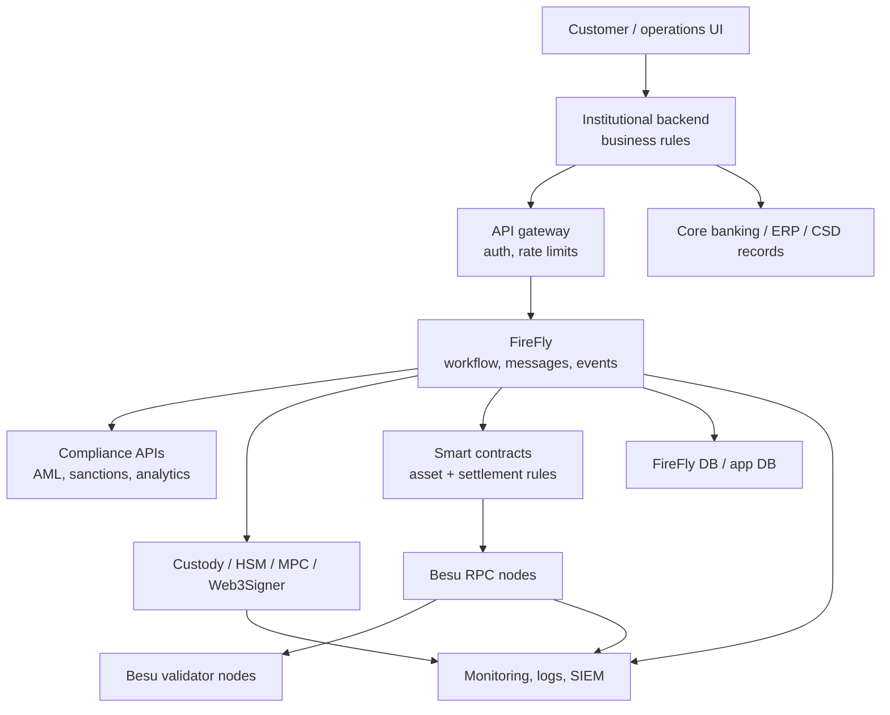

Each layer has a boundary:

| Layer | Responsibility | Data stored | Trust assumption | Failure mode |
|---|---|---|---|---|
| Business app | User workflow and policy orchestration | Requests, approvals, user state | App enforces business policy | Wrong approval or duplicate request |
| FireFly | Multiparty API, events, messages, transaction tracking | Messages, operations, identities, checkpoints | FireFly state matches chain events | Event lag, duplicate delivery, DB outage |
| Smart contracts | On-chain asset and settlement rules | Blockchain state | Contract logic is correct | Bug, bad upgrade, role compromise |
| Besu | Ethereum execution, networking, consensus | Blocks, world state, receipts | Client correctly implements rules | Consensus/client bug, disk corruption |
| Custody/HSM | Key generation and signing | Keys or key shares | Signing policy is enforced | Key compromise or signing outage |
| Compliance | Risk decisions and evidence | Alerts, scores, cases | Data and rules are accurate | False positive/negative, stale sanctions |
| Core banking/ERP | Legal books and records | Official balances/positions | Reconciliation is correct | Ledger break or delayed posting |

## Hyperledger And LF Decentralized Trust

Hyperledger began as a Linux Foundation umbrella for open-source enterprise blockchain projects. In 2024, Hyperledger Foundation and Trust over IP Foundation became part of LF Decentralized Trust, which describes itself as an open-source foundation for decentralized technologies and standards.[^lfdt] LF Decentralized Trust hosts code bases and communities; it does not make every hosted project a protocol standard or guarantee that all projects solve the same problem.

Besu and FireFly are both hosted in this ecosystem, but they sit at different layers:

| Project | Main layer | Relevance here |
|---|---|---|
| Besu | Ethereum execution client / ledger software | Runs public or private Ethereum-compatible networks |
| FireFly | Multiparty middleware / integration stack | Makes blockchain usable by enterprise applications |
| Fabric | Permissioned blockchain framework | Alternative with different execution and identity model |
| Indy | Decentralized identity ledger | Relevant to identity networks |
| Aries | DID/verifiable credential tooling | Relevant to identity exchange |
| Cacti | Interoperability/integration | Relevant to cross-network workflows |
| Iroha | Permissioned ledger | Alternative for simpler asset/identity use cases |

The Enterprise Ethereum Alliance historically developed enterprise Ethereum specifications and practices. The Ethereum Foundation stewards public Ethereum research and ecosystem development. Besu bridges the worlds: it is an Ethereum client that can participate in public Ethereum while also supporting private permissioned deployments.[^besu-home][^lfdt-besu]

## Plain Technical Orientation: Besu And FireFly

Besu and FireFly are complementary, but they are not the same kind of component. **Besu is the blockchain node software.** It runs the Ethereum-compatible ledger: it connects to peer nodes, stores blocks and state, executes smart contracts in the EVM, validates transactions, exposes JSON-RPC APIs, and participates in consensus. In a private institutional network, several banks or network members may each run Besu nodes, and some of those nodes may be validators that create and finalize blocks. Besu is therefore the layer that answers: "What is the current agreed blockchain state, and which transactions are valid?"

**FireFly is an application and integration layer above the blockchain.** It is middleware that gives enterprise applications higher-level APIs, event streams, identity abstractions, token operations, off-chain data coordination, multiparty messaging, and transaction tracking. FireFly does not replace Besu and does not create consensus. Instead, it helps business systems use Besu without every application team manually handling JSON-RPC calls, nonce management, receipt polling, event decoding, retries, duplicate delivery, and correlation between blockchain transactions and internal business records. FireFly is therefore the layer that answers: "How does this business workflow use the blockchain reliably and integrate with our systems?"

The simplest stack is:

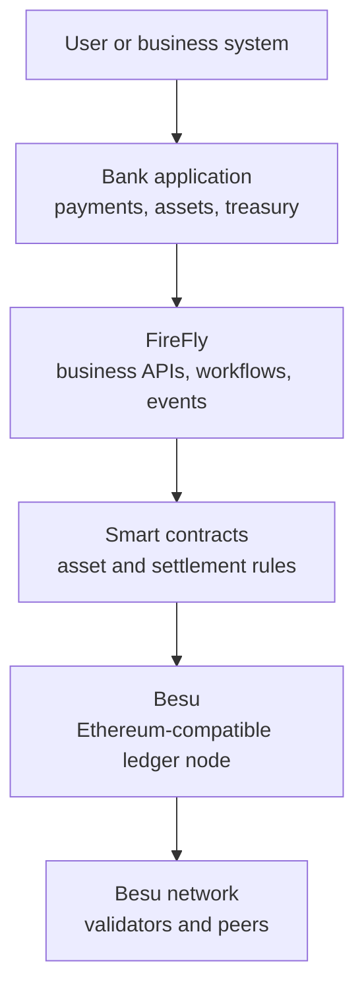

An analogy from conventional enterprise systems is useful but imperfect. Besu is close to the shared database/state-machine layer operated by a consortium, while FireFly is close to an integration and workflow platform that helps applications write to that shared state, listen for changes, attach documents or messages, and keep internal systems synchronized. The analogy is imperfect because Besu is not a normal database: transactions are signed, smart-contract execution is deterministic, and consensus determines the canonical state. FireFly is not merely an API gateway either: it stores operational state, tracks blockchain operations, coordinates multiparty messages, and emits events that downstream systems can consume.

In a tokenized-deposit example, Besu would run the network and execute the token contract that records balances and transfers. FireFly would expose the API that a bank application calls to mint, transfer, or burn tokens; track the resulting transaction; emit an event when Besu finalizes it; attach a business correlation ID; and help update the bank's core ledger or audit store. The regulated asset still also needs custody controls, compliance screening, legal terms, governance, and books-and-records systems around both components.

## Hyperledger Besu

### History And Positioning

Besu originated as Pantheon, an Ethereum client developed by ConsenSys, and entered Hyperledger as an enterprise-friendly Ethereum client. LF Decentralized Trust describes Besu as distributed ledger software and an Ethereum client designed for public and private permissioned network use cases, with permissioning schemes for consortium environments.[^lfdt-besu] The current Besu documentation describes it as an open-source Ethereum client written in Java, licensed under Apache 2.0, that runs on public and private networks and supports plugins.[^besu-home]

Besu is not a Layer 2, not middleware, and not a complete institutional platform by itself. It is a node implementation. A production network also needs deployment automation, key management, monitoring, firewalling, governance, smart contracts, application APIs, data stores, compliance systems, and operational procedures.

### Internal Architecture

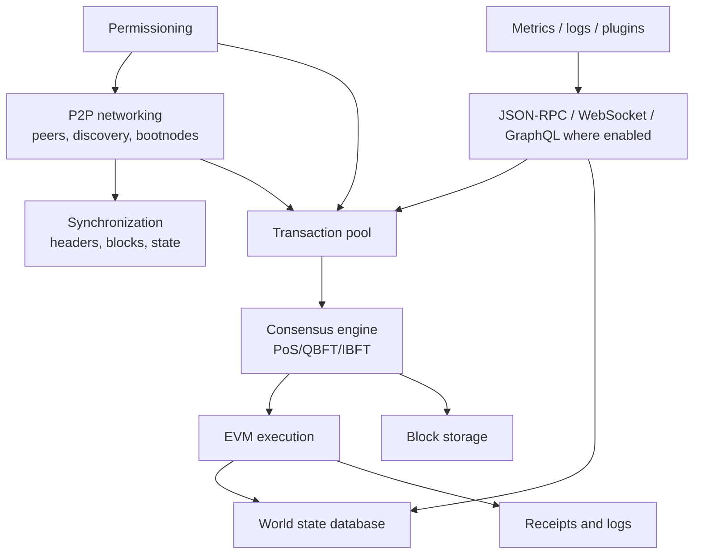

Besu's P2P layer discovers and communicates with peers. Bootnodes help new nodes find the network. Static peers are explicitly configured peers, often used in permissioned networks where membership is known. The transaction pool stores pending transactions. The consensus engine determines how blocks are proposed and accepted. EVM execution computes state transitions. RPC services expose node functions to applications and middleware.

### Node Roles

Institutions separate node roles because consensus, API traffic, observability, and security have different risk profiles.

| Role | Purpose | Operator | Design reason |
|---|---|---|---|
| Validator node | Participates in QBFT/IBFT block production | Consortium member | Governance and finality |
| Non-validator full node | Validates and reads chain | Member, auditor, application team | Local verification without block production |
| RPC node | Serves application/API requests | Institution or platform team | Isolates user traffic from validators |
| Observer node | Read-only monitoring/audit | Regulator, auditor, internal controls | Independent visibility |
| Bootnode | Peer discovery | Network operator or members | Stable network formation |
| Archive node | Historical state/query support | Analytics/audit team | Investigations and reporting |
| External signer | Signs validator or account operations | Security/custody team | Keeps keys out of node process |

### Consensus In Private Networks

Besu implements QBFT and IBFT 2.0 PoA consensus for private networks. Besu documentation states Clique is no longer supported.[^besu-poa] On public Ethereum, Besu operates as an execution client coordinated with a consensus client under Ethereum proof of stake; private QBFT/IBFT networks are different systems with known validators.

QBFT means **Quorum Byzantine Fault Tolerance**. IBFT means **Istanbul Byzantine Fault Tolerance**. Both are proof-of-authority (**PoA**) protocols: the right to participate in consensus comes from membership in a known validator set rather than from proof of work, proof of stake, or open participation. They are Byzantine fault tolerant (**BFT**) protocols, meaning they are designed to keep functioning when some validators are offline, faulty, or malicious, up to the protocol's fault threshold.

QBFT and IBFT provide immediate finality: once a block is committed, there are no probabilistic confirmations in the Bitcoin sense. This is attractive for settlement workflows, but it depends on validator availability, message delivery, and the assumption that fewer than one-third of validators are Byzantine. In institutional terms, "finality" is therefore a combined technical and legal statement: the protocol finalizes a block, while the consortium rulebook says what that finality means for obligations between members.

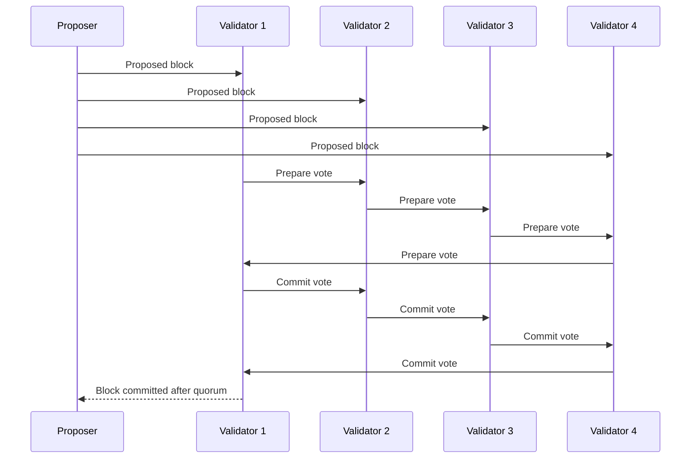

For production, Besu recommends at least four validators. With four or five validators, one unresponsive validator can be tolerated; with six to eight, two can be tolerated according to the Besu PoA documentation.[^besu-poa] More validators improve governance distribution but increase communication overhead and coordination complexity.

Validator addition and removal are governance events. In a bank consortium, adding Bank D as a validator is not merely a command-line change. It requires legal admission, node identity issuance, infrastructure readiness, monitoring, and validator-set update procedures. Removing a validator after compromise requires incident evidence, emergency governance, and possibly customer communication.

Validator-set voting must be treated as production change management. A validator addition changes the fault-tolerance and governance model of the network. A validator removal can affect liveness if the network is already near its minimum online quorum. A routine-looking validator operation can therefore become a settlement incident if performed during an outage.

| Consensus mode | Current relevance in Besu context | Finality | Governance implication |
|---|---|---|---|
| QBFT | Current recommended PoA-style option for many Besu private networks | Immediate after quorum commit | Validator set is a consortium governance object |
| IBFT 2.0 | Still relevant/supported, often seen in existing networks | Immediate after quorum commit | Similar governance, legacy deployments may use it |
| Clique | Historical/deprecated for Besu; no longer supported per current docs | Not the current design target | Do not design new Besu networks around it |
| Public Ethereum PoS | Relevant when Besu runs as public Ethereum execution client | Economic finality through consensus layer | Validator governance is public Ethereum, not a private consortium |

Faulty-validator handling has two layers. The protocol can continue if the number of faulty or offline validators remains below the threshold. The consortium must still investigate whether the failure is accidental, negligent, malicious, or caused by infrastructure dependency. Technical liveness does not answer legal accountability.

### Permissioning In Besu

Besu permissioning can restrict nodes and accounts. Local permissioning uses a local permissions configuration file and affects the node under the operator's control.[^besu-permissioning] This is useful for protecting an institution's node resources, but it should not be confused with global network policy.

Example:

- Bank A allows only Bank B and Bank C nodes as peers.
- Bank B forgets to remove a compromised Bank C node.
- Bank A is protected from that peer, but Bank B may still communicate with it.
- If the compromised node remains a validator, the consortium must use validator-governance procedures, not only local allowlists.

### Privacy Model

A current Besu design should verify privacy components carefully. Current Besu docs link private-network privacy to Paladin.[^besu-poa] Older Enterprise Ethereum deployments used private transaction managers such as Tessera and, historically, Orion-style components to distribute encrypted payloads and store only marker or coordination data on-chain. Those older mechanisms should be treated as legacy unless current project documentation confirms support for the selected deployment.

Private transaction pattern:

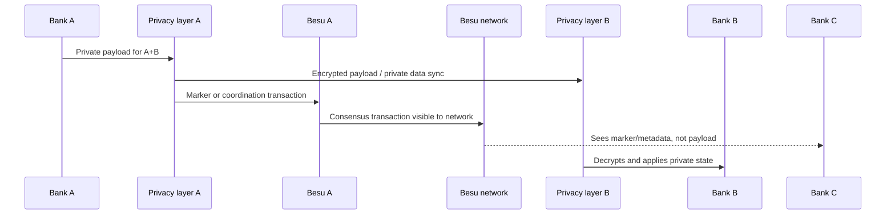

If Bank A and Bank B privately settle a tokenized loan participation, Bank C may validate the chain but not see the loan terms. A regulator or auditor may receive selective disclosure through an auditor node, encrypted document access, or exported evidence package. This creates operational complexity: privacy keys, participant lists, payload storage, private-state backup, and audit access must be managed as production-critical systems.

Privacy terminology can be slippery:

| Term | Meaning in institutional design |
|---|---|
| Private network | Only approved nodes can connect; data may still be visible to all members |
| Private payload | Transaction content is shared only with selected participants |
| Private state | The result of private execution is visible only to participants in that privacy scope |
| Privacy group | A defined set of members allowed to share private data/state |
| Marker transaction | Public/on-chain coordination transaction that signals private activity without carrying full private payload |
| Selective disclosure | Revealing private data or proofs to auditors/regulators without publishing to all members |
| Metadata leakage | Exposure of timing, participants, message size, or activity patterns even when payloads are encrypted |

The operational question is not only whether cryptography hides a value. It is whether every backup, log, event stream, database replica, analytics export, administrator console, and support process respects the same confidentiality boundary.

### Storage, State, APIs, And Integration

Besu stores blocks, world state, receipts, logs, indexes, and node metadata. Archive requirements depend on whether the institution must answer historical state queries. A normal full node may be sufficient for validation; an archive or indexed analytics system is often needed for audit, compliance, and reporting.

Besu exposes JSON-RPC over HTTP and WebSocket and supports Pub/Sub; the documentation also notes common JSON-RPC namespaces such as `eth`, `net`, `web3`, `debug`, and `miner`.[^besu-home] RPC endpoints should be treated as high-risk infrastructure. Exposed RPC can leak data, allow transaction submission, reveal operational metadata, or enable denial-of-service attacks. Production systems usually place RPC behind API gateways, authentication, authorization, network segmentation, rate limits, and logging.

Besu documentation states that Besu does not support key management inside the client and points to Web3Signer for keystore access and transaction signing.[^besu-home] Institutions often go further by using HSMs, MPC custody, approval workflows, and segregation of duties.

Storage design has direct audit consequences. A regulator may ask why a transfer was accepted, which contract emitted the event, which private payload was attached, and which internal ledger update followed. The block and receipt prove on-chain execution; the FireFly/database record proves workflow correlation; the core ledger proves books-and-records treatment. Losing one of those layers does not necessarily lose the asset, but it can break operational evidence.

| Data | Stored by | Used for |
|---|---|---|
| Blocks and headers | Besu | Chain validation, audit proof, replay |
| World state | Besu | Current balances, contract storage |
| Receipts/logs | Besu and indexers | Event-driven workflows and reporting |
| Private payloads | Privacy layer / off-chain store | Confidential business data |
| FireFly operations | FireFly database | Correlation, retry, idempotency |
| Books and records | Core banking / ERP / CSD | Legal accounting record |
| Monitoring logs | Observability stack / SIEM | Incident response and controls testing |

API integration should normally avoid giving business applications unrestricted RPC access. A safer pattern is:

1. application calls an internal API or FireFly endpoint;
2. middleware validates idempotency, authorization, and business policy;
3. transaction is sent to signing infrastructure;
4. signed transaction is submitted through controlled RPC nodes;
5. receipts/events are consumed asynchronously;
6. downstream ledgers update from confirmed events rather than optimistic assumptions.

API vocabulary:

- **JSON-RPC:** remote procedure call protocol used by Ethereum clients for methods such as sending transactions and reading state.
- **WebSocket:** persistent connection useful for subscriptions and event streams.
- **GraphQL:** query language; if enabled/supported in a deployment, it should be exposed only behind the same controls as other node APIs.
- **Engine API:** interface between Ethereum execution and consensus clients on public Ethereum; relevant when Besu participates in public proof-of-stake Ethereum, usually not the main interface for private QBFT applications.
- **Pub/Sub:** publish/subscribe mechanism for event-style communication.

Institutions often separate "write RPC" from "read RPC." A read-only analytics node can expose historical queries to reporting systems, while transaction submission goes through a narrow, authenticated path that enforces policy and signing controls.

### Key Management

Enterprise Ethereum deployments have multiple key types:

- **node keys:** identify P2P nodes;
- **validator keys:** authorize block production or validator messages;
- **account keys:** sign business transactions;
- **privacy keys:** encrypt/decrypt private payloads where privacy layers are used;
- **API credentials:** authenticate applications to middleware;
- **TLS certificates:** secure service-to-service traffic.

These keys should not all live in the same place. A validator key may be managed by infrastructure operations. A mint/burn key may require treasury and compliance approval. A customer custody key may be held by an MPC platform. A privacy key may be controlled by a data-governance team. Separation of duties prevents one compromised application server from minting assets, changing validators, decrypting private data, and submitting transactions.

Key rotation is difficult because keys appear in on-chain roles, node permissioning files, certificates, audit records, and application configuration. A rotation plan must cover both the cryptographic event and the business mapping: the new key must be linked to the same legal entity or role, while the old key must be disabled without breaking historical evidence.

### Plugins And Operations

Besu's Plugin API allows extensions on public and private networks.[^besu-home] Plugins can support custom permissioning, monitoring, metrics, or enterprise integration. They also expand the operational and security surface. A plugin that affects transaction acceptance, permissioning, or RPC behavior must be treated like critical infrastructure and tested across all consortium nodes.

Operational deployment commonly uses Docker or Kubernetes, while production topology depends on security, resilience, regulatory, and operational requirements. Validators may run on-premise, in dedicated cloud accounts, across regions, or across multiple providers. RPC nodes may autoscale behind load balancers. Monitoring commonly uses Prometheus and Grafana-style metrics, logs, SIEM integration, alerting, and runbooks.

### Besu Security Risks

| Risk | How it appears | Mitigation direction |
|---|---|---|
| Exposed RPC | Internet-accessible node APIs | Private networking, auth, gateway, rate limits |
| Key compromise | Validator/account key stolen | HSM/MPC/external signing, rotation, approvals |
| Validator compromise | Malicious or offline validator | BFT thresholds, monitoring, governance removal |
| Misconfigured permissioning | Inconsistent node/account access | Shared config management and audits |
| Malicious member | Insider submits harmful transactions | Contract controls, compliance checks, governance |
| Client bug | Consensus divergence or outage | Testing, staged upgrades, client/version policy |
| Database corruption | Node cannot validate or serve | Backups, resync plans, disk monitoring |
| Supply-chain risk | Malicious dependency/image | SBOM, signed artifacts, controlled builds |

### Besu Use Case: Tokenized Deposit Consortium

Assume four commercial banks create a permissioned Besu network for tokenized deposits. Each bank operates one validator, one RPC node, and one observer/analytics node. A shared smart contract represents deposit tokens issued by each bank. FireFly exposes APIs to internal bank systems. HSMs sign mint, burn, and transfer operations.

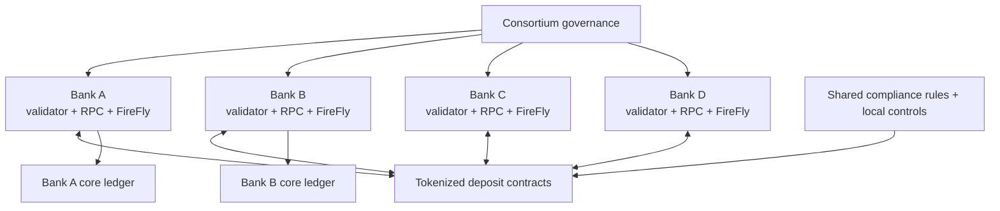

When Bank A onboards a new corporate customer, the customer does not become a validator. Bank A maps the customer's legal identity to one or more wallets, applies KYC, sets transfer permissions, and records the relationship internally. If the customer transfers tokenized deposits to a Bank B customer, the blockchain records token movement, but each bank still updates internal books, compliance records, and customer statements.

## Hyperledger FireFly

The Besu section described the ledger layer: nodes, blocks, state, consensus, RPC, and smart-contract execution. FireFly starts one layer higher. It is the software that enterprise applications use when direct node integration would be too low-level and fragile. A bank application usually does not want to manually build raw JSON-RPC requests, coordinate nonces, poll for receipts, decode logs, retry failed submissions, distribute off-chain payloads, and map every transaction hash back to a business instruction. FireFly packages those concerns into APIs, operations, events, identities, messages, token abstractions, connectors, and persistent workflow state.

In short: **Besu runs the Ethereum-compatible network; FireFly helps enterprise applications use that network as part of real business workflows.** Besu is concerned with valid blockchain state. FireFly is concerned with reliable application coordination around that state.

### What FireFly Is

FireFly is enterprise middleware for blockchain and multiparty systems. The documentation describes Hyperledger FireFly as an open-source "Supernode" and a complete stack for enterprises to build and scale secure Web3 applications.[^firefly-home] In practical architecture terms, FireFly gives applications APIs, events, data exchange, identity abstractions, token APIs, blockchain connectors, and operational state around a blockchain network.

FireFly is not a blockchain, consensus mechanism, execution client, custody platform, or replacement for smart contracts. It sits above Besu or other ledgers. It exists because direct JSON-RPC integration is too low-level for most enterprise workflows.

### Problems FireFly Solves

Without middleware, every application team must handle transaction signing, nonce management, retries, receipt polling, event decoding, duplicate delivery, off-chain data, participant identities, and business correlation. FireFly standardizes much of this into APIs and event streams.

| Problem | Direct Besu JSON-RPC | FireFly approach |
|---|---|---|
| Business request tracking | Application must build correlation | Operations and transaction records |
| Event handling | Manual log filters and receipt polling | Subscriptions and event bus |
| Multiparty messages | Custom off-chain system | Broadcast/private data exchange |
| Token operations | Contract-specific ABI calls | Token abstractions/connectors |
| Idempotency | Application-specific | Idempotency keys and operation tracking |
| Multi-chain support | Different SDKs per chain | Connector framework |
| Off-chain data | Custom storage/hashing | Data payloads and proofs |

### Internal Architecture

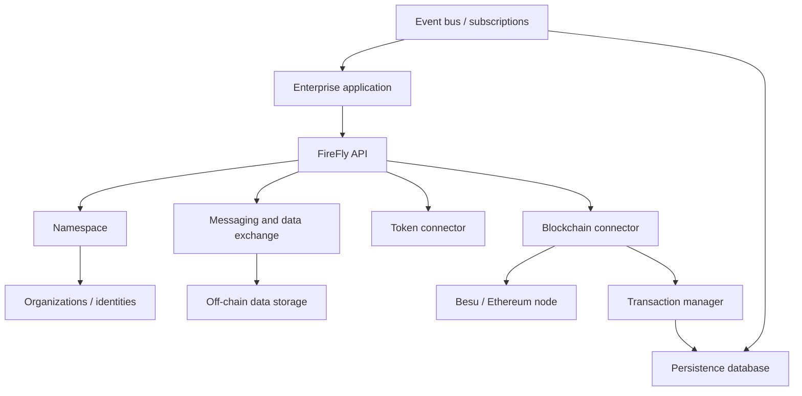

FireFly concepts include namespaces, nodes, organizations, identities, blockchain connectors, token connectors, data exchange, messages, events, subscriptions, persistence, APIs, and plugins. A namespace provides a logical boundary for a multiparty application. Organizations represent participants. Identities map business actors to verifiers and blockchain identities. Connectors translate FireFly operations into chain-specific actions. FireFly's node component architecture describes a node as multiple runtimes exposed through a unified HTTPS/WebSocket API, with a private database and connectivity to other parties through runtimes such as blockchain, shared storage, and messaging.[^firefly-node]

FireFly's multiparty documentation emphasizes that each party retains sovereignty over its application instance, private data, business processes, proprietary logic, internal controls, and application instance.[^firefly-multiparty] This is central: FireFly is not a central server that all banks blindly trust. Each member can run its own node and integrate it with its own systems.

### Blockchain Connectors

FireFly can connect to Ethereum/Besu-style networks and other chains through connectors. The abstraction hides some low-level details, but blockchain-specific concepts still leak through: confirmation depth, transaction finality, contract addresses, event signatures, gas/fees on public chains, private-network finality assumptions, and token contract behavior.

A Besu connector workflow:

1. Application calls FireFly API to invoke a contract.
2. FireFly creates an operation with an idempotency key.
3. FireFly sends the request to a blockchain connector.
4. The connector submits a transaction through Besu RPC or signing infrastructure.
5. FireFly tracks pending status.
6. Besu emits a receipt/log.
7. FireFly updates operation state and emits an event to the application.

FireFly's connector architecture is deliberately pluggable. Its documentation describes a blockchain connector framework and a FireFly Transaction Manager (**FFTM**) responsible for transaction submission, monitoring operations, receipts, confirmations, transaction process history, nonce management, event streaming, checkpoint restart, and at-least-once delivery.[^firefly-connector] This matters because many enterprise failures are not contract failures; they are integration failures around duplicate submission, lost receipts, stale event listeners, and unclear operation status.

Nonce management is especially important for EVM chains. If two systems submit transactions from the same signing address without coordinating nonces, they can allocate the same nonce and replace or block each other. FireFly documentation warns against multiple nonce-management systems using the same signing key.[^firefly-connector] In institutional design, this means a signing address should normally have one authoritative transaction pipeline.

### FireFly Multiparty Concepts In More Detail

| FireFly concept | Meaning | Institutional interpretation |
|---|---|---|
| Namespace | Logical application boundary | One business network or workflow domain |
| Node | A participant's FireFly runtime | Each bank may run its own node |
| Organization | Business participant | Legal entity such as Bank A |
| Identity | Verifiable representation of a participant/application/user | Maps business actor to technical verifiers |
| Message | Structured payload exchanged through FireFly | Business event, instruction, or data notice |
| Data | Payload or reference managed by FireFly | Document hash, JSON terms, file metadata |
| Operation | Tracked unit of work | Contract call, token action, message send |
| Subscription | Event delivery registration | Webhook/WebSocket feed to applications |
| Token pool | Token abstraction context | ERC-20/721/1155-like asset pool or connector-managed asset |
| Verifier | Technical proof of identity/control | Address, key, DID, or other verification material |

FireFly does not make all participants share one database. In multiparty mode, each participant can retain its application instance, private data, internal business logic, and IT controls.[^firefly-multiparty] The shared ledger and FireFly messages coordinate facts between parties, while each organization remains sovereign over its own systems of record.

### Tokens And Regulated Assets

FireFly token APIs can simplify minting, burning, transferring, and tracking token pools, but regulated tokens still require issuer policies. A tokenized deposit or security token cannot rely on generic token transfer alone. It may need investor eligibility, jurisdiction restrictions, freeze/hold controls, transfer-agent approval, issuer limits, sanctions screening, and reconciliation to off-chain books.

| Asset | Token operation | Extra institutional requirement |
|---|---|---|
| Bank-backed stablecoin | Mint/burn/transfer | Reserve reconciliation, redemption rights |
| Tokenized deposit | Issue/transfer/redeem | Bank liability accounting |
| Bond token | Mint allocation and transfer | Offering docs, investor eligibility, coupon lifecycle |
| Security token | Transfer | Transfer restrictions and registrar records |
| CBDC experiment | Issue/redeem/settle | Central bank policy and participant controls |

### Messaging And Off-Chain Data

Large documents and confidential records should not be placed directly on-chain. A tokenized bond may have an offering circular, subscription agreement, investor representations, legal opinions, and payment instructions. FireFly can coordinate off-chain payloads and put hashes or references into shared workflows, so participants can prove which document was used without making every document public.

Example: a tokenized bond issuance.

- Issuer uploads final terms to controlled document storage.
- FireFly sends private data references to underwriters and eligible investors.
- A hash of the document package is linked to the issuance transaction.
- Investors subscribe through FireFly APIs.
- Smart contracts allocate bond tokens.
- Core systems record cash received and securities positions.
- Auditors can later verify the document hash and transaction evidence.

FireFly's example transaction-flow documentation illustrates a pattern where one party broadcasts public descriptive data for a binary asset, another party requests the actual data privately, and the data transfer itself can happen off-chain while blockchain-backed messages provide sequencing/evidence.[^firefly-txflow] That pattern generalizes to finance: publish enough metadata for workflow coordination, keep confidential documents off-chain, and hash or reference them so later audit can verify integrity.

### Events, Idempotency, And Consistency

Enterprise systems fail in messy ways: API calls timeout, transactions confirm later, duplicate webhooks arrive, databases restart, and core banking systems process batches. FireFly helps by recording operations, tracking event checkpoints, using idempotency keys, and emitting application events.

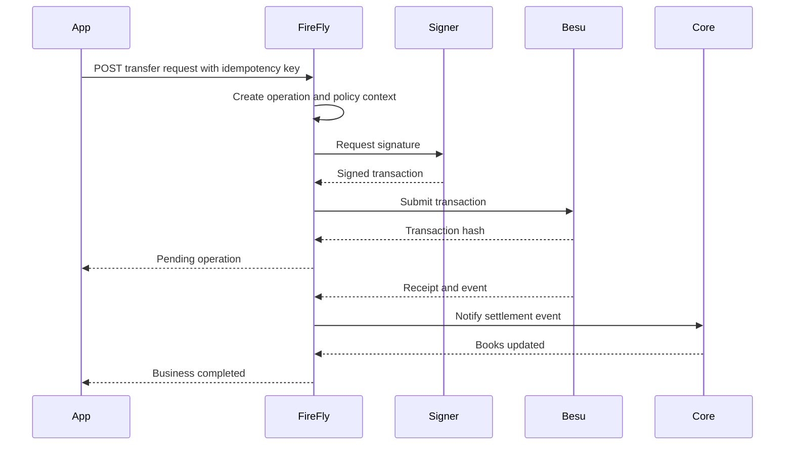

Eventual consistency is unavoidable. A blockchain transaction may be final while a core ledger update is delayed. The correct design makes this state visible and recoverable rather than pretending every system updates atomically.

### FireFly Security And Operations

FireFly needs API authentication, authorization, namespace isolation, database security, connector credential management, secrets management, network segmentation, monitoring, backups, and upgrade procedures. FireFly state is not blockchain state. It stores operational and workflow data needed to correlate blockchain events with business processes.

If FireFly is unavailable, the blockchain may continue producing blocks. If
Besu is unavailable, FireFly may accept requests but cannot settle them. If the
FireFly database is corrupted, chain state may still be reconstructed from Besu,
but workflow correlation can be lost unless backups and event replay are
designed properly.

FireFly persistence usually includes messages, data references, operations, transactions, identities, subscriptions, event checkpoints, and status records. That state answers operational questions the blockchain alone cannot answer: whether a request was retried, which business ID maps to a transaction hash, which webhook was delivered, which off-chain payload hash was attached, and whether a downstream system acknowledged the event.

Consistency risk appears when FireFly, Besu, and core banking disagree:

- FireFly thinks a transaction is pending, but Besu rejected it.
- Besu finalized a transaction, but FireFly missed the event while offline.
- FireFly delivered an event twice, and the core ledger posted twice.
- The core ledger updated optimistically, but the blockchain transaction failed.

Good designs use idempotency keys, event checkpoints, replayable event streams, reconciliation jobs, and manual repair procedures. The system should make inconsistent states visible rather than hiding them behind a single "success" flag.

### FireFly Versus Alternatives

| Alternative | Strength | Weakness |
|---|---|---|
| Direct Besu JSON-RPC | Full control, minimal middleware | High integration burden |
| Custom middleware | Tailored to bank processes | Expensive to build and maintain |
| Kaleido/managed platforms | Faster deployment and operations | Vendor/platform dependence |
| Fabric SDK systems | Native Fabric model | Less Ethereum/EVM compatibility |
| Generic Web3 frameworks | Developer ecosystem | Not enterprise workflow middleware |
| Event indexers | Excellent event/query layer | Not full transaction orchestration |
| Workflow engines | Strong business process tools | Need blockchain-specific adapters |

FireFly is appropriate when several organizations need shared workflows, event correlation, private data exchange, token APIs, and operational consistency around blockchain transactions. It may be unnecessary for a small internal prototype that only needs direct contract calls.

## Hyperledger Cacti And Interoperability

Hyperledger Cacti is the interoperability part of the institutional blockchain stack. The official Cacti documentation describes it as a "multi-faceted pluggable interoperability framework" for linking networks built on heterogeneous distributed ledger and blockchain technologies and running transactions that span multiple networks.[^cacti-docs] The Cacti repository explains that it resulted from a merger of the Weaver Lab project with Hyperledger Cactus, later renamed to Cacti, and that it combines protocols, modules, libraries, SDKs, connectors, and examples for DLT interoperability.[^cacti-github]

Enterprise blockchain deployments can recreate the same fragmentation that
distributed ledgers are intended to reduce. One consortium may run Besu for
tokenized deposits; a securities market infrastructure may use Fabric, Canton,
Corda, or a centralized CSD platform; and a public-chain issuer may use Ethereum
or a Layer 2. Without interoperability, each network becomes another silo.

### Why Cacti Exists

The basic institutional problem is cross-network coordination. A regulated asset workflow rarely lives inside one ledger forever. A tokenized bond may be issued on one network, paid for with tokenized deposits on another, custodied by a third platform, reported through ISO 20022-style messages, and monitored by compliance systems. If every integration is built as a one-off API between two operators, the result is fragile and trust-heavy.

Cacti's docs frame the problem as avoiding a fragmented ecosystem where digital assets and workflows remain isolated in silos. The stated goal is not to force every network onto one chain, but to let networks orchestrate transactions across boundaries without sacrificing security, privacy, or governance autonomy.[^cacti-github]

Interoperability must answer several questions at once:

- how one network discovers and authenticates another network's members;
- how a request is authorized by the source and destination networks;
- how one network verifies a fact from another network;
- how assets avoid double-spending when represented across ledgers;
- how both sides handle failure, timeout, replay, and rollback;
- how legal finality maps to technical finality on both networks;
- how regulators and auditors receive evidence without seeing confidential data unnecessarily.

### What Cacti Is And Is Not

Cacti is not a blockchain, not a consensus protocol, not a custody platform, and not a replacement for Besu or FireFly. It is an interoperability framework and toolkit. It can help applications and networks share ledger data, exchange assets, transfer assets, and coordinate cross-network workflows.

| Component | Primary problem solved | Relationship to Cacti |
|---|---|---|
| Besu | Runs an Ethereum-compatible ledger | Cacti may connect to a Besu network through a connector/driver |
| FireFly | Enterprise workflow, APIs, eventing, multiparty coordination | FireFly may orchestrate a business process that invokes Cacti-enabled interop |
| Cacti | Cross-ledger interoperability | Links independent networks while preserving their governance |
| Custody/HSM/MPC | Key protection and signing governance | Required for secure interop operations but not replaced by Cacti |
| Compliance analytics | Risk and monitoring | Consumes interop evidence and screens cross-network flows |

Cacti should be viewed as a bridge between sovereign systems, not as a single settlement layer. This distinction is important. Some interoperability designs require a common settlement chain or central bridge contract. Cacti's documentation emphasizes interoperability without requiring deployment of, or dependence on, separate chains, and describes itself as suited to private or permissioned DLT networks that want to keep governance control.[^cacti-docs]

### Core Interoperability Modes

Cacti documentation identifies common interoperability modes: asset transfer, asset exchange, data sharing, and identity.[^cacti-modes]

| Mode | Meaning | Institutional example | Main risk |
|---|---|---|---|
| Asset transfer | Asset moves from source ledger to consuming ledger | Tokenized cash locked on Besu and represented on Fabric | Double representation if lock/burn proof is wrong |
| Asset exchange | Ownership changes on two networks atomically | DvP: bond on securities network, cash on deposit-token network | One leg settles while the other fails |
| Data sharing | One network shares a record or proof with another | KYC eligibility or shipment status used in payment workflow | Destination trusts stale or forged data |
| Identity | Networks understand each other's members and credentials | Bank consortium verifies member of another consortium | Bad membership proof or revoked identity accepted |

The distinction between assets and data matters. A data record can often be copied to another ledger without destroying the original. An asset cannot safely exist as the same claim in two places unless there is a robust locking, burning, escrow, or representation model. This is why asset transfer requires stronger atomicity and double-spend controls than ordinary data sharing.

### Architecture Concepts: Connectors, Relays, Drivers, And Identity

Cacti inherits two architectural lineages:

- **Cactus-style modules/connectors:** pluggable connector components and APIs for interacting with different ledgers.
- **Weaver-style relays/drivers:** protocols for data sharing and asset exchange between independent networks, with relays and network-specific drivers.

The Cacti docs describe relays as facilitating protocol communication between networks. A relay has a relay service for incoming relay requests, an app service for local application requests, and a driver that communicates with the local network. The driver is network-specific and can be a separate process connected over gRPC.[^cacti-relay][^cacti-drivers]

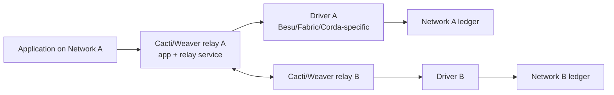

The driver abstraction is crucial. Besu, Fabric, Corda, and Iroha do not expose the same APIs, finality model, identity system, or proof format. A driver translates the generic interoperation request into the local network's vocabulary. This is powerful, but it means ledger-specific concepts still leak through. A Besu connector may deal with contract events and receipts; a Fabric connector may deal with chaincode, channels, endorsements, and MSP certificates; a Corda connector may deal with states, flows, notaries, and vaults.

### Identity Plane And Data Plane

Cacti/Weaver documentation separates identity concerns from data/asset transfer. The data plane handles the actual exchange of assets or data. The identity plane establishes whether the remote network and its members are who they claim to be. The docs discuss Interoperation Identity Networks (**IINs**) that can maintain identity records and credentials for organizations, with decentralized identifiers (**DIDs**) and verifiable credentials (**VCs**) used to support cross-network trust.[^cacti-identity]

This is not academic detail. A destination network cannot safely accept a remote proof unless it knows which organizations are members of the source network, which keys/certificates are valid, and whether the source network's consensus or governance process authorized the statement.

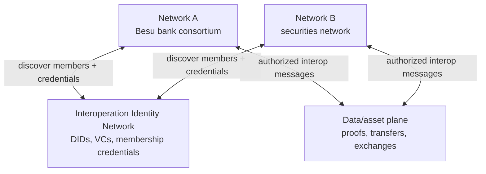

The identity plane is where many enterprise assumptions become explicit:

- which organizations are members of which network;
- which certificates or DIDs represent those organizations;
- who is trusted to issue membership credentials;
- how revocation and membership changes propagate;
- whether a network accepts credentials from one IIN, multiple IINs, or a direct bilateral exchange.

### Interoperability Patterns In Institutional Workflows

#### Data Sharing

Data sharing means one network proves or shares a fact with another. For example, a trade finance network may prove that an invoice was approved, enabling a payment network to release funds. A tokenized bond platform may prove that an investor is eligible, enabling a settlement network to process a cash leg.

Data sharing does not require moving the original record. It requires the destination to trust the proof, the identity of the source, and the freshness of the data. Stale proofs are a real risk: an investor may have been eligible yesterday but sanctioned today.

#### Asset Transfer

Asset transfer moves an asset representation across networks. Cacti documentation describes asset transfer as requiring burning or locking on the source ledger and creation on the target ledger so that the same asset is not spendable in both places.[^cacti-modes]

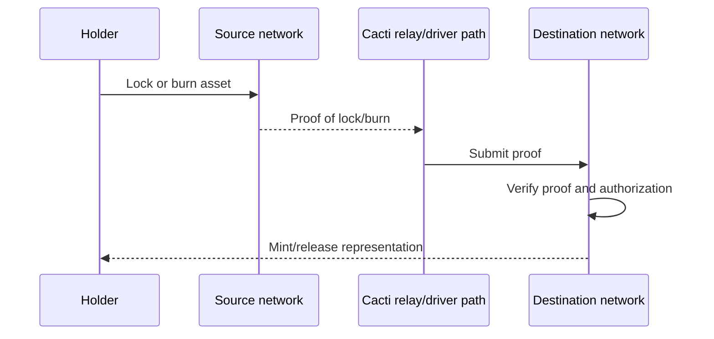

The hard part is not the word "transfer"; it is making sure the source-side lock/burn is final, the proof is valid, the destination rules allow mint/release, and failures do not create duplicate claims.

#### Asset Exchange And DvP

Asset exchange changes ownership of assets on separate networks without moving either asset out of its home network. In financial markets this maps naturally to DvP: cash changes ownership on one network while securities change ownership on another.

The atomicity problem is subtle. If the cash network has immediate BFT finality and the securities network has a different finality model, one side may consider its leg final before the other can safely commit. The interop protocol must define timeouts, locks, proofs, and dispute handling.

#### Messaging Bridge

A messaging bridge forwards events or instructions across networks. It is easier than asset transfer but still has security requirements. A message saying "Bank A paid Bank B" must include provenance, signatures, replay protection, and policy checks. Otherwise, the destination network may treat an ordinary message as settlement evidence.

#### Proof-Based Interoperability

Proof-based interoperability tries to reduce trust in a central relay by making the destination verify evidence from the source network. The proof might include signatures, Merkle proofs, transaction receipts, consensus evidence, or notarized attestations depending on the ledger. Proof quality depends on the source network's consensus and the destination's verification logic.

### Cacti Beside Besu And FireFly: Concrete Example

Assume a bank consortium uses Besu for tokenized deposits and a securities consortium uses Fabric or Canton for tokenized bonds. A customer wants to buy a tokenized bond using tokenized deposits.

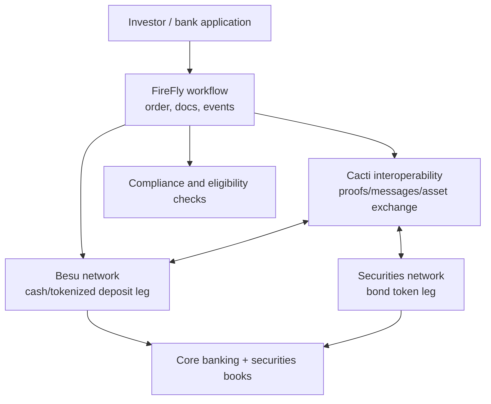

Workflow:

1. FireFly receives the bond purchase request and coordinates the business process.
2. Compliance checks investor eligibility, sanctions, wallet risk, and account limits.
3. Besu cash contract locks tokenized deposits.
4. The securities network locks or prepares bond tokens.
5. Cacti coordinates cross-network proof exchange or asset exchange logic.
6. Each network verifies the remote evidence according to its own rules.
7. Both legs finalize or timeout/unwind according to the interop protocol.
8. FireFly emits business events and updates core systems.

In this model, FireFly is the workflow/API layer, Besu is one ledger, and Cacti is the interop layer connecting Besu to another ledger. They are complementary, not substitutes.

### Trust And Security Model

Interoperability adds a new trust layer rather than eliminating trust.

| Risk | Example | Mitigation direction |
|---|---|---|
| Relay compromise | Relay forwards forged or selective messages | Destination verifies cryptographic proofs and source authorization |
| Driver bug | Besu/Fabric driver misinterprets state | Testing, formal interface specs, independent validation |
| Finality mismatch | Public-chain reorg after destination accepts proof | Confirmation/finality thresholds and rollback policy |
| Replay attack | Old proof reused to mint/release again | Nonces, unique transfer IDs, consumed-proof registry |
| Identity drift | Remote member removed but still trusted | Credential expiry, revocation, membership refresh |
| Governance mismatch | Networks disagree about incident handling | Inter-network operating agreement |
| Privacy leakage | Cross-network proof reveals confidential business state | Minimal proofs, selective disclosure, access controls |
| Legal mismatch | Technical transfer not recognized legally | Contractual settlement-finality terms |

The destination network must decide what it trusts: a relay operator, a set of source-network signatures, a Merkle proof, a notarized event, a source consortium governance statement, or some combination. Different Cacti modes and deployments can choose different trust assumptions. That flexibility is useful, but it means "uses Cacti" is not a complete security description.

### Cacti Versus Alternatives

| Approach | How it works | Strength | Weakness |
|---|---|---|---|
| Direct custom integration | One system calls another through bespoke APIs | Fast for one bilateral link | Does not scale; trust and evidence are ad hoc |
| FireFly connectors | Middleware submits/observes transactions on ledgers | Excellent for application workflow | Not by itself a cross-network proof/atomicity protocol |
| Cacti | Pluggable interop framework with connectors/relays/protocols | Designed for heterogeneous DLT interoperability | Operationally complex; still requires governance |
| Public-chain bridge | Lock/mint or message across public networks | Large ecosystem and liquidity | Bridge risk, smart-contract risk, public metadata |
| Chainlink CCIP / LayerZero-style messaging | Public-chain cross-chain messaging networks | Broad public-chain connectivity | Different trust model; not primarily consortium governance |
| SWIFT/ISO 20022 messaging | Structured institutional messages | Mature banking integration | Message does not itself verify ledger state or atomic settlement |
| Central industry utility | One platform coordinates all participants | Simpler governance if accepted | Central operator/vendor concentration |

Cacti is most relevant when independent ledgers must remain sovereign but still coordinate. If one bank controls both systems, a simpler internal integration may be enough. If the workflow spans independent consortia, Cacti-style identity, proof, and interop patterns become more valuable.

### Limitations And Misconceptions

> **Misconception: Interoperability makes two ledgers share one security model.**  
> Each ledger keeps its own consensus, governance, privacy, and failure modes. Interoperability creates a controlled relationship between them.

> **Misconception: A relay is automatically trusted settlement infrastructure.**  
> A relay transports or facilitates messages. The destination still needs proof verification, authorization, replay protection, and governance.

> **Misconception: Atomic cross-ledger settlement is easy if both ledgers are blockchains.**  
> Atomicity is hard when finality, identity, clocks, privacy, and legal rules differ.

> **Misconception: Cacti replaces FireFly.**  
> FireFly handles enterprise workflow and multiparty application integration. Cacti handles cross-network interoperability. A serious institutional architecture may use both.

The deeper lesson is that interoperability is a governance problem expressed through software. The code can carry proofs and messages, but the participating networks must agree what those proofs mean, when a timeout occurs, who can upgrade connectors, who can pause a link, and what happens when one network has an incident.

## End-To-End Institutional Workflows

### Stablecoin Issuance And Redemption

Actors: issuer, customer, reserve bank, compliance team, custody signer, FireFly, Besu, smart contract, core ledger, auditor.

Minting:

1. Customer wires fiat to issuer reserve account.
2. Issuer treasury confirms funds in banking system.
3. Compliance checks customer, source of funds, sanctions, and wallet.
4. FireFly receives mint request with correlation ID.
5. Custody/HSM signs mint transaction.
6. Besu finalizes the token mint.
7. FireFly emits event and updates issuer systems.
8. Reserve ledger and token supply are reconciled.

Redemption reverses the flow: tokens are burned or locked, compliance checks are performed, fiat is paid out, and evidence is stored.

### Tokenized Deposit Transfer Between Banks

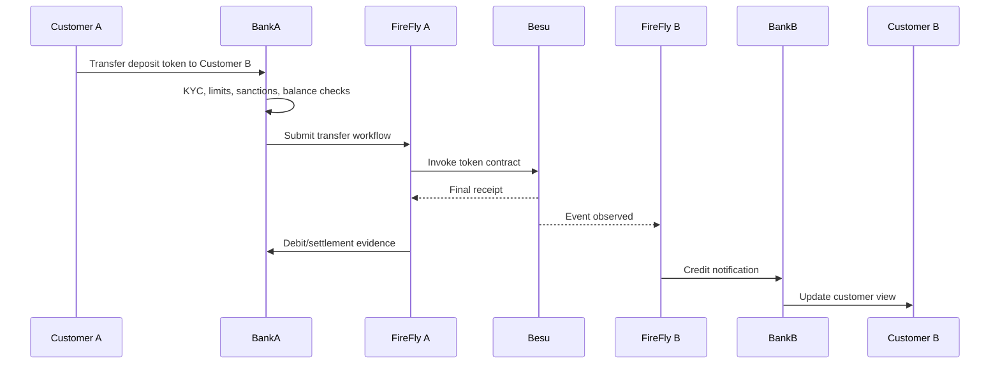

The settlement point is the finalized blockchain transfer if legal agreements define the token movement as settlement. The banks still reconcile internal ledgers, customer statements, liquidity positions, and compliance evidence.

### Tokenized Bond Issuance And DvP

A delivery-versus-payment workflow coordinates two assets: securities and cash. Either both legs settle or neither should settle. A smart contract can escrow tokenized cash and tokenized securities, then atomically exchange them.

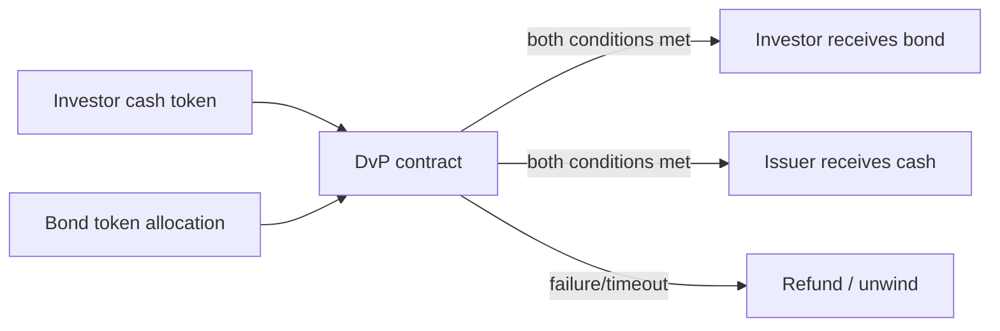

Institutional details matter: investor eligibility, subscription documents, securities law transfer restrictions, paying-agent records, coupon processing, tax reporting, and custodian statements.

### Cross-Border Payment And CBDC Experiment

In a wholesale CBDC experiment, a central bank or operator issues settlement tokens to participating banks. Banks use those tokens for interbank settlement. The experiment tests finality, liquidity, operating hours, privacy, compliance reporting, and integration with RTGS or correspondent systems. It does not automatically solve FX liquidity, capital controls, legal tender status, or cross-border regulatory recognition.

### Same-Bank Tokenized Deposit Transfer

When two customers of the same bank transfer tokenized deposits, the bank controls both customer relationships. The blockchain record may update a token contract, but the legal liability remains on the same bank's balance sheet. Compliance still checks sender, receiver, account status, sanctions, fraud indicators, transfer limits, and purpose where required.

The operational flow is simpler than interbank transfer:

1. customer request enters the bank channel;
2. bank checks both customers in its own KYC system;
3. FireFly submits transfer or records workflow event;
4. Besu finalizes token movement;
5. core banking updates sub-ledger/customer view;
6. audit links customer instruction, compliance decision, transaction hash, and ledger posting.

### Minting And Redeeming A Stablecoin

Minting and redemption are balance-sheet workflows, not just token functions. If an issuer mints 10 million tokens, there should be a corresponding reserve or receivable process according to the issuer's legal structure. If tokens are redeemed, the issuer must burn or retire tokens and pay fiat through banking rails.

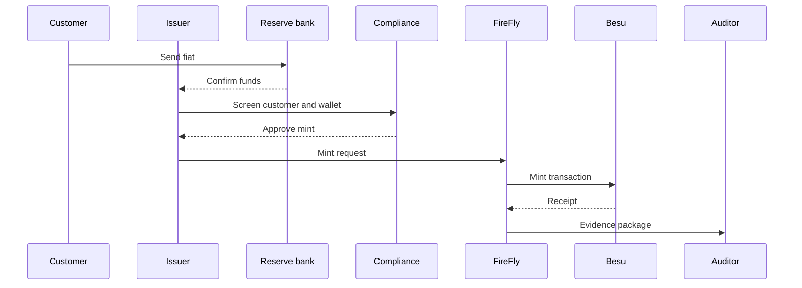

### Issuing A Tokenized Commercial-Bank Deposit

A tokenized deposit represents a commercial bank liability. The bank must decide whether token balances are a new product ledger, a representation of existing deposit accounts, or a sub-ledger synchronized to core deposits. That decision affects deposit insurance, interest, statements, legal terms, and resolution treatment.

The smart contract can enforce transfer mechanics, but the bank's books determine legal liability. A robust design reconciles token supply to deposit liabilities daily or intraday, prevents minting without internal approval, and provides controls for court orders, sanctions, fraud, and operational errors.

### Delivery-Versus-Payment Settlement

In DvP, the system coordinates a cash-like token and a security token. Institutional DvP requires more than atomic code. It requires asset eligibility, buyer/seller authorization, custody records, tax treatment, settlement calendar, failed-settlement handling, and legal definition of finality.

Failure handling must be explicit:

- if cash is missing, securities are not delivered;
- if securities are not available, cash is refunded or remains locked;
- if compliance blocks a party, both legs stop;
- if one participant's node is down, the workflow may wait or use alternate submission paths;
- if finality occurs but a downstream book update fails, reconciliation creates an exception.

### Cross-Border Institutional Payment

A cross-border bank payment may involve payer bank, beneficiary bank, FX provider, correspondent bank, sanctions screening, messaging, liquidity, and settlement asset. A permissioned Ethereum network can provide a shared settlement record, but it does not remove FX controls, local payment rails, beneficiary-bank obligations, or regulatory reporting.

Blockchain value appears when multiple banks can see settlement status in near real time, attach structured evidence, and reduce reconciliation breaks. The legal agreement must define whether token transfer is final settlement or only an instruction to settle elsewhere.

### Wholesale CBDC Experiment

A wholesale CBDC pilot usually limits participation to banks or regulated institutions. Central bank tokens may be used for interbank settlement, DvP, or cross-border experiments. The design questions are policy-heavy:

- who may hold the CBDC;
- whether it bears interest;
- whether transactions are private from other banks;
- whether the central bank can freeze or reverse;
- how the CBDC connects to RTGS;
- whether settlement is legally final;
- how outages are handled.

### ISO 20022-Style Evidence Workflow

The purpose of an ISO 20022-style evidence workflow is not to turn a blockchain
into SWIFT. It is to translate blockchain activity into structured business
evidence that existing systems understand. A transfer event can become a
canonical message containing debtor, creditor, amount, asset, settlement
timestamp, transaction hash, compliance decision, and reconciliation status.

A generic mapping pattern is:

1. FireFly observes on-chain transfer.
2. Middleware maps blockchain fields to payment semantic fields.
3. Identity registry maps addresses to legal entities/accounts.
4. Compliance system attaches screening result.
5. Reporting service emits ISO 20022-style message or internal canonical event.
6. Audit store links message ID, transaction hash, block number, parties, and controls.

## Wider Ecosystem

| Layer | Providers / systems | Architectural problem solved |
|---|---|---|
| Ethereum clients | Besu, Geth, Nethermind, Erigon | Execution clients and node diversity |
| Permissioned ledgers | Fabric, Corda, Canton | Alternative privacy/governance/execution models |
| Middleware/platforms | FireFly, Kaleido, ConsenSys products | Deployment, integration, workflow APIs |
| Custody/key management | Fireblocks, Taurus, Anchorage Digital, BitGo, HSM providers | Key protection and signing governance |
| Settlement/tokenization | Fnality, Kinexys, SDX, Broadridge DLR, Euroclear, Clearstream, DTCC initiatives | Market infrastructure and institutional networks |
| Cloud/infrastructure | AWS, Azure, Google Cloud, Oracle, Kubernetes, Vault | Compute, secrets, deployment, resilience |

These providers are not interchangeable. A custody platform protects keys. A tokenization platform manages asset lifecycle. A blockchain client validates state. A CSD or FMI provides legal market infrastructure. A cloud provider supplies infrastructure but not settlement law.

## Alternatives And Trade-Offs

| Architecture | Privacy | Governance | Interoperability | Operational burden | Best fit |
|---|---|---|---|---|---|
| Besu permissioned Ethereum | Configurable, but complex | Consortium-defined | EVM-compatible | Medium-high | Bank consortia wanting Ethereum tooling |
| Public Ethereum | Low by default | Public social governance | Highest composability | Lower node governance, higher compliance complexity | Public assets and open liquidity |
| Ethereum L2 | Varies by rollup | Operator/protocol governance | Growing but fragmented | Bridge/sequencer assumptions | High-throughput public workflows |
| Fabric | Strong permissioned identity/channel model | Consortium-defined | Less EVM-native | Medium-high | Enterprise workflows with Fabric skills |
| Corda | Point-to-point financial workflow model | Network/operator governed | Finance-oriented | Medium | Bilateral/multiparty financial agreements |
| Canton | Privacy-preserving synchronization model | Operator/domain governed | Strong institutional focus | Medium-high | Regulated multiparty finance |
| Centralized database | Strong access control | Single operator | Easy internal integration | Low-medium | Single-institution workflows |
| Shared industry utility | Central operator or governed utility | Formal utility governance | Good within network | Depends on operator | Standardized market processes |

## Risks And Misconceptions

> **Misconception: A permissioned blockchain automatically satisfies compliance.**  
> Known validators reduce some risks, but customer-level AML, sanctions, audit, reporting, and legal controls still need explicit systems.

> **Misconception: Besu is the enterprise blockchain application.**  
> Besu is a client. The application stack includes contracts, middleware, custody, compliance, databases, monitoring, and governance.

> **Misconception: FireFly removes the need to understand smart contracts.**  
> FireFly simplifies integration, but contract behavior still defines on-chain asset rules.

> **Misconception: Private networks eliminate privacy risk.**  
> Members, metadata, logs, backups, and audit exports still create confidentiality issues.

Architectural risks include governance capture, validator collusion, weak legal agreements, poor key management, inconsistent permissioning, privacy leakage, vendor lock-in, weak disaster recovery, and overestimating what ledger finality means legally.

## Glossary

**AML:** Anti-money laundering.

**API:** Application programming interface.

**Asset exchange:** Cross-network pattern where ownership changes on multiple ledgers without moving the assets out of their home ledgers.

**Asset transfer:** Cross-network pattern where an asset is locked or burned on one ledger and created or released on another.

**Besu:** Ethereum execution client that can run on public Ethereum or private Ethereum-compatible networks.

**BFT:** Byzantine fault tolerance; ability to reach correct consensus despite some faulty or malicious participants.

**Cacti:** Hyperledger interoperability framework for connecting heterogeneous blockchain and DLT networks.

**CDD:** Customer due diligence.

**Connector:** Software component that adapts a generic integration or interop framework to a specific ledger or system.

**CSD:** Central securities depository.

**DID:** Decentralized identifier.

**DvP:** Delivery versus payment; securities delivery and cash payment coordinated so both settle or neither settles.

**ERP:** Enterprise resource planning system.

**FireFly:** Enterprise middleware and multiparty systems framework for blockchain applications.

**FFTM:** FireFly Transaction Manager.

**HSM:** Hardware security module.

**IBFT 2.0:** Istanbul Byzantine Fault Tolerant proof-of-authority consensus protocol supported by Besu.

**ISO 20022:** Financial messaging standard used for structured payment and securities messages.

**IIN:** Interoperation Identity Network, a registry/credential network used in Cacti/Weaver identity-plane designs.

**KYC/KYB:** Know Your Customer / Know Your Business.

**Lock-and-mint:** Cross-chain transfer pattern where an asset is locked on a source ledger and a representation is minted on a destination ledger.

**MPC:** Multi-party computation; used in custody to split signing authority across key shares.

**Permissioning:** Rules controlling which nodes, accounts, users, or roles can access or perform actions.

**PKI:** Public key infrastructure, often used with certificates for machine or organization identity.

**Privacy group:** A subset of participants allowed to access private transaction data or state.

**QBFT:** Byzantine fault tolerant proof-of-authority consensus protocol supported by Besu.

**RPO/RTO:** Recovery point objective / recovery time objective.

**Relay:** Interoperability component that facilitates communication between networks.

**SIEM:** Security information and event management system.

**Tokenized deposit:** A bank deposit represented as a tokenized liability of a commercial bank.

**VC:** Verifiable credential.

**Validator:** Node authorized to participate in block production/finality in a private PoA network.

## References

[^besu-home]: Hyperledger Besu documentation, [Besu Ethereum client](https://docs.besu-eth.org/).
[^besu-poa]: Hyperledger Besu documentation, [Proof of authority consensus](https://docs.besu-eth.org/private-networks/concepts/poa).
[^besu-permissioning]: Hyperledger Besu documentation, [Permissioning](https://docs.besu-eth.org/private-networks/concepts/permissioning).
[^lfdt]: LF Decentralized Trust, [home page](https://www.lfdecentralizedtrust.org/).
[^lfdt-besu]: LF Decentralized Trust, [Besu project page](https://www.lfdecentralizedtrust.org/projects/besu).
[^firefly-home]: Hyperledger FireFly documentation, [Hyperledger FireFly](https://hyperledger.github.io/firefly/latest/).
[^firefly-multiparty]: Hyperledger FireFly documentation, [Enterprise multi-party systems](https://hyperledger.github.io/firefly/latest/overview/multiparty/).
[^firefly-node]: Hyperledger FireFly documentation, [Node Component Architecture](https://hyperledger.github.io/firefly/latest/architecture/node_component_architecture/).
[^firefly-connector]: Hyperledger FireFly documentation, [Blockchain Connector Toolkit](https://hyperledger.github.io/firefly/latest/architecture/blockchain_connector_framework/).
[^firefly-txflow]: Hyperledger FireFly documentation, [Example Transaction Flow](https://hyperledger.github.io/firefly/latest/architecture/ping_pong_txflow/).
[^cacti-docs]: Hyperledger Cacti documentation, [A Pluggable Interoperability Toolkit for Blockchain and DLT Networks](https://hyperledger-cacti.github.io/cacti/).
[^cacti-github]: Hyperledger Cacti GitHub repository, [hyperledger-cacti/cacti](https://github.com/hyperledger-cacti/cacti).
[^cacti-modes]: Hyperledger Cacti documentation, [Interoperability Modes](https://hyperledger-cacti.github.io/cacti/weaver/interoperability-modes/).
[^cacti-relay]: Hyperledger Cacti documentation, [Relay](https://hyperledger-cacti.github.io/cacti/weaver/architecture-and-design/relay/).
[^cacti-drivers]: Hyperledger Cacti documentation, [Drivers](https://hyperledger-cacti.github.io/cacti/weaver/architecture-and-design/drivers/).
[^cacti-identity]: Hyperledger Cacti documentation, [Decentralized Identity](https://hyperledger-cacti.github.io/cacti/weaver/architecture-and-design/decentralized-identity/).
