# Blockchain Analytics for Compliance and Investigations

Last verified: 2026-07-29.

Blockchain compliance analytics is the discipline of turning raw blockchain data into risk, attribution, investigation, monitoring, and audit evidence. Public blockchains expose transactions, addresses, smart-contract calls, logs, and token movements, but that visibility is not the same as understanding. An address is not a legal identity. A transaction graph is not a customer-risk conclusion. A smart-contract trace is not automatically a financial narrative.

The provider landscape establishes which implementation families exist; the
rest of the note explains the field from first principles. Vendor product pages
are evidence of product claims and positioning, not full disclosure of
proprietary scoring formulas, attribution datasets, model weights, accuracy, or
deployment details. The technical principles apply to exchanges, banks,
stablecoin issuers, tokenization platforms, custodians, investigators,
regulators, and permissioned-network operators.

## Provider Landscape

The table below separates **core compliance and investigation vendors** from
adjacent on-chain intelligence, market-data, and forensic-services providers.
“Publicly visible focus” means the capability appears in cited public material;
it does not certify coverage, accuracy, supported chains, or service quality.

| Provider | Publicly visible focus | Typical users | Notes |
|---|---|---|---|
| Chainalysis | Transaction monitoring, address screening, investigations, VASP risk, token/stablecoin ecosystem monitoring, data solutions, scam prevention, Web3 security | Governments, law enforcement, exchanges, banks, payment firms, stablecoin/token issuers | Broadest public product suite among the major vendors; strong government and investigation positioning.[^chainalysis-home][^chainalysis-kyt][^chainalysis-reactor] |
| Elliptic | Wallet and transaction screening, continuous monitoring, VASP/entity due diligence, cross-chain investigations, data ingestion, stablecoin risk, network integrations, training | Banks, exchanges, payment firms, stablecoin/token issuers, regulators, law enforcement, network operators | Strong cross-chain compliance framing and unusually visible public developer/API documentation.[^elliptic-compliance] |
| TRM Labs | Wallet screening, transaction monitoring, investigations, entity risk, threat intelligence, case workflows, public-sector investigations | Governments, financial institutions, exchanges, fintechs, crypto businesses | Major competitor to Chainalysis and Elliptic; public positioning is especially strong around public-sector, threat intelligence, and compliance workflows.[^trm-home] |
| Merkle Science | Transaction monitoring, wallet/entity risk, investigations, policy/rule configuration, sanctions and illicit-activity intelligence | Exchanges, fintechs, banks, crypto firms, law enforcement | Typically positioned as a compliance and investigation platform for digital-asset businesses and public-sector users.[^merkle-home] |
| Scorechain | Crypto AML, transaction monitoring, address/entity risk, investigations, reporting, VASP-oriented compliance | Crypto firms, financial institutions, auditors, regulators | European/Luxembourg-rooted provider with strong compliance operations framing.[^scorechain-home] |
| Coinfirm | AML risk analytics, wallet and transaction screening, crypto investigations, asset-recovery support | Crypto firms, financial institutions, investigators | Long-running AML analytics provider; public materials emphasize risk scoring and investigations.[^coinfirm-home] |
| Crystal Intelligence | AML compliance, blockchain investigations, risk monitoring, entity intelligence, training | Exchanges, banks, regulators, law enforcement | Bitfury-origin analytics provider; public positioning spans compliance and investigative workflows.[^crystal-home] |
| Arkham Intelligence | Entity-labeled blockchain intelligence, wallet/entity profiling, public investigation interface, intel marketplace | Investigators, traders, researchers, some institutional users | More public/open intelligence and market-facing than traditional AML vendors; not primarily a regulated transaction-monitoring suite in public positioning.[^arkham-profile] |
| Nansen | Wallet labels, on-chain analytics, smart-money tracking, token/NFT/DeFi analytics | Investors, funds, protocols, research teams | Strong for market intelligence and labeled wallets; compliance case management and regulatory monitoring are not its core public positioning.[^blockchain-analysis-profile] |
| Elementus | Blockchain data, entity intelligence, investigation and risk analytics | Institutions, investigators, risk teams | Often positioned as institutional blockchain intelligence/data infrastructure.[^blockchain-analysis-profile] |
| Blockpliance | Crypto AML and compliance tooling | VASPs, exchanges, crypto compliance teams | Smaller/narrower vendor in public references; diligence should verify current product depth and chain coverage.[^blockchain-analysis-profile] |
| Dune | Community and enterprise on-chain query/analytics platform | Analysts, protocols, researchers, data teams | Excellent for custom dashboards and transparent SQL analytics; not a turnkey AML case-management vendor.[^blockchain-analysis-profile] |
| CryptoQuant | On-chain and market data analytics | Traders, investors, research teams | Market and exchange-flow analytics rather than full compliance operations.[^blockchain-analysis-profile] |
| Breadcrumbs | Crypto investigation and tracing tools | Investigators, compliance analysts, victims/asset recovery | Investigation-oriented tooling; public materials do not establish attribution depth, evidence exports, or enterprise controls. |
| MistTrack / SlowMist | Stolen-fund tracing, security intelligence, hack analysis | Protocol teams, exchanges, investigators | Strong connection to Web3 security incident response; compliance-monitoring breadth should be tested separately. |
| CipherTrace / Mastercard Crypto Secure | Crypto risk intelligence and compliance, integrated into Mastercard's broader crypto risk products | Banks, payment networks, crypto businesses | CipherTrace was acquired by Mastercard; current packaging is tied to Mastercard risk offerings, so product availability should be checked directly. |

## Vendor Capability Matrix

Legend: **Yes** = clearly marketed as a product capability; **Partial** =
adjacent, narrower, or not documented in enough public detail for confidence;
**No / unclear** = not visible as a public product focus. This is a map of public
claims, not a ranking or quality score.

| Vendor | Wallet/address screening | Transaction monitoring/KYT | Cross-chain investigation | Entity/VASP due diligence | Sanctions/illicit typologies | DeFi/DEX/bridge tracing | Stablecoin/token ecosystem monitoring | Data/API ingestion | Case management/evidence | Threat intel/reports | Scam/fraud prevention | Smart-contract/Web3 security | Training/services |
|---|---|---|---|---|---|---|---|---|---|---|---|---|---|
| Chainalysis | Yes | Yes | Yes | Yes | Yes | Yes | Yes | Yes | Yes | Yes | Yes | Yes | Yes |
| Elliptic | Yes | Yes | Yes | Yes | Yes | Yes | Yes | Yes | Yes | Yes | Partial | No / unclear | Yes |
| TRM Labs | Yes | Yes | Yes | Yes | Yes | Yes | Partial | Yes | Yes | Yes | Partial | Partial | Yes |
| Merkle Science | Yes | Yes | Yes | Yes | Yes | Yes | Partial | Yes | Yes | Yes | Partial | No / unclear | Partial |
| Scorechain | Yes | Yes | Yes | Yes | Yes | Partial | Partial | Yes | Yes | Partial | Partial | No / unclear | Partial |
| Coinfirm | Yes | Yes | Partial | Yes | Yes | Partial | Partial | Yes | Partial | Partial | Partial | No / unclear | Partial |
| Crystal Intelligence | Yes | Yes | Yes | Yes | Yes | Partial | Partial | Yes | Yes | Yes | Partial | No / unclear | Yes |
| Arkham Intelligence | Yes | No / unclear | Yes | Partial | Partial | Yes | No / unclear | Partial | Partial | Yes | Partial | No / unclear | No / unclear |
| Nansen | Partial | No / unclear | Partial | Partial | Partial | Yes | No / unclear | Yes | No / unclear | Yes | No / unclear | No / unclear | No / unclear |
| Elementus | Yes | Partial | Yes | Partial | Yes | Partial | Partial | Yes | Partial | Partial | No / unclear | No / unclear | Partial |
| Dune | No / unclear | No / unclear | Custom | No / unclear | Custom | Custom | Custom | Yes | No / unclear | No / unclear | No / unclear | No / unclear | No / unclear |
| CryptoQuant | No / unclear | No / unclear | No / unclear | No / unclear | No / unclear | Partial | No / unclear | Yes | No / unclear | Yes | No / unclear | No / unclear | No / unclear |
| Breadcrumbs | Yes | Partial | Yes | Partial | Partial | Partial | No / unclear | Partial | Partial | Partial | Partial | No / unclear | Partial |
| MistTrack / SlowMist | Yes | Partial | Yes | Partial | Yes | Yes | No / unclear | Partial | Partial | Yes | Partial | Yes | Partial |
| CipherTrace / Mastercard | Yes | Yes | Partial | Yes | Yes | Partial | Partial | Yes | Partial | Yes | Partial | No / unclear | Partial |

### What The Matrix Means In Practice

The important distinction is not whether a provider uses the phrase “blockchain
analytics.” It is which operating model the product supports:

- **Compliance operations:** real-time screening, alert queues, policy rules, audit trails, rescreening, APIs, and integration with customer/account systems.
- **Investigations:** graph exploration, cross-chain tracing, bridge/DEX/mixer interpretation, exportable evidence, collaboration, and reporting.
- **Counterparty risk:** VASP/entity profiles, ownership or jurisdiction indicators, service exposure, enforcement history, and indirect fiat/crypto risk.
- **Issuer and ecosystem monitoring:** stablecoin/token exposure, blacklisting/freezing workflows, token-holder risk, service concentration, and ecosystem trend analysis.
- **Threat intelligence:** scam clusters, ransomware, exploit/hack attribution, sanctioned entities, darknet markets, fraud typologies, and custom intelligence feeds.
- **Data infrastructure:** APIs, SDKs, bulk enrichment, data feeds, warehouse integration, reproducible field definitions, and service-level commitments.

## Vendor Deep Dives

### Chainalysis

**Product view.** Chainalysis positions itself as a broad blockchain intelligence platform. Public product areas include KYT for transaction monitoring, Reactor for investigations, Address Screening, VASP Risking, Sentinel for token/stablecoin ecosystem monitoring, Data Solutions, Rapid, Wallet Scan, Alterya for scam prevention, Hexagate for Web3 security, and AI-assisted workflows.[^chainalysis-home][^chainalysis-kyt][^chainalysis-reactor]

**What it covers well.**

- Real-time transaction monitoring for deposits, withdrawals, and platform activity.
- Graph investigations and escalation from monitoring alerts into Reactor.
- Address screening, direct and indirect exposure, sanctions and illicit-activity categories.
- VASP/counterparty risk and token or stablecoin ecosystem monitoring.
- Public-sector and law-enforcement workflows, including triage and seizure-oriented tooling.
- Adjacent fraud and security products through Alterya and Hexagate.

**Potential gaps or diligence questions.**

- Full clustering methods, confidence scoring, false-positive rates, and label evidence are proprietary.
- Pricing and packaging can be complex because the public suite is broad.
- Institutions should test whether all required chains, tokens, bridges, rollups, and DeFi protocols are covered at the required depth, not only listed as supported.
- AI-assisted outputs must be tied back to source-linked evidence for audit and legal review.

**Publicly disclosed clients or users.** Public profiles and vendor material associate Chainalysis with law-enforcement and government users such as the FBI, DEA, IRS Criminal Investigation, and the UK National Crime Agency, and with banks, brokers, exchanges, regulators, and crypto businesses.[^chainalysis-profile]

### Elliptic

**Product view.** Elliptic markets an enterprise crypto compliance platform covering due diligence, wallet and transaction screening, continuous monitoring, investigations, data ingestion, configurable alerting, stablecoin risk management, network integrations, and education. Public product names include Discovery, Lens, Investigator, Analytics, Data Fabric, Blocklists, Indirect Risk Reporting, Issuer Due Diligence, and Threat Intelligence.[^elliptic-compliance]

**What it covers well.**

- Cross-chain compliance intelligence and "holistic" tracing across assets, bridges, and networks.
- Wallet and transaction screening, continuous monitoring, rescreening, alerts, and configurable risk rules.
- VASP/entity due diligence and indirect risk reporting.
- Stablecoin and token issuer due diligence, asset due diligence, and ecosystem monitoring.
- Data ingestion and API-driven workflows; Elliptic's public site links directly to API documentation.[^elliptic-compliance]

**Potential gaps or diligence questions.**

- Smart-contract exploit prevention is not as prominently productized as Chainalysis Hexagate or SlowMist-style security services.
- Scam prevention appears mostly embedded in screening, monitoring, blocklists, and threat intelligence rather than as a separate consumer-protection product.
- As with all vendors, attribution methods, confidence thresholds, and full label database quality are not publicly disclosed.

**Publicly disclosed clients or users.** Elliptic's public compliance page includes a Coinbase customer quote and positions the platform for financial institutions, centralized exchanges, payment services, token/stablecoin issuers, DeFi, network operators, law enforcement, and regulators.[^elliptic-compliance] Public company profiles also state that Elliptic has served banks, exchanges, and government agencies, and list investors including JPMorgan Chase, Wells Fargo, SoftBank Vision Fund, and SBI Group.[^elliptic-profile]

### TRM Labs

**Product view.** TRM Labs is one of the major blockchain intelligence vendors alongside Chainalysis and Elliptic. Public positioning centers on blockchain intelligence for compliance, investigations, and threat intelligence, with products for wallet screening, transaction monitoring, case management, entity risk, and investigative tracing.[^trm-home]

**What it covers well.**

- Compliance workflows for VASPs, fintechs, financial institutions, and crypto businesses.
- Public-sector and law-enforcement investigations, including tracing and threat-intelligence use cases.
- Wallet screening, transaction monitoring, sanctions and illicit-activity detection, and case workflows.
- Risk intelligence across typologies such as scams, hacks, ransomware, darknet markets, mixers, terrorist financing, and sanctioned entities.

**Potential gaps or diligence questions.**

- Public product pages do not expose the same level of integration detail as a full technical evaluation would require.
- Stablecoin/token ecosystem monitoring may be available through data and monitoring workflows, but it is less clearly separated as a named issuer product than Chainalysis Sentinel or Elliptic stablecoin risk modules.
- Smart-contract security and exploit-prevention coverage should be clarified because TRM is primarily known as intelligence/compliance rather than protocol-security tooling.

**Publicly disclosed clients or users.** TRM publicly positions itself for
government agencies, law enforcement, financial institutions, and crypto
businesses. Customer examples are time-sensitive and should be sourced from
current, attributable material.[^trm-home]

### Merkle Science

**Product view.** Merkle Science provides blockchain analytics for compliance, risk monitoring, and investigations. Public positioning commonly groups its capabilities around transaction monitoring, wallet and entity screening, investigation/tracing, policy configuration, and illicit-finance intelligence.[^merkle-home]

**What it covers well.**

- AML transaction monitoring and wallet/entity risk for crypto businesses and financial institutions.
- Investigation tooling for following fund flows and building case narratives.
- Sanctions, scams, darknet markets, ransomware, hacks, and other illicit typology coverage.
- Rules and risk-configuration workflows for compliance teams.

**Potential gaps or diligence questions.**

- Public information is less detailed than the largest vendors on stablecoin issuer workflows, ecosystem-level token monitoring, and Web3 exploit prevention.
- Public chain, asset, and DeFi/bridge coverage claims require verification
  against real historical cases.
- Evidence export, audit logs, API field stability, and enterprise access controls should be checked in proof-of-concept.

**Publicly disclosed clients or users.** Public customer lists vary over time; verify current named customers through vendor case studies and references. The primary target segments are exchanges, fintechs, banks, crypto firms, regulators, and law-enforcement teams.[^merkle-home]

### Scorechain

**Product view.** Scorechain is a crypto AML and blockchain analytics provider with products for transaction monitoring, address/entity risk checks, investigations, reporting, and compliance workflows. It is often associated with European VASP and financial-institution compliance needs.[^scorechain-home]

**What it covers well.**

- AML monitoring for crypto transactions and addresses.
- Risk scoring, sanctions and illicit exposure checks, and compliance reporting.
- Investigation and fund-flow analysis for escalated alerts.
- VASP-oriented compliance workflows and audit evidence.

**Potential gaps or diligence questions.**

- Public materials should be tested against high-complexity DeFi, bridge, rollup, and privacy-tool scenarios.
- Stablecoin issuer and token-ecosystem monitoring may be possible through monitoring/reporting, but public positioning is less explicit than Chainalysis or Elliptic.
- Supported assets, entity-label depth, API throughput, and case-management
  maturity can change and require current evidence.

**Publicly disclosed clients or users.** Scorechain targets crypto businesses, financial institutions, auditors, regulators, and compliance teams; named institutional references should be verified directly.[^scorechain-home]

### Coinfirm

**Product view.** Coinfirm is a long-running crypto AML analytics provider. Public positioning emphasizes AML risk scoring, wallet and transaction screening, investigations, compliance reporting, and support for asset tracing/recovery workflows.[^coinfirm-home]

**What it covers well.**

- Wallet and transaction AML risk scoring.
- Sanctions, fraud, darknet, high-risk service, and illicit-source exposure checks.
- Compliance reporting and investigation support for VASPs and financial institutions.
- Crypto asset tracing and recovery-oriented analysis.

**Potential gaps or diligence questions.**

- Cross-chain, DeFi, bridge, NFT, and rollup coverage should be validated with current product demos and test cases.
- Publicly visible product detail is narrower than Chainalysis/Elliptic/TRM, so technical API fields and evidence model require direct review.
- Stablecoin/token ecosystem monitoring is not as prominently marketed as a separate institutional product.

**Publicly disclosed clients or users.** Coinfirm positions itself toward crypto
businesses, financial institutions, and investigators. Named-client claims are
time-sensitive and require current sources.[^coinfirm-home]

### Crystal Intelligence

**Product view.** Crystal Intelligence provides blockchain analytics for AML compliance, risk monitoring, and investigations. Public positioning includes transaction monitoring, address/entity risk, visual investigations, reports, and training for compliance and public-sector users.[^crystal-home]

**What it covers well.**

- AML screening and monitoring.
- Investigation graphing and entity intelligence.
- Sanctions, darknet, mixer, scam, ransomware, hack, and high-risk-service typologies.
- Training and support for compliance and investigative teams.

**Potential gaps or diligence questions.**

- Validate current ownership, product packaging, and deployment model because vendor packaging has evolved over time.
- DeFi/bridge/stablecoin ecosystem coverage should be tested with recent cases.
- Evidence exports, case workflow depth, and API scale should be evaluated in proof-of-concept.

**Publicly disclosed clients or users.** Crystal targets exchanges, banks, financial institutions, regulators, and law enforcement; named users should be verified against current public case studies or vendor references.[^crystal-home]

### Arkham Intelligence

**Product view.** Arkham is more public intelligence and entity-label analytics than classic AML operations. It provides a public platform for wallet/entity profiling, transaction analysis, alerts, dashboards, and an intelligence marketplace. Public profiles describe it as using AI to identify and catalog owners of blockchain addresses.[^arkham-profile]

**What it covers well.**

- Publicly accessible entity-labeled wallet intelligence.
- High-profile wallet tracking, exchange/entity flows, and research workflows.
- Useful investigative starting points and open-source style enrichment.

**Potential gaps or diligence questions.**

- Not primarily positioned as a regulated KYT/AML case-management suite.
- Public analytics interfaces should not be assumed to provide the same audit
  trail, policy-rule engine, rescreening, Travel Rule-adjacent workflows, or
  enterprise controls as dedicated AML platforms.
- Public labeling can be useful but must be validated before high-impact compliance decisions.

**Publicly disclosed clients or users.** Arkham is widely used by researchers,
analysts, media, and market participants. Public profiles mention use of Arkham
data in high-profile investigations, but this does not establish suitability for
regulated compliance operations.[^arkham-profile]

## Why Blockchain Analytics Exists

Blockchains create a strange compliance environment. On the one hand, many public ledgers are radically transparent: anyone can inspect transactions. On the other hand, they are pseudonymous: the ledger records addresses, not passport names, beneficial owners, or corporate control structures.

Raw visibility is not enough because transactions require interpretation. A transfer to an exchange deposit address may be a customer deposit, a laundering cash-out, an internal exchange sweep, or a mistaken transfer. A DEX swap may be ordinary trading, exploit liquidation, sanctions evasion, or MEV. A bridge transfer may be cross-chain portfolio management or laundering through chain hopping.

| Example | Raw on-chain fact | Analytics question |
|---|---|---|
| Exchange deposit address | Address receives USDC | Which customer, source exposure, Travel Rule status |
| Personal wallet | EOA sends ETH | Self-custody or hosted wallet, risk history |
| Mixer | Funds enter/exit pool | Probable link, timing/amount analysis, legal risk |
| Bridge | Asset locked and minted elsewhere | Cross-chain continuity and uncertainty |
| Sanctioned wallet | Address appears on list | Direct/indirect exposure and required action |
| Hacked funds | Exploit address drains contract | Trace flow, freeze points, exchange cash-out |
| Treasury wallet | Institution moves assets | Internal transfer, investment, or customer flow |

Banks, exchanges, stablecoin issuers, governments, and investigators need analytics because blockchain activity touches AML, sanctions, fraud, cybercrime, market integrity, reserve monitoring, customer risk, and regulatory reporting. Analytics does not replace compliance judgment; it supplies structured evidence.

The simplest mental model is that blockchain analytics is a translation layer. It translates ledger-native facts such as `0xabc... sent 50,000 USDC to 0xdef...` into institution-native questions such as "Is this my customer?", "Is this counterparty a sanctioned service?", "Did these funds come from a hack?", "Can I safely credit this deposit?", and "Can I explain my decision six months later?" The translation is never purely mechanical because addresses, contracts, bridges, exchanges, and off-chain identities do not line up one-to-one.

Analytics is needed in both directions:

- **Prevention:** stop a withdrawal, block a risky address, reject an onboarding wallet, or add friction before funds leave the institution.
- **Detection:** identify suspicious deposits, source-of-funds problems, sanctions exposure, layering, fraud proceeds, or market-abuse behavior after activity occurs.
- **Investigation:** reconstruct a narrative from many ledger events, counterparties, swaps, bridges, and off-chain facts.
- **Evidence:** preserve the facts, timestamps, labels, confidence levels, rule versions, screenshots, API responses, and analyst reasoning that support a decision.
- **Feedback:** use case outcomes to improve typologies, thresholds, customer segmentation, and manual-review playbooks.

> **Important distinction:** A blockchain analytics alert is not a legal conclusion. It is evidence for a risk decision. A compliance team still needs policy, proportionality, jurisdictional analysis, customer context, and human review for serious actions such as freezing funds, offboarding, or filing a suspicious activity report.

## Practical Operating Model

In practice, blockchain analytics sits between three worlds that use different languages.

| World | Native objects | Analytics bridge |
|---|---|---|
| Blockchain infrastructure | Blocks, transactions, logs, UTXOs, accounts, contracts, traces | Decode ledger events into value flows and actions |
| Compliance operations | Customers, counterparties, policies, alerts, cases, reports | Map on-chain behavior to risk categories and decisions |
| Investigations and law enforcement | Incidents, victims, suspects, evidence, subpoenas, seizures | Turn graphs and labels into a defensible narrative |

A regulated exchange, for example, may use analytics at four points in one customer journey. During onboarding, the exchange screens a customer's declared wallet to avoid associating with known scams or sanctioned services. During deposits, the exchange screens incoming transactions before crediting balances. During withdrawals, it screens destination addresses and may apply stronger controls for first-time addresses. During periodic review, it rescreens historical activity because labels and sanctions lists change over time.

This operating model is broader than "checking whether an address is bad." Relevant use cases include VASP counterparty due diligence, stablecoin-ecosystem monitoring, evidence that tokenized-security transfers complied with investor restrictions, and tracing stolen funds through bridges, decentralized exchanges, liquidity pools, and centralized-exchange deposit clusters.

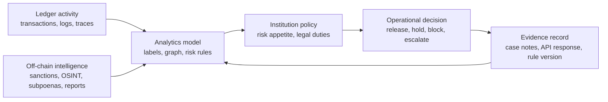

The feedback arrow matters. A confirmed false positive can improve future
thresholds or labels. A newly identified scam cluster can flow into monitoring.
Credible source-of-funds evidence should be preserved with the decision record
rather than replaced by a vendor score.

## Traditional Compliance Foundation

Traditional compliance begins before a transaction. A bank or regulated platform must know who the customer is, what activity is expected, and whether the relationship is allowed.

- **KYC:** identifying and verifying natural-person customers.
- **KYB:** identifying and verifying businesses, beneficial owners, directors, control persons, and corporate structure.
- **AML/CFT:** anti-money laundering and counter-terrorist financing controls.
- **CDD:** customer due diligence at onboarding and refresh.
- **EDD:** enhanced due diligence for higher-risk customers or activity.
- **Source of funds:** origin of money used in a specific transaction.
- **Source of wealth:** broader origin of a customer's wealth.
- **Sanctions screening:** checking parties against government restrictions.
- **PEP screening:** identifying politically exposed persons.
- **Transaction monitoring:** detecting unusual or suspicious behavior.
- **Travel Rule:** requirement for VASPs to obtain, hold, and transmit originator/beneficiary information for qualifying transfers.

FATF guidance states that virtual asset service providers should be subject to relevant FATF measures, including customer due diligence, record keeping, suspicious transaction reporting, and originator/beneficiary information transmission for transfers.[^fatf-va][^fatf-guidance]

The Travel Rule deserves special attention because it is often confused with blockchain analytics. Blockchain analytics estimates risk from public or permissioned ledger activity. Travel Rule compliance is about collecting and transmitting required originator and beneficiary information between regulated virtual asset service providers (**VASPs**) for qualifying transfers. Analytics may help decide whether a transfer is risky, but it does not by itself transmit the required customer information.

In a regulated exchange withdrawal, three separate checks may happen:

1. **Authentication/fraud check:** the platform verifies that the customer account and withdrawal instruction are genuine.
2. **Blockchain risk check:** the platform screens the destination address, exposure history, and typology risk.
3. **Travel Rule check:** if another VASP is involved, the platform exchanges or records required originator and beneficiary information.

These controls can produce different outcomes. A withdrawal can be authentically requested by the customer but still be blocked for sanctions. A withdrawal can be low-risk on-chain but missing Travel Rule data. A Travel Rule message can be complete while the destination address is later linked to a scam.

Blockchain monitoring differs from bank monitoring because the external transaction graph is visible but identity is incomplete. A bank sees its own customer records and internal account ledger. A blockchain analytics system sees public ledger behavior and attempts to attribute addresses/entities, classify services, trace value flows, and estimate risk.

Fraud detection, payment authentication, AML, sanctions, forensics, and cybercrime investigation overlap but are not the same:

| Discipline | Main question |
|---|---|
| Fraud detection | Is the customer being tricked or is the transaction unauthorized? |
| Payment authentication | Is the payer authorized and the instruction genuine? |
| AML | Is the customer laundering proceeds or hiding beneficial activity? |
| Sanctions | Is a restricted party directly or indirectly involved? |
| Blockchain forensics | Where did funds come from and where did they go? |
| Cybercrime investigation | Who exploited, stole, laundered, hosted, or cashed out? |

## Blockchain Data Model For Analytics

Analytics systems ingest many data types:

- blocks and timestamps;
- transactions and transaction hashes;
- addresses, UTXOs, accounts, and balances;
- token transfers and contract events;
- logs and decoded event signatures;
- smart-contract calls, traces, and internal calls;
- bridge lock/mint/burn/release events;
- DEX swaps, liquidity events, and AMM pool state;
- NFT transfers and marketplace events;
- stablecoin minting, burning, freezing, and blacklisting;
- miner/validator/proposer information where relevant;
- mempool data where available;
- off-chain intelligence such as labels, websites, sanctions lists, subpoenas, exchange data, and analyst research.

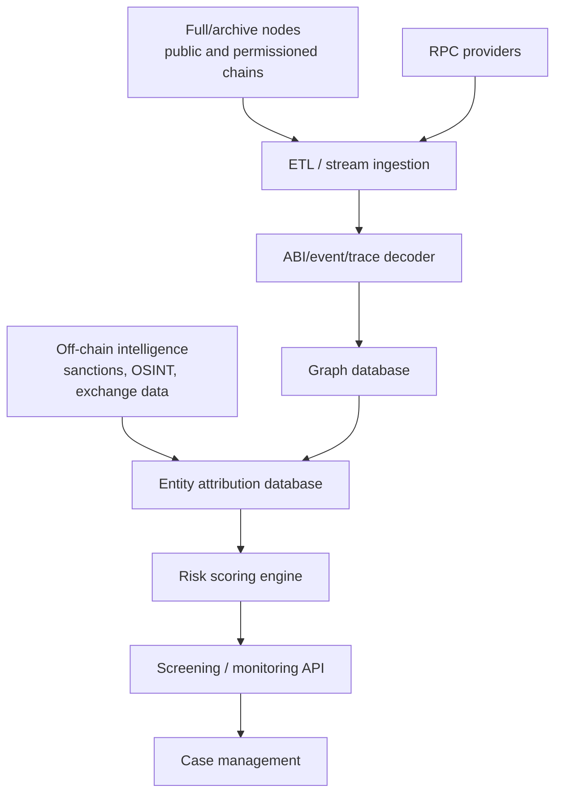

Archive nodes matter for historical state queries. Indexers transform raw chain data into queryable facts. Graph databases represent flows and relationships. Entity databases attach labels such as exchange, darknet market, mixer, bridge, stablecoin issuer, scam, ransomware, or sanctioned service. The quality of entity attribution is often more valuable than the raw node infrastructure.

### Analytics Data Pipeline

A production analytics system is usually a pipeline, not a single database. Each layer changes the form of the data and adds meaning.

1. **Collection:** pull blocks, transactions, receipts, logs, traces, token metadata, mempool observations, and chain-reorganization events from nodes or RPC providers.
2. **Normalization:** convert chain-specific formats into a common schema. Bitcoin inputs/outputs, Ethereum account calls, Solana instructions, and rollup batches have different structures, so the system needs a cross-chain abstraction without erasing important chain-specific details.
3. **Decoding:** interpret smart-contract events and internal calls. An ERC-20 `Transfer` log, a Uniswap swap, a bridge deposit, and a lending liquidation all need different decoders.
4. **Entity resolution:** attach probable labels and clusters to addresses, contracts, services, and VASPs.
5. **Graph construction:** represent value flows and relationships as queryable paths.
6. **Risk enrichment:** add sanctions, darknet, scam, ransomware, exploit, mixer, high-risk exchange, bridge, jurisdiction, behavioral, and customer-context signals.
7. **Decisioning:** apply institution-specific policy thresholds to produce alerts, holds, blocks, or review queues.
8. **Case record:** store evidence and analyst decisions in a way that can be reproduced later.

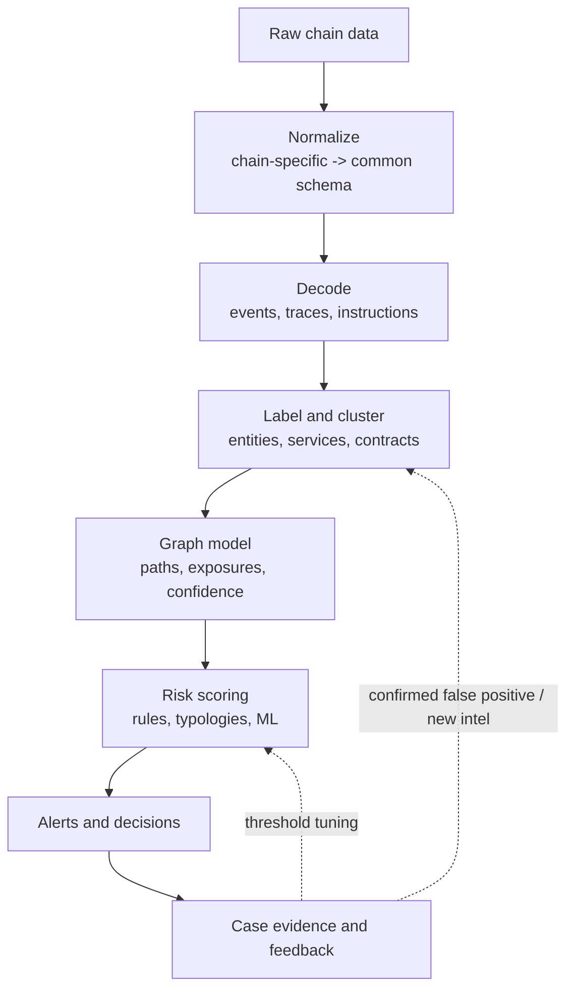

This pipeline explains why analytics quality is uneven across chains and protocols. A chain may be easy to index but hard to interpret because activity is compressed inside complex contracts. Another chain may have simple transfers but weak public tooling. A rollup may post compressed data to Ethereum while execution details live in separate infrastructure. A privacy protocol may deliberately hide the transaction graph. A permissioned network may have full identity information but restricted data access.

### Raw Data Versus Interpreted Data

The same blockchain event can support several levels of interpretation:

| Layer | Example | Reliability |
|---|---|---|
| Raw fact | Transaction hash `0x123` included in block `N` | High if chain data is correct |
| Decoded event | ERC-20 `Transfer(from, to, amount)` | High if ABI and token contract are correctly identified |
| Financial action | User swapped USDC for ETH on a DEX | Medium/high if router, pool, trace, and logs are decoded |
| Entity attribution | Receiver belongs to Exchange X | Depends on label evidence and cluster quality |
| Risk interpretation | Deposit has indirect ransomware exposure | Depends on tracing model, confidence, and policy |
| Legal conclusion | Funds must be frozen | Requires legal/policy analysis beyond the ledger |

This distinction protects analysts from overclaiming. A transaction hash is evidence. A label is an assertion supported by evidence. A risk score is a model output. A compliance action is an institutional decision.

### Minimal Internal Data Structures

A simplified analytics platform might store objects like this:

```text
AddressLabel {
  chain: "ethereum",
  address: "0x...",
  entity_id: "entity:centralized-exchange-example",
  category: "exchange",
  confidence: 0.97,
  evidence: ["hot wallet sweep pattern", "exchange confirmation", "prior subpoena response"],
  first_seen_block: 12345678,
  last_reviewed_at: "2026-07-13",
  source_version: "labels-2026-07-13"
}

ExposureEdge {
  source_entity: "entity:ransomware-cluster-example",
  target_address: "0x...",
  chain_path: ["bitcoin", "ethereum", "arbitrum"],
  assets: ["BTC", "ETH", "USDC"],
  amount_usd_estimate: 250000,
  hops: 5,
  tracing_model: "proportional",
  confidence: 0.74,
  evidence_tx_hashes: ["...", "..."]
}

Alert {
  customer_id: "cust_123",
  trigger: "indirect_sanctions_exposure",
  severity: "high",
  rule_version: "aml-policy-2026-07",
  vendor_response_id: "screen_789",
  analyst_disposition: "pending"
}
```

The exact schema differs by vendor and institution, but the design principle is stable: keep raw facts, labels, model outputs, policy decisions, and analyst conclusions separate enough that they can be audited independently.

## Transaction Graph Analysis

A transaction graph has vertices and edges. Vertices may be addresses, transactions, UTXOs, contracts, entities, or events. Edges may represent value movement, contract interaction, ownership inference, shared control, bridge linkage, or temporal sequence. Edges can be directed, weighted by amount, labeled by asset, and timestamped.

Bitcoin's UTXO graph and Ethereum's account graph behave differently. In Bitcoin, transactions consume outputs and create new outputs; common-input heuristics can cluster addresses but CoinJoin breaks assumptions. In Ethereum, addresses call contracts and token movements may appear in logs rather than native ETH transfers. A DEX swap may include multiple internal calls and event logs inside one transaction.

Conceptual techniques:

- **Breadth-first tracing:** explore all counterparties within N hops.
- **Depth-first tracing:** follow a suspected path deeply.
- **Shortest path:** find minimal connection between two entities.
- **Flow decomposition:** split mixed inflows into possible outgoing flows.
- **Connected components:** identify clusters of related addresses.
- **Community detection:** find dense subgraphs that may represent services.
- **Centrality:** identify hubs such as exchanges, bridges, mixers.
- **Temporal analysis:** examine timing, velocity, repeated patterns.
- **Path scoring:** score routes by risk, amount, time, and confidence.
- **Taint analysis:** propagate exposure from risky sources.
- **Probabilistic attribution:** express confidence rather than certainty.

Example: stolen ETH moves from exploit wallet to DEX, swaps to USDC, bridges to another chain, then deposits to an exchange. A good graph system must link the exploit transaction, swap event, bridge event, minted representation on the destination chain, later DEX swap, and exchange deposit cluster. Each link has a confidence level.

### Tracing Strategies

Tracing is the act of following value through the graph. It sounds simple until funds split, merge, swap assets, move through services, or enter smart contracts. The analyst must decide which question the trace is answering.

| Tracing question | Best-fit method | Typical use |
|---|---|---|
| Where did this deposit come from? | Backward source-of-funds trace | Exchange deposits, redemptions |
| Where did stolen funds go? | Forward destination trace | Hack investigations |
| Did two addresses interact with the same service? | Counterparty/entity analysis | Customer review |
| How much risky exposure exists? | Taint/exposure model | Alert severity |
| Which path best explains cash-out? | Hypothesis-driven investigation | Law-enforcement report |

The direction changes the interpretation. A backward trace from a customer deposit may reveal an indirect connection to a mixer. A forward trace from the mixer may reveal thousands of innocent recipients, dusting victims, and exchange hot-wallet customers. Treating both directions as equivalent would create misleading conclusions.

### Flow Decomposition

When funds split and merge, tracing becomes a flow-decomposition problem. The system must decide how to attribute outgoing value to incoming value. There is no universal answer because blockchain units are not always individually identifiable after commingling.

```text
Address A receives:
  70,000 USDC from Exchange Clean
  30,000 USDC from Exploit Cluster

Address A sends:
  20,000 USDC to DEX
  40,000 USDC to Exchange Deposit
  40,000 USDC to New Wallet
```

A proportional model treats each outgoing transfer as 30% exploit-linked. A strict-taint model may treat all outgoing transfers as contaminated. A chronology model may assign exposure based on ordering. A risk-based compliance policy may care more about whether the customer controls Address A, whether the exploit exposure was deliberate, whether the funds were rapidly layered, and whether the customer can document source of funds.

For education, the core point is that "trace the funds" does not mean "there is one mathematically inevitable path." It means "construct the most defensible path under explicit assumptions, with evidence and uncertainty visible."

## Address Clustering And Entity Attribution

Attribution turns addresses into probable entities. This is where analytics becomes both powerful and fragile.

Common heuristics:

| Heuristic | Works when | Fails when |
|---|---|---|
| Common-input ownership | One Bitcoin transaction spends inputs controlled by one wallet | CoinJoin, collaborative transactions |
| Change detection | Wallet creates one payment and one change output | Wallets randomize outputs or use advanced coin selection |
| Deposit clustering | Exchange creates many customer deposit addresses swept to hot wallet | Service changes infrastructure or uses shared custodians |
| Gas funding | One address funds gas for many addresses | Airdrops, relayers, account abstraction, sponsorship |
| Batching | Exchange pays many withdrawals in one transaction | Merchant batch payouts or treasury operations |
| Peel chains | Wallet repeatedly spends change | Deliberate obfuscation or ordinary wallet behavior |
| Contract ownership | Deployer/admin controls contract | Multisig, proxy admin, governance contracts |

Vendors combine on-chain heuristics with customer-provided data, exchange information, subpoenas, law-enforcement data, OSINT, dark-web research, sanctions lists, threat intelligence, malware infrastructure, scam reports, and manual analyst work. The best systems do not treat heuristics as proof; they attach evidence and confidence.

False clustering can harm customers. A CoinJoin participant is not necessarily the same person as every other participant. A dusting attack can send tiny amounts from a risky address to many innocent wallets. A custodial omnibus wallet may contain funds for thousands of customers with different risk profiles.

Attribution also has a time dimension. A deposit address can start as unknown, later be attributed to an exchange, then later be reassigned or retired. A smart contract can be deployed by one team but governed by a multisig, then upgraded to a DAO-controlled proxy. A bridge can change operators or suffer a compromise. Analytics systems therefore need effective dates and label history, not only a current label.

Good attribution evidence can include:

- repeated deposit-address sweep patterns into known hot wallets;
- exchange-provided address lists or customer deposit mappings;
- public announcements from projects or issuers;
- sanctions designations and regulator publications;
- court filings, indictments, forfeiture actions, and subpoenas;
- open-source intelligence from websites, GitHub repositories, social media, and domain records;
- smart-contract deployment/admin relationships;
- transaction patterns matching prior known campaigns;
- analyst-confirmed case outcomes.

Weak attribution evidence includes single-hop contact, one tiny dust transfer, ambiguous naming in a block explorer, unverifiable social-media claims, or superficial similarity to a known pattern. A mature analytics process distinguishes these evidence classes instead of flattening them into one label.

## Fund-Flow And Exposure Models

Exposure models estimate how much risk from a source or destination should affect a wallet, transaction, customer, or platform.

| Exposure type | Meaning |
|---|---|
| Direct exposure | Immediate transaction with a risky entity |
| Indirect exposure | Risk reached through intermediate hops |
| Source exposure | Funds originated from risky sources |
| Destination exposure | Funds move toward risky destinations |
| Counterparty exposure | Customer interacts with risky entity |
| Amount-weighted exposure | Risk proportional to value |
| Time-weighted exposure | Recent risk counts more than old risk |
| Proportional attribution | Mixed funds allocate risk by proportions |
| FIFO/LIFO-style tracing | Ordered assumptions about which units moved |

Touching a risky wallet is not enough for a reliable risk conclusion. Suppose a sanctioned address sends 0.000001 ETH to a large exchange hot wallet. Every later withdrawal from that hot wallet is not automatically sanctioned. The correct response depends on amount, control, intent, commingling, legal rules, and internal policy.

Different models can produce different outcomes:

```text
Wallet receives:
  90 ETH from clean exchange
  10 ETH from mixer

Wallet sends:
  10 ETH to Bank X

Proportional model: Bank X exposure = 10% mixer-linked
FIFO model: exposure depends on ordering assumption
Strict taint model: entire wallet contaminated
Risk-based model: alert severity depends on source category, timing, and customer profile
```

### Taint Is A Model, Not A Substance

Taint is a metaphor for risk exposure. It is not a physical property that attaches to coins forever in a uniform way. The same flow can be viewed differently under AML, sanctions, fraud, custody, and civil-litigation standards.

| Model | Intuition | Strength | Weakness |
|---|---|---|---|
| Strict taint | Any contact contaminates all later funds | Simple and conservative | Overinclusive, vulnerable to dusting |
| Haircut/proportional | Risk moves proportionally through mixes | More realistic for commingling | Requires assumptions and value accounting |
| FIFO/LIFO | Outflows consume inflows in order | Familiar from accounting | Ordering may be arbitrary on-chain |
| Lowest intermediate balance | Exposure limited by balance over time | Reduces overstatement | Hard across swaps/contracts |
| Service break | Trace stops at large hosted service | Avoids over-attributing omnibus flows | Requires good service labels |
| Typology-based | Risk depends on behavior pattern | Operationally meaningful | Needs expert rules and tuning |

Sanctions screening often treats direct exposure to designated addresses more severely than broad indirect exposure. AML monitoring may treat indirect exposure as a trigger for enhanced review rather than automatic blocking. Fraud prevention may care less about old indirect exposure and more about whether the customer is currently being manipulated into sending funds to a scam wallet.

### Exposure Depth And Decay

The number of hops matters, but it is not enough. A 1-hop transfer from a sanctioned wallet is usually more serious than a 12-hop path through a large exchange. A 3-hop path through three newly created wallets within ten minutes may be more suspicious than a 2-hop path through a regulated exchange over several months.

Useful dimensions include:

- **hop count:** number of transfers or entity transitions;
- **time decay:** recent exposure may matter more than old exposure;
- **amount share:** tiny exposure may be operationally different from majority exposure;
- **service type:** mixer, bridge, exchange, gambling site, darknet market, DeFi pool, issuer wallet;
- **control evidence:** whether the same person likely controlled intermediate wallets;
- **velocity:** speed of movement after the risky event;
- **asset conversion:** swaps into stablecoins, privacy assets, or high-liquidity assets;
- **cash-out proximity:** movement toward known exchange deposit clusters or OTC brokers.

## Risk Scoring

Risk scoring converts evidence into operational decisions. It may score entities, addresses, transactions, customers, assets, jurisdictions, products, and behaviors.

Possible features include:

- sanctioned exposure;
- mixer exposure;
- darknet or ransomware exposure;
- stolen-fund exposure;
- fraud/scam exposure;
- high-risk exchange interaction;
- bridge use and rapid chain hopping;
- unusual size or velocity;
- circular flows and layering;
- newly created wallets;
- timing around hacks or sanctions announcements;
- asset type and jurisdiction;
- customer expected behavior.

Scores must be explainable. A compliance analyst needs to know whether a high-risk alert came from direct sanctions exposure, indirect mixer exposure, ransomware typology, dark-web attribution, or unusual behavior. Thresholds should be calibrated and governed; false positives create customer harm and operations burden, while false negatives create regulatory and crime risk.

No responsible note should claim to know a vendor's proprietary scoring formula unless publicly documented. Public pages can identify product capabilities, not hidden weights or label-validation processes.

Risk scoring should be governed like a model, even when it is rule-heavy rather than machine-learning-heavy. A compliance team should know which risk categories exist, who can change thresholds, how alerts are sampled for quality assurance, how false positives are tracked, and how a customer can be reviewed if an automated system blocks activity.

| Scoring artifact | Purpose | Governance question |
|---|---|---|
| Risk category | Human-readable reason such as sanctions, mixer, scam, ransomware | Is the label evidence-backed and current? |
| Numeric score | Rank or threshold transactions | How was the threshold calibrated? |
| Confidence score | How certain attribution is | What evidence supports confidence? |
| Alert rule | Operational trigger | Who approved the rule and when? |
| Case disposition | Analyst decision | Was rationale documented? |
| Model/rule version | Audit reproducibility | Can the institution explain past decisions? |

Explainability is not cosmetic. If a bank denies a transaction, freezes funds, files a report, or offboards a customer, it must be able to explain the basis internally and often to regulators, auditors, or courts.

## Typology-Based Monitoring

A typology is a recurring pattern of behavior associated with a risk. Traditional AML uses typologies such as structuring, layering, funnel accounts, mule networks, trade-based laundering, and unusual cash activity. Crypto monitoring adds blockchain-specific typologies because value can move quickly across addresses, chains, assets, and smart contracts.

Common blockchain typologies include:

| Typology | Pattern | Why it matters |
|---|---|---|
| Rapid layering | Funds split across many wallets, then recombine or cash out | Obscures source and creates investigation burden |
| Peel chain | Wallet repeatedly sends a payment and retains change | Common in Bitcoin laundering, but also appears in ordinary wallet behavior |
| Chain hopping | Funds move across bridges, DEXs, and assets quickly | May avoid controls limited to one chain or asset |
| Mixer ingress/egress | Funds enter or exit privacy/mixing infrastructure | Weakens direct source/destination linkage |
| Scam collection | Many victims send similar amounts to collection wallets | Indicates fraud proceeds or mule infrastructure |
| Ransomware cash-out | Victim payments aggregate and move toward exchanges/OTC | Supports cybercrime monetization |
| Exploit laundering | Drained assets swapped, bridged, split, or frozen | Requires immediate tracing and freeze coordination |
| Sanctions evasion | Interaction with designated addresses/services or derivatives | May trigger legal blocking obligations |
| High-risk VASP routing | Funds move through weakly controlled exchange or OTC service | Increases counterparty risk |
| Dusting | Tiny amounts sent from risky addresses to many wallets | Can create false exposure if controls are naive |

Typologies are more useful than isolated facts because they connect behavior to plausible intent. A bridge transfer by itself is ordinary. A bridge transfer minutes after a hack, followed by swaps into a stablecoin and deposits into multiple exchange clusters, is different. A transaction to a mixer may be privacy-seeking behavior; a transaction to a mixer immediately after ransomware payment aggregation is stronger evidence of laundering.

### Alert Design

Alert rules should combine risk category, amount, timing, customer profile, and confidence. A simple rule such as "alert on any mixer exposure" creates too much noise. A better rule may separate direct mixer deposits, indirect exposure through a service, old low-value exposure, and high-value rapid movement after a known exploit.

Example alert tiers:

| Alert | Trigger | Typical response |
|---|---|---|
| Informational | Low-value indirect exposure older than policy window | Log and include in periodic review |
| Medium | Recent indirect mixer exposure above threshold | Hold or request source-of-funds evidence |
| High | Direct sanctions exposure or stolen funds from known hack | Escalate immediately, block/freeze if required |
| Critical | Active exploit funds entering platform | Incident response, issuer/exchange coordination, legal review |

Good monitoring systems allow policy teams to tune thresholds by customer segment. A crypto market-maker, a retail customer, a token issuer, and a bank treasury desk can have very different expected behavior. The same DEX volume that is normal for a market-maker may be unusual for a newly onboarded retail customer.

### False Positive Patterns

False positives are not just annoying; they can deny legitimate users access to funds. Common sources include:

- dusting from risky addresses;
- exchange hot-wallet commingling;
- old exposure later reclassified;
- liquidity-pool interaction with many unrelated users;
- bridges used for ordinary fee optimization;
- privacy tools used for legitimate personal safety or commercial confidentiality;
- contract interactions decoded incorrectly because an ABI or proxy changed;
- customer deposits routed through a third-party wallet provider;
- token spam and fake airdrops.

False negatives also matter. A system may miss a laundering path because a new bridge is unsupported, a contract decoder is wrong, the illicit cluster has not yet been labelled, a centralized exchange breaks the on-chain path, or a privacy system hides the relevant link.

## Real-Time Transaction Monitoring

Monitoring can happen before and after settlement:

- wallet screening before allowing a withdrawal address;
- pre-transaction screening before signing;
- deposit screening after mempool detection or confirmation;
- post-transaction monitoring after inclusion;
- continuous rescreening when sanctions or labels change;
- alert escalation into case management.

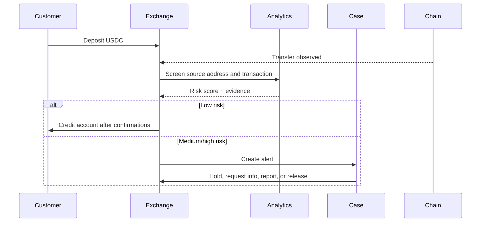

Chain reorganizations and confirmation thresholds matter. A deposit detected in the mempool may disappear. A transaction with one confirmation on a fast chain may still be reversible under that chain's finality model. Real-time systems must balance latency against settlement confidence.

### Real-Time Monitoring Architecture

Real-time monitoring is both a latency and a correctness problem. A system must
act quickly enough to prevent loss or prohibited activity without reacting
prematurely to unstable data.

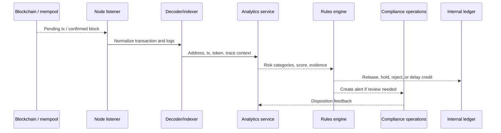

Important design choices:

- **Mempool versus confirmed blocks:** mempool monitoring is faster but less reliable; confirmed-block monitoring is slower but grounded in canonical chain history.
- **Confirmation thresholds:** Bitcoin, Ethereum, rollups, and permissioned chains have different settlement/finality assumptions.
- **Fail-open versus fail-closed:** if the analytics API is unavailable, an institution must decide whether to pause transactions, allow low-risk flows, or route to manual review.
- **Caching:** screening results can be cached for speed, but stale labels create risk after sanctions or incident updates.
- **Idempotency:** the same transaction may be observed multiple times; alert creation must avoid duplicates.
- **Reorg handling:** if a block is reorganized out, credited deposits and alerts may need correction.
- **Backfill:** when a new label is added, historical transactions may require rescreening.

### Continuous Rescreening

Continuous rescreening is one of the most practical differences between ordinary "check once" screening and mature compliance analytics. A wallet can look clean on Monday, receive funds from a hack on Tuesday, and be sanctioned on Friday. A customer deposit accepted months ago may become relevant if a newly discovered cluster links it to a fraud network.

Rescreening can trigger:

- account review;
- asset freeze or withdrawal block;
- customer outreach;
- suspicious activity reporting;
- remediation of historical case decisions;
- update to customer risk rating;
- notifications to partner banks, issuers, or law enforcement where appropriate.

Rescreening should preserve historical context. A transaction that was low-risk under the labels available at the time may become high-risk later. The audit record should show both the original decision basis and the new information that caused review.

## Cross-Chain Analytics

Criminal and ordinary users both move across chains. Cross-chain analytics links bridge events, wrapped assets, centralized exchange conversions, DEX swaps, and cross-chain messages.

Common bridge models:

- **lock-and-mint:** lock asset on source chain, mint representation on destination chain;
- **burn-and-mint:** burn representation on one chain, mint on another;
- **liquidity bridge:** fulfill transfer from liquidity pools;
- **canonical bridge:** protocol-recognized bridge for a rollup or chain;
- **centralized exchange bridge:** deposit one asset, withdraw another chain/asset.

Example path:

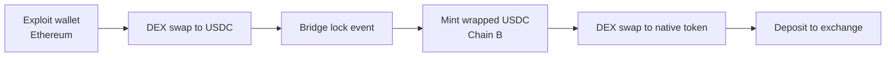

Uncertainty remains when bridges batch transfers, use liquidity pools, rely on off-chain relayers, or route through centralized exchanges. A strong system reports confidence and evidence rather than pretending every cross-chain link is certain.

### Cross-Chain Linkage Methods

Cross-chain tracing usually combines several signals rather than relying on one perfect identifier.

| Signal | Example | Confidence issues |
|---|---|---|
| Bridge event pair | Lock on Ethereum, mint on Arbitrum | Strong for canonical bridges with clear logs |
| Same address on EVM chains | `0xabc...` uses Ethereum and Polygon | Same private key may control both, but contract addresses can differ |
| Amount and timing match | 100,000 USDC leaves Chain A, similar amount arrives on Chain B | Weak if bridges batch or fees/slippage change amounts |
| Message ID / nonce | Cross-chain message carries unique identifier | Strong if protocol exposes it clearly |
| Liquidity pool accounting | Bridge pays from destination pool | Requires bridge-specific understanding |
| Centralized exchange pivot | Deposit BTC, withdraw USDT on Tron | On-chain path breaks inside exchange |
| Contract trace | Bridge router calls adapter/relayer contracts | Requires trace support and correct decoding |

The central difficulty is that a "bridge" is not one technical design. Some bridges lock assets in a contract and mint wrapped assets elsewhere. Some burn on one chain and mint on another. Some rely on liquidity providers. Some use canonical rollup messaging. Some use off-chain relayers and multisigs. Some are effectively centralized services with on-chain deposit and withdrawal legs.

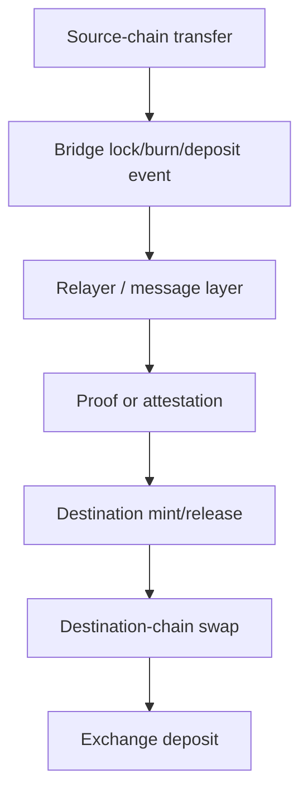

Cross-chain analytics therefore needs bridge-specific adapters, not only generic graph search. The adapter should know which contracts are canonical, which events represent deposits, which events represent releases, how fees are charged, how refunds appear, and how failed messages are handled.

### Chain-Hopping Scenario

A fake exploit scenario illustrates the problem:

1. An attacker drains 8,000 ETH from a vulnerable protocol on Ethereum.
2. The attacker swaps 3,000 ETH into USDC through a DEX aggregator.
3. The attacker bridges USDC to Arbitrum through a liquidity bridge.
4. On Arbitrum, the attacker swaps USDC to ETH and then to a different stablecoin.
5. The attacker bridges part of the value to Tron as USDT.
6. The attacker deposits smaller pieces into several centralized exchanges.

The investigation must not simply say "funds went to Chain B." It should identify transaction hashes, contracts, bridge events, asset conversions, destination wallets, exchange deposit clusters, estimated losses to slippage/fees, and confidence. If the path passes through a centralized exchange, the public graph may stop; further evidence may require exchange cooperation, subpoenas, or internal customer data.

## DeFi Analytics

DeFi analytics decodes smart-contract activity into financial actions. A transaction trace might include a flash loan, several swaps, oracle interaction, liquidation, token approvals, and profit transfer. Logs reveal events; traces reveal internal calls; contract ABIs decode meanings.

Exploit tracing example:

1. Attacker funds wallet from a mixer or exchange.
2. Attacker deploys exploit contract.
3. Contract takes flash loan.
4. Contract manipulates AMM price or oracle.
5. Lending protocol accepts inflated collateral value.
6. Attacker borrows assets and drains pool.
7. Flash loan is repaid.
8. Profit is swapped to ETH/stablecoins.
9. Funds move through bridges, mixers, or exchanges.

Analytics must distinguish attack mechanics from laundering mechanics. The exploit transaction explains how funds were obtained. Later flows explain how funds were moved, hidden, or cashed out.

### DeFi Decoding Layers

DeFi analytics requires more than reading token transfers. A single Ethereum transaction can contain nested calls, delegated calls, emitted events, internal ETH transfers, temporary balances, and reverted subcalls. The analytics system must decode the economic action, not only the surface transaction.

| Data source | Shows | Why it matters |
|---|---|---|
| Transaction input | Called contract and calldata | Identifies router/function if ABI is known |
| Event logs | Token transfers, swaps, deposits, liquidations | Often the cleanest structured signal |
| Traces | Internal calls and value movements | Needed for contract-to-contract behavior |
| State diffs | Balance/storage changes | Useful when events are missing or misleading |
| Oracle updates | Price source changes | Relevant to exploit mechanics and liquidation |
| Mempool order | Pending transactions and ordering | Relevant to MEV/front-running investigations |

Example: a user sends one transaction to a DEX aggregator. The visible recipient is the aggregator contract, but the economic path may be USDC -> WETH -> wstETH -> ETH through three pools. If the system only records "user interacted with aggregator," it misses counterparties, slippage, pool exposure, token approvals, and possible sanctioned liquidity-pool exposure.

### Exploit Mechanics Versus Laundering Mechanics

Forensics usually separates the incident into phases:

| Phase | Analyst question | Typical data |
|---|---|---|
| Funding | How did attacker prepare wallets and gas? | Prior transfers, exchange withdrawals, mixer exits |
| Setup | Were contracts deployed or approvals obtained? | Contract creation, bytecode, admin calls |
| Exploit | Which vulnerability produced profit? | Traces, storage changes, oracle events, flash loans |
| Profit extraction | Which assets were stolen or minted? | Token transfers, pool drains, liquidation events |
| Layering | How were funds split/swapped/bridged? | DEX swaps, bridges, new wallets |
| Cash-out | Where did funds enter services? | Exchange clusters, OTC, stablecoin redemptions |

This phase model prevents a common confusion. A flash loan is not automatically suspicious; it is a tool. A DEX swap is not automatically laundering; it is a financial action. Risk comes from the context: exploit proceeds, rapid asset conversion, obfuscation, sanctioned services, and cash-out attempts.

### MEV And Market-Integrity Signals

MEV means maximal extractable value: value captured by controlling transaction ordering, inclusion, or insertion. In DeFi monitoring, MEV can look like front-running, back-running, sandwich attacks, arbitrage, or liquidation competition. Compliance analytics is usually not trying to ban all MEV, because some arbitrage and liquidations are part of DeFi market functioning. It may still matter for market integrity, customer harm, or suspicious trading around tokenized assets.

Signals include:

- victim transaction surrounded by buy/sell transactions in the same block;
- repeated interaction with known MEV bots or private relays;
- large slippage paid by customers;
- oracle manipulation followed by borrowing or liquidation;
- suspicious trading before governance announcements, listings, or tokenized-asset events.

## Stablecoin Analytics

Stablecoins are central to compliance analytics because they are widely used for trading, payments, remittances, DeFi collateral, and settlement. Issuers and regulators monitor minting, burning, reserves-related wallets, treasury flows, exchange flows, blacklists/freezes, cross-chain versions, and redemption patterns.

Examples include USDT, USDC, PYUSD, EURC, RLUSD, DAI/USDS, and tokenized deposits as a comparison. The analytics question differs by design:

| Asset type | Key analytics questions |
|---|---|
| Fiat-backed stablecoin | Are mint/burn flows consistent with issuance/redemption? Are sanctioned addresses blocked? |
| Crypto-backed stablecoin | What collateral and liquidation risks exist? |
| Algorithmic/hybrid design | What mechanism supports the peg? |
| Tokenized deposit | Which bank liability moved, and between which verified customers? |
| Bridge-issued stablecoin | Which bridge/custodian backs the representation? |

Stablecoin issuers use analytics to screen mint/redemption counterparties, monitor secondary-market flows, detect illicit exposure, comply with sanctions, and support law-enforcement requests. Banks use analytics before accepting stablecoin-related customers or collateral.

Issuer-controlled functions change the analytics and compliance model. Some fiat-backed stablecoin contracts include administrative controls such as pausing, freezing, or blacklisting. These controls can support sanctions compliance and incident response, but they also create governance and operational risk. An issuer must control who can invoke those functions, what legal authority is required, how actions are logged, and how mistaken freezes are corrected.

Stablecoin monitoring also has a supply-integrity dimension:

- mint events should reconcile to approved issuance workflows;
- burn events should reconcile to redemption or chain-migration workflows;
- treasury wallets should match internal treasury records;
- cross-chain supply should not exceed authorized issuance;
- frozen balances should match legal/compliance cases;
- reserve attestations or disclosures should be linked to the relevant reporting date, not treated as real-time proof.

For decentralized or crypto-backed stablecoins, analytics shifts toward collateral composition, liquidation risk, governance control, oracle dependence, peg stability, and exposure to DeFi protocols.

### Stablecoin Issuer Monitoring Stack

A fiat-backed stablecoin issuer has an analytics problem that resembles both a payment network and a bank-liability ledger. The token contract shows on-chain token movement. The reserve bank accounts and treasury systems show off-chain backing. Compliance systems connect wallets, customers, redemptions, blacklists, freezes, and law-enforcement requests.

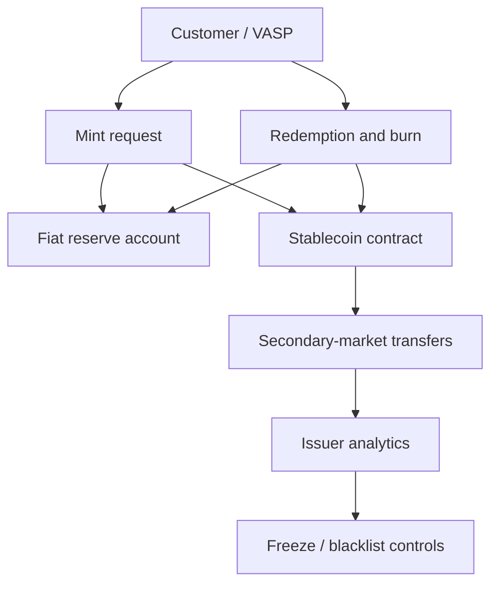

Issuer analytics should cover:

- **primary market:** direct customers minting and redeeming with the issuer;
- **secondary market:** token movement between exchanges, wallets, DeFi protocols, bridges, and merchants;
- **treasury operations:** movements among issuer-controlled wallets and authorized chain deployments;
- **supply reconciliation:** total supply by chain compared with authorized mints, burns, and bridge supply;
- **compliance actions:** freezes, unfreezes, blacklist updates, court orders, and mistaken-action remediation;
- **concentration risk:** large holders, exchange dependency, liquidity distribution, and geographic exposure;
- **redemption risk:** sudden large redemptions, high-risk sources, and bank payout controls.

### Stablecoins In Illicit Finance

Stablecoins are attractive for both legitimate and illicit activity because they combine crypto settlement with price stability relative to fiat currency. A scammer who receives BTC may face price volatility before cash-out; a scammer who receives USDT or USDC has a dollar-denominated asset that moves quickly across exchanges, wallets, bridges, and OTC markets. Chainalysis reported that stablecoins represented a large share of identified illicit transaction volume in its 2026 Crypto Crime Report introduction; that should be read as vendor methodology over identified addresses, not as a complete measurement of all global illicit finance.[^chainalysis-crime-2026]

Practical stablecoin monitoring therefore focuses heavily on:

- scam collection wallets receiving many victim payments;
- rapid consolidation into treasury-like wallets;
- cross-chain movement into high-liquidity networks;
- conversion through OTC brokers or weakly controlled VASPs;
- sanctions exposure and issuer freeze obligations;
- bridge-issued or wrapped versions that may not be controlled by the original issuer;
- DeFi liquidity pools where stablecoins mix with many users.

## Privacy-Enhancing Systems

Privacy tools reduce observability but rarely erase all evidence.

| Tool | Hides or weakens | Remaining signals |
|---|---|---|
| CoinJoin | Input-output linkage | Timing, amount, wallet behavior |
| Mixer pool | Direct source/destination link | Deposit/withdraw timing, amounts, relayers |
| Privacy coin | Transaction graph details | Exchange entry/exit, metadata, network data |
| Stealth address | Recipient address reuse | Sender behavior and spending patterns |
| Shielded pool | Amount/party visibility | Pool entry/exit and compliance disclosures |
| Private mempool | Public pre-trade visibility | Final on-chain settlement |
| ZK proof system | Underlying private data | Proof verification, disclosed commitments |

Legal and ethical analysis matters. Privacy tools can protect legitimate users, journalists, activists, and commercial confidentiality. They can also be used for laundering, sanctions evasion, and ransomware cash-out. Heuristic claims about privacy-tool users require care.

### Mixer And Privacy-Pool Analysis

Mixers and privacy pools break or weaken the direct link between source and destination. A simple mixer takes deposits from many users and later allows withdrawals to different addresses. A zero-knowledge mixer can allow a user to prove entitlement to withdraw without revealing which deposit note they control. This improves privacy, but it also creates an analytics challenge because the graph no longer contains a simple source-to-destination edge.

Analysts may examine:

- deposit and withdrawal amounts;
- deposit and withdrawal timing;
- relayer addresses;
- gas funding for withdrawal wallets;
- repeated wallet behavior before or after mixing;
- links to known exploit or ransomware clusters;
- exchange entry and exit points;
- whether withdrawal denominations narrow the anonymity set.

These techniques are probabilistic. A same-amount withdrawal shortly after a deposit may be suggestive, not definitive. A large anonymity set does not guarantee privacy if the user later consolidates funds or pays gas from a linked wallet. A small anonymity set can be weak even if the cryptography is sound.

Treasury's 2022 Tornado Cash action described the protocol as a virtual-currency mixer operating on Ethereum and alleged that it had been used to launder more than $7 billion in virtual currency since creation, including funds attributed to Lazarus Group and bridge heists.[^treasury-tornado] That case is important for analytics because it joined technical tracing, sanctions law, privacy-tool policy, and debates over software, smart contracts, and civil liberties.

### Dusting And Poisoning

Dusting occurs when someone sends tiny amounts of crypto or tokens to many addresses. Address poisoning is a related tactic where an attacker sends a transaction from a visually similar address so the victim may later copy the wrong address from history. These behaviors matter because naive analytics can treat any contact as meaningful.

Compliance systems should treat unsolicited tiny transfers differently from customer-controlled flows. Useful safeguards include minimum-value thresholds, directionality checks, customer-control analysis, token-spam filters, and rules that distinguish "received dust from a risky address" from "sent funds to a risky address."

## Machine Learning And Graph Intelligence

Machine learning can classify entities, detect anomalies, predict links, cluster wallets, rank suspicious paths, and summarize cases. Graph neural networks and temporal models can learn patterns from transaction networks, but labelled data is scarce and adversaries adapt. The Elliptic dataset and related research have been used in academic work on illicit transaction detection, but production systems depend heavily on private labels and analyst validation.

LLMs and agents can help investigators summarize cases, generate queries, explore graph paths, draft evidence narratives, and extract facts from reports. They must not be treated as independent evidence. Hallucination, missing provenance, and overconfident summaries are dangerous in legal or compliance settings. Human review and source-linked evidence remain mandatory.

### Graph Machine Learning

Graph machine learning tries to learn patterns from nodes, edges, labels, and time. In blockchain analytics, a node may represent an address, entity, contract, transaction, UTXO, or case. An edge may represent transfer, shared control, contract call, bridge linkage, or co-occurrence in a typology. Features can include transaction counts, counterparties, temporal bursts, service categories, asset types, gas behavior, contract interactions, and known labels.

Possible tasks:

- **node classification:** label an address as exchange, scam, mixer user, exploit wallet, or ordinary wallet;
- **edge prediction:** infer whether two wallets are controlled by the same entity or connected through a hidden path;
- **anomaly detection:** find behavior unlike a customer's or peer group's history;
- **community detection:** identify clusters of related wallets;
- **path ranking:** prioritize the most plausible laundering path among many possibilities;
- **case summarization:** group transactions into meaningful phases.

The hard part is training data. Most illicit activity is not labelled. Labels are delayed, biased toward detected cases, and often proprietary. Criminals adapt once rules become known. Cross-chain activity breaks simple graph assumptions. A model trained on one chain, year, or crime type may generalize poorly to another.

Practical ML governance should require:

- labelled-data provenance;
- separation of training, validation, and investigation evidence;
- monitoring for drift as criminals change behavior;
- human-review thresholds for high-impact decisions;
- explanation artifacts, even if approximate;
- periodic false-positive and false-negative review;
- prohibition on treating an LLM-generated narrative as evidence unless every claim links back to source data.

### Knowledge Graphs

A knowledge graph is a graph designed to store facts and relationships in a semantically meaningful way. In this context, it might connect an address to an entity, an entity to a jurisdiction, a jurisdiction to a regulatory status, a transaction to a case, a case to a SAR/STR, and a wallet to a customer.

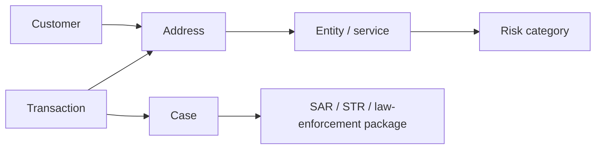

Knowledge graphs are useful because compliance cases are not only value-flow graphs. They include legal entities, beneficial owners, documents, policies, alerts, reviewer decisions, jurisdictions, and regulatory obligations.

## Chainalysis Case Study

Chainalysis positions itself as a blockchain intelligence platform for investigations, risk, and security. Its current website lists products across investigations, compliance, security/fraud, data, and platform layers, including Reactor, KYT, Address Screening, VASP Risking, Sentinel, Data Solutions, Rapid, Wallet Scan, Alterya, and Hexagate.[^chainalysis-home]

### Product Roles

| Product / area | Publicly described purpose | Typical user |
|---|---|---|
| Reactor | Investigate and trace funds across blockchains | Investigators, law enforcement, compliance escalation |
| KYT | Real-time transaction monitoring | Exchanges, financial institutions, stablecoin issuers |
| Address Screening | Assess wallet risk exposure | Onboarding and withdrawal controls |
| VASP Risking | Assess VASP/counterparty risk | Compliance and banking teams |
| Sentinel | Stablecoin ecosystem risk profile | Stablecoin issuers and risk teams |
| Data Solutions | Data/intelligence feeds | Data science and threat-intel teams |
| Rapid / Wallet Scan | Triage and seizure-support workflows | Investigators |

The product names should be understood as workflow surfaces:

- **Reactor:** investigation workspace for tracing and explaining fund flows.
- **KYT:** "Know Your Transaction"; operational monitoring for deposits, withdrawals, and platform exposure.
- **Address Screening:** risk check for a wallet before onboarding or transfer.
- **VASP Risking:** counterparty due diligence on virtual asset service providers.
- **Sentinel:** stablecoin ecosystem and issuer risk-management workflow.
- **Data Solutions:** feeds or datasets for institutions that want to build internal analytics.
- **Rapid / Wallet Scan:** triage and seizure-oriented investigation support.

Product names and packaging can change over time, and available features may
depend on contract, jurisdiction, and integration. The names used here were
visible on Chainalysis's public site on 2026-07-29.[^chainalysis-home]

Chainalysis states that Reactor connects real-world counterparties and services, supports cross-chain tracing through bridges, mixers, DEX swaps, and other activity, and can carry KYT alerts into investigation workflows.[^chainalysis-reactor] These are product claims; the underlying attribution methods and scoring formulas are proprietary.

Chainalysis describes KYT as the center of a crypto transaction monitoring engine. Its public KYT page describes real-time monitoring alerts, direct and indirect exposure alerts, behavioral alerts, customizable risk settings, custom groups, custom address lists, alert/case management, dashboards, and API integration. It also states that KYT supports 400+ networks and 50M+ tokens, that indirect exposure can trace back until an identified service is reached, and that alerts can be generated within seconds of on-chain activity.[^chainalysis-kyt] These figures are current public product claims rather than independently verified measurements.

Chainalysis Address Screening is positioned differently from KYT. KYT is transaction-monitoring oriented: it watches incoming and outgoing platform activity. Address Screening is wallet/liquidity-pool risk oriented: it screens addresses or pools, supports direct and indirect exposure, allows time-based analysis, and can continuously monitor risk-score changes according to Chainalysis's public page.[^chainalysis-address-screening] The distinction matters in an institution:

- KYT answers: "Should this deposit or withdrawal raise an alert?"
- Address Screening answers: "Should we allow or review this wallet, counterparty, or pool?"
- Reactor answers: "Can an analyst explain the path and build an investigation narrative?"
- VASP Risking answers: "Should we treat this crypto business as a lower-risk or higher-risk counterparty?"
- Sentinel-style issuer tooling answers: "How risky is activity around this stablecoin ecosystem?"

### Chainalysis Workflow Surfaces

| Workflow surface | Input | Output | Operational use |
|---|---|---|---|
| KYT monitoring | Transaction, address, customer/platform context | Alert, score, category, evidence | Deposit/withdrawal monitoring |
| Address screening | Wallet, pool, time window | Exposure and risk profile | Onboarding, allowlist/blocklist, counterparty checks |
| Reactor investigation | Address/transaction/entity seed | Graph, traced paths, entity context | Enhanced due diligence, law enforcement, incident response |
| VASP/entity risk | Service or business identity | Counterparty risk profile | Banking, VASP due diligence, partner review |
| Data solutions | Bulk labels/signals/intelligence | Internal data feed | Enterprise data lake, custom models |

### Chainalysis-Style Technical Flow

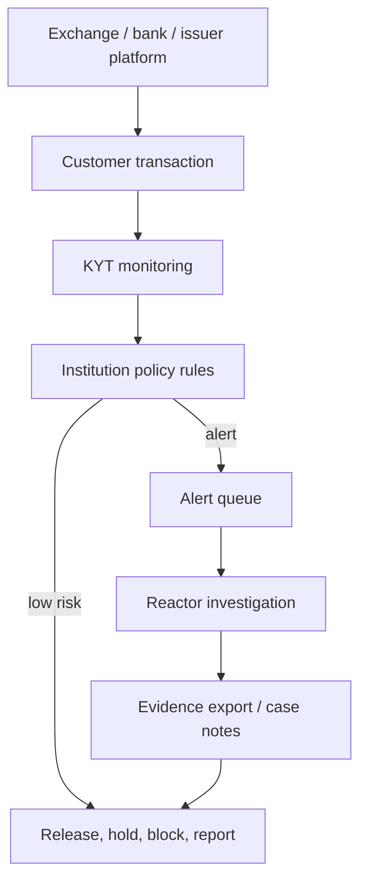

The practical value is not only the risk score. It is the handoff from fast monitoring into an explainable investigation. A low-latency API can tell the exchange to hold a deposit. An investigator still needs a graph view showing which transaction, label, service, or path caused the alert.

### Typical KYT Workflow

1. Exchange observes deposit or withdrawal request.
2. Exchange sends transaction/address/customer context to KYT.
3. KYT returns risk category, score, and evidence.
4. Rules decide release, hold, block, or escalate.
5. High-risk case moves to analyst review.
6. Analyst may open Reactor to trace source/destination.
7. Compliance records decision and supporting evidence.

Case studies often involve ransomware, darknet markets, sanctions, hacks, and stolen-asset recovery. Use public case reports cautiously: a vendor may have contributed data or tooling, while law enforcement, exchanges, issuers, and courts perform separate legal actions.

### Fake KYT Example

Suppose a regulated exchange receives a 75,000 USDC deposit on Ethereum from a customer named Maya.

Raw facts:

- the deposit address belongs to Maya's exchange account;
- the sender is a self-custody wallet;
- the USDC transfer is confirmed in block `N`;
- the sender received 80,000 USDC two hours earlier from a DEX aggregator;
- the DEX swap was funded by ETH that came from a bridge;
- the bridge source has 20% proportional exposure to an exploit cluster.

The KYT-style alert should not merely say "high risk." A useful alert might say:

```text
Severity: Medium / High
Reason: Recent indirect exposure to exploit cluster
Path: Exploit wallet -> DEX swap -> Bridge -> Sender wallet -> Exchange deposit
Exposure model: proportional, 20% of bridged value
Time window: 2 hours from exploit-linked source to deposit
Suggested action: hold credit pending source-of-funds review and escalation
Evidence: transaction hashes, bridge event IDs, decoded swap path, labels, confidence
```

The analyst then decides whether Maya is a victim, a mule, an ordinary trader with incidental exposure, or the controller of the laundering path. The blockchain trace narrows the problem; it does not finish the investigation.

### Architecture Pattern

Chainalysis-style deployment usually has three integration modes:

- **interactive investigation UI:** analysts open graphs, annotate flows, and prepare evidence;
- **real-time API:** exchanges and banks screen addresses or transactions during onboarding/deposit/withdrawal;
- **data/intelligence feed:** internal data platforms ingest labels, alerts, or risk signals.

The most important architectural boundary is between automated decisioning and analyst judgment. A KYT alert may automatically hold a withdrawal, but the final disposition may require a human analyst to review source exposure, customer profile, Travel Rule information, and legal obligations. Reactor-like tooling then helps explain the flow behind the alert.

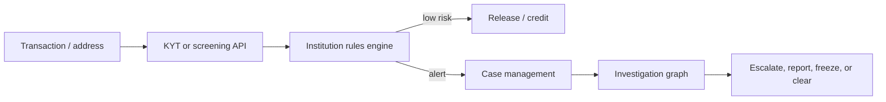

## Elliptic Case Study

Elliptic positions itself around crypto compliance, investigations, stablecoin risk management, network integrations, and data products. Current public pages list Due Diligence, Screening, Monitoring, Investigations, Data Ingestion, Configurable Alerting, Triage, Threat Intelligence, Issuer Due Diligence, Ecosystem Monitoring, Blockchain Integration, Ecosystem Insights, Data Fabric, Blocklists, Indirect Risk Reporting, Discovery, Lens, Investigator, and Analytics.[^elliptic-home]

| Product / area | Publicly described purpose | Typical user |
|---|---|---|
| Discovery | VASP screening and entity due diligence | Banks and counterparties |
| Lens | Real-time multi-asset wallet and transaction screening | Exchanges, payment firms, FIs |
| Investigator | Cross-chain investigations | Investigators and escalation teams |
| Analytics | Exposure trend visualization | Risk and strategy teams |
| Data Fabric | Plug-in blockchain data and intelligence | Internal data platforms |
| Blocklists | Real-time blocklists | Exchanges and protection systems |
| Issuer Due Diligence | Stablecoin issuer wallet risk insights | Banks and treasury teams |
| Ecosystem Monitoring | Monitor token ecosystems | Stablecoin and token issuers |

Elliptic's public positioning emphasizes compliance lifecycle coverage, cross-chain investigations, stablecoin monitoring, network integrations, and APIs. As with Chainalysis, detailed attribution datasets, risk weights, and internal QA processes are proprietary.

Elliptic's public compliance page describes an enterprise platform covering due diligence, screening, continuous monitoring, investigations, data ingestion, and configurable alerting. It states that entity activity is assessed across 50+ blockchains, enhanced tracing covers 250+ bridges, and the platform has 1B+ labelled addresses.[^elliptic-compliance] The page also describes real-time wallet/transaction screening, automatic rescreening when risk levels shift, cross-chain investigation visualization, API and bulk data delivery, and a combination of machine learning, blockchain analytics, and expert-sourced threat intelligence for risk scoring.[^elliptic-compliance]

Elliptic vocabulary:

- **Discovery:** due diligence and risk assessment for crypto businesses or services.
- **Lens:** wallet and transaction screening.
- **Investigator:** investigation and tracing workspace.
- **Analytics:** aggregate exposure and trend analysis.
- **Data Fabric:** data-ingestion product for internal platforms.
- **Blocklists:** real-time blocking/risk lists for operational controls.
- **Issuer Due Diligence / Ecosystem Monitoring:** stablecoin and token ecosystem risk use cases.

The public product vocabulary suggests modular workflows rather than one
monolithic analytics tool: one product can support VASP onboarding, another
transaction monitoring, and another investigation escalation.

### Elliptic Workflow Surfaces

| Workflow surface | Input | Output | Operational use |
|---|---|---|---|
| Discovery | VASP or crypto-business counterparty | Due-diligence profile | Bank/VASP onboarding and review |
| Lens | Wallet or transaction | Screening result and risk categories | Real-time AML/sanctions controls |
| Investigator | Address, transaction, or alert seed | Cross-chain graph and fund-flow analysis | Escalations and investigations |
| Analytics | Aggregated exposure data | Trends, dashboards, concentration views | Risk management and strategy |
| Data Fabric | Internal platform ingestion | Data feeds/API outputs | Custom compliance and analytics stacks |
| Ecosystem monitoring | Token or stablecoin ecosystem | Activity and risk overview | Issuer and network risk management |

Elliptic's product split reflects distinct operational functions. Onboarding
requires counterparty due diligence; transaction operations require fast
screening; investigations require graph exploration; risk management requires
aggregate exposure; data platforms require feeds; and stablecoin issuers require
ecosystem monitoring. A single “blockchain analytics” label hides these
different jobs.

### Elliptic-Style Technical Flow

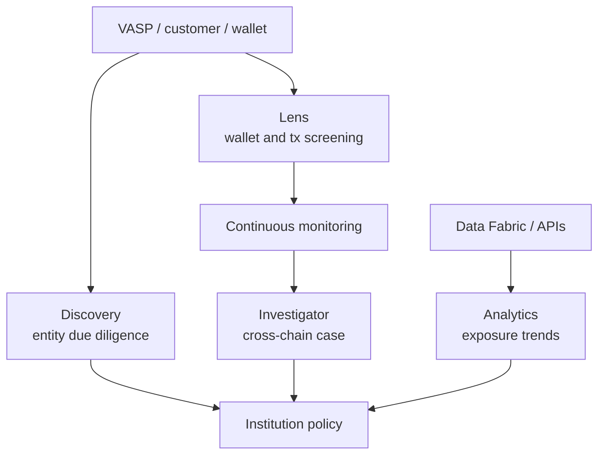

### Hypothetical VASP Onboarding Example

A regulated bank is assessing a hypothetical crypto broker called Alpine Digital Markets as a potential account customer.

The due-diligence questions include:

- Is Alpine a registered VASP in its claimed jurisdictions?
- Which blockchains, assets, and services does it support?
- Does its flow show exposure to high-risk exchanges, mixers, darknet markets, scams, or sanctioned services?
- Does it handle stablecoins, privacy coins, DeFi, or bridges?
- Are its hot wallets consistent with the business model it described?
- Has its risk changed materially since onboarding?

An Elliptic-style workflow might use Discovery for entity due diligence, Lens for wallet screening, continuous monitoring for risk changes, and Investigator for a deeper review if a high-risk exposure appears. The complete control framework also includes ordinary KYB, beneficial-owner checks, regulatory-status verification, legal review, and account-activity monitoring. Blockchain analytics supplies the on-chain evidence layer.

Elliptic-style deployment often appears in banks and fintechs that need pre-transaction screening, wallet due diligence, counterparty risk, stablecoin ecosystem monitoring, and cross-chain investigations. Its public product names suggest a split between screening/monitoring workflows, investigation workflows, data-ingestion workflows, and ecosystem-risk workflows. That split maps to institutional departments:

- compliance operations needs screening and alert queues;
- investigations needs graph exploration and evidence;
- risk management needs aggregate exposure analytics;
- product teams need APIs and integration support;
- stablecoin issuers need ecosystem monitoring and issuer-specific views.

Product pages establish capabilities and positioning, not exact scoring logic. Any production integration therefore requires organization-specific model governance, policy thresholds, quality assurance, and audit evidence.

## Provider Comparison

| Provider | Common positioning | Notes |
|---|---|---|
| Chainalysis | Investigations, KYT, government, exchange, stablecoin risk | Strong public law-enforcement and investigation positioning |
| Elliptic | Compliance, screening, investigations, stablecoin/network analytics | Strong financial-institution and data-product positioning |
| TRM Labs | Compliance and investigations | Often used by exchanges, fintechs, public sector |
| Merkle Science | Compliance and risk monitoring | API and investigation workflows |
| Crystal | Blockchain analytics and investigations | Known for transaction monitoring and tracing |
| Scorechain | AML/compliance analytics | Compliance-oriented tooling |

Comparison should focus on chain coverage, attribution quality, explainability, API design, case management, cross-chain support, DeFi decoding, stablecoin tooling, Travel Rule integrations, deployment model, and evidence standards. Private pricing and proprietary formula comparisons should not be invented.

The most important evaluation questions are practical:

- Can the provider explain why an address or entity is labelled?
- How often are labels updated?
- How are false positives corrected?
- Does the API return evidence or only a score?
- Can analysts export evidence suitable for audit or legal review?
- Does the system decode the chains, bridges, tokens, and DeFi protocols the institution actually uses?
- Can it support permissioned-network data, or only public-chain data?
- How does it handle data retention, privacy, and jurisdictional restrictions?
- Can the institution reproduce historical decisions after product/rule updates?

### Chainalysis Versus Elliptic In Practical Terms

Both providers sell blockchain intelligence and compliance tooling. The meaningful comparison is not "which one is correct" in the abstract. It is whether the provider's coverage, labels, workflow, evidence, APIs, and governance fit the institution's risk profile.

| Dimension | Chainalysis-style emphasis | Elliptic-style emphasis | Institution question |
|---|---|---|---|
| Monitoring | KYT for platform transaction monitoring | Screening and continuous monitoring | Which product best fits deposit/withdrawal flows? |
| Investigations | Reactor as a widely referenced investigation surface | Investigator for cross-chain investigations | Can analysts reconstruct complex cases quickly? |
| Wallet screening | Address Screening with exposure/time analysis | Lens-style wallet and transaction screening | Can onboarding and withdrawal checks be low latency? |
| Counterparty due diligence | VASP Risking and entity risk tooling | Discovery and due-diligence workflow | Can bank/VASP onboarding teams assess counterparties? |
| Stablecoin/issuer risk | Sentinel and stablecoin risk management positioning | Issuer Due Diligence and Ecosystem Monitoring | Can issuers monitor token ecosystems and controls? |
| Data integration | Data Solutions and platform APIs | Data Fabric and APIs/bulk delivery | Can internal data science teams build on the feed? |
| Publicly visible strengths | Law-enforcement and investigation brand, broad KYT positioning | Compliance lifecycle, stablecoin/network and cross-chain positioning | Which workflow matters most for this institution? |

Reproducible comparison requires known test cases rather than product
demonstrations alone. Useful scenarios include a clean exchange deposit, a
mixer-adjacent deposit, a bridge transfer, a sanctioned address, a dusting
event, a DeFi exploit path, and a stablecoin redemption. The outputs can then be
compared for latency, evidence quality, false-positive handling, API fields,
audit export, analyst usability, and chain coverage.

## Case Studies And Public Typologies

Case studies are useful because they show why analytics is more than label lookup. Each case combines technical tracing, operational response, legal context, and uncertainty.

### Tornado Cash And Mixer Sanctions

Tornado Cash is a privacy protocol using smart contracts to weaken links between deposits and withdrawals. From an analytics perspective, it is important because it shows the limits of both public-chain transparency and binary screening.

Treasury's August 8, 2022 action sanctioned Tornado Cash and stated that it had been used to launder more than $7 billion in virtual currency since 2019, including funds connected to Lazarus Group and bridge heists.[^treasury-tornado] The action also described mixers as anonymity-enhancing technologies that can obstruct AML/CFT controls.[^treasury-tornado]

Analytics lessons:

- a smart contract can be publicly visible while source/destination linkage remains difficult;
- sanctions can apply to addresses or services, but enforcement in decentralized protocols is technically and legally complex;
- dusting and unsolicited transfers can create false exposure if institutions treat all contact as equal;
- privacy tools can serve legitimate privacy needs and illicit laundering needs at the same time;
- analysts must distinguish direct use, indirect exposure, dusting, and post-sanctions activity.

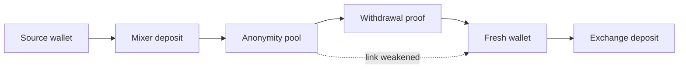

### Bybit Hack And Rapid Cross-Chain Laundering

The FBI's February 26, 2025 public service announcement attributed the theft of approximately $1.5 billion in virtual assets from Bybit to North Korea-linked TraderTraitor activity. The FBI stated that actors had converted some stolen assets to Bitcoin and other virtual assets and dispersed them across thousands of addresses on multiple blockchains, and encouraged private-sector entities including RPC node operators, exchanges, bridges, blockchain analytics firms, DeFi services, and VASPs to block transactions with or derived from listed addresses.[^fbi-bybit]

Analytics lessons:

- incident response requires speed because stolen funds can split and move across chains quickly;
- public address lists can seed monitoring, but laundering paths evolve after publication;
- bridges, DEXs, and exchanges become response points even when they were not part of the original compromise;
- tracing must handle thousands of addresses, asset conversions, and cross-chain paths;
- law-enforcement alerts can become immediate inputs to screening and rescreening systems.

### Ransomware Payment Flows

Ransomware analytics often begins with victim payments. A victim buys crypto, sends it to an attacker-controlled address, and the attacker consolidates payments, uses laundering services, and cashes out through exchanges, OTC brokers, or other services. The blockchain may reveal payment timing, clustering, and cash-out attempts, but it usually does not reveal the malware operator's legal identity by itself.

Typical ransomware flow:

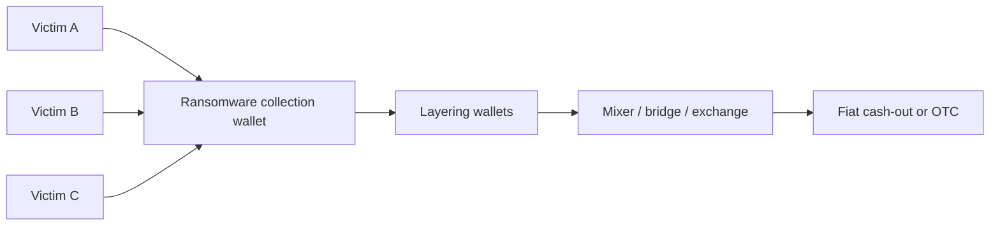

Practical questions:

- Are multiple victim payments going to the same cluster?
- Does the cluster match a known ransomware family?
- Are funds moving toward a service that can freeze or identify the account?
- Are payments linked to a sanctioned actor or jurisdiction?
- Can the victim, insurer, exchange, and law enforcement coordinate quickly?

### Scam And Pig-Butchering Infrastructure

Investment scams and romance-investment scams often use stablecoins because victims can be instructed to buy USDT or USDC and send it to a wallet controlled by the fraud network. The blockchain may show victim deposits, consolidation wallets, OTC routes, and links to online marketplaces or money-laundering services. The off-chain part of the crime includes fake websites, social engineering, messaging apps, mule accounts, and human trafficking in some scam-center ecosystems.

Analytics lessons:

- many small victim payments can reveal a collection pattern;
- stablecoins simplify dollar-denominated fraud proceeds;
- fraud networks may reuse deposit addresses, cash-out services, or infrastructure;
- crypto tracing must be combined with victim reports, exchange records, domains, chat logs, and bank/payment data;
- law-enforcement and platform actions may target both wallets and off-chain service infrastructure.

### DeFi Exploit And Issuer Freeze Scenario

An attacker drains a protocol and swaps stolen tokens into USDC. If the funds remain in freeze-capable stablecoins, the issuer may be able to freeze specific balances if legal and operational conditions are met. If funds are swapped into ETH, bridged, or moved into a privacy system before detection, recovery becomes harder.

This case shows why real-time monitoring and issuer coordination matter. A one-hour delay can mean the difference between funds being frozen in a stablecoin contract and funds being split across multiple chains with weaker control points.

## Institutional Compliance Architecture

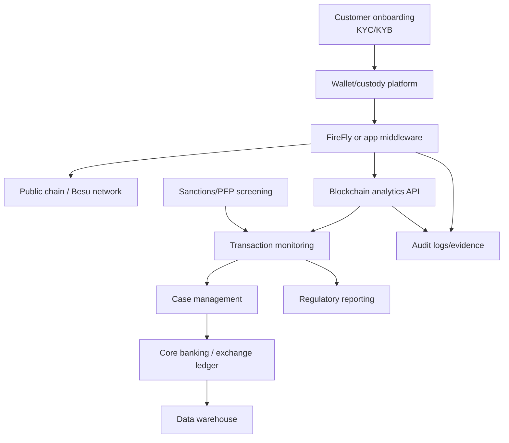

The architecture must support both real-time decisions and later investigations. Screening APIs need low latency. Case management needs evidence. Data warehouses need normalized history. Audit logs need immutable or tamper-evident records. Compliance officers need explanations, not just scores.

### Control Points In An Institution

Blockchain analytics can be embedded at several control points. Each point has a different tolerance for latency and error.

| Control point | Timing | Main risk | Typical action |
|---|---|---|---|
| Wallet onboarding | Before address is accepted | Customer links risky wallet | Reject, allow, or enhanced review |
| Deposit monitoring | Before or after credit | Platform receives illicit exposure | Delay credit, hold, escalate |
| Withdrawal screening | Before signing/broadcast | Platform sends to risky destination | Block, step-up authentication, review |
| Stablecoin mint | Before token issuance | Issuer mints for risky customer | Reject or enhanced due diligence |
| Stablecoin redemption | Before fiat payout | Illicit funds exit to banking system | Hold payout, investigate |
| VASP onboarding | Before banking/partnership | Weak counterparty controls | Reject, limit services, monitor |
| Periodic review | Ongoing | Risk changes after initial approval | Re-rate customer, rescreen, report |
| Incident response | During exploit/fraud event | Funds leave before action | Freeze, notify, trace, coordinate |

### Build Versus Buy

Blockchain analytics commonly uses a hybrid architecture. Internal components
can provide data platforms, policy rules, case workflows, and dashboards, while
external sources provide labels and investigative intelligence. Raw node data is
not the scarce component; high-quality attribution and continuously updated
threat intelligence are.

| Capability | Build internally | Buy/license |
|---|---|---|
| Node/indexer infrastructure | Possible for supported chains | Easier through data providers |
| Customer-policy rules | Usually internal | Vendor templates may help |
| Case management integration | Usually internal/integrated | Vendor UI can be used |
| Entity labels | Hard to maintain globally | Core vendor value |
| Cross-chain tracing adapters | Expensive and ongoing | Vendor value if coverage is strong |
| Sanctions/threat-intel updates | Internal governance required | Vendor feeds plus official lists |
| Audit evidence | Must be institution-owned | Vendor exports support evidence |

Accountability cannot be outsourced with the score. The organization applying a
hold or rejection remains responsible for the customer decision, regulatory
response, and evidence record.

### Data Governance And Privacy

Blockchain analytics data can include personal data when wallet addresses are linked to customers, IP data, device data, case notes, sanctions hits, victim reports, or law-enforcement requests. A compliance data lake therefore needs access controls, retention rules, purpose limitation, and jurisdiction-aware sharing.

Key governance controls:

- restrict analyst access by role and case need;
- log searches and exports;
- separate customer identity from public-chain graph data where possible;
- document lawful basis for processing and retention;
- protect law-enforcement sensitive information;
- review vendor data-processing terms and cross-border transfers;
- define when customer explanations and appeals are allowed;
- preserve evidence without keeping unrelated sensitive data forever.

## Complete Compliance Workflows

### Customer Deposits USDC Into A Regulated Exchange

Raw data: USDC transfer event, sender address, receiver deposit address, transaction hash, block, amount, chain, token contract.

Analytics:

- identify whether source is self-hosted, exchange, DeFi, mixer, sanctioned, hacked, or unknown;
- measure direct and indirect exposure;
- check customer expected behavior;
- account for confirmations and chain finality.

Decision:

- low risk: credit after confirmations;
- medium risk: hold and request source-of-funds explanation;
- high risk: freeze/hold, file internal report, possibly SAR/STR depending jurisdiction.

### Bank Customer Receives A Tokenized Deposit

Raw data: permissioned-network transfer event, sender bank/customer identifier, recipient wallet, token contract, amount, settlement timestamp, FireFly operation ID, internal account mapping.

Analytics:

- confirm sender and recipient are permitted customers;
- check whether either customer has changed sanctions/KYC status;
- compare transfer with expected account behavior;
- verify token contract and issuing bank;
- reconcile token balance with deposit liability records.

Decision:

- accept and post to customer view;
- hold for review if customer/account status changed;
- raise internal fraud/compliance alert if transfer pattern is inconsistent.

False positives may arise when treasury operations, payroll files, or omnibus transfers look unusual compared with retail behavior.

### Stablecoin Issuer Receives A Redemption Request

Raw data: burn or redemption request, customer identity, source wallet, token history, bank payout instruction, reserve ledger entry.

Analytics:

- screen customer and wallet before accepting redemption;
- trace source of redeemed tokens;
- check direct/indirect exposure to sanctions, mixers, hacks, scams, or high-risk services;
- compare redemption size with customer profile;
- verify tokens are genuine contract units on the correct chain.

Decision:

- approve burn and fiat payout;
- delay payout pending source-of-funds review;
- freeze or reject where law/policy requires;
- file suspicious activity report where applicable.

The settlement effect is two-sided: token supply decreases and fiat reserves leave the issuer's banking system. Audit evidence must connect both.

### Indirect Mixer Exposure

A customer deposit has 3-hop exposure to a mixer. This is not automatically equivalent to a mixer deposit. The analyst checks amount, timing, intermediate services, proportional exposure, customer history, and whether the path is plausible laundering or ordinary market activity.

### Sanctions List Update After Prior Transactions

Continuous monitoring matters because a wallet can become sanctioned after earlier activity. The institution must rescreen historical exposure, identify affected customers, determine whether assets are held, block future transactions, and document decisions. This is different from real-time screening at the moment of transfer.

### Bridge And DEX Chain-Hopping

Funds move Ethereum -> bridge -> Chain B -> DEX -> stablecoin -> exchange. The analytics system links bridge events, destination mint, DEX swap, and exchange deposit. Uncertainty is recorded at each step. Compliance may escalate because rapid cross-chain movement after a high-risk source is a laundering typology.

### Tokenized Bond Purchase

Compliance checks investor eligibility, sanctions, wallet risk, source of funds, jurisdiction, and offering restrictions. The blockchain records token allocation and payment settlement; the compliance record stores investor representations, screening evidence, transaction hash, and transfer-agent approval.

### Bank Participates In DvP Settlement

Raw data: cash-token lock, securities-token lock, DvP contract call, participant identities, settlement batch, confirmations/finality proof.

Analytics:

- verify buyer and seller are eligible;
- screen both wallets and legal entities;
- check security transfer restrictions;
- confirm cash token issuer and asset type;
- monitor for failed or reversed off-chain legs.

Automatic decisions may allow the DvP contract call only after both sides pass policy checks. Human review is needed for exceptions such as blocked party updates, failed funding, mismatched settlement instructions, or disputed beneficial ownership.

### Tokenized-Asset Issuer Screens Investors And Transfer Counterparties

A security-token issuer or transfer agent screens both primary issuance and secondary transfers. Raw data includes investor identity, wallet address, jurisdiction, accreditation/eligibility evidence, transfer restrictions, token contract, and transaction history.

The issuer may enforce:

- allowlisted investors only;
- jurisdiction blocks;
- holding-period restrictions;
- maximum investor count;
- sanctions screening;
- beneficial ownership updates;
- manual transfer-agent approval.

Analytics contributes wallet risk and behavioral monitoring; legal transfer validity still depends on securities law, offering documents, and registry rules.

### Smart-Contract Exploit Investigation

Investigator identifies exploit transaction, decodes traces, labels attacker contract, follows profit flows, identifies swaps/bridges/mixers/exchanges, creates evidence graph, requests freezes from issuers/exchanges where legally possible, and prepares a report with confidence levels.

### Customer Uses A Bridge Before Deposit

Raw data includes source-chain transaction, bridge event, destination-chain mint/release, DEX swaps, and final deposit. The system must distinguish ordinary cross-chain activity from laundering typology. Risk signals include rapid movement after hack exposure, use of high-risk bridges, peeling across chains, and immediate cash-out.

False positives occur because legitimate users bridge for lower fees, access to applications, or portfolio management. A good alert explains why this bridge path is suspicious, not merely that a bridge was used.

### Full Investigation Walkthrough: Fake Stablecoin Scam

Scenario: a customer reports losing 42,000 USDT after being convinced to invest through a fake trading website.

1. **Initial clue:** the victim provides one transaction hash and a screenshot of the fake platform deposit address.
2. **Wallet identification:** the analyst confirms that the transaction sent USDT to Address A on Tron.
3. **Collection pattern:** Address A has received similar deposits from 26 other wallets over two weeks.
4. **Consolidation:** Address A forwards most balances to Address B every few hours.
5. **Layering:** Address B splits funds across three wallets, then sends them to an OTC-like service cluster and a centralized exchange deposit cluster.
6. **Off-chain enrichment:** the fake website domain, messaging app handle, and victim reports are added to the case.
7. **Action:** the exchange is notified through the appropriate legal/compliance channel; the victim receives transaction evidence for a police report; the institution updates internal blocklists.
8. **Feedback:** Address A and B become part of a scam typology watchlist, with evidence and review date.

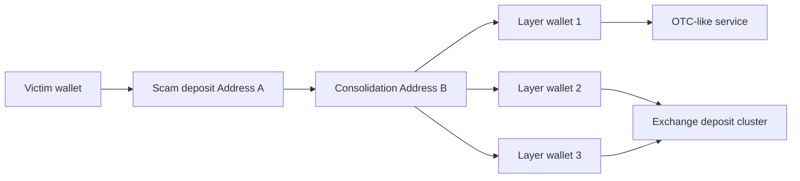

The evidence package should not say "the exchange account is the scammer" unless the institution has evidence of account control. The more careful statement is that funds from the reported scam address flowed to a deposit cluster associated with the exchange, and further identification may require exchange records or legal process.

### Full Investigation Walkthrough: Fake DeFi Exploit

Scenario: a lending protocol loses 12 million DAI after an oracle manipulation.

1. The attacker funds a fresh wallet with ETH from a centralized exchange withdrawal.
2. The attacker deploys an exploit contract.
3. The exploit contract takes a flash loan, manipulates a thin-liquidity pool, causes an oracle price distortion, borrows DAI against inflated collateral, and repays the flash loan.
4. Profit moves to two wallets: one swaps DAI to ETH, the other bridges DAI to a rollup.
5. On the rollup, the attacker swaps part of the DAI into USDC and sends it to a freeze-capable issuer token contract path.
6. The protocol, analytics provider, issuer, exchanges, and law enforcement coordinate around identified addresses.

The technical report should separate:

- vulnerability mechanism;
- stolen assets and approximate USD value;
- attacker funding source;
- contracts and traces involved;
- asset-conversion path;
- freeze/cash-out opportunities;
- confidence and unresolved gaps.

## Evidence, Audit, And Legal Readiness

Compliance analytics is only useful if decisions can be defended. A future reviewer should be able to reconstruct the information available at the time, the rule that fired, the supporting evidence, the reviewer, and the resulting decision.

### Evidence Package

A score or graph image is not self-explanatory evidence. The package should let
another analyst reproduce the raw flow, see which facts came from the chain,
identify which conclusions depended on proprietary attribution, and determine
which policy version converted those facts into action. That distinction becomes
critical when labels change after the original decision.

A strong evidence package contains:

- customer identifier and relevant KYC/KYB status;
- transaction hashes, block numbers, timestamps, chains, asset contracts, and amounts;
- decoded events and traces where relevant;
- address/entity labels with source and confidence;
- exposure path and tracing model;
- screenshots or exports from investigation tools when used;
- API response identifiers and timestamps;
- policy/rule version that generated the alert;
- analyst notes, rationale, and disposition;
- customer-provided source-of-funds/source-of-wealth evidence;
- legal/regulatory action taken, if any;
- rescreening history if later labels changed.

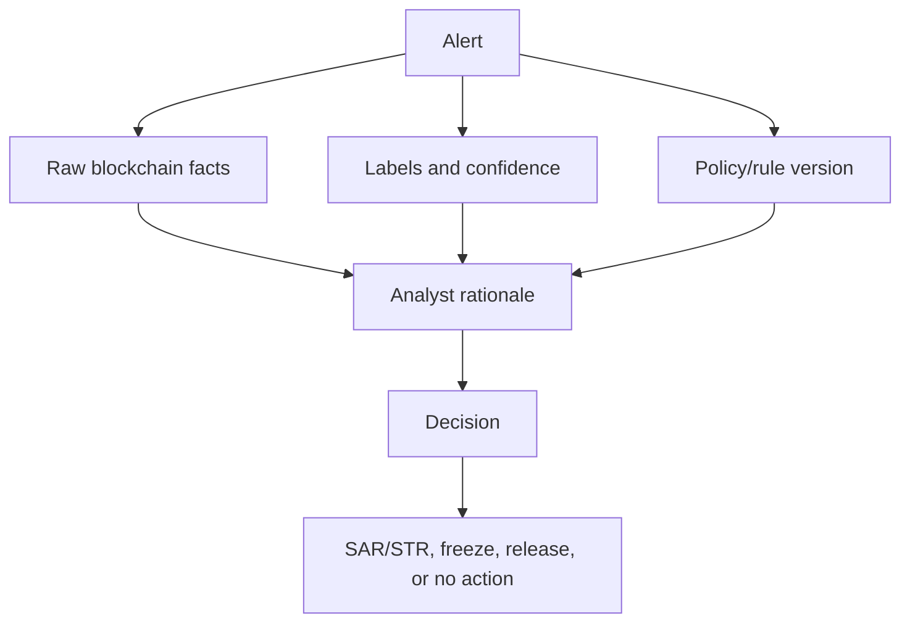

### Standard Of Language

Analytics writing should be precise:

| Weak wording | Better wording |
|---|---|
| "This address is criminal." | "This address is labelled as part of Cluster X based on Evidence Y." |
| "Funds are tainted." | "The deposit has 18% proportional exposure to a labelled ransomware cluster within 4 hops." |
| "The customer laundered money." | "The customer's wallet received funds through a path consistent with layering; intent is not established by this trace alone." |
| "The exchange received stolen funds." | "Funds traced from the exploit flowed to an address attributed to the exchange's deposit cluster." |
| "The model proved the link." | "The model assigned high confidence; supporting transactions are listed." |

This language discipline is not pedantry. It protects the institution, the customer, and the analyst by keeping facts, inferences, and legal conclusions separate.

### Audit And Model Governance

Audit should test whether the analytics program works as designed:

- sample low/medium/high alerts and verify dispositions;
- confirm sanctions updates triggered rescreening;
- check that false positives are tracked and corrected;
- verify that vendor label updates are documented;
- test failover when vendor APIs are unavailable;
- compare alert thresholds with approved policy;
- review access logs and evidence exports;
- check that historical decisions are reproducible after rule updates.

Model governance applies even if the "model" is a rules engine. Thresholds, risk categories, confidence levels, and typology rules affect customers and regulatory outcomes. They should have owners, approval history, testing, and periodic review.

## Permissioned Networks And Tokenized Assets

Compliance analytics still matters in permissioned networks because known validators are not the same as known end customers. Internal fraud, sanctions changes, market abuse, policy violations, cross-network transfers, and off-chain asset fraud can still occur.

| Network/asset | Analytics focus |
|---|---|
| Public stablecoins | Illicit exposure, issuer controls, exchange flows |
| Tokenized deposits | Customer identity, bank liability movement, limits |
| Wholesale CBDCs | Participant behavior, policy compliance, resilience |
| Tokenized securities | Investor eligibility, transfer restrictions, market abuse |
| Permissioned consortium | Member compliance, operational monitoring, audit evidence |

## Privacy-Preserving Compliance

Emerging approaches include verifiable credentials, decentralized identity, selective disclosure, zero-knowledge KYC, proofs of sanctions screening, proof of reserves, proof of source-of-funds properties, encrypted compliance data, privacy pools, and policy-aware smart contracts.

These ideas should be separated by maturity:

- **Deployed today:** conventional screening APIs, Travel Rule messaging, address allowlists, issuer freezes, KYC databases, case management.
- **Emerging deployments:** verifiable credentials, selective disclosure, proof-of-reserves attestations, privacy-preserving identity workflows.
- **Research/proposed:** generalized zero-knowledge compliance proofs, privacy pools with robust policy proofs, fully encrypted compliant transaction systems.

Privacy-preserving compliance aims to prove enough to satisfy policy without exposing all customer data to every counterparty. The hard problems are credential governance, revocation, jurisdictional differences, auditability, and regulator acceptance.

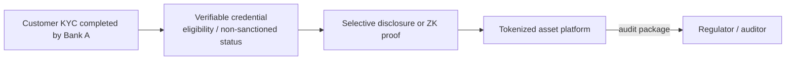

The platform may learn that the customer is eligible without seeing all passport, address, income, or beneficial-ownership data. This is attractive, but it shifts trust to credential issuers, revocation registries, proof circuits, governance processes, and legal acceptance. A cryptographic proof that a credential exists is not enough if the credential issuer performed weak KYC.

## Limitations, Ethics, And Governance

Blockchain analytics can be wrong. Attribution may be incomplete. Heuristics may overcluster. Labels may become stale. Risk scores may be opaque. Surveillance can chill legitimate activity. Vendor concentration can give a few firms outsized influence over access to financial services.

Governance should cover:

- label provenance and review;
- confidence levels;
- customer appeal processes;
- data retention;
- model validation;
- analyst accountability;
- regulatory reporting thresholds;
- privacy rights;
- conflict between jurisdictions;
- evidentiary standards for law enforcement and courts.

The goal is not to treat analytics as an oracle of guilt. The goal is to create defensible, explainable, risk-based decisions.

### Main Failure Modes

| Failure mode | Example | Mitigation |
|---|---|---|
| Overclustering | CoinJoin users treated as one owner | Confidence levels, heuristic limits, analyst review |
| Underclustering | Scam network split across many new wallets | Typology detection, victim reports, temporal analysis |
| Stale labels | Address changes service/control status | Continuous updates, effective dates |
| Chain coverage gap | Unsupported bridge or rollup | Coverage inventory, vendor testing |
| Decoder error | Proxy contract or event decoded incorrectly | ABI/version controls, trace validation |
| Dusting false positive | Sanctioned wallet sends tiny unsolicited funds | Minimum thresholds, directionality, dust filters |
| Omnibus confusion | Exchange hot wallet exposure attributed to all customers | Service-break logic and customer-level data |
| Opaque score | Analyst cannot explain alert | Evidence-first API responses and case notes |
| Vendor concentration | One provider's labels drive many firms' decisions | Multi-source validation for serious cases |
| Privacy overreach | Legitimate privacy use treated as guilt | Proportionality, context, appeal process |

### Ethical Tensions

Blockchain analytics can support victim recovery, sanctions enforcement, cybercrime disruption, and safer market infrastructure. It can also produce surveillance, financial exclusion, and unreviewable blacklisting if used carelessly. The ethical question is not whether analytics is "good" or "bad"; it is whether decisions are proportional, explainable, contestable, and limited to legitimate purposes.

Important safeguards:

- do not equate privacy-tool use with criminality;
- provide manual review for high-impact automated decisions;
- separate legal obligations from commercial risk appetite;
- document uncertainty rather than hiding it;
- protect customer and victim data;
- avoid retaining broad graph/intelligence data without purpose;
- test for customer harm from false positives;
- allow correction when labels or evidence are wrong.

### Open Technical Problems

Several problems remain difficult even for mature providers:

- cross-chain tracing through centralized exchanges and OTC brokers;
- privacy-preserving systems with large anonymity sets;
- account abstraction and sponsored gas patterns that weaken gas-funding heuristics;
- rollup data compression and diverse execution environments;
- DeFi composability where one transaction performs many economic actions;
- token spam and fake asset metadata;
- real-time exploit response across many chains and bridges;
- measuring illicit finance without double-counting or relying only on known labels;
- maintaining explainability as ML/AI systems become more involved.

## Common Misconceptions

> **Misconception: Public blockchain data means attribution is easy.**  
> Addresses are visible, but real-world identity requires evidence and confidence.

> **Misconception: Any exposure to a risky wallet means the customer is illicit.**  
> Exposure must be evaluated by amount, path, time, control, typology, and context.

> **Misconception: Vendor scores are objective facts.**  
> Scores are models based on data, labels, assumptions, and thresholds.

> **Misconception: Permissioned ledgers do not need analytics.**  
> They still need customer-level monitoring, policy enforcement, audit evidence, and reporting.

> **Misconception: More hops always means lower risk.**  
> Hop count is only one dimension. Timing, amount, service type, control evidence, and typology can matter more.

> **Misconception: A bridge transfer is suspicious by default.**  
> Bridges are ordinary infrastructure. They become risk-relevant when combined with exploit proceeds, rapid layering, high-risk services, or unsupported/opaque bridge designs.

> **Misconception: A graph can always prove who controls a wallet.**  
> On-chain graphs show behavior and relationships. Legal identity often requires exchange records, KYC data, device data, subpoenas, or other off-chain evidence.

> **Misconception: AI can replace investigators.**  
> AI can summarize, prioritize, and query. It cannot replace source-linked evidence, policy judgment, or legal review.

## Glossary

**Address clustering:** Grouping addresses believed to be controlled by the same entity.

**AML:** Anti-money laundering controls.

**Attribution:** Linking blockchain activity to real-world entities or services.

**Beneficial owner:** Natural person who ultimately owns or controls a legal entity or arrangement.

**CDD/EDD:** Customer due diligence / enhanced due diligence.

**CFT:** Countering the financing of terrorism.

**CoinJoin:** Collaborative Bitcoin transaction pattern that weakens common-input ownership heuristics.

**Cross-chain tracing:** Linking value movement across different blockchains through bridges, swaps, exchanges, or messaging protocols.

**DEX:** Decentralized exchange.

**Exposure:** Risk relationship between funds, addresses, entities, or customers.

**FIFO/LIFO:** First-in-first-out / last-in-first-out tracing assumptions.

**GNN:** Graph neural network.

**KYA/KYT:** Know Your Address / Know Your Transaction; address-level and transaction-level crypto risk checks.

**KYB/KYC:** Know Your Business / Know Your Customer.

**KYT:** Know Your Transaction; transaction monitoring for crypto activity.

**MEV:** Maximal extractable value; value from transaction ordering, insertion, or exclusion.

**OFAC:** U.S. Office of Foreign Assets Control.

**PEP:** Politically exposed person.

**Proportional exposure:** Tracing model that allocates risk by the share of mixed funds linked to a source.

**SAR/STR:** Suspicious activity report / suspicious transaction report.

**Taint analysis:** Propagating risk from source funds through later flows.

**Typology:** Repeated behavioral pattern associated with a risk category.

**Travel Rule:** Requirement for qualifying virtual asset transfers to include originator and beneficiary information.

**VASP:** Virtual asset service provider.

**ZK proof:** Zero-knowledge proof; cryptographic proof that a statement is true without revealing all underlying data.

## References

[^fatf-va]: FATF, [Virtual Assets](https://www.fatf-gafi.org/en/topics/virtual-assets.html).
[^fatf-guidance]: FATF, [Updated Guidance for a Risk-Based Approach to Virtual Assets and Virtual Asset Service Providers](https://www.fatf-gafi.org/en/publications/Fatfrecommendations/Guidance-rba-virtual-assets-2021.html), 2021.
[^chainalysis-home]: Chainalysis, [Blockchain intelligence for investigations, risk, and security](https://www.chainalysis.com/).
[^chainalysis-reactor]: Chainalysis, [Reactor](https://www.chainalysis.com/product/reactor/).
[^chainalysis-kyt]: Chainalysis, [KYT: Know-Your-Transaction](https://www.chainalysis.com/product/kyt/).
[^chainalysis-address-screening]: Chainalysis, [Address Screening](https://www.chainalysis.com/product/address-screening/).
[^chainalysis-profile]: Wikipedia, [Chainalysis](https://en.wikipedia.org/wiki/Chainalysis), used only for public company/customer profile cross-checking.
[^chainalysis-crime-2026]: Chainalysis, [2026 Crypto Crime Report Introduction](https://www.chainalysis.com/blog/2026-crypto-crime-report-introduction/).
[^elliptic-home]: Elliptic, [Blockchain analytics and crypto compliance solutions](https://www.elliptic.co/).
[^elliptic-compliance]: Elliptic, [Crypto Compliance](https://www.elliptic.co/solutions/crypto-compliance).
[^elliptic-profile]: Wikipedia, [Elliptic](https://en.wikipedia.org/wiki/Elliptic_%28company%29), used only for public company/customer and investor profile cross-checking.
[^trm-home]: TRM Labs, [Blockchain intelligence and crypto compliance solutions](https://www.trmlabs.com/).
[^merkle-home]: Merkle Science, [Blockchain analytics and crypto compliance solutions](https://www.merklescience.com/).
[^scorechain-home]: Scorechain, [Crypto AML compliance software](https://www.scorechain.com/).
[^coinfirm-home]: Coinfirm, [Blockchain analytics and AML risk platform](https://www.coinfirm.com/).
[^crystal-home]: Crystal Intelligence, [Blockchain analytics for AML compliance and investigations](https://crystalintelligence.com/).
[^arkham-profile]: Wikipedia, [Arkham Intelligence](https://en.wikipedia.org/wiki/Arkham_%28cryptocurrency_exchange%29), used only for public profile and product-positioning cross-checking.
[^blockchain-analysis-profile]: Wikipedia, [Blockchain analysis](https://en.wikipedia.org/wiki/Blockchain_analysis), used only as a broad provider-discovery source; vendor capabilities still require direct diligence.
[^fbi-bybit]: FBI Internet Crime Complaint Center, [North Korea Responsible for $1.5 Billion Bybit Hack](https://www.ic3.gov/PSA/2025/PSA250226), February 26, 2025.
[^treasury-tornado]: U.S. Department of the Treasury, [U.S. Treasury Sanctions Notorious Virtual Currency Mixer Tornado Cash](https://home.treasury.gov/news/press-releases/jy0916), August 8, 2022.
