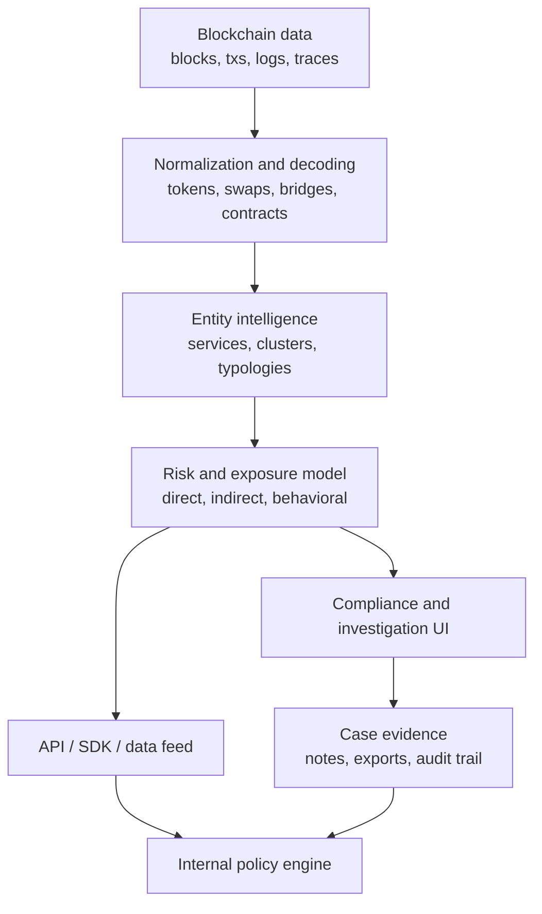
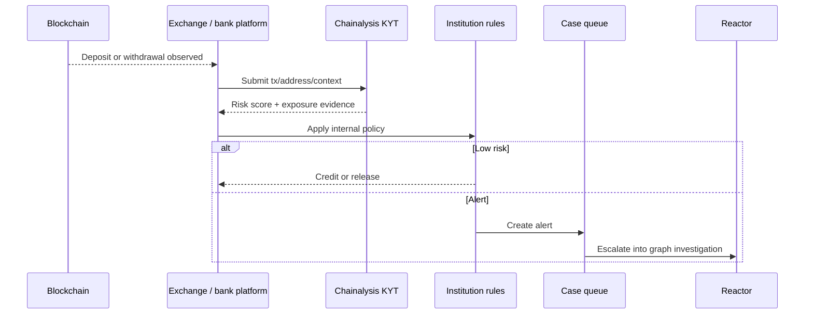
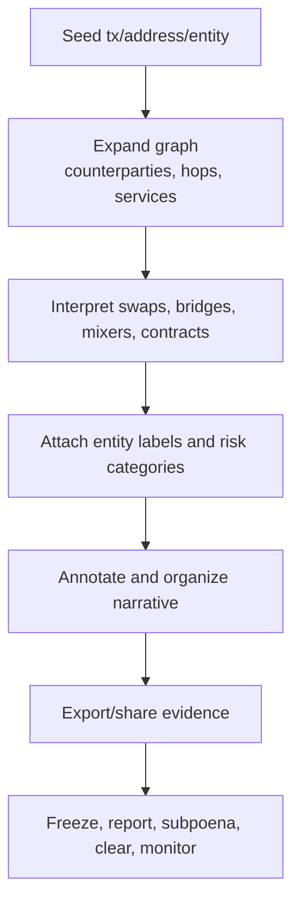
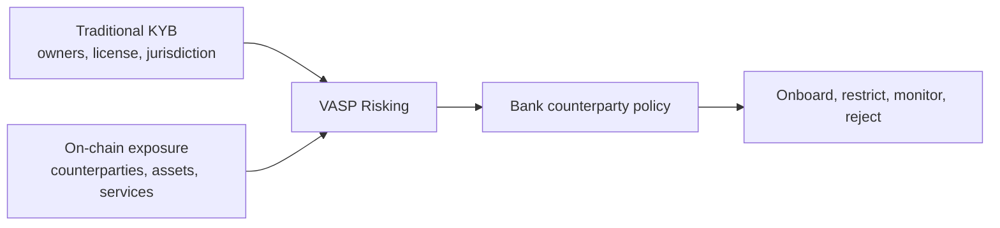
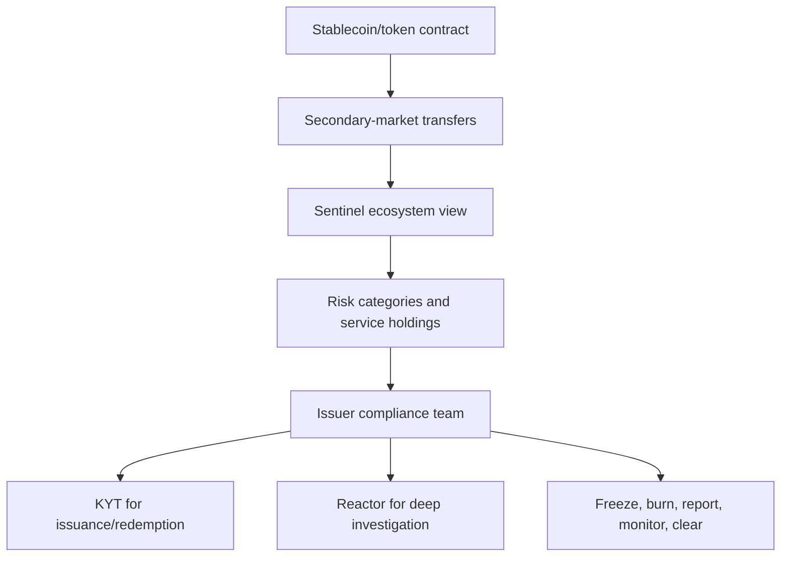
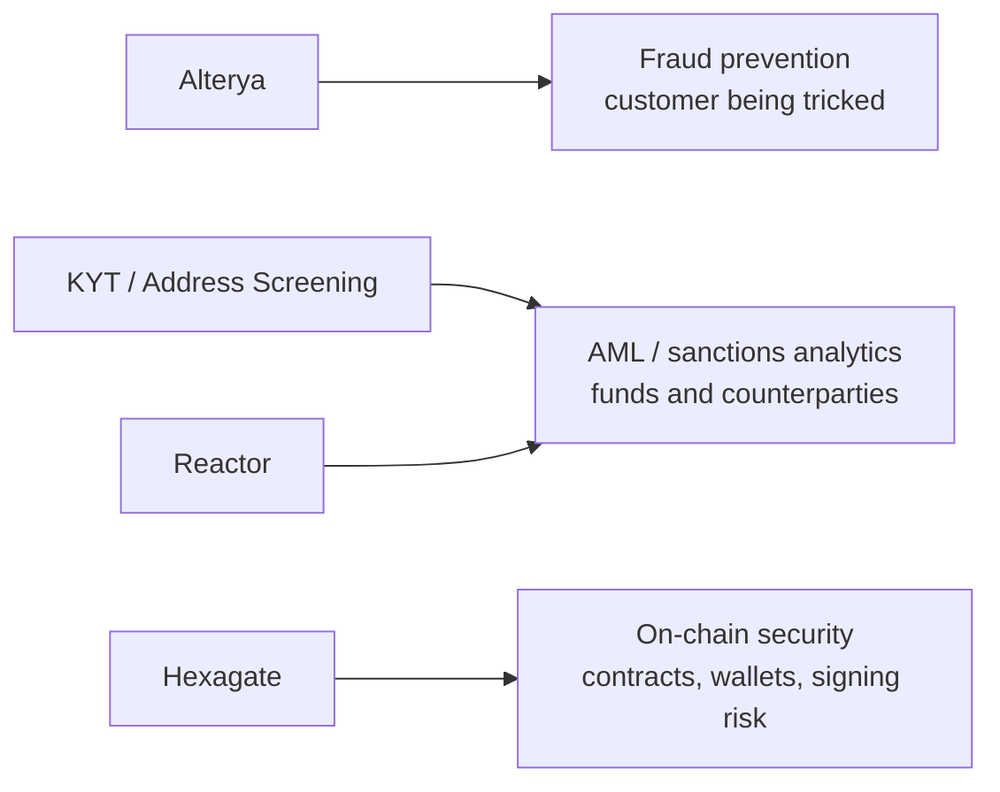
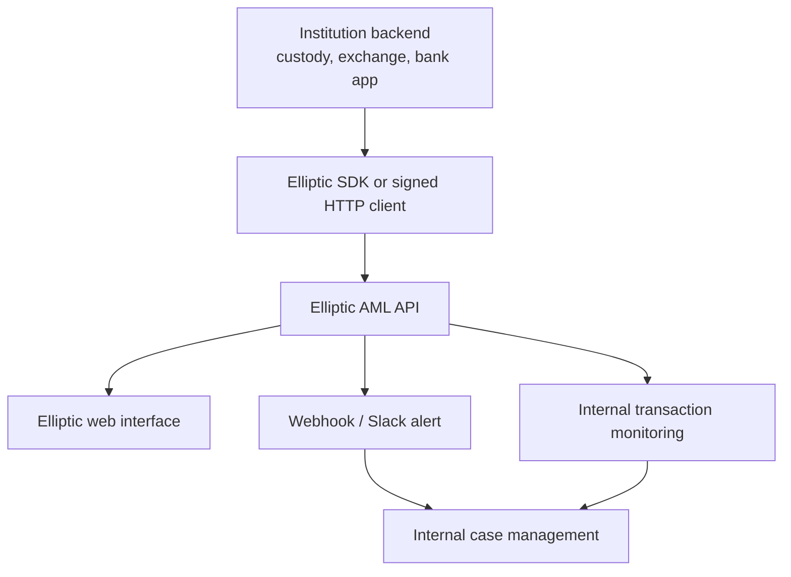
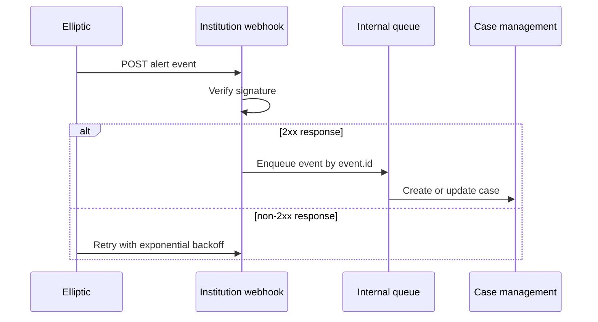
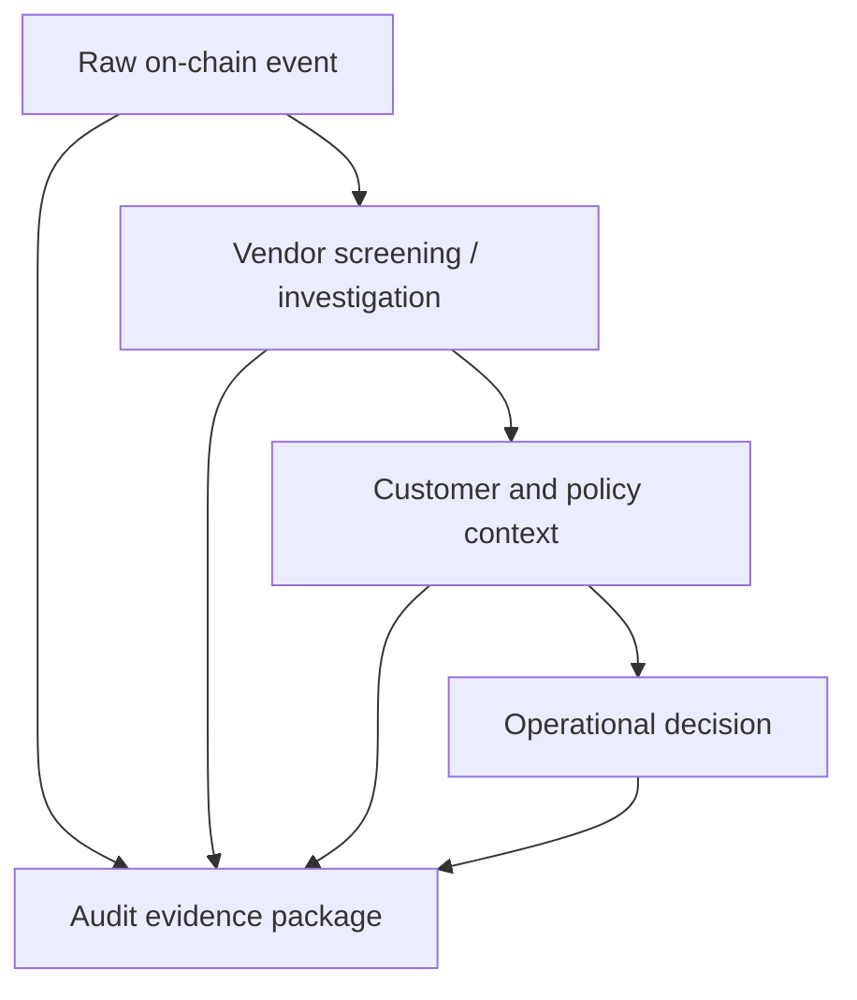
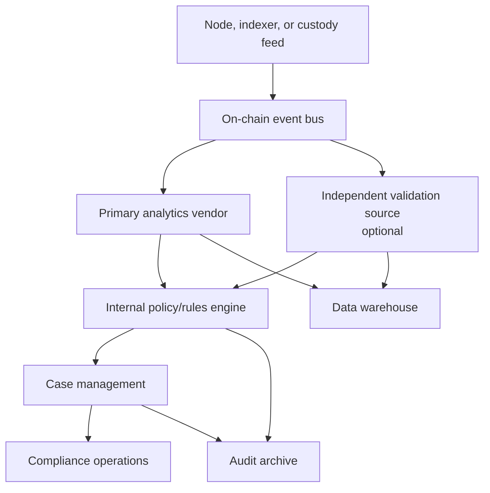

# Chainalysis and Elliptic

Last verified: 2026-07-29.

**Chainalysis** and **Elliptic** are blockchain analytics and
crypto-compliance intelligence platforms. Their publicly documented
architectures, product categories, data and investigation workflows, APIs,
evidence models, strengths, and limitations illustrate how this class of system
turns blockchain records into operational intelligence.

The two companies are direct competitors. Their core capabilities overlap substantially: both build an intelligence layer above raw blockchain data so regulated organizations can move from addresses and transactions to attributed entities, source-of-funds analysis, risk classifications, behavioral context, alerts, case workflows, and defensible evidence.

> **Source boundary:** Both vendors publish product pages, support material, and some technical documentation. Neither vendor publicly discloses its full entity-attribution database, complete clustering logic, model weights, internal quality-assurance process, or all deployment details. The analysis below separates public facts from reasonable architectural interpretation.

## Executive Summary

Chainalysis has the broader and more vertically integrated public product suite. It spans field-level triage, wallet and seed-phrase scanning, investigations, transaction monitoring, VASP risk, token and stablecoin ecosystem monitoring, raw intelligence/data workflows, scam prevention, smart-contract security, AI-assisted workflows, and government-sensitive investigation use cases. Its public positioning is especially strong around law enforcement, national security, tax agencies, regulators, exchanges, and compliance teams.[^chainalysis-reactor][^chainalysis-kyt]

Elliptic is more tightly centered on cross-chain compliance intelligence. Its public positioning emphasizes wallets, transactions, entities, investigations, stablecoin/token ecosystems, and network activity as parts of a unified multi-chain, multi-asset graph. Its public developer documentation is materially more visible: authentication, SDKs, API workflows, synchronous analysis, rescreening, alerts, webhooks, and an AI wallet-summary endpoint are documented publicly.[^elliptic-compliance][^elliptic-developer-auth][^elliptic-aml-intro]

The principal difference is each company's emphasis:

- **Chainalysis:** broader vertical suite, strong investigation/government/compliance positioning, KYT-to-Reactor workflow, issuer and VASP products, and additional fraud/security products.
- **Elliptic:** compliance-centered platform with strong cross-chain and API documentation emphasis, clearer public integration model, and product language oriented toward banks, exchanges, payments firms, regulators, token issuers, and network operators.

Both vendors provide blockchain analytics, but a feature name does not establish
coverage or quality. Meaningful comparison requires representative chains,
assets, transaction types, evidence requirements, integration patterns, and risk
policies.

## Core Mental Model

Chainalysis and Elliptic are **blockchain intelligence platforms**. They sit above raw blockchain data and connect transactions, addresses, contracts, and events to entities, services, typologies, compliance policies, investigation workflows, and evidence packages.

Both providers solve the same technical problem:

1. ingest blockchain data across many networks;
2. normalize chain-specific transaction structures;
3. decode token transfers, contract events, traces, swaps, bridges, and other protocol actions;
4. attach entity and service labels where evidence supports attribution;
5. calculate exposure and risk signals;
6. expose those signals through APIs, dashboards, alerts, cases, investigation graphs, reports, and data feeds.



For regulated users, the output may support decisions such as:

- whether a deposit should be credited;
- whether a withdrawal destination should be blocked;
- whether a wallet should be accepted during onboarding;
- whether a VASP is a suitable counterparty;
- whether a token issuer should freeze a balance;
- whether a case should become a suspicious activity report;
- whether an investigator can reconstruct a fund-flow narrative.

## Publicly Documented Versus Proprietary

The most useful way to read vendor documentation is by evidence level.

| Evidence level | Examples | How to use it |
|---|---|---|
| Public product facts | Product names, workflow descriptions, coverage claims, high-level features | Safe to describe with attribution |
| Public technical docs | API endpoints, SDK behavior, authentication, webhook payloads | Safe to describe precisely when documented |
| Public package metadata | SDK language support, dependencies, license, release date | Useful for integration planning |
| Product screenshots/demos | UI workflow, example fields, conceptual outputs | Useful but not a complete specification |
| Vendor claims | accuracy, coverage, customer count, recovery amounts | Cite as vendor claims, not independently verified facts |
| Proprietary internals | label database, heuristics, model weights, QA process | Do not invent; describe as unavailable or unclear |

This distinction matters because the organization using the output remains
accountable for its decisions. It must distinguish auditable facts, fields
available through integration, internal policy choices, and claims that have not
been independently verified.

## Principal Product Equivalences And Differences

The two vendors use different product names, but many product categories map directly to each other.

| Area | Chainalysis | Elliptic | Practical interpretation |
|---|---|---|---|
| Full investigations | Reactor | Investigator | Both provide graph-based investigation workflows for tracing funds and building evidence. |
| Initial investigation triage | Rapid | Triage | Both address fast prioritization before full investigation; Chainalysis also has Wallet Scan for seizure-oriented workflows. |
| Transaction monitoring | KYT | Navigator, Lens, and Continuous Monitoring | Both support AML-oriented transaction monitoring; Elliptic publicly presents Navigator as automated monitoring and Lens as a unified wallet/transaction screening workflow.[^elliptic-compliance] |
| Wallet screening | Address Screening | Lens / Screening | Both screen wallet risk and exposure; Chainalysis separately markets liquidity-pool assessment under Address Screening. |
| VASP due diligence | VASP Risking | Discovery / Entity Due Diligence | Both support counterparty review of crypto businesses and services. |
| Stablecoin or token monitoring | Sentinel | Issuer, Asset, and Ecosystem Due Diligence | Both support issuer/token ecosystem risk beyond customer-by-customer transaction screening. |
| Raw intelligence/data | Data Solutions | Data Fabric / Threat Intelligence | Both support institutional data ingestion and custom analytics beyond analyst UI workflows. |
| Scam prevention | Alterya | Primarily covered through screening and threat intelligence | Chainalysis markets a distinct scam-prevention product area; Elliptic appears to cover this mainly through screening, monitoring, and threat intelligence. |
| Smart-contract security | Hexagate | Not as prominent in the main Elliptic suite | Chainalysis markets a distinct Web3 security/exploit-prevention capability through Hexagate. |
| Cross-chain focus | Supported across Reactor, KYT, Address Screening, Data Solutions, and intelligence products | Central differentiator marketed through Holistic screening/tracing | Elliptic's cross-chain framing is especially prominent in its compliance positioning; Chainalysis also supports cross-chain tracing in investigation and monitoring products. |
| AI assistance | Chainalysis AI Agents / Rapid-style insights | Elliptic AI copilot / wallet summary API | Both use AI as an analyst productivity layer; evidence must still link back to source data. |
| Training and services | Academy, Global Services | Education and training, support resources | Both publish enablement offerings; public materials do not define every delivery or support term. |

Chainalysis presents a broader vertical suite, while Elliptic is more
concentrated around cross-chain compliance intelligence and publicly visible
workflow integration. Both address the same underlying problem: raw blockchain
records are insufficient for regulated operations.

## Public Positioning and User Segments

Public materials suggest overlapping but differently emphasized user segments.

| Segment | Chainalysis public positioning | Elliptic public positioning |
|---|---|---|
| Law enforcement and national security | Highly prominent; Reactor, Rapid, Wallet Scan, Data Solutions, and government-sensitive deployments are central in public messaging.[^chainalysis-reactor] | Present through investigations and intelligence products, but less dominant than compliance lifecycle messaging.[^elliptic-compliance] |
| Exchanges and crypto-native platforms | Strong KYT, Address Screening, Reactor, and compliance positioning; KYT page displays major exchange/customer logos and says top exchanges rely on the product.[^chainalysis-kyt] | Strong screening, monitoring, and compliance workflow positioning; public compliance page includes exchange and customer references.[^elliptic-compliance] |
| Banks and financial institutions | Strong but often presented alongside government, exchange, and investigation use cases.[^chainalysis-kyt] | Very prominent; Elliptic's site emphasizes financial institutions, payments, exchanges, regulators, and compliance teams.[^elliptic-compliance] |
| Stablecoin and token issuers | Sentinel is a distinct issuer/token ecosystem monitoring product.[^chainalysis-sentinel] | Issuer Due Diligence, Asset Due Diligence, and Ecosystem Monitoring are explicit product areas.[^elliptic-compliance] |
| Regulators and tax agencies | Strong public positioning through Data Solutions, Reactor, and regulator/tax-agency use cases.[^chainalysis-data-solutions] | Regulators and law enforcement are named segments, with an emphasis on market integrity and investigations.[^elliptic-compliance] |
| Data science and internal analytics teams | Data Solutions offers dashboards, SQL/no-code interfaces, Python scripting, alerting, and bulk enrichment.[^chainalysis-data-solutions] | Data Fabric and AML API support data ingestion, exports, and internal workflow integration.[^elliptic-compliance][^elliptic-aml-intro] |

This table is not market-share evidence. It summarizes public positioning and
available documentation; it does not establish adoption, product quality, or
coverage.

## Chainalysis Deep Dive

Chainalysis positions itself as a blockchain intelligence platform for investigations, risk, compliance, security, data, and AI-assisted workflows. Its public product navigation includes Reactor, KYT, Address Screening, VASP Risking, Sentinel, Data Solutions, Rapid, Wallet Scan, Alterya, Hexagate, and AI Agents.[^chainalysis-kyt]

The strongest public signal in Chainalysis's positioning is the connection between **monitoring** and **investigation**. KYT monitors platform transactions. Reactor investigates the flows behind alerts. Sentinel monitors token ecosystems. VASP Risking supports counterparty due diligence. Data Solutions supports customized intelligence and analytics workflows.

### Chainalysis Product Map

| Product / area | Main purpose | Typical user | Publicly visible technical input | Publicly visible technical output |
|---|---|---|---|---|
| KYT | Real-time transaction monitoring | Exchanges, banks, payment firms, stablecoin issuers | Transactions, addresses, customer/platform context | Risk alerts, scores, categories, dashboards, cases |
| Reactor | Investigation and tracing | Investigators, compliance escalation, law enforcement | Seed address, transaction, entity, KYT alert | Investigation graph, entity context, annotated fund flows |
| Address Screening | Wallet and liquidity-pool risk screening | Onboarding teams, withdrawal controls, DeFi/product teams | Address or liquidity pool | Risk score, direct/indirect exposure, counterparty analysis |
| VASP Risking | Counterparty and VASP risk | Bank/VASP due diligence teams | VASP/entity profile | Risk score, off-chain data, exposure, historical views |
| Sentinel | Token/stablecoin ecosystem monitoring | Stablecoin issuers, token issuers, tokenized-asset providers | Token ecosystem activity | Risk trends, service holdings, category views, exportable data |
| Data Solutions | Custom data and threat intelligence | Data science, law enforcement, regulators, large enterprises | Query/data workflow, target set, typology | Dashboards, alerts, enriched addresses, custom analytics |
| Alterya | Scam and fraud prevention | Fraud, security, and consumer-protection teams | Customer, transaction, and scam-risk signals | Fraud/scam risk alerts and prevention workflows |
| Hexagate | Web3 security and exploit prevention | Protocol, DeFi, security, and incident-response teams | Smart-contract and protocol activity | Exploit/hack prevention and threat detection workflows |
| AI Agents | Natural-language workflow automation | Investigators, data teams, compliance teams | Prompt plus accessible Chainalysis data/workflows | Graphs, reports, dashboards, deterministic workflows |
| Rapid / Wallet Scan | Triage and seizure-support workflows | Law enforcement and investigative teams | Wallet, seed phrase, or target lead | Fast wallet/activity assessment |

Product packaging can change. The names above reflect public pages visible on
2026-07-29.

### KYT: Know Your Transaction

KYT is Chainalysis's transaction-monitoring product. The product page describes it as the center of a crypto transaction monitoring engine and says it assesses the risk of incoming and outgoing cryptocurrency transactions on a customer's platform.[^chainalysis-kyt]

In a financial institution, KYT sits close to transaction execution. It is not mainly a research dashboard. It is operational infrastructure for deposits, withdrawals, crediting, holds, and alert escalation.

Typical KYT inputs:

- transaction hash;
- source and destination address;
- chain/network;
- asset or token contract;
- amount;
- customer reference or internal account context;
- direction: deposit, withdrawal, transfer, or platform exposure;
- time and confirmation status;
- platform-specific metadata.

Typical KYT outputs, based on public product descriptions:

- risk score or severity;
- direct exposure alerts;
- indirect exposure alerts;
- behavioral alerts;
- risk categories such as sanctions, scams, darknet markets, mixers, ransomware, hacks, or high-risk services;
- alert status and case-management data;
- dashboard views of platform exposure;
- risk-setting and threshold behavior.



Chainalysis's public KYT page emphasizes several tuning features: behavioral alerts, direct and indirect exposure alerts, custom groups, custom address lists, bulk alert management, dashboards, and API integration. It states that KYT supports 400+ networks and 50M+ tokens, and that indirect exposure is measured back until an identified service is reached.[^chainalysis-kyt]

Those claims imply configurable risk thresholds and typologies rather than one
rigid default. A retail wallet, exchange customer, market maker, and stablecoin
issuer can have very different expected behavior.

### KYT Alert Example

Suppose a custodial crypto platform receives a 250,000 USDC deposit for a
corporate customer.

Raw event:

```text
chain: Ethereum
token: USDC
tx_hash: 0xdeposit...
from: 0xCustomerWallet
to: 0xBankDepositAddress
amount: 250,000 USDC
customer_id: corp_1274
```

The vendor risk analysis may add:

```text
direct_counterparty: self-hosted wallet
indirect_exposure:
  - 18% exposure to exploit cluster within 4 hops
  - bridge hop through Bridge X
  - DEX swap before deposit
time_window: 3 hours from exploit-linked source to deposit
risk_category: stolen funds / exploit exposure
risk_score: high
confidence: medium-high
```

The bank's internal policy then decides the action:

- hold credit temporarily;
- open a case;
- request source-of-funds evidence;
- escalate to enhanced due diligence;
- notify legal if sanctions or stolen-property concerns apply;
- release funds if the customer provides credible evidence and risk is resolved.

The vendor score is therefore an input to a policy decision, not the policy itself.

### Reactor: Investigation Graph And Evidence Surface

Reactor is Chainalysis's investigation tool. The public Reactor page describes tracing across blockchains, swaps, bridges, DEXs, mixers, entities, and complex contract activity.[^chainalysis-reactor] It also describes carrying KYT alerts into Reactor with risk scores, entities, and context.[^chainalysis-reactor]

Reactor is the part of the suite that turns an alert into a story an analyst can inspect. It lets users seed an investigation with a transaction, wallet, or entity and then explore the surrounding graph. The graph is useful because laundering paths are rarely one transaction long. They often involve splitting, swapping, bridging, consolidation, and cash-out attempts.

Reactor's public page claims:

- links to real-world counterparties, organizations, and services;
- cross-chain tracing across many blockchains and assets;
- interpretation of swaps, bridges, mixers, and complex contract activity;
- graph layouts and annotations;
- integration with KYT;
- integration with tools such as Cellebrite, Siren, and i2;
- deployment options including cloud, on-premises, and FedRAMP-authorized environments.[^chainalysis-reactor]

The exact attribution methods and scoring models are proprietary, but the workflow is clear:



### Reactor Investigation Scenario

Fake scenario: a DeFi protocol loses 8,000 ETH after a smart-contract exploit.

1. The victim protocol identifies the exploit transaction.
2. An analyst seeds Reactor with the exploit address and transaction.
3. The graph shows ETH leaving the exploit contract and splitting into four wallets.
4. Two wallets swap ETH to USDC through a DEX aggregator.
5. One wallet bridges USDC to another chain.
6. Another wallet sends ETH to a mixer.
7. The bridged funds later move to an exchange deposit cluster.
8. The analyst annotates the graph with exploit transaction, swap path, bridge event, mixer entry, exchange deposit, and unresolved gaps.

The investigation report should not say "the exchange is the attacker." It should say that funds traced from the exploit flowed to an address attributed to an exchange deposit cluster. Identifying the account behind that deposit requires exchange records or legal process.

### Address Screening

Address Screening is different from KYT. KYT monitors actual incoming and outgoing platform transactions. Address Screening checks addresses or liquidity pools for risk before or outside a specific transaction workflow.

Chainalysis describes Address Screening as a way to detect and block risky wallets, assess wallet addresses or liquidity pools, screen programmatically or manually, and continuously monitor addresses for risk-score changes.[^chainalysis-address-screening]

Useful use cases:

- screen a withdrawal address before it is allowlisted;
- screen a wallet during customer onboarding;
- screen a DeFi liquidity pool before institutional interaction;
- rescreen a saved address after sanctions or threat-intelligence updates;
- evaluate counterparties over a specific time window.

The liquidity-pool dimension matters. Screening a DeFi interaction requires more
than asking whether one address is sanctioned; it may require identifying
whether the pool has exposure to hacks, scams, sanctioned addresses, or
high-risk services.

### VASP Risking

VASP Risking is for counterparty due diligence on **virtual asset service providers**. A VASP can be an exchange, broker, custodian, wallet provider, OTC desk, payment processor, or other crypto business depending on jurisdiction and function.

Chainalysis describes VASP Risking as a continuous monitoring and due-diligence workflow for VASPs. Public product details include on-chain and off-chain activity, historical trends, exposure analysis, risk scores, off-chain profile data such as license/legal names/jurisdiction, time-based views, exposure thresholds, historical records, and asset-level selection.[^chainalysis-vasp-risking]

This is different from transaction monitoring. It answers questions such as:

- whether a crypto exchange is an acceptable counterparty;
- whether customer fiat flows to a particular VASP require restrictions;
- whether a VASP's risk changed after onboarding;
- whether the VASP has material exposure to mixers, sanctions, scams, darknet markets, or high-risk jurisdictions;
- whether the VASP looks unusual compared with peers.



### Sentinel: Token And Stablecoin Ecosystem Monitoring

Sentinel is Chainalysis's token-issuer and stablecoin-issuer monitoring product. Its public page says it monitors token ecosystem activity, risk exposure across more than 35 categories, daily transactions, risk trends, service holdings, category views, time-based views, bulk exports, and real-time alerts.[^chainalysis-sentinel]

Sentinel is issuer-level ecosystem monitoring rather than high-throughput transaction monitoring for an exchange.

For a stablecoin issuer, Sentinel-style monitoring supports questions such as:

- which services hold the token;
- whether sanctioned or scam-linked wallets are receiving the token;
- whether risky categories are increasing over time;
- which balances might require freeze or legal review;
- whether primary issuance/redemption counterparties need KYT checks;
- whether a suspicious secondary-market flow should be escalated to Reactor.



### Data Solutions

Chainalysis Data Solutions is positioned as a customizable threat monitoring and analytics platform. The public page describes threat intelligence, proactive monitoring, real-time alerts, dashboards, SQL/no-code interfaces, Python scripting, programmatic enrichment of large numbers of addresses, and escalation to Reactor.[^chainalysis-data-solutions]

This product category matters when an organization needs more than a vendor UI.
Risk intelligence may need to feed:

- a data lake;
- transaction monitoring systems;
- fraud engines;
- customer risk-rating models;
- market surveillance;
- treasury risk dashboards;
- stablecoin or tokenized-asset analytics;
- regulator-facing reporting.

Data Solutions therefore resembles data infrastructure rather than a single
compliance dashboard. Its architectural significance depends on whether data can
be queried, exported, versioned, joined to internal records, and reproduced for
audits.

### Adjacent Fraud And Security Products: Alterya And Hexagate

Alterya and Hexagate are important because they make Chainalysis look broader than a pure AML analytics provider.

Alterya is positioned as AI-powered crypto fraud prevention. Its public page
focuses on authorized push-payment fraud, scam blocking, money-mule detection,
synthetic identities, KYC-stage fraud signals, and linking scam activity across
financial identifiers.[^chainalysis-alterya] This sits closer to fraud prevention
and customer protection than classic source-of-funds AML investigation. It
addresses the moment before a customer sends funds to a scammer, rather than only
the later investigation of where those funds went.

Hexagate is positioned as a blockchain security platform for real-time on-chain
threat detection and automated prevention. Its public page describes detecting
key compromise, phishing, governance attacks, execution risks, suspicious token
flows, and malicious transactions before signing; it also mentions integrations
with MPC wallet workflows, Safe, Fireblocks, SIEM/SOAR-style notifications, and
75+ chain coverage claims.[^chainalysis-hexagate] These functions belong to the
security and operational-risk stack as much as the compliance stack.



Elliptic's public suite addresses scams and illicit activity primarily through screening, monitoring, threat intelligence, investigation, and data products. A separate smart-contract security product is not as prominent in Elliptic's main public product suite. Chainalysis therefore markets more distinct product surfaces for fraud prevention and Web3 security.

### Chainalysis AI Agents

Chainalysis describes AI Agents as a beta capability built on Chainalysis intelligence, allowing users to ask questions, create investigation graphs, dashboards, reports, custom views, and codify deterministic workflows.[^chainalysis-ai-agents]

In a compliance environment, AI-assisted workflows should be treated as productivity tooling rather than independent evidence. Their main use is workflow acceleration:

- generate a graph from a natural-language request;
- summarize risk exposure;
- propose next investigative steps;
- build repeatable monitoring workflows;
- create dashboards or reports;
- record inputs, sources, and actions for audit.

The risk is that users may over-trust generated summaries. Any high-impact
workflow needs source-linked evidence, workflow logs, permission controls, model
governance, and human review.

### Chainalysis Public Technical Gaps

Reviewed public materials provide rich Chainalysis product detail but do not expose a developer/API reference comparable to Elliptic's public developer docs. Chainalysis mentions KYT APIs, Address Screening APIs, Data Solutions interfaces, SQL/Python/no-code access, and integrations, but public endpoint schemas, authentication mechanics, webhook payloads, SDK implementation, and request/response examples are not available in the same accessible form.

Those capabilities may be available through customer documentation, private portals, or contracted integrations, but they are not publicly documented in the reviewed sources.

For a technical note, that creates a boundary:

- **documented:** product roles, workflows, public coverage claims, UI/API availability claims, integration claims;
- **unclear from public sources:** exact API endpoints, authentication model, SDK support, event payloads, retry behavior, rate limits, complete data schema, data-export formats;
- **proprietary:** clustering formulas, label evidence thresholds, scoring weights, full entity database, internal validation process.

## Elliptic Deep Dive

Elliptic positions itself around crypto compliance, investigations, stablecoin
risk management, network integrations, and data products. Its public materials
describe Discovery, Lens, Navigator, Investigator, Analytics, data products,
continuous monitoring, configurable alerting, issuer due diligence, ecosystem
monitoring, and network integration.[^elliptic-compliance]

Elliptic has a stronger public developer-documentation footprint than Chainalysis in the sources reviewed. The Elliptic Developer Center documents authentication, an AML API, SDKs, synchronous and batch analysis workflows, rescreening, alerting, and an AI summary endpoint.[^elliptic-developer-auth][^elliptic-aml-intro]

### Elliptic Product Map

| Product / area | Main purpose | Typical institutional user | Publicly visible technical input | Publicly visible technical output |
|---|---|---|---|---|
| Discovery | VASP/entity due diligence | Bank onboarding, counterparty risk | Crypto business/entity | Due-diligence profile and risk context |
| Lens | Wallet and transaction screening | Exchanges, payment firms, banks | Wallet, transaction, customer reference | Screening result and risk categories |
| Navigator | Automated transaction monitoring | Exchanges and payment platforms | Platform transactions and policy context | Monitoring alerts and workflow records |
| Investigator | Cross-chain investigation | Compliance escalation, law enforcement | Address, transaction, alert seed | Cross-chain fund-flow graph |
| Triage | Bulk prioritization of wallets or investigative leads | Investigation teams, compliance escalation | Wallet set or lead list | Prioritized items for investigation |
| Analytics | Exposure trend visualization | Risk management and strategy | Aggregated crypto exposure | Dashboards and trends |
| Data Fabric | Data ingestion and intelligence feed | Data and platform teams | Internal data integration | Plug-in blockchain data |
| Blocklists | Operational blocking data | Exchanges, wallets, protection systems | Address/entity data | Blocklist signals |
| Indirect Risk Reporting | Crypto exposure in fiat activity | Banks with fiat transaction flows | Fiat flows to/from crypto businesses | Hidden crypto exposure signal |
| Issuer Due Diligence | Stablecoin issuer wallet risk | Banks, treasury teams | Issuer wallets/entities | Issuer risk insights |
| Asset Due Diligence | Digital-asset onboarding and monitoring | Banks, asset committees, product-risk teams | Asset, issuer, network, or ecosystem | Asset risk and monitoring context |
| Ecosystem Monitoring | Token ecosystem monitoring | Stablecoin/token issuers | Token activity | Ecosystem risk monitoring |
| Threat Intelligence | Custom illicit-activity datasets and intelligence | Investigators, public sector, risk teams | Threat category, entity, wallet, typology | Targeted intelligence and risk context |
| AI copilot | Summary and productivity layer | Analysts and compliance teams | Screening ID / analysis context | AI-generated summary |

Elliptic publishes changing coverage figures for blockchains, bridges, assets,
and labelled addresses. Those figures are vendor claims and should be dated and
rechecked before use rather than treated as permanent properties.[^elliptic-compliance]

### Elliptic AML API Architecture

The Elliptic AML API is publicly documented. Its introduction says the API can submit batches of transactions or wallets programmatically, return immediate responses through a single-analysis endpoint, retrieve analyzed customers/transactions/wallets/risk rules through GET endpoints, and carry out workflow actions such as labelling, assigning, archiving customers, setting transaction notes, and creating or removing customer labels.[^elliptic-aml-intro]

This is important because it reveals an enterprise integration model:

- high-volume systems can submit batches;
- lower-volume or time-sensitive workflows can call synchronous analysis;
- internal monitoring systems can pull analysis results into their own databases;
- case/workflow state can be updated programmatically;
- analysts can still use the Elliptic web interface.



### Authentication

Elliptic's public authentication docs require all HTTP requests to include authentication headers:

- `x-access-key`;
- `x-access-sign`;
- `x-access-timestamp`.

The signature is a Base64-encoded HMAC-SHA256 over a request text constructed from:

- current Unix timestamp in milliseconds;
- uppercase HTTP method;
- lowercase API path including query string;
- request body as a JSON string, or `{}` if there is no body.[^elliptic-developer-auth]

Simplified pseudocode:

```text
payload = json_body_or_empty_object_string
request_text = timestamp_ms + uppercase(method) + lowercase(path_with_query) + payload
signature = base64(HMAC_SHA256(base64_decode(secret), request_text))

headers = {
  "x-access-key": api_key,
  "x-access-sign": signature,
  "x-access-timestamp": timestamp_ms
}
```

This matters operationally because the bank must secure API secrets, control timestamp drift, canonicalize JSON consistently, avoid logging secrets, and implement retry logic without accidentally replaying stale or malformed signed requests.

### SDKs

Elliptic's SDK quick-start page says SDKs are available for Node.js, PHP, and Python, with more language support planned. The SDKs wrap common HTTP clients:

- Node.js uses Axios;
- Python uses Requests;
- PHP uses Guzzle.[^elliptic-sdk-quickstart]

The docs explicitly advise against browser-side API calls because API credentials would be exposed in frontend code.[^elliptic-sdk-quickstart] This is a simple but important enterprise security point: screening calls must be made from trusted backend systems, not public web clients.

The Python SDK is publicly listed on PyPI as `elliptic-python`. Its PyPI page describes it as a Requests wrapper for connecting to Elliptic APIs, with `AML` client usage and a `WebhookRequestVerifier` for validating webhook signatures. It lists Apache-2.0 licensing and a 0.9.1 release dated October 13, 2025.[^elliptic-python-pypi]

### Screening Request Model

Elliptic's SDK examples show wallet-screening requests with a `subject`, `type`, and optional customer reference. Examples use `asset: "holistic"` and `blockchain: "holistic"` for broad analysis.[^elliptic-sdk-quickstart]

Example shape:

```json
{
  "subject": {
    "asset": "holistic",
    "blockchain": "holistic",
    "type": "address",
    "hash": "0x9b322e68bee8f7d6c1c4d32083e9fe159a36aab1"
  },
  "type": "wallet_exposure",
  "customer_reference": "customer_123"
}
```

The exact response schema depends on endpoint and account access, but the visible model already teaches the integration pattern:

- the organization supplies the object being screened;
- the organization connects the analysis to its own customer reference;
- Elliptic returns analysis results;
- the result is visible or retrievable for compliance workflow.

### Source Of Funds And Destination Of Funds

Elliptic's synchronous analysis endpoint documents two transaction-oriented analysis types:

- `source_of_funds`;
- `destination_of_funds`.[^elliptic-single-analysis]

The docs describe `source_of_funds` as identifying entities that contributed funds to a transaction's source address and calculating a risk score from that exposure. They describe `destination_of_funds` as identifying entities that received funds from a transaction's destination address and calculating a risk score from that exposure.[^elliptic-single-analysis]

This maps cleanly to institutional workflows:

| Analysis type | Operational meaning | Example |
|---|---|---|
| `source_of_funds` | Deposit-side risk | Customer deposits USDC into exchange; platform asks where funds came from |
| `destination_of_funds` | Withdrawal-side risk | Customer withdraws ETH; platform asks where funds are going |
| `wallet_exposure` | Wallet-level risk | Bank screens a self-hosted wallet before allowlisting it |

### Batch Versus Synchronous Analysis

Elliptic's AML API introduction distinguishes batch submission from synchronous single analysis.[^elliptic-aml-intro]

| Mode | Best for | Trade-off |
|---|---|---|
| Batch analysis | High-volume platforms, periodic screening, backfills | Better throughput, less immediate |
| Synchronous analysis | Low-volume or time-sensitive decision point | Immediate response, rate-limit sensitive |
| GET exports | Data warehouse and monitoring-system integration | Requires reconciliation and storage design |
| Programmatic workflow updates | Internal case systems | Requires careful permission and audit control |

Different workloads use different modes. High-volume flows can use batch or
streaming-style integration; time-sensitive withdrawals can use synchronous
checks; data teams can pull results into a warehouse; and case teams can update
labels, assignments, and notes.

### Rescreening And Alerting

Elliptic documents two rescreening types:

- automatic rescreening, where requested wallets are rescreened multiple times over a configurable timeframe;
- system rescreening, where analyses that errored with 4xx or 5xx status codes are rescreened daily for a short period.[^elliptic-rescreening]

The docs also describe alerting via Slack or webhooks when screenings meet configured risk criteria. Public webhook examples include fields such as:

- `analysed_at`;
- `risk_score`;
- `subject`;
- `evaluation_detail`;
- `risk_score_change`;
- `id`;
- `screening_id`;
- `analysis_url`;
- `type`;
- `customer.reference`;
- `event.id`;
- `event.time`;
- `event.type`.[^elliptic-rescreening]

Documented event types include wallet and transaction system/automatic rescreening completion events.[^elliptic-rescreening]



The docs state that non-2xx webhook responses are retried with exponential backoff up to 10 times, starting with a two-minute interval and capped at one hour.[^elliptic-rescreening]

This is very practical for bank engineering. The receiving system must be:

- idempotent, because retries can produce duplicate events;
- authenticated, because webhooks affect compliance decisions;
- resilient, because missing alerts can create regulatory risk;
- auditable, because alerts may lead to holds, reports, or customer action.

### Webhook Verification

The SDK documentation and PyPI package description mention a `WebhookRequestVerifier` class. Elliptic webhook validation uses fields such as webhook ID, timestamp, signature header, raw request body, trusted public key, and expected endpoint ID.[^elliptic-sdk-quickstart][^elliptic-python-pypi]

A simplified institutional handler:

```text
receive POST
read raw request body
extract webhook-id, webhook-timestamp, webhook-signature
verify signature using trusted public key and expected endpoint ID
deduplicate by event.id or webhook message ID
store raw payload and verification result
enqueue event for case processing
return 2xx only after durable receipt
```

The "durable receipt" point matters. If the endpoint returns `200 OK` before saving the event, and then crashes, the alert may be lost.

### AI Summary Endpoint

Elliptic documents an AI API endpoint that returns an AI-generated summary for a wallet screening using a `screeningId`.[^elliptic-ai-wallet-summary]

This suggests a layered design:

- AML API produces screening and risk data;
- a screening receives an ID;
- AI API can summarize that wallet screening;
- the summary can support analyst productivity.

The summary should not be treated as independent evidence. The evidence remains the screening result, transaction hashes, labels, exposure paths, customer context, and analyst review. AI is a compression and workflow tool.

## How Transactions Get Documented

The central operational issue is whether each on-chain event can be documented
in a way that supports compliance decisions, audits, customer review, and
regulatory reporting.

A defensible evidence record contains at least four layers:

1. **Raw event:** transaction hash, chain, block, asset, amount, addresses, logs, timestamps.
2. **Vendor analysis:** screening ID, risk score, categories, exposure path, entity labels, alert status.
3. **Organization context:** customer ID, account, product, jurisdiction,
   expected behavior, Travel Rule status, and KYC/KYB status.
4. **Decision record:** rule version, analyst notes, disposition, report/freeze/hold/release decision, evidence export.



### Evidence Fields

| Evidence field | Why it matters | Chainalysis-style source | Elliptic-style source |
|---|---|---|---|
| Transaction hash | Anchors event on-chain | KYT/Reactor/Address Screening | AML API / Lens / Investigator |
| Chain/network | Determines finality and interpretation | KYT/Reactor | `subject.blockchain` / analysis result |
| Asset/token | Distinguishes ETH, BTC, USDC, wrapped assets | KYT/Reactor/Sentinel | `subject.asset` / analysis result |
| Address | Basic graph object | All workflow surfaces | `subject.hash`, wallet screening |
| Customer reference | Connects event to institution customer | Institution context passed to workflow | `customer_reference` documented |
| Risk score | Operational prioritization | KYT/Address Screening/VASP Risking | Analysis response / webhook field |
| Risk categories | Explain alert reason | KYT/Reactor/Sentinel | `evaluation_detail` and analysis result |
| Exposure path | Shows source/destination relationship | Reactor, KYT evidence | Investigator / analysis detail |
| Alert ID / screening ID | Reproducibility | Case/KYT/Reactor identifiers | `screening_id`, analysis ID |
| Analysis URL | Analyst review link | Product UI link where available | Webhook payload includes `analysis_url` |
| Rule version | Explains internal action | Institution-owned | Institution-owned |
| Analyst notes | Human reasoning | Case management | Case management |
| Rescreening event | Later risk changes | Continuous monitoring | Documented webhook event types |

### Fake End-To-End Deposit

A customer deposits 12 BTC into a brokerage account.

1. The brokerage detects the transaction on-chain.
2. The brokerage records transaction hash, output address, amount, block height, and customer deposit address.
3. The brokerage submits the transaction or wallet for vendor screening.
4. The vendor calculates source exposure and returns a risk result.
5. The brokerage policy engine compares the result with customer profile and risk thresholds.
6. Low-risk deposit is credited after confirmations; high-risk deposit is held.
7. If held, the analyst opens the vendor investigation UI and stores evidence in the case system.
8. If labels later change, rescreening may reopen the case.

The documentation record must show both the vendor analysis and the platform's
own decision logic.

## Architectural and Operational Comparison

This section compares the publicly visible systems by workflow and architecture.
It is an educational comparison, not a recommendation or product ranking.
Published capabilities should be tested with reproducible cases before they are
treated as evidence of coverage or performance.

### Executive Comparison

| Dimension | Chainalysis | Elliptic | Practical interpretation |
|---|---|---|---|
| Public product strength | Strong investigation/compliance suite with Reactor/KYT/Sentinel/VASP Risking | Strong compliance lifecycle and public developer documentation | Both are credible; Elliptic is easier to analyze technically from public docs |
| Transaction monitoring | KYT is clearly positioned for real-time platform monitoring | Navigator, Lens, Continuous Monitoring, and AML API | Both fit deposit/withdrawal monitoring |
| Investigation workflow | Reactor is heavily emphasized and mature in public positioning | Investigator supports cross-chain investigations | Compare analyst usability with real cases |
| Public API transparency | Product pages mention APIs, but endpoint-level public docs were not identified in reviewed materials | Public AML API, auth, SDK, webhook, endpoint docs | Elliptic currently has more public integration detail |
| SDKs | No public SDK found in reviewed sources | Node.js, Python, PHP SDKs documented | Important for developer onboarding |
| Stablecoin issuer tooling | Sentinel is issuer/token ecosystem focused | Issuer Due Diligence and Ecosystem Monitoring | Both relevant for token issuers |
| VASP due diligence | VASP Risking includes off-chain and on-chain profile claims | Discovery covers VASP/entity due diligence | Both need proof-of-quality testing |
| Data platform | Data Solutions supports SQL/no-code/Python-style analytics claims | Data Fabric supports data ingestion | Compare data export format, latency, schema, licensing |
| Scam prevention | Alterya is marketed as a distinct scam/fraud-prevention product | Scam risk appears mainly within screening, monitoring, and threat-intelligence workflows | Chainalysis has a more explicitly separated fraud-prevention surface |
| Smart-contract and on-chain security | Hexagate is marketed as a distinct Web3 security and exploit-prevention product | Not as prominent in Elliptic's main public product suite | Relevant for banks running custody, DeFi access, tokenized assets, or protocol operations |
| AI | Chainalysis AI Agents beta for Data Solutions customers | AI wallet summary endpoint documented | AI should be treated as assistant layer, not evidence |
| Deployment | Reactor page mentions cloud, on-prem, FedRAMP environments | Public docs show SaaS/API model; deployment details need diligence | Important for regulated banks and government work |

### On-Chain Event and Transaction Coverage

On-chain analytics systems may need to interpret:

- native asset transfers;
- ERC-20/stablecoin transfers;
- tokenized deposit transfers;
- custody deposits and withdrawals;
- DeFi swaps and lending events;
- bridge lock/mint/burn/release events;
- NFT or tokenized asset transfers;
- stablecoin mint/burn/freeze/blacklist events;
- smart-contract exploit traces;
- rollup deposits and withdrawals;
- transactions involving VASPs or high-risk services.

These event classes provide a more useful comparison basis than product names.

| Requirement | Chainalysis evaluation angle | Elliptic evaluation angle |
|---|---|---|
| High-volume transaction screening | Test KYT throughput, latency, false positives, alert quality | Test AML API batch/synchronous throughput, rate limits, webhook behavior |
| Wallet onboarding | Test Address Screening coverage and evidence | Test wallet exposure screening via Lens/API |
| Cross-chain paths | Test Reactor handling of bridges/swaps/mixers | Test Investigator and Holistic tracing |
| Stablecoin flows | Test Sentinel ecosystem views and KYT issuance/redemption | Test Ecosystem Monitoring and Issuer Due Diligence |
| VASP counterparty risk | Test VASP Risking labels, off-chain data, historical views | Test Discovery profiles and monitoring |
| Internal data lake | Test Data Solutions schema, query access, export rights | Test Data Fabric schema, API exports, data rights |
| Case evidence | Test Reactor/KYT exports and reproducibility | Test analysis IDs, URLs, webhook records, Investigator exports |

### Chainalysis: Documented Strengths

The following strengths describe breadth and workflow continuity visible in
public material. They do not establish comparative accuracy. For example,
connecting a KYT alert to Reactor can reduce analyst friction, but the underlying
attribution still needs validation on the institution's chains and typologies.
Deployment claims likewise matter only when the required product and data are
available in that deployment model.

Likely strengths based on public information:

- strong public investigation positioning through Reactor;
- KYT is explicitly framed around real-time incoming/outgoing transaction monitoring;
- clear workflow continuity from KYT alerts into Reactor investigations;
- broad product coverage for exchanges, banks, regulators, law enforcement, stablecoin issuers, VASPs, data teams, and AI workflows;
- Sentinel gives a distinct token/stablecoin ecosystem view rather than only transaction-by-transaction monitoring;
- VASP Risking explicitly combines off-chain profile data with on-chain exposure;
- Data Solutions appears designed for custom analytics, dashboards, SQL/no-code/Python access, and large-scale enrichment;
- public Reactor page emphasizes deployment options including on-premises and FedRAMP-authorized environments, which may matter for highly regulated clients.[^chainalysis-reactor]

### Chainalysis: Publicly Undocumented or Unclear Areas

Unclear from public sources reviewed:

- public API endpoint schemas for KYT, Address Screening, Data Solutions, and webhooks;
- public SDK availability and implementation details;
- exact authentication method;
- response payload structure;
- rate limits, retry behavior, and webhook semantics;
- historical reproducibility guarantees after labels/rules change;
- detailed data-export schema and data rights;
- how proprietary scores are calibrated;
- how false positives are corrected and propagated;
- how private client labels and customer-specific intelligence are segregated;
- how much evidence is returned through API versus only visible in UI.

These gaps are not necessarily product weaknesses. They mark the boundary of
what the cited public sources establish.

### Elliptic: Documented Strengths

Elliptic's public developer surface makes its operational integration easier to
reason about before obtaining product access. That is an assurance advantage
because engineering teams can examine authentication, asynchronous updates, and
failure handling. It remains separate from analytical performance: transparent
API mechanics do not prove that a label or cross-chain path is correct.

Likely strengths based on public information:

- public developer docs make the integration model easier to understand;
- HMAC authentication, required headers, SDKs, and webhook patterns are documented;
- Node.js, Python, and PHP SDKs are publicly documented;
- Python SDK is publicly listed on PyPI with Requests wrapper and webhook verifier information;
- synchronous and batch analysis modes support different operational needs;
- `source_of_funds` and `destination_of_funds` map cleanly to deposit and withdrawal workflows;
- rescreening and webhook alert behavior is publicly documented;
- webhook retry behavior and event types are visible enough for engineering design;
- product suite covers due diligence, screening, monitoring, investigation, data ingestion, configurable alerting, stablecoin/token ecosystem use cases, and AI summaries;
- Data Fabric and API/export positioning supports internal analytics-stack
  integration.

### Elliptic: Publicly Undocumented or Unclear Areas

Public silence is not evidence that a capability is absent. It means an evaluator
cannot rely on it without product access, contractual documentation, or a tested
demonstration. These gaps should become diligence questions and acceptance tests,
particularly where they affect evidence reproducibility or high-volume controls.

Unclear from public sources reviewed:

- exact full response schemas for all analysis types without authenticated API access;
- detailed scoring formula and entity-attribution methodology;
- full chain/token/protocol coverage beyond public coverage claims;
- deployment options for banks needing private cloud, on-prem, strict data residency, or segregated environments;
- detailed case export format and court/audit evidence workflows;
- detailed data rights for Data Fabric outputs;
- how AI summaries are grounded, validated, retained, and governed;
- exact performance under very high transaction volumes;
- quality difference between chains, bridges, DEXs, and less common token standards;
- operational support process for urgent exploit/freezing events.

### Reproducible Evaluation Exercises

The following exercises reveal whether public capability claims translate into
useful, reproducible evidence. They are included to teach evaluation of an
analytics system, not to recommend a product.

| Test case | Why it matters | Expected evidence |
|---|---|---|
| Clean retail deposit | Baseline false-positive rate | Low-risk result, short explanation |
| Direct sanctioned address | Critical sanctions control | High-risk alert, clear direct exposure |
| Dusting event | Avoid customer harm | Low/no severe alert if unsolicited tiny receipt |
| Indirect mixer exposure | Risk nuance | Exposure path, amount, hops, confidence |
| DeFi aggregator swap | Smart-contract decoding | Underlying swap route, token movements |
| Bridge transfer | Cross-chain continuity | Source/destination linkage and confidence |
| Stablecoin redemption | Issuer compliance | Source-of-funds analysis and redemption evidence |
| VASP onboarding | Counterparty risk | Legal/off-chain profile plus on-chain exposure |
| Rescreening after new label | Continuous monitoring | Historical case update and event trail |
| Webhook outage | Resilience | Retry, deduplication, no lost alert |
| Data lake export | Enterprise integration | Schema, IDs, timestamps, versioning |
| Analyst investigation | Human workflow | Graph clarity, annotations, export quality |

### Comparison Dimensions

Selection should be based on end-to-end cases rather than isolated features. A
product with excellent attribution but insufficient latency may fail a
pre-withdrawal control; a fast screening API with weak evidence may overwhelm
investigators. The dimensions below should therefore be weighted by where the
output enters a decision and what happens when it is late, unavailable, or wrong.

Relevant comparison dimensions include:

- coverage of required chains, rollups, bridges, DEXs, tokens, and stablecoins;
- latency for real-time decisions;
- batch throughput;
- false-positive and false-negative performance on realistic cases;
- explainability of alerts;
- quality of cross-chain tracing;
- quality of DeFi decoding;
- wallet/entity label confidence and evidence;
- API reliability and documentation;
- SDK maturity;
- webhook security and retry behavior;
- case-management integration;
- data-export rights and reproducibility;
- model governance support;
- regional hosting/data-residency support;
- support responsiveness during incidents;
- audit and regulatory evidence support.

### Reference Integration Architecture

A generic analytics integration can use this pattern:



An independent validation source can:

- validating severe sanctions/stolen-funds cases;
- benchmarking label quality;
- reducing vendor concentration risk;
- comparing false positives;
- giving investigators an alternative view.

Using multiple intelligence sources also increases integration complexity, alert
reconciliation work, and policy-management burden.

## Implementation Considerations

### API Secret And Credential Management

Vendor API keys should be treated as privileged secrets. They may reveal sensitive customer screening activity or allow workflow changes.

Controls:

- store secrets in a vault;
- rotate keys periodically;
- separate environments;
- enforce least privilege;
- avoid browser-side calls;
- avoid logging secrets or signed request texts;
- monitor unusual API use;
- revoke credentials during employee/vendor incidents.

### Idempotency And Event Deduplication

Screening and alert systems often retry. Webhooks can arrive more than once. Nodes can emit the same transaction more than once across mempool, confirmation, and reorg stages.

Institutions should deduplicate by stable IDs:

- transaction hash plus chain;
- screening ID;
- webhook event ID;
- internal case ID;
- customer ID plus address plus timestamp window.

### Fail-Open Versus Fail-Closed

If the analytics provider is unavailable, the integrating organization needs a
policy. Options:

| Policy | Meaning | Risk |
|---|---|---|
| Fail-closed | Stop or hold transactions until screening returns | Customer disruption, liquidity issues |
| Fail-open | Allow transactions and rescreen later | Compliance/sanctions exposure |
| Risk-tiered | Allow low-risk known flows, hold new/high-risk flows | More complex but often practical |
| Manual fallback | Route to human review | Slow and expensive |

The correct choice depends on product, jurisdiction, customer type, asset, and transaction direction. Withdrawals to new addresses usually justify stricter controls than small deposits from previously screened wallets.

### Audit Reproducibility

Audit reproducibility means an organization can explain a past decision after
labels, risk scores, and product versions have changed.

Store:

- vendor response payload;
- vendor response ID;
- timestamp;
- vendor product/version if available;
- internal policy/rule version;
- customer risk profile at the time;
- analyst disposition;
- any later rescreening changes.

### Data Privacy

Wallet screening becomes personal data when linked to customer identity. The
data controller should define:

- what customer data is sent to the vendor;
- whether pseudonymous internal references can be used;
- retention period;
- data residency;
- access controls;
- lawful basis;
- onward sharing restrictions;
- customer appeal/correction process.

## Public Repository And Code Findings

Elliptic exposes public SDK packages and developer documentation. The Python SDK is visible on PyPI and links to a Bitbucket repository. The package description says it wraps Requests and includes webhook verification.[^elliptic-python-pypi] The developer docs say Node.js uses Axios, Python uses Requests, and PHP uses Guzzle.[^elliptic-sdk-quickstart]

No Chainalysis public SDK repository or endpoint-level public API reference was identified in the reviewed public materials. Chainalysis product pages mention APIs, SQL/no-code/Python access in Data Solutions, and platform integrations, but the reviewed public pages do not expose endpoint-level documentation comparable to Elliptic's developer center.

No public codebase suitable for detailed implementation review was identified
for either provider beyond Elliptic's public SDK package references. A technical
review of any authenticated documentation or SDK should inspect:

- request and response schemas;
- auth signing code;
- webhook verification code;
- retry and error handling;
- endpoint wrappers;
- package dependencies;
- examples and tests;
- versioning and changelog practices.

## Misconceptions

> **Misconception: Chainalysis and Elliptic are just block explorers.**  
> They are intelligence and workflow platforms. They combine blockchain data, attribution, risk scoring, alerting, investigation graphs, and enterprise integrations.

> **Misconception: A vendor risk score is a legal conclusion.**  
> The score is evidence for a decision. The legal or compliance action still
> belongs to the organization using it.

> **Misconception: Public docs reveal how the scoring model works internally.**  
> Public docs show workflows and some integration behavior. Proprietary labels, heuristics, model weights, and QA processes are not fully disclosed.

> **Misconception: API integration replaces internal compliance policy.**  
> APIs supply data and risk signals. The integrating organization still needs
> thresholds, escalation rules, audit evidence, and human review.

> **Misconception: AI summaries can be used as evidence by themselves.**  
> AI summaries are productivity tools. Evidence must link back to transactions, labels, exposure paths, source documents, and analyst reasoning.

## Final Mental Model

Chainalysis centers on **KYT for transaction monitoring**, **Reactor for investigations**, **Sentinel for token ecosystems**, **VASP Risking for counterparty risk**, **Data Solutions/AI Agents for customized intelligence workflows**, plus adjacent **Alterya fraud-prevention** and **Hexagate on-chain security** capabilities. Its public positioning is particularly strong around investigations, government/law-enforcement use cases, KYT-to-Reactor escalation, token-issuer monitoring, scam prevention, and Web3 security.

Elliptic centers on **Discovery for due diligence**, **Lens/screening for wallet
and transaction risk**, **Investigator for cross-chain tracing**, **Data Fabric
for internal data use**, **configurable alerting/rescreening**, and a publicly
documented **AML API/SDK layer**. Its public developer documentation makes the
integration pattern more visible without authenticated documentation.

The comparison should ultimately be grounded in tested behavior:

- which system explains representative transaction flows more clearly;
- which has better coverage of the required chains, assets, bridges, and DeFi
  protocols;
- which provides better evidence for auditors and regulators;
- which integrates cleanly into policy engines and case systems;
- which produces fewer harmful false positives without missing serious exposure;
- which provides enough transparency for responsible model governance.

## Glossary

**AML API:** Application programming interface for anti-money-laundering screening and analysis workflows.

**Case management:** Workflow system where alerts are reviewed, assigned, documented, escalated, cleared, or reported.

**Data Fabric:** Elliptic product area for integrated blockchain data and intelligence.

**Data Solutions:** Chainalysis product area for customizable threat intelligence, data access, dashboards, alerting, and analytics workflows.

**Destination of funds:** Withdrawal-oriented analysis that evaluates where funds are going after a transaction.

**HMAC-SHA256:** Hash-based message authentication code using SHA-256; used by Elliptic to sign API requests.

**KYT:** Know Your Transaction; Chainalysis product and general term for crypto transaction monitoring.

**Lens:** Elliptic product surface for wallet and transaction screening.

**Reactor:** Chainalysis investigation graph product.

**Rescreening:** Reanalysis of a wallet or transaction after time passes, labels change, errors are retried, or new risk information becomes available.

**Sentinel:** Chainalysis token/stablecoin ecosystem monitoring product.

**Source of funds:** Deposit-oriented analysis that evaluates where funds came from before a transaction.

**VASP:** Virtual asset service provider, such as an exchange, custodian, broker, or wallet provider depending on jurisdiction and function.

**Webhook:** HTTP callback sent from a vendor to an institution when an event, such as an alert or rescreening result, occurs.

## References

[^chainalysis-kyt]: Chainalysis, [KYT: Know-Your-Transaction](https://www.chainalysis.com/product/kyt/).
[^chainalysis-reactor]: Chainalysis, [Reactor](https://www.chainalysis.com/product/reactor/).
[^chainalysis-address-screening]: Chainalysis, [Address Screening](https://www.chainalysis.com/product/address-screening/).
[^chainalysis-vasp-risking]: Chainalysis, [VASP Risking](https://www.chainalysis.com/product/vasp-risking/).
[^chainalysis-sentinel]: Chainalysis, [Sentinel](https://www.chainalysis.com/product/sentinel/).
[^chainalysis-data-solutions]: Chainalysis, [Data Solutions](https://www.chainalysis.com/product/ds/).
[^chainalysis-alterya]: Chainalysis, [Alterya](https://www.chainalysis.com/product/alterya/).
[^chainalysis-hexagate]: Chainalysis, [Hexagate](https://www.chainalysis.com/product/hexagate/).
[^chainalysis-ai-agents]: Chainalysis, [AI Agents](https://www.chainalysis.com/ai-agents/).
[^elliptic-compliance]: Elliptic, [Crypto Compliance](https://www.elliptic.co/solutions/crypto-compliance).
[^elliptic-developer-auth]: Elliptic Developer Center, [Authentication](https://developers.elliptic.co/docs/authentication-1).
[^elliptic-aml-intro]: Elliptic Developer Center, [AML API Introduction](https://developers.elliptic.co/docs/aml-api-introduction).
[^elliptic-sdk-quickstart]: Elliptic Developer Center, [Quick Start - SDK Integration](https://developers.elliptic.co/docs/quick-start-sdks).
[^elliptic-single-analysis]: Elliptic Developer Center, [Run a single analysis](https://developers.elliptic.co/reference/analysissync).
[^elliptic-rescreening]: Elliptic Developer Center, [Rescreening and Alerting](https://developers.elliptic.co/docs/rescreening-and-alerting).
[^elliptic-ai-wallet-summary]: Elliptic Developer Center, [Get wallet summary](https://developers.elliptic.co/reference/getwalletsummary).
[^elliptic-python-pypi]: PyPI, [elliptic-python](https://pypi.org/project/elliptic-python/).
